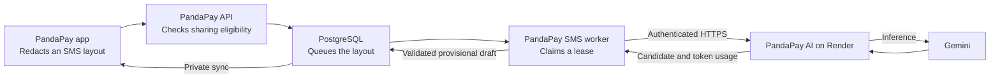

# PandaPay AI integration guide

PandaPay AI drafts rules for unfamiliar SMS layouts. The PandaPay worker sends an eligible redacted layout to the inference service and validates the returned draft before saving it. PostgreSQL holds the queue, worker leases, usage records, and provisional drafts. The current provider is Gemini.



## Repositories and deployment

| Component | Location |
| --- | --- |
| PandaPay worker and queue integration | PandaPay checkout, integration commits `be5531ad` and `063e5d87` on `codex/pandapay-ai-isolation` |
| Standalone inference API | [Private PandaPay AI repository](https://github.com/sujaykurtikar/pandapay-ai) |
| Render service | `pandapayAI` on the Free plan. The assigned hostname is `pandapay-ai-staging.onrender.com`. |
| Deployment spec | [`render.yaml`](https://github.com/sujaykurtikar/pandapay-ai/blob/main/render.yaml) configures a Docker web service, `/readyz` as the health check, and manual deploys. Its creation name is `pandapay-ai-staging`. |
| Deployed revision verified in the integration test | `6e7d26b`, which includes `/uptime` |

Render deploys the standalone repository. Start the container with `HOST=0.0.0.0` and let Render supply `PORT`. Render terminates HTTPS. The staging URL is public and the draft route requires a bearer token. The service runs without a PostgreSQL connection.

## Configuration

Match these settings across the inference service and the PandaPay worker. The values below describe the verified staging deployment.

| Setting | PandaPay worker | PandaPay AI on Render |
| --- | --- | --- |
| HTTPS origin | `SMS_V2_AI_SERVICE_URL=https://pandapay-ai-staging.onrender.com` | Render service URL |
| Shared service credential | `SMS_V2_AI_SERVICE_TOKEN` | `PANDAPAY_AI_SERVICE_TOKEN` |
| Model | `SMS_V2_AI_MODEL=gemini-3.1-flash-lite` | `PANDAPAY_AI_GEMINI_MODEL=gemini-3.1-flash-lite` |
| Output token limit | `SMS_V2_AI_MAX_OUTPUT_TOKENS=4096` | `PANDAPAY_AI_MAX_OUTPUT_TOKENS=4096` or the default |
| Prompt revision | `SMS_V2_AI_SERVICE_PROMPT_VERSION=sms-rule-draft-v1.0.0` or the default | Revision embedded in the deployed prompt |
| PostgreSQL login | `SMS_AI_WORKER_DATABASE_URL` for the restricted `sms_ai_worker` role | None |
| Provider credential | Legacy direct Gemini mode only | Existing `GEMINI_API_KEY`, optional `GEMINI_FALLBACK_API_KEY`, and optional comma-separated `GEMINI_API_KEYS` |

Use the same random base64url service token on both sides. Store it in the PandaPay worker's protected environment and in the Render service's environment settings. The workspace connection was configured in PandaPay's ignored `.env`. Actual production connectivity requires its own environment configuration. The service token authenticates the worker, and the Gemini key authenticates the inference service to Google.

The existing deployment workflow can forward `SMS_V2_AI_SERVICE_URL` and `SMS_V2_AI_SERVICE_TOKEN` as GitHub secrets. Configure the production worker's token budget and model pricing through its existing settings. See [the architecture and rollout plan](PANDAPAY_AI_SERVICE_PLAN.md) for scope and deployment checks.

## Request contract

The worker sends `POST /v1/sms-rule-drafts` with `Authorization: Bearer <service-token>` and `Content-Type: application/json`. It also sends `X-Request-Id` for log correlation and supplies `X-Prompt-Version`, `X-Expected-Model`, and `X-Expected-Max-Output-Tokens` as preconditions.

```json
{
  "senderBrand": "TESTBK",
  "redactedBody": "<AMT> paid to <PARTY>."
}
```

The body contains exactly these two fields. The service builds the prompt. A successful response contains `answer`, `model`, `inputTokens`, `outputTokens`, and `totalTokens`. PandaPay validates the draft, checks consent and the worker lease at write time, and saves an eligible result as `ready`. A `ready` draft can reach a consenting submitter as a provisional rule through private sync.

| Result | Worker behavior |
| --- | --- |
| `200` | Validate the candidate and record usage. Save a valid draft only while the job lease and consent are current. |
| `401`, `409`, `412` | Check the shared token, prompt revision, model, or output limit. Remote configuration errors leave the job queued. |
| `429`, `503`, or timeout | Keep the job queued and back off. If Gemini received a timed-out request, it can still incur usage. |
| Invalid layout or unusable candidate | Follow the existing layout or draft validation path. An invalid layout can fail individually while later jobs proceed. |

The API contract is also documented in the [standalone README](https://github.com/sujaykurtikar/pandapay-ai#contract). Swagger UI and an OpenAPI file are still pending.

## Health and monitoring

```sh
curl -I https://pandapay-ai-staging.onrender.com/uptime
curl -fsS https://pandapay-ai-staging.onrender.com/readyz
```

Use an HTTP(s) monitor in UptimeRobot for `https://pandapay-ai-staging.onrender.com/uptime`. `HEAD` returns HTTP 200 with an empty body. `GET` returns `{"status":"ok"}`. Both bypass inference. Monitor setup in UptimeRobot is unverified. Use the authenticated draft route and a synthetic layout when testing Gemini connectivity. The worker and service logs share request IDs and report status and duration without request bodies or secrets.

## Reproduce the tests

Run the standalone suite with `npm test` from the PandaPay AI checkout. Run the two-project transport test from PandaPay with the separate checkout alongside it, or set `PANDAPAY_AI_PROJECT_DIR` to its location.

```sh
node --test scripts/verify_pandapay_ai.cjs
```

For the PostgreSQL regressions, use a **disposable local database** with current product migrations and the test worker roles. The test harness clears shared SMS tables, so a production or shared development database is unsuitable. `scripts/test_postgres_suites.sh` provisions the test databases from a disposable loopback cluster and includes the SMS PostgreSQL suites. To run only the AI cases against an already prepared database, set `SMS_V2_TEST_DATABASE_URL`, `SMS_V2_TEST_ADMIN_DATABASE_URL`, and `SMS_V2_TEST_AI_WORKER_DATABASE_URL`, then run:

```sh
node --test --test-concurrency=1 api/test/sms_v2/ai_service_pg.test.js
```

The live integration test used the existing `--once` worker command with the service settings and restricted worker login injected into its environment. The test API submitted a synthetic layout, and PostgreSQL showed `queued` → `ready`, a saved provisional draft, a cleared lease, and recorded token usage. Sync returned the draft only to the submitting profile. The PostgreSQL regression suite separately exercised outage recovery, revoked consent during generation, and stale leases with a controlled HTTP responder.

From the `app` directory, run the workstation-only Flutter checks:

```sh
flutter test --no-pub --concurrency=1 --dart-define=PANDAPAY_AI_TEST_RUN=fresh_flutter_cache test/features/sms_v2/learning_loop_phone_test.dart test/features/sms_v2/storage/provisional_store_test.dart test/features/sms_v2/ui/ai_status_labels_test.dart
```

The test-only define selected a fresh Flutter compiler cache key when the existing cache stalled on this workstation.

## Verification and remaining work

| Check | Result |
| --- | --- |
| Render deployment and uptime | `HEAD` and `GET /uptime` returned 200. |
| Bearer authentication | An anonymous draft request returned 401. The authenticated PandaPay worker validated a synthetic draft. |
| Real local PostgreSQL through live Render | Worker saved a Gemini draft, cleared its lease, recorded usage, and verified submitter-only sync. |
| PostgreSQL regressions | 3 passed with zero skips. |
| Flutter tests | 12 passed on the workstation without installing an app. |
| Production rollout | Pending. Live verification used synthetic inputs and a disposable local PostgreSQL instance. |
| Provider expansion | Groq, Cloudflare Workers AI, and Experiential Labs are the next candidates for synthetic benchmarks. NVIDIA Build, OpenRouter, and OpenAI are later candidates. |

Before enabling production jobs, review the provider's data handling, configure the production worker, and monitor the first small rollout for queue age, errors, draft quality, and usage. To pause, use the existing drafting toggle. For an explicit rollback to direct Gemini, remove both service connection settings on the worker and verify the legacy provider and optional wording policy before resuming. The PostgreSQL queue stays in place for either mode.
