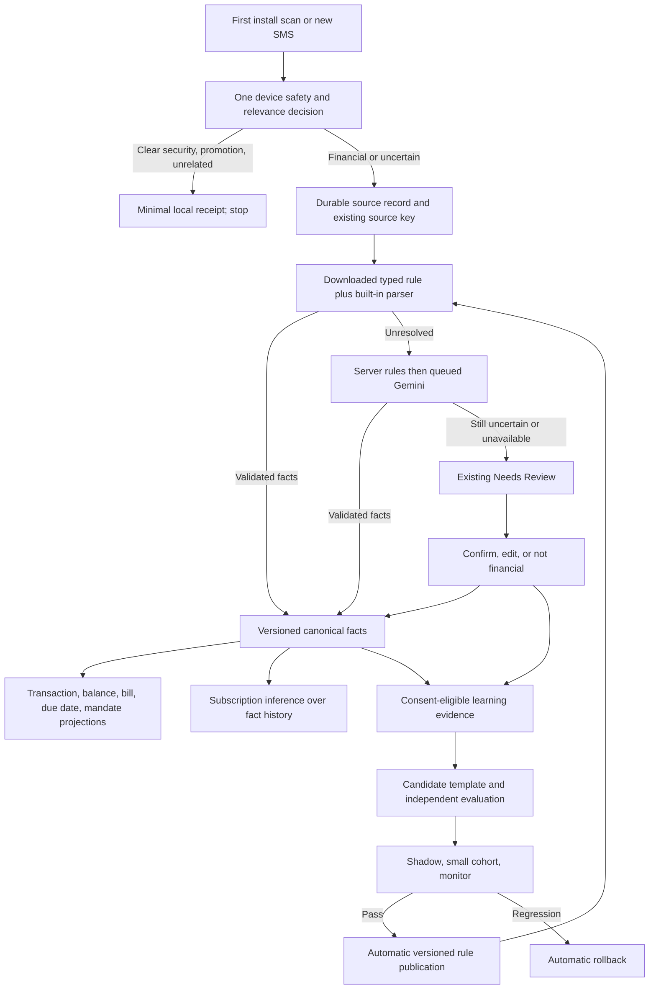

# PandaPay SMS intelligence: final implementation plan

**Status:** authoritative implementation handoff for the remaining SMS work, 22 October 2026. This document is a plan, not a statement that the autonomous loop already works. Follow [the research decision](SMS_LEARNING_TECHNIQUE_RESEARCH_AND_DECISION.md) for technique tradeoffs and [the existing-flow compatibility audit](sms-existing-flow-compatibility-audit.md) for regression gates. Earlier plans remain references for the Gemini queue, message families, and admin operations; where they require routine admin rule approval, this plan supersedes them.

## 1. Goal and fixed decisions

PandaPay should process each incoming SMS once, store its decision and validated facts centrally for that user's app data, and reuse those facts in every relevant feature. Clear promotions/security/unrelated SMSs are filtered on the device. Unknown plausible financial SMSs use existing rules, queued Gemini, then the existing Needs Review page if uncertainty remains. User decisions resolve their source immediately and, when contribution is permitted, create learning evidence. A long-running server worker automatically learns narrow reusable templates, proves them against positive and negative examples, publishes safe versions to devices, monitors results, and rolls back regressions. New users receive already validated shared rules.

Keep the existing login auto-scan, new-message listener, paged inbox checkpoint, source-key receipts, offline outboxes, duplicate protection, account isolation, Gemini queue/microbatching, local cache, and current product behavior. Do not reset scan progress or trigger a fresh historical scan when rules change. Keep the current Needs Review layout and existing admin console design; add only the data/actions needed to represent existing review tasks and learning status.

One SMS may produce **multiple typed facts**. An actual debit can create a posted movement and a balance snapshot. A bill notice can create total/minimum obligations and dates. A promotion mentioning an amount creates no posted movement. A subscription is inferred across several accepted facts, not declared from one SMS. User corrections always outrank rule, parser, server, and Gemini replays.

## 2. What exists and what to add

| Existing foundation | Missing work to implement now |
| --- | --- |
| Device capture/scan and `app/lib/data/local/sms_intake_repository.dart`; `LocalSmsParser` and sender-aware filter; versioned downloaded rule cache. | One durable, versioned decision record covering ignored, financial, and unresolved sources; one shared interpretation for all entry points; safe targeted re-evaluation after rule updates. |
| `app/lib/data/sms_fact_contract.dart`, facts outbox, `api/src/sms_facts.js`, `/sms/facts`, and user overrides. | Verify and migrate each product reducer to accepted canonical facts, family by family; retain legacy adapters until shadow parity passes. |
| `api/src/gemini_worker.js` and the durable queued fallback. | Preserve quota/failure handling; treat model output as a proposal and record per-field evidence and validation outcome for learning. |
| `api/src/sms_learning.js` and feedback grouped by sender/family/corrected field. | Capture consent-eligible, redacted template shapes, field spans/expected values, positive **and** negative outcomes, missed-financial reports, and reliable label provenance. Current aggregates cannot generate or evaluate rules. |
| `api/src/sms_rule_bundle.js`, bundle endpoint, device download/cache, admin publish/rollback. | Restricted automatic template compiler, independent evaluator, system-only promotion path, per-rule state/cohorts, shadow execution, automatic rollback, and compatibility checks. |

Do not delete existing tables, routes, or raw device context during the transition. Migrations are additive. An old app must continue to work while a new app uses the versioned decision/fact envelope.

## 3. One source of truth and routing

**Local source decision:** persist namespace/user, stable source key, receipt time, sender family, decision/reason, policy/parser/bundle/model versions, processing state, fact-set hash, and override revision. Keep raw financial SMS in the existing device store only as long as current product/review recovery requires. OTP and clear noise have no raw learning copy. A crash must not advance the scan checkpoint before decisions/outbox work are durable.

**Canonical facts:** one source can have several facts with stable identity, amount/date role, lifecycle, entity binding, provenance, confidence, status, and supersession. Accept/reject a fact using the shared Dart/Node contract. Do not infer a posted amount from a due amount, mandate limit, available balance, or failed attempt. Project only accepted facts; a machine replay may supersede its prior machine interpretation but never a user correction.

**Existing source-key limitation:** the current normalized sender/body hash can collide for identical texts sent on different days. Characterize the real effect and design an alias/identity migration separately; do not silently change the key during this work. Duplicate broadcast, inbox, backup, API, and AI deliveries must still converge on one source and one economic event.

## 4. Filtering, scoring, and review policy

1. Run a hard device security gate first for OTP/PIN/CVV/verification and invalid input. Downloaded rules or Gemini cannot override it.
2. Identify credible completed movement, bill/due, balance, mandate, and failed/pending evidence before dismissing an SMS for offer wording. A posted debit plus cashback footer stays financial; “spend ₹X to get cashback” alone is promotional.
3. Use separate calibrated evidence/score for `useful_financial`, `pure_noise`, family, exact field extraction, and entity binding. No universal 80% cutoff. A score is meaningful only after validation on independent, time-separated labeled cases. Until then, keep interpretable rule evidence and abstain.
4. Automatically ignore only clear noise with a measured low missed-financial risk. Keep ambiguous bank-like SMS durable, use server/Gemini if allowed, then show actionable unresolved items in **Needs Review**. Do not flood review with clear promotions or service notices.
5. If Gemini has a 429, quota, timeout, malformed response, or contradictory proposal, keep the job/source recoverable and show the actionable uncertainty in review after bounded retry. An AI self-rated confidence never posts money by itself.
6. The review decision is source-scoped: confirm/edit facts or mark not financial. Apply it immediately to that user and preserve it through later replays. Sync a structured correction/dismissal; do not re-upload the raw SMS merely because it was reviewed.

## 5. How the first user teaches the next user

Normalize the repeating message shape by **issuer/sender plus stable words and ordered slots**. Replace changing values such as amount, date, account/card suffix, merchant, reference, and URL with typed placeholders. Distinguish debit, credit, bill, AutoPay, offer, security, failed attempt, and service templates even from the same sender.

| Evidence tier | Behavior |
| --- | --- |
| One user's confirmed/edit/dismiss decision | Immediate user-specific resolution and narrow personal memory. For another user, at most a safer prefill or Gemini hint; no silent shared discard or financial write. |
| Several independent users and candidate tests | Candidate is eligible for shadow comparison; it is not yet a trusted global rule. Existing `>=5` feedback aggregation only finds a recurring issue. |
| Independent positives, hard negatives, historical replay, exact-field checks, cross-platform parity, and live shadow/canary pass | Worker promotes a narrowly scoped, versioned shared rule. Server applies it and devices download/cache it. A later user with the same template resolves locally, with different field values extracted from its slots. |
| Regression or insufficient evidence | Keep or restore the last known-good rule; uncertain sources continue through Gemini/Needs Review. |

The learning store needs reliable labels and counterexamples, not just the sender fingerprint and changed-field name currently saved. Store consent-eligible redacted structural examples plus typed spans/expected values, label source (`user_confirmed`, `user_edited`, `dismissed`, `missed_financial`, independently reconciled, or weak AI/rule proposal), rule/model version, and deletion/retention lineage. Encrypt/restrict access and keep examples out of normal logs/admin views/device bundles. Weak AI/rule labels can suggest candidates but cannot certify their own correctness. Include a small, consent-eligible audit sample of accepted and ignored decisions so silent filter mistakes become measurable.

## 6. Automatic candidate, scoring, and release worker

Implement a durable state machine: `proposed → evaluated → shadow → limited → expanded → active`, plus `rejected`, `paused`, and `rolled_back`. Worker leases/retries and idempotency keys must survive crashes. A candidate generator derives a **restricted typed template**; Gemini can propose anchors/slots but never publish executable code directly. Prefer a token/slot DSL or deliberately narrow cross-platform regex subset, bounded by input/work limits. Compile and run identical fixtures in JS and Dart. `ignore_noise` has the strongest gate and may not override a credible financial event.

Evaluation compares the candidate with the **current active pipeline** on frozen, independent examples split by user, wording family, and time. Require positive and hard-negative cases, real financial + offer, promotion + amount, OTP + transaction words, EMI solicitations, service alerts, pending/failed/reversed/refunded, bill/payment/balance/limit confusion, and subscription false-series cases. Check exact amount/date/entity values and downstream totals, not only the family label. Record evidence, sample size, metric definitions, and reasons for every pass/fail. Do not set numeric thresholds merely to match an example score: derive family/action-specific thresholds from the labeled baseline and their acceptable error bounds.

No candidate may regress the protected corpus: secret upload, silent discard of a known financial SMS, fabricated/duplicate posted movement, wrong amount/date role, wrong account binding, loss of due obligation, wrong subscription series, or user-override replacement. A small cluster remains a suggestion if its error bound cannot be estimated. To illustrate why, five error-free independent cases still allow roughly a 45% one-sided 95% upper error bound; the [research decision](SMS_LEARNING_TECHNIQUE_RESEARCH_AND_DECISION.md#why-five-users-do-not-prove-a-rule-is-safe) contains the calculation and source.

In shadow, save only redacted deltas; do not change user facts. During canary, assign stable user cohorts, set minimum independent sample and maximum error bounds before exposure, and compare corrections, false discards, invalid facts, duplicate economic events, bill-date errors, review rate, and projection totals. Expand only with observed evidence; lack of labels is not a pass. Pause immediately on a protected invariant breach and automatically roll back on confirmed regression. A narrowly privileged system path publishes/rolls back bundles; admin retains visibility and emergency controls, with no routine review requirement.

## 7. Product integration from the same facts

| Feature | Accepted source facts | Extra logic and invariant |
| --- | --- | --- |
| Activity, reports, rewards | Posted economic movements | Preserve transaction dedupe and transfer/card-repayment treatment; no bill amount as spending. |
| Home bank balance | Balance snapshots | Choose latest observation for the resolved account and show its **as-of SMS date**. |
| Credit card bills and Payments Due | Bill obligations and payments | Keep total, minimum, outstanding, statement date, due date, and cycle separate; link partial payment safely. |
| Mandates/AutoPay | Mandate lifecycle plus actual posted collection | Limit/setup/scheduled/failed/cancelled are not a debit. |
| Subscriptions | Series of accepted posted charges, bill obligations, and mandate hints | Learn cadence despite variable amount/date; avoid one-off repeats and duplicate series. |
| Card/account identity | Fact hints plus user inventory | Last four digits support, but do not alone prove, entity binding. |

Cut over one family at a time behind existing rollout flags. First compare canonical and legacy projections in shadow, then make facts authoritative for that family. Stop redundant SMS regex extraction in that feature only after parity and override gates pass. Preserve old-client/API compatibility during rollout.

## 8. Work packages in dependency order

| Phase | Implementation work | Exit gate |
| --- | --- | --- |
| **0. Baseline** | Freeze a redacted, labeled corpus and characterize current scanner, parser, Gemini, review, fact, bill, balance, and subscription behavior. Record current false discard, false posting, due-date, duplicate, and review rates. | Reproducible baseline and known defects; existing scan/offline/account gates pass. |
| **1. One durable decision** | Add additive device/server source-decision metadata, atomic fact/outbox/checkpoint ordering, policy-version receipts for ignored and unresolved messages; converge entry points. | First install and future listener use one decision; restart/retry does not duplicate or lose SMS. |
| **2. Fact projections** | Reconcile existing typed facts with each feature; add lineage and supersession; cut over transaction, balance, bill/due, mandate, then subscription series under shadow flags. | All views agree on accepted facts; manual values and corrections win. |
| **3. Review and labels** | Wire existing Needs Review decisions and missed/negative outcomes into consent-aware learning examples; protect opt-out, deletion, RLS, and raw-text boundaries. | First user resolves their SMS; evaluator has independent positive/negative examples; no shared effect from one dismissal. |
| **4. Candidate synthesis and scores** | Build restricted template compiler, generator, frozen evaluator, per-family/field calibration, cross-platform parity, and adversarial/performance tests. | Candidate cannot enter shadow without reproducible evidence and no protected regression. |
| **5. Autonomous promotion** | Add narrowly privileged worker, shadow, stable cohorts, automatic release/rollback, bundle compatibility, drift monitor, and admin visibility using current operations surface. | A seeded safe template reaches a new device without admin action; seeded bad rule rolls back without data/override loss. |
| **6. End-to-end rollout** | Apply migrations in staging, run worker/flags, execute API/mobile/console and real `app_user` DB gates, then use a physical-device **update build** with the same dev app ID and intended backend URL. Stage by family and cohort. | Actual deployed worker, bundle delivery, first-install processing, offline recovery, Needs Review, and product projections verified. |

Likely implementation files: `app/lib/features/sms_import/sms_text_hint.dart`, `sms_listener_service.dart`, `app/lib/data/local_sms_parser.dart`, `app/lib/data/local/sms_intake_repository.dart`, `sms_import_store.dart`, `sms_rule_bundle.dart`, `sms_rule_bundle_store.dart`, `sms_facts_outbox.dart`, `financial_store.dart`, `app/lib/app/providers.dart`; `api/src/sms_learning.js`, `sms_facts.js`, `sms_facts_route.js`, `sms_rule_bundle.js`, `gemini_worker.js`, `sms_parser.js`, recurring/bill reducers; additive `db/supabase/migrations`; and existing admin APIs/console data layer. Inspect each before editing; this is a navigation list, not a mandate to change every file.

## 9. Required scenario gates

1. Fresh install with mixed inbox online/offline: one paged scan; useful facts visible without Gemini; clear promotion absent from review; OTP never stored/uploaded; second launch does no repeated history work.
2. Same SMS from broadcast, background, inbox, backup, API retry, Gemini retry: one decision, fact set, economic event, and user review outcome; SMS arriving mid-scan/upload survives.
3. Debit + balance, bill total + minimum + due date, partial bill payment, refund/reversal, pending/failed attempt, mandate setup/cancel/actual debit: correct separate facts and projections, no double spending.
4. Promotion containing bank/card/amount/transaction words versus real financial SMS with offer footer: correct opposite decisions, including `-P` sender and service/OTP hard negatives.
5. Unknown wording, Gemini success/failure/quota, review confirm/edit/not-financial: durable recovery; user correction wins over late AI/rules; no cross-account leak.
6. Learned template with changed account suffix, amount, merchant, date, and reference: exact field capture and entity safety for a later user; hard-negative near matches do not auto-post or auto-ignore.
7. Bad rule, invalid checksum/regex, server rollback, outdated client, offline device, bundle arriving mid-scan: cached/built-in fallback, recorded version, no checkpoint reset or duplicate processing.
8. Subscription with variable billing date/amount, mandate cancel, and ordinary repeat shopping: only evidenced series, correct status and due prediction, no invented charge.
9. Consent off, example deletion, user account switch, worker crash/restart, concurrent promotion, drift after issuer wording change: isolated data and recoverable state; no shared learning from opted-out data.

## 10. Completion definition

The remaining work is complete when a reviewed, previously unknown issuer template can generate a candidate, pass independent positive/negative and exact-field tests, run in shadow and limited cohorts, automatically publish to the server and device bundle, resolve a later user's varying values locally, and automatically roll back if it regresses. The same accepted facts must feed transaction, balance, bill, due-date, mandate, and subscription projections without repeated body extraction or duplicate economic events. All first-install, existing-flow, database-access, quota/failure, and physical update-build gates above must pass. If evidence is insufficient, the correct finished behavior is safe abstention through Gemini/Needs Review, not a claimed automatic rule.
