# SMS intelligence: final implementation diagram

This diagram is the end-to-end target for device filtering, server assistance, Gemini, review, shared learning, and rule distribution. It keeps SMS capture and financial projections on the existing app pipeline. A status label on a node describes the current implementation evidence; it does not imply release readiness.

```mermaid
flowchart TD
  subgraph PHONE["PandaPay device — capture and classify locally"]
    A["New SMS: live listener, inbox scan, or backup"] --> B{"SMS permission and account namespace valid?"}
    B -->|No| B0["Do not scan or upload; recover on next authorized session"]
    B -->|Yes| C["Durable local intake + existing user-scoped source key\n[EXISTING — preserve cursor, receipts, dedupe]"]
    C --> D{"Sensitive / OTP / security or clear promotion?"}
    D -->|Safe exclusion| E["Ignore as transaction; retain required local safety/accounting state"]
    D -->|Possible financial SMS| F["Run built-in safety and financial relevance gates"]
    F --> G["Apply cached approved rule bundle first; fall back to built-in parser\nSQLite cache + SHA-256 validation on device"]
    G --> H{"Strong family match and required facts valid?"}
    H -->|Yes| I["Create local SMS observation\nMovement uses provisional/legacy transaction path; balance, bill, mandate and failed attempt can mint typed facts"]
    H -->|No / conflict / unsupported| J["Keep SMS recoverable in local intake/outbox"]
    I --> K["Namespaced device SMS data\ncaptured body in sms_captured_messages · durable sms_intake · financial_entities/sms_observations · provisional transaction · sms_facts_outbox"]
    K --> L["Current local product readers\nActivity uses transactions; balance, Bills and Commitments also read SMS observations"]
    J --> M["Authenticated sync after capture; never block local capture on network"]
    K --> M
    M --> N{"Sync route by detected output; preserve one user-scoped source key and receipts"}
    R["Lifecycle sync: authenticated GET /sms/rules/active\nCache version; verify checksum; recover rollback"] --> G
  end

  subgraph SERVER["PandaPay server — deterministic resolution and durable AI queue"]
    N -->|Posted movement / unresolved raw SMS| NL["Existing /transactions/from-sms/batch\ntransaction_observations + transactions"]
    N -->|Supported non-spend facts| NF["POST /sms/facts\nsms_sources + sms_source_facts + fact_overrides; no raw body on this route"]
    NL --> O["Route-specific safety, dedupe, deterministic parsing and specialist validation"]
    NF --> O
    O --> P{"All required facts resolved and validated?"}
    P -->|Yes| Q["Central source/fact contract — PARTIAL TODAY\nOne user-scoped source can have multiple typed facts; adapt remaining legacy transaction output into this contract"]
    P -->|No| S["Create durable per-SMS AI job\nReturn job ID; retry POST maps to same job"]
    S --> T["Fair scheduler: live ahead of history; per-user fairness; lease recovery"]
    T --> U["Adaptive microbatch experiment\nDispatch ready items promptly; start small (1–4), cap tokens, isolate IDs"]
    U --> V{"Gemini request/token/daily/concurrency budget available?"}
    V -->|Wait within deadline| T
    V -->|No capacity / deadline| W["Mark unresolved for existing Needs Review page"]
    V -->|Yes| X["Payload privacy gate\nMinimize/mask; allow only approved processing preference and provider tier"]
    X --> Y["Gemini — one configured project/key\nStructured proposal per opaque job ID"]
    Y --> Z["Validate each item independently\nSchema · source evidence · amount/date role · lifecycle · entity · contradictions"]
    Z --> AA{"Evidence-backed family confidence clears its tested gate?"}
    AA -->|Yes| Q
    AA -->|Weak / malformed / conflicting| W
    Y -->|429 / transient failure| AB["Bounded backoff with jitter; retry within deadline"]
    AB --> T
    Y -->|Permanent failure / quota exhausted| W
    Q --> AC["Domain reducers and sync projections\nKeep existing legacy writers until the adapters pass compatibility tests"]
    AC --> AD["Posted movements → transaction ledger and spending metrics"]
    AC --> AE["Balance snapshots → correct account, latest observation timestamp"]
    AC --> AF["Bills/payments → cycle-aware ledger; keep total, minimum, outstanding, payment distinct"]
    AC --> AG["Mandates/subscriptions/card hints → lifecycle and profile projections, not purchases"]
    AD --> PHONEUI["Sync confirmed result to device; replace provisional row once"]
    AE --> PHONEUI
    AF --> PHONEUI
    AG --> PHONEUI
    W --> REVIEW["Existing Needs Review page\nSafe prefill + explain exact uncertainty; no raw SMS in admin view"]
  end

  subgraph LEARNING["Human feedback and shared rules — promotion is controlled"]
    REVIEW --> CHOICE{"User decision"}
    CHOICE -->|Confirm or edit| CORR["Save structured correction / override\nUser decision outranks late parser or AI replay"]
    CHOICE -->|Not a transaction / dismiss| LABEL["Save scoped feedback label and dismissal"]
    CORR --> FEED["Privacy-scoped feedback example\nNo raw SMS or account mapping in shared bundle"]
    LABEL --> FEED
    Q --> MON["Measure precision, recall, review and correction rates by family/version"]
    FEED --> MON
    MON --> CLUSTER["Cluster approved examples by sender + wording shape; identify variable slots"]
    CLUSTER --> CAND["Generate candidate reusable rule; keep private and inactive"]
    CAND --> EVAL["Replay positives, hard negatives, promotions, security alerts and historical corpus"]
    EVAL --> GATE{"Held-out accuracy, safety and compatibility gates pass?"}
    GATE -->|No| HOLD["Keep candidate; gather more evidence; do not publish"]
    GATE -->|Yes, admin approves| PUB["Publish immutable, versioned shared bundle"]
    PUB --> R
    PUB --> SRV["Server applies same active shared rule version"]
    PUB --> RB["Rollback by deactivating version; devices reconcile on next authenticated lifecycle sync"]
    RB --> R
  end

  subgraph OPS["Admin operations and rollout gates"]
    OPS1["SMS AI Operations dashboard\nQueue depth/age · batches/items · quota/429/retries · outcomes · rule versions · corrections"]
    T -. sanitized operational metrics .-> OPS1
    Y -. provider/model/status metadata .-> OPS1
    MON -. family quality/correction metrics .-> OPS1
    OPS1 --> OPS2["Read-only and redacted by default; audited controls for pause/retry/publish/rollback"]
    OPS2 --> PUB
  end

  subgraph GATES["Must remain green at every phase"]
    G1["Automatic post-login detection; second open scans no old pages"]
    G2["Same SMS via broadcast/inbox/backup = one source and one economic event"]
    G3["Offline capture/outbox recovery; no Gemini dependency for local capture"]
    G4["Account namespace isolation; no cross-account result attachment"]
    G5["User-confirmed/dismissed items never overwritten or resurrected"]
    G6["Historical imports keep original dates and do not re-trigger current-cycle side effects"]
  end

  classDef existing fill:#e6f4ea,stroke:#25834b,color:#102a18;
  classDef partial fill:#fff2cc,stroke:#b88900,color:#382900;
  classDef planned fill:#e8f0fe,stroke:#3973c6,color:#10284d;
  classDef gate fill:#fce8e6,stroke:#c33b32,color:#3a1210;
  class C,F,G,I,K,L,N,NL,NF,R,O,P,AC,AD,AE,AF,AG,REVIEW,CHOICE,CORR,LABEL,FEED,OPS1 existing;
  class Q partial;
  class S,T,U,V,X,Y,Z,AA,AB,CLUSTER,CAND,EVAL,GATE,PUB,RB,OPS2 planned;
  class B0,E,W,HOLD,G1,G2,G3,G4,G5,G6 partial;
```

## Status and implementation order

- **Already wired in the current code:** automatic local intake, stable source-key deduplication, local deterministic classification, Needs Review, supported typed facts and their specialist projections, server queue/provider components, admin monitoring, and versioned on-device bundle download/cache/authentication/checksum/rollback path.
- **Centralization today:** one namespaced device intake stores captured SMS; `financial_entities` stores local observations and provisional transactions. The server has a central `sms_sources`/`sms_source_facts` contract for the typed-facts route, with overrides. Posted transactions still run through `transaction_observations`/`transactions`, and several screens still read `sms_observations` directly. The final convergence adapter must bring those results under one source-to-many-facts contract without changing the existing transaction and screen behavior.
- **Still needs end-to-end proof or completion:** real database/RLS publication-and-fetch test under `app_user`; device rollback integration test; server-to-Dart canonical hash compatibility fixture; enforce `minClientVersion`; prove candidate rules against hard negatives and calibrated family-specific thresholds. Gemini worker remains disabled until its server configuration and consent/payload gates are ready.
- **Implementation order:** (1) lock current-flow compatibility gates; (2) finish bundle contract, compatibility, database, rollback and cross-platform tests; (3) verify typed facts reach each existing product projection without duplicate spend; (4) finish Gemini privacy gate, durable queue, quota/microbatch behavior and review fallback; (5) complete candidate-rule evaluation, admin approval and staged rollout.

For the detailed phase gates and scenario matrix, use [the master implementation plan](SMS_INTELLIGENCE_MASTER_IMPLEMENTATION_PLAN.md) and [the existing-flow compatibility audit](sms-existing-flow-compatibility-audit.md). The diagram's green nodes show code paths found in the audit; yellow/red labels are explicit acceptance gates, not claims that the full release is already verified.
