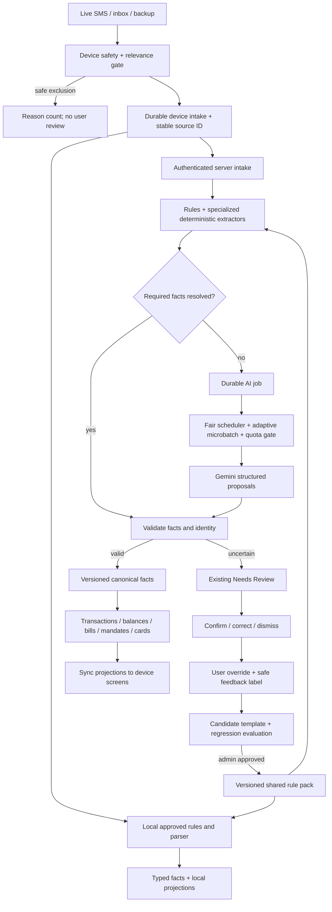

# PandaPay SMS intelligence: master implementation plan

**Status:** implementation handoff, 21 October 2026. No feature code is implemented by this document. This plan is the source of truth for the SMS classifier, Gemini processing, shared learning, product projections, Needs Review and admin monitoring. Where an older diagram says every successful SMS becomes a transaction, follow this plan's **multi-fact** contract instead.

For GLM 5.3 Flash as the coding agent, start with the [copy-ready implementation handoff](GLM53_FLASH_SMS_IMPLEMENTATION_HANDOFF.md). Gemini remains the application API provider; GLM is the implementer.

## 1. Goal and final product decisions

After the user enables SMS access, PandaPay automatically recognizes useful financial SMSs. Known formats resolve immediately with local and server rules. Unknown wording can go to one Gemini project through a durable, quota-aware server queue. A message may update several features at once: a purchase, bank balance, card bill, subscription, mandate, commitment or card identity. Only an actual posted economic event changes spending. Uncertain actionable facts appear in the **existing Needs Review page**. Confirmed corrections improve that user's results and can become tested shared rules for future users.

Decisions already made:

1. Keep automatic SMS detection. No per-message permission prompt or manual masking task. Explain server/AI processing in SMS setup and record a versioned preference; Android SMS permission alone is a device permission, not the whole data-processing explanation.
2. Use Gemini first, one project/account. Keep the provider adapter extensible for a later GLM development backup. A second provider is out of the first release.
3. Use small **adaptive interactive microbatches** only for unresolved SMSs. Never wait to fill a batch. Historical backfill has lower priority than live SMSs.
4. Use the current `Needs review` page for transaction, bill, account and mandate uncertainty. User actions sync as structured corrections; raw context remains on the originating device initially.
5. Display the latest observed bank balance with its SMS date (for example, “Balance as of 15 Oct”). Do not fabricate a current balance from intervening transactions.
6. Detect clear bills and other obligations automatically. Only facts below their family-specific decision gate, or with conflicting identity/amount/date evidence, go to review.
7. Filter promotions, marketing, unrelated service alerts and OTP/security messages before Gemini when safely recognized. A completed financial fact takes precedence over marketing language appended to an alert.
8. Use the free Gemini API only with synthetic fixtures or automatically sanitized payloads that pass a tested de-identification and terms review. Raw real-user SMSs requiring original context use a billed project if enabled; otherwise they go to Needs Review. The bank's existing account-number masking helps but is not the only payload check. See [Gemini API terms](https://ai.google.dev/gemini-api/terms) and [billing](https://ai.google.dev/gemini-api/docs/billing/).

## 2. Documents to read in order

| Order | Document | Implementation role |
| --- | --- | --- |
| 1 | [Unified application audit](sms-unified-observation-architecture-review.md) | Current code paths, gaps, message scenarios, privacy boundary and scoring policy. |
| 2 | [Message families](sms-message-families-plan.md) | Typed transaction, bill, mandate, recurring and balance fields; specialist reducer behavior. |
| 3 | [Economic transaction classification](../TRANSACTION_CLASSIFICATION_PLAN.md) | Canonical economic kinds, account legs, deduplication and shared spending metrics. |
| 4 | [Gemini queue architecture](sms-gemini-final-architecture.md) | Durable jobs, fairness, quota, retries, per-item result states. Treat its GLM branch as development-only and deferred. |
| 5 | [Microbatch experiments](sms-gemini-microbatch-plan.md) | Initial 1–4 item/short-window experiment, token limits, isolation, performance comparison. |
| 6 | [Admin monitoring](sms-ai-admin-monitoring-plan.md) | Jobs, batches, quota, outcomes, APIs and existing console integration. |
| 7 | [Learning-loop diagram](sms-self-learning-classifier-diagram.md) | Team explainer for candidate templates and approved rule distribution; interpret “save transaction” as “save validated facts and relevant projections.” |
| 8 | [Existing-flow compatibility audit](sms-existing-flow-compatibility-audit.md) | Mandatory regression gates for login auto-detection, incremental scanning, source identity, offline retry, account isolation and backfill. |

The [older three-part index](sms-ai-three-part-plan.md) remains a summary. This master plan adds the integration and acceptance details needed to build the whole system.

**Compatibility rule:** phases below extend the existing capture and sync lifecycle. They must not reset the per-account Android inbox checkpoint, replace the current sender/body source key without an alias migration, or make a Gemini call a prerequisite for local detection. Use the [compatibility audit](sms-existing-flow-compatibility-audit.md) as a required gate at every affected phase.

## 3. Target architecture and ownership

**Device:** captures, filters obvious secrets, stores local observations and raw Needs Review context, runs downloaded rules offline, maintains a durable outbox. **Server:** authenticates, deduplicates, runs deterministic extractors and Gemini queue, stores validated facts, domain projections, corrections, shared rule versions and privacy-safe telemetry. **Admin:** sees operational metadata and rule-quality evidence, never raw SMS in the ordinary operations view.

## 4. Canonical contract to build before Gemini

One source envelope per SMS, keyed by a stable **user-scoped** source ID across broadcast, inbox, backup and retry. Include sender family, received time, capture source, processing state, parser/rule/policy version, safe redacted shape and short-lived encrypted payload reference when needed. Keep raw body out of logs and admin DTOs.

One envelope emits **zero or more facts**. Every fact has: fact ID, type, lifecycle (`scheduled`, `pending`, `posted`, `failed`, `reversed`, etc.), typed value/amount role, date role and precision, currency, source evidence, extraction method/version, validation state, field confidence, entity-binding confidence and supersession link. Key types: `posted_movement`, `balance_snapshot`, `bill_obligation`, `bill_payment`, `mandate_lifecycle`, `recurring_charge`, `card_identity_hint`, `card_profile_hint`, `promotion`, `security_or_service_alert`. A debit with available balance produces at least two facts; an offer mentioning ₹15,000 produces **no posted movement**.

Keep separate money fields: `transaction_amount`, `statement_total`, `minimum_due`, `outstanding_amount`, `mandate_limit`, `typical_recurring_amount`, `available_balance`, `credit_limit`. Keep separate dates: transaction, statement, due, mandate, expected charge and SMS receipt. A last-four suffix is evidence for entity matching, not a globally unique account/card ID. User overrides outrank future parser/model results.

Domain reducers consume validated facts:

- **Transactions/economic events:** reuse the existing insert, observation and dedupe paths, but only for actual posted movement. Apply the canonical economic-kind and metric rules from `TRANSACTION_CLASSIFICATION_PLAN.md`; no double counting for card repayments or own-account transfers.
- **Bank accounts:** use balance snapshots by resolved account and newest observation timestamp. Merge local/server projections consistently. Preserve the “as of” date.
- **Card bills:** retain bill cycles, statement total, minimum, outstanding and payments as distinct facts. Link a repayment to a card/cycle only with sufficient evidence; a reminder updates an existing cycle.
- **Other commitments:** merge due reminders and manual items by stable provider/account/cycle identity; retain manual changes and dismissals.
- **Mandates and subscriptions:** authorization/setup/cancel is separate from a posted recurring charge. A mandate limit is not a predicted charge. Infer subscriptions from confirmed charge history and link mandate evidence when justified.
- **Card discovery/profile:** produce suggestions and safe day/limit hints; wallet addition remains a user action, and user-entered card values retain priority.

## 5. Routing and score policy

Route in this order: **(a)** safety/OTP exclusion; **(b)** strong nonfinancial or promotion exclusion; **(c)** broad financial relevance check; **(d)** all applicable deterministic family extractors; **(e)** validation and entity resolution; **(f)** Gemini for unresolved facts if allowed; **(g)** Needs Review for remaining uncertainty. Do not let a local `localIgnore` decision terminate a useful balance or mandate observation before its product projection and any required sync are complete.

Scores are **calibrated decision aids, not Gemini self-ratings**. The current local bill `confidence` is a hand-weighted heuristic and must not be interpreted as probability. Start with these release targets from the [audit's decision table](sms-unified-observation-architecture-review.md#final-decision-policy-for-scores-and-marketing): ≥99.5% precision for automatic financial writes/entity bindings, ≥99.5% recall at the relevance gate, and ≥99.9% precision for automatic marketing discard. The proposed ≥0.99 calibrated decision gate for high-impact writes is an initial policy to test, not a measured property of today's app. Until a labeled held-out corpus supports it, use verified deterministic rules plus abstention. Review thresholds by family and field rather than one global percentage.

Promotion handling must recognize conditional language (“spend ₹X to get ₹Y”), card offers and sender promotion markers, while allowing real completed debits, refunds, bills or balances that contain offer wording. Do not queue obvious marketing for Gemini or burden Needs Review with it. Track redacted exclusion counts and sample error audits. An uncertain bank-like SMS remains in intake so false negative filtering cannot silently lose it.

The supplied Needs Review screenshot gives immediate regression fixtures:

| SMS shape | Desired result |
| --- | --- |
| HDFC “Transaction Check Alert! We tried to contact and confirm txn...” | Security/verification alert; no transaction review action or posted spend. |
| Kotak Neo “running A/c settlement payout ... should receive funds” | Investment settlement/transfer observation; do not default to consumer spend or earned income. |
| ViCARE “Call Forwarding is now active” | Nonfinancial service/security alert; exclude from transaction review. |

## 6. Gemini job and microbatch contract

The server creates one durable job per unresolved source SMS and returns an accepted/job state quickly. Worker leases are recoverable. The scheduler gives live jobs priority over historical imports, applies per-user fairness, limits concurrent calls and checks actual project RPM/TPM/daily/spend capacity. On 429/5xx, use bounded retry with backoff and jitter; when the time budget expires, route the item to Needs Review. A queue lowers 429 risk but cannot promise zero 429s.

Begin the **experiment** with at most four items and about a 300 ms grouping window; dispatch a single ready item promptly. Benchmark sizes 1, 2, 4 and 8 for throughput, token cost, p95 latency, per-item accuracy and malformed outputs. Group within one user's jobs first; cross-user grouping is deferred unless RPM pressure makes it necessary and isolation is proved. Gemini returns schema-constrained objects keyed by opaque job ID. Validate exact ID coverage, field roles, source evidence, lifecycle, amount/date plausibility and identity **per item**. A malformed group response retries only missing/invalid items in smaller groups. Google notes that [structured JSON still needs semantic validation](https://ai.google.dev/gemini-api/docs/structured-output).

Build an automatic payload gate before the provider call. Bank SMSs generally contain masked account numbers already. The gate catches exceptional full identifiers and other sensitive values, and can replace unnecessary names, suffixes, references, URLs, exact amounts/dates and merchant IDs with typed placeholders while preserving roles. Maintain the mapping only within PandaPay. If the free-tier payload cannot pass the de-identification check or sanitization removes needed context, use a billed Gemini path if configured or Needs Review. Never send OTP/security content. One Gemini project and server-side key are enough for the first release; GLM stays an adapter seam and development-only experiment.

## 7. Needs Review and correction loop

Extend `NeedsReviewKind` and the existing `app/lib/features/activity/needs_review_screen.dart`. Show the message, detected family, precise uncertainty and a safe prefill; action labels reflect the task (`Review transaction`, `Review bill`, `Choose card/account`, `Confirm mandate`, `Ignore message`). A security/service alert should not reach the page as a “Possible transaction.” Keep raw context on device. Sync the **confirmed structured decision**, dismissal/override, source ID and rule version; do not need to sync pending raw review tasks in the first release. Do not let a late AI result overwrite a user confirmation or dismissal. Record correction labels for candidate-rule evaluation under the user's processing preference.

## 8. Shared learning, new users and admin

Cluster reviewed or validated cases by normalized sender and wording structure; infer stable anchors and variable slots. Keep a candidate rule private until it passes positive, hard-negative, multi-user and historical replay. A few matching users seed a candidate, not an automatically trusted global rule. Admin approves a versioned rule pack; the server uses it immediately and devices download/cache it for offline detection. Roll back a rule by version if precision degrades. Never distribute a user's raw SMS, account mapping or corrections as a shared rule.

Add the [SMS AI Operations](sms-ai-admin-monitoring-plan.md) view in the existing Flutter Web console. Store job, batch, batch-item, event and quota records with the worker. Show queue depth/age, effective dispatch order, grouped calls, quota headroom, 429/backoff, parser/rule/model versions, validation reasons, per-family outcomes and user correction rates. Admin endpoints are read-only first, paginated, auth-gated and redacted. Later controls (pause/resume/retry) require audit logs and cannot replay over a user correction.

## 9. Repository implementation sequence

Each phase should be a reviewable change with fixtures, migration notes and an explicit acceptance gate. Preserve unrelated working-tree edits; read the latest code before touching a file.

| Phase | Build tasks and likely code | Gate before next phase |
| --- | --- | --- |
| **0. Baseline** | Add a privacy-safe fixture corpus and expected facts for all families, the screenshot cases, mixed bill+offer, debit+balance, mandate, refund, partial card repayment, duplicate source and conflicting suffix. Run current local/server parsers and record false entries, missed facts and screen output. Baseline the login/startup/incremental/offline/account-switch flows in the [compatibility audit](sms-existing-flow-compatibility-audit.md). Likely tests: `app/test/data/local_sms_parser_test.dart`, `app/test/data/card_bill_ledger_test.dart`, `api/test/sms_parser.test.js`, `api/test/subscription_parser.test.js`. | Baseline and known regressions documented; fixtures share one taxonomy. |
| **1. Contract and storage** | Add versioned source/fact/entity-binding schema and device equivalent. Add idempotency and user override precedence. Keep adapters to current `sms_observations`, `transaction_observations`, `parser_patterns` and existing response DTOs. | One SMS can hold multiple typed facts; replay creates no duplicate economic event. |
| **2. Intake and deterministic routing** | Update `sms_text_hint.dart`, `sms_listener_service.dart`, `local_sms_parser.dart`, `sms_import_store.dart`, `api/src/sms_parser.js`, `subscription_parser.js`, `due_date_parser.js` and import routes. Cover all message families, safety/marketing, lifecycle and local/server parity. Retain current inbox cursor and source hash. Any historical discovery from a widened filter uses a separate versioned checkpoint and dedupe. | Useful balance/mandate/bill messages are not dropped or terminally acknowledged before projection/sync; screenshot cases route correctly; second app open scans no old pages. |
| **3. Product projections** | Integrate facts into `providers.dart`, `financial_store.dart`, `card_bill_ledger.dart`, `commitments_repository.dart`, `recurring.js`, account summaries, card discovery and existing screens. Keep metric logic consistent with `TRANSACTION_CLASSIFICATION_PLAN.md`. | Home, Payments Due, Subscriptions, Activity, Cards and reports agree with the same facts; no spend double count or stale balance claim. |
| **4. Review** | Add typed review items/actions to `needs_review_repository.dart` and `needs_review_screen.dart`; sync confirmed decisions and preserve override priority. | Every uncertain actionable fact has one recoverable task; correction persists and is not overwritten. |
| **5. Gemini queue** | Migration for job/batch/event/quota tables; API acceptance/result endpoints; worker with leases, fairness, quota and per-item validator; automatic payload gate; single provider key. Add small-group experiment after single-item path works. AI job ID derives from the existing user-scoped SMS source ID; a repeated device POST returns the same job/result. | Crash/429/quota exhaustion leaves every item resolved or reviewable; grouping has no cross-item contamination or extra inbox scan. |
| **6. Learning and admin** | Candidate-rule pipeline and replay evaluator; signed/versioned rule distribution; admin read APIs and operations UI, then audited controls. | A new user gets approved rules; admin can explain every job without seeing raw SMS; bad rule rolls back. |
| **7. Migration and rollout** | Dry-run historical observations and compare projections; stage by message family/feature flag; monitor corrections and financial totals; preserve manual overrides. | Shadow-run deltas are understood; rollback restores old projections without losing source facts or user corrections. |

## 10. Verification and release checklist

- **Correctness:** negative/security/promotion fixtures do not post money; transaction+balance emits both facts; mandate setup is not spend; card bill payment does not count as a second purchase; partial payments and refunds preserve the right bill/economic status.
- **Identity:** same last four at two institutions or two accounts remains unresolved until sufficient evidence exists; user-entered card days/limits are not overwritten.
- **Reliability:** foreground/background/inbox/backup paths dedupe; offline intake survives restart; server jobs survive worker crash; partial microbatch errors retry only affected jobs; queue deadlines lead to Needs Review.
- **Quality:** report precision, recall, review rate, field error and correction rate by family, sender/template and version. Do not quote score thresholds as achieved until measured on a held-out corpus large enough to support the claim.
- **Privacy:** no raw SMS/OTP in logs or admin; provider payload gate is tested; processing explanation and preference are recorded; deletion/retention are implemented; provider tier is verified before live traffic.
- **Operations:** quota/429/spend/backlog and oldest-job age are visible; a queued item can be traced to one final result or review task; admin actions are audited.
- **Product:** the existing Needs Review page is the only unresolved-SMS user queue; balances have “as of” dates; clear bills appear automatically; approved shared rules work for a new installation.
- **Existing-flow compatibility:** all rows of the [compatibility matrix](sms-existing-flow-compatibility-audit.md#compatibility-test-matrix-for-each-implementation-phase) pass, including automatic login detection, zero history pages on second open, foreground/inbox dedupe, offline outbox recovery, account switching, backup reimport, and historical side-effect rules.

**Hand-off rule for implementing models:** do not begin by adding Gemini to `/transactions/from-sms` alone. Complete phases 0–2 first so Gemini outputs can reach every relevant feature through the shared fact contract. Treat each phase's gate as a required test, and update this document when the implementation makes a deliberate deviation.
