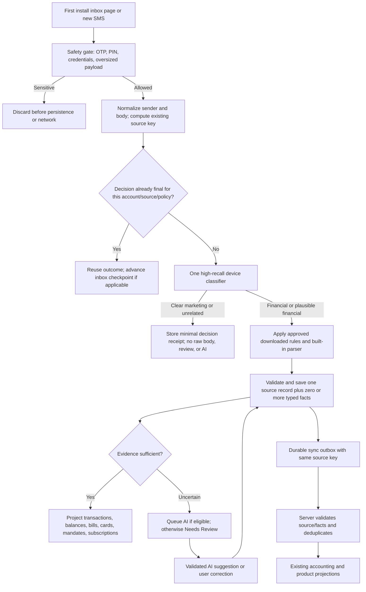

# SMS single-decision intake: implementation handoff

**Status:** implementation plan based on the 22 October 2026 code audit. This document does not claim the changes below are implemented. It supplements the [master SMS plan](SMS_INTELLIGENCE_MASTER_IMPLEMENTATION_PLAN.md), [compatibility audit](sms-existing-flow-compatibility-audit.md), and [final architecture diagram](SMS_INTELLIGENCE_FINAL_IMPLEMENTATION_DIAGRAM.md). When those documents describe the intended architecture, use this document for the specific first-install, filtering, persistence, and migration work.

## Goal and non-negotiable behavior

For each non-sensitive SMS, make one durable, account-scoped decision and store its outcome so inbox replay, live delivery, background recovery, API retry, rule updates, and feature screens do not independently classify the same arrival. Detect whether it contains useful financial information; extract *all* supported facts (a message can contain a posted debit and a balance, or a bill total and minimum); suppress clear marketing, OTPs, and unrelated notices from Needs Review and Gemini. A low-confidence *financial* candidate may go to Gemini and then Needs Review. Preserve the automatic scan after login and the existing transaction, bill, balance, mandate, subscription, and card behavior.

“Once” means one durable decision per source identity and policy version, with deliberate, controlled re-evaluation when a rule/policy version changes. It cannot mean zero computation when Android delivers an SMS again: the cheap safety check must run before storage. **Never persist OTP/PIN/security text or its fingerprint solely to enforce once-only processing.** Clear promotions can retain a source fingerprint and decision metadata without retaining raw body. Financial candidates retain the raw text locally only where review/recovery still requires it, under an explicit retention policy.

## Verified current seams and gaps

| Seam | Current code | Gap to close |
| --- | --- | --- |
| First install | `permissions_screen.dart` calls controller `start()`, `captureExistingInbox()`, then starts background sync. `SmsInboxScanner` reads bounded pages and commits provider ID progress after local capture. | Rule refresh in the authenticated lifecycle is not a guaranteed prerequisite for the onboarding scan. Do not make network a prerequisite; record which bundle version made each initial decision. |
| Three capture entry points | `sms_listener_service.dart` applies `capturesFinancialSms` to inbox, foreground, and background; each reaches `SmsImportStore`. | The early filter contains hard promotional vetoes before completed movement/bill evidence is assessed. A financial SMS with an offer footer can disappear before parser, rule, AI, or review sees it. |
| Local classification | `SmsImportStore` writes intake, calls `LocalSmsParser`, saves an observation, provisional movement, and sometimes typed facts. | Eligibility, marketing/noise classification, parsing, and fact building occur in different modules. A localIgnore promotion is acknowledged but its raw body remains in `sms_captured_messages`. A pre-filtered promotion has only coarse inbox cursor progress, no per-SMS decision. |
| Server | Pending transaction/bill SMSs go to the legacy `POST /transactions/from-sms/batch`, where `sms_parser.js` extracts again. Non-spend and bill facts use `/sms/facts`. | The server can disagree with the device and extraction is repeated. Preserve the legacy path during migration; introduce one canonical decision/fact envelope with server validation rather than replacing accounting logic at once. |
| Identity | `smsSourceKey` uses user + normalized sender + normalized body, without timestamp. Receipts and processed flags prevent duplicate imports. | Repeated identical sender/body on different dates collapse. Treat a new identity scheme as a separate migration with aliases, not an incidental change to this work. |

## Target flow



### Decision contract

Create one internal result type, for example `SmsIntakeDecision`, returned by a pure Dart classifier and consumed by every capture entry point. Suggested fields:

- `sourceKey`, `namespace`, `receivedAt`, `senderFamily`, `captureSource` (inbox, foreground, background, backup), `policyVersion`, `parserVersion`, `ruleBundleVersion`, `decidedAt`.
- `decision`: `ignored_promotion`, `ignored_unrelated`, `financial_auto`, `financial_review`, `financial_pending_ai`. Sensitive content is *not* a persisted decision.
- `messageFamilies`: set such as `posted_movement`, `balance_snapshot`, `bill_obligation`, `mandate_lifecycle`, `pending_or_failed_attempt`, `subscription_signal`. Never force one SMS into one family.
- `facts`: typed fields with roles, confidence, evidence span or reason code, and provenance (`built_in`, `downloaded_rule`, `server`, `gemini`, `user`). Distinguish posted amount, available balance, bill total, bill minimum, mandate limit, and credit limit.
- `reasonCodes`, `confidenceByFact` (not one magic score for the whole SMS), `state` (`final`, `awaiting_server`, `awaiting_ai`, `awaiting_user`), and `userOverrideRevision`.
- `bodyRetention`: `none`, `local_review`, or `local_recovery`; enforce it in storage rather than relying on callers to omit text.

Do **not** infer an amount role from its numeric value alone. A valid automatic posted movement requires clear completed movement wording, a positive amount, direction, and a defensible source/instrument. Balance-only and bill-only messages must not create spend transactions. A promotion label must not override clear completed debit/credit or bill evidence simply because an offer is appended.

### One device classifier, shared by all entry points

1. Keep the absolute sensitive gate at the earliest possible entry point; use the same function in inbox, foreground, background, backup, and `SmsImportStore` defense in depth. It rejects OTP, PIN, CVV, passwords, verification codes, and oversized/invalid text before raw storage or network.
2. Replace the current separate `capturesFinancialSms` hard veto with a high-recall **triage** result: `clear_noise`, `possible_financial`, or `clear_financial`. Triage must inspect completed movement, bill/due, balance, mandate, and failed-attempt evidence *before* a promotion decision. A message containing both transaction evidence and an offer footer remains eligible. A message containing only “spend ₹X and get cashback” is marketing.
3. Apply built-in safety/noise rules before downloaded rules. Downloaded `ignore_noise` rules cannot suppress an SMS with posted movement, bill obligation, balance, or mandate evidence. Apply approved downloaded rules and the built-in parser once inside `SmsImportStore`, not separately in each screen.
4. If the message is clearly promotional/unrelated, save a minimal decision receipt keyed by source key and policy version, then stop. No Needs Review, AI, transaction, fact outbox, or raw captured body. If classification is merely uncertain, retain it as a financial candidate; do not silently discard it.
5. Extract a set of typed facts from the classification result. `buildSmsFactsForObservation` may use the body to fill a field during this pass, but downstream consumers must use the saved facts rather than re-running body regexes. Preserve fact index and source key for idempotent sync.
6. Each entry point invokes this same capture service. Inbox progress still commits only after the page's decisions are durably stored; a duplicate broadcast/inbox arrival reuses the decision. A delivery during upload remains in the append/ack outbox.

### Persistence and retention

Add a versioned local decision table or extend the existing source table without resetting `sms_inbox_progress`. A concrete schema can be:

```text
sms_source_decisions(namespace, source_key, first_received_at, last_received_at,
  sender_family, decision, state, reason_codes_json, policy_version,
  parser_version, bundle_version, confidence_json, fact_set_hash,
  body_retention, decided_at, user_override_revision,
  PRIMARY KEY(namespace, source_key))
sms_source_facts(namespace, source_key, fact_index, fact_type, payload_json,
  provenance_json, confidence, status,
  PRIMARY KEY(namespace, source_key, fact_index))
```

Use the existing `sms_captured_messages`, `sms_intake`, observations, receipts, review rows, and outboxes through the transition. Do not make a second raw SMS store. `ignored_promotion` and `ignored_unrelated` must delete or avoid a raw capture row after a successful terminal decision, subject to preserving any existing user correction/review dependency. Keep only minimal metadata needed for idempotency and diagnostics. Avoid copying full promotional bodies into logs, telemetry, admin, or shared learning. Define expiry for negative receipts, but do not expire them so quickly that app resume creates repeated work. Keep the receipt behavior of confirmed transactions and user dismissals.

Use a transaction/savepoint so decision, facts, outbox, and page checkpoint have recoverable ordering. Do not mark a financial source final while its only required sync item is unpersisted. A crash after capture but before checkpoint can replay a page; upsert/dedupe must yield one decision and one set of facts. A crash after server acceptance but before local acknowledgement must return the same server result.

### First-install and rule-update behavior

- On sign-in and SMS permission grant, start the listener, attempt a bounded rule-bundle refresh, then run the existing paged local scan. Rule download is best effort with a short timeout; offline users scan with built-in/cached rules and see local results without waiting for Gemini/server.
- Record the bundle/policy version used for each decision. An approved bundle downloaded *during* an initial scan may apply to later pages; this is acceptable only if each source records its version and replay remains deterministic. Prefer snapshotting the active bundle at scan start for consistent pages.
- Later rule updates do **not** reset or rewind the Android inbox cursor. Queue targeted re-evaluation only for unresolved financial candidates and previously classified promotion/unrelated shapes selected by an explicit safety-controlled migration. Do not automatically re-run all historical SMS or revive dismissed reviews.
- Promoting a new rule should include positive, negative, mixed-footer, and historical cases. Enforce `minClientVersion`, checksum parity across JS/Dart, and validate a rollback replacement before deactivating the working cached bundle. These are prerequisites for relying on downloaded noise rules.
- Preserve account isolation. Logout/account switch during scan or upload cannot attach a decision/result to the next account. Keep current signed-out/legacy recovery semantics.

### Server transition without breaking existing accounting

**Stage A — observe:** keep `/transactions/from-sms/batch` and `/sms/facts` working. Upload a versioned decision/fact envelope only for eligible financial messages under a flag. Server validates schema, source identity, amount roles, timestamps, provenance, and confidence; logs disagreements without changing posted transactions. No marketing body is uploaded.

**Stage B — use canonical facts:** for families whose shadow results match existing behavior, let the server accept validated device facts and invoke existing transaction/accounting helpers. Server should not trust a client assertion alone: verify source constraints, money signs/ranges, family semantics, and duplicate receipts. Keep a legacy parser fallback for old clients and unknown formats. Store one canonical source/fact record server-side; projections consume those facts. AI output remains a suggestion until deterministic validation.

**Stage C — retire repeat extraction:** after corpus and shadow gates pass, stop invoking legacy regex extraction for messages already carrying an accepted canonical fact set. Keep old endpoints/version adapters until supported app versions have migrated. Do not change reward, cap, milestone, historical backfill, subscription, bill, balance, or user override behavior as a side effect.

### Gemini and Needs Review

- Queue Gemini only for a plausible financial candidate that lacks a validated deterministic result. Do not send clear promotions, unrelated notices, OTPs, or known negative transaction attempts. Batch only eligible items and preserve per-item source keys/results.
- Validate every model field and fact independently. A high model score cannot override contradictory local evidence or fabricate an amount/date/instrument. On 429, quota, timeout, or malformed output, retain the durable state and move a genuinely uncertain financial item to Needs Review when appropriate; never rescan the inbox to recover.
- Needs Review shows only decisions requiring user input, with safe prefilled fields and a clear reason. A user confirmation/edit/dismissal wins over later parser, rule, server, or AI replay. Dismissal as “not financial” can produce a feedback label; it must not automatically publish a global ignore rule.
- Shared learning clusters redacted, consent-eligible feedback by issuer and wording. Candidate rules require positive, negative, mixed marketing, and historical tests plus promotion approval before devices download them.

## Scenario matrix: required acceptance tests

| Scenario | Expected result |
| --- | --- |
| Fresh user, 1,000 mixed inbox rows, online or offline | One paged scan; checkpoint reaches head; useful local facts visible; no OTP stored; clear marketing absent from review/AI; no network dependency for completion. |
| Second open with no new SMS | No history pages, no new decisions, parser work, API uploads, AI jobs, transactions, or review rows. |
| Same SMS via live broadcast, background queue, inbox, backup, and API retry | One source decision, fact set, economic event, and final review state. Inbox checkpoint still advances. |
| Debit or bill SMS with offer/cashback footer | Financial fields extracted; promotion wording does not veto the alert. |
| “Spend ₹500 and get cashback” or loan offer containing card/amount words | Promotion receipt only; no raw body retention, facts, AI, or review. |
| OTP mentioning transaction/amount/card suffix | No persistent row, network call, AI job, or review; same safety check on each delivery. |
| Balance-only, bill total + minimum, mandate setup/cancel, failed attempt, pending transaction, refund, reversal | Correct distinct facts and amount roles; no invented spend. Bill and balance “as of” timestamps remain correct. |
| Unknown plausible financial SMS | Durable candidate; rule/AI/review route, never silently dropped by a marketing keyword. |
| No bundle/offline, bundle arrives mid-scan, invalid bundle, server rollback | Built-in fallback works; version recorded; invalid rollback leaves last valid bundle active. No cursor reset. |
| Crash before/after page checkpoint, server acceptance, AI acceptance, or user review | Resume from durable state; no lost source, duplicate transaction, or resurrected review. |
| Rule or parser update after user correction/dismissal | Only eligible unresolved sources re-evaluated; user decision remains authoritative. |
| Same sender/body genuinely sent on separate days | Document current collision and test proposed identity migration separately; do not silently change existing keys. |
| Two signed-in accounts or account switch mid-work | Decisions, raw retention, outboxes, reviews, and server facts remain isolated. |
| Historical backfill | Correct event dates; no present-cycle reward/notification side effects. |

## Implementation order and review gates

1. **Baseline corpus and characterization tests.** Collect redacted positive, negative, mixed-footer, and screenshot examples. Test the existing first-install path and document counts/decisions before modification. Do not change the user’s unrelated uncommitted files.
2. **Shared device triage.** Replace the current hard promotional pre-filter with the common high-recall decision gate; wire inbox, foreground, background, backup, and `SmsImportStore`. Prove debit/bill + offer survives and pure marketing/OTP does not.
3. **Durable source decision and facts.** Add local migration, atomic capture, minimal negative receipts, typed fact set, retention, and version fields. Preserve existing source keys, receipts, `sms_inbox_progress`, and outboxes.
4. **Rule bootstrap and safe replay.** Snapshot bundle for initial scan; enforce version/hash/rollback safety. Re-evaluate only eligible unresolved sources after a version change. No full automatic rescan.
5. **Server shadow contract.** Add versioned envelope, read/write/RLS/idempotency tests, disagreement metrics, and admin visibility. Leave old accounting path active.
6. **Family-by-family cutover.** Move validated transaction, bill, balance, mandate, and subscription projections to canonical facts only after shadow parity; keep old-client fallback. Remove redundant extraction only after the corresponding family gate passes.
7. **Rollout.** Feature flags for triage, decision persistence, canonical server facts, and each projection. Compare false-review rate, dropped-financial rate, duplicate count, queue depth, AI usage, correction rate, and financial totals. Roll back by flag without deleting source decisions or user corrections.

Run focused mobile tests for scanner, listener/background queue, intake, parser, rule bundles, Needs Review, card/bill/balance projections, and backup import; API tests for parser, queue, facts, idempotency, RLS, and accounting side effects. Then run full mobile/API suites and a physical-device update build that preserves the installed app ID and login state. **A test pass alone does not prove the deployed worker/flags are active:** verify one safe end-to-end staging SMS per family and inspect server queue/admin outcomes. Never test with a real OTP or publish raw SMS in logs.

## Completion criteria

The implementation is complete when a new user’s mixed inbox yields one durable outcome per eligible SMS, clear marketing never reaches Needs Review or Gemini, mixed financial-plus-offer messages are retained, each validated fact is reused across product views and server projections, and repeated delivery or app restarts do not re-extract or duplicate outcomes. All compatibility gates in `sms-existing-flow-compatibility-audit.md` must pass before enabling canonical server processing for every user.
