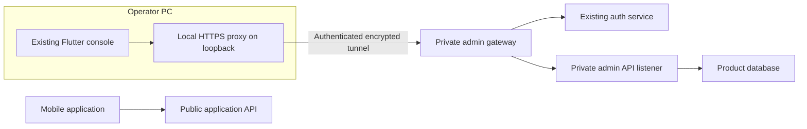

# PandaPay admin console on the operator's PC

Reviewed 30 October 2026. This is a proposed design based on source inspection and read-only queries against the local `pandapay` and `pandapay_auth` databases. It is not a claim about the hosted databases, deployed ingress, or a completed security rollout. No account, credential, grant, or deployment was changed during this review.

## What already exists

| Component | Verified finding | Source |
| --- | --- | --- |
| Main dashboard | The Flutter console already includes catalogue, scraper, queues, referrals and SMS operations screens. Reuse it. | [Console entrypoint](../console/lib/main.dart) |
| Login | Email and phone OTP sign-in exist. The current UI has no password field or built-in shared password. | [Login screen](../console/lib/features/auth/login_screen.dart), [auth client](../console/lib/data/admin_api.dart) |
| Local launcher | Starts a Flutter development browser target on port 5173. That port had no listener at the time of review. The launcher is not a complete production console-and-gateway setup. | [run_web.sh](../console/run_web.sh) |
| Product authorization | The API verifies the caller's session and checks `pandapay.is_admin()`. That function checks an active `admin_users` row against the authenticated user ID. | [API](../api/src/index.js), [membership function](../db/supabase/migrations/0011_rls_policies.sql) |
| Local accounts | Two active owner membership rows exist, including the operator's email and a verification test email. Neither membership ID has a matching user in the local auth database. A membership row alone is not a working sign-in. Exact emails and IDs are deliberately omitted from this document. | Read-only local database inspection |
| Role granularity | The schema lists owner, operator, reviewer and readonly roles, but the shared membership function does not distinguish them. The reviewed common API guard therefore does not establish operation-specific read/write restrictions. | [Admin schema](../db/supabase/migrations/0008_admin_console.sql), [membership function](../db/supabase/migrations/0011_rls_policies.sql) |
| QA bootstrap | A separate script can create a preverified user, seed a fixed four-digit OTP with a default 30-day expiry, grant membership, and mint a session. It accepts supplied database URLs; the reviewed script has no local-only environment/target guard. Its presence does not prove that its test login is currently active. | [create_test_admin.js](../db/scripts/create_test_admin.js) |
| Browser session gateway | Source exists for server-held bearer credentials, an HttpOnly cookie, CSRF checks, fixed upstreams, admin admission checks and server logout. The main console sign-out button invokes server logout. This remains deployment-dependent. | [Browser gateway](../auth/src/services/consoleBrowser.js), [runtime](../auth/src/services/consoleBrowserRuntime.js), [console sign-out](../console/lib/main.dart) |
| Other dashboard | The optional auth security dashboard is a different component, guarded by an explicit feature flag and a separately provisioned, expiring security-admin capability. It is not the main Flutter console. | [Auth entrypoint](../auth/src/index.js), [security access tool](../auth/scripts/security_admin_access.js) |

## Recommended architecture

The dashboard's static files stay on the operator's PC. Backend administrative actions continue to run beside the existing application services, behind private access. Keeping the UI local does not by itself prevent calls to a remote admin API.

There must be no public path to the private admin listener. An SSH local-forward is a suitable initial transport if the backend host supports it; a private device-authenticated network is an alternative. Confirm the actual hosting and ingress controls before choosing the transport.

OWASP recommends keeping management endpoints off the public Internet and restricting their network access. This recommendation applies to the admin routes, not just the dashboard HTML. [REST security: management endpoints](https://cheatsheetseries.owasp.org/cheatsheets/REST_Security_Cheat_Sheet.html#management-endpoints).

## Implementation work

### 1. Reconcile and enroll the real administrator

- Verify the intended email through the ordinary auth flow in the backend environment the console will manage. A local dashboard can operate on local or live data; the launcher must make that target clear.
- Use the verified account's stable auth user ID for its product-admin membership. Resolve the existing stale membership ID and unique-email conflict explicitly, preserving any audit attribution; do not blindly delete an old administrator or replace its ID.
- Create a dedicated, reviewed provisioning command with a preview, explicit target, idempotent grant/revoke behavior and an audit record. It must require an existing active verified account and must not seed an OTP, mark an unverified address verified, or mint a refresh token.
- There is no need to introduce a shared password. Prefer an individual admin identity secured by a passkey or security key requiring user verification. If choosing a password-based admin flow, add a separate authenticator factor and proper password storage. These factors are proposed additions; they are not implemented by the current OTP screen.
- Enroll a backup factor and retain recovery material securely so losing the PC does not force a hidden bypass. Account recovery must preserve the same assurance requirements.

Passkeys can provide phishing-resistant MFA when local user verification is required and its result is checked by the server. [OWASP MFA guidance](https://cheatsheetseries.owasp.org/cheatsheets/Multifactor_Authentication_Cheat_Sheet.html#passkeys).

### 2. Make admin APIs private

- Inventory every administrative route, including `/admin`, the console's `/browser` gateway, the optional auth security dashboard, and provider-generated service URLs or direct ports.
- The current API registers public and admin handlers in one process. Introduce a private admin listener/router or separate admin process that reuses the existing business logic. Public routing must reject administrative handlers; restrict direct origin/container/provider access as well as the friendly domain.
- Restrict the private listener to loopback or an appropriate private interface and allow access only through the approved tunnel/device identity. Closing the tunnel must remove the PC's route to it.
- Keep identity and authorization checks on the private API. Network access never grants administrator privileges by itself.
- CORS rules, an obscure URL, hiding UI buttons and an embedded API key cannot substitute for these controls. Do not put database-owner or service credentials in the browser bundle.

### 3. Package the console for this PC

- Serve a reviewed Flutter release web bundle with its proxy from a stable local HTTPS origin. Bind listeners explicitly to `127.0.0.1` and, if needed, `::1`; do not expose the listener to Wi-Fi/LAN interfaces or install a public tunnel for it.
- Route the browser's existing relative `/browser/...` calls through the local proxy and private transport. Configure the backend gateway's accepted origin to match the chosen local browser origin exactly. Provide locally trusted TLS and keep its private key protected on the PC.
- Preserve Host/Origin validation, CSRF enforcement, the fixed upstream allowlist, restrictive content security policy and no-store responses. Localhost is not an authentication bypass.
- Add a start/stop launcher that establishes the private transport, starts the local proxy, verifies readiness and opens the console. An unavailable tunnel must produce an unavailable console, not a fallback to a public admin URL.
- Use the existing browser gateway approach so bearer credentials remain server-side. A future native desktop target would need Keychain or equivalent secure storage instead of the current native preferences compatibility store.

### 4. Enforce administrator permissions and sessions

- Require the server to recognize a dedicated admin authentication context and completed strong authentication. An ordinary mobile-app session from the same person must not automatically satisfy the admin assurance requirement.
- Define and enforce permissions per operation. A readonly operator cannot write, and a reviewer cannot acquire owner privileges. Apply these controls in API handlers and the corresponding database access boundaries; the current boolean membership gate is only a starting point.
- Recheck active membership and revocation on requests. Use server-enforced idle and absolute session limits, explicit logout and fresh authentication for high-impact actions such as role changes, bulk exports or destructive operations. Choose documented timeout values for this console rather than relying on the browser window staying open.
- Preserve server-side credential storage, HttpOnly/Secure/SameSite cookies and CSRF checks. Record administrator, action, target, reason and outcome without logging authentication codes, tokens or financial message bodies.

OWASP recommends denying access unless explicitly permitted and validating permission on every request. [Authorization guidance](https://cheatsheetseries.owasp.org/cheatsheets/Authorization_Cheat_Sheet.html). Server-side expiry and logout are described in [session guidance](https://cheatsheetseries.owasp.org/cheatsheets/Session_Management_Cheat_Sheet.html#session-expiration).

### 5. Retire the test access safely

- Identify test admin grants, still-valid seeded challenges and associated sessions on each environment. Do not assume that removing a script invalidates an existing session.
- Deactivate unwanted test memberships, invalidate their authentication material and revoke their sessions while retaining audit attribution.
- Restrict the QA bootstrap to explicitly disposable local test targets or replace it with test fixtures. Its default hosted auth URL and unchecked target inputs are unsuitable for routine real-admin enrollment.
- Preserve public-app development fixtures only in explicitly allowed local/test configurations. They must never become a way to access live administrative data.

## Acceptance before using live data

These are checks to perform during implementation; this review did not run them against production.

| Scenario | Required result |
| --- | --- |
| Request from the public Internet, including direct/provider origin URLs | No administrative operation can be reached through a public path. |
| PC on the same Wi-Fi/LAN | Cannot open the dashboard's loopback listener. |
| Private tunnel closed or device credential revoked | Admin connection fails without a public fallback. |
| Ordinary user on the private network | Still denied administrative access. |
| Admin membership without an active, verified, matching auth identity | Sign-in/access denied. |
| Missing/invalid second factor or ordinary mobile session | Cannot establish the privileged admin context. |
| Readonly/reviewer attempts a forbidden mutation or privilege escalation | Server and database boundaries reject it. |
| QA code, expired OTP or revoked session | Cannot authorize a live action. |
| Logout, idle/absolute expiry, membership revocation | Existing sessions lose access as specified. |
| Changed Origin, CSRF token, Host or attempted upstream selection | Request rejected. |
| Public mobile/API regression checks | Required customer functions continue to work after admin isolation. |
| Recovery with a lost primary PC/factor | Reviewed recovery works without a shared test login. |

## Proposed order

1. Confirm the management target and host networking capabilities; reconcile the local identity mismatch in a development environment.
2. Add and verify private listener/routing and the localhost console launcher.
3. Add safe admin provisioning, strong authentication, operation-specific permissions and session policy.
4. Verify the acceptance cases on a controlled environment, then on the actual intended deployment with explicit release scope.
5. Retire test access and enable the real admin account only after an end-to-end login and independent external-access check pass.

The existing dashboard and much of its auth/session plumbing can be reused. A new UI is not the missing piece; complete identity enrollment, private API access and narrower permissions are the main gaps established by this review.
