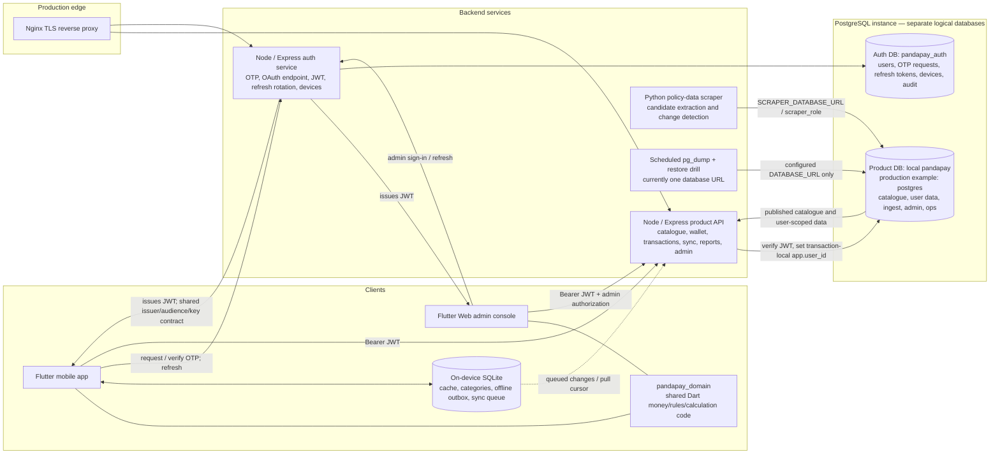

# PandaPay architecture and data review

**Audit date:** 2026-10-19
**Scope:** Flutter mobile app, Flutter admin console, shared Dart domain package, Node API, Node auth service, Python scraper, PostgreSQL schemas/migrations, and deployment/backup scripts.

## Executive summary

PandaPay is a multi-service system with two PostgreSQL databases, not the single shared database described by some older planning documents. The product API is the main boundary for the app and admin console; a separate auth service owns identities and tokens. The mobile app also keeps an SQLite cache and durable offline queues. The design has meaningful safeguards—RLS on 88 of the 89 local product tables, per-request user context, hashed OTP/refresh-token storage, and separate auth/product databases—but there are several important consistency and operations gaps to resolve.

The most important findings are:

1. **Account erasure is not completed by the default stack.** The API schedules deletion after 30 days, while the scheduled job is deliberately skipped by the normal migration runner. The product deletion function also documents that it must call the auth service, but the active auth service has no matching user-deletion route.
2. **The configured backup/restore path covers the product database only.** It does not dump or restore-drill the separate `pandapay_auth` database.
3. **The local product database is behind this checkout.** It has 42 of 65 non-cron migrations recorded; 23 are pending, plus the intentionally skipped cron migration. No migration was applied during this audit.
4. **The production auth database setup is not reproducible from the production compose workflow.** The auth schema is initialized by local Docker init scripts, while the production migration job only runs product migrations. The sample auth URL uses the privileged `postgres` account, despite the deployment guide saying both services use `app_user`.
5. **There is a Google-auth schema mismatch.** `/auth/google` writes `users.google_id`, but that column is absent from the active auth schema and the local auth database. The `oauth_accounts` table is declared but not used by the active auth code.

This review inspected source and local database metadata only. **It did not connect to or inspect production, read transaction/customer rows, read secret values, or change any database/schema.** A local schema snapshot is not proof of production state.

## High-level architecture

The shared Dart package is used by the mobile app and console. The Node API also has its own JavaScript reward logic, so financial calculations cross a language boundary; parity fixtures/tests need to remain a release gate. Authentication and product data are intentionally split across databases: `profiles.id` matches an auth `users.id`, but PostgreSQL cannot enforce a foreign key across the two databases. The API and any account-erasure workflow therefore own that consistency.

## Data model inventory

The local PostgreSQL snapshot contained:

| Database | Snapshot | Main responsibility |
|---|---:|---|
| `pandapay` | 89 public tables, 174 indexes, about 24 MB; RLS enabled on 88/89 | Card catalogue/rules, profiles and wallets, transactions and derived tracking, sync/import, merchant/crowdsource, admin queues, platform/backup metadata |
| `pandapay_auth` | 7 public tables, 29 indexes, about 8.5 MB; no RLS | Identity, OTP challenges, device registrations, refresh-token rotation, authentication audit, OAuth linkage |

The row estimates from `pg_stat_user_tables` are local PostgreSQL telemetry and their reset/window was unavailable. They are not used here to label a table unused. Exact local counts did show zero rows in `app_versions`, `feature_flags`, `otp_codes`, and `oauth_accounts`; zero rows alone do not prove a feature is unused.

| Product-data area | Representative tables |
|---|---|
| Catalogue and rewards | `issuers`, `card_products`, `reward_rules`, `cap_rules`, `milestone_rules`, `fee_waiver_rules`, `card_benefits`, `forex_rules`, `fuel_surcharge_rules`, `billing_cycle_rules`, `redemption_options`, `spend_categories`, `mcc_categories` |
| User and wallet | `profiles`, `user_cards`, `card_overrides`, `user_settings`, `user_consents`, `user_devices`, `referrals`, `referral_codes` |
| Spending and tracking | `transactions`, `transaction_splits`, `transaction_observations`, `points_ledger`, `cap_states`, `milestone_states`, `fee_waiver_states`, `lounge_usage`, `budgets`, `recurring_series`, `monthly_reports`, `needs_review_items`, `duplicate_candidates` |
| Imports and sync | `forwarding_addresses`, `inbound_emails`, `imap_connections`, `statement_imports`, `sms_import_batches`, `change_log`, `sync_cursors`, `sync_conflicts` |
| Merchant/crowdsource | `merchants`, `merchant_locations`, `merchant_contributions`, `acceptance_reports`, `acceptance_summary`, `effective_rate_samples`, `effective_rate_summary`, `contribution_quotas`, `contribution_salts`, `abuse_signals` |
| Admin/data operations | `admin_users`, `admin_audit_log`, `sources`, `source_pages`, `scrape_runs`, `page_snapshots`, `extraction_proposals`, `policy_change_alerts`, `policy_alert_evidence`, `parser_patterns`, `parser_failures`, `card_requests`, `data_error_reports`, `support_tickets` |
| Platform/operations | `app_status`, `remote_config`, `feature_flags`, `app_versions`, `kill_switches`, `changelog_entries`, `backup_runs`, `restore_drills` |

The auth schema is defined in `auth/db/pandapay-auth/init.sql`: `users`, `otp_requests`, `otp_codes`, `user_devices`, `refresh_tokens`, `auth_audit`, and `oauth_accounts`. OTP flow code uses `otp_requests`; no active auth source references `otp_codes` or `oauth_accounts`.

## Findings and recommendations

### High priority

**Account erasure is scheduled but not executed end-to-end.** `POST /account/delete-request` sets a 30-day due date; the API route explicitly says it only schedules deletion. The product deletion function deletes product-side rows and says the backend must also delete the auth-service user. The only scheduled sweep is in `0013_cron_jobs.sql`, and both local/prod migration runners skip that file. I found no user-deletion route in the active auth service. Unless a separate external job and manual auth workflow exist, an account can remain pending and identity data will not be erased. Build an observable background workflow that removes both sides, handles retries, records completion, and has tests for partial failure; ensure the worker is actually installed in each environment.

Evidence: `api/src/index.js` (`/account/delete-request`), `db/supabase/migrations/0010_functions_and_views.sql` (`execute_account_deletion`), `db/supabase/migrations/0013_cron_jobs.sql`, `db/scripts/migrate.sh`.

**Auth data is missing from scheduled backup and restore testing.** The backup container receives one `ADMIN_DATABASE_URL`; `backup.sh` runs `pg_dump` against exactly that URL. The production example points this URL at the product database (`postgres`) and keeps auth in the separate `pandapay_auth` database. The scheduled restore drill also restores only that one dump. This leaves users, OTP/token/device records, and auth audit outside the demonstrated recovery path. Add a second auth-database dump with independent status/retention and a restore drill, or an explicitly verified cluster-wide backup that includes both databases.

Evidence: `docker-compose.prod.yml` (`backup` environment), `.env.prod.example` (two database URLs), `db/scripts/backup.sh`, `db/scripts/restore_drill.sh`, `db/backup/crontab`.

**The local product schema is stale relative to checked-in migrations.** The local `schema_migrations` ledger has 48 total entries, including 6 demo-seed records; 42 product migrations are recorded. The checkout contains 66 migration SQL files: 23 non-cron files are not in the ledger, and `0013_cron_jobs.sql` is intentionally skipped. The latest recorded product migration is `20261015120000_sms_account_attribution.sql`, while the checkout contains newer migrations through `20261019144500_sync_user_category_field.sql`. This is a local snapshot finding, not a claim about production. Current app/backend behavior cannot be validated against this database until the drift is reconciled and migrations are tested in a disposable database.

The skipped job is more than maintenance: it includes inbound-email purge, merchant-confidence recomputation, divergence checks, due account deletion, and anonymization audits. Move these jobs to a supported scheduler/worker or make the required `pg_cron` setup and monitoring an explicit deploy gate.

**Production auth provisioning and database privilege documentation disagree.** Product schema migration is automated by the production `db-migrate` service, but that runner only processes `db/supabase/migrations`; the auth schema is loaded through local Postgres initialization scripts and has no equivalent versioned production migration step. The production sample also connects auth as `postgres`, while `deploy/DEPLOY.md` says both API and auth connect as `app_user`. Documented first-time deployment therefore does not fully specify how to create/upgrade auth schema or what role auth actually uses. Add a versioned auth migration/bootstrap path and a dedicated least-privilege auth DB role, then align the sample env and deploy guide.

### Medium priority

**Google auth route does not match the active auth schema.** `/auth/google` inserts and updates `users.google_id`, but `users` in `init.sql` and the local `pandapay_auth` schema do not contain that column. A clean database will fail that route at runtime. The schema does define `oauth_accounts`, but the active route does not use it; the mobile auth client also currently calls OTP/refresh endpoints rather than `/auth/google`. Decide whether Google sign-in is a supported product feature; then either wire the app and use a versioned OAuth-link schema, or retire the unused route/table. Add a database-backed contract test.

**The API database role can modify its migration ledger.** `db/setup_app_role.sql` grants CRUD on all public tables, and local metadata confirms `app_user` has SELECT/INSERT/UPDATE/DELETE on `schema_migrations`, which is the sole public table without RLS. This is not exposed through a normal route, but it violates least privilege and lets a compromised API credential alter migration bookkeeping. Keep the ledger owned and writable only by the migration role; grant the API role only the specific runtime permissions it needs.

**API CORS is more permissive than auth CORS.** The product API calls `app.use(cors())` unconditionally. The auth service validates and restricts origins in production, but the API does not show the same allowlist. Configure an explicit allowlist for the admin web origin(s) and leave native clients (without browser `Origin`) supported. CORS is not authentication, but browser response exposure should be intentional.

**Migration version prefixes are duplicated.** There are multiple files numbered `0037`, `0041`, `0043`, `0044`, and `0045`. The current custom runner keys the ledger by the full filename, so those files can run there; standard timestamp/version-based migration tooling may reject or mis-order them. Adopt unique sortable versions and validate the chain on a blank database in CI.

**Architecture documentation has diverged from runtime.** Root `README.md` and `database.sql` describe one shared database for both apps and a Next.js console; active compose/runtime uses separate product/auth databases and a Flutter Web console. `PROGRESS.md` documents an older 14-migration state. Mark the consolidated SQL as historical/reference or regenerate it, and make one concise runtime architecture/deployment document authoritative.

**API route surface is concentrated in a very large entrypoint.** `api/src/index.js` is 9,384 lines with roughly 150 direct route handlers. The service has useful extracted modules, but core feature routes remain coupled in one file. Split by domain (auth/profile, wallet/cards, transactions/import, sync, reporting, admin, operations) behind shared middleware and add DB-contract tests before making schema changes.

### Cleanup candidates — verify before removing

| Candidate | Evidence found | Safe next step |
|---|---|---|
| Auth `otp_codes` | Legacy comment in init schema; active code uses `otp_requests`; exact local count 0 | Confirm no external/old clients, then remove with an auth migration |
| Auth `oauth_accounts` | No active auth source references it; exact local count 0; Google route instead expects missing `users.google_id` | Choose one OAuth data model before cleanup |
| Product `app_versions`, `feature_flags` | Exact local counts 0 and no active app/API/console reference found; runtime app gating uses `app_status` | Mark as planned, implement, or remove via a reviewed migration |
| Mobile dependencies `rive`, `flex_color_scheme`, `responsive_framework`, `cupertino_icons` | No direct import/use found under `app/lib` | Recheck generated/native/assets usage and remove unused packages |
| Mobile test/build tools | `app/pubspec.yaml` has no top-level `dev_dependencies`; test/lint/codegen packages appear under `dependencies` | Move test-only and build-only packages into `dev_dependencies` |
| Nested `PandaPal_Auth_Service/` repository | `PROGRESS.md` says active `auth/` was adapted from it; root compose builds `./auth`, not the nested checkout | Confirm it is only archival before moving/removing it; preserve its independent Git history and secrets carefully |

Do not treat zero rows as proof of obsolescence. For example, `contribution_quotas`, `contribution_salts`, and `partner_programs` have no local rows but are used by database-side functions.

## Verification performed

| Check | Result |
|---|---|
| API `npm test` | Passed: 436 tests |
| Auth `npm test` | Passed: 38 tests |
| Mobile `flutter test` | Failed: 905 passed, 19 failed (924 total). Failures include duplicate-review wording/interaction expectations and a scan-FAB icon-count expectation; triage UI vs test contract before release. |
| Mobile `flutter analyze` | 27 info-level lints, no warnings/errors; includes deprecated file-picker byte access and async `BuildContext` notices |
| Console `flutter test` | Passed: 17 tests |
| Console `flutter analyze` | Passed: no issues |
| Shared domain `dart test` | Passed: 227 tests |
| Database inspection | Read-only local PostgreSQL catalog, grants, migration ledger, and aggregate counts; no user financial rows read |
| Production/live checks | Not performed; no production credentials or live environment were used |

## Suggested order of work

1. Close the account-erasure and dual-database backup/restore gaps.
2. Make auth schema provisioning versioned and least-privileged; resolve the Google-auth contract.
3. Reconcile the local migration ledger against the current migration chain in a disposable environment; add a CI migration-from-empty check and unique migration versions.
4. Fix the 19 failing mobile tests and review the 27 analyzer notices; add API/auth DB contract tests.
5. Reconcile stale architecture docs and prune only the confirmed schema/dependency candidates.
