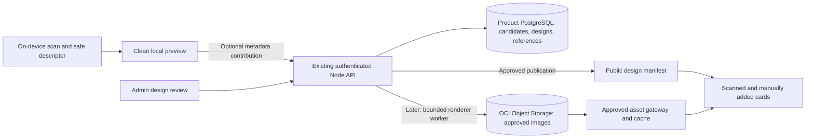

# Shared card designs from scans: implementation plan

Date: 2026-10-20. Status: proposal; no application, database, bucket, or production changes made for this plan.

## Recommendation

This is feasible with the existing Flutter app, Node product API, PostgreSQL product database, and OCI hosting. Start with on-device extraction of colors and a constrained layout, then publish approved designs into a shared catalogue. Add more faithful artwork using approved issuer assets or reviewed reconstructions after the initial pipeline works.

The shared item is a **card design**, associated with a catalogue product and a verified network/edition variant. An owned card references that design. Scanning a card and adding the same product manually should resolve through the same renderer and catalogue.

Do not use a customer's original front/back photographs as reusable catalogue images. The existing scanner's privacy boundary is valuable: preserve it. Back-side scanning can continue to identify a card and extract its last four digits locally; it is not needed as a shared artwork source. Never send full numbers, security codes, expiry dates, signatures, personal names, raw OCR, barcodes, or photographs of the back into the contribution system. An existing user-card last-four field remains private and separate from design metadata.

An attractive color-matched approximation is considerably easier than reconstructing every bank's exact artwork from arbitrary photographs. Glare, embossing, holograms, personalized pictures, and metallic finishes cannot be reliably reproduced by sampling colors alone.

## What exists in the current checkout

| Component | Observed behavior | Consequence |
| --- | --- | --- |
| [ScanCardScreen](/Users/chandresh_kerkar/Documents/PandaPath/pandapay-docs/app/lib/features/scan/scan_card_screen.dart:18) | Front/back OCR is combined in memory. Camera captures are deleted after recognition; gallery originals are not owned by the app. | Extract safe appearance metadata before discarding each frame; preserve cancellation/error cleanup. |
| [ScannedCardResult](/Users/chandresh_kerkar/Documents/PandaPath/pandapay-docs/app/lib/features/scan/scan_card_screen.dart:100) | Returns the catalogue product and optional last four digits. | Add an optional appearance result without breaking existing callers. |
| [MlKitCardTextRecognizer](/Users/chandresh_kerkar/Documents/PandaPath/pandapay-docs/app/lib/features/scan/card_scanner.dart:41) | Uses ML Kit and the Dart image library. Returns joined text, discarding OCR geometry; some passes resize/crop/grayscale the input. | Add structured OCR regions and their coordinate transforms. Sample appearance from the original color frame, never the enhanced OCR variants. |
| [Catalogue schema](/Users/chandresh_kerkar/Documents/PandaPath/pandapay-docs/db/supabase/migrations/0003_card_catalogue.sql:5) | Products already have art_asset, art_primary_color, and data_version. | Reuse compatible fields, then add designs and versions without changing reward identity. |
| [Domain model](/Users/chandresh_kerkar/Documents/PandaPath/pandapay-docs/packages/pandapay_domain/lib/src/card_rules/card_rules.dart:303) and its JSON codec | Already carry artAssetUrl and artPrimaryColor. | No new database is needed. Preserve old JSON fields while adding an optional typed design object. |
| [CardVisual](/Users/chandresh_kerkar/Documents/PandaPath/pandapay-docs/app/lib/features/cards/card_visual.dart:475) | Uses catalogue artPrimaryColor when available, otherwise preset colors. Patterns and secondary colors are generated. Does not render artAssetUrl. | Extend this shared widget to use approved designs; many Wallet/Home/picker/detail surfaces already reuse it. |
| [Network variants](/Users/chandresh_kerkar/Documents/PandaPath/pandapay-docs/db/supabase/migrations/0043_card_product_network_variants.sql:7) | One product can have several verified networks/tiers. | Store artwork variants separately; a Visa/RuPay or old/new design must not overwrite another. |
| [Catalogue cache](/Users/chandresh_kerkar/Documents/PandaPath/pandapay-docs/app/lib/app/providers.dart:4337) | A valid nonempty cached catalogue is returned before a live fetch. | Publishing art alone will not reliably refresh existing devices. Include a freshness/revalidation mechanism. |
| [Unsupported-card API client](/Users/chandresh_kerkar/Documents/PandaPath/pandapay-docs/app/lib/data/card_requests_api.dart:8) | Has an imagePath placeholder, but documents that no upload endpoint exists. | This is not an implemented or validated upload pipeline; build a dedicated contribution contract. |
| [Deployment](/Users/chandresh_kerkar/Documents/PandaPath/pandapay-docs/deploy/DEPLOY.md:1) | Node services run on a Docker-capable VM; product access uses PostgreSQL. | Add OCI object access behind the existing API. No migration to Oracle Database or adoption of Supabase Storage is required. |

This review inspected source and existing local architecture/schema reports, plus official provider documentation. It did not inspect live OCI tenancy billing, free capacity, bucket configuration, IAM, production schema, or VM load. The OCI CLI is not available on this workstation. Those are pre-deployment checks, not confirmed deployment facts.

## User experience

1. The user scans front/back as today and confirms the matched product/network. Appearance extraction does not add another required scan.
2. Show a clean generated preview: colors, allowed pattern, product label, and network mark. Offer “Looks right”, “Choose another design”, and “Use standard design”. Do not show original card numbers in this preview.
3. If there is already an approved match, use it immediately. An unrecognized appearance can remain a local-only preference until approved.
4. Ask separately and optionally whether to contribute the clean design metadata. Declining never prevents adding a card. Do not upload pixels in the first release.
5. A reviewer approves a new shared design or matches it to an existing one. The public catalogue then includes the approved variant.
6. A later user adding the product manually gets the current approved default and can select an older/network-specific design. Existing explicit selections stay selected.

Example: the first user scans a newly issued purple edition. PandaPay suggests purple locally and queues a design candidate. After review, a second user can choose that purple edition without scanning. Owners of the older green edition keep their selected green design.

## Extraction and recognition algorithm

### A. Normalize and assess the front frame locally

- Detect four card corners; allow the user to adjust the crop if detection is uncertain. Correct perspective to a normalized card coordinate system; retain orientation for portrait cards.
- Assess blur, cut-off edges, glare, occlusion, and exposure. Ask for a retake or use the standard design when quality is insufficient. Camera white balance is not an exact color measurement.
- Run bounded image processing off the UI thread. Reuse a single normalized color frame where possible, and bound pixel dimensions and concurrent work to avoid memory spikes or another emulator freeze.
- Run structured OCR on the normalized frame. If using the recognizer's existing cropped/rotated variants, map boxes back to normalized coordinates before using them. Coordinates from one variant must never mask another directly.

OpenCV provides the perspective-transform building blocks; ML Kit exposes text-region bounds and corner points. These are capabilities to integrate, not proof that our current scanner already extracts safe artwork. [OpenCV](https://docs.opencv.org/4.13.0/da/d6e/tutorial_py_geometric_transformations.html), [ML Kit](https://developers.google.com/ml-kit/vision/text-recognition/v2/android).

### B. Build a safe appearance descriptor

- Mask text, sensitive print regions, barcodes/QRs, signature areas, and non-background elements for sampling. Expand masks around embossed characters. OCR alone is not a complete redaction guarantee.
- Sample a coarse spatial grid and cluster background pixels in a perceptual color space, using robust weighted medians or clustering. Preserve genuine black/white designs; do not discard all bright/dark pixels as glare/shadow.
- Produce a small palette, approximate gradient direction, supported pattern family, orientation, and coarse layout landmarks. Record quality scores and extraction algorithm version.
- Reconstruct a fresh clean face from an allowlisted template. Insert product/network text from the catalogue. Do not retain customer OCR strings or original pixel patches in the descriptor.
- Generate hashes only from canonical safe descriptors or approved derivatives. Never use a full number, original photo, raw OCR, or their hashes as a global identity/deduplication key.

The first release should accept only bounded structured data: validated colors, enums, normalized coordinates, and approved asset identifiers. Reject arbitrary SVG, HTML, scripts, URLs, image blobs, and free-form OCR fields. This reduces both accidental data leakage and malicious submissions.

### C. Match within the correct product family

First reuse the existing text matcher for issuer/product/network identity, then ask the user to resolve ambiguity. Never infer a product or reward rules from its color alone. The current matcher's score must not be presented as a calibrated probability.

Search only approved designs compatible with the confirmed product, verified network/tier, and edition/region where known. Rank candidates using palette distance, spatial color/layout agreement, and permitted shape features. Later, perceptual hashes of clean normalized artwork can help find near-duplicates; they are not reliable product identifiers by themselves.

```text
front = normalizeAndCheckQuality(capturedFront)
identity = confirmExistingProductAndNetwork(existingTextMatch)
descriptor = extractAllowlistedAppearance(front)
eraseAppOwnedRawFramesAndTemporaryOcrCopies()

if qualityOrIdentityIsUncertain:
    return chooseApprovedDesignOrUseFallback()

candidates = approvedDesignsFor(identity)
match = compareSafeDescriptors(descriptor, candidates)

if strongMatchWithAdequateMargin(match):
    return match.design

showCleanLocalPreview(descriptor)
if userOptsInToContribute:
    enqueueValidatedMetadataCandidate(identity, descriptor)
return localPreviewOrStandardDesign()
```

Calibrate distance thresholds and the match-versus-runner-up margin against a labeled validation set. Do not invent a universal “95% confidence” threshold. Start with at least 20–30 representative products, including similar tiers, multiple networks, old/new editions, portrait cards, black/metallic designs, poor light, and devices from different manufacturers.

### D. Approve and version changes

- Exact descriptor hashes deduplicate retries; approximate matching groups similar candidates for review. One candidate from one scan must not change the public default.
- Multiple independent consistent submissions increase review priority, not automatic trust. Device/account counts alone cannot prove independence or prevent coordinated poisoning.
- Prefer official clean issuer assets with recorded provenance and permitted reuse when available. User consent to contribute does not establish rights to a bank's artwork.
- Publish only after identity, privacy, provenance, and visual checks. Never use generative image reconstruction as the authority for printed product names, logos, networks, or benefits.
- New edition means a new logical variant/version. Keep earlier approved editions selectable and maintain an audit trail. Cosmetic changes never modify rewards, fees, matching keys, or subscription/transaction behavior.

## Data model

Keep metadata in the existing product database. Store only approved image files in object storage when image support is introduced. Do not store image/base64 blobs in catalogue or user-card rows.

| Proposed entity | Minimum useful fields and responsibilities |
| --- | --- |
| card_art_designs | id, card_product_id, optional network_variant_id, variant_key, region/edition, orientation, version, status, palette_json, constrained layout_json, optional front/thumb asset keys, checksum, algorithm_version, source_type/source_url, rights/provenance decision, reviewed_by/at, supersedes_id, created_at. Published payloads are immutable; edits create a new version. |
| card_art_defaults | Product/compatible-network-variant key → approved design ID. One active default for each scope. Used for manual addition and users who have not selected a design. A withdrawal updates this mapping atomically. |
| card_art_submissions | id, authenticated submitter reference, confirmed product/variant, safe descriptor, consent_version/at, quality summary, status/reason, expires_at, resolved_design_id, idempotency_key. Metadata only in phase 1. Keep submitter information private; dedupe a submitter's repeats. |
| user_cards additions | Nullable selected_art_design_id and an explicit default-versus-pinned choice. Enforce that the chosen design belongs to the card's product and compatible network variant. Never accept a design ID from another product merely because it exists. |
| Art manifest revision | One monotonic publication revision covering published additions, withdrawals, default changes, and corrections. Do not infer this from MAX(per-card data_version). |
| Durable work, if needed | A leased jobs/outbox table for rendering, object promotion, cleanup, and publication events. Retries must survive a process restart and be idempotent. Phase 1 can render descriptors directly in Flutter and avoid an image worker. |

Use foreign keys, bounded JSON validation, uniqueness for product/variant/version and idempotent submissions, indexes on product/variant/status, and atomic default publication. Protect published-only reads and owner/admin-only submissions using API authorization plus RLS. Review export views so draft/private provenance never appears in /catalogue.

PandaPay uses its own auth service and [transaction-local app.user_id](/Users/chandresh_kerkar/Documents/PandaPath/pandapay-docs/api/src/db.js:21). Implement policies using that verified existing boundary; copying an auth.uid() example would not establish the caller here. Keep runtime roles without bypass privileges. If Supabase Data API is ever exposed, grants and RLS are separate checks. [Supabase RLS](https://supabase.com/docs/guides/database/postgres/row-level-security).

## API and application changes

- Add CardAppearanceDescriptor, CardArtDesign, and optional fields to ScannedCardResult and the domain JSON codec. Keep raw OCR lifetime local and short.
- Add a CardArtRepository and account-safe local preference storage. Use a small published manifest with a revision and per-design hashes; fetch images only when a card is visible.
- Add GET /card-art/manifest (published descriptors/defaults only), POST /card-art/submissions (authenticated metadata), a compatible selected-art field on user-card create/update, and admin list/approve/reject/withdraw operations. Bind submission ownership to the verified account server-side.
- Extend CardVisual resolution: valid explicit selection → compatible approved default → current generated palette/pattern. Thumbnail, Wallet, Home, and detail views use the same resolver. Preserve dynamic balances/last-four overlays and avoid drawing duplicate chips/logos over a complete approved front image.
- Refresh the art manifest on app resume/Wallet open when stale, initially targeting a 15-minute online freshness window. Show cached art immediately, fetch updates in the background, and keep an offline fallback. Add explicit last-checked metadata; a valid cached JSON object is not proof of freshness.
- A publish transaction advances the art manifest revision and the relevant product data_version. Cached images use content hashes and immutable paths. If ETag/304 is introduced, add explicit client support for a 304 response and retained cached body; the current catalogue HTTP client expects 200.
- Preserve old clients' art_asset/art_primary_color fields. Do not change existing bundled asset-key semantics into arbitrary network URLs without a typed, validated resolver. Accept remote assets only from PandaPay's approved origin.
- Separate feature flags for local extraction, shared contributions, and remote images. A service failure must leave card addition and offline Wallet usable.

## OCI architecture and operational plan



1. **Phase 1 needs no image bucket.** Publish safe descriptors in the existing database/API and render them in Flutter. Use bundled approved logos. This proves the contribution/matching flow with minimal infrastructure.
2. **For approved image support, use OCI Standard Object Storage.** Keep files outside the VM disk and Postgres. Suggested immutable key: card-art/<product>/<variant>/<design-version>/<content-hash>.webp. Store database keys and checksums, not expiring access links.
3. **Start with a private approved-assets bucket.** A tightly scoped server reader serves only asset IDs belonging to approved published designs through a cached asset route. Do not expose arbitrary object paths or a proxy that fetches user URLs. Add a CDN for these public sanitized derivatives when traffic justifies it; no private API response caching.
4. **If image candidates are introduced later, use a separate private quarantine bucket.** The first release should not accept customer photo uploads. Later intake accepts only locally reconstructed or conservatively sanitized front derivatives after a tested privacy gate, then independently decodes, scans, re-encodes, and reviews them server-side. Reject uncertainty; never retain the back. Quarantine cannot be read through the public asset route.
5. **Use OCI instance principals where supported by the actual VM deployment.** Restrict IAM to the required buckets/actions; keep all OCI credentials out of the app. Container access to instance identity must be deliberately controlled because processes on the instance can inherit its authority. A separate worker VM/dynamic group may be needed for stronger isolation. [OCI instance principals](https://docs.oracle.com/en-us/iaas/Content/Identity/Tasks/callingservicesfrominstances.htm).
6. **Prefer controlled intake over broad upload links.** For low-volume approved imports, a streaming endpoint with strict byte/pixel/concurrency limits is sufficient. If direct uploads become necessary, issue short-lived, one-object write-only PARs after authentication; validate stored bytes before accepting the submission. PARs are bearer links, not single-use tokens or automatic size/quota enforcement. Never issue bucket-wide upload access to the mobile app or log full PAR URLs. [OCI PAR documentation](https://docs.oracle.com/en-us/iaas/Content/Object/Tasks/usingpreauthenticatedrequests.htm).
7. **Bound worker resource use.** Begin with one image-processing job at a time and measure decoded-image peak memory before increasing it. Avoid GPU/image-generation workloads on the login/API process. Validate any new native dependencies on the server architecture and Android/iOS devices.
8. **Publish safely across DB and object storage.** Upload/verify an immutable derivative first, then atomically publish its DB reference and manifest revision. Retry using stable IDs/checksums. A sweeper removes unreferenced objects; a database rollback must not leave a public row pointing at a missing file.
9. **Retention and deletion.** Delete rejected/quarantine derivatives promptly, with an initial target of 7 days or less; use an explicit cleanup job plus lifecycle rules as backup. Apply rules to abandoned uploads and old versions too. Lifecycle execution is asynchronous, so it is not an exact deletion deadline. Never enable an immutable retention lock on temporary submissions. [OCI lifecycle rules](https://docs.oracle.com/en-us/iaas/Content/Object/Tasks/usinglifecyclepolicies.htm).
10. **Recovery and withdrawal.** Back up metadata and approved assets, exercise restore consistency, and support design withdrawal/default fallback and edge purge. Long-cached content cannot be guaranteed erased from phones already holding it; therefore the public privacy gate must happen before publication. Account deletion removes private submissions/preferences and follows the agreed policy for already anonymized published designs.

## Capacity and cost

Artwork storage scales mainly with unique designs and versions, rather than number of users. Download requests/bandwidth scale with users and cache misses.

Illustrative arithmetic, not measured payload sizes or a price quote:

| Scenario | Approximate result |
| --- | --- |
| 10,000 published descriptors × 2 KiB | 19.5 MiB of JSON payload before indexes, row overhead, audit, and backups. |
| 10,000 design versions × (40 KiB thumbnail + 160 KiB full face) | 1.91 GiB of image objects. Backups/history/quarantine are extra. |
| 100,000 users × 4 uncached images × 80 KiB average | 30.5 GiB transferred and 400,000 reads if every image reaches the object origin. Device/edge caching can reduce origin requests. |

Oracle currently documents 50,000 free Object Storage API requests/month. Its allowance is 20 GB combined storage for an expired-trial Always-Free-only account, while paid/trial accounts have tier-specific allocations including 10 GB Standard. These allowances are shared with other tenancy use, not reserved for card art. Verify the actual account, region, existing backups, and headroom before enabling storage. [Oracle free resources](https://docs.oracle.com/en-us/iaas/Content/FreeTier/freetier_topic-Always_Free_Resources.htm).

The descriptor-first pilot can avoid paid AI services and new image infrastructure. An image pilot could fit available free storage, but a larger user base can exceed free request allowances even with a small catalogue. Monitor origin reads, bytes, rejected uploads, retained versions, worker time, and review backlog. Use application submission caps, storage quotas where supported, alerts, and a contribution kill switch; a budget alert does not enforce a spending ceiling. Do not promise zero cost without a live tenancy check and explicit traffic limits.

## Work sequence and acceptance criteria

| Phase | Deliverable | Exit condition |
| --- | --- | --- |
| 0: Proof and decisions | Synthetic/public permitted sample set, quality/matching experiment, renderer preview, production schema/OCI quota check. | Same product's old/new/network variants stay distinct; no raw data leaves device. Determine whether color approximation meets the desired fidelity. |
| 1: Color/layout pilot | Structured on-device extraction, local preview, approved design schema, metadata submissions, admin review, shared resolver and manifest freshness. | User A's approved safe descriptor is available to user B adding manually; explicit legacy selections stay selected; offline and failed extraction still work. |
| 2: Approved artwork | OCI bucket/IAM, asset gateway/cache, bounded worker, issuer-asset provenance and versioned files. | Safe assets render across Wallet/Home/pickers/detail, failed downloads fall back, re-publication refreshes devices, withdrawal and rollback work. |
| 3: Optional crowd image intake | Separate quarantine, conservatively sanitized/reconstructed front-only derivatives, second inspection, review and cleanup. | Privacy/malicious-file/ownership/abuse validation passes before public contribution images are enabled. |

Planning estimate for one experienced developer: roughly 3–5 development days for a constrained color/layout pilot, and about 2–3 weeks for the reviewed shared catalogue with artwork infrastructure and device validation. This assumes sample artwork/provenance and admin access are available; automatic faithful reconstruction of arbitrary art is a separate experiment and has no reliable estimate yet.

Validation should cover: synthetic names/PANs/security codes on both sides and embossed layouts; crop/rotation mapping; glare and portrait cards; duplicate/retried submissions; two concurrent approvals; incompatible product/design IDs; malicious JSON/oversized images; owner/admin access; stale manifest and offline restart; missing/withdrawn assets; interrupted uploads/publication; quota exhaustion; peak emulator/real-device memory. Keep real card photos out of fixtures, screenshots, logs, reports, Git, and AI prompts.

No tests were run for this documentation-only proposal. No live capacity, match accuracy, or privacy guarantee has been certified. Before implementation, agree on the initial fidelity target: the recommended first release is an attractive color/layout match with reviewed shared designs, followed by approved exact artwork where available.

## Additional primary reference

The decision to exclude verification codes and card photographs from shared assets is deliberate data minimization. PCI SSC specifically addresses verification-code storage in consumer-device software; a user's consent is not permission to retain that data. This design is not a PCI compliance certification. [PCI SSC FAQ 1574](https://www.pcisecuritystandards.org/faqs/1574/).
