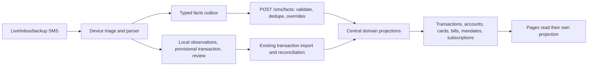

# PandaPay central financial projections and subscription accuracy plan

Status: implementation handoff; no production code changed by this plan. Current checkout reviewed 23 October 2026. This plan preserves the existing SMS intake and transaction workflow.

## Product rules agreed with the user

- The Subscriptions page shows only service subscriptions. A subscription may be one-time, prepaid, free, monthly, quarterly, annual, manually renewed, or automatically renewed. Repeated charges are evidence, not a prerequisite.
- Bills & Commitments shows card bills, utilities, loans, insurance obligations, and their AutoPay instructions. A merchant mandate is an authorization, not a posted charge or proof of a subscription.
- A ₹0 mandate activation means no charge at activation. A maximum limit is a ceiling, never the paid amount, the future price, or evidence that the service is free.
- Show a future payment amount/date only when explicitly stated; otherwise show an appropriately labeled estimate or unknown. Do not manufacture a date from an unstated cadence.
- Silence after one month proves neither renewal nor pause nor cancellation. Explicit one-month access can end at its stated expiry. When a renewal was expected but no evidence arrives, mark renewal unverified. Cancellation requires explicit evidence or user confirmation.
- A card bill AutoPay and a merchant AutoPay on the same card are separate records. Card repayment is a transfer/settlement, not another consumer spend.

## Current pipeline and exact insertion points

1. `app/lib/data/local/sms_import_store.dart` performs capture, triage, source-key deduplication, baseline/candidate parsing, local observation, provisional transaction, local commitment, and Needs Review decisions. Preserve this for offline behavior. `app/lib/data/local/sms_facts_outbox.dart` sends structured facts without raw body.
2. `api/src/index.js` `/transactions/from-sms` and batch import parse posted movements, resolve card/category, and use the existing transaction writer and duplicate reconciliation. Preserve transaction accounting and rewards behavior.
3. `api/src/sms_facts.js` stores source/facts with amount roles (`posted`, `due_total`, `ceiling`, `proposed`), and `api/src/sms_facts_route.js` reapplies corrected facts before specialists. This is the central evidence boundary.
4. `applyFactSpecialists` currently sends `mandate_lifecycle` directly to `persistSubscriptionMandate` in `api/src/index.js`, which writes `recurring_series`. This is the primary wrong-entity boundary. The writer also defaults cadence and treats the limit as `typical_amount_inr`.
5. `/recurring` in `api/src/index.js` detects historical patterns on read and writes `recurring_series`; `app/lib/app/providers.dart` also constructs an offline report from broad observation/commitment criteria. These are competing projections. `subscriptions_screen.dart` contains further name/amount/date filtering. Consolidate domain decisions centrally; keep UI filters for display only.
6. Account/card and Needs Review are specialist paths, not one mutually exclusive SMS category. One message may yield several facts. Preserve `GET /account-summaries`, card due-day healing, category rules, duplicate matching, transfer/investment classifications, and local review.

## Target central model

Use existing `sms_sources`, `sms_source_facts`, `transactions`, and `recurring_series`. Add only the minimum additive schema proven necessary after an agent inventories current bill/commitment persistence. Central facts are immutable evidence; versioned projections can be rebuilt after overrides or rule changes. Never move raw SMS into the central database just to support classification.

Define one shared *domain decision* over resolved facts and linked transactions, with multiple outcomes allowed. It should return `posted movement`, `account/card observation`, `bill obligation`, `mandate authorization`, `subscription service`, and/or `review needed`. An economic event is counted once. Use source key, fact ID, transaction ID, merchant identity, payment instrument, mandate reference, and bill cycle to link results; last four digits alone are weak identity.

The mandate projection needs target kind (`card_bill`, `utility_or_other_bill`, `service_merchant`, `unknown`), lifecycle, authorization limit, instrument, and source evidence. The subscription projection needs service identity, explicit-subscription evidence or user assertion, renewal mode (`one_time`, `automatic`, `manual`, `unknown`), billing cadence when known, access end when known, last *posted* payment, stated next payment date and amount, estimated next date and amount separately, lifecycle/status, confidence/reason, and links to mandate and facts. A ₹0 setup and a limit populate only mandate fields. Preserve current `recurring_series` rows and user edits through an additive migration; avoid destructive recategorization.

Classification precedence: user correction > explicit lifecycle/plan evidence > linked posted payments > historical pattern > brand prior. Brand name alone and AutoPay alone never establish a confirmed subscription. Distinguish a service merchant from a processor shared by unrelated services. A known service with only mandate setup becomes an *unconfirmed candidate* or remains only a mandate until product policy chooses to show candidates; it never enters active spend totals. This decision should be explicit in the implementation contract.

Lifecycle: explicit activation/term creates a subscription even after one message; a posted charge confirms only that occurrence; stated next date/price remains a claim until charged; missed expected renewal becomes `renewal_unverified` after a measured grace window; explicit fixed-term expiry becomes `ended`; failed payment becomes `payment_issue`; explicit pause/cancellation or user action changes status. Absence of SMS alone never means renewed, paused, or cancelled. If no term/cadence is known, preserve unknown instead of defaulting monthly.

## Agent execution for Luna 5.6 Hi

Coordinator: spawn up to three subagents with `gpt-5.6-luna` and `high` reasoning effort; give each non-overlapping file ownership. Agents work in the shared checkout, report exact diffs and test results, and do not reset other changes. The coordinator reviews integration and owns final cross-path tests, migration gate, device build, and handoff. Start with read-only baseline before edits because this checkout may contain another session's work.

| Agent | Ownership and deliverable | Must preserve |
| --- | --- | --- |
| A: central facts/domain | `api/src/sms_facts*`, new narrow projection module, additive DB migration, focused server tests. Inventory current schema first; add typed subscription/mandate fields and idempotent projection after resolved facts/overrides. | Replay, correction precedence, privacy contract, bill and card specialists. |
| B: transaction/recurrence | `api/src/recurring.js`, merchant identity helpers, `/recurring` integration in `api/src/index.js` only after coordinator grants edit window, server tests. Make historical matching an evidence source, never sole service classification. Separate price/date roles and stop page-read writes after projection cutover. | Existing transaction insertion, duplicates, transfer/investment/account/reward behavior. |
| C: device/offline/UI | `app/lib/data/local_sms_parser.dart`, facts outbox, local projection in `providers.dart`, subscriptions/Bills & Commitments UI and focused Flutter tests, coordinated edit window for `providers.dart`. Match central rules offline; display status and evidence labels. | Capture, local review, sync, sign-in state, existing bills/cards/account screens. |

Phase 0: coordinator records Git diff and current schema, enumerates all SMS upload routes and feature flags, runs current focused suites, and builds a source-to-projection map. Ask each agent to propose minimal changes before overlapping edits. Agent A defines a contract and migration; B/C consume the same contract. Do not let three agents independently invent status enums or amount semantics.

Phase 1: add synthetic fixtures and a read-only shadow evaluator over existing fact/transaction data. Report counts by proposed target, especially mandates previously called subscriptions, card bills, utility bills, and user-edited subscriptions. Inspect representative redacted evidence; do not silently rewrite old rows.

Phase 2: implement additive central projections. First preserve all current writes; run new classifier in shadow. Compare existing and proposed outputs. Then gate new subscription writes behind a feature flag while Bills & Commitments and transaction/account paths remain live. Overrides must reproject idempotently. Backfill centrally from stored facts/transactions where evidence exists; do not infer missing facts from a mandate ceiling.

Phase 3: switch `/recurring` to read the central subscription projection and make offline report follow the same decisions. Keep server response shape compatible until the app update is installed. Return active, unverified, and history statuses separately; costs count only supported actual or explicitly stated future amounts, with a clear estimate policy. Remove broad local `is_autopay`/`local_commitment` admission into subscriptions. Bills & Commitments owns ordinary obligations and AutoPay display.

Phase 4: migration/rollout. Preserve old `recurring_series` rows, manual edits, dismissals, and cancellation history; map old records to new evidence states. Review unmatched legacy rows instead of deleting them. Provide reversible flag/endpoint behavior and rollback SQL for additive indexes/columns only. Preserve portable backup/sync contracts or update their versioned coverage and restore tests.

## Required test matrix

Each case asserts both the central facts/projections and the visible page, including exact rupee roles and absence from unrelated totals. Use synthetic data only. At least these cases must be represented:

1. Axis OpenAILLC mandate: ₹0 setup, ₹1,999 limit, card XX7105, no charge/price/next date; no transaction or annual spend.
2. Same card has separate card bill AutoPay, statement total, minimum, due date; only Bills & Commitments shows the card bill.
3. Electricity and water AutoPay mandates with monthly bills; neither appears in Subscriptions.
4. Loan EMI, SIP/investment, insurance premium, wallet top-up, self-transfer, and card repayment; correct categories and no subscription.
5. Explicit ChatGPT subscription with free trial and stated next charge/date; show stated future terms, ₹0 paid at setup.
6. Explicit Gemini subscription with posted ₹1,999 and stated next date/amount; exactly one spend and one subscription payment link.
7. One-time prepaid month with explicit end date; active during term, ended after term, no invented renewal.
8. One-time or manual renewal with no end date; subscription exists, renewal unknown.
9. Monthly, quarterly, yearly, weekly and irregular stated schedules; preserve actual calendar dates and distinguish cadence confidence.
10. July subscription with expected August renewal but no SMS: renewal unverified after grace, not renewed/paused/cancelled; no new payment.
11. July subscription with no stated term or renewal: status unknown; do not assume a one-month term.
12. Explicit cancellation, AutoPay cancellation without service cancellation, pause, resume, payment failure, retry success, refund and reversal; correct independent mandate/service/payment states.
13. Price changes, GST/currency conversion, trials converting to paid, and different payment card; link only when merchant/service evidence is strong.
14. Two services through one processor, two plans from one merchant, alias variants (`OPENAILLC`, `ChatGPT`, `OpenAI`), and unrelated purchases from a subscription brand; no false merges.
15. Duplicate SMS, statement import of the same charge, fact replay, app restart/offline sync, correction replay, rule upgrade, legacy backfill, and backup/restore; one economic event and user correction wins.
16. OTP, promotion, security alert, incomplete amount/date, ambiguous merchant, stale account/card suffix, and malformed fact; no false posted charge or false confirmed subscription, correct review/ignore behavior.

Run focused Node, Dart/Flutter unit and widget suites, then the app/API relevant full regression suites. Include migration tests against a copied schema, API compatibility, offline/reconnect and sync tests, and ledger invariants: spending totals, card dues, balances, rewards, and duplicate counts before/after must agree except for documented fixes. Evaluate precision/recall on held-out labeled SMS families and inspect every newly included/excluded subscription; require no known bill or mandate-only false positives. A passing test count alone is insufficient if fixtures encode the old behavior.

## Physical device and build gate

Read-only check on 23 October 2026: an Android development device was connected; PandaPay Dev package `app.pandapay.pandapay.dev2` installed at `1.0.5-dev` version code 40. The earlier code-40 build is a baseline, not a test of future changes. Recheck device identity locally rather than storing its serial in this document.

Before installation, recheck `adb devices -l`, installed package/version/signing certificate, source revision/Git status, intended production API/auth/legal URLs, and new APK package/version/signature. Build a **Dev-flavor update** with production URLs and version code > installed 40; use the existing signing identity so Android updates in place without sign-out. Do not install if device/package/signature/version checks disagree. After that gate, install as an update and verify existing login remains. Do not clear app data or sign out.

On device, import or simulate privacy-safe SMS fixtures through the supported test path; verify: subscription list and costs, Bills & Commitments, card due, account summary, Activity, Needs Review, offline restart, sync, and corrections. Check exact ₹0/₹1,999 role display on the Axis example. Reopen after sync and app restart to ensure the central answer replaces temporary local display without duplicate rows. Record APK path/hash, installed version, test observations, screenshots with sensitive data masked, and any untested live-bank cases. Do not call a device case passed from a widget test alone.

## Acceptance criteria

The existing SMS pipeline and non-subscription workflows still work; source facts are idempotent and corrections authoritative; no mandate ceiling becomes spend, due amount, or subscription price; no bill/loan/investment/card repayment reaches Subscriptions; an explicit single subscription is retained even without recurrence; unknowns remain unknown; offline and central results converge; user edits and history survive migration; the Dev update installs in place and preserves login. Roll back the feature flag if any invariant fails.
