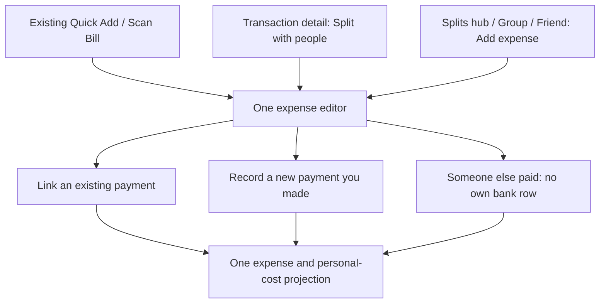

# PandaPay shared expenses: product, calculations, and UI/UX specification

- Updated: 4 November 2026; original source investigation: 3 November 2026.
- Status: proposed implementation contract; application feature is not implemented by this document.
- Current source baseline: `sms-v2/integration`, commit `bf6bec9b`. Original `5cadaaa3` investigation retained as history; the [SMS v2 branch review](shared-expenses-sms-v2-branch-review.md) updates the source assumptions below.
- Deliverable: product decisions, calculation rules, entry flows, page coverage, tab-layout samples, mandatory Bamboo Ink UI/UX requirements, and release acceptance criteria.

Implementation companions: [production engineering plan](shared-expenses-production-implementation-plan.md), [multi-agent work packages](shared-expenses-agent-work-packages.md), and [detailed scenario/test matrix](shared-expenses-scenario-test-matrix.md). Use them for architecture, dependency order, ownership, performance/capacity targets, migration and release execution; this document remains the product/accounting/UI contract.

**Latest local device/layout evidence:** [build 8128 correction and verification](../implementation/shared-expenses/layout-correction-20261104.md) records compact full-width tabs, toolbar search/filter, slate net/gross summary, directional rows, quiet settled disclosure, distinct Activity layout and denser group expenses using the actual app fonts. Signed-in emulator-5554 / 1.0.16-dev (8128), local API 4001 / auth 3210, exercised the hub/context tabs and existing Home/Insights/Payments/Subscriptions navigation; 24 financial records and one legacy split were preserved. [Actual-font Flutter renders](prototypes/splits-tabs-2026-11-04/implemented/README.md) use fictional data and are separate from device proof. Visual acceptance remains partial for editor/Scan/member/group-summary/settlement dependencies. The [earlier backend upgrade](../implementation/shared-expenses/emulator-20261104.md#follow-up-local-backend-integration-and-live-group-verification) preserved the original server column values and migration checksums. Bamboo Ink/Outfit/IBM Plex Sans and the existing app theme remain mandatory.

**Implementation progress, 4 November:** work continues on `sms-v2/integration`. The [implementation register](../implementation/shared-expenses/README.md) and P00–P06 handoffs track each delivered sub-increment, failures, evidence and next owner. Implemented: exact Node/Dart allocation and scoped journal, additive PostgreSQL commands/RLS with consent and confirmed payments, immutable SQLite/HTTP/sync/recovery bridge, exact accepted totals, gated real Insights → Splits read routes and the existing Payments/Subscriptions relocation. Latest API regression: **1,501 passed / nine skipped**; local PostgreSQL migration/financial/race/full-upgrade checks: **53 passed / zero skipped**. Draft calculations cover all payer and allocation modes, including friend-paid and partial sharing. This is not the complete feature: source-funding guards, existing-form save integration, full bill metadata, personal-cost reports, lifecycle, settlement/link UI and device/load/release gates remain open. Financial rollout remains disabled. The prior nine draft contracts stay preserved in stash `30cb0be3f60acb810970147417f063de99e3cc4e`; they were not reapplied.

## 1. What this design must achieve

Users must understand **the total bill, how much they paid, their own share, and what is still owed** without seeing duplicate purchases or a crowded screen.

The feature must work when the current user paid, someone else paid, several people paid, only part of a purchase is shared, or a repayment happens later. Spending, rewards, budgets, card liability, and group balances must each use the correct amount.

### Final product decisions

1. Keep one economic expense, with participant shares and payer contributions. Bank transactions are private payment evidence linked to it, not copies of that expense.
2. Preserve bank/card transaction amounts. A split never changes what was actually charged.
3. Put **Bill total** and **Your share** on every shared-expense summary. Show **You paid** when it differs or when payment context matters.
4. Personal spending uses the user's accepted/recorded share plus any unshared part of their own purchase. Card and account views use actual charges. Both perspectives have explicit names.
5. Rewards and card progress use actual eligible charges on the user's own instruments. A friend's payment and a reimbursement do not generate another purchase reward.
6. Keep categories, subcategories, private tags, sharing membership, and settlement state as separate dimensions.
7. Reuse one expense editor. Existing entry points open it with context; do not build different manual-entry forms for Home, Categories, Tags, and Groups.
8. Add one **Splits** tile inside **Insights**, opening one feature page with **Friends / Groups / Activity** top tabs. Move the existing Subscriptions content into Payments as its third tab. Keep the existing Home / Wallet / Scan / Insights / You navigation; optional Home/You shortcuts reach the same Splits page.
9. Existing transactions offer **Split with people**; once linked, that same position becomes **View split**. Do not show competing create/view controls.
10. Keep the Multi-Card Split Planner separate and make its card-related name explicit everywhere.
11. Use exact minor-unit arithmetic, durable offline commands, required revision checks, immutable settlement history, and server authorization.
12. Every new or changed UI must follow the app's Bamboo UI/UX workflow and existing Bamboo Ink guidance/components. Use `BambooFonts.heading` / `BambooFonts.ui` (Outfit) and `BambooFonts.money` (IBM Plex Sans with tabular figures); reuse theme, spacing, radii, money formatting, icons and accessible interactions. Generated images demonstrate layout; source-defined tokens and fonts govern implementation.
13. Never interpret app return, an SMS amount match, a contact name, or a verified phone number as sufficient proof of payment or consent to a debt.

### Scope of this audit

- Current static inventory: 113 `*_screen.dart` files across 24 screen-bearing areas (four new SMS v2/foreign files added to Appendix A). Source count is not a count of live routes; shared SMS ledger/detail/form components are reviewed separately.
- Traced source calculations for server spend reports/budgets, local report fallback, Spending filters/tag projections, Home/Insights rewards, monthly reports, card cycle totals/utilization, bills/subscriptions, transaction ingestion/deduplication, existing split storage, and recovery boundaries.
- Reviewed navigation and the existing mobile UI guidelines. Remaining supporting screens received a source inventory and integration disposition, not an exhaustive runtime correctness review.
- No running-app walkthrough, device installation, account sign-in, live payment, or production database verification was performed for this specification. The earlier HTML preview is a four-screen concept, not evidence that these integrations exist.
- This document proposes behavior. It does not claim that an existing feature is broken merely because it lacks the proposed shared-expense model.

## 2. Current implementation and required changes

Paths below are relative to the repository root. Function/class names are the durable anchors; line numbers may move.

| Owning source | Observed behavior | Required integration |
| --- | --- | --- |
| `app/lib/data/user_cards_repository.dart`: `TransactionSplit`, `TransactionSplitDocument` | Amounts, notes, card/category references; no stable people or shared settlements. | Add an independent shared-expense domain; do not infer identities from notes. |
| `TransactionEntry` event fields; `sms_v2/ledger/projection_writer.dart`; `api/src/sms_v2/storage.js` | Local v2 display IDs can be `v2:<event hash>`; server transactions have UUIDs and event/source aliases. | Add a typed source-resolution adapter. A display ID cannot be passed blindly to UUID split routes; preserve pending links and canonical remaps. |
| `sms_v2/ledger/providers.dart`, `reports.dart`, domain `ledger/snapshot.dart` | Current reporting switches to source-ledger snapshots when the v2 flag/readiness gate is met, adapting manual/unreplayed rows. | Apply own-share facts once over the selected source owner, with explicit legacy/v2/mixed/replay coverage; no duplicate source ledger or raw-SMS reparse. |
| SMS v2 corrections, `migration/legacy_replay.dart`, server `legacy_supersede.js` | Corrections and replay can reproject, retire or supersede source transaction rows; rejected instruments can invalidate current source projection. | Extend reservations and link reconciliation to these writers. Source retirement does not delete shared history or silently accept corrected debt. |
| Existing `ForeignPayment`, `foreign_money.dart`, `api/src/foreign_payments.js` | Original currency, frozen estimate, confirmed billed INR, refunds and source aliases are already modeled. | Reuse valuation flow; only authorized usable confirmed INR funding can back an accepted INR split. Estimates do not become card/reward/debt amounts. |
| `api/src/transaction_splits.js`: `registerSplitRoutes` | Active parent transaction UUID required; owner-scoped replacement, optional fingerprint, bounded shares and no reward-state changes. | Preserve legacy semantics; v2 identity mapping and shared revisions/ACLs require explicit adapters, not a relaxed UUID/active check. |
| `app/lib/data/local/split_repository.dart`: `SplitRepository` | Account-scoped durable pending document, fingerprint conflict handling, retry/resume. | Reuse principles; immutable financial events and settlements need distinct durable operations, not last-write-wins share fields. |
| `api/src/spend_reports.js`: `periodTotals`, breakdowns, `budgetSpend` | Active transaction amounts drive spend, categories, merchant/account breakdowns, series, and budget totals. | Add a consistent personal-cost projection alongside purchase-charge reports. |
| `app/lib/app/providers.dart`: `_makeLocalSpendReport`, `_localEntryTotals`, `_localBreakdownRows` | Local fallback also sums transaction amounts. | Implement the same projection locally; changing only the API would make offline totals disagree. |
| `app/lib/features/insights/spend_trends_screen.dart` | Categories, Merchants, Accounts, Tags; filtered totals and drill-downs use transaction snapshots. | Make headline, chart, filters, counts, and rows consume the same basis/snapshot. |
| `app/lib/features/insights/spending_tag_projection.dart`: `projectSpendingTags` | Each tagged transaction contributes its full amount to each distinct tag. | Pass projected personal-cost facts for personal spending; keep overlap warning. |
| `app/lib/data/spending_selection.dart`: `SpendingSelection` | Central predicate for category, merchant, account, instrument, and private tag selection. | Extend deliberately for sharing scope; represent non-bank-backed expenses honestly. |
| `app/lib/features/insights/insights_overview.dart` | Stored nonnegative reward values, actual transaction spend denominator, estimated missed opportunities. | Preserve reward inputs and denominator; add personal spending separately. |
| `api/src/reward_math.js`, `api/src/index.js`: `applyTransactionState` | Reward rules and cap/state application use actual transaction amount and context. | Split-only changes must not call transaction reward/state application. |
| `api/src/monthly_report.js`, `monthly_savings_screen.dart` | Stored expected reward values and actual purchase counterfactuals. | Keep card-performance basis; add a separate personal-cost summary if shown. |
| `app/lib/app/providers.dart`: `_cardSpendSummary`, `creditUtilizationProvider` | Active credit-card purchases drive cycle spend and tracked utilization estimate. | Retain full card charges; do not replace with participant shares or claim issuer-verified balances. |
| `payments_due_screen.dart`: `paymentsDueProvider` | Issuer bill evidence and separately labeled logged cycle spend. | Preserve full issuer obligation. A friend owing money does not pay the issuer. |
| `subscriptions_screen.dart`, `subscription_detail_screen.dart`, `api/src/recurring.js` | Separate service/mandate/renewal evidence and annual estimates. | Add sharing plans, confirmed-cycle linking, and personal annual forecast without posting speculative expenses. |
| `quick_add_screen.dart` | One add flow with Quick Add / Scan Bill / Import; stable `clientMutationId` for unchanged retries. | Extend this owner with payer/sharing state; do not create another global manual-entry workflow. |
| `api/src/transaction_dedup.js`, `transaction_outbox_repository.dart` | Canonical observations, retry identities, constrained duplicate detection/review. | Preserve identities and remap expense links on merges; group expenses require their own deduplication boundary. |
| `scan_result_screen.dart`: `_payWith` | Merchant/card recommendation flow with a business-payment confirmation for likely personal QRs. | Friend settlement uses its own screen/state machine; reuse low-level launch infrastructure only. |
| `activity_projection.dart`, `activity_screen.dart` | Transaction-row projection; summaries and type filters depend on `TxnEntryKind`. | Add typed linked-expense/settlement presentation; do not force a friend-paid expense into a fake transaction. |
| `portable_backup/local_snapshot_source.dart` | Explicitly excludes `split_documents` staging from portable capture. | Define new queue/snapshot coverage and restore reconciliation before claiming recovery support. |
| `app/lib/app/router.dart`, `account_screen.dart`, `tools_hub_screen.dart` | Four destinations plus central Scan; an existing card Split planner entry. | Reuse navigation and rename ambiguous card-planner copy; no additional bottom tab in initial rollout. |

Repository guidance: [mobile UI guidelines](mobile-ui-guidelines.md). Existing background context: [split investigation](../split-functionality-investigation.md), [ingestion/deduplication](../transaction-ingestion-and-deduplication.md), [card bill accounting audit](../credit-card-bill-spending-audit.md). Current source takes precedence over older prose where they differ.

## 3. Amount vocabulary: one meaning per label

| Label | Definition | Example: you pay a three-person bill |
| --- | --- | --- |
| Bill total | Total economic expense, across all payers. | INR 1,200 |
| You paid | Your direct contributions to that expense, across your actual instruments/cash records. | INR 1,200 |
| Your share | Your allocated cost within the shared expense. | INR 400 |
| Your cost | Your share plus any unshared remainder of your linked purchase; equals Your share for a fully shared bill. | INR 400 |
| Others' shares | Total allocated to other participants, not necessarily all owed to you when there are multiple payers. | INR 800 |
| You are owed / You owe | Current ledger position after confirmed settlements and adjustments. | You are owed INR 800 |
| Repaid / received | Confirmed settlement events, with method/provenance. | INR 300 received |
| Your spending | Sum of eligible personal-cost facts for the selected period. | INR 400 from this bill |
| Purchases you paid | Actual purchase charges/contributions recorded against your own instruments, including recorded cash. | INR 1,200 |
| Money received / sent | Actual identified account movements in their own time periods; requires reliable direction evidence. | INR 300 reimbursement received later |
| Card charges | Actual eligible transactions charged to a particular card. | INR 1,200 |
| Card rewards | Stored/estimated reward value generated by eligible own-card charges. | INR 24 at an illustrative 2% |

Do not label a gross bank/card amount as "Your spending" after shared-cost accounting is enabled. Do not label the group's total as "You paid" when somebody else funded it. A credit-card purchase is a charge/liability; it is not proof that money has already left a bank account.

The application currently has broad entry-kind/type summaries, not a complete double-entry cash ledger with trustworthy direction for every imported transfer. Preserve that limitation: unknown directions stay unknown. Do not manufacture cash-flow or available-balance claims from group balances.

## 4. Accounting contract

### 4.1 Shared-expense invariants

For expense `e` in one currency:

```text
T_e        = shared expense total in minor units
P_e,u      = direct expense contribution of member u
S_e,u      = allocated personal share of member u

sum(P_e,u) = T_e
sum(S_e,u) = T_e

initial balance contribution of u = P_e,u - S_e,u
sum(initial balance contributions) = 0
```

Positive balance means receivable; negative means payable. Being the author is independent of being a payer or beneficiary. A payer can have a zero share. Zero-share members may be shown but need no zero-value journal posting.

For each member within a group/currency:

```text
B_u = sum(net direct expense contributions - net shares)
      + confirmed settlements paid
      - confirmed settlements received
      + explicit balanced adjustment postings
```

Each journal transaction balances to zero. Balances are derived from accepted postings; never synchronize a mutable `balance` field between clients. A display projection/cache is allowed if it reconciles to the journal.

### 4.2 Personal spending without duplicate purchases

Let `A_t` be an eligible own purchase amount and `F_t` the sum of amounts linked from it to active shared expenses. Constrain `0 <= F_t <= A_t` in the relevant source revision. Then:

```text
unshared own cost for source t = A_t - F_t

Your spending(period) =
    sum(unshared own costs on eligible sources in the period)
  + sum(your current recognized shares in active expenses in the period)
  + explicit cost corrections governed by the period/refund policy
```

This formula includes a friend's expense once through your share even when you have no corresponding source transaction. It also replaces, rather than supplements, the shared portion of your own purchase.

Use stable personal-cost fact IDs: expense/member, unshared source/residual, and adjustment event. A new revision changes the fact's value; it does not add another independent expense fact. Multiple payments funding one expense do not multiply its personal share.

Recognition policy:

- Initial shared posting is `explicit_review`: retain a separate author-recorded/provisional view; the complete previously accepted balanced revision remains unchanged until all required financially affected people accept the new revision. Do not post an accepted receivable while excluding its unaccepted payable. SMS event complete/user_confirmed, OTP and source review are different from shared-debt acceptance.
- Your own explicit private/manual record can contribute to **Your recorded spending**, with recorded/provisional status where needed.
- An expense/invitation created by somebody else is initially a **Pending claim**. It does not silently enter your accepted spending, budget alerts, or payable headline before review.
- Accepted group expenses contribute agreed shares even before repayment. Settlement timing does not change consumption timing.
- Offline self-edits show a provisional projection. Incoming rejected/disputed revisions do not overwrite an accepted projection without their defined resolution.
- Accepted membership establishes the group's configured posting policy. It is not blanket acceptance of unknown historical claims or unrestricted settled-expense edits.

### 4.3 Exact arithmetic

- Store monetary values as integer minor units with currency. Use exact integer/rational arithmetic for allocation; do not divide rupee doubles and round each display independently.
- Equal shares use quotient and remainder. Weighted/% shares use the largest remainder method. Percentage inputs use fixed precision, for example basis points; shares are bounded integers.
- Persist final allocations and deterministic tie ordering from stable member IDs/expense identity. The same operation always produces the same result across devices/retries. Do not reshuffle a rounding paisa merely because names were reordered.
- Different expenses may use a deterministic varying tie order to avoid always favoring the first displayed member. This is separate from mathematical correctness.
- JSON amounts use bounded integer decimal strings, for example `{ "amountMinor": "120000", "currency": "INR" }`. Validate individual and aggregate bounds before arithmetic/storage. Backend JavaScript must not silently coerce arbitrary-size amounts into floating point.
- INR 100 / 3 saves 3,334 + 3,333 + 3,333 paise. Repeating the expense 100 times still totals exactly INR 10,000.
- Amounts smaller than the participant count can create zero shares; do not silently increase the total. Reject negative/overallocated payments; handle reversals as linked events.

### 4.4 Refunds, corrections, and dates

Default personal-cost policy: use expense occurrence date and the latest accepted corrected allocation for ordinary reports and budgets. An accepted correction/refund can restate the original expense period. Explain this in the affected detail/history; retain effective/recorded timestamps for audit. Do not move the same cost into the settlement month.

Actual payment/refund history uses its own recorded date. Card/issuer calculations retain their existing evidence and reversal rules. A personal allocation change does not constitute an issuer refund.

- Confirmed merchant refund: link to the expense and the actual receiver of refunded funds; reduce funded cost and shares using explicit accepted allocations. Partial refunds can target items/people; equal division is only a proposed default.
- Expected refund: label pending; do not reduce actual card liability or confirmed group balances as if received.
- Cumulative expense refunds cannot silently exceed original funded expense. Excess/standalone credits need their own classification.
- Shared allocation edit: change ledger/personal-cost projections only. Do not recalculate bank rewards unless the actual source amount/category/context also changed through its owning transaction workflow.
- Void shared expense: reverse shared journal effects and preserve settlements. A remaining genuine own purchase returns to unshared personal cost; it does not disappear. If there was no genuine own purchase, remove the voided personal-cost fact. Confirmed overpayments become refund credits.
- Delete/unlink a bank source: distinguish removing private evidence from voiding the economic expense. A valid shared expense can survive a missing bank source. Require review when the deletion was caused by an incorrect/fake transaction.
- Actual source correction: serialize validation against linked funded amounts; show a reconciliation conflict if amounts no longer fit. Never truncate shares to force validity.

### 4.5 Who owes whom: preserve obligation provenance

A zero-sum group balance vector alone does not identify a payment recipient or prove every obligation is cleared. Keep expense-level obligation allocations alongside balanced postings.

- For each accepted expense revision, compute `P-S` per member. Match negative contributions to positive contributions using a persisted deterministic member ordering, producing exact amount-bearing debtor/creditor edges. Save those edges with the expense revision; do not recompute recipients from mutable display names.
- Initial release nets opposite obligations only between the same two members, group, and currency, retaining the source edges. Do not silently reroute a debt through a third person or a different group.
- Friend detail derives its payable/receivable from these pair/group edges, not from the whole group's net position. One friend can owe in one group and be owed in another; disclose both.
- A settlement names a payer, receiver, group, currency, amount, and operation ID. Allocate it to those members' eligible outstanding edges, oldest expense first, with stable expense-ID tie order; persist allocations. Disputed/unaccepted edges are excluded. Overpayment becomes an explicit pair/group credit.
- Source/current-balance changes can invalidate a payment quote; revalidate before launch/confirmation. An already received real payment is still recorded at its actual amount and any excess becomes credit rather than being discarded.
- Optional group debt simplification is a later explicit group policy. Its proposals must preserve every member's net position and explain who paid originally versus the suggested receiver. Preserve offset/allocation provenance if members accept it.
- **All settled** requires no unresolved recognized obligations or credits under the supported settlement/offset policy. A circular A owes B, B owes C, C owes A can leave every net balance zero while pairwise obligations still exist. Show both gross owed/owing until explicitly resolved; do not announce settlement based only on the net vector.

### 4.6 Discounts, fees, gifts, and reward credits

- The actual merchant invoice/charged amount governs the expense total. Apply a confirmed merchant discount before allocating tax/service charges/tip as explicitly agreed; final shares still sum to the funded total. Itemization must allocate shared fees and each remainder exactly once.
- Issuer interest, EMI processing cost, card annual fee, late fee, and similar financing costs belong to the cardholder by default. They are not automatically charged to friends. Sharing an agreed fee requires an explicit additional expense/allocation and consent.
- Merchant discounts reduce purchase cost; issuer reward points/cashback remain reward benefit unless an explicit merchant/source correction establishes a different purchase amount. Do not automatically reduce friends' shares because the payer earns points.
- A cashback credit that confirms an already estimated reward replaces/reconciles that estimate by reward identity. Do not add expected reward plus its realized credit as two benefits. Principal reimbursements remain outside rewards.
- A refund to store credit/wallet or a friend's different account is not proof of credit to the original card. Preserve actual refund recipient/instrument and the agreed cost adjustment separately.
- Gift/nonrepayable support is deliberately restricted in the first release: keep it out of the repayable split workflow or record a clearly private memo. Never create a payable merely from Paid by someone else. A donor's ordinary gift purchase retains its own spending classification.

## 5. Calculation matrix: which number every feature uses

| Calculation / surface | Correct basis | What splitting must not do |
| --- | --- | --- |
| Home personal-spending headline | Recognized personal cost, including friend-paid shares. | Sum full bills, subtract repayments as new discounts, or omit expenses without own SMS. |
| Spending headline, chart, category/merchant totals | Same personal-cost facts, period, filters, revision, and timezone. | Mix gross headline with personal-share rows. |
| Purchases-you-paid report | Eligible actual own purchase amounts, source-deduplicated. | Add an additional shared-expense copy or include settlement transfers. |
| Category/subcategory | Allocate personal-cost facts to the user's own classification. | Replace Dining with Split or rewrite other users' categories. |
| Tags | Selected-basis facts linked to the user's private tags. Union filters count each fact once; individual tag rows can overlap. | Sum overlapping tags into the grand total. |
| Accounts tab / card detail | Actual charges/contributions to that account/card, explicitly labeled. | Attribute a friend's card to the user or allocate whole bill to every funding source. |
| Actual bank balance | Bank/account evidence and existing private balance mechanisms. | Add receivables or subtract unconfirmed payables from the bank balance. |
| Overall/category/tag budget | Saved budget basis: personal cost for new personal budgets; actual charges for explicitly selected purchase budgets. | Change a budget's basis silently. |
| Card budget | Actual charges to that card; retain existing refund eligibility policy. | Reduce charged utilization/budget because friends promise reimbursement. |
| Budget pace/forecast | Same numerator, period boundaries, filters, and accepted/provisional policy as its progress value. | Forecast from gross spend while showing a personal-share progress bar. |
| Bill/card statement due | Actual issuer bill/confirmed repayments; tracked cycle spend remains labeled an estimate. | Net friends' debts against issuer dues. |
| Tracked credit utilization | Existing actual own credit-card cycle charges/limit model. | Use personal share, invent issuer-verified balance, or treat a received UPI transfer as card repayment. |
| Reward points/value | Actual eligible own-card charge, original merchant/category/rail/time/rule context and issuer rounding model. | Award points to participants with no eligible charge or split one charge into artificial reward transactions. |
| Reward caps | Existing rule measure and full actual qualifying charge/reward value. | Divide cap consumption among participants. |
| Milestones / fee-waiver progress | Existing qualifying actual own-card charges and periods. | Reduce/increase qualified spending on a sharing-only edit. |
| Effective reward rate | Own reward value / the same reward-report's actual purchase-charge population. | Divide all rewards by personal share and report it as card yield. |
| Missed opportunities / best-card comparison | Actual historical source charge and eligible owned cards; preserve estimate labels. | Treat a friend-paid expense as a missed choice among your cards. |
| Monthly savings / portfolio break-even | Stored/estimated own rewards and actual annual fee; counterfactuals on own charges. | Treat reimbursed principal as earnings or savings generated by PandaPay. |
| Lounge/benefit eligibility | Existing own-card rules and recorded usage. | Create benefits or usage for participants because the purchase is shared. |
| Subscription annual forecast | Separate full service cost and your planned allocation; label forecast. | Post 12 actual expenses or repayments from a mandate ceiling. |
| Group balances | Balanced accepted journal and confirmed settlements. | Equate total bill value with debt to the author. |
| Earned income | Existing genuine-income facts, excluding explicitly identified reimbursements/refunds under the new reporting contract. | Present a friend's principal repayment as salary/earned income. |
| Money-in history | Actual received movement; label reimbursement/refund purpose when established. | Hide a real credit merely because it is not earned income. |
| Cash flow / transfers | Identified movements and their actual dates; unknown direction remains unknown. | Count credit purchase and card repayment as two consumption expenses. |
| Counts / average expense | Unique economic expense facts for personal spending; unique source payments for payment reports. | Count every share, revision, import observation, and payment as another purchase. |
| Referral/activity qualification | Existing authoritative eligibility rules and canonical qualifying events. | Manufacture engagement, referral rewards, or purchase counts from split clones/claims. |

Important existing distinction: stored `expected_value_inr` is an estimate/recorded expectation, not proof of an issuer reward payout. Keep reward confidence/provenance visible. A zero or unknown denominator produces **Not available**, not an invented 0% or infinite rate.

### Additional formulas and reconciliation rules

| Metric | Formula / boundary policy |
| --- | --- |
| Category/merchant percentage | Selected-basis category/merchant amount / the same filtered total. Parent categories already include children; never sum parent plus child as disjoint slices. Put unmatched facts in Other. |
| Personal-spending comparison | `(current personal cost - previous personal cost) / previous personal cost`. Use identical basis/filters/calendar policy. Previous zero/current positive shows New spending, not infinity; both zero shows no spending. |
| Average expense | Personal-cost total / number of included positive-cost economic expense facts, counting each once. A payment report uses payment count and a separately named average. Fully refunded/zero-cost items remain in history but do not inflate this positive-cost average's denominator. |
| Budget consumed fraction | Basis-aligned spent / positive configured limit. Reject zero/negative limits in the editor. A progress bar may clamp visually at 100%, while text retains the actual over-budget value. |
| Budget remaining | Limit minus spent. Negative result displays Over by X; do not hide debt behind a displayed zero. |
| Budget elapsed fraction | Elapsed time / valid period duration under the saved calendar policy. At elapsed zero, forecast is unavailable. |
| Budget forecast | Basis-aligned spent / elapsed fraction, explicitly a projection. Do not alter its basis, include unknown future bills as already spent, or turn pending claims into alerts. |
| Per-card effective reward rate | That card's recorded/estimated reward value / all its included actual purchase charges, including zero-reward purchases. Exclude repayments/transfers; unknown reward coverage makes the rate provisional/unavailable rather than silently certain. |
| Overall return on purchases paid | Own recorded/estimated purchase rewards / all included purchases you paid, including cash. Distinct label from per-card rate. Friend-paid expenses are outside this denominator. |
| Net card benefit, if introduced | Known reward value minus explicitly included own fees/finance costs on a consistent time horizon. Label coverage/estimate. Do not equate it with personal spending or with the existing best-card counterfactual. |
| Group collection rate, if introduced | Confirmed allocated settlements / recognized collectable obligations within an explicit cohort; credits, voids and pending claims require explicit treatment. Do not show an arbitrary percentage of full bill totals. |

For C12, card return is `14/700 = 2%`; overall return on purchases paid is `14/1,200 = 1.1666...%`, displayed as 1.17%. `14/400 = 3.5%` is not a card reward rate. A displayed report must identify its denominator population.

Filtering must use stable category/tag/member/group/expense/account IDs and saved private classification. A tag union counts each economic fact once. Archive/rename/merge changes labels/identity mappings without duplicating facts. Unknown values form an explicit review/Other bucket rather than disappearing from totals.

Do not join payment contributions, participant shares, tags, and settlement allocations as unaggregated one-to-many tables and then SUM amounts. Aggregate each owning relation at its intended grain first; test multi-payer/multi-tag cases specifically.

### Accounts-tab decision

Preserve Categories / Merchants / Accounts / Tags. Categories, Merchants, and Tags use the selected report basis. Accounts answers **Charged to your accounts**, so it uses the actual-charge basis and clearly labels that context; hide the personal-cost switch there and remember the user's basis for the other tabs. Do not place a gross account breakdown under a personal-cost headline without changing the headline label.

In personal-cost views, friend-paid rows say **Paid by Rahul**. They have no user's account/card assignment. An optional funding-context filter may include **Paid by someone else**, but it is not a fabricated bank account.

### Budget migration and alerts

- Existing budgets retain their current actual-charge basis. Add a persisted basis/version; do not infer from whichever report tab was last open.
- New overall/category/tag budgets default to **Your spending**; card budgets use **Card charges**.
- Show one short basis label on budget cards and a selector in the editor, not repeated toggles on every row.
- Sharing an old purchase can change personal-budget progress retroactively. Explain the change; do not send a flurry of historical alerts.
- Incoming unaccepted claims do not trigger over-budget alerts. Self-created pending edits can show provisional progress, with external alerts delayed until server acceptance.
- Cache keys and alert-dedup keys include basis, scope, period/timezone, relevant revision, and account namespace.

## 6. Worked scenarios and expected numbers

All rates below are illustrative arithmetic, not promises about any real card.

| ID | Scenario | Your spending | Your direct purchase charges | Initial position / later result | Your purchase rewards |
| --- | --- | --- | --- | --- | --- |
| C01 | You pay INR 1,200, three equal shares. | 400 | 1,200 | You are owed 800. | 24 at illustrative 2%; rate 2%, not 6%. |
| C02 | Rahul pays INR 900, three equal shares including you. | 300 | 0 | You owe Rahul 300. | No reward-generating own charge; show Not applicable. |
| C03 | C02; you repay Rahul 300 next month. | Still 300 in original expense month; 0 new consumption next month. | Still 0 merchant purchase charges for you. | Your payable falls to zero; later movement is settlement. | No new purchase reward from the settlement. |
| C04 | INR 1,200; you pay 800, Priya 400; three equal shares. | 400 | 800 | You are owed 400; Priya nets zero; Rahul owes 400. | 16 at illustrative 2% on your 800. |
| C05 | INR 1,200 own purchase; only 600 shared equally with Rahul. | 600 unshared + 300 shared = 900 | 1,200 | Rahul owes you 300. | 24 at illustrative 2% on full source charge. |
| C06 | Rahul owes you 500; confirmed payment 300. | No change | No new merchant charge | Remaining 200. | No new purchase reward. |
| C07 | Rahul owes you 500; confirmed payment 600. | No change | No new merchant charge | You hold 100 credit owed to Rahul. | No new purchase reward. |
| C08 | C01 fully settled; merchant returns 300 to you; net bill 900, equal revised shares. | 300 | Original charge 1,200; actual refund 300 separately recorded. | You owe Rahul and Priya 100 each. | Adjust only using actual eligible issuer/source refund evidence. |
| C09 | C01 fully settled; void group expense but genuine own purchase remains. | 1,200 unshared | 1,200 | Preserve friends' payments; you owe 400 back to each. | Sharing void alone does not change actual purchase rewards. |
| C10 | Same INR 1,200 payment observed manually, by SMS, then statement. | One personal-cost fact after linking. | One canonical charge | Observations attach to survivor; existing split remains. | Applied once. |
| C11 | INR 100 / 3. | 33.34 or 33.33, as persisted | Payer's actual source amount | 33.34 + 33.33 + 33.33 = 100. | Calculated on actual own charge, not three share-rounded charges. |
| C12 | You pay 1,200 with two own sources: card 700, cash 500; three equal shares. | 400 once | 700 card + 500 cash | You are owed 800. | 14 on card at 2%; cash contributes no card reward. |
| C13 | You pay 1,200 entirely on behalf of two friends, with your share zero. | 0 | 1,200 | You are owed 1,200. | Actual eligible own-card charge remains reward input. |
| C14 | Equal outgoing and incoming obligations in different groups. | Expense-based, unchanged by global net | Actual source charges | Net can be zero while gross payable/receivable remain. Do not show All settled. | Source-based. |
| C15 | INR 1,200 merchant authorization followed by final INR 1,350 charge. | Requires accepted corrected allocation. | Final canonical charge is 1,350 when established. | Show amount-change review; do not duplicate expense. | Actual source correction follows existing reward-state path once. |
| C16 | INR 500 uncertain UPI attempt; no trusted confirmation. | No new expense | No extra purchase charge | Payable remains; show payment status unknown. | None from launching an app. |
| C17 | User declines an incoming INR 1,200 claim. | Accepted personal spending unchanged. | No fabricated charge | Claim remains declined/disputed, outside accepted payable headline. | None. |
| C18 | Someone else paid as a gift, with no repayment agreement. | No repayment-based personal cost for recipient in this feature. | No own charge | Do not create a payable; allow a private memo or leave outside Splits. | None for recipient. |
| C19 | Shared invoice: items 1,000 minus merchant discount 100 plus agreed service/tip 100; two equal shares. | 500 | 1,000 if you paid all | Other person owes 500. | Source eligibility governs the 1,000 charge; financing fees are separate. |
| C20 | C12 includes cash and card funding. | 400 once | 1,200 across sources | Receivable 800. | Card rate 2%; overall purchase return 1.17%, with explicit labels. |
| C21 | A owes B 100, B owes C 100, C owes A 100 in one group. | Original expense-based costs remain. | Actual source charges remain. | Every net position is zero, but three pairwise obligations remain without explicit offset policy. | Unchanged. |
| C22 | Dining parent contains 300 Team lunch and 200 Coffee personal costs; one fact also has two tags. | 500 in the parent | Actual charges separately reported | Parent and subcategories reconcile; tag overlap never makes total 800 or 1,000. | Actual source-based rewards remain separate. |

For C08, the original-period personal total is restated according to section 4.4. The refund event remains visible on the date funds returned. If refunded to a different instrument, do not pretend the original card liability fell.

Forgiveness/bad-debt handling must be explicit: changing who bears a cost requires an accepted allocation/cost adjustment; it is not a bank payment. Defer a generic Write off action until that model is implemented.

## 7. Someone else paid: complete product behavior

### 7.1 Entry paths

Use the same `ExpenseEditor` component from:

1. Existing **Home -> Quick add** and **Tools -> Quick add a spend**. Add a compact **Paid by: You** row; selecting another person enables the shared-expense portion of the editor.
2. **Splits & Groups -> Add expense**, or a group/friend's contextual **Add expense**. Prefill membership and offer an existing-payment picker before new payment entry.
3. **Quick Add -> Scan Bill**. Receipt extraction prefills merchant/date/bill total, then asks who paid; a receipt image does not prove your bank paid.
4. The existing voice-review sheet, once payer/member parsing is supported. Unresolved names remain editable; never guess identities and notify people.

Do not add a separate Someone else paid screen, standalone floating button, or new manual-entry form under each category/tag.

### 7.2 Example: Rahul pays INR 900 for three people

```text
Add expense

Bill total                     INR 900.00
What was it for?                Dinner
Paid by                        Rahul >
Shared with                    You, Rahul, Priya >
Split                          Equally >
Your share                     INR 300.00

You will owe Rahul INR 300.00

[Save expense]
```

- Select a stable existing member or create a private invited-member identity. A contact permission is optional.
- For the creator's own record, explicitly confirm that this is a repayable shared expense. A gift/nonrepayable payment must not silently become debt.
- Hide **your** card/account/payment-method fields because you did not fund this purchase. Do not ask for Rahul's full card/account details.
- Save one expense with `P_Rahul=900`, your `S=300`, and other allocations. Save your private category/tags against your personal-cost fact.
- Do not call `logTransaction` under your profile for INR 900 or INR 300. Do not attach your remembered default card.
- Show the personal expense as **Paid by Rahul** in your personal-spending views and one read-only linked activity item with its origin label. It is not a bank debit or Money out.
- The peer's account binding/invitation is separate from consent to send messages. No automatic WhatsApp/SMS invitation on save.
- If Rahul is registered, a new claim affecting his balance requires the applicable group/expense review policy. Your private record can remain visible as recorded by you without impersonating his confirmation.
- If Rahul later imports his INR 900 debit, his source can be attached to the existing authorized expense. Your app never receives his raw transaction details.

### 7.3 Later repayment

From expense/friend/group detail, **Settle up** opens a payment screen with sender, receiver, current balance, and editable amount. A confirmed INR 300 settlement reduces your payable; it does not create another INR 300 personal expense.

If a corresponding bank SMS arrives, reconcile it to the settlement using strong reference/account/direction evidence or explicit user selection. Update its purpose/reporting projection atomically. If not yet matched, show **Possible split payment -> Review**; do not silently reclassify a legitimate unrelated payment.

### 7.4 Private entry and an incoming invitation describe the same dinner

Before accepting/importing the claim, offer **Link to your recorded expense** or **Keep separate** when there is a plausible local candidate. Show payer, date, participants, total, and share side by side. Only explicit common expense identity or user review can consolidate them. Preserve private tags/categories, comments, provenance, and audit history; remove the superseded personal-cost fact from totals in the same transaction.

This cross-account expense reconciliation is separate from per-user SMS/statement transaction deduplication.

## 8. Manual-entry ownership and duplicate prevention

### 8.1 One editor, three intents



| Intent | What is created | What is reused |
| --- | --- | --- |
| Split an existing payment | Expense, shares, source link, journal, local/server operation. | Existing source transaction ID, amount, merchant, date, payer evidence. |
| New shared purchase you paid | One manual source transaction plus one linked expense, committed under one durable intent. | Existing Quick Add transaction-entry code and deduplication rules. |
| Someone else paid | One expense and personal-cost facts; no own source transaction. | Same editor, allocation controls, private category/tag picker. |
| Existing group expense already present | No new expense; open its details or attach permitted payment evidence. | Stable expense ID and current revision. |
| Settle a debt | Settlement intent/event and optional actual bank-movement link. | Existing obligation; never duplicate purchase. |

For new own payment + expense, prefer a server transaction/orchestration endpoint that commits source creation, source link, expense revision, postings, and idempotency result atomically. If implementation temporarily sequences these, preserve a durable operation graph so a source-save success followed by expense-save failure resumes linking the same source rather than creating it again. Clearly show **Payment saved; split needs attention**.

### 8.2 Identity and synchronization rules

- **SMS v2 source resolution:** links are typed as legacy transaction, v2 event or confirmed foreign payment, with owner, event/source aliases, optional actual canonical transaction UUID and reviewed source revision/fingerprint. Local `v2:<hash>` IDs are navigation keys; wait/reconcile after source upload instead of casting to UUID. Replay/correction/supersede/instrument rejection must preserve links or create a review conflict without deleting shared history.
- Generate `expenseId` and `operationId` once per intent; retain on unchanged retries. Guard operation key with payload hash and unique constraint.
- Constrain an active source payment's linked amount. In the initial UX, one source purchase can back one active expense (possibly partially); do not offer one source split into several group expenses until reservation/sum validation and UI exist.
- Several legitimate sources may fund one expense. Pre-aggregate payments before joining shares; a payer-by-share SQL join can multiply totals.
- One economic expense/member fact appears once even when it has multiple sources, tags, notifications, revisions, or imported observations.
- Canonical transaction merge remaps private source links atomically. If both candidate sources already fund distinct expenses, require conflict review rather than silently merging their obligations.
- A declined or repeated equal-amount purchase is not automatically a duplicate. Keep amount/date heuristics as suggestions unless stronger identity proves equivalence.
- Match receipt/manual/SMS/statement channels to the same source when established; never re-run expense creation merely because another observation arrived.
- Reuse existing source import identities and `clientMutationId`. Do not regenerate them from screen build/retry time.
- Offline create/update/void/settlement-report operations persist together with provisional projections. Required base revisions reject conflicting financial edits.
- Dependent tasks wait for group/member/source resolution. Authorization is rechecked after reconnect; preserve rejected drafts privately.
- Debounce UI taps, but rely on server uniqueness for correctness. Notifications are server-outbox events after accepted commit, deduplicated by event ID.

### 8.3 Do not hide legitimate different events

An original dinner and a later repayment are distinct financial events. Show the purchase once and the repayment once, labeled **Split repayment**, excluded from purchase/personal-cost totals. This is not redundant entry.

Multiple true card charges funding a bill remain separately inspectable in card/account history. A consolidated expense row can group them in personal views; the underlying source records must not be erased to make the UI look simpler.

## 9. Uncluttered UI rules and amount placement

Follow Bamboo Ink, `AppBackground`, `BambooFonts`, `AppSpace`, and `AppRadius`. Use one primary action per context, 44-point minimum accessible targets, deliberate keyboard/safe-area behavior, and text labels in addition to color.

### 9.1 Compact list rows

Personal Spending / shared expense feed:

```text
Swiggy dinner                         Your share
Dining · Flatmates                       INR 400
Bill INR 1,200 · You paid INR 1,200
```

Friend-paid variant:

```text
Dinner                                Your share
Dining · Paid by Rahul                   INR 300
Bill INR 900 · You paid INR 0
```

Bank/card transaction row:

```text
Swiggy                              Charged here
Card ending 1234                      INR 1,200
Bill INR 1,200 · Your share INR 400
```

For multiple payers, the bank row might say **Charged here INR 800; Bill INR 1,200; Your share in bill INR 400**. The share belongs to the bill, not necessarily to that particular funding transaction. Exact values and full labels remain available to screen readers and detail views.

- Every shared summary exposes bill total and own share without opening another screen. Show own contribution in the compact subtitle when relevant; detail always shows all three.
- Ordinary unshared transaction rows retain their existing compact presentation; do not repeat Your share equals Total on every normal purchase.
- Use at most one small Shared/attention marker. Do not put avatar stacks, full debt amounts, several status chips, and a Settle button on every transaction row.
- When font size/narrow width requires wrapping, allow the subtitle to expand; do not truncate amounts or silently abbreviate paisa. List tap opens details, not an accidental payment action.

### 9.2 Activity projection

Keep bank events authoritative. Extend `ActivityListRow`/projection with a typed linked-expense item rather than a fake `TransactionEntry`.

- An own purchase linked to an expense remains one visible purchase row; enrich it rather than inserting a second group-copy row.
- Multiple own source payments may be grouped under one expense header in an unfiltered personal feed, with actual funding rows in a disclosure. Card/account filters expose the actual relevant charges.
- A friend-paid expense appears once with **Paid by Rahul / Shared expense** and Your share; it contributes zero to bank Money in/out.
- Pending foreign claims live in the hub's review section, not as accepted purchase rows.
- Add a **Shared expenses** type/filter and shared status within the existing filter sheet. Do not overload Transfer/Income or rely on a private tag named Shared.
- Preserve separate aggregation fields for movement summaries, actual purchase charges, personal cost, expense count, and payment count. Current Money in/out predicates cannot safely summarize mixed group rows unchanged.
- Shared row tap resolves to the same expense detail from any entry point; its private original-transaction section links back to the existing bank detail.
- Combined feed search/date ordering/pagination must be server/local-projection aware. Do not concatenate an unbounded group list onto the first bank-history page and claim complete search/counts.

### 9.3 Detail layout

```text
Dinner
Bill total                         INR 1,200
Your share                         INR 400
You paid                           INR 1,200

You are owed INR 800
[View split / Settle up as appropriate]

Category · Subcategory · Private tags
Participants and allocation         >
Payments and revisions              >
Original payment / attachments      >
```

On a bank detail, keep **Charged here** as the bank amount and add one Shared expense panel containing Bill total, Your share, and View split. Do not rename/reduce the original amount. Detailed participant lists and payment history expand on demand.

### 9.4 Editor hierarchy

Show in order: context/group, bill amount, description, payer, shared participants, allocation preview, save. Keep date/category/tags/receipt in compact existing rows; advanced options expand. Default sharing off for an ordinary own Quick Add; choosing Someone else or Multiple enables the relevant fields. Existing-source payer/amount context stays anchored to evidence.

Equal split is the initial mode; exact/%/shares are optional modes in one selector. Live validation states the remaining amount/percent and remedy. Keep entered values per mode or confirm before replacing them. One primary **Save expense** button; a pending local save is not shown as delivered to friends.

### 9.5 Hub and navigation

- The permanent entry is **Insights → Splits**, using the existing Spending-style tile pattern. Preserve Insights summaries, existing destinations and urgency behavior. Optional You/Home shortcuts open this same feature, not additional hubs. Rename the existing card **Split planner** row to **Multi-Card Split Planner** so two meanings cannot collide.
- Splits has one page header and horizontal **Friends / Groups / Activity** tabs, matching the existing `GroupedInsightScreen` TabBar: selected slate label and underline, muted inactive labels, horizontally scrollable at narrow widths. Do not turn these into another bottom navigation bar or large filled segmented controls.
- A selected group uses a reusable contextual view with **Expenses / Balances / Totals** tabs. Reuse the same person/group presenters and expense/settlement sheets rather than cloning a dashboard for each entry point. Only one tab level is visible for the active context; Back restores the parent tab, search, filters and scroll.
- Payments keeps **Bills & commitments / Due dates** and adds **Subscriptions** as the third tab. Reuse the current subscription body, cost summary, cadence filters, review candidates, Add subscription and service detail. Use one Payments header; do not nest the entire existing Subscriptions Scaffold under another AppBar. Move the standalone Insights Subscriptions entry after the tab is available.
- Existing subscription-list links select Payments → Subscriptions; direct service links retain the same service IDs and detail owner. Back returns to the selected tab and preserved list state; cold links have a safe Payments → Subscriptions fallback. Keep unrelated Payments links on their original target. The move does not recreate recurring records or change amounts, mandates, history or drafts.
- Home shows one small shared balance/action only when relevant. Keep existing quick actions compact; use their existing Quick Add route for manual entry rather than add several new tiles.
- Hub shows gross You owe and You are owed beside net; pending claims and sync attention are separate. Net zero across groups does not imply no obligations.
- Friend detail aggregates group positions with group drill-down; no silent cross-group payment offset.
- Main pages retain the current Home / Wallet / central merchant Scan / Insights / You dock. Secondary Splits, selected group and Payments pages follow current Back-based navigation and shell visibility; do not add a new dock on deeper pages. Do not add a fifth non-Scan bottom destination or a new Spending tab for Split. Existing Categories / Merchants / Accounts / Tags remain.
- Show creation CTAs in the hub/group/friend context, not on rewards, category-management, card setup, or emergency screens.

```text
Insights
├─ Spending → existing Categories / Merchants / Accounts / Tags
├─ Splits → Friends / Groups / Activity
│  └─ Selected group → Expenses / Balances / Totals
└─ Payments → Bills & commitments / Due dates / Subscriptions
```

### 9.6 Report/budget controls

Use a single report-level basis control on applicable Spending views:

```text
[Your spending] [Purchases you paid]
Filters: period · category · tags · group/person
```

Explain the basis once in a short help sheet. Persist basis per report context. Put sharing filters inside the existing filter sheet; show chips only for active choices. Keep rewards as a separate labeled block, not a second full metric grid on every category.

Budget cards show one basis subtitle; the editor owns the selector. Subscription cards show the full service amount and Your planned share only when configured. Do not add split controls to every unrelated row.

### 9.7 Mandatory Bamboo UI/UX implementation requirements

Apply the app's Bamboo UI/UX skill/guidance before designing or implementing each affected screen. The available repository source of truth is [mobile-ui-guidelines.md](mobile-ui-guidelines.md), [app_theme.dart](../../app/lib/app/design/app_theme.dart) and [widgets.dart](../../app/lib/app/design/widgets.dart). No separately installed skill named Bamboo was found in this session; follow these actual app instructions, rather than claiming a different skill was executed. If a dedicated Bamboo skill is provided later, apply it alongside these sources without replacing the app's tokens.

| Concern | Required reuse |
| --- | --- |
| Headings | `BambooFonts.heading`: Outfit, existing size/weight/letter-spacing conventions for the equivalent screen level. |
| Body, tabs, buttons, field labels, helper/error/empty copy | `BambooFonts.ui`: Outfit. Do not introduce another font family, screen-local Google Fonts calls or default Material typography in new feature widgets. |
| Currency and numeric money | `BambooFonts.money`: IBM Plex Sans with `FontFeature.tabularFigures()`. Use the existing `Money` / `MoneyText` and formatting preference path, preserving rupee signs, locale separators and meaningful paisa. Align comparable amounts and do not truncate them. |
| Surfaces | Existing `AppBackground`, transparent Scaffold/AppBar conventions, paper/glass panels and hairline borders; match the current owning screen. |
| Colors | Existing `BambooInk` semantic tokens: slate primary surfaces, lime only on slate, jade success/receivable and readable clay error/payable text. Always label direction/state in words, not color alone. |
| Spacing and corners | Existing `AppSpace` values 4/8/12/16/24/32/48 and `AppRadius` 10/14/20; existing pill/navigation tokens where already used. Avoid local near-duplicate constants. |
| Tabs | Reuse the existing grouped-insight underline TabBar pattern, font weights, scroll behavior, selected state and accessible tab semantics. Cadence chips and split-mode controls keep their own existing patterns; do not restyle unrelated pages. |
| Icons and identity | Reuse current Material icon vocabulary, logo/avatar components and fallback behavior. No replacement logo, second icon package or image-generated text/icon bitmap in the production UI. |
| Actions and states | Existing `Pressable`, sheets, loading/skeleton, refresh, empty/error/retry and status components. Minimum 44-point targets, one primary next action, keyboard/safe-area clearance and reduced-motion support. |
| Preferences and accessibility | Preserve current appearance, locale/number formatting, amount visibility and text scaling. Let long names and financial subtitles wrap; test screen-reader labels and restore focus/scroll after sheets. Respect the app's established font-loading/offline behavior without adding a parallel font dependency or fetch path. |

The generated samples are visual references, not exact font files or production widgets. Build with the real app fonts and components; compare rendered Flutter screens against adjacent existing screens. Do not copy approximation, icon mismatch or unsupported font weights from an image if it conflicts with the design system.

### 9.8 Sample screens and exact tab responsibilities

The sample sheets are now part of this plan:

- [Splits: Friends / Groups / Activity](prototypes/splits-tabs-2026-11-04/pandapay-splits-tabs.png).
- [Insights entry, selected group tabs and Payments subscriptions](prototypes/splits-tabs-2026-11-04/pandapay-insights-group-payments.png).
- [Generation prompts and sample amount checks](prototypes/splits-tabs-2026-11-04/PROMPTS.md).
- [Detailed four-screenshot coverage review](shared-expenses-screenshot-coverage-review.md), retained as the historical gap assessment preceding this revision.

| Tab / context | Required content and actions |
| --- | --- |
| Splits → Friends | Summary: gross You are owed, gross You owe, Net, currency and pending/sync context. Authorized friend search/filter, net per friend with expandable group/direct breakdown, Add friend, reversible Show/Hide settled and distinct No expenses state. Person tap opens the same reusable contextual presenter. |
| Splits → Groups | Same reconciled overall summary; group search/filter, Create group, compact group balances and optional person breakdown. Include Non-group expenses as a presentation bucket over authorized direct contexts, not a group granting every friend access. Show/Hide settled never deletes history. |
| Splits → Activity | Searchable, paginated actor/action/time/group/revision feed for expenses added/edited/voided and payments reported/confirmed/reversed. Pending reports stay pending; event values do not become extra expense facts or bank movements. Reuse existing Activity infrastructure where suitable, not another ledger. |
| Selected group → Expenses | Bill total, Your share and You paid on compact expense rows; expense-date/month grouping, recorded payer, optional settle-up date, member roster and settings. Contextual Add expense and secondary Scan Bill reuse Quick Add; expense tap uses the existing shared detail/expanded split sheet. |
| Selected group → Balances | Authorized who-owes-whom amounts, gross/net distinction, credits, pending/disputed states and explicit settlement allocations. Settle up uses the same sheet and current quote validation. No silent cross-group offset or third-person rerouting. |
| Selected group → Totals | Period/currency-labeled group expense total, Your share, You paid, confirmed settlements paid/received and current outstanding. Count each economic expense once; exclude revisions and payments from consumption. Group-wide totals require authorized scope and are not the user's personal-cost total. |
| Payments → Subscriptions | Current subscription list, full service amounts, lifecycle/AutoPay/unknown states, cadence filters, Add subscription and existing service detail. Optional personal forecast is labeled separately from posted expenses. |

Search/filter states are explicit: All / You owe / Owed to you / Settled, with pending/review attention shown separately. Search only authorized records, retain cursor/coverage and preserve independent tab state. The full summary is not recomputed from only the visible page of rows; label any deliberately filtered summary scope. Returning from an expense restores the previous tab, selection and scroll; an account change clears account-scoped view state safely.

One primary **Add expense** action per active Splits context. Scan Bill is secondary or part of the same existing entry owner, not an overlapping extra FAB. Add friend / Create group are contextual actions opening one reusable form each. The central app QR Scan remains merchant Scan & Pay and is not repurposed as receipt scanning.

Sample arithmetic: ₹8,400 owed − ₹2,400 owing = ₹6,000 net. Friend positions ₹7,200 − ₹1,800 + ₹600 and group/direct positions ₹7,800 − ₹1,800 + ₹0 both reconcile to ₹6,000. Non-group owed ₹600 and owing ₹600 is **net zero with obligations**, not Settled. A reported ₹300 payment remains excluded from confirmed balances until the required confirmation. These fictional values are fixtures for the sample, not user data or permission to offset separate contexts.

### 9.9 Required lifecycle, participation and activity states

- Group creation and adding a person create no expense/debt and send no unsolicited message. Contacts permission remains optional; verified identity does not auto-accept past claims.
- Group settings provide name/icon, member/invite status, authorized edits, notification mute, optional settle-up date and explicit archive/leave rules. Preserve historical participants and obligations after removal/leave; reauthorize offline drafts on reconnect. Hiding/archive is not expense voiding or data deletion.
- A settle-up date is a timezone-aware reminder preference following quiet hours/caps, not a scheduled payment or a changed card-bill deadline. Authorized changes and overdue copy must be reviewable.
- Distinguish No expenses, Settled, Net zero with obligations, Pending invite/review, Pending payment, Credit owed back, Disputed and Snapshot incomplete. A new recognized obligation resurfaces a hidden settled context; user preference never mutates the ledger. When settled rows are visible, the control says **Hide settled**, not Show settled.
- Paid 0 / share 0: an authorized group-only row may say **Not included in this split** and contributes no personal spend/movement/reward. Paid >0 / share 0: say **You paid for others**, since the user can be owed money. Paid 0 / share >0: say **Paid by Rahul** with Your share; create no fake own debit.
- A group settlement between two other members may appear in authorized group activity; it does not become the viewer's payment or expense. Private bank evidence stays private. Offer group All activity separately from the default personally relevant feed.
- Audit events retain stable IDs, actor identity, event time, original expense date, revision and provenance. Show event-time values or an explicitly labeled current balance; do not silently rewrite old event copy. Updated/voided/confirmed events do not create duplicate spending or reward facts.
- Reuse existing Spending charts with group/person filters where appropriate. Advanced group analytics, bulk settlement, multi-currency and debt simplification require their separately scoped contracts; an item named “Settle all balances” does not justify a fake expense or an automatic offset feature.

## 10. Page-by-page integration policy

Appendix A records every existing screen. The following groups define the actual UX/calculation changes for those entries.

| Area | Required behavior | Avoid |
| --- | --- | --- |
| Home | Personal-cost headline from shared projection; relevant balance strip; existing Quick Add carries context. | Full-bill sums labeled personal cost; duplicate group widgets and new add buttons. |
| Insights / Splits / Payments navigation | Insights Splits tile; Friends/Groups/Activity top tabs and contextual Expenses/Balances/Totals; Payments gains reused Subscriptions third tab. | Replacing Insights in the dock, second dashboard/editor, duplicated subscription list or nested headers. |
| Activity and transaction details | One enriched/grouped purchase, actual-source detail, friend-paid typed item, shared filters, linked settlement history. | Fake bank rows, duplicate source plus expense cards, blanket hiding repayments. |
| Editing/review/deleted/duplicate transactions | Warn about linked expenses; canonical remap; distinct unlink/void; preserve allocations and payments. | A category edit modifying every friend's private data; source deletion cascading through settled history. |
| Wallet / Card detail Spend and Statement | Full charged amount; own-share subtitle on relevant purchases; issuer bill stays full. | Promised reimbursements reducing balance/limit/due. |
| Categories / subcategories | Default common category for new expense; private per-member override; totals from selected basis. | Category Shared/Split, or exposing private custom IDs/names to the group by default. |
| Tags / Manage tags | Personal tags attach to personal-cost facts; merge/archive preserve identity and projections. | Turning a tag into group membership or debt; losing tags when linking a source. |
| Spending / Trends | One basis-aware dataset for current/previous totals, chart, breakdowns, filters, counts, and export. | Screen-local subtraction of friends' amounts from unrelated server totals. |
| Budgets | Persisted basis; correct progress/pace/forecast, accepted/pending policy and alert deduplication. | Unexpected basis migration or historical alert storms. |
| Bills / Due dates / receipts | Shared utility/rent cost plans; actual paid bill linkage; personal reminders distinct from issuer dues. | Creating posted purchases from a bill reminder, card statement, or mandate ceiling. |
| Subscriptions | Move existing body/actions into Payments third tab, preserve list/detail links and state; sharing plan, full service cost, personal forecast, confirmed-cycle expense link. | Duplicate standalone Insights tile/list, nested page chrome, speculative paid expenses; mixing PandaPay subscription credits with friends' debts. |
| Rewards / savings / missed / portfolio | Actual own charge/fee basis, existing estimates/confidence, correct reward denominator. | Showing peer rewards as yours or counting reimbursement as PandaPay savings. |
| Caps / milestones / waivers / utilization / lounge | Preserve actual issuer-rule inputs; optional links from eligible underlying purchases. | Split-save side effects on card state, benefit entitlement, or lounge usage. |
| Billing float | Optional outstanding-reimbursement context inside linked purchase detail, not another permanent panel. | Promising expected collections extend issuer due dates. |
| Tools / Travel / calculators / comparison | One editor route after actual recording; optional shared-cost planning; explicit Multi-Card naming. | A planning result creating actual debt or hypothetical rewards entering totals. |
| Merchant search / nearby / overrides | Retain purchase context for later editor; card/category choices remain their existing purpose. | Creating obligations from a search, location match, or card preference. |
| Scan & Pay / Scan Bill | Distinguish merchant payment, receipt extraction, and person settlement; attach resulting source once. | Treating app return/receipt OCR as confirmed bank payment. |
| All import channels | Import canonical bank records once; enrich/link existing expenses after acceptance. | Prompt per historical row or group-expense creation on every observation. |
| Export / transfer / recovery | Include economic expense IDs, private source mappings, shares, settlement provenance/revisions, pending-operation coverage and explicit scope. | Restoring as new bank charges or exporting other members' raw bank/receipt data. |
| Notifications / preferences | Invitations, accepted changes, payment reports/confirmations; quiet hours, mute, cap and deep-link scope. | Duplicate local/server messages or persistent reminder spam for disputed/unaccepted claims. |
| Referrals / invitations / authentication | Separate group/expense invites from product-access/referral tokens; preserve destination across permitted sign-in. | Treating a group invite as product-access bypass or award qualification. |
| Voice / widgets / assistant | Reviewable shared draft; basis-labeled summaries; privacy-aware optional shortcut. | Auto-saving ambiguous names or exposing financial details when amounts are hidden. |
| Settings / account / help / support | Private category/tag, notification/blocked sender controls; scoped disputes, export/deletion and FAQ explanations. | Broadcasting personal bank data or leaving pending drafts orphaned after account switching. |
| System / onboarding / card setup | Preserve safe routing and existing focused tasks; return to pending invitation only after access checks. | Split widgets on login/maintenance/biometric/emergency/card-selection screens. |

## 11. Edge cases, consent, and payment state

| Scenario | Technical rule | UI resolution |
| --- | --- | --- |
| Same amount spent twice legitimately | Stable references and source identity first; heuristic candidates are reviewable. | Keep both is always possible when evidence allows. |
| You and friend create the same shared bill independently | Common expense identity or explicit consolidation; preserve private metadata. | Side-by-side review before combining; one final cost fact. |
| Offline save / response lost / app killed | Local record + command in one SQLite transaction; stable IDs, server unique claim/result. | Saved on this device / Waiting to sync / Needs attention. |
| Concurrent edits | Required revision check and atomic whole financial revision. | Review changes; do not auto-merge money fields. |
| Member removed while offline | Reauthorize on server before accepting queued mutation. | Preserve private draft; explain posting permission changed. |
| Split edit races settlement | Serialize relevant expense/group revision/balance transitions. | Show latest resulting balance before confirmation. |
| Partial/overpayment | Confirm actual amount as a distinct settlement. | Remaining amount or credit, never silent clamping. |
| Payment app missing/cancelled/unknown | Persist attempt before launch; no automatic relaunch of uncertain payment. | Copy UPI ID / show QR / Check your payment app before trying again. |
| Receiver confirmation / external verification | Distinct permanent provenance states. Signed/provider evidence, when actually available, follows its own verification contract. | Confirmed by Priya versus provider verified. Generic callback is not proof. |
| Refund after settlement | Adjust net contributions/shares; preserve original payments; create credits. | Preview who must return money and why. |
| Expense void / deleted source / restored source | Separate domain operations; do not cascade shared history deletion. | Explicit remove evidence versus correct shared expense choices. |
| Pending invitation/dispute | Separate visibility and recognition from accepted balances. | Review/decline/report; pause debt reminders. |
| Nonregistered person | Stable member identity; invitation claim uses verified server identity and idempotent binding. | Pending member; no forced install to view explicitly shared summary. |
| Phone claim race/recycled number | Transactional uniqueness, private lookup, binding audit; verified phone does not accept historical debt. | Review claims; no unrestricted history disclosure. |
| Payer omitted from beneficiaries | Zero beneficiary share is allowed. | Paid by Rahul; Your share can be zero. |
| Gift / forgiveness | Explicit nonrepayable meaning or cost reallocation. | Do not silently create a debt or fake settlement. |
| Debt netting | Group/currency-scoped balanced projection; any offset provenance retained. | Explain Included in group balance. Expense status is not bank-payment verification. |
| Zero net across different groups | Preserve gross obligations; no cross-group offset without explicit supported agreement. | Net zero; still show You owe and You are owed. |
| Multi-currency | Separate currency-aware type; fixed group currency, frozen expense rate and exact rounding. | Original amount + agreed conversion; INR-only controls until fully implemented. |
| Receipt privacy | Explicit attachment visibility and authorized access. | Share receipt separately; never expose raw SMS, bank balance, or full account data. |
| Contact/SMS permission denied | Manual entry/link choice works independently. | No permission wall. |
| Missing amount/account/source direction | No guessed financial values or pretend funding source. | Needs review / Unknown; explain unavailable calculations. |
| Partial linking and several funding sources | Sum/reservation constraints, pre-aggregation, one share fact. | Show shared portion versus whole purchase and all funding contributions. |
| Historical import / backfill | Preserve existing state-applied/backfill behavior. | Allow retroactive sharing without replaying current cap/reward counters. |
| Category/card reclassification | Use canonical transaction owner for actual source corrections; private personal category remains separate. | Explain when actual reward estimate may change versus just report grouping. |

Proactive suggestions are optional and default to restrained foreground context. Only canonical eligible purchases qualify; exclude settlements, self-transfers, card bill repayments, uncertain/failed/reversed items, duplicates, and historical bulk imports. Suggested initial fatigue caps are one per foreground session and opt-in background limits of one daily/three weekly, subject to measurement. The suggestion opens a draft; it does not create debt or send an invitation.

## 12. Technical implementation boundaries

On `sms-v2/integration`, reuse the existing fact → instrument/linker → source event/ledger → transaction/report adapters. Keep the shared obligation journal separate from private bank movement truth. Shared claims/settlements are not additional SMS ledger entries. The [branch review](shared-expenses-sms-v2-branch-review.md) is the source-owner and capability adaptation reference.

### 12.1 Domain and storage

Use existing Flutter/Riverpod, SQLite, GoRouter/native link ownership, Express, and PostgreSQL. Do not introduce a new DB framework or a parallel money/event system merely to draw the screens.

Proposed owning records:

- Groups, stable members, member-account bindings/aliases and review state.
- Economic expense identity, immutable financial revisions, payer contributions, participant allocations.
- Private source-payment links with funded amounts and canonical source revision.
- Balanced journal events/postings, settlement reports/confirmations/reversals, payment attempts.
- Per-user personal-cost facts and private classification/tag associations.
- Idempotency operation records and transactional notification outbox.
- Local equivalents, provisional projections, dependency-aware command outbox, coverage/cursor metadata, and explicit recovery/export sections.

Current `transaction_splits` remains legacy private metadata until explicitly converted. Conversion must preview allocations, ask the user to resolve people, and establish any unallocated owner portion. Do not expose old notes to newly invited members or infer phone numbers from free text. A copied/linked legacy allocation is replaced/excluded in the same personal projection so it cannot double reduce cost.

### 12.2 Read contracts

Return explicit amounts rather than ask each widget to rediscover arithmetic:

```json
{
  "expenseId": "stable-id",
  "revision": 7,
  "currency": "INR",
  "billTotalMinor": "120000",
  "yourDirectPaidMinor": "120000",
  "yourShareMinor": "40000",
  "yourSourceResidualMinor": "0",
  "yourCostMinor": "40000",
  "recognition": "accepted",
  "syncState": "synced"
}
```

Current amount owed belongs to a group/person ledger position and settlement-allocation view; it must not be guessed by subtracting arbitrary group payments from each expense. If displayed on an expense, return its explicit allocated-settlement/outstanding context.

Reports return basis, calendar/timezone, coverage, as-of revision, accepted/provisional totals, expense/payment counts, and source-aligned reward metrics. Add sharing filters to typed query contracts and cache keys, not only to visible chips. Paginate combined activity and expense lists. Never represent a partial local snapshot as a complete zero-cost report.

### 12.3 Calculations and invalidation

Introduce a shared, testable projection boundary with equivalent backend and local behavior. Extract feature code into focused files instead of growing the already-large `providers.dart`, transaction-detail, or Spending screen files further.

On accepted expense create/revision/void/claim/settlement/reversal, update affected detail, group/friend balances, activity items, personal reports, relevant budgets, subscription projections, widgets/assistant snapshots, and exports using a revision-aware event. Settlement alone does not invalidate or reprice reward/cap/milestone state. Actual source mutation uses its existing transaction-state correction path and then invalidates dependent shared projections.

Coverage must include friend-paid expense facts, not just the user's transaction date range. Account switches namespace caches, task senders, identities, and projection subscriptions; no previous account's pending expense may leak or sync under another user.

### 12.4 Permissions, invitations, and recovery

- Group membership authorizes shared expense access, never another member's private source transactions/tags/raw receipt data.
- Restrict financial revisions to their permitted author/admin/proposal policy; audit before/after and preserve disputed history.
- Settlement payer reports and receiver confirmations are distinct. No member can impersonate another member's bank verification.
- Use high-entropy, expiring/revocable invitation capabilities. Viewing a scoped anonymous summary is not joining a group; GET and link-preview scans never mutate state. Generic social previews contain no private amount/details.
- Extend the existing validated native deep-link owner and distinguish split, referral, and product-access routes. Current configured invitation domain differs from the earlier proposed `pandapay.in`; domain association must be intentionally configured before link release.
- Capture pending shared operations in recovery, or block/label an incomplete backup until drained. Server-canonical records can be rehydrated; never replay acknowledged settlements as new operations after restore.
- Keep logs/analytics free of raw messages, invite secrets, phone numbers, VPAs, and bank details. Track operation IDs, queue age, projection mismatches, conflict rate, unresolved payment age, and duplicate notification events.

## 13. Implementation sequence and deliverables

The [production implementation plan](shared-expenses-production-implementation-plan.md) expands these slices into gated multi-agent execution, exact transaction/command boundaries, indexed bounded processing, workload/SLO proposals, fault/load/restore tests and staged rollout. Assign work using the [P00–P13 packet register](shared-expenses-agent-work-packages.md) after contracts are frozen. All enabled paths must satisfy the [scenario matrix](shared-expenses-scenario-test-matrix.md) and C01–C22; proposals are not evidence that the current system meets million-user targets.

| Slice | Deliverable | Acceptance requirement |
| --- | --- | --- |
| A: contracts and fixtures | Currency/amount model, journal invariants, personal-cost projection, shared read contracts and reference scenarios. | Backend/local golden fixtures agree; no widget-specific financial math. |
| A-UI: navigation and Bamboo contract | Existing Insights tile pattern; Splits Friends/Groups/Activity and contextual Expenses/Balances/Totals; Payments Subscriptions tab; actual Outfit/IBM Plex Sans and shared components. | Both plan formats and source routes agree; no duplicate headers/forms, lost subscription state or different font/token system. |
| B: existing-source split | One expense editor opened by transaction detail; equal/exact shares, source links and clear amounts. | One source, one expense, one own cost; rewards/card values invariant under sharing-only edits. |
| C: manual and friend-paid | Existing Quick Add/Scan Bill integration and hub/group entry to the same editor; multiple payers. | Friend-paid creates no own bank row; compound own source+expense operation is recoverable and idempotent. |
| D: app-wide reporting | Home, Activity, Spending tabs/filters, budgets, reports, widgets/assistant/export basis. | Full period/filter/snapshot reconciliation, including expenses with no own source. |
| E: settlement and corrections | Partial/overpayment, receiver confirmation, refunds/revisions/voids, disputes. | No fake expense/income/reward; post-settlement changes explain credits. |
| F: automation and recurring | Canonical SMS/import hints, sharing plans and cycle linking, restrained notifications. | Historical sources stay quiet; one expense per accepted real charge/cycle. |
| G: invitations, recovery, UPI/web | Verified routing/claims, scoped preview, payment-attempt handoff, complete recovery. | No auth bypass, uncertain auto-settlement, token disclosure, or replay duplicates. |
| Follow-up | Frozen-rate multi-currency, itemization, advanced netting and explicit write-off policy. | Separate reviewed contracts; no unsupported control advertised in initial UI. |

The earlier four HTML screens cover only a concept hub/editor/settlement/web preview. The two sample image sheets in section 9.8 now show six selected states and the agreed tab placement; they do not implement interactions or cover every state. Required companion designs before UI implementation sign-off: remaining friend/group lifecycle/search/filter/settings/date/balances/totals states, existing-source detail, compact list variants, private friend-paid entry, partial-sharing preview, multiple-payer editor, Spending basis/filter sheet, budget editor, recurring-plan setup, incoming-claim review, correction/void confirmation, conflict resolution, and source/expense duplicate consolidation. Use existing presenters/sheets rather than treating this list as a requirement for duplicate pages.

## 14. Verification and release gates

### Mathematical and financial tests

- Test C01-C22 as explicit golden expectations; add randomized totals/weights/participant counts, zero shares, maximum bounds, and currency precisions.
- Assert allocation sum, payer sum, journal zero-sum, source-funded bounds, deterministic remainder, and backend/local equivalence.
- Assert personal cost + other recognized shares equals economic total where classifications/recognition scope are comparable; do not sum overlapping tag groups or mixed currencies.
- Sharing-only changes preserve actual source amount, reward value/points, caps, milestones, fee-waiver state, card cycle amount, due evidence, and utilization inputs.
- Include zero/unknown reward coverage, cash plus card reward denominators, zero previous-period spend, budget zero/over-limit/zero-elapsed boundaries, parent-child category overlap, tag unions, and circular obligations with zero net position.
- Friend-paid recognition contributes personal cost and budget progress, zero own source charge, zero own-card reward, and no fake cash movement.
- Settlement contributes zero new personal consumption, zero new earned income, and zero purchase reward; test both partial and excess payments.
- Test one source/two observations, one expense/two sources, one expense/several tags, manual-before-SMS, SMS-before-manual, duplicate source merge, and private-before-invite consolidation.
- Test partial sharing, amount change, refund after full settlement, shared void with real source retained, missing/deleted/restored source, same-amount legitimate repeats, and refunded-to-different-account.
- Test original-month purchase/later-month repayment, previous-period comparisons after corrections, local-midnight boundaries, and saved budget period anchors.

### Sync, security, and resilience tests

- Lose response after commit; retry same operation; restart process; replay old outbox; restore old backup: one financial effect.
- Exercise concurrent edit/edit, edit/settlement, claim/create, void/payment, and two source links competing for funds.
- Rebuild all projections from accepted journal/current facts; compare cached/server/local totals and explain any pending/local coverage.
- Reauthorize reconnect operations after membership/account changes; prove no cross-account reads or task sends.
- Test expired/revoked/wrong-recipient invite, preview bot GET, forwarded link, verified phone claim race, and recycled-number review.
- Exercise payment cancellation, no callback, duplicate callback, pending provider result, report/dispute/confirm/reversal, and app death during external handoff.
- Verify privacy of private source/card/account/category/tag/receipt data at each shared/API/export boundary.

### UI acceptance tests

- On each shared row/detail, users can identify Bill total and Your share. In a card/account context, they can identify the actual amount charged there.
- On friend-paid entry, no own card is required or silently selected; the row is not presented as a bank debit.
- On partial sharing/multiple payers, users see what remains their own cost and who actually paid; group total is never attributed entirely to them incorrectly.
- Identical amount labels produce identical values across Home, Spending, detail, budgets, group activity, exports, widgets, and assistant responses for the same basis/snapshot.
- One obvious creation action per context; no new Split category/tag, duplicate manual forms, persistent extra FABs, or additional initial bottom-nav destination.
- Verify Friends / Groups / Activity and Expenses / Balances / Totals match the app's current underline TabBar behavior, keyboard/screen-reader semantics and large-text scrolling. Back and tab changes restore selection/filter/scroll state; show one header/tab level per context.
- Verify all new headings/body/tabs/buttons use Outfit through `BambooFonts`, money uses IBM Plex Sans with tabular figures and the current formatting preferences, and backgrounds/components/colors/spacing/radii use the actual app tokens. Screenshot/visual review must use real rendered Flutter fonts; image-generated approximations are not proof of fidelity.
- Verify Payments → Subscriptions preserves the original service IDs, amounts, lifecycle, cadence filters, add/detail actions, deep links, drafts and list state, without duplicate list routes or nested page headers.
- Verify group/friend/overall reconciliation, authorized direct-expense visibility, hide/show without data loss, no-expenses versus settled versus net-zero states, pending reports and payer-only/no-participation rows. Activity edit/payment events must not increase personal spending or rewards.
- Review loading/empty/error/offline/conflict/permission-denied states, 320/360/430-point layouts, large text, screen reader labels, paisa visibility, keyboard focus, reduced motion, and safe areas in rendered Flutter UI.
- Real device flows must follow `AGENTS.md`: record exact serial, version, required backend, sign-in state and exercised flow; preserve data with update install; user performs authentication. A build/install does not satisfy UI verification.

### Documentation validation for this task

This task changes documentation only. Validate source links, complete inventory coverage, arithmetic examples, and internal consistency. Do not describe documentation arithmetic checks or earlier HTML checks as proof of an implemented Flutter/shared-ledger feature.

## Appendix A. Complete existing screen inventory and disposition

Inventory baseline: 113 screen source files across 24 screen-bearing directories on `sms-v2/integration`; supporting `voice`, `sync`, and `recovery` files remain separately considered. This inventory includes wrappers/legacy routes and does not imply 113 distinct live pages or full runtime verification.

Disposition legend:

- **Integrate**: add contextual shared-expense UI/data behavior described above.
- **Preserve calculations**: consume actual charge/issuer/reward data; guard against share substitution.
- **Support**: handle routing, privacy, identity, restore, reporting or linked-record lifecycle without adding another creation form.
- **No direct entry**: keep focused existing UI; any underlying shared behavior is inherited through its owner.

### A.account

| Screen source | Disposition | Required decision |
| --- | --- | --- |
| [account_screen.dart](../../app/lib/features/account/account_screen.dart) | Integrate | Optional shortcut to the same Insights Splits page; explicitly name Multi-Card Split Planner; preserve current rows and manual-entry owner. |

### A.activity

| Screen source | Disposition | Required decision |
| --- | --- | --- |
| [activity_screen.dart](../../app/lib/features/activity/activity_screen.dart) | Integrate | One enriched source row or typed friend-paid item, shared filters, separate cost/movement summaries and complete pagination. |
| [deleted_transactions_screen.dart](../../app/lib/features/activity/deleted_transactions_screen.dart) | Support | Restore private source identity and mapping once; source restore does not automatically reactivate a voided expense. |
| [duplicate_review_screen.dart](../../app/lib/features/activity/duplicate_review_screen.dart) | Support | Preview/remap affected source links; if two expenses conflict, resolve obligations explicitly before source consolidation. |
| [edit_transaction_screen.dart](../../app/lib/features/activity/edit_transaction_screen.dart) | Integrate | Protect linked funding bounds and actual source amount; private categories/tags never edit everyone else's allocations. |
| [needs_review_screen.dart](../../app/lib/features/activity/needs_review_screen.dart) | Support | Resolve uncertain source evidence first; no automatic debt from unconfirmed imported data. |
| [report_transaction_screen.dart](../../app/lib/features/activity/report_transaction_screen.dart) | Support | Distinguish incorrect bank record from shared-expense dispute; preserve evidence and settled history. |
| [transaction_detail_screen.dart](../../app/lib/features/activity/transaction_detail_screen.dart) | Integrate | Main Split with people / View split entry; actual Charged here plus Bill total and Your share; original payment remains accessible. |

### A.auth

| Screen source | Disposition | Required decision |
| --- | --- | --- |
| [account_recovery_screen.dart](../../app/lib/features/auth/account_recovery_screen.dart) | Support | Preserve pending invitation destination through user-completed authentication and product-access checks; no split creation here. |
| [invite_link_screen.dart](../../app/lib/features/auth/invite_link_screen.dart) | Support | Split invitations need separate scope/type from referral/product activation; preview does not join or accept debt. |
| [login_screen.dart](../../app/lib/features/auth/login_screen.dart) | Support | Preserve pending invitation destination through user-completed authentication and product-access checks; no split creation here. |
| [product_activation_screen.dart](../../app/lib/features/auth/product_activation_screen.dart) | Support | Preserve pending invitation destination through user-completed authentication and product-access checks; no split creation here. |

### A.calculator

| Screen source | Disposition | Required decision |
| --- | --- | --- |
| [big_purchase_calculator_screen.dart](../../app/lib/features/calculator/big_purchase_calculator_screen.dart) | Preserve calculations | Full planned purchase context; shared-cost planning remains hypothetical until explicitly recorded through the editor. |

### A.cards

| Screen source | Disposition | Required decision |
| --- | --- | --- |
| [benefit_detail_screen.dart](../../app/lib/features/cards/benefit_detail_screen.dart) | Preserve calculations | Own-card eligibility and actual recorded usage; participants do not inherit benefits. |
| [benefits_cheat_sheet_screen.dart](../../app/lib/features/cards/benefits_cheat_sheet_screen.dart) | Preserve calculations | Preserve issuer-benefit comparison; no group entitlement or duplicate entry action. |
| [card_actions_screen.dart](../../app/lib/features/cards/card_actions_screen.dart) | Support | Pause/archive retains transactions and expense links; no receivable adjustment of card liability. |
| [card_detail_screen.dart](../../app/lib/features/cards/card_detail_screen.dart) | Integrate | Spend/Statement retain actual charges; shared subtitle and drill-down; Rewards/Caps/Milestones/Fees/Benefits preserve issuer basis. |
| [card_picker_screen.dart](../../app/lib/features/cards/card_picker_screen.dart) | No direct entry | Only own funding instruments when the user paid; do not invoke for a friend-only payment. |
| [card_skin_preview_screen.dart](../../app/lib/features/cards/card_skin_preview_screen.dart) | No direct entry | Keep card setup/catalogue/visual tasks focused; shared expenses are reached through owned payment records. |
| [deleted_cards_screen.dart](../../app/lib/features/cards/deleted_cards_screen.dart) | Support | Card restore preserves source links and history; never creates another expense. |
| [discover_new_cards_screen.dart](../../app/lib/features/cards/discover_new_cards_screen.dart) | Preserve calculations | Legitimate own payment context; friend-paid facts are not invented missed opportunities on your cards. |
| [edit_card_screen.dart](../../app/lib/features/cards/edit_card_screen.dart) | Preserve calculations | Actual limit, fee, statement and due settings; no netting promised reimbursements against issuer values. |
| [find_cards_screen.dart](../../app/lib/features/cards/find_cards_screen.dart) | No direct entry | Keep card setup/catalogue/visual tasks focused; shared expenses are reached through owned payment records. |
| [my_cards_screen.dart](../../app/lib/features/cards/my_cards_screen.dart) | Integrate | Actual card-spend metadata remains full; expose sharing through underlying purchases rather than another hub or add form. |
| [points_expiry_screen.dart](../../app/lib/features/cards/points_expiry_screen.dart) | Preserve calculations | Own points ledger and expiry only; sharing does not transfer points. |
| [report_wrong_data_screen.dart](../../app/lib/features/cards/report_wrong_data_screen.dart) | No direct entry | Keep card setup/catalogue/visual tasks focused; shared expenses are reached through owned payment records. |
| [request_new_card_screen.dart](../../app/lib/features/cards/request_new_card_screen.dart) | No direct entry | Keep card setup/catalogue/visual tasks focused; shared expenses are reached through owned payment records. |

### A.comparison

| Screen source | Disposition | Required decision |
| --- | --- | --- |
| [comparison_view_screen.dart](../../app/lib/features/comparison/comparison_view_screen.dart) | Preserve calculations | Compare actual/planned charge context; do not substitute personal shares or post a hypothetical expense. |

### A.geofence

| Screen source | Disposition | Required decision |
| --- | --- | --- |
| [nearby_merchants_screen.dart](../../app/lib/features/geofence/nearby_merchants_screen.dart) | No direct entry | Location supplies optional merchant context; never creates group membership, expenses or debt. |

### A.home

| Screen source | Disposition | Required decision |
| --- | --- | --- |
| [bank_accounts_screen.dart](../../app/lib/features/home/bank_accounts_screen.dart) | Preserve calculations | Actual/private bank balances and existing authentication; receivables remain separate. |
| [home_screen.dart](../../app/lib/features/home/home_screen.dart) | Integrate | Personal-cost headline, contextual hub summary and existing Quick Add; full purchase amount still drives card recommendation. |

### A.home_widget

| Screen source | Disposition | Required decision |
| --- | --- | --- |
| [widget_settings_screen.dart](../../app/lib/features/home_widget/widget_settings_screen.dart) | Support | Optional shortcut and basis-labeled summaries; respect hidden amounts and financial privacy. |

### A.import

| Screen source | Disposition | Required decision |
| --- | --- | --- |
| [auto_sms_sync_screen.dart](../../app/lib/features/import/auto_sms_sync_screen.dart) | Support | Canonical source ingestion/review, stable retry identity and cross-source deduplication; no expense per observation or historical notification storm. |
| [csv_statement_import_screen.dart](../../app/lib/features/import/csv_statement_import_screen.dart) | Support | Canonical source ingestion/review, stable retry identity and cross-source deduplication; no expense per observation or historical notification storm. |
| [data_export_screen.dart](../../app/lib/features/import/data_export_screen.dart) | Support | Explicit expense/payment/personal-cost scopes, stable identities and report basis; private bank evidence remains private. |
| [data_transfer_screen.dart](../../app/lib/features/import/data_transfer_screen.dart) | Support | Preserve economic IDs and scope during import/restore; no cloned bank charges or settlements. |
| [document_import_screen.dart](../../app/lib/features/import/document_import_screen.dart) | Support | Canonical source ingestion/review, stable retry identity and cross-source deduplication; no expense per observation or historical notification storm. |
| [email_forwarding_screen.dart](../../app/lib/features/import/email_forwarding_screen.dart) | Support | Canonical source ingestion/review, stable retry identity and cross-source deduplication; no expense per observation or historical notification storm. |
| [gmail_connect_screen.dart](../../app/lib/features/import/gmail_connect_screen.dart) | Support | Canonical source ingestion/review, stable retry identity and cross-source deduplication; no expense per observation or historical notification storm. |
| [imap_connection_screen.dart](../../app/lib/features/import/imap_connection_screen.dart) | Support | Canonical source ingestion/review, stable retry identity and cross-source deduplication; no expense per observation or historical notification storm. |
| [import_hub_screen.dart](../../app/lib/features/import/import_hub_screen.dart) | Support | Keep existing acquisition channels; no new parallel Split import/manual-entry tile. |
| [screenshot_spending_import_screen.dart](../../app/lib/features/import/screenshot_spending_import_screen.dart) | Support | OCR rows require review/deduplication; image/amount alone does not prove a paid shared expense. |
| [statement_pdf_import_screen.dart](../../app/lib/features/import/statement_pdf_import_screen.dart) | Support | Canonical source ingestion/review, stable retry identity and cross-source deduplication; no expense per observation or historical notification storm. |
| [sync_backup_screen.dart](../../app/lib/features/import/sync_backup_screen.dart) | Support | New pending commands and conflicts are visible; cover drafts and reconcile acknowledged operations on restore. |

### A.insights

| Screen source | Disposition | Required decision |
| --- | --- | --- |
| [billing_float_screen.dart](../../app/lib/features/insights/billing_float_screen.dart) | Preserve calculations | Issuer cycle/interest-free estimate stays actual card context; receivables cannot extend due dates. |
| [budgets_screen.dart](../../app/lib/features/insights/budgets_screen.dart) | Integrate | Persisted basis; correct progress, pace and forecast; preserve old budgets and explicit new personal-cost defaults. |
| [caps_screen.dart](../../app/lib/features/insights/caps_screen.dart) | Preserve calculations | Retain actual own-card/issuer calculation inputs; shared allocations never create reward or benefit state. |
| [credit_utilization_screen.dart](../../app/lib/features/insights/credit_utilization_screen.dart) | Preserve calculations | Existing tracked actual credit-card spend/limit estimate; never personal share or issuer-verified balance claim. |
| [due_date_calendar_screen.dart](../../app/lib/features/insights/due_date_calendar_screen.dart) | Integrate | Keep issuer dates; personal split reminders are separate, opt-in and labeled. |
| [fee_waivers_screen.dart](../../app/lib/features/insights/fee_waivers_screen.dart) | Preserve calculations | Retain actual own-card/issuer calculation inputs; shared allocations never create reward or benefit state. |
| [grouped_insight_screen.dart](../../app/lib/features/insights/grouped_insight_screen.dart) | Support | Reuse underline tabs for Splits and contextual views; Payments adds original Subscriptions content without nested headers; preserve tab/child state. |
| [insights_hub_screen.dart](../../app/lib/features/insights/insights_hub_screen.dart) | Integrate | Add Splits tile using existing Spending-style pattern; move Subscriptions entry into Payments, preserve other tiles and reward/spending summary. |
| [limits_and_perks_screen.dart](../../app/lib/features/insights/limits_and_perks_screen.dart) | Preserve calculations | Retain actual own-card/issuer calculation inputs; shared allocations never create reward or benefit state. |
| [lounge_access_screen.dart](../../app/lib/features/insights/lounge_access_screen.dart) | Preserve calculations | Issuer eligibility and actual visits only; no automatic group benefit or consumption. |
| [milestones_screen.dart](../../app/lib/features/insights/milestones_screen.dart) | Preserve calculations | Retain actual own-card/issuer calculation inputs; shared allocations never create reward or benefit state. |
| [missed_opportunities_screen.dart](../../app/lib/features/insights/missed_opportunities_screen.dart) | Preserve calculations | Own historical source charges only; full-charge comparison and estimate labels stay intact. |
| [monthly_savings_screen.dart](../../app/lib/features/insights/monthly_savings_screen.dart) | Integrate | Preserve own reward/counterfactual basis; any personal-cost block and shareable report use explicit separate labels. |
| [my_contributions_screen.dart](../../app/lib/features/insights/my_contributions_screen.dart) | No direct entry | Contribution/consent statistics stay separate from group payments, personal rewards and referrals. |
| [past_bill_receipts_screen.dart](../../app/lib/features/insights/past_bill_receipts_screen.dart) | Integrate | Eligible paid purchase can open the same editor; a statement/reminder/receipt alone never posts another expense. |
| [payments_due_screen.dart](../../app/lib/features/insights/payments_due_screen.dart) | Integrate | Shared utility/rent plans and paid-charge links; full issuer due and logged estimate remain distinct. |
| [portfolio_audit_screen.dart](../../app/lib/features/insights/portfolio_audit_screen.dart) | Preserve calculations | Own rewards, actual annual-fee break-even and source counts; reimbursements are not card earnings. |
| [spend_trends_screen.dart](../../app/lib/features/insights/spend_trends_screen.dart) | Integrate | Basis-aware headline/chart/filter/count/drill-down projections; Accounts clearly uses actual charges. |
| [subscription_detail_screen.dart](../../app/lib/features/insights/subscription_detail_screen.dart) | Integrate | Share this subscription uses one recurring-plan editor; distinguish mandate/forecast/actual charge. |
| [subscriptions_screen.dart](../../app/lib/features/insights/subscriptions_screen.dart) | Integrate | Reuse body/actions in Payments third tab with one header, existing IDs/detail links and preserved state; full service versus forecast cost; no speculative posted spending. |

### A.notifications

| Screen source | Disposition | Required decision |
| --- | --- | --- |
| [notifications_screen.dart](../../app/lib/features/notifications/notifications_screen.dart) | Integrate | Deduplicated scoped split events; exact detail/confirmation destination and latest revision on open. |

### A.onboarding

| Screen source | Disposition | Required decision |
| --- | --- | --- |
| [add_first_card_screen.dart](../../app/lib/features/onboarding/add_first_card_screen.dart) | No direct entry | Keep card setup focused; split viewing does not invent an own-card requirement beyond actual access policy. |
| [all_set_screen.dart](../../app/lib/features/onboarding/all_set_screen.dart) | Support | Keep setup focused; preserve pending destination, optional permissions and access enforcement; no financial side effects. |
| [card_details_setup_screen.dart](../../app/lib/features/onboarding/card_details_setup_screen.dart) | No direct entry | Own card configuration never requests friends' funding details. |
| [permissions_screen.dart](../../app/lib/features/onboarding/permissions_screen.dart) | Support | Manual sharing works without contacts/SMS/camera permissions; request them contextually. |
| [request_unsupported_card_screen.dart](../../app/lib/features/onboarding/request_unsupported_card_screen.dart) | No direct entry | Unsupported-card feedback stays independent from shared-expense creation. |
| [splash_screen.dart](../../app/lib/features/onboarding/splash_screen.dart) | Support | Keep setup focused; preserve pending destination, optional permissions and access enforcement; no financial side effects. |
| [tour_screen.dart](../../app/lib/features/onboarding/tour_screen.dart) | Support | Keep setup focused; preserve pending destination, optional permissions and access enforcement; no financial side effects. |
| [tracking_setup_screen.dart](../../app/lib/features/onboarding/tracking_setup_screen.dart) | Support | Keep setup focused; preserve pending destination, optional permissions and access enforcement; no financial side effects. |
| [welcome_screen.dart](../../app/lib/features/onboarding/welcome_screen.dart) | Support | Keep setup focused; preserve pending destination, optional permissions and access enforcement; no financial side effects. |

### A.overrides

| Screen source | Disposition | Required decision |
| --- | --- | --- |
| [manual_overrides_screen.dart](../../app/lib/features/overrides/manual_overrides_screen.dart) | Preserve calculations | Card-ranking preference remains separate from personal classification and explicit sharing rules. |

### A.quickadd

| Screen source | Disposition | Required decision |
| --- | --- | --- |
| [quick_add_screen.dart](../../app/lib/features/quickadd/quick_add_screen.dart) | Integrate | Single manual-entry owner with payer/sharing state; reuse existing Quick Add, Scan Bill and Import flow and mutation IDs. |

### A.referrals

| Screen source | Disposition | Required decision |
| --- | --- | --- |
| [invite_friends_screen.dart](../../app/lib/features/referrals/invite_friends_screen.dart) | Support | Separate product referral rewards/invites from split membership and payments; reuse sharing infrastructure only. |

### A.scan

| Screen source | Disposition | Required decision |
| --- | --- | --- |
| [payment_sent_screen.dart](../../app/lib/features/scan/payment_sent_screen.dart) | Integrate | Offer linking after a recorded purchase; uncertain payment remains uncertain; source deduplication prevents double logging. |
| [scan_card_screen.dart](../../app/lib/features/scan/scan_card_screen.dart) | No direct entry | Card recognition only; no expense or friend-account collection. |
| [scan_result_screen.dart](../../app/lib/features/scan/scan_result_screen.dart) | Preserve calculations | Merchant/card recommendation uses full charge; settlement screen reuses safe low-level launch infrastructure only. |
| [upi_qr_scanner_screen.dart](../../app/lib/features/scan/upi_qr_scanner_screen.dart) | Support | Typed purchase/receipt/settlement context; decoding a QR or returning from another app does not prove payment. |

### A.search

| Screen source | Disposition | Required decision |
| --- | --- | --- |
| [merchant_search_screen.dart](../../app/lib/features/search/merchant_search_screen.dart) | No direct entry | Merchant search supplies optional context for the same editor; no debt from a search or recommendation. |

### A.settings

| Screen source | Disposition | Required decision |
| --- | --- | --- |
| [account_settings_screen.dart](../../app/lib/features/settings/account_settings_screen.dart) | Support | Deletion/sign-out handles private drafts and shared-history retention without cross-account task sends. |
| [appearance_screen.dart](../../app/lib/features/settings/appearance_screen.dart) | Support | Formatting, large text, reduced motion and hidden amounts apply to all shared figures. |
| [data_storage_screen.dart](../../app/lib/features/settings/data_storage_screen.dart) | Support | Clear cache never deletes pending financial commands or acknowledged ledger history. |
| [email_phone_screen.dart](../../app/lib/features/settings/email_phone_screen.dart) | Support | Verified phone changes do not transfer historical debt; claims follow explicit binding/review policy. |
| [feedback_support_screen.dart](../../app/lib/features/settings/feedback_support_screen.dart) | Support | Scoped expense/settlement support references with redacted optional evidence. |
| [help_faq_screen.dart](../../app/lib/features/settings/help_faq_screen.dart) | Support | Explain total/share/payment, friend-paid manual entry, corrections and reporting bases. |
| [legal_screen.dart](../../app/lib/features/settings/legal_screen.dart) | Support | Review shared visibility, claims, retention and payment-role wording before release; no entry controls. |
| [linked_devices_screen.dart](../../app/lib/features/settings/linked_devices_screen.dart) | Support | Session/device changes isolate commands and revisions; do not lose or mis-upload drafts. |
| [merchant_future_rules_screen.dart](../../app/lib/features/settings/merchant_future_rules_screen.dart) | Support | Classification rules remain separate from explicit future sharing plans; no past debt from rule edits. |
| [notification_settings_screen.dart](../../app/lib/features/settings/notification_settings_screen.dart) | Integrate | Separate suggestions, invites, changes, payment reports/confirmations and reminders; mute/quiet hours/fatigue limits. |
| [privacy_permissions_screen.dart](../../app/lib/features/settings/privacy_permissions_screen.dart) | Integrate | Explain private funding evidence versus shared summary, optional contacts, receipt visibility and blocked senders. |
| [settings_hub_screen.dart](../../app/lib/features/settings/settings_hub_screen.dart) | Support | Reuse existing settings grouping for private metadata, permissions, identity, notification and data-lifecycle behavior; no duplicate entry form. |
| [transaction_tags_screen.dart](../../app/lib/features/settings/transaction_tags_screen.dart) | Support | Private merge/archive preserves personal-cost links; tags never create membership or obligations. |
| [whats_new_screen.dart](../../app/lib/features/settings/whats_new_screen.dart) | Support | Explain personal-cost basis and migration briefly; no duplicate onboarding or financial mutation. |

### A.sms_import

| Screen source | Disposition | Required decision |
| --- | --- | --- |
| [ios_sms_import_screen.dart](../../app/lib/features/sms_import/ios_sms_import_screen.dart) | Support | Preserve consent and supported intake path; canonical confirmed purchases may suggest sharing; manual entry works independently. |
| [sms_backup_import_screen.dart](../../app/lib/features/sms_import/sms_backup_import_screen.dart) | Support | Preserve consent and supported intake path; canonical confirmed purchases may suggest sharing; manual entry works independently. |
| [sms_consent_screen.dart](../../app/lib/features/sms_import/sms_consent_screen.dart) | Support | Preserve consent and supported intake path; canonical confirmed purchases may suggest sharing; manual entry works independently. |
| [sms_import_screen.dart](../../app/lib/features/sms_import/sms_import_screen.dart) | Support | Preserve consent and supported intake path; canonical confirmed purchases may suggest sharing; manual entry works independently. |

### A.subscription_credits

| Screen source | Disposition | Required decision |
| --- | --- | --- |
| [subscription_credits_screen.dart](../../app/lib/features/subscription_credits/subscription_credits_screen.dart) | No direct entry | PandaPay subscription credits are separate from friend balances and shared merchant subscriptions. |

### A.system

| Screen source | Disposition | Required decision |
| --- | --- | --- |
| [biometric_lock_screen.dart](../../app/lib/features/system/biometric_lock_screen.dart) | Support | Preserve durable pending state and safe destination through existing access/version/maintenance controls; no split entry UI. |
| [forced_upgrade_screen.dart](../../app/lib/features/system/forced_upgrade_screen.dart) | Support | Preserve durable pending state and safe destination through existing access/version/maintenance controls; no split entry UI. |
| [maintenance_screen.dart](../../app/lib/features/system/maintenance_screen.dart) | Support | Preserve durable pending state and safe destination through existing access/version/maintenance controls; no split entry UI. |

### A.tools

| Screen source | Disposition | Required decision |
| --- | --- | --- |
| [emergency_card_info_screen.dart](../../app/lib/features/tools/emergency_card_info_screen.dart) | No direct entry | Keep focused tool purpose; invoke the shared editor only through an explicit supported actual-expense action. |
| [emi_advisor_screen.dart](../../app/lib/features/tools/emi_advisor_screen.dart) | Preserve calculations | Full financed/planned principal and fees; shared allocation is hypothetical until recorded. |
| [split_planner_screen.dart](../../app/lib/features/tools/split_planner_screen.dart) | Preserve calculations | Multi-Card planner allocates actual charges across cards; people shares remain independent. |
| [tools_hub_screen.dart](../../app/lib/features/tools/tools_hub_screen.dart) | Support | Reuse Quick Add owner and explicit Multi-Card naming; no duplicate manual forms. |
| [travel_mode_screen.dart](../../app/lib/features/tools/travel_mode_screen.dart) | Integrate | Optional trip-group shortcut; actual full-charge ranking remains; FX sharing waits for frozen-rate support. |

### A.sms-v2-and-foreign-additions

| Screen file | Disposition | Current-branch integration boundary |
| --- | --- | --- |
| [foreign_payments_screen.dart](../../app/lib/features/activity/foreign_payments_screen.dart) | Integrate | Reuse original currency/estimate/billed-INR confirmation and same detail. Share an eligible confirmed purchase through the current split owner; estimates and refunds do not create new accepted debt. |
| [found_instruments_screen.dart](../../app/lib/features/sms_v2/ui/found_instruments_screen.dart) | Support | Preserve instrument confirm/reject/link and actual funding identity. Revalidate affected shared source links; no additional expense form. |
| [migration_report_screen.dart](../../app/lib/features/sms_v2/ui/migration_report_screen.dart) | Support | Preserve resumable replay and explain pending shared-link reconciliation. Do not replay accepted obligations or lose legacy split notes when source rows supersede. |
| [review_inbox_screen.dart](../../app/lib/features/sms_v2/ui/review_inbox_screen.dart) | Support | Reuse existing source correction/why/review; ambiguous evidence resolves before accepted source sharing. No duplicate source-review screen in Splits. |

Routed reusable `sms_v2/ui/ledger_screens.dart` and its investments/IPOs/money-in/subscription views, foreign payment detail classes, why/correction/personal-format forms are additional current components, not all named `*_screen.dart`. Preserve them and route source issues to their existing owner.

### A.supporting-features

| Supporting area | Required integration |
| --- | --- |
| `app/lib/features/voice/` | One reviewable draft with explicit payer/member resolution; assistant summaries use the same basis-aware facts. |
| `app/lib/features/sync/` | Durable financial commands, account scoping, dependency/revision conflicts, and safe resume; no automatic uncertain UPI relaunch. |
| `app/lib/features/recovery/` | Preserve pending operations and rehydrate acknowledged shared history without cloning expenses or settlements. |

## Appendix B. Source inspection versus implementation evidence

- All screen files above were inventoried and scanned for owning UI labels/actions; relevant navigation and financial owners received deeper inspection as listed in section 2.
- Source inspection does not establish live migration/deployment status, a signed-in device, payment capability, or full visual correctness of every runtime screen.
- Arithmetic checks while preparing this document validate proposed examples and invariants, not a current Flutter/API implementation of the new feature.
- Implementation must supply the automated and real-device evidence in section 14 before release.
