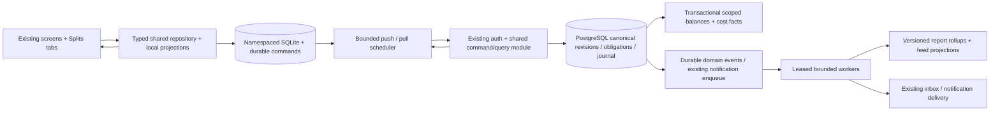
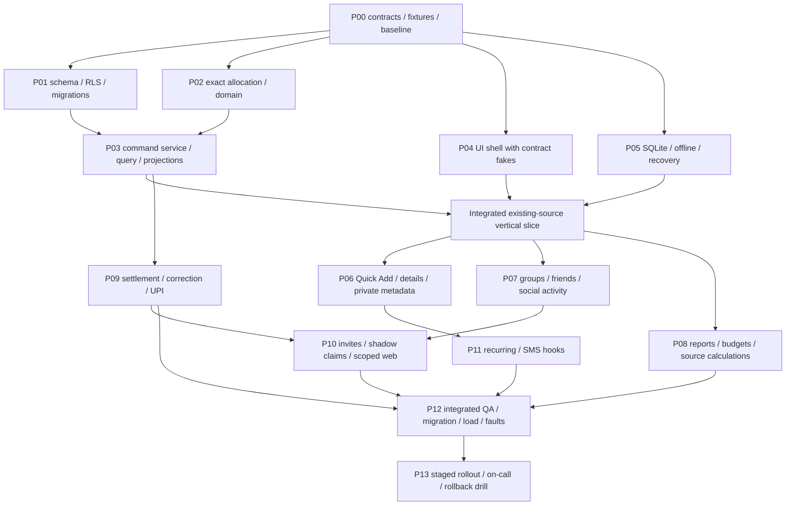

# PandaPay shared expenses: production implementation and multi-agent execution plan

Updated 4 November 2026. Current inspected baseline: **`sms-v2/integration` at `bf6bec9b`**, replacing the original `5cadaaa3` source baseline. **Foundation implementation has started; app integration, accepted financial writes and capacity certification remain gated.** See the [implementation register](../implementation/shared-expenses/README.md) for current evidence and the [SMS v2 branch investigation](shared-expenses-sms-v2-branch-review.md) for source evidence, stash preservation and revised gates.

## 1. How to execute this plan

This is the engineering execution companion to the [product/accounting/UX specification](shared-expenses-product-ux-accounting-spec.md), not a replacement. The amount vocabulary, C01–C22 examples, accounting rules and refreshed 113-screen disposition remain requirements. The [scenario matrix](shared-expenses-scenario-test-matrix.md) includes current v2 correction/replay/source-identity cases. The [agent work packages](shared-expenses-agent-work-packages.md) define ownership, dependencies and handoffs.

**Execution gate:** old draft contracts remain preserved in stash `30cb0be3f60acb810970147417f063de99e3cc4e` and were not applied. A revised [foundation interface subset](../contracts/shared-expenses-v1/README.md) now has exact allocation, one-expense balances/cost, source identity and checked amount adapters with shared executable Node/Dart fixtures. That bounded subset is delivered/tested and awaits independent review; [P00](../implementation/shared-expenses/P00-status.md) and [P02](../implementation/shared-expenses/P02-status.md) remain open. Complete full source-admission/command/ACL/consent/recovery and real DB gates before shared writes. Continue on `sms-v2/integration`; do not enable SMS v2 cutover as a Splits side effect.

Priority when sources disagree: explicit user decisions → repository `AGENTS.md` → current source and agreed financial contracts → these aligned plans → generated samples. Stop the affected implementation slice and resolve a genuine financial-contract conflict; unrelated work can continue. Do not treat a sample image, old review or old skill transcript as permission to change navigation, data or authentication policy.

Execution sequence: freeze shared contracts and fixtures; implement domain/storage and local operation semantics; integrate one source-linked expense end to end; expand people/groups, entry and reports; add settlement, automation and invitations; complete upgrade, load, fault and device gates; release gradually. Agents can work concurrently only across approved boundaries. A collection of passing isolated branches is not an integrated release.

### Non-negotiable outcomes

1. One economic expense, one personal share per recognized participant, independent actual funding records and immutable payment history.
2. No overwritten source amounts, lost legacy split notes, phantom bank debits, duplicated entries or reward inflation.
3. Correct exact arithmetic, retry-safe committed effects, explicit consent, scoped authorization and no silent financial last-write-wins.
4. The existing UI remains. Add **Insights → Splits**, with **Friends / Groups / Activity** top tabs. Contextual group tabs: **Expenses / Balances / Totals**. Payments gains the existing **Subscriptions** content as its third tab. Existing bottom navigation remains **Home / Wallet / Scan / Insights / You**.
5. Mandatory Bamboo UI/UX guidance and source-defined components/fonts; one header, one visible tab level and one primary creation action per context.
6. Bounded client/server work, measurable latency and cost, observable correctness, recoverable queues and data-preserving rollout/rollback.

## 2. Evidence, reuse and unresolved inputs

| Current evidence | Required action; do not overclaim |
| --- | --- |
| Current SMS v2 source facts/events/instruments/ledger, local `ProjectionWriter` and server `sms_v2/storage.js` own canonical source projection. | Add account-owned source adapters covering local `v2:<event hash>`, server transaction UUIDs, event/source aliases and source revisions. The shared journal models obligations, not another SMS/bank ledger. |
| `smsV2ReportingEnabledProvider` selects `LedgerReadModel` when flag/readiness permits; manual/legacy rows have a compatibility path. | Compose personal-cost projection over this owner once. Test flag-off, on-without-facts, mixed replay and v2-ready cases explicitly; no gross/own-share double count. |
| SMS corrections, replay/supersede, instrument rejection and foreign billed-INR confirmation change source eligibility. | Extend reservation/writer audit and remapping to those paths. Accepted shared history survives source retirement; changed cost requires a reviewed revision. |
| Existing foreign source original currency/rate/estimate/confirmed billed-INR and precision registry. | Reuse valuation and checked type adapters; do not build another FX registry or promote estimates into accepted INR debt/rewards. |
| [Legacy transaction split routes](../../api/src/transaction_splits.js) and [split model](../../app/lib/data/user_cards_repository.dart) store transaction-owned allocation metadata. | Preserve the old API/meaning. Add stable people, shared expenses, authorization and settlement records as an additive domain. Never infer account identity or debt acceptance from a note. |
| [SplitRepository](../../app/lib/data/local/split_repository.dart) stores a namespaced document plus coalescing pending state. | Reuse its account isolation, durable-save and conflict principles; an accepted settlement cannot be replaced by a later document edit. |
| [SyncQueue](../../app/lib/data/local/sync_queue.dart) intentionally coalesces field updates. | Keep it for suitable metadata. Build a namespaced shared-command outbox within the existing SQLite system for financial commands. `EXPENSE_TASK` is a proposed logical task category, not a verified current queue/table. |
| [FinancialReadWorker](../../app/lib/data/local/financial_read_worker.dart) states that its compatible query can still scan full history despite bounded returned DTOs. | Extend actual indexed SQL/read projections and profile them. Moving a scan to an isolate alone is insufficient. Preserve worker/recovery fences and explicit coverage. |
| [withUserClient](../../api/src/db.js) sets transaction-local identity and statement timeout. | Reuse that transaction/RLS boundary; add group-aware policies and carefully scoped functions rather than bypassing ownership with a broad service client. |
| [Notification enqueue](../../api/src/notification_outbox.js) is intended inside a user transaction; [worker](../../api/src/notification_outbox_worker.js) enforces `batchSize === 1` and bounded leases. | Reuse safe transactional enqueue where applicable. Verify database/role topology; a dedicated connection URL does not prove a different physical database. Do not simply raise worker batch size. Benchmark delivery concurrency and fan-out separately. |
| [Transaction paging](../../api/src/transaction_paging.js) already signs scoped cursors. | Reuse the ownership/pagination approach, but explicitly add filter/snapshot binding needed by shared queries. Do not change existing paging consumers without their compatibility tests. |
| [Local snapshot source](../../app/lib/data/portable_backup/local_snapshot_source.dart) explicitly excludes split staging. | Add recovery coverage for new pending operations before enabling writes. Existing source coverage cannot be assumed to cover new records. |
| [Historical performance ledger](../performance/IMPLEMENTATION_STATUS.md) and [baseline](../performance/PERFORMANCE_BASELINE.md) record unresolved device jank and unverified integrations. | Establish a current baseline. Those historical measurements are risk evidence, not current release results. No claim of smoothness from HTML/image previews. |

Before the capacity/release gate, the lead must record actual MAU/DAU, peak request mix, group-size distribution, current PostgreSQL version/topology/connection budget, row/index sizes, region/network/device mix, backup/failover guarantees, notification throughput, deployment migration mechanism and available on-call ownership. Work can start with the labeled assumptions below; broad rollout cannot proceed on invented infrastructure facts. No production credentials or real customer fixtures belong in an agent prompt.

## 3. Scope and quality targets

### 3.1 Initial supported contract

Support INR shared and direct expenses; equal/exact/percentage/shares modes; single/multiple payers; partial sharing; source-linked and friend-paid entry; groups/friends lifecycle; partial/overpayment; user-reported and receiver-confirmed settlement; safe UPI handoff; corrections/refunds/voids; offline operation/reconciliation; current app reporting touchpoints; recurring plans tied to actual charges; scoped invitations and recovery.

Percent/shares modes may be enabled after equal/exact pass the same arithmetic fixtures, without another editor. Unsupported modes remain hidden with safe read compatibility. Multi-currency settlement, itemized receipts, advanced debt simplification, bulk cross-group offset, provider-verified UPI and automated collections require separate capability gates and contracts. An intent-launch integration does not establish a payment-provider relationship. No guessed FX or misleading disabled-but-promised feature.

Proposed launch safety limits, to be validated by contracts and UX: 200 active members per group, 50 beneficiaries and 8 payers per expense, 64 KiB command JSON excluding separately uploaded attachments, 50 default/100 maximum list page size and 100 maximum local change records per pull page. Existing legacy split limits remain unchanged. Offer a clear validation message at a limit; do not truncate participants, money, payloads or pagination silently.

### 3.2 Proposed service and device objectives

These are **initial acceptance targets**, not measurements or claims. Confirm them in P00 using representative infrastructure and devices. Any revision must state the tradeoff and leave financial invariants intact.

| Objective | Proposed gate and measurement boundary |
| --- | --- |
| Shared API availability | 99.95% monthly successful eligible requests; report overload/server failures separately from expected authorization/validation responses. Provider handoff availability is measured separately. |
| Read latency | p95 ≤250 ms / p99 ≤750 ms, ingress to response completion for first-page indexed reads at target peak; disclose region, payload and warm/cold cache. Mobile network time is additional. |
| Financial command latency | p95 ≤400 ms / p99 ≤1 s to durable database commit, excluding external payment apps; no success before commit. |
| Local save | p95 ≤100 ms to durable SQLite draft/command commit on the reference low/mid-range device, with clear Saved on this device state. |
| Screen usability | Cached first useful Splits content p95 ≤300 ms after navigation; uncached useful content p95 ≤1.5 s on the specified network fixture. Measure content, not a blank first frame/skeleton. |
| Scroll/render | At 60 Hz, p95 UI and raster frame time each ≤16.7 ms and <1% frames missing the target budget in the defined list journeys; also test 120 Hz where supported. No synchronous history scan or frame >100 ms caused by the feature. |
| Correctness | Zero duplicate committed financial effect, unauthorized disclosure or unexplained reconciled monetary mismatch in release fixtures/soak; these are hard gates, not error-budget tolerances. |
| Projection freshness | Financial detail and affected scoped balances current at commit; broader report projections p95 ≤2 s / p99 ≤10 s under normal load, with revision/freshness shown when behind. Do not serve mixed-basis partial totals as complete. |
| Sync recovery | Normal online pending shared commands p95 acknowledged ≤5 s; reconnect recovery bounded and progressive. Queue age, not a spinner alone, determines alerting. |
| Disaster recovery | Proposed server acknowledged-financial-write RPO 0 requires verified synchronous/failover guarantees; otherwise record the actual nonzero RPO and do not promise zero loss. Proposed service RTO ≤30 minutes, proven by restore/failover drill. Device-only unsynced drafts cannot be guaranteed after device loss without a completed recovery export. |

### 3.3 Capacity model for a million-active-user envelope

Registered users are not concurrent users or requests per second. Use a parameterized workload and separately benchmark reads, writes, contention, storage and fan-out.

| Planning assumption | Result |
| --- | --- |
| 1,000,000 DAU, 20 list/detail/report reads per DAU/day | 20,000,000 reads/day; about 231.5/s average; 10× daily burst ≈2,315/s. |
| 4 accepted financial commands per DAU/day, including creates/edits/settlements | 4,000,000/day; about 46.3/s average; 10× burst ≈463/s. |
| 2 new expenses per DAU/day, mean 4 participants | 2,000,000 expenses/day. Beneficiary, journal, projection and notification amplification must be counted, not just API calls. |
| Illustrative 20 inserted/updated row operations per new expense | 40,000,000 row operations/day before edits/settlements/index/WAL/replication costs; **not** a prediction of persistent row count or bytes. Measure actual rows and byte growth. |

Benchmark an initial operating point of 2,500 reads/s and 500 financial commands/s mixed traffic, then 2× headroom and a short 5× burst with controlled shedding. These are demand scenarios, not a claim that the current database handles them. Include 50-member expenses, large histories, a hot group, a hot participant in many groups, slow replicas, queue backlog and abusive clients. No throughput result without hardware/topology/dataset/duration/error/latency/lock/WAL/CPU/IO/connection data.

Storage worksheet: daily inserted rows by table × measured bytes/row including indexes + audit/personal fact versions + attachment bytes + WAL/replica/backup overhead. Produce 30/90/365-day forecasts and cost per 1,000 commands, reads and notification deliveries. Retention, partitioning and maintenance must fit the measured growth **before** million-DAU enablement. Never solve growth by deleting unresolved obligations or breaking idempotency.

## 4. Architecture and transaction boundaries

Retain the current modular application and PostgreSQL/SQLite stack initially. Add a focused shared-expense module with internal contracts. Independent stateless API replicas and bounded workers can scale separately. Do not introduce Kafka, Redis, microservices, a new local DB or a separate monetary source of truth without measured need and a reviewed decision.



An external UPI app is outside this database transaction. Its launch, return, reported outcome and confirmed settlement are separate states. Domain commit never waits for an HTTP provider call, receipt OCR, contact lookup, notification send or analytics.

### 4.1 Owning records and constraints

**Source boundary on this branch:** the existing SMS v2 fact/event/ledger and foreign payment models remain private movement truth. Split source references are a typed union (legacy transaction / v2 event / confirmed foreign source), with owner, event/source aliases, optional actual canonical transaction UUID and reviewed source version. A local `v2:<hash>` key is never cast to UUID or sent directly to legacy split routes. New accepted source-funded operations wait for canonical admission; drafts remain recoverable meanwhile. The full adapter proposal is in the branch review.

Names below are **proposed**, subject to P00 schema review. Use an isolated `shared_*` naming family in additive migrations. Do not append shared state into unversioned legacy JSON.

| Record family | Responsibility / important constraints |
| --- | --- |
| Contexts and memberships | Group or private direct context, immutable IDs, revision, historical access policy, role/invite/leave state. Direct contexts authorize only their own participants; the Non-group bucket grants no access. |
| Members and bindings | Stable person/member identity, verified account binding, pending aliases and claim audit. Verified-phone uniqueness is enforced in the authorized identity system, not guessed from labels. |
| Expenses and revisions | Stable economic identity, current accepted revision, occurred/recorded times, total/currency, shared portion, author and recognition policy. Whole financial revisions are atomic. |
| Contributions and shares | Unique revision/member rows, exact nonnegative amounts; contribution sum and share sum equal the relevant expense total. Mixed funding has separate private source links. |
| Private source links | Owner profile + canonical source ID + linked funded amount + revision. Prevent total reserved funding exceeding the source and preserve canonical merge mapping. Peers never receive raw source evidence. |
| Journal and obligation allocations | Balanced accepted postings and deterministic debtor/creditor edges; obligation allocations preserve expense provenance. Journal is append-only, reversals linked; no balance fields synchronized from clients. |
| Settlement reports, confirmations, allocations, reversals | Sender/receiver/context/currency, actual amount, provenance, source linkage, operation identity. At most one confirmation financial effect per settlement; excess is explicit credit. |
| Payment attempts | Persisted before external launch; attempt state, scoped quote revision, destination identity and eventual evidence. A pending attempt does not reduce recognized debt. |
| Personal-cost facts and private classification | Stable expense/member and source-residual keys, current recognized cost and private category/tag links. Revisions replace current facts; audit versions remain distinct. |
| Scoped balance projections | Transactionally maintained context/member and pair amounts, currency/revision and obligation/credit counts, reconciled from canonical history. Informational cross-context friend net is a projection, never automatic offset authorization. |
| Commands / idempotency receipts | Actor + operation ID + canonical request hash + result reference, schema version and committed revision. Unique canonical effect references survive retries/restores. |
| Domain events / consumer checkpoints | Immutable event identity, aggregate revision, recipient/scope and minimal payload. Per-consumer uniqueness/checkpoint and replay provenance. |
| Preferences / delivery state | Per-user hidden-settled state, mutes, reminders, invitation visibility and notification dedupe; never delete financial records to implement visibility. |

Use SQL constraints/FKs/unique keys for local invariants. Cross-row sum checks require a controlled mutation function/service transaction and, where practical, deferred database checks; a column `CHECK` cannot validate a different table's sum. Application-role tests must prove that bypassing the public API cannot write malformed shared financial state. Privileged maintenance and worker roles have separate minimal permissions.

Use PostgreSQL integer minor units with exact aggregate handling; integer decimal strings on the wire. Node arithmetic uses checked BigInt helpers, not floating `Number` for financial operations. Dart extends the current Money model via a reviewed exact conversion/allocation seam, with backend/local golden parity; do not create unrelated widget math. Define maximum single amount and aggregate bounds in P00; proposed single INR expense cap ₹1 crore (1,000,000,000 paise), distinct from any UPI provider transaction limits. Bounds and overflow apply to sums, products, exports and web builds, not only inputs.

### 4.2 One financial command, one durable commit

1. Validate auth, feature capability, request shape/size/amount precision and current object authorization. The server derives actor identity.
2. Claim the actor-scoped operation ID atomically with the canonical request hash. An unchanged committed retry returns the original authorized result; changed payload under that key is a conflict. No check-then-insert race.
3. Lock all affected records in one **global ordering protocol**: contexts in stable ID order; source-reservation rows in owner/source ID order; expense heads; obligation/pair rows; then per-user projection rows in stable owner/currency order. Identity binding is a separate transaction unless the command's explicit reviewed ordering covers it. Never acquire another context late in the transaction.
4. Revalidate membership, source ownership/funding bounds, expected financial revision and, for settlement, quote/eligible outstanding. Source amount edit/delete/merge paths must participate in the same reservation protocol; otherwise the source/expense race is unresolved.
5. Calculate the complete exact result; persist the revision/postings/obligations/cost facts and affected scoped balances. For edits after payment, preserve old settlement allocations and post explicit corrections/credits.
6. Insert durable change events, current-user mutation receipt and authorized inbox/outbox work in the same database transaction. If notification delivery lives elsewhere, commit a local domain event and use a deduplicated relay; never pretend two databases share one transaction.
7. Commit before success. Return canonical DTOs, affected IDs, revisions, basis and coverage. Retry on selected deadlock/serialization failure only within a short bounded budget using the same operation identity. Exhaustion returns a retryable state, not false success.

Initial safe contention boundary: serialize financial mutations within a context. This deliberately bounds complexity for small groups; measure lock wait and hot-context throughput. Unrelated groups proceed concurrently, but a popular user projection can still contend. If targets fail, replace synchronous global summary updates with partitioned revisioned fan-in, explicit projection lag and read-your-write tokens **before** increasing admission; do not remove consistency checks. A context-wide mutex is not advertised as unlimited throughput.

Consistent lock order and short transactions reduce deadlock risk; PostgreSQL can still abort a deadlocked transaction, so retry behavior must be tested. [PostgreSQL locking documentation](https://www.postgresql.org/docs/current/explicit-locking.html).

Retain a unique financial command/effect identity for the supported record/replay lifetime even if a bulky HTTP response cache expires. Garbage-collecting a response must not permit the same restored operation to create money again. Old-schema payloads use the recorded result or a safe compatibility/review response, never an automatic reinterpretation. Metadata-command retention may differ only under the frozen replay policy. Reauthorize access to replay results; revocation must not disclose a formerly visible group's full payload.

P01/P03/P06 must inventory **every source writer**: individual edit/delete/restore, general sync, imports, duplicate merge, legacy conversion and any privileged repair path. A source mutation first discovers affected contexts, locks in the shared protocol, then rechecks the link set under the source lock. If another context/link appeared, abort and retry with the expanded sorted lock set; never acquire an unknown context late or rely on an unlocked pre-read. A new expense validates the latest source after acquiring its reservation lock. Tests must exercise writers beyond the new shared API; an old sync path must not bypass funding constraints.

Current-branch writer inventory also includes SMS v2 `ProjectionWriter`, `SmsTransactionActions`/correction service, server correction storage/projection, rejected-instrument cleanup, `LegacyReplay`, server legacy supersede/unsupersede, and foreign payment confirmation/refund/restoration. Map or block affected accepted funding under the shared protocol; do not delete shared history when source evidence retires. Keep existing source review/why/personal-format flows as their owner.

### 4.3 Exact allocation and settlement rules

- Allocate in integer paise with rational weights and largest remainders, persisting a deterministic tie order. ₹100 / 3 = ₹33.34 + ₹33.33 + ₹33.33. Retries, rename and reordering cannot move a paisa.
- Explicit percentages must equal the declared scale (for example 10,000 basis points); shares are nonnegative integers with a positive sum. Exact amounts must sum exactly; total 0, negative, NaN, infinity, overflow and excess decimal precision are rejected with actionable copy.
- Beneficiary share and payer contribution are independent. Author need not pay or benefit. Match negative and positive `P−S` values deterministically without constructing an N×N participant matrix.
- Personal cost = recognized allocated share + unshared own residual. Contributed actual charge, personal consumption, current obligation and received repayment remain separate measures.
- Initial netting is only the same debtor/creditor, context and currency with source provenance retained. Opposite obligations across groups/direct contexts remain distinct. True Settled requires no unresolved eligible obligation/credit/pending financial issue under the supported policy, not simply net zero.
- Settlement allocation uses oldest eligible expense first with stable ID tie order. Record allocations; do not recompute old payment application from today's names or chronology. A real excess payment is credit, never discarded or clamped away.
- Creating/editing an expense after settlement uses balanced reversals/new postings and a preview explaining refunds owed. A void preserves actual sources and payment history. Source unlink, source deletion, shared void, member hide and account deletion are different operations.

## 5. Read contracts, projection consistency and APIs

Freeze JSON schemas/fixtures in P00 before parallel implementation. New routes follow the existing app's auth/error conventions; proposed paths below are additive and must be reconciled with route registration.

| Proposed API | Contract |
| --- | --- |
| `POST /shared-expenses/commands` | Typed command envelope; required operation ID/schema version/expected revision and command-specific payload. Fixed allowlist, never arbitrary SQL or field patch. |
| `GET /shared-expenses/commands/:operationId` | Actor-authorized operation status/result reference after uncertain commit. Does not expose another user's request payload. |
| `GET /shared-expenses/overview` | Gross owed/owing/net by currency, pending/credit counts, revision/coverage, capabilities. Not computed from a single visible page. |
| `GET /shared-expenses/friends` and `/groups` | Signed keyset cursor, selected filters, summary scope, 50/100 page bounds, stable sorting; direct-context bucket explicitly typed. |
| `GET /shared-expenses/contexts/:id/expenses`, `/balances`, `/totals` | Authorized contextual views; explicit group-wide versus personal measures, period/currency and freshness. |
| `GET /shared-expenses/expenses/:id` | Bill total, shared portion, own share/cost/contribution, safe participants, source link permissions, latest revision, settlement allocation and allowed actions. |
| `GET /shared-expenses/activity` | Typed immutable financial/social events; actor/action/time/context and event-time values, paginated and scoped. Not a bank transaction list. |
| `GET /shared-expenses/changes` | Recipient-scoped monotonic change cursor with upserts, explicit tombstones/revocation and reset-required semantics. Keep existing general sync contract backward compatible. |
| `POST /shared-expenses/settlement-quotes` | Current eligible context/pair/currency amount, balances revision, payee confirmation and expiry; no debit/effect. Quote cannot guarantee state will remain unchanged. |
| Invitation preview/claim routes | Scoped anonymous summary where explicitly allowed; authenticated authorized claim/join commands. GET/social crawler requests never accept membership or debt. |

Example wire envelope (illustrative, schema to freeze):

```json
{
  "schemaVersion": 1,
  "operationId": "stable-client-generated-uuid",
  "kind": "CREATE_EXPENSE",
  "contextId": "authorized-context-uuid",
  "expectedRevision": 0,
  "payload": {
    "expenseId": "stable-economic-uuid",
    "currency": "INR",
    "totalMinor": "120000",
    "occurredAt": "2026-11-04T13:00:00Z",
    "payerContributions": [{"memberId": "you-member-id", "amountMinor": "120000"}],
    "participantShares": [
      {"memberId": "you-member-id", "amountMinor": "40000"},
      {"memberId": "rahul-member-id", "amountMinor": "40000"},
      {"memberId": "priya-member-id", "amountMinor": "40000"}
    ]
  }
}
```

Candidate machine codes: `REVISION_CONFLICT`, `IDEMPOTENCY_PAYLOAD_MISMATCH`, `SOURCE_ALREADY_LINKED`, `SOURCE_FUNDS_CHANGED`, `MEMBERSHIP_CHANGED`, `CLAIM_REVIEW_REQUIRED`, `PAYMENT_UNCERTAIN`, `QUOTE_STALE`, `CURSOR_SCOPE_MISMATCH`, `SNAPSHOT_INCOMPLETE`, `CAPABILITY_REQUIRED`, `RATE_LIMITED`. Define HTTP mapping and UI remedies once; do not let every agent invent a different envelope or generic retry behavior. Include request ID but no SQL/provider secrets.

### 5.1 Snapshot and coverage rules

- Reuse current `LedgerReadModel`/SMS v2 snapshot adapters for actual source reporting. The personal-cost layer replaces the linked source portion once; bank movements, points, investments/IPO holds and card-bill transfers retain source semantics. Existing v2 JSON minor amounts are integers; shared wire decimal strings require checked adapters without modifying SMS contracts or using floats.
- A list cursor is not automatically an immutable snapshot. Bind the signed cursor to actor/authorization epoch, context, filters, sort and schema. On revision changes, use documented refresh/deduplication semantics or a tested snapshot strategy; do not promise gap-free traversal of mutable sorts without one.
- Implement commit-safe ordered streams: context history uses the context head locked by the write protocol; personal changes use affected recipient-head rows locked in stable profile order. Increment the relevant head and insert events in the same transaction. This serializes sequence publication within each stream and rolls back failed increments. A cursor records scope and high-watermark; personal and selected-context streams are distinct. Do not scan every group's full history on app entry or fan out group-only history into everyone's personal-spending facts.
- Context history may include an authorized event between other members; fetch it on the selected group's bounded stream. Personal stream updates affected identities/balances/cost facts and membership/revocation notices. Freeze that recipient policy in P00 and test a nonparticipating member's freshness path. Do not use an independently allocated raw database sequence as proof that all lower values committed; test out-of-order commits and worker retries.
- Return `asOfRevision`, `coverage`, `pendingLocalCount`, `projectionStatus` and the basis required by the surface. Queries for labels with the same meaning must reconcile on one snapshot. Replica lag requires a primary fallback/read-your-write token or explicit refreshing state; never silently show a just-confirmed debt as unpaid again.
- Per-user report projection changes use a transactional delta keyed by event/consumer, updating both old and new date/category buckets. Settlement does not reprice consumption/rewards; a cost correction can restate the original period under the product policy.
- Shadow-compare new personal-cost reports against reference fixtures and exact recomputation. Rollups are rebuildable; canonical history is not replaced by cache contents. Avoid DISTINCT/SUM hacks masking join multiplication.
- Keep existing report defaults until a deliberate per-account, cross-surface capability/basis transition. Preserve existing budget basis. An actual-charge default is labeled Purchases you paid; only complete personal-cost coverage may be labeled Your spending. Do not enable just one personal headline while its drill-down uses gross amounts.

## 6. Offline-first client and recovery

### 6.1 Command state machine

`draft → locally_saved → ready → sending → acknowledged`, with explicit `retry_wait`, `blocked_conflict`, `blocked_permission`, `requires_review` and `cancelled_before_send` branches. A crash in sending resumes as uncertain: query operation status or resend the **same** operation. No regenerated IDs or automatic repeated payment-app launches.

- Persist local draft/current provisional projection/outbox command/dependencies in one SQLite transaction. On failure (disk full, schema error, encryption/unlock issue), show Not saved; retain recoverable input. Never close the editor with Saved when durability failed.
- Namespace every row/cursor/task/cache by account. Account switch pauses senders, cancels irrelevant reads and fences delayed replies; tasks from account A cannot send with B's token.
- Dependent create-group/member/source commands wait for acknowledgments or stable offline IDs. Unsent drafts may coalesce only before dispatch and with one well-defined intent; sent/acknowledged financial commands and settlement events are immutable.
- Reconnect uses bounded slices, per-context sequencing and global concurrency limits, exponential backoff with full jitter, Retry-After and app lifecycle scheduling. Proposed starting push concurrency 2 independent contexts, one active financial command per context, 25 commands/slice and ≤100 changes/pull page; benchmark alongside SMS/import/recovery traffic.
- Partial sync commits each page and its cursor atomically. Missing rows in an incomplete page never imply deletion. Expired cursors trigger a scoped rehydrate plus pending overlay, not clearing all local data.
- A conflict retains both versions and the user's draft. Show what changed and offer Review latest / Save revised proposal / Cancel local change; money fields never auto-merge based on wall-clock order.

### 6.2 Recovery coverage

Current source dependencies span v2 schema/outbox/sync/replay and foreign outbox state, in addition to generic sync and legacy split staging. The v2 outbox replaces the same kind/ID payload and upload only admits its own source/instrument/event/ledger types; do not insert immutable settlement commands there. Use a distinct shared-command protocol inside the same SQLite/recovery/scheduler system. Source acknowledgment and shared command acknowledgment are different checkpoints.

Extend portable backup/recovery manifests and account-recovery gates for each new SQLite/server table, command identity, source link, pending confirmation and private classification. Classify canonical rehydratable records versus unacknowledged local-only records. Device cursors, leases and authentication secrets are not portable financial data.

Export either captures a consistent pending-operation section or explicitly blocks incomplete capture with a resumable drain path. Do not silently exclude an offline expense while showing Backup complete. Restore preserves operation IDs, acknowledges already committed events and replays uncommitted commands only after current authorization/revision checks. Never restore confirmed settlements as new operations. Test old/new archive compatibility, schema migration, account binding, attachments and process death at every phase. An unsynced draft lost with an unbacked-up device cannot be recreated by a server guarantee.

## 7. UI/UX implementation contract

Mandatory app Bamboo guidance: [mobile UI guide](mobile-ui-guidelines.md), [theme and fonts](../../app/lib/app/design/app_theme.dart), [shared widgets](../../app/lib/app/design/widgets.dart). A separate installed Bamboo skill was not found in this session; these actual repository instructions are the enforceable app workflow. If provided later, read and apply that skill alongside them.

### 7.1 Fonts and components

- Headings: `BambooFonts.heading`, Outfit; body/tabs/buttons/labels: `BambooFonts.ui`, Outfit; monetary values: `BambooFonts.money`, IBM Plex Sans with tabular figures, existing `Money`/`MoneyText` formatting preferences.
- Use `AppBackground`, `AppSpace`, `AppRadius`, `BambooInk`, existing logo/icons/Pressable/sheets/loading/empty/error components. Slate decisions, lime only on slate, semantic readable jade/clay direction with words. No new font/icon package or per-screen font fetch.
- Preserve amount visibility, locale, appearance, font-loading/offline behavior, large text and accessibility. 44-point targets, keyboard-safe save action, adequate touch spacing and no clipped paisa. Generated samples are references; actual tokens/fonts govern Flutter implementation.
- Existing underline TabBar, scrollable for long labels. Keep tab index and current context in scoped state; do not render all list pages eagerly or stack two headers/two tab levels.

### 7.2 Screen and redirection acceptance

| Surface | Required UI and owner | Key failure/back behavior |
| --- | --- | --- |
| Insights | Add Splits tile alongside Spending; move standalone Subscriptions entry into Payments only once the tab works. Keep reward summary/all other destinations. | Preserve current urgency ordering, scroll and period. Feature unavailable does not remove Insights. |
| Splits/Friends | Gross owed/owing/net summary, friend search/filter, group/direct breakdown, Add friend, settled/no-expenses states. | Show pending/review separately; net zero is not automatically Settled. Back to Insights; retain each tab's state. |
| Splits/Groups | Group search/filter/create, concise rows, Non-group expenses and Show/Hide settled. | Hide never deletes, new obligation resurfaces; missing offline coverage is not no groups. |
| Splits/Activity | Actor/action/time/context/revision feed; safe avatars, explicit pending/confirmed wording. | Event-time amount differs from today's balance; updates/notifications do not add spending. |
| Group/Expenses | Current rows with Bill total / Your share / You paid; optional date, roster/settings, Add expense and secondary Scan Bill. | Paid for others differs from Not included. Authorized group-only rows do not pollute personal spend. |
| Group/Balances | Pair obligations, gross/net/credits, pending/disputes, safe settlement entry. | Requote if stale; do not pay a different friend automatically. |
| Group/Totals | Period/currency-labeled expense total, contribution/share, repayments and outstanding. | Reconcile with same scope; group total is not personal cost. Charts reuse Spending where appropriate. |
| Quick Add/Scan Bill | Expand existing owner with optional sharing, Paid by You/Someone else/Multiple and one allocation component. | No own funding control/default card when someone else paid; OCR is editable evidence, not proof of payment. |
| Transaction detail | Existing source ID/amount/category/tags/receipts; current action becomes Split with people or View split. | A saved split cannot be overwritten as empty while initial data is loading; permission/conflict has a recoverable action. |
| Existing Activity/Wallet/Spending/category/tag rows | Enrich linked purchase once; preserve charge amount in account contexts, own share in personal-cost contexts. | Source row versus social event typed explicitly; search/filter/export use the same basis and snapshot. |
| Settle-up sheet | Sender/receiver/currency/amount/current scope, UPI or record external payment; pending/confirm/reverse states. | Unknown return says Check your payment app before trying again. No success animation until the relevant accepted settlement effect. |
| Payments/Subscriptions | Reuse subscription content in third tab, one header, existing full amounts/status/add/detail. | Old links select the tab, Back restores filter/scroll/drafts; no recurring identities or history rewritten. |
| Incoming invitation/conflict/correction | Small scoped review sheets using original source and shared evidence boundaries. | No forced contact permission, automatic debt acceptance, raw SMS exposure or lost draft on cancel. |

One primary Add expense per active context; scan is secondary. Friend/group creation is contextual, not another global FAB. Main merchant Scan retains its current purpose. The [two sample sheets](prototypes/splits-tabs-2026-11-04/PROMPTS.md) demonstrate six states, not every screen/error state. Before UI sign-off render skeleton/empty/error/offline/permissions/conflict/pending/large-text variants, plus balances/totals, roster/settings/date and correction previews.

### 7.3 Concrete recoverable copy

| Trigger | Copy / action |
| --- | --- |
| Durable local save offline | Saved on this device. Waiting to sync. / View pending |
| SQLite failure | Expense not saved. Free some space and try again. / Retry, Keep editing |
| Changed accepted expense | This expense changed on another device. Review the latest amounts. / Review changes |
| Source already shared | This payment is already linked to an expense. / View split |
| Membership revoked | You can no longer post to this group. Your draft is saved privately. / Review draft |
| Phone claim | These expenses were recorded before you joined. Review them before accepting. / Review, Decline |
| UPI uncertain | Payment status is not confirmed. Check your payment app before trying again. / I paid, View details |
| Partial confirmation | ₹300 confirmed. ₹200 remains. / View payment history |
| Overpayment | ₹100 remains as credit with Rahul. / View credit |
| Refund after settled expense | The bill changed after repayment. You now owe ₹100 back to each person. / Review correction |
| Zero mixed position | Net ₹0. You still owe ₹600 and are owed ₹600. / View balances |
| Forecast | Planned share; no charge recorded yet. / View subscription |

## 8. Performance and processing design

### 8.1 Database and API

- Read current bounded projections for lists/summary; do not replay the journal per request. Reconcile asynchronously with a bounded authoritative recomputation job. Financial writes remain exact; cheap reads cannot excuse drift.
- Candidate indexes follow actual predicates: `(context_id, occurred_at DESC, expense_id DESC)`; `(profile_id, currency, counterparty_id, context_id)`; `(actor_id, operation_id)` unique; event recipient/sequence; outbox status/next-attempt/lease; and canonical source reservation uniqueness. Include authorization/filter keys. Validate indexes with EXPLAIN (ANALYZE, BUFFERS) on staging-sized data; do not blindly add every index or trust small fixtures.
- Avoid N+1 summaries or participant lookups; preaggregate owning relations before joins. Use bounded membership/participation and selected fields; no entire journal, raw SMS, attachment body or all group members in a list payload. Proposed first-page JSON cap 128 KiB before compression, excluding optional media.
- Prefer keyset paging; selected counts/summary use indexed maintained counters or separately bounded queries, not full counts on each keystroke. Debounce authorized search, enforce length/rate limits, cancel stale requests; expensive fuzzy/global search waits for measured indexing design.
- Enforce request and SQL deadlines, lock-wait budgets, connection acquisition timeout and per-actor/context admission. Total connection budget = API replicas × pool max + worker pools + migrations/admin reserve; autoscaling cannot exceed the DB budget. Record pool saturation/wait and cap worker concurrency.
- Retain per-user/request auth and RLS on cached reads. An optional cache key includes actor/context/currency/basis/filters/auth epoch/revision; cache is not authorization. Revocation invalidates access promptly. Shared financial responses are never served from a public CDN cache.
- If replicas are introduced, use them only for reads whose freshness contract allows lag. Primary/read-token fallback covers just-written financial state. Keep report lag explicit.

### 8.2 Client

- Indexed SQLite for context/member/period queries and bounded DTOs; preserve one DB connection owner per isolate and recovery fencing. No JSON decode/full-history sort or reconciliation in `build()` or synchronously on a UI tap.
- Lazy lists/slivers, stable keys and granular Riverpod selectors. Invalidate affected expense/context/profile projections rather than all Home/Insights/cards on every event. Keep reward/cap/milestone invalidation tied to actual source changes.
- Load the selected tab and adjacent state deliberately; do not request every friend's history, every group's totals and all reports on entry. Reuse in-flight requests and scoped caches, cancel irrelevant loads and keep stale useful content during refresh with a freshness label.
- Receipt OCR/import/large export and heavy projection work are background/bounded; do not compete unboundedly with SMS intake, cold start, auth storage, backup or scrolling. Bound image decode dimensions and cache/attachment sizes.
- Never force a refresh timer per visible row or per group. Prefer event-driven invalidation and one lifecycle-aware bounded sync scheduler; polling, if needed, has backoff/jitter and pauses appropriately.

Flutter's official performance guidance recommends controlling rebuild costs and avoiding unnecessary expensive layout/paint work. Use the app's existing patterns and profile real devices. [Flutter performance best practices](https://docs.flutter.dev/perf/best-practices).

### 8.3 Worker and notification behavior

- At-least-once events with unique consumer effect keys, revision checks and per-aggregate ordering. Fenced leases prevent a stale worker acknowledging work owned by another lease. Transactional projection update/checkpoint, not checkpoint-before-effect.
- Claims may use short `FOR UPDATE SKIP LOCKED` transactions for queues; do not use skipped rows as a financial balance read. That distinction matches [PostgreSQL's queue/locking guidance](https://www.postgresql.org/docs/current/sql-select.html).
- Bounded retries, backoff, poison-event quarantine and operator replay preserve IDs and payload hash. Automatic retry does not mean automatic UPI launch or acceptance of a changed claim.
- Notifications are post-commit, deduplicated and privacy-minimized. Actor need not receive their own push. Respect membership access, mutes, quiet hours, daily caps and disputed/unaccepted states at delivery time; outbox creation does not freeze permission forever.
- Coalesce suitable repeated **informational notifications** with explicit summaries, never financial commands or payment-confirmation effects. A million-user fan-out must have an independently measured inbox/delivery capacity, provider quota and cost model. Core ledger commits continue safely when push is degraded.
- Current notification worker batch size 1 is a safety contract. Scale independent bounded instances only after proving lease and provider throughput; any redesign is a separate reviewed task, not an agent's opportunistic optimization.

### 8.4 Scaling decisions and tripwires

Start with indexes, bounded queries, modular services and stateless API/worker scaling. Evaluate table partitioning/archival before the forecast outgrows maintenance windows; exact choice depends on access patterns and deployed PG version. Partitioned uniqueness/FKs and replay retention require explicit design. A monthly partition is not automatically compatible with globally unique operation IDs.

Tripwires: peak p99 misses after query tuning; lock wait dominating command latency; sustained pool queue; worker backlog older than freshness target; forecast storage/index maintenance exceeding budget; replica lag violating read contract; device scans increasing with history. Each triggers a measured decision record and a rollout hold, not a random new service. Sharding by context can isolate group journals but complicates cross-context friend summaries and private source funding; defer until a reviewed ownership/routing/reconciliation strategy exists.

## 9. Security, privacy and payment boundaries

- Server authorizes all commands, list cursors, individual records, source links, attachments, exports and async replays. Test under actual application RLS roles; successful owner tests alone do not establish cross-member security.
- Group membership grants only configured shared history. Private categories/tags, raw SMS, full account/balance data and original receipt access remain private unless explicitly shared. Define join-from-now versus selected historical access; do not imply membership grants all past data without policy.
- Invitation capabilities are high-entropy, scoped, expiring/revocable and protected against token leakage in logs/referrers/social previews. Anonymous preview reveals only intentionally scoped summary. Link-view GET never joins, creates debt or sends messages.
- Bind a shadow identity transactionally through verified account identity and explicit review of historical claims. OTP verification alone does not accept debt. Protect against recycled numbers, mistaken names, parallel claims and claim-versus-create races; preserve alias history and reject ambiguous automated merges.
- Use the existing deep-link owner; intentionally configure production HTTPS domain association and Android/iOS routing. Verify actual host associations, not just clicking a custom scheme. [Android App Links verification](https://developer.android.com/training/app-links/verify-applinks).
- Validate/encode UPI intent fields, currency/amount/payee and allowlisted handoff destinations. Do not scrape a provider app, store its credentials or treat callback text as verified bank settlement. Receiver confirmation and actual signed provider evidence, if a provider is later integrated, remain different provenance.
- Block/mute/report flows restrict harassment; source retention and legitimate outstanding disputes do not justify continued unwanted reminders. Apply per-actor/group invite and command limits; do not disclose whether an arbitrary phone has an account.
- Account erasure, retention and shared audit obligations need a documented product/security/data-owner decision before release. Reuse existing account-lifecycle gates, preserve remaining members' legitimate shared history under that policy, and do not copy recovery secrets into shared records. This document does not assert legal compliance.

## 10. Migration, compatibility and rollback

1. Inventory existing populated split/source/category/tag/receipt/pending state and current migration ledger; establish provenance of unrelated work. Never rewrite applied migration files, reset the DB, clear app data or auto-adopt checksum drift.
2. Add new tables/policies/indexes and API capabilities with feature writes off. Give each migration one owner; choose its number from the actual current ledger, not a hardcoded plan number.
   Current branch includes migrations through `20261112200000_sms_v2_correction_update_guard.sql`; inspect actual sorted ordering before reserving a successor. The old 20261104 suggestion would precede existing v2 migrations and is superseded. Add current role manifest, v2/foreign coverage and lifecycle inspection to P01.
3. Use expand/validate/backfill/activate/contract staging. Backfills are resumable, checkpointed, idempotent and throttled. Validate counts, IDs, amounts, notes, relationships, pending operation IDs and report totals on old populated accounts. Do not reinterpret legacy others-share rows as a list already including the user.
4. Legacy conversion is opt-in/reviewed: map people, preview owner remainder, preserve note/privacy, establish a stable conversion ID and atomically replace/exclude old personal-cost effects. Pending legacy edits must be synced/reviewed or version-fenced; old clients cannot overwrite a converted shared allocation silently.
5. Keep legacy APIs and old-client reads functional. Capability/version checks gate new writes; an old client may read a safe summary or be told this shared record needs a newer app. Never downgrade it into a fake source transaction or silently lose unknown fields.
6. For live large-table indexes, evaluate concurrent builds separately from transaction-wrapped migrations and verify invalid-index cleanup/retry. The database version/migration runner must support the exact approach. [PostgreSQL concurrent index caveats](https://www.postgresql.org/docs/current/sql-createindex.html).
7. Build report projections in shadow mode; do not change active spending basis or issue historical reminder storms until reconciled activation. Subscriptions navigation is a route/body change, not a recurring-data migration.
8. Rollback gates stop new writes/automation first; read access, pending-operation recovery, source history and exports remain available. Restore the last schema-compatible binary/config; additive tables/events stay. Do not reverse real user payments or drop new tables to make an old binary start.
9. If a correctness invariant fails, fence affected writes, preserve evidence, reconcile from the last good checkpoint and post audited compensating events after review. No operator SQL editing cached balances as an unexplained fix. Cross-app rollback must not mix gross and personal spending projections.

## 11. Multi-agent implementation sequence

Detailed packets, acceptance gates and copyable agent instructions are in the [work package register](shared-expenses-agent-work-packages.md). A lead owns shared contracts, migrations, integration files and release decisions. Workers own narrow modules and provide evidence; they do not merge/deploy independently.



Waves are dependency gates, not date promises:

| Wave | Work in parallel | Exit requirement |
| --- | --- | --- |
| 0: baseline/contracts | P00 plus evidence gathering, UI state inventory and test-fixture preparation | Money/API/event/recognition/authorization contracts frozen; source/runtime unknowns recorded; proposed targets agreed. |
| 1: foundations | P01, P02, P04 fake-backed UI and P05 local store | Real DB/RLS and cross-runtime fixture tests; offline persistence/recovery contract; no app-wide production writes. |
| 2: first complete slice | P03 + lead-owned adapters, with P04/P05 integration | Existing transaction → one expense → correct detail/balance → offline retry → same result after restore. Rewards/source amounts unchanged. |
| 3: product breadth | P06/P07/P08/P09 with owned seams | All tab paths, friend-paid/multiple payers, reports and partial/corrected settlements reconcile. |
| 4: distribution/automation | P10/P11; P12 grows continuously | Invitations/claims and recurring/SMS link once, preserve privacy, recover uncertain operations and avoid notification fatigue. |
| 5: hardening/release | P12 then P13 | Full scenario matrix, populated upgrades, device flows, tested capacity/DR/rollback and on-call owner. |

Do not force this into three sprints by omitting contracts, restore, corrections or performance gates. Sprint sizing depends on team capacity and discovered migrations; package acceptance determines progress, not how many generated files exist.

**Revised first gate on SMS v2:** update source identity/eligibility and numeric adapters, readiness/reporting matrix, correction/replay reservations and existing foreign valuation before treating P00 as frozen. Restore no old draft contracts automatically. Preserve existing SMS WP ownership, refresh branch dependencies from their current lockfiles and pass source-regression fixtures before beginning new shared writes. Split UI/navigation decisions remain unchanged.

## 12. Verification, observability and release

### 12.1 Required evidence

- Preserve and implement C01–C22 fixtures from the product spec plus every applicable [scenario matrix](shared-expenses-scenario-test-matrix.md) row. Labels P0/P1 denote release ordering, not optional correctness.
- Pure math/property tests across Node and Dart; real PostgreSQL migration/RLS/constraint/concurrency tests; SQLite files with kill/restart/upgrade/low-disk faults; contract compatibility and two-device reconciliation. Mock-only tests cannot prove SQL locks, durable commit or authorization.
- UI tests cover meaningful actions and restored state, not only finding text. Render real Bamboo fonts at 320/360/430-point widths, large text, hidden amounts, keyboard, reduced motion and screen readers. Profile signed-in populated physical devices; retain exact serial/version/backend/sign-in/flow per `AGENTS.md`.
- Load a staging dataset representative of 30/90/365-day distributions, including one high-history user and hot contexts. Test target mixed peak for ≥60 minutes, 2× headroom for ≥30 minutes, short burst plus backpressure recovery, and ≥24-hour soak. Include DB/worker restart, network interruption, notification outage and delayed events without monetary mismatch. Durations are proposed baseline test plans, not already completed results.
- Migration/recovery evidence: before/after counts/digests/FKs/amounts/private metadata/pending IDs; old/current client and archive compatibility; two-device recovery and actual database restore/failover drills.
- Document blocked/failed/inconclusive checks explicitly. Historical Windows Flutter hangs require a reliable CI/alternate-runner result, not a claim that unexecuted tests passed. No broad repeated suite reruns without new failure/change justification.

### 12.2 Instrument from the first slice

Operational questions: Did one intent commit once? Are all views reconciling? Are users stuck offline or awaiting payment confirmation? What part of processing is slow/costly? Can affected writes be stopped without losing data?

| Signal | Required dimensions / action |
| --- | --- |
| API rate/errors/latency | Endpoint/command kind/result/version/cohort; latency histograms and bounded error codes. No user/group/expense IDs as unbounded metric labels. |
| Money invariants | Allocation mismatch, journal imbalance, duplicate-effect conflict, source over-reservation, cached/canonical reconciliation delta and snapshot lag. Any confirmed unexplained monetary mismatch pages/fences writes. |
| Contention/resources | Lock wait, retries/deadlocks, DB pool wait/saturation, rows scanned/returned, slow queries, WAL/IO/storage and worker event-loop lag. |
| Queues/recovery | Oldest command/event age, pending/blocked/retry/poison counts, lease expiry/reclaim, cursor reset and recovery incomplete counts. |
| Payment experience | Attempt → launch → report → confirm/reverse funnel and age of unresolved attempts; provider verification kept separate. No VPA/UPI URI or callback raw body in logs. |
| Client UX | First useful frame, UI/raster budgets, tab navigation latency, local durable-save latency, crash/ANR and memory; record device/build/network class and sample rate. |
| Growth/notifications | Authorized preview → join/review → activated share; invite abuse/report/mute and deduplicated delivery rate/cost. No purchase/referral awards from split clones. |

Structured allowlisted logs/traces correlate request/operation/event IDs and entry point; redact tokens, phones, SMS, VPAs, receipt URLs, bank details and financial free text. IDs can be restricted log fields, not high-cardinality public metrics. Financial audit trails are access-controlled domain records, not sampled analytics.

Proposed alert triggers: any real invariant breach or unauthorized access; sustained 5xx >1% over 5 minutes; p99 command latency >1 s with load/lock evidence; online pending age >60 s; report projection lag >30 s; delivery backlog beyond agreed reminder freshness; pool acquisition saturation or predicted disk exhaustion. Tune normal baselines before paging broadly; do not hide correctness incidents in availability averages.

### 12.3 Rollout gates

Separate kill switches/capabilities for shared reads/writes, legacy conversion, personal reporting, settlement launch/reporting, invitations, recurring/SMS suggestions and push/reminders. Server enforcement is authoritative; local flags alone are insufficient. Kill switches preserve draft/read/export/recovery access.

Rollout sequence: disabled deployment → internal fixtures → explicit internal accounts → 0.1% → 1% → 5% → 25% → 50% → 100% of **eligible** accounts. Proposed hold: at least one full daily cycle per early stage and one recurring/billing observation window before broad recurring automation. Volume and confidence matter; low-traffic stages need longer. Membership in a group does not force every member onto a partially supported client contract.

Advance only when correctness, privacy, source/reward invariance, capacity/device budgets, migration/restore and support signals pass. Stop new writes immediately on duplicate money effects, unauthorized data exposure or unexplained monetary mismatch; degrade nonessential notifications/charts first for capacity pressure. A platform-wide DB incident follows the existing incident process, not a feature-only cache workaround.

## 13. Definition of done and handoff

- Current spec, this plan, agent contracts and HTML summary agree on navigation, amount semantics and capability order.
- All required packets have integrated code, tests and reviewer evidence; no fake success states, mock-only financial behavior, placeholder permissions or unowned migrations.
- Existing unrelated UI/data, legacy splits, source IDs/private metadata, rewards/card state, recurring history and pending operations are preserved through upgrade, replay and rollback.
- Each supported scenario has a passing artifact, or is explicitly unavailable behind a reviewed capability with clear UX. Deferred scenarios are not advertised as implemented.
- Actual production workload/topology/capacity/cost/DR assumptions replaced with evidence. Millions-user readiness is established by representative measurements and operational review, not a diagram or user-count label.
- User-facing screens use actual Bamboo Ink fonts/tokens/components; no duplicate pages/forms/navigation or data-clearing install.
- Release owner, on-call escalation, dashboards, safe replays, rollback and data repair are documented and rehearsed. No AI worker independently deploys, sends external messages or declares financial verification.

## 14. Open decisions that must close before their dependent gates

| Decision | Proposed default / owner |
| --- | --- |
| Actual traffic/topology/SLAs and budget | Use section 3 only as a planning envelope; lead + operations replace it with measurements before scale gate. |
| Group posting/acceptance and historical access | Explicit established-group policy; direct incoming claims require review. Product + security freeze in P00 before shared writes. |
| Member removal/erasure/financial record retention | Preserve accepted obligations and private access boundaries under existing lifecycle policy; data/security owner records exact supported behavior before P07/P10 release. |
| Provider-verifiable UPI evidence | No provider integration assumed. P09 ships intent plus reported/receiver-confirmed states; provider claims remain disabled. |
| FX/advanced netting/itemization | Deferred capabilities with safe imported-read behavior and no guessed conversions; separate reviewed design required. |
| Font availability on fresh/offline installs | Reuse current font path; UI owner verifies actual behavior. If assets need packaging, make a scoped design-system/dependency change with provenance and app-wide regression review. |

## 15. Reference checks used for this plan

Local code/source anchors are listed in section 2; these establish current implementation seams, not live production configuration. Primary platform documentation was checked for PostgreSQL [locking](https://www.postgresql.org/docs/current/explicit-locking.html), [queue-style SKIP LOCKED behavior](https://www.postgresql.org/docs/current/sql-select.html), [concurrent index migration caveats](https://www.postgresql.org/docs/current/sql-createindex.html), Flutter [performance practices](https://docs.flutter.dev/perf/best-practices), and Android [App Links verification](https://developer.android.com/training/app-links/verify-applinks). Verify against the actually deployed versions during implementation. No provider pricing, legal compliance or benchmark result is asserted here.
