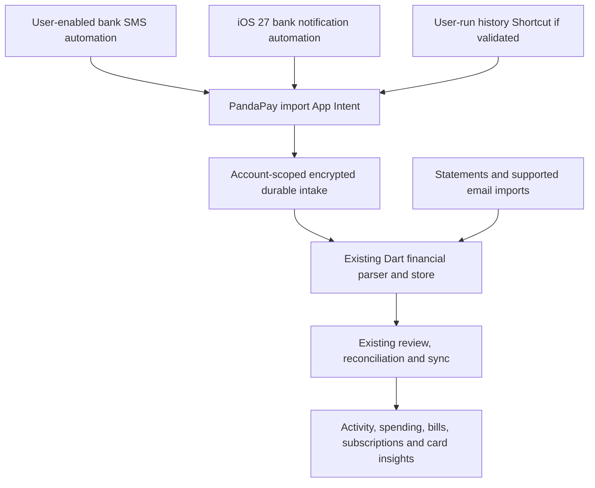

# iOS financial import options

Research date: 26 October 2026. Scope: the SMS-driven financial features in PandaPay, with an India-focused bank, credit-card and UPI use case. This began as a feasibility proposal; a separate real-iPhone diagnostic was tested afterward. No production change was performed.

Follow-up: the [simulator prototype](ios-shortcuts-prototype-results-2026-10-26.md) demonstrated the Shortcuts-to-parser handoff, and a [physical iPhone test](ios-physical-history-probe-2026-10-26.md) retrieved five older message bodies through Find Message. The [27 October shared-intake prototype](ios-shortcuts-shared-intake-2026-10-27.md) recovered the original Date for a single Message and verified the actual shared capture store on iOS. Sender extraction and complete Android capture parity remain unverified.

## Decision

Prototype an Apple Shortcuts → PandaPay App Intent adapter before committing to an iOS ingestion design. Use Message automations for incoming bank texts, investigate the Messages history actions available in iOS 26+, and add notification automations for bank/UPI apps on iOS 27. Keep statements and email as independent reconciliation sources.

The current evidence supports a credible path to sharing the financial processing and product experience. It does **not** establish identical capture coverage, recovery, latency or setup to Android. PandaPay cannot itself obtain Android's SMS-provider permission on iOS. Shortcuts is a separate, user-controlled route that needs its own consent and setup.

Do not base the decision on the older blanket claim that iOS has no useful SMS automation or history actions. Apple's current documentation describes capabilities that deserve a device experiment.

## What Apple documents, and what is still an inference

| Mechanism | Documented capability | PandaPay interpretation and limits |
| --- | --- | --- |
| Message automation | Shortcuts can trigger on a sender or message text; Message automations can run without asking each time. | Candidate for forwarding each matching incoming bank text into an import action. Actual body/sender/date mapping, alphanumeric bank senders and locked-device behavior need validation. |
| Messages history actions, iOS 26+ | Apple lists Find Message and Find Conversation among Messages' Shortcuts actions. | Candidate for a user-initiated history import and later recovery scan. The release notes alone do not prove complete results, pagination, full-body export, identifier stability or available permissions. Treat this as the most important unresolved experiment. |
| Notification automation, iOS 27 | Apple adds an automation for a notification from a selected app; filters can use notification message, subtitle or title. | Candidate for bank and UPI app alerts. Only the data actually present in an emitted notification can be parsed. It is not a general notification-listener entitlement for PandaPay. |
| App Intents | Apps can expose actions to Shortcuts, including actions that run in the background. | Build a native Import Financial Message action that accepts supplied content. An App Intent exposes PandaPay's operation; it does not independently grant access to Messages. |

Sources: [Apple communication triggers](https://support.apple.com/en-kw/guide/shortcuts/apdd711f9dff/ios), [automation without confirmation](https://support.apple.com/en-euro/guide/shortcuts/-apd602971e63/ios), [iOS 26 Shortcuts actions](https://support.apple.com/en-au/125148), [iOS 27 Shortcuts changes](https://support.apple.com/en-sa/149045), [notification trigger settings](https://support.apple.com/en-tm/guide/shortcuts/apd932ff833f/ios), and [App Intent runtime behavior](https://developer.apple.com/documentation/appintents/configuring-the-runtime-behavior-of-your-app-intents).

The iOS 27 notes also describe automations embedded in shared shortcuts. This may simplify distributing setup presets, but importing a preset must not be confused with the user activating it and granting its permissions. Earlier iOS versions need a different onboarding flow. The exact automation UI must be checked on each supported OS.

Apple's older SiriKit search interfaces, such as INSearchForMessagesIntentHandling, let a messaging app expose **its own** messages to Siri. Implementing one in PandaPay would not unlock the Apple Messages database. [Apple's interface description](https://developer.apple.com/documentation/intents/insearchformessagesintenthandling).

## Existing Android behavior that must be accounted for

The existing Android design includes an initial inbox capture, live deliveries, a durable incremental checkpoint, catch-up after interruption, local parsing/display, and a durable upload/reconciliation queue. Card discovery can reuse retained financial messages. See [the SMS capture architecture](sms-capture-and-sync-architecture.md).

This distinction matters: demonstrating one successful transaction from an iOS Shortcut would not prove parity with Android's history scan and recovery behavior.

| Android-derived function | iOS route to investigate | What could prevent parity |
| --- | --- | --- |
| Import existing financial SMS | User-run history Shortcut on iOS 26+; statement/import fallback | History action output, result limits, indexing and permissions remain unverified. |
| Capture new bank texts | Message automation → App Intent | Filter coverage, sender variants, activation, interruptions and execution permissions. |
| Capture bank/UPI app alerts | Notification automation on iOS 27 → App Intent | No usable notification, incomplete text, repeated/updated alerts, or a skipped automation. |
| Spending, bills, dues, subscriptions and card discovery | Existing financial parser/store after content is captured | A source may omit dates, card identity, due amounts or other fields present in SMS. |
| Offline use | Encrypted local intake and existing local financial store | Capture permissions, protected storage availability and execution time while locked. |
| Recovery and no duplicates | History recovery if validated; cross-source reconciliation and statements | Shortcuts may not supply a durable provider row ID; recovery cannot be assumed. |

The processing can be reused for recognized inputs. Equivalent screens do not establish equivalent completeness of the underlying records.

## Proposed integration

The iOS-specific component should capture supplied evidence and record its origin. It should not be a second independent implementation of PandaPay's complete financial grammar.

The intent needs source type, supplied message text, sender/source app when available, original event time when available, capture time, device/account ownership, and a stable source identifier if the system supplies one. Missing metadata must remain explicitly unknown. Capture time is not automatically the transaction date.

Use a minimal native capture step with an atomic encrypted queue before attempting a Flutter background handoff. Keep the existing Dart parser canonical. The proof of concept must determine whether the existing parser can finish during the allowed background execution. If parsing can only finish when the app next opens, that introduces a latency difference and must be reflected in product behavior.

Exclude OTPs and other sensitive/nonfinancial inputs before durable retention, using the same safety semantics as the current intake. Do not put financial text or reusable account tokens into URL query strings or logs. Tie intake to the signed-in account at capture and preserve that ownership across logout/account changes.

Use an App Group only if the chosen app/extension execution model requires shared storage. A shared container by itself does not provide encryption. Reuse the existing domain processing, rather than storing raw bank texts in widget display preferences.

Cross-source matching needs special care: one payment can generate a bank SMS, a UPI notification and an email. Conversely, two real payments can have the same merchant and amount. Do not deduplicate merely by amount, merchant, or body text; preserve ambiguous matches for reconciliation/review.

## Repository readiness

- [Import Hub](../app/lib/features/import/import_hub_screen.dart) currently exposes automatic SMS as Android-only.
- [LocalSmsParser](../app/lib/data/local_sms_parser.dart) takes sender, body and received time, making it a candidate for reuse once an iOS adapter supplies the evidence. It still needs meaningful source metadata and the existing account/card context.
- [Document import pipeline](../app/lib/data/transaction_import_pipeline.dart) already covers PDF, spreadsheet, delimited and JSON documents. Screenshot import is also present. Their code presence is not a substitute for iPhone validation.
- [Gmail discovery](../app/lib/features/import/gmail_discovery_service.dart) scans bank emails for card discovery. It is not currently a complete automatic Gmail transaction-import service.
- The forwarded-email webhook in [the API](../api/src/index.js) contains parsing and automatic transaction creation for recognized emails. Actual receiving-provider configuration, bank coverage and delivery were not inspected during this research.
- The iOS project has a widget extension, but no financial-import App Intent/Shortcuts adapter was found. Its deployment target is currently iOS 15.5; new capabilities need availability checks or a deliberate minimum-version decision.
- The local active Xcode is 26.6. Evaluating iOS 27-specific behavior requires a compatible toolchain and target device.

## Other options and why they do not settle the problem alone

**Email and statements.** Useful for history and reconciliation, particularly when an SMS or notification is missed. Email only covers events a bank actually emails, and a monthly statement cannot provide the same immediacy as a transaction alert. A new server-side Gmail feed would be a separate OAuth, privacy and operations project: Google's push mechanism targets a backend through Pub/Sub and requires renewal of mailbox watches. [Google's push documentation](https://developers.google.com/workspace/gmail/api/guides/push). Existing forwarding and import code should be evaluated first.

**IdentityLookup SMS filter.** Apple limits it to incoming messages from unknown senders; the documented filtering interface excludes contacts and iMessage. It cannot write to containers shared with the containing app or make direct network requests. System-managed server deferral exists for filtering, but does not turn this into a full local, account-owned message archive. It should not be presented as a drop-in replacement for Android intake. [Apple's filtering documentation](https://developer.apple.com/documentation/identitylookup/sms-and-mms-message-filtering?changes=_1).

**TelephonyMessagingKit.** This is a genuine carrier-messaging API, but it requires PandaPay to become the default carrier messaging app and requires end users to have an EU-registered account and be in the EU. It does not solve the India-focused use case. [Apple's framework requirements](https://developer.apple.com/documentation/TelephonyMessagingKit?language=swift).

**FinanceKit.** Apple's documented eligibility and supported accounts cover the US and UK. It is not a general feed for Indian bank, UPI and credit-card accounts. [Apple's availability page](https://developer.apple.com/financekit/).

**Indian Account Aggregator/bank partnerships.** Worth investigating as an additional structured-data source. Direct FIU participation requires an eligible regulated entity; PandaPay would need a suitable eligibility/partnership model and provider confirmation of the exact accounts, fields and refresh coverage. Do not assume this produces every credit-card alert, due date or rewards fact. [Sahamati participation FAQ](https://sahamati.org.in/faq/).

**Manual fallback.** User-selected statements, copied SMS text and shared screenshots can fill gaps. They require user action and therefore do not satisfy fully automatic parity on their own.

## The experiment that decides whether this meets the requirement

Build one small, separately reviewable iOS prototype before a full port. Its acceptance work should cover:

1. On iOS 26 and 27, check the actual Messages Find Message/Find Conversation actions, full text/date/sender output, permissions, old bank messages, alphanumeric bank sender IDs, result limits, large histories and whether repeated date-window imports can recover missed events.
2. Pass a real bank Message automation into PandaPay's native import action; establish the full field mapping and behavior with the phone locked, app closed, after reboot/first unlock, and offline.
3. On iOS 27, test representative bank/UPI notification payloads and bursts, previews disabled, Focus/summaries, app notification settings, and a duplicate SMS for the same payment. Apple documents the trigger, not an Android-equivalent durable delivery guarantee.
4. Compare the resulting financial observations with the Android parser's output for the same supplied texts: spends, credits, refunds, transfers, bills/dues, EMI/autopay, subscriptions and card identity. Missing evidence must not be invented.
5. Exercise interrupted capture, retry, account switching, repeated equal-amount transactions, and overlapping historical/live/email imports. Verify that no OTP or unrelated text is retained.
6. Confirm setup on a real user's supported iOS version, including imported preset activation and any first-run consent. Show a successful test capture and a last-received timestamp; do not label the whole inbox as synchronized unless that has actually been verified.

The outcome should be a capability matrix by iOS version with measured gaps. If history export or recovery is insufficient, the honest product contract is automated supported new events plus statement/email reconciliation, rather than a promise of identical Android capture.
