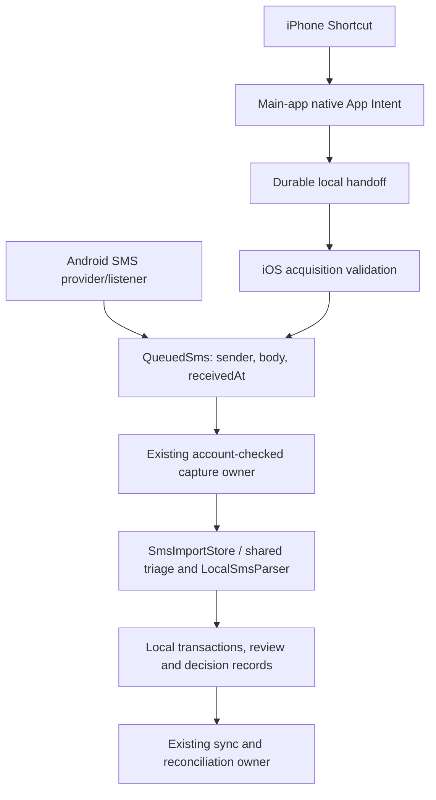

# Integrating iPhone Shortcut SMS acquisition into PandaPay

Prepared 29 October 2026. This document describes required implementation work; it does not claim that production iPhone integration, durable capture or locked-device delivery is implemented. The prototype remains a diagnostic until the acceptance checks below pass.

Updated 30 October 2026: added ongoing catch-up reconciliation on app open and optional daily Shortcuts automation. These use one shared range-job owner and a completed receive-range checkpoint, not the last live message or app-open timestamp.

The [implementation execution plan](ios-sms-intake-implementation-plan-2026-10-30.md) now defines phased work, deduplication identities, nonblocking UI/status behaviour, concrete components, release gates and tests. It includes the latest requirement that reopening after several days must leave the app usable while catch-up is pending or processing.

## Objective and boundary

Replace the isolated prototype app with an acquisition adapter in the real PandaPay iPhone app. Android continues obtaining SMS through its existing provider/listener; iPhone obtains user-authorized messages through Shortcuts. Both supply the same sender/body/receive-time contract to the same account-scoped PandaPay algorithms.

Keep financial classification, personal-number policy, transaction parsing, learned rules, canonical deduplication and upload contracts shared. Do not infer a financial classification in Swift or create an iPhone-only parser. Each device uses its own local database and the appropriate account state; the devices do not need one physical database.

## Required onboarding: selected history, one month at a time

The user requires new iPhone users to choose how far back to import, including at least **two years** and custom dates. PandaPay must coordinate the same reusable history Shortcut **one calendar window at a time** through that chosen period. Do not substitute “latest 500 messages” or another message-count cutoff for the chosen dates.

The [monthly history onboarding specification](ios-monthly-history-onboarding-spec-2026-10-29.md) defines the period picker, exact calendar boundaries, persisted job/window state, sequential launch/finish/processing checks, pause/resume, large-month splitting and acceptance tests. The app owns the queue; the Shortcut handles one issued interval. A rolling two-year period can intersect 25 calendar months because its first and final months are partial. Empty windows do not establish that older history is absent and do not end the selected import.

Add a main-app onboarding/import screen, an `IosHistoryImportCoordinator` and an account-bound durable job repository in addition to the native input spool below. Advance only after reconciling the previous interval's persisted receipts; unresolved metadata, capacity or execution failures remain explicit. Next-window launches must be verified on the target phone and offer a saved **Continue import** point if iOS requires interaction. This is required production work, not functionality already present in the installed probe.

## Ongoing live capture and catch-up

The [live/catch-up review](ios-live-capture-reconciliation-review-2026-10-30.md) consolidates the user's additional requirements into live acquisition plus one reconciliation engine. App startup/resume, an opt-in daily Shortcuts automation and manual retry trigger the same engine; a separate daily importer is unnecessary. Initial monthly history remains a separate selected range-job type using the same acquisition/processing ownership.

Persist account-scoped completed receive-date intervals and a contiguous **reconciled-through** boundary. Drain existing durable input first, then search from unresolved gaps/the completed boundary with a deliberate overlap through a frozen current cutoff. Two or three missed days must all be included; never advance the checkpoint from a new live SMS, an app opening or a successful server upload. Commit it only after validating persisted search/finish receipts and shared outcomes. Retry/cancel/incomplete states cannot skip a gap.

Reuse the existing canonical deduplication for repeated live/range input. Equivalent original sender/body values are required; the existing key excludes receive time and may collapse distinct identical messages. Any identity-policy correction belongs in shared code. Show search counts, duplicates, ignored results and new transactions separately.

The screen need not be open for the intended native live handler, but durable saving is required when Flutter is absent. Daily acquisition should be an optional user-enabled **Time of Day → Daily** Shortcuts automation, tested with the whole recipe on the target device; an exact background timer in the main app is not a reliable acquisition mechanism. No guarantee of silent execution or complete Messages indexing follows from one successful test. App-open range launch may switch to Shortcuts or need a continuation; avoid a repeat launch loop.

## Nonblocking catch-up and replay protection

On startup/resume, show existing local data first and schedule catch-up after the app is usable. Keep navigation/editing available and show a compact, nonmodal status/progress strip near the top of the existing shell. Do not await reconciliation in routing or cover the application with a spinner. If Messages acquisition requires opening Shortcuts, show **Continue catch-up** rather than force an app switch; an all-background source query remains a device-verification question. Already-saved messages can be processed in the existing worker while the user stays in PandaPay.

Reuse PandaPay's shared SHA-256 source key and final decision/receipt checks; do not add scan timestamps to that key. Add a durable acquisition receipt/occurrence ledger for efficient repeated handoffs only when original sender/date evidence is trustworthy, without replacing shared financial identity. Pending/failed work must remain retryable; a record's existence is not a successful processing acknowledgement. Database uniqueness, short atomic writes and fenced ownership must handle races and crashes. The execution plan gates any change needed for distinct identical sender/body occurrences across Android/API/iPhone, so deduplication cannot silently erase genuine repeated payments or introduce an iPhone-only identity contract.

Keep large parsing batches off the UI isolate, constrain the existing synchronous fallback after worker failure, and profile ordinary navigation/editing during catch-up on a real phone. Status text distinguishes waiting for acquisition, processing, known date-window progress, paused/partial work and network sync. Unknown SMS totals use an indeterminate indicator rather than an invented percentage.

## Current implementation and migration points

| Existing source | Current responsibility | Required main-app change |
| --- | --- | --- |
| `app/ios/Runner/PrototypeBankMessageIntent.swift` | Single-message and selected-range actions inside `PANDAPAY_DEVICE_IMPORT_PROBE`; guards allow only the isolated bundle. | Extract production App Intents into a main-target source file, remove prototype bundle assumptions from that production implementation, and keep the diagnostic path isolated. |
| `app/ios/Runner/DeviceLiveMessageInbox.swift` | Locked, bounded, process-memory queue and recent debug events. | Implement a durable native handoff for production. Do not make the memory singleton the persistence boundary. |
| `app/ios/Runner/DeviceHistoryRange.swift` | Range request validation and mirrored native security gate. | Reuse/refactor acquisition validation and the existing security policy; keep run tracking separate from financial-source identity. |
| `app/ios/Runner/AppDelegate.swift` | Registers the probe bridge only under its flag; normal device builds register plugins. | Register a production SMS handoff bridge in the real device build while preserving normal plugin registration. |
| `app/lib/features/sms_import/ios_shortcut_sms.dart` | Converts input rows to `QueuedSms`; currently includes prototype sender inference. | Add a production validation path that preserves supplied metadata and reports missing/estimated evidence explicitly. Do not silently infer a bank identity for production input. Keep any diagnostic inference an explicit prototype-only option. |
| `app/lib/app/providers.dart` → `SmsAutoImportController.captureShortcutMessages` | Existing account-checked entry into `_captureMessages`. | Call it from the production iPhone handoff drainer. Keep its account/recovery checks and rule loading. Currently no active production iOS receiver calls it. |
| `app/lib/features/sms_import/sms_capture_worker.dart` | Opens the actual database and runs shared intake with rule bundles. | Reuse through the existing capture owner; do not duplicate its parsing or rule configuration. |
| `app/lib/data/local/sms_import_store.dart` | Shared triage, parser, local decisions, observations and provisional financial records. | Reuse unchanged for platform integration. Policy changes, if later requested, belong here or in the shared classifier. |
| `app/lib/data/local/sms_intake_repository.dart` | Shared source identity, durable intake and decision records. | Reuse canonical keys and durable outcomes for acknowledgement/replay. |
| `app/lib/data/local/recovery_deferred_sms.dart` and recovery/account lifecycle code | Android/account-labelled deferred capture patterns and recovery coordination. | Follow the existing ownership/fencing approach when integrating a native spool; include the new spool in account reset/recovery lifecycle handling. |
| `app/lib/main_ios_history_device_probe.dart`, `IosDeviceProbeSession`, `IosLiveProbeSession` | Temporary diagnostic screen, database and counters. | Do not use these as the main-app processing owner or database. Optional developer diagnostics may observe production receipts without owning intake. |
| `app/lib/data/ios_history_range_request.dart` | One selected-day range request with a run ID and zoned boundaries. | Reuse boundary semantics behind a versioned production protocol; add durable onboarding/catch-up jobs, a period picker and a contiguous receive-range checkpoint. One request is not resumable onboarding or ongoing reconciliation. |
| `app/lib/app/router.dart` → `_AppShell` | Main navigation and existing lifecycle providers; renders the current local screens. | Add observed nonmodal SMS status after startup, without blocking routing, covering controls or triggering acquisition on every rebuild. |

Proposed new production components: `app/ios/Runner/IncomingSmsIntent.swift`, `app/ios/Runner/IncomingSmsSpool.swift`, and `app/lib/features/sms_import/ios_shortcut_intake_service.dart`. These names are implementation suggestions, not existing files.

## Input contract

The platform-neutral classifier input remains the existing `QueuedSms`:

| Field | Required meaning | iPhone acquisition rule |
| --- | --- | --- |
| `sender` | Sender of the received SMS, as supplied by the source. | Pass the incoming Message's Sender property as text. Preserve bank headers and phone numbers; do not replace a forwarded personal sender with a bank named in the body. Verify original bank-header acquisition on a real bank SMS. |
| `body` | Full message text. | Pass Message Content directly. Preserve Unicode, whitespace, punctuation and line breaks; apply the existing size/validation rules. Never substitute the previous action's result for the original message. |
| `receivedAt` | Receive timestamp supplied for this input. | Prefer the source Message Date. A Current Date live fallback is an estimate and must retain that provenance separately; never call it verified original receive metadata. Require the original date for historical range acquisition. |

Acquisition metadata stays outside the financial classifier contract: durable `captureId`, acquisition kind (`live` or `history`), `capturedAt`, original/estimated/missing date provenance, sender evidence, range `runId` when applicable, and capture-time account ownership. Store these alongside the envelope for diagnosis and retries. Do not use the timestamp printed in a financial SMS as its receive timestamp; the shared parser extracts transaction occurrence separately.

Missing metadata is not permission to manufacture evidence. Production validation must report incomplete input. If the product supports approximate live receive time, label it explicitly and test that policy; retain original-time requirements for history. A blank sender must not quietly become `VM-BANK` or a body-inferred bank identifier in the production adapter.

## Durable native handoff

The App Intent must be able to preserve a successful acquisition without depending on a running Flutter engine. Start with intents in the main app target; an App Group is needed only if a separate extension target is later introduced and must share storage. The current app has no App Group entitlement.

1. Validate the input envelope and apply the existing pre-storage security guard. The native guard must continue sharing the existing synthetic policy corpus with Dart. Its purpose is acquisition safety, not a second financial classifier. The prototype's user-requested display of exact rejected inputs is not a production logging contract.
2. Capture the active account namespace and account/recovery generation using a deliberate bridge from the existing account lifecycle. An absent account is not an invitation to assign old messages to the next signed-in user.
3. Persist the envelope atomically in a private native spool before returning a saved outcome. One file per capture, atomically written and protected by iOS Data Protection, is a suitable initial implementation; serialize writes and use stable capture IDs. This is a new spool, not Swift writing arbitrary records into the Dart financial schema.
4. Choose and test file protection deliberately. Supporting delivery while locked after first unlock has different storage access from delivery before the first unlock after reboot. Do not claim both from a successful foreground test. Exclude the transport spool from unintended backup/export paths and cap its size without silently overwriting unprocessed inputs.
5. A completed native save means **saved for processing**, not **transaction created**. Return a noninteractive result without forcing the main app to the foreground. Missing metadata, ignored content and retry states must have explicit outcomes.
6. If a durable write fails, do not acknowledge a successful save. Avoid raw message/error-body logs. Expose actionable pending/failure status in the app when possible; recovery via date-range acquisition remains separate from successful handoff persistence.

This change protects messages that actually reach the handler. It cannot cause a missing Shortcuts trigger to execute, catch an iOS conversion error before the handler, or guarantee OS background scheduling.

## Drain into existing PandaPay ownership

1. Register the production bridge independently of the probe compile flag. Preserve plugin registration for the real Flutter app.
2. Add a lifecycle service that reads the durable spool on startup/resume and responds to live handoff notifications when a Flutter engine is available. Use one serialized drain owner and bounded batches; no continuous background polling is required.
3. Check that the capture-time account ownership/generation is still valid. Call `captureShortcutMessages(expectedNamespace: ..., records: ...)`, which already joins the existing recovery gate and `_captureMessages` path. Recheck ownership after asynchronous work.
4. Use the actual main-app `ResponseCache`/`FinancialStore`, including the account's cards, profile and current learned/shared/downloaded rules. Do not open `openInMemoryForTesting()` or import the probe's fake namespace into production.
5. After shared intake succeeds, establish each record's durable outcome: financial intake/decision, review, duplicate/already processed, or an intentional rejection. Read the existing decision/intake state rather than assuming every valid envelope creates a transaction. Extend the handoff result as needed; the current returned batch alone is not a per-record processing receipt.
6. Acknowledge/delete a spool item only after its successful shared processing is durably recorded. If account ownership changes, recovery owns the writer, or processing fails, keep it pending under its original ownership and retry safely. Crash after processing but before acknowledgement must replay without duplicate financial records.
7. Reuse the existing sync owner and batch API. The native intent should not hold auth tokens, make its own transaction API calls or bypass consent. Local capture, network upload and server reconciliation are separate outcomes.
8. Startup/resume also queues or resumes missing-date-range reconciliation. Draining already-saved rows alone cannot recover messages whose live trigger never fired. Join daily/manual triggers to that same range-job owner and commit coverage only after successful reconciliation.

Reuse `smsSourceKey(namespace, sender, body)` exactly. Native capture IDs and history run IDs track transport only; do not invent a second financial deduplication key.

## Shortcut migration

The saved recipes currently reference App Intents belonging to `app.pandapay.iosimportprobe`. Removing that app will remove those actions. Recipe logic is reusable, but its app-action bindings do not automatically become actions of the main PandaPay bundle.

For the user, this mainly means selecting the **main app's actions** and reconnecting their variables; changing only the app's display name is insufficient. The main iPhone project already exists, but the production receivers described here must be implemented and installed first. The migration checklist is:

| Shortcut/setup | What changes | What stays |
| --- | --- | --- |
| Live incoming SMS | Replace the prototype capture action; reconnect Message Content, Sender as text and receive date. | Working one-space trigger and full body. Keep Current Date only as an explicitly supported estimated live timestamp. |
| History import | Replace prepare/begin, boundary, per-message capture and finish actions with main-app equivalents, including issued window/attempt metadata. | Date-filtered search, per-message loop and original message body/sender/date association. |
| Monthly onboarding | The main app supplies successive windows to one parameterized production history Shortcut. | No Shortcut per month and no manual monthly date changes. Period selection belongs in the app. |
| App-open/manual reconciliation | Main-app coordinator issues missing windows through the same history protocol. | Shared deduplication and a usable app while processing; a visible continuation if acquisition requires switching to Shortcuts. |
| Optional daily reconciliation | User sets up a separate Time of Day automation targeting production reconciliation. | Same coordinator and receipts as app-open/manual recovery, not a separate importer. |

1. Install the main app with stable, discoverable production actions and verify the extracted App Intent metadata.
2. Provide a production copy of the live recipe and the selected-range recipe, or replace their app actions once while preserving the user's original prototype copies. Do not edit the user's shortcuts or delete the prototype merely to test this migration.
3. Keep the live sender parameter optional text. The saved variable must select the source Message's Sender property. Retain honest missing-sender diagnostics and test bank-header and personal-number values. A contact picker is not a substitute for source metadata.
4. Preserve the body property that has been verified on the user's phone. Use source dates for range imports. Expose estimated live receive dates explicitly if Current Date is supported.
5. For history, port the begin/boundary/per-message/finish protocol and connect it to the durable monthly job. Launch the same production-bound Shortcut once for each issued calendar window. Range completion acknowledges handoff separately from financial parsing. Preserve explicit start/end bounds, per-message field association, found/processed/rejected counts and partial/error states. Reconcile the finish receipt before launching the next window; automatic app/Shortcut transitions are a device acceptance test, not a guarantee.
6. The one-space Message Contains criterion is observed to work on this phone but still misses messages with no spaces. Preserve date-range reconciliation and report incomplete coverage. Do not describe a letter, space or keyword filter as an all-message wildcard.
7. Disable routine confirmation/notification options where supported, and test that successful and intentionally ignored inputs need no interaction. Fix conversion failures rather than promising the main app can suppress all Shortcuts system errors.
8. Remove the prototype only after production-bound shortcuts, durable intake and acceptance tests pass. A production app update is a separate release step.

## Shared policy and build alignment

The personal-number and six-digit numeric sender gates are shared Android/iPhone policy. They do not identify test messages and do not authenticate bank identity. Any genuine financial SMS matching the patterns is excluded too. Keep that behavior unchanged for an acquisition-only integration; any requested relaxation must be implemented in shared code with regression coverage for both platforms.

The earlier uploaded Android internal build used master/parser version 21. The probe includes shared parser version 22 and the advisory-security correction. Validate from one source revision for a fair platform comparison; do not assume the already installed Android binary contains these changes. This document does not authorize or perform another Android release.

## Implementation sequence

1. Add production native actions and a durable, account-bound spool; verify text-sender metadata and quiet return behavior.
2. Add strict production acquisition validation and a bridge/drainer into the existing capture owner.
3. Integrate account reset, sign-out and recovery generation handling before enabling unattended intake.
4. Add iOS onboarding period selection, persisted month jobs/windows and the serial history coordinator with split/retry and pause/resume behaviour.
5. Add completed-range coverage state and catch-up scheduling after the first usable screen on startup/resume/manual retry; make an optional daily Shortcut join that same coordinator. Implement a compact status strip and user-controlled acquisition continuation.
6. Rebind live/history shortcuts to main-app actions without removing prototype copies, and verify per-window return/continuation and any daily automation setup.
7. Run the matrix below and the monthly/catch-up specifications' checks, then retire prototype ownership. Keep classification-policy edits in separate shared changes.

## Acceptance matrix

| Test | Required evidence |
| --- | --- |
| Same bank sender/body/date through both acquisitions | Same shared triage reason, source identity, financial/review output and intake outcome under matching account/rule state. |
| Personal phone, numeric header, chat, promotion, security content | Same shared classification policy; intentional ignores do not masquerade as created transactions. |
| Missing sender or date | Explicit incomplete/estimated status; no silently invented original metadata. |
| Full body and dates | Unicode/body association preserved; transaction time remains separate from receive/capture time. |
| Real bank SMS | Captured header matches Messages; inference is not accepted as proof. |
| App open, backgrounded, process absent, force-quit | Independently observed trigger, durable-save and shared-processing outcomes; document OS limitations for any failing state. |
| Locked after first unlock; reboot before first unlock | Independent storage and execution results. No guarantee inferred from another state. |
| Crash before save, after save, after processing before ack | No false save acknowledgement; successful saved input survives restart and financial replay is idempotent. |
| Duplicate live/range handoffs | Existing canonical deduplication prevents duplicate spending while transport receipts remain understandable. |
| Offline/retry | Accepted input is durable; existing sync resumes without alternate API contracts. |
| Account change/sign-out/recovery/reset | No cross-account attribution, stale replay or resurrection of deleted account data. |
| One-space trigger and range reconciliation | Capture limitations remain visible; range counts and partial results are checked, not assumed exhaustive. |
| Onboarding history period | At least two years plus custom dates selectable; exact dates and calendar-window count shown before starting; no latest-500 substitute. |
| Monthly scheduling and recovery | One history attempt at a time; empty months do not end the range; dense months split explicitly; interruption/account change resumes or stops without skipping data. |
| Sequential Shortcut transitions | Verified launch/return/finalization before advancing; persisted continuation when iOS requires user interaction. |
| Reopening after two or three days | Reconcile the entire gap since the last completed receive-range boundary with overlap; no today-only or last-live-message shortcut. |
| Daily + app-open + manual concurrency | Same range-job owner; duplicate triggers coalesce and one financial source remains one under shared identity rules. |
| Failed/partial catch-up and server sync | Failed acquisition does not advance coverage; offline upload alone does not roll back successfully committed local capture. |
| Nonblocking catch-up | Cached app data and navigation/editing remain usable; large parsing stays off the UI isolate, worker failure does not trigger a large synchronous fallback, and no external-app launch loop occurs. |
| Replay and occurrence identity | Shared financial key retained; committed repeats do not create duplicate effects; pending retries aren't discarded; distinct equal-text occurrences remain explicit and any identity migration is shared/versioned. |
| Main app installed; prototype removed | Shortcuts resolve main-app actions and still execute without the prototype bundle. |
| Normal continuous use | No app-opening requirement or routine diagnostic pop-ups; any OS-level conversions are tested directly. |

Existing starting tests: `ios_device_probe_session_test.dart`, `ios_shortcut_capture_pipeline_test.dart`, `ios_live_probe_session_test.dart`, `ios_shortcut_sms_test.dart`, `sms_gate_filter_test.dart`, and the native live receiver harness. Extend them for the production spool and lifecycle; current tests do not establish real-device background reliability.

## Completion criteria

The main app owns the iPhone actions, incoming evidence is durably preserved under the right account, both platforms enter the same classifier with equivalent inputs/state, existing processing/sync ownership is reused, and selectable monthly onboarding and ongoing catch-up work with saved progress. The acceptance matrix must have recorded results. Only then can the prototype be retired without removing the input route.

See [the acquisition differences table](ios-android-sms-acquisition-parity-2026-10-29.md) for current verified status and source pointers.
