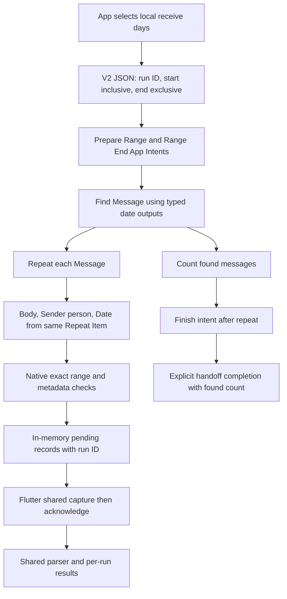

# PandaPay iOS Shortcuts Prototype — Agent Handoff

Updated: 29 October 2026
Source snapshot: `codex/ios-shortcuts-prototype`, including existing uncommitted/untracked prototype files. Fix workspace: attached detached worktree `the isolated implementation worktree`.

This document is the working handoff for the PandaPay iOS Shortcuts investigation. It distinguishes repository implementation, prior device-test reports, current user-reported Shortcut edits, and work that remains unverified. Read the linked physical-device and shared-intake notes before changing the prototype.

## Current status

The requested coordinated range-import fix is implemented in an isolated worktree at `the isolated implementation worktree`. It started with the current uncommitted prototype snapshot from `codex/ios-shortcuts-prototype`; the user's original checkout and exported Shortcut were preserved. No commit, push, PR or production app deployment was performed. The agent did not run real messages; the user subsequently ran the history workflow on iPhone, with observations recorded below.

- The Flutter screen now launches **PANDAPAY SELECTED RANGE V2**, using a versioned JSON request containing a UUID run ID and explicit UTC instants for the selected device-local calendar days. September means local September 1 midnight inclusive through local October 1 midnight exclusive.
- Four new iPhone App Intents provide typed search boundaries, capture one message at a time, and explicitly finish the run. A successful URL launch is only a waiting state. A completed handoff is separate from successful parser ingestion and does not prove the message search is exhaustive.
- The shared iOS adapter withholds missing/invalid/unzoned original receive dates; it no longer substitutes body dates or capture time. Sender inference is retained for parsing with separate diagnostic provenance. Android parser, scanner, canonical source keys, and backend behavior were not modified.
- Latest-run acquisition/rejection/parser counters and matches are separate from cumulative session counters. Exact source keys replace amount/merchant/first-message guesses. Each run retains its own sender/body/receive/capture association, including identical bodies received on different days; shared canonical dedup remains unchanged.
- A signed, separately named importable copy and reusable builder are in `artifacts/ios-history-range-v2/` and `app/tool/build_ios_history_range_shortcut.py`. The original signed export was decoded read-only with Apple `aea decrypt -profile 0 -sign-pub` using its embedded certificate public key. Its original body/sender/date variable links were present, while its search dates were fixed to March. No private Shortcuts storage was edited.
- The revised copy was added to Mac Shortcuts and its dynamic date links, Count → Message binding, Repeat → Message input, output link and Limit off were inspected. The Mac displays the iOS-only PandaPay actions as Unknown Action; this alone does not validate iPhone action resolution. A second import replaced only the newly generated V2 copy after correcting Count's internal `Input` key.
- The user subsequently chose to create the new Shortcut manually on iPhone and share screenshots later. Shortcut UI automation was stopped at that point. Do not perform further Shortcut import/export/editor automation or run real messages on the user's behalf.
- The user manually built **PANDAPAY SELECTED RANGE V2** and verified March and September history handoffs on iPhone. Receive/import date separation was also observed in an October transaction. These observations validate those runs, not exhaustive message coverage or sender fidelity.
- A new **Live incoming SMS** section is implemented at the very top of the diagnostic screen. Both existing single-message intents feed a separate native live receiver and separate temporary shared-intake database. Range, bulk and synthetic/self-check traffic cannot inflate live counters.
- Focused Flutter/widget tests, Foundation/CryptoKit native synthetic harnesses, DST tests and targeted Dart analysis validate the implementation. New live automation mapping, all-message trigger coverage and process/background behavior remain unverified. Build/install evidence is recorded below.

## Live test diagnosis and advisory correction — 29 October 2026

### Device-observed evidence

The user supplied live panel and event screenshots around 01:53 local time. The app recorded **2 handler calls and 2 body values**, **0 pending**, **0 processed/acknowledged**, **0 retained/existing/duplicates**, **1 sensitive rejection**, **2 missing original dates**, **2 missing senders** and **0 processing errors**. The two observed handlers were `text_sender`: one event around 01:51:59 rejected missing original receive date; another around 01:52:49 rejected security content. No private body/account/amount/reference/phone data is reproduced here.

`text_sender` identifies **Inspect Financial Message on iPhone**, not **Inspect Financial Message With Sender** (`person_sender`). It identifies the native receiver, not which trigger/automation launched it. An older/duplicate automation might account for the discrepancy, but that is unproven and no Shortcuts were edited or deleted by the agent.

The security rejection was a false positive on a generic no-secret **Never Share OTP/PIN/CVV** advisory in an otherwise ordinary credit alert. The user explained that the alert had been forwarded/resent and its body transaction timestamp predates actual receipt. That body timestamp must never substitute for original SMS receivedAt.

A subsequent screenshot of **PandaPay Incoming SMS**, now filtered by **Message contains A**, displayed a red error on **Inspect Financial Message With Sender**: Shortcuts could not convert Message to Date. This proves that failed invocation never reached `perform()`; it cannot create an app event. The user also reported that `A` triggered execution while the empty condition did not in their test. `A` only covers matching messages and is a temporary mapping diagnostic, not an all-message solution. The source Date gap and all-message trigger behavior are independently unresolved.

### Narrow implemented correction

`SmsSecurityPolicy` (Dart and an equivalent Foundation implementation) now distinguishes one exact terminal advisory list from credential evidence. It discounts only **never/do not/don't share [your] OTP/PIN/CVV** (slash/comma and whitespace variants), optionally followed by a short alphabetic bank signoff, when the prefix has currency/amount plus a financial movement/balance cue and no authentication/reset instructions. Digits/assignments/trailing extra content after the advisory prevent the exception. All remaining prefix and signoff text is still checked for security content; a word such as credited/debited is never a blanket allow rule.

The check preserves conservative OTP/PIN/CVV/password/code vetoes and tightens attached-code and authentication/reset/expiry/regeneration cases. An actual credential in the transaction text, even with the same generic advisory at the end, remains rejected before retention. Only classification evidence discounts the matched advisory; the original text is preserved unchanged in accepted intake, and original receive/capture times are unchanged. Missing original receive Date still rejects safe messages. Sensitive content is rejected even when Date is also missing.

Physical-device live, V2 range and legacy bulk native gates use the same native policy. The iOS adapter calls `LocalSmsParser.sensitive`; the parser, shared `SmsGateFilter` triage and text-hint veto now use one Dart policy. **This narrow shared-Dart source change also changes Android security classification for this established false positive**; Android scanning, source keys, transaction extraction, production API and deployed apps are unchanged. The optional learning-evidence redactor remains more conservative and may omit samples containing advisory keywords. The separate tagged simulator harness retains its earlier stricter native veto; it is not the real-message device path.

The live panel now shows the exact human-readable action title beside each handler code and the latest event. A missing-date hint directs the user to **Shortcut Input → Type: Message → Get: Date**, only if that metadata is actually supplied. Changing the whole variable's Type to Date is a conversion and can fail. The app never suggests Current Date or an in-body date as original receive time.

### Supported trigger/mapping research and next step

Apple's fetched [communication-trigger guide](https://support.apple.com/en-in/guide/shortcuts/apdd711f9dff/ios), labelled iOS 26, documents Sender and Message Contains criteria and says combined criteria must all match. It does not establish an unrestricted wildcard or blank-filter all-message behavior. The user-observed blank-filter failure therefore remains unresolved; spaces, letters or keywords must not be presented as every-message coverage.

Apple's [variable editor guide](https://support.apple.com/guide/shortcuts/adjust-variables-apda36b9018b/ios) distinguishes changing content Type (which requests conversion) from selecting an available content property. Minimal manual diagnosis is to keep the actual source as Message and select its Date property if it exists. Menu availability alone does not prove the trigger supplied usable original metadata. If the same conversion error persists, use the already device-verified V2 range workflow for reconciliation, preserving Find Message's original dates. The agent does not run this against real messages.

A future original-source lookup could compare exact message body and verified sender against supported Find Message results in a bounded receive window, require exactly one fully enumerated original Message with a valid original Date, and report zero/ambiguous/incomplete results instead of choosing a first match. This is **a proposed fallback, not implemented or verified**. Search incompleteness or repeated forwarded text must not silently become a guessed receive date. No private Messages/Shortcuts database access, upload or unsupported bypass was introduced.

The corrected signed Profile build installed successfully on the connected iPhone as `app.pandapay.iosimportprobe`, with all six existing action definitions preserved. Automatic launch was denied because the iPhone was locked; the user can unlock and open the installed probe. Installation restarts the process-local session; no explicit Clear was run. Validation and final build/install evidence for this correction are in `artifacts/ios-live-advisory-fix-2026-10-29/verification.json`. All 439 focused/shared Flutter regressions and the three native harnesses pass; the common Swift/Dart policy corpus has 30 synthetic cases and no user SMS data. Targeted analysis has no errors/warnings or new findings; two existing parser info-level lints were verified in HEAD. Current device trigger/date fixes are not claimed without a new user run.

## Live incoming SMS diagnostic

The user reported receiving a test SMS that did not appear in the probe. There was no evidence yet that the automation called the app. The new top section makes that boundary visible without assuming whether the trigger, type conversion or application caused the missing result.

### Receiver and processing path

- Existing **Inspect Financial Message on iPhone** (`InspectDeviceFinancialMessageIntent`, text sender) and **Inspect Financial Message With Sender** (`InspectDeviceFinancialMessagePersonIntent`, optional person sender) both call `DeviceLiveMessageInbox.capture`. Names and parameter identifiers are preserved. Their body is now optional so nil/empty input can be recorded if `perform()` is invoked; sender/date remain optional/defaulted. Input conversion or IPC errors before `perform()` remain unobserved.
- The native receiver records handler invocation time, call count, number of non-nil body values received, missing sender/date dimensions and safe event metadata **before validation**. A nil/blank/oversized body, security/OTP text, missing original date, duplicate, wrong bundle or diagnostic capacity produces an explicit rejection state. No receive-date fallback is created.
- Security/OTP bodies are never retained or displayed. Rejection events contain only a random event ID, fixed handler/state codes, timestamps/metadata-presence flags and character count. They contain no sender/body text and are not written to logs or files. Accepted non-sensitive records stay in process memory until shared intake acknowledges an outcome. Valid retained live messages can be inspected locally.
- Each accepted live record has `origin: live`, a unique transport ID, original receive time, handler/import time and a stable sender/date/body identity. Native replay is counted as a duplicate. Capacity is 2,500 unique live identities/pending records per process; rejections are visible. The recent event list keeps 30 metadata events; aggregate totals continue after event eviction.
- `readPending` returns live records/counters/events under its separate `live` field. Existing top-level records/runs continue to carry history only. A dedicated `IosLiveProbeSession` uses its own in-memory database and unchanged shared `SmsImportStore`; history cumulative results and live results stay separate. It never launches an upload client.
- Flutter returns explicit `retained_new`, `retained_existing`, `ignored`, `rejected_sensitive`, `rejected_invalid`, `rejected_missing_date`, or `processing_error` outcomes via `completeLive`. Successful outcomes are cached by transport ID, so an acknowledgement/refresh retry cannot reprocess or double-count a successful capture. Native completion is idempotent and removes a pending record only for an allowed final outcome. Parser failures remain pending and retry on Refresh; error attempts are counted separately from successes.
- Handler `ready`, manual **Refresh / retry live handoffs**, and app resume refresh the panel. A platform-read/acknowledgement failure shows an explicit unconfirmed/retry message. Nothing labels URL launch, receipt or pending state as retained success.

The top panel shows idle/last invocation/latest state, calls/body values, pending/processed acknowledgement counts, new/existing/duplicate/ignored/sensitive/invalid/capacity totals, missing original date/sender, inferred sender count and processing error attempts. Its recent-event list separates original receive, handler/import and processed times. A separate inspection expander contains only retained live SMS and parsed transactions; parser occurrence time remains distinct and may itself fall back to receive time when absent in the body.

If idle, the exact message is **No incoming Shortcut handoff received in this app session**. That establishes only that the running receiver has not observed a call; trigger execution, input conversion, IPC, another process or an earlier process lifetime cannot be diagnosed from zero calls. The UI explicitly calls pre-handler failures **UNOBSERVED**.

### Current user-owned incoming automation

The user manually configured **PandaPay Incoming SMS** on iOS 27.2 with **When I receive a message**. Sender and test-marker restrictions were removed; the editor showed an empty Message contains text placeholder. Automation was on and Confirm Before Run off when inspected. Whether that empty filter matches every SMS remains **unverified**.

The action is **Inspect Financial Message With Sender**, not a range/bulk action. Sender as person is intentionally blank for the first test. The user verbally reported body = Shortcut Input, Type Message, Get Message Content; receive date = Shortcut Input, Type Message, Get Date. We have not established that this trigger supplies a typed Message object or that these conversions complete before `perform()`. The older notification-trigger workflow does not establish receipt of a typed Message.

Do not edit/import/export/delete the user's Shortcuts or run real SMS imports. The minimum next test after installation is: leave the probe running, receive one new non-sensitive test SMS through the existing automation, reopen the probe and inspect the top panel (tap Refresh if needed). A higher call count proves this process saw the single-message handler; the latest state distinguishes metadata rejection, ignored content, pending/retry or retained result. If calls remain zero, upstream conversion/trigger/process causes are still unobserved. Background, closed-app and locked-device behavior remain separate acceptance tests.

All live state is process-local. Installation, app/process restart or explicit Clear resets the history and live temporary sessions. No explicit clear is run against the device session during development; automated tests use separate synthetic in-memory sessions. Installing the updated app naturally restarts it. This update does not add durable production intake or guarantee every-message delivery.

## Important distinction: Shortcuts sync and app actions

There are two separate things that can be changed:

1. **A Shortcut recipe** is edited in Apple’s Shortcuts app. If both devices use the same Apple Account and iCloud Sync is enabled in Shortcuts settings, regular shortcuts sync between Mac and iPhone. Personal automations do not sync.
2. **A PandaPay action** is implemented in the app using Apple App Intents. Updating Mac app source does not install that action in the iPhone app. The iOS build must contain and register its own compatible App Intent, and the app must be installed on the iPhone.

The current repository has iOS App Intent code for its diagnostic prototype. A matching App Intent implementation was not found under `app/macos`. macOS Shortcuts can use App Intents actions to build custom shortcuts, but Apple documents that App Shortcuts themselves are not supported on macOS. Do not assume an iOS-only action will be runnable on Mac just because its Shortcut recipe synced there.

Apple references: [Sync shortcuts on Mac](https://support.apple.com/guide/shortcuts-mac/sync-shortcuts-apdb3a4240b0/mac), [Sync shortcuts on iPhone or iPad](https://support.apple.com/guide/shortcuts/apdb3a4240b0/ios), [App Shortcuts platform notes](https://developer.apple.com/design/human-interface-guidelines/app-shortcuts).

## Goal and platform constraint

The research goal is to let a user-authorized Apple Shortcut pass selected message content to PandaPay for local parsing. A regular iOS app cannot directly read the Apple Messages database. The current prototype therefore uses Shortcuts actions such as Find Message as the user-authorized acquisition step.

This is not yet a production feature. The current diagnostic does not provide an authenticated account context, durable capture queue, production upload, or a complete historical-message scan. Do not describe the observed results as proof of complete SMS history or production Android parity.

## Application layout and build boundaries

PandaPay is a Flutter app with iOS and macOS targets. The relevant files are:

- [iOS history diagnostic screen](../app/lib/main_ios_history_device_probe.dart)
- [Native iOS Shortcut intents and bridges](../app/ios/Runner/PrototypeBankMessageIntent.swift)
- [Live receiver, safe event metadata and acknowledgement](../app/ios/Runner/DeviceLiveMessageInbox.swift)
- [Live shared-intake coordinator](../app/lib/data/ios_live_probe_session.dart)
- [Top live diagnostic panel](../app/lib/widgets/ios_live_probe_panel.dart)
- [iOS AppDelegate](../app/ios/Runner/AppDelegate.swift)
- [Isolated device-wrapper preparation script](../app/tool/prepare_ios_device_history_probe.py)
- [Shared-intake implementation notes](ios-shortcuts-shared-intake-2026-10-27.md)
- [Physical-device history probe notes](ios-physical-history-probe-2026-10-26.md)
- [Dynamic date-window design](ios-shortcuts-dynamic-history-design-2026-10-28.md)

### Native compile modes

`PrototypeBankMessageIntent.swift` contains two deliberately separate compile-time branches:

- `DEBUG && targetEnvironment(simulator)` contains synthetic-only demo/history intents. It is excluded from ordinary device and release builds.
- `PANDAPAY_DEVICE_IMPORT_PROBE` contains the physical-device diagnostic App Intents and bridge. The preparation script copies the current Flutter dependency closure and this Swift file into a disposable Flutter project, changes its display name and configures the probe compilation condition. Its bundle identifier is `app.pandapay.iosimportprobe`.

The normal iOS Runner bundle identifier in the checked-in Xcode project is `app.pandapay.pandapay`. The device-probe capture function checks for `app.pandapay.iosimportprobe`, so do not expect the probe action to work by installing the ordinary app build. The production app must not be replaced with the diagnostic wrapper.

The iOS probe is not implemented in the macOS target. There is no evidence in the current checkout that the Mac app exposes these actions to Shortcuts.

### Diagnostic data flow

State remains intentionally ephemeral: native queues, reports, diagnostic provenance and the Flutter database are in memory. An app termination loses them; a stale or unknown request fails explicitly and must be restarted from the app. There is no account or active upload client. This is not a durable background importer. Single-message native handoffs may take longer than a bulk action; runtime duration and OS interruptions require device testing.

## Current Flutter diagnostic behavior

The screen defaults to September 2026, with March/September/October chips and a date-range picker. The previous unverified days/recent-history launch buttons were removed from this screen. Selecting days only changes the next request; results stay labelled with the actual run's range until Fetch starts another run.

- Latest fetch status: waiting, running, explicit handoff completion, incomplete handoff, or launch failure.
- Latest fetch: search found, native handoffs, accepted, duplicates, missing sender/date, out of range, sensitive/invalid/capacity rejection counts.
- Shared intake: newly retained, already retained, triage ignored, missing-date/invalid/sensitive validation rejections, matched transactions and newly added transactions.
- Session totals: retained SMS, transactions, review items, inferred senders and withheld dates.
- Transaction view defaults to sources handed over in the latest run; a switch shows cumulative session transactions. Acquisition membership uses original receive dates, not transaction occurrence dates.
- Expanded transactions distinguish **Parser occurrence**, **Original SMS received**, and **Imported**. Parser occurrence can itself fall back to receive time when the body lacks a date; it is not presented as independently verified spending time. Sender provenance identifies handle, name, text or inference. Missing exact source links remain unavailable.
- Empty results say **No imported transaction matches**, and never assert that no transactions occurred.

## App Intents currently in source

The names below come from the current Swift source. The compile condition matters: the synthetic actions and device diagnostic actions belong to different build modes.

### Synthetic simulator branch

- `LoadPrototypeHistoryIntent` — loads an explicitly seeded synthetic test inbox.
- `ImportPrototypeMessageBatchIntent` — imports tagged synthetic JSON messages.
- `CapturePrototypeBankMessageIntent` — captures one synthetic message, requiring the `[PANDAPAY_TEST]` marker.
- `PrototypeBankMessageShortcuts` — publishes the synthetic capture App Shortcut phrase.

### Opt-in device-probe branch

- `InspectDeviceFinancialMessageIntent` — live single-message path; optional body, defaulted text sender, optional original receive `Date`; pre-validation event tracking.
- `InspectDeviceFinancialMessagePersonIntent` — live single-message path with optional body, optional `IntentPerson` sender and optional original receive `Date`; nil sender is supported and inferred parsing is labelled. Prior person-conversion failures remain unresolved.
- `InspectDeviceFinancialHistoryIntent` — receives arrays of message bodies, optional senders, and optional original receive dates as strings. Its displayed action name is **Inspect Financial History on iPhone**.
- `PrepareDeviceHistoryRangeIntent` — **Prepare PandaPay Selected Range**; validates an app-registered V2 request and returns the search start as a typed `Date`.
- `DeviceHistoryRangeEndIntent` — **PandaPay Selected Range End**; returns the end boundary as a typed `Date`.
- `CaptureDeviceHistoryRangeMessageIntent` — **Import PandaPay Range Message**; receives the request and one message's body, optional sender `IntentPerson` and optional original receive `Date`.
- `FinishDeviceHistoryRangeIntent` — **Finish PandaPay Range Import**; receives the request and found count after the repeat, opens the app and records explicit handoff completion.

There is no type named `InspectFinancialMessageIntent` in the current source. Use the exact `InspectDevice...` type names when updating code or this document.

The device-probe capture path rejects empty/oversized and OTP/security-like bodies, caps a message body at 20,000 characters, and caps unique in-process identities at 2,500. Inputs with a receive date are deduplicated within the current process using sender, timestamp, and body; inputs without a date use a random identifier and are not replay-deduplicated. These are diagnostic safeguards, not a durable production deduplication policy.

## Shortcut catalog and current date handoff

The earlier `PandaPay History Probe`, `PANDAPAY DEEP HISTORY BACKFILL`, `PANDAPAY DATE RANGE BACKFILL` and personal automation workflows are preserved legacy experiments. They are not launched by the V2 screen. V2 does not rely on their configuration or on parallel arrays.

### Exact V2 iPhone recipe

Name the regular Shortcut **PANDAPAY SELECTED RANGE V2**. No Ask for Input, fixed dates, Format Date or external URL/network action is needed.

| Order | Action title | Parameters / source |
| --- | --- | --- |
| 1 | Prepare PandaPay Selected Range | Range request = Shortcut Input |
| 2 | PandaPay Selected Range End | Range request = Shortcut Input |
| 3 | Find Message | Date is between output of step 1 and output of step 2; sort Date, Oldest First; Limit off |
| 4 | Count | Count Items in Message output of step 3 |
| 5 | Repeat with Each | Message output of step 3 |
| 6, inside repeat | Import PandaPay Range Message | Range request = Shortcut Input; Message body = Repeat Item → Body; Sender as person = leave blank for the first test (optional later experiment: Repeat Item → Sender, underlying property `author`); Original receive date = Repeat Item → Date |
| 7 | End Repeat | Close the repeat |
| 8 | Finish PandaPay Range Import | Range request = Shortcut Input; Messages found = Count output of step 4 |
| 9, optional | Stop and Output | Output of Finish PandaPay Range Import |

The updated isolated app must be installed before these actions can resolve on iPhone. Start the workflow by pressing **Fetch selected receive range** in the app, not by manually running a request-less Shortcut. Always use the outer **Shortcut Input** for the request, not Repeat Item or the previous action output. Prior person-conversion failures mean the first physical test should leave Sender as person blank. Native code accepts nil, counts missing sender, and the app labels bank inference explicitly; this does not test original-sender fidelity.

### Range and completion contract

The app sends `version: 2`, `run_id`, `start_inclusive`, and `end_exclusive` as JSON. It constructs local calendar midnights, then serializes UTC instants. It constructs the next calendar midnight rather than adding a fixed 24-hour duration, so DST boundaries are respected.

The start action returns one second before start; the end action returns next midnight. This makes Find Message's Between query a superset around either possible endpoint interpretation. Native capture enforces `receivedAt >= start && receivedAt < end` exactly; boundary records outside the requested days are counted and rejected. Actual iOS Between behavior/search coverage still needs a physical test. Each per-message handoff keeps body, sender and typed date from the same Repeat Item, avoiding list compaction/alignment errors.

Finish requires `found == native received` to record `completed`; unequal values yield `incomplete_handoff`. Zero found/zero handoffs completes correctly. Completion describes reaching the end of the handoff, not retention of every record: inspect rejected/ignored counts too. URL opening never creates completion. Repeating a request after finish fails; a new Fetch uses a new run ID. A superseded request is rejected. Native accepted identities include sender/date/body within the run; shared parser dedup still uses its unchanged canonical sender/body key, so reruns report matches but zero new rows where appropriate.

Native V2 accepts at most 2,000 unique messages per run, with at most 2,500 pending records. Capacity rejections are explicit. Twenty recent native run reports are retained. These are diagnostic safeguards, not universal iOS search limits. Each body is limited to 20,000 UTF-16 units; OTP/security-like input is rejected. Missing dates are counted and rejected. Missing sender is counted; parsing may infer a bank sender with provenance. Contact display names are labelled as names, not verified SMS handles.

### Legacy bulk compatibility

The preserved **Inspect Financial History on iPhone** action still takes `[String]` lists. Supplied sender/date lists must equal the body count; mismatches or more than 2,000 bodies now reject the entire legacy batch explicitly without silently truncating or re-associating metadata. Only zoned ISO dates count as original receive timestamps. The old permissive native date parser remains for prior diagnostic source compatibility, but the legacy bulk action no longer uses its localized guesses. The Flutter adapter withholds missing original dates from shared persistence.

### Known history-search limits

- A prior run reported 500 messages from one search and a later app-triggered run increased the observed count to 598. This is a result of those particular tests, not evidence of a universal iOS limit or a complete message-store scan.
- A date filter finding old message bodies does not prove that the individual Message Date property reached the AppIntent.
- Previously, bulk sender/date mappings returned bodies while sender values were empty and date count was zero. A single-message Date mapping reportedly worked in a separate test.
- Sender inference from message text is not the original SMS sender. Do not label it as verified source metadata.
- Dynamic month-by-month search, result completeness, exact boundary behavior, and DST/time-zone cases remain test requirements. See the [dynamic date-window design](ios-shortcuts-dynamic-history-design-2026-10-28.md).

## Safe Mac-to-iPhone workflow

1. In Apple Shortcuts on the Mac, edit or create the regular Shortcut recipe.
2. Ensure both devices use the same Apple Account and that iCloud Sync is enabled in Shortcuts on both devices.
3. Let the Shortcut sync, then inspect it in Shortcuts on the iPhone.
4. Confirm that the iPhone has the correct PandaPay iOS build installed and that the relevant App Intent appears under PandaPay in the action library.
5. Run a small synthetic or explicitly bounded test first. Confirm permission prompts and the intent result before testing real messages.

Do not edit `~/Library/Shortcuts/Shortcuts.sqlite` directly or rely on undocumented database mutation/signing instructions. This handoff has no verified or supported workflow for that method; use Shortcuts’ UI or Apple’s supported sharing/import flow.

## Device-observed V2 history results — 29 October 2026

After manually constructing the V2 Shortcut on iPhone, the user ran the ranges themselves. These are observations from those specific runs, relayed in the coordinating chat; no private SMS text is copied here.

| Requested receive range | Found / native handoffs | Passed native checks | Sensitive rejected | Newly retained / existing / ignored | Transactions |
| --- | --- | --- | --- | --- | --- |
| March 2026 | 424 / 424 | 387 | 37 | 176 / 74 / 137 | 66 |
| September 1 inclusive → October 1 exclusive | 337 / 337 | 305 | 32 | 180 / 34 / 91 | 93 newly matched/added |

Those runs reported zero missing original dates, out-of-range, native duplicate, invalid and capacity rejections. The cumulative March+September session was 356 retained SMS and 159 transactions. The original sender parameter was deliberately blank and senders were inferred; these results do not validate original sender fidelity.

The user subsequently fetched October and expanded a transaction. Original receive time showed October 23/24, separately from October 29 import time. This is device-observed date separation for that inspected result; it does not prove all history is found, every row has the correct association under all inputs, or that the incoming automation works.

## Prior device-test reports

These results were recorded in earlier prototype notes. They predate the current bulk ISO-string change unless specifically stated; they do not validate the current Shortcut configuration or establish production readiness.

### Earlier 500-message and follow-up runs

The prior master-plan notes report:

- First run: 500 Shortcut inputs, 440 complete inputs, 60 sensitive/OTP rejections, 270 shared retained messages, 132 parsed transactions, zero reported native duplicates, and zero dropped records.
- Later app-triggered run: total inputs increased to 598, complete inputs to 534, retained messages to 298, and no duplicate transactions were reported.

Treat these as historical diagnostic observations. The current bulk date-string bridge still needs its own physical-device verification. See the [physical-device probe notes](ios-physical-history-probe-2026-10-26.md) and [shared-intake notes](ios-shortcuts-shared-intake-2026-10-27.md) for scope and caveats.

## Remaining device verification

The history recipe and March/September runs are now device-observed above. The user continues to own Shortcut setup and real-message tests; new live diagnostics need the next incoming-message test described above. Do not repeat export/menu hunts or run a real-message import through automation.

1. For additional history regression tests, open **PandaPay History Probe · V2**, select September 2026 and tap **Fetch selected receive range**. The result must leave Waiting, show a found count, and reach **Shortcut handoff completed** or an explicit partial/error state.
2. Inspect one retained SMS: **Original received** must be a September timestamp from Messages, while **Imported** is the current run time. A March transaction date inside a September-received SMS may appear as Parser occurrence; that is separate and legitimate.
3. Repeat September. Matched results should remain visible; newly retained/added counts should be zero for previously captured canonical messages. Switch to March and Fetch: the run's requested boundaries and receive metadata must change accordingly.
4. Missing dates, sender conversion failures, absent/unknown actions, partial handoffs, OS interruption, capacity counts, empty results and search completeness remain physical-device acceptance items. Synthetic tests do not prove that iOS finds every message or reliably runs in the background.

Production integration remains separate and requires durable, account-scoped intake, explicit ownership, retry and locked-device testing. Nothing here enables the production backend or replaces the installed production app.

## Verification on 29 October 2026

- Thirteen focused Flutter tests passed: `ios_shortcut_sms_test.dart`, `ios_device_probe_session_test.dart`, `ios_history_range_request_test.dart`, and `ios_shortcut_capture_pipeline_test.dart`.
- Three range tests additionally passed with `TZ=America/New_York`, including the 23-hour DST day on 8 March 2026.
- `python3 app/tool/test_ios_history_range_native.py` passed synthetic checks for zoned boundaries, start inclusion/end exclusion, receive-date preservation, record association, missing metadata, sensitive/invalid input, repeat runs, zero matches, incomplete handoffs, stale requests, acknowledgement and capacity rejection.
- Targeted Dart analysis found no issues after the final source fixes. Python utilities compile successfully.
- Apple `shortcuts sign --mode anyone` produced the V2 importable file locally. Apple documents that signing sends the workflow to Apple for validation; the generated workflow contains only action definitions and no private messages, account inputs or original export signing metadata. No third-party signing service was used.
- Mac Shortcuts accepted the signed artifact and showed dynamic Find Message date-output links, Count Items in Message, Repeat with Message, Limit off and the final action output. iOS-only actions show Unknown Action on Mac. Later user direction stopped further Shortcut UI work.
- Isolated Profile build succeeds at `/tmp/pandapay-ios-device-probe/build/ios/iphoneos/Runner.app`, bundle ID `app.pandapay.iosimportprobe`, display name PandaPay History Probe. App Intents extraction contains all four V2 action identifiers and their request/body/person/date/found parameter types. The wrapper preparation script copies 33 Dart sources and both diagnostic native sources; it enforces the isolated bundle identifier and preserves the existing signing team.
- Installation status: `devicectl device install app` confirmed the final Profile build installed on the connected iPhone 16 Pro Max as `app.pandapay.iosimportprobe`; a subsequent `devicectl device process launch` succeeded. The user later verified V2 history resolution and the ranges above; per-item original sender conversion, incoming trigger mapping and closed/locked-device behavior remain unverified.

## Live diagnostic verification — 29 October 2026

- Twenty-two focused Flutter/widget tests passed (nine new live tests plus thirteen existing range/intake tests). The new tests exercise live-vs-range separation, receive/import provenance, missing sender inference, ordinary ignored content, sensitive/invalid/date rejection, cached acknowledgement retry, parser failure retry, idle top placement, safe rejection rendering, manual refresh, handler-ready and app-resume refresh. They run with the existing range/intake regression tests using synthetic fixtures only.
- `python3 app/tool/test_ios_live_probe_native.py` validates both single-message bindings and Foundation receiver behavior: missing input attempts, both handler codes, metadata-only event storage, privacy rejection, no history inflation, pending/failure/final states, acknowledgement idempotence, capacity and bounded events. The existing range native harness remains passing.
- Targeted Dart analysis found no issues and the isolated signed Profile build succeeded. The wrapper now copies 35 Dart sources and the live native receiver in addition to the existing range/intent sources. No production native project/backend change is required.
- The live diagnostic Profile build installed successfully on the connected iPhone as `app.pandapay.iosimportprobe` after retrying a transient CoreDevice remote connection failure. Automatic launch was denied because the iPhone was locked (`FBSOpenApplicationErrorDomain`, Locked). Installation succeeded; the user can unlock and open the installed probe manually. Final live build/install evidence is recorded in `artifacts/ios-live-probe-2026-10-29/verification.json` after device installation. Widget/native tests establish implementation behavior; they do not prove incoming automation execution on the phone.

## Evidence and source notes

- [Physical iPhone history probe](ios-physical-history-probe-2026-10-26.md)
- [Shared iOS intake design and verification](ios-shortcuts-shared-intake-2026-10-27.md)
- [Dynamic date-window design and outstanding tests](ios-shortcuts-dynamic-history-design-2026-10-28.md)
- [Apple: sync shortcuts on Mac](https://support.apple.com/guide/shortcuts-mac/sync-shortcuts-apdb3a4240b0/mac)
- [Apple: sync shortcuts on iPhone or iPad](https://support.apple.com/guide/shortcuts/apdb3a4240b0/ios)
- [Apple Developer: App Shortcuts platform support](https://developer.apple.com/design/human-interface-guidelines/app-shortcuts)
