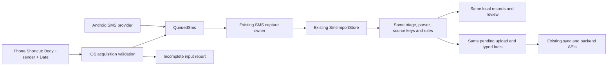

# iOS Shortcut acquisition into the shared SMS pipeline

Branch: `codex/ios-shortcuts-prototype`, based on `dev`. Device: iPhone 16 Pro Max, reported iOS 27.2 (24B5084k). No backend source, API contract, production deployment or installed production app was changed.

## Required acquisition contract

Android's downstream input is `QueuedSms(sender, body, receivedAt)`. Android provider row IDs belong to its scanner/checkpoint and are not required by the downstream parser or batch API. Account namespace and saved cards/rules come from PandaPay after sign-in; they are not extracted from the SMS.

| Field | Required behavior | Physical iPhone evidence |
| --- | --- | --- |
| `body` | Preserve complete text, including line breaks; never send the Message object's display name as its body. | Explicit Message → Body mapping supplied text in bounded real-history tests. |
| `sender` | Preserve the actual source identifier; do not guess a bank from body text or replace it with an arbitrary contact name. | String mapping was empty. An `IntentPerson` parameter failed because Shortcuts could not convert Person to Contact. Switching to `emailOrPhone` failed with Person to Contact/Phone Number/Email Address. Sender-name extraction is still under investigation. |
| `receivedAt` | Preserve the original instant with timezone. Never substitute the time of import. | Passing a single found Message's Date to the single-message App Intent **worked**, with a September timestamp. Earlier parallel-list mapping returned no dates. |

The first five-message body-only diagnostic was insufficient evidence of a complete import. Date is now proven for a single message; sender remains unproven. Bulk per-message extraction has not been verified.

## Implemented shared path

`IosShortcutSmsBatch` validates at most 100 supplied messages, preserves accepted body/sender values without rewriting, and requires an original ISO timestamp with an offset. An optional native UTF-16 length check rejects a damaged handoff. Missing sender/date and contact display-name substitutions are incomplete; OTP/security content is rejected before shared persistence. No fallback time, inferred bank or second financial grammar is introduced.

`SmsAutoImportController.captureShortcutMessages` joins the existing `_captureMessages` path with an expected account namespace checked before and after asynchronous capture. Android's scanner and listener call sites are unchanged. The existing sync owner still reads the same `sms_intake` queue, invokes `UserCardsRepository.logTransactionsFromSmsBatch`, and reconciles its existing response. API requests preserve `sender`, `body`, `occurredAt` and historical `backfill` behavior. The existing canonical source key remains account + normalized sender + normalized body, matching Android and the backend; the earlier simulator transport hash is not substituted for that key.

The separate device diagnostic now invokes **the actual `SmsImportStore.captureBatch`** in an in-memory `AppDatabase`. It shows shared retained-message, observation, transaction, review and queue counts. A retained complete message can be expanded locally to view the full SMS, sender and original time. Incomplete inputs create no financial state and their raw bodies are not retained by the Dart session. A native read/ack handshake acknowledges inputs after successful local processing, allowing an in-process retry after capture failure.

The diagnostic remains an isolated Profile app with bundle `app.pandapay.iosimportprobe`; it has no account or active HTTP client. It does not upload private test messages. Its database and native handoff are intentionally temporary and are lost on process termination. Production integration still needs durable, account-owned native intake and resume/locked-device acceptance before activation.

## Verification

- Eight focused tests passed: full text and timezone preservation, missing metadata and contact-name rejection, OTP/damaged-input rejection, identical canonical Android/iOS records, incomplete-input exclusion, replay behavior, the unchanged mocked batch API, and existing Android capture regressions.
- The parity test compares captured bodies/times, intake rows, decisions, financial entities, review rows and typed-fact outbox rows against direct Android `SmsImportStore` capture of the same synthetic messages.
- The API test uses `MockClient`; it proves request compatibility and existing response reconciliation without calling a live backend.
- Targeted static analysis completed without issues after the final screen changes.
- The signed physical-device Profile build succeeded and was installed separately.
- On the iPhone, **Run synthetic shared-intake check** visibly reported: `Self-test passed: 2 retained, 1 transaction. OTP and incomplete input excluded. Replay added 0.` This exercises SQLite and the shared capture code in the actual iOS binary.

## Remaining acquisition acceptance

Recover an actual bank sender identifier from a found Message through supported Shortcut conversions, then pass that identifier together with **that same message's** Body and Date into the single-message intent. Check the canonical retained input on the device. Repeat per message for a bounded batch and verify field association and replay under the existing canonical policy. If the source cannot provide the sender identifier, full Android-equivalent history capture is not established and the adapter must continue reporting the input as incomplete.

Unattended incoming-message automation, iOS 26 behavior, comprehensive history coverage/pagination, real-source financial accuracy, account changes, process death and locked/offline behavior remain separate physical-device acceptance work.
