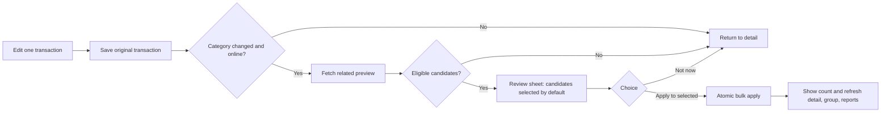

# Merchant based bulk category review: implementation plan

Status: planning only. No feature code has been changed by this plan.

## 1. Outcome and boundaries

When a person changes the category of one active transaction, save that transaction first. If there are other confidently related transactions, show a review sheet with their dates, amounts, payment sources, and current categories. Eligible generic-category rows are selected by default; the person can deselect any row, select all eligible rows again, apply the category to the selection, or choose **Not now**. Declining leaves the original edit saved. An apply operation changes only the selected rows and returns a clear result.

This first release covers **category assignment**. Additive bulk tags can follow under a separate contract. The current flag icon opens a transaction-specific **Report an issue** form; do not bulk-submit reports or bulk-ignore refunds/reversals as part of this feature.

The feature must work from any route that opens transaction edit, including a row opened from the Insights merchant group. The sheet is offered only when the effective category changed, the original online save succeeded, and the saved transaction qualifies for related-transaction matching. Other edits (amount, card, date, merchant, kind, rail, tags alone) must not trigger it. If the merchant identity is edited in the same save, suppress the suggestion in v1 unless the server can establish the new identity with high confidence.

## 2. Current implementation and risks

- Insights groups transactions by exact trimmed `merchantName` in `app/lib/features/insights/spend_trends_screen.dart`. This is display grouping, not a durable merchant identity. Blank names become `Unknown merchant`.
- The detail screen's **Assign category** and **Edit transaction** actions both open `EditTransactionScreen`. That screen saves with `UserCardsRepository.editTransaction`, then pops. It offers no related-row preview.
- `PATCH /transactions/:id` in `api/src/index.js` updates one active row. It reverses and reapplies card/cap/reward state in a database transaction. Bulk implementation must preserve this invariant for every changed row.
- The database has `merchant_name` and `merchant_vpa` on transactions; `TransactionEntry` and `GET /transactions` do not currently expose a stable merchant match key. Name-only grouping can merge unrelated recipients or payment aggregators.
- `UserCardsRepository.editTransaction` omits null category fields. Clearing a category is therefore not an explicit supported operation through that method; resolve this in the shared category-edit contract before shipping bulk apply.
- Tags use a local repository and outbox. Its `replace` method is appropriate for one transaction but must not be reused to replace tags across a group.
- The normal transaction list is unbounded on the API side. The sheet should request a focused preview, not scan all locally cached transactions or assume the visible report group is complete.
- The existing single edit has an offline queue path. A queued offline save is not server-confirmed and cannot safely trigger an online bulk preview or apply.

## 3. Product decisions to freeze before agents code

1. **Scope:** match across all historical transactions belonging to this profile, independent of the current Insights report period. State this in the sheet: “Other transactions from this merchant in your history.” The preview lists exact candidates; it never silently applies beyond them.
2. **Identity:** use normalized merchant VPA when available and valid. A server-owned canonical merchant ID may supersede it if one is introduced. Use a specific normalized merchant name only as a lower-confidence fallback, and require a review sheet; never match blank/unknown/generic names. Display the match basis in diagnostics, not as a user-facing technical string.
3. **Default selection:** active, unsplit, ordinary spend rows with an unset or generic `Other` category. Exclude the original transaction. Show already categorized or ambiguous matches separately and unchecked. The user may manually select a different-category row after seeing its current category. Rows the server deems unsafe (different kind, ignored, split, uncertain identity) cannot be selected.
4. **Same category:** rows already in the target category are excluded from apply and counted as “already Food” if useful. Never write no-op rows.
5. **Capacity:** support the 500-row scenario without partial UI selection. Set an initial maximum of 500 selectable rows per operation. If more than 500 candidates exist, the preview must clearly show the total and ask for a narrower date scope; never label 500 visible rows “all” when more exist. The implementation may raise the limit only after load testing.
6. **Online only for bulk v1:** offline saves continue through the current queue, but the review sheet does not appear until server confirmation. Do not imply that an offline bulk action succeeded. A future durable bulk outbox is a separate feature.
7. **No permanent merchant rule in v1:** applying to current selected history does not recategorize future transactions. Future merchant rules require a separate opt-in, override policy, and UI.
8. **Failure semantics:** the original transaction remains saved if preview or bulk apply fails. Bulk apply itself is atomic: all selected eligible rows commit or none do. If any selected row changed since preview, return a conflict and refresh the preview rather than silently skipping it.

## 4. User flow and copy



Suggested sheet:

> **Apply Food to 3 more transactions from TESTMERCHANT@upi?**
> Your edit to 5 Oct is already saved. Review the other transactions below.

Each row: checkbox, local date, amount, payment source, current category. Include **Select all eligible / Clear selection**; the primary button says **Apply to N transactions** and is disabled when N is zero. Secondary action: **Not now**. For different-category rows, show an explicit “Currently Groceries” warning and leave unchecked. For more than 500 candidates, show the total and a date-range narrowing action before apply. Accessibility labels must include the row date, amount, current category, and selection state.

On success: “Food applied to 3 transactions.” On conflict: “Some transactions changed since this list was shown. Review the refreshed list.” On network failure: retain the sheet and selection and offer Retry. No optimistic success message before the server confirms.

## 5. API and data contract

Freeze the exact JSON contract in a small shared contract document or fixture before parallel work. Proposed routes:

### `GET /transactions/:id/category-related-preview?targetCategoryId=...`

Also accept `targetUserCategoryId` for a custom category. The backend derives the source transaction and merchant match key from its own data, not from a client-supplied merchant name. Return:

- Source transaction ID, target category identity and label, match basis (`vpa`, `canonical_merchant`, or `strict_name`), and total counts.
- Up to 500 selectable candidate rows with ID, date, amount, masked account/card label, current category ID/label, selection tier (`default_selected`, `manual_review`, `ineligible`), reason, and `updatedAt` or an opaque row version.
- A stable `previewId` or equivalent short-lived server snapshot identifier. If a persisted snapshot is used, store only profile, selected candidate IDs and versions, target category, scope, creation/expiry, and operation status; use RLS/ownership checks and expire it. A signed stateless token is acceptable only if size and key rotation are handled safely.
- An overflow flag and total when the 500-row limit is exceeded. Do not issue an apply-capable preview for an incomplete “all” selection; allow a bounded date filter to narrow it.

### `POST /transactions/category-bulk-apply`

Request: `previewId`, `selectedTransactionIds` (deduplicated, maximum 500), target category identity, and `idempotencyKey`. Do not accept merchant name, amount, status, or category values from the client as authority. A selected ID must belong to the preview and current profile. Response: operation ID, changed count, unchanged count, target category, and affected IDs or a bounded summary. A repeat with the same idempotency key must return the same result without reapplying financial state.

Server algorithm, all within one database transaction:

1. Authenticate and validate category ownership/existence, request size, duplicate IDs, preview age, and idempotency key.
2. Lock the selected transaction rows in stable ID order. Revalidate profile, active status, merchant identity, spend kind, split status, target category, and each row version/current category against preview. Reject stale selections with `409` and no writes.
3. For each real change, use the same reverse-old, update-category, apply-new state logic as `PATCH /transactions/:id`. Extract a tested shared helper rather than calling the HTTP route or issuing independent requests. Preserve `state_applied`, backfill, card compatibility, reward, caps, and milestone behavior.
4. Record an audit operation with old and new category IDs, affected row IDs, time, actor profile, and idempotency key. Store enough to support a safe future undo; do not expose raw SMS evidence.
5. Commit once and return the result. An exception rolls back all category and derived-state changes.

Avoid a SQL-only `UPDATE transactions SET category_id=...`: it bypasses the derived-state work performed by the existing edit endpoint. Avoid setting a custom child category without its parent category mapping. Ensure a built-in category clears any previous `user_category_id`, and a custom category sets both parent and child consistently.

### Merchant matching policy

Implement one server-side matcher used by both preview and apply:

- Normalize VPA case and surrounding whitespace; compare exact full VPA, not substring.
- If there is no trustworthy VPA/canonical ID, normalize a specific name (trim, case fold, collapse whitespace). Do not merge similarly spelled names or remove arbitrary suffixes. Exclude generic labels such as “UPI payment”, “Unknown merchant”, “Other”, and person/aggregator identifiers until proven safe.
- Never use amount or day as the merchant identity. They remain visible context and may inform an ambiguity warning.
- Store a match policy version in the preview/audit record so a later matcher change cannot silently expand an existing selection.

## 6. Parallel agent work plan

Use **gpt-5.6-luna, high reasoning** for each implementation subagent. The orchestrator first freezes the contract and file ownership. At most three implementation agents run together with the orchestrator occupying the fourth slot. Agents share the checkout, so each owns separate files; they must not edit another agent's files or discard existing uncommitted work. Reconcile work only after their changes are visible and reviewed. The working tree already has unrelated modifications, including `api/src/index.js` and `app/lib/data/local/financial_store.dart`; agents must inspect those diffs before touching shared code.

| Wave | Agent | Owned work | Files primarily owned | Deliverable |
|---|---|---|---|---|
| 0 | Orchestrator | Freeze exact API fixtures, matching rules, and UI acceptance criteria; inspect current uncommitted changes | This plan and contract fixtures | Contract ready for parallel work |
| 1 | A — backend | Preview endpoint, matcher, bulk apply transaction, state-helper extraction, idempotency, audit migration, API tests | `api/src/**`, `api/test/**`, new `db/supabase/migrations/**` | Endpoints and backend tests |
| 1 | B — Flutter data | Typed preview/apply models, repository methods, provider/cache invalidation, clear-category semantics; repository tests | `app/lib/data/**`, designated `app/lib/app/providers.dart` section, `app/test/data/**` | Client API boundary matching frozen fixtures |
| 1 | C — Flutter UI | Category-change detection, save-then-preview flow, review sheet, selection and overflow handling, widget tests | `app/lib/features/activity/**`, `app/test/features/activity/**` | Reviewable mobile flow |
| 2 | Orchestrator | Integrate A/B/C, resolve contract drift, inspect all diffs, run targeted and full checks, update the existing USB-connected PandaPay Dev installation in place, run physical-device scenarios, fix cross-layer defects | Cross-cutting only after Wave 1 | Working end-to-end feature with device evidence |
| 2 | D — independent reviewer | After a slot frees, review safety, matching, stale-data, offline, and UX edge cases; add tests only for concrete gaps | Review first; test files only if assigned | Findings and regression evidence |

Suggested agent prompts should include: objective, owned files, frozen fixture paths, precise acceptance criteria, existing uncommitted changes, and “do not modify other agents' files.” Do not ask each agent to design a different API. Agent C can implement against a fake repository from the contract while Agent A and B work; Agent B's typed models must match the same fixture.

### Task A: backend details

1. Isolate the existing single-transaction financial-state edit logic behind a shared function that accepts a database client and category-only change. Preserve existing `PATCH` behavior and tests.
2. Add the merchant matching helper and strict eligibility predicate, including split-parent/child checks and category tier classification.
3. Add preview query with deterministic ordering (`occurred_at DESC, id DESC`) and accurate total/overflow count. Index `(profile_id, merchant_vpa, occurred_at)` or another verified query path only after measuring the query plan; add a strict-name index if needed.
4. Add preview/snapshot, idempotency, and audit storage with ownership protections and expiry/cleanup.
5. Add bulk apply transaction, row-version conflict detection, and bounded request size. Use stable row lock order.
6. Add auth, validation, concurrency, rollback, and derived-state tests. Verify no cross-profile candidate can be previewed or mutated.

### Task B: Flutter data details

1. Add typed preview/candidate/result models and JSON parsing, including unknown future server fields and category identity for built-in/custom categories.
2. Add repository calls and map `409` to a refreshable conflict rather than a generic failure. Distinguish offline, authentication, validation, and server errors.
3. Ensure category clearing is represented explicitly in the existing edit API without unintentionally clearing a category when other fields are saved.
4. Provide focused cache/provider invalidation for transactions, detail, Insights/category reports, home totals, utilization/reward/card state as applicable. Avoid returning a stale merchant group after apply.
5. Add parsing, HTTP payload, clear-category, and error mapping tests.

### Task C: Flutter UI details

1. Compare the original and selected effective category identity, including custom children. Trigger preview only after successful online save and only for a real category change.
2. Save the original exactly once. Show the review sheet after save without losing navigation context; **Not now** still returns to refreshed detail.
3. Render default selections, manual-review unchecked rows, ineligible explanations, select-all/clear-selection, selected count, and confirmation. Never preselect rows already in a different meaningful category.
4. Handle loading, empty result, overflow, conflict refresh, retry, authenticated session refresh, and accessibility. Preserve current selection on retry where row versions remain valid; otherwise show the refreshed default state clearly.
5. Disable duplicate submits and close only after confirmed apply. Refresh the appropriate views and show a precise success count.
6. Test via a fake repository: original save, sheet display, selection changes, cancel, apply, conflict, offline, and no prompt for non-category edits.

### Task D: independent review

Review the completed diff against this plan, paying particular attention to category parent/child consistency, split transactions, 500-row limits, cross-profile access, concurrent edits, idempotent retry, and existing single-edit behavior. Report actionable findings with paths and evidence. Add only tests that expose a real missing condition; the orchestrator owns fixes and final integration.

## 7. Test matrix

### Backend unit/integration

- Exact normalized VPA match includes same-payee rows across cards and dates; different VPA or generic merchant name is excluded.
- Strict-name fallback is used only when permitted; case/whitespace variants match, similar but different names do not.
- Original row is excluded. Inactive, income, transfer, split parent/child, duplicate/suppressed, and already-target-category rows are not selectable.
- Generic category rows are default-selected. A different meaningful category is shown but unchecked and can be selected explicitly if eligible.
- Built-in and custom category updates set/clear parent and child IDs correctly.
- Unauthorized profile/foreign category/foreign selected ID is rejected. Missing/deleted category is rejected.
- One stale selected row returns `409` and changes **zero** rows. Concurrent bulk requests cannot double-apply state. Repeated idempotency key returns the original result.
- Failure during the 250th of 500 updates rolls back category, reward, cap, and milestone changes for all 500.
- A successful 500-row operation updates each selected row once, leaves unselected rows unchanged, and produces totals equal to a fresh recomputation from transactions.
- Preview over 500 candidates signals overflow and cannot be presented as a complete select-all set.

### Flutter data and widget

- Category change saves original, then presents only the server preview's candidates. A non-category edit or unchanged category gives no sheet.
- Cancel/Not now leaves the original edit saved and refreshes its detail.
- Default selection, deselect one, Select all eligible, Clear selection, and disabled zero-selection button work.
- Different-category rows start unchecked; selecting one exposes its current category before apply.
- Button count matches actual selected IDs. One tap sends one apply request; repeated taps while loading do nothing.
- Offline queued save shows no bulk success. Preview failure leaves original edit intact and gives retry/exit.
- `409` refreshes the preview and never claims success. Successful apply invalidates affected data and shows exact changed count.
- Long merchant names, large amounts, custom category names, 500-row lists, small screens, and screen-reader labels remain usable.

### Manual end-to-end scenarios

1. Use the screenshot scenario: four `TESTMERCHANT@upi` payments in Other. Categorize the 5 Oct ₹500 row as Food. Confirm a sheet lists the other three selected. Deselect the ₹777 row; apply. Verify two more move to Food, ₹777 remains Other, and reports reconcile.
2. Repeat with all selected and with Not now. Confirm no row changes beyond what the action describes.
3. Mix Food, Groceries, Other, and a split transaction for one merchant. Confirm only safe Other rows are preselected; Groceries is manual review; split is unavailable.
4. Edit the same merchant from two devices while one preview is open. The stale device gets conflict and refreshed choices, with no partial change.
5. Lose network after original save and before bulk apply. Original remains saved; retry succeeds once without duplicate recomputation.
6. Check a user-created subcategory and a card transaction whose reward rules depend on category. Verify resulting category labels and state totals across Activity, Insights, caps, and rewards.

## 8. Validation commands and release gates

Run targeted checks first, then the relevant full suites. Use the repository's installed toolchain; do not claim a command passed without recording its actual result.

```text
cd api
npm run check
node --test test/<new bulk category tests>.test.js
npm test

cd app
dart format --output=none --set-exit-if-changed <changed Dart files>
flutter analyze
flutter test test/data/<new repository tests>.dart
flutter test test/features/activity/edit_transaction_screen_test.dart
flutter test
```

Also execute SQL migration tests against a disposable database and a real API/app integration test for a 500-row preview/apply. Capture before/after totals for categories, caps, milestones, and reward value. Check the query plan and elapsed time for 500 rows; if the transaction is too slow or risks timeouts, lower the initial limit and adjust the UI copy before release. Test a rollback injected mid-operation. On Android, manually verify the bottom sheet, scrolling, selection, and screen-reader labels.

### Required physical-device update and regression pass

The user already has a physical phone connected with USB debugging and an existing **PandaPay Dev** app. On 23 October 2026, `adb devices -l` detected a Motorola edge 50 fusion (`ZA222MS4SF`). The Dev flavor package is `app.pandapay.pandapay.dev2`. The installed version and signing certificate were **not** verified while writing this plan, so read them from the device at implementation time. The goal is to **update the existing app in place**, preserving its local data and signed-in session. Do not uninstall it, clear storage, change the package ID, or install a differently signed APK. If Android rejects the update for a version or signature mismatch, stop and diagnose it; never use uninstall as a workaround.

1. Before changing the device, inspect the current PandaPay Dev app: record installed package, actual `versionCode`/`versionName`, APK path, device ABI, app launch state, signed-in account state, and the currently visible Activity/Insights transaction data. Record `firstInstallTime` if available so it can be compared after update. Do not capture or publish raw SMS, tokens, or personal merchant data in test logs.
2. The physical-device build must use the **production API and Auth services**, even though it uses the PandaPay Dev flavor for an in-place test update. Use explicit hosted values: `-ApiBaseUrl https://api.pandapath.site -AuthBaseUrl https://auth.pandapath.site -LegalBaseUrl https://api.pandapath.site/legal/`. Never use the Dev script defaults `10.0.2.2`, `localhost`, or another emulator-only/local address for this phone. Confirm the new preview/apply endpoints are deployed to that production API before attempting the end-to-end flow, and verify the exact compiled URLs. Avoid switching backend/account unintentionally, since that can appear as a sign-out or missing data.
3. Build the **next** Dev APK with `scripts/build_app.ps1 dev -Target apk -BuildNumber <next> -ProductionBackend -ApiBaseUrl https://api.pandapath.site -AuthBaseUrl https://auth.pandapath.site -LegalBaseUrl https://api.pandapath.site/legal/`. `-ProductionBackend` compiles `PANDAPAY_ENV=dev_hosted`, which keeps Dev runtime behavior while allowing the release guard to accept the hosted production URLs. Choose the number from the **installed actual Android version code** and inspect the generated APK's actual version code; it must be strictly higher. Confirm the APK package is `app.pandapay.pandapay.dev2`, its signing certificate matches the installed Dev app, its ABI supports the phone, and its compiled endpoints are the production URLs above. The flavor is Dev for package/signing compatibility; the network target is production for this device test.
4. Install exactly that inspected APK with `adb install -r <apk>` (or `adb -s ZA222MS4SF install -r <apk>` when multiple devices are attached). Do not pass `-d`, `--user` with a different profile, or any data-clearing option. If the signature differs, restore the correct signing setup and rebuild; preserve the installed app untouched.
5. After installation, verify package, higher version code, unchanged `firstInstallTime` if available, successful cold launch, retained wallet/local data, and **actual authenticated API access without signing in again**. Merely seeing cached Home data is insufficient proof of a valid session; open a server-backed screen and confirm it refreshes. If authentication was already expired before the update, record that baseline separately rather than attributing it to this feature.
6. Run the six manual scenarios above on the updated phone, using a test account and controlled transactions. Start with the screenshot's merchant group. Verify the review sheet and counts, deselect/reselect, Not now, apply, report totals, conflict/retry, and offline behavior. Use screenshots or a short screen recording only where it helps review; redact account identifiers. A second device/API client may be used to create the concurrent-edit conflict without altering the installed Dev app.
7. Record exact build command (with secrets omitted), source commit/diff, APK hash, package/version/signature/ABI, install output, before/after sign-in state, test account/environment, each scenario's result, and any blocker in a verification report. If the phone disconnects or is unavailable, leave device validation unverified and do not mark the feature complete.

On this Windows workspace, ADB is currently installed at `C:\Users\sujay\AppData\Local\Android\Sdk\platform-tools\adb.exe` but is not on `PATH`; use that executable path or add its directory to the session PATH. `docs/android-release-build-guide.md` contains the repository's package/version/signature verification pattern; apply it to the **Dev** package, not the production package.

Completion requires: API contract matches Flutter models; all targeted tests and applicable suites pass; no unexpected modified files are overwritten; static analysis passes; the manual scenarios above reconcile on the updated physical Dev app; the existing app data and authenticated session are confirmed retained; the independent review has no unresolved high-severity finding; and the final report distinguishes observed passes from checks that could not run.

## 9. Deployment and follow-on work

Deploy database migration, then backend, then app. Gate the sheet with a server/client feature flag until migration and endpoint availability are confirmed. Old app versions keep using the single-row edit route. Monitor preview errors, apply conflicts, apply duration, selection counts, and rollback errors without logging raw merchant/VPA data. Roll back by disabling the sheet and endpoint; preserve audit rows and already committed user category choices.

After category bulk apply is stable, implement **bulk tag add** using the existing tag repository's additive `assign` semantics, with its own preview and tests. Treat merchant-wide future auto-categorization as a separate opt-in rule feature. Do not fold support-report flags, refund/reversal classification, or automatic future edits into this release.
