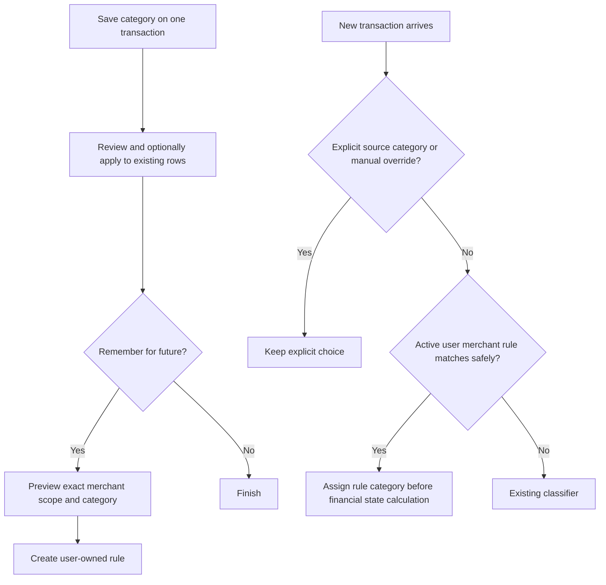

# User merchant category rules: implementation plan

## Goal and scope

Add an explicit **Remember for future transactions** choice after the existing one-time merchant bulk category review. A rule belongs to one user and assigns a parent category and optional custom child category to future qualifying spend from the same merchant. Existing transactions change only through the already shipped bulk review. The rule never creates a merchant-wide issue flag, refund, transfer, or delete action.

The current API already has a global `merchant_category_rules` table and an import resolver that infers from verified VPA, MCC, prior user history, global rules, and fallback. This feature needs a separate user-owned rule table and a single precedence contract across SMS, statement, screenshot, manual, and sync ingestion. The existing `merchant_bulk_category.js` matcher is the starting point for merchant identity; do not infer a permanent rule from a generic name or an aggregator.

## Product decisions to implement

1. The future rule is **off by default**. The choice appears only after a successful online category change and a usable merchant identity; the existing bulk review can be accepted or declined independently.
2. V1 match scope is **exact normalized VPA** when a merchant VPA exists. Otherwise use **strict normalized full merchant name** only for a non-generic name. Do not use substring, fuzzy similarity, transaction narration, phone number, gateway name, or marketplace umbrella identity for automatic user rules. Distinct VPAs under the same display name stay distinct.
3. Store the selected category identity: built-in parent `category_id`, and optional owned `user_category_id`. Resolve a custom child's current parent on create and on apply. If the category is deleted, disable the rule and fall back to ordinary classification.
4. Precedence: explicit category supplied by a reviewed import or manual transaction edit; transaction-specific user override; active user merchant rule; verified VPA/MCC, prior history, global rules, built-in inference; `Other`. A rule must not rewrite an already saved transaction or a meaningful explicit source category.
5. A later manual recategorization of one matching transaction is a **transaction exception**. It must not silently edit the rule. Offer **Update future rule** as a separate explicit action when the user changes the category of a merchant with an active rule.
6. Rule edits and deletion affect **future classification only**. The UI must say this. Existing transactions require the bulk review flow.
7. Eligible transaction kinds are active ordinary spends. Do not apply to income, transfers, card bill payments, refunds, reversals, ignored/deleted rows, split children/parents, or rows with an explicit user choice. One purchase observed from multiple sources must resolve to one categorized transaction under existing deduplication rules.
8. Rule applies at ingestion before reward/cap/milestone state is computed, for online and offline paths. If offline cannot safely evaluate the same version of the rule, keep the new item pending/default and reconcile on sync without overwriting an explicit local choice.

## Data and API contract

Create `user_merchant_category_rules`: `id`, `profile_id`, `match_basis` (`vpa` or `strict_name`), `match_value`, `category_id`, nullable `user_category_id`, `is_active`, `version`, timestamps, and optional `source_transaction_id`. Unique active rule per profile and exact basis/value. Add an audit table with actor, old/new category identity, operation, and timestamp. RLS must restrict both tables to the owner; portable backup and restore coverage must state whether rules are exported and restored. Prefer including them so a device replacement preserves user intent. Sync must propagate create/update/disable and resolve revisions rather than letting stale devices resurrect deleted rules.

Suggested endpoints (names may follow existing API conventions, but freeze them before parallel coding):

| Endpoint | Purpose | Required checks |
|---|---|---|
| `GET /merchant-category-rules` | List user's active and disabled rules | Owner scope, pagination |
| `POST /merchant-category-rules/preview` | Derive match basis/value from owned source transaction; show category and examples | Never trust client-supplied merchant identity; reject generic/unsafe keys |
| `POST /merchant-category-rules` | Create or explicitly replace a rule | Owned source/category, expected version for replace, idempotency key, unique match |
| `PATCH /merchant-category-rules/:id` | Change category or enabled state | Owner, expected version, audit |
| `DELETE /merchant-category-rules/:id` | Disable rule | Owner, idempotent, no historic recategorization |

Responses should return rule ID, safe display merchant name, match basis, category identity, status, version, and the explicit statement that historic transactions were unchanged. Do not expose raw SMS or full account identifiers. Return `409` with current rule/version on concurrent edits. Do not silently overwrite a conflicting rule.

## Agent work plan (GPT-5.6 Luna, high)

Use one orchestrator and three agents. Spawn with `model: gpt-5.6-luna`, `reasoning_effort: high`, and `fork_turns: none`; provide each agent this document, the repository root, and its exact ownership. Luna agents should read repository instructions and inspect the existing implementation before editing. Work in a clean managed worktree if the current shared checkout has unrelated edits; never discard them. Freeze endpoint names, fixtures, and category precedence before agents edit shared contracts.

| Wave | Owner | Engineering task | File ownership and handoff |
|---|---|---|---|
| 0 | Orchestrator | Inspect current import, SMS, manual, offline sync, category hierarchy, and deploy state; write shared JSON fixtures and final API contract; identify every category assignment entry point | Contract and integration checklist |
| 1A | Backend agent | Migration, RLS, indexes, API CRUD/preview, validation, idempotency, audit, category ownership and parent resolution, backup/sync coverage | `db/supabase/migrations`, dedicated API rule module/routes/tests |
| 1B | Classification agent | Pure exact matcher and precedence function; integrate it into all server ingestion paths, dedupe and derived-state timing; protect explicit/manual categories | Import/SMS resolver modules and focused tests; coordinate shared `api/src/index.js` edits through orchestrator |
| 1C | Flutter agent | Repository models/API calls, post-bulk opt-in UI, existing-rule update prompt, rule management list/edit/disable, offline state and clear conflict messages | Flutter data, screens, providers, widget tests |
| 2 | Orchestrator | Integrate conflicts, review privacy and state accounting, run suites and migration tests, build Dev package against production API, update connected phone in place after backend deploy | Verification report and deploy readiness |

Agents must report changed files, contract differences, tests, and unresolved risks. The orchestrator owns shared integration files and final commits. Do not run concurrent Flutter builds against one `app/build` directory.

## Required automated tests

- Exact VPA match across varied display names; different VPA with same name does not match. Strict name fallback matches normalized case/space only. Generic names, gateway labels, and phone-like recipients cannot create rules.
- Built-in parent, custom child, deleted child, wrong-profile child, and parent changes are handled correctly.
- Explicit import category, manual category, and a transaction exception beat the user rule. A rule beats global inference/history where no explicit choice exists.
- All ingestion families use the same resolver. Deduped SMS plus statement evidence does not generate duplicate category state.
- Income, transfers, refunds/reversals, ignored and split transactions are excluded. Reward, cap and milestone values reflect the chosen category exactly once.
- Create retry returns the same result; concurrent create/update gets a deterministic conflict; cross-user reads/writes fail under the API role and database RLS.
- Update/disable never rewrites prior transactions. Offline create/update syncs once and stale device revisions do not resurrect disabled rules. Backup round trip retains rule identity and category links.
- Flutter: opt-in unchecked by default; Not now; create; existing-rule conflict/update; disabled rule; offline/error state; correct accessibility labels.

Run API checks/tests, Flutter analyze with the repository CI flags, focused and full Flutter tests, real PostgreSQL migration/RLS tests, sync/backup tests, and a release APK build. Fix a failed gate before push.

## Physical device and deployment validation

The connected Motorola phone already has package `app.pandapay.pandapay.dev2`; preserve its login and local data. Record installed version/signature and build the **next** version with `scripts/build_app.ps1 dev -Target apk -BuildNumber <next> -ProductionBackend -ApiBaseUrl https://api.pandapath.site -AuthBaseUrl https://auth.pandapath.site -LegalBaseUrl https://api.pandapath.site/legal/`. Verify package, signer, version and compiled URLs; install with `adb install -r`. Never uninstall or clear storage. Confirm the authenticated home and merchant group still load.

After migration and API deployment, use controlled test-account transactions to check: opt-in declined; rule created from VPA and strict-name merchant; next SMS and statement transaction categorized; explicit override retained; another VPA unaffected; rule changed and disabled; old transactions unchanged; custom child category; reward/report totals; offline entry and later sync; second-device conflict; backup/restore. Use redacted evidence and record actual observations. Do not claim end-to-end success from unit tests or a locally built APK alone.

## Rollout and acceptance

Deploy migration before API, then app. Gate creation and automatic application separately so a failing classifier can be disabled without losing stored rules. Monitor rule creation, matches, conflicts, invalid category references, and fallback counts without logging raw VPA or SMS. Rollback disables automatic application while retaining user rules and audit records.

Acceptance requires an opted-in rule to categorize a new eligible spend from the same exact merchant, preserve explicit exceptions, keep historic transactions unchanged, survive sync/backup, and produce correct financial totals on the updated physical device. The deployment and verification report must distinguish automated passes from physical scenarios not yet observed.
