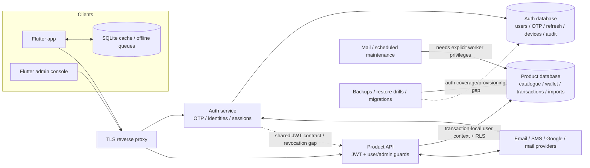

# PandaPay: security, API, backend-flow and data-redundancy audit

Audit date: 20 October 2026. Source: HEAD `c2e41d8` plus the current working tree. Other application edits were occurring during this review, so this is a dated working-tree assessment, not certification of a frozen release binary.

## Decision summary

There are genuine issues to fix; this is **not an all-clear for release**. The highest-priority findings are two conditional account-takeover paths in legacy/contact-linking authentication, broken encrypted-phone lookups, OTP codes appearing in production logs, and inconsistent session revocation between the auth and product services.

Eight isolated probes reproduced the conditions described below using the actual source with synthetic records and mocked database/provider boundaries. No customer account was attacked and no real OTP was requested. The normal backend tests nevertheless pass: **436 API tests and 38 auth tests** rerun today. Passing those tests does not cover the newly found cases.

The data audit also confirmed **20 extra cap-rule rows, 4 extra benefit rows, and two overlapping index pairs in the local product database**. Nothing was deleted, fixed, migrated, committed, pushed, or deployed during this review.

### What was checked

- Active Flutter app, Flutter admin console, Node product API, Node auth service, local PostgreSQL schema/policies/aggregate counts, deployment examples and operational scripts. The shared domain/scraper architecture and earlier test baseline are covered in the linked architecture review.
- All **198 registered backend method/path pairs** in the active services: 170 product API and 28 auth routes, including generated admin rule routes and inherited router guards.
- A heuristic inventory of **160 literal Dart HTTP call sites**, followed by manual review of public exceptions, token headers, auth/recovery helpers, Gmail calls, and the authenticated retry client.
- Mobile credential/network/storage/dependency scanners, manual mobile security checks, and current production-dependency `npm audit` results.
- Local schema metadata for **89 product tables and 7 auth tables**; no customer/transaction/message contents were exported.

### Limits that matter

Production infrastructure, deployed role grants, real email/SMS delivery, production records, provider dashboards, Firebase authorization rules, complete Git history, penetration testing of every request payload, and runtime instrumentation of a signed mobile release were **not** inspected. API coverage here means registration/guard inventory plus targeted source review and isolated probes—not 198 end-to-end security tests. Some risks depend on configuration or particular account states, explicitly noted below.

## Review pack

| Artifact | Purpose |
|---|---|
| [Full API authentication matrix](/Users/chandresh_kerkar/Documents/PandaPath/pandapay-docs/artifacts/security-review-2026-10-20/route-inventory.md) | Every inventoried method/path, access rule and source line |
| [Complete local database dictionary](/Users/chandresh_kerkar/Documents/PandaPath/pandapay-docs/artifacts/security-review-2026-10-20/schema-inventory.md) | All 96 tables, columns, nullable fields, foreign keys, RLS policies, index counts and pending migrations |
| [Extended database metadata](/Users/chandresh_kerkar/Documents/PandaPath/pandapay-docs/artifacts/security-review-2026-10-20/schema-details.json) | Fresh local metadata for the HTML Database explorer: 96 tables, 934 columns, 139 foreign keys, keys/checks/defaults, indexes, policies, triggers, six views, 26 enums and 31 application-function signatures. Includes the later local `recurring_series.user_edited` column. No production records. |
| [Source-only and device schemas](/Users/chandresh_kerkar/Documents/PandaPath/pandapay-docs/artifacts/security-review-2026-10-20/schema-source-supplement.json) | Two migration-defined tables absent locally, plus all 19 persistent Flutter SQLite tables, exact source declarations and guarded runtime column additions. Device source inventory, not a device-data snapshot. |
| [Database optimization evidence](/Users/chandresh_kerkar/Documents/PandaPath/pandapay-docs/artifacts/security-review-2026-10-20/database-optimization-evidence.json) | Fresh local table counts/sizes, indexes, counter limits, literal source locations, database-routine mentions and payload/retention aggregates. No customer values or production records exported. |
| [Reproduction results](/Users/chandresh_kerkar/Documents/PandaPath/pandapay-docs/artifacts/security-review-2026-10-20/security-probe-results.json) | Eight reproduced conditions; `reproduced: true` means a problem was demonstrated, not a security pass |
| [Probe source](/Users/chandresh_kerkar/Documents/PandaPath/pandapay-docs/artifacts/security-review-2026-10-20/security-probes.cjs) | Reusable synthetic-only checks; no network/database connection |
| [Dependency audit](/Users/chandresh_kerkar/Documents/PandaPath/pandapay-docs/artifacts/security-review-2026-10-20/dependency-audit.json) | Current npm advisory evidence for the installed API/auth dependency trees |
| [Mobile scanner output, redacted](/Users/chandresh_kerkar/Documents/PandaPath/pandapay-docs/artifacts/security-review-2026-10-20/mobile-scanner-results.redacted.json) | Raw heuristics, with the manual interpretation in this report |
| [Architecture and data review](/Users/chandresh_kerkar/Documents/PandaPath/pandapay-docs/docs/architecture-data-review-2026-10-19.md) | System architecture, data responsibilities, backup/deletion/provisioning findings and previous test baseline |

## 1. Is every API call authenticated?

**No—and some calls should intentionally remain public.** The important distinction is public catalogue/login traffic versus access to a verified user's private data. No accidentally unguarded private route was identified in the registration inventory, but the current guards do not establish a sufficiently consistent identity/session boundary.

| Product API access class | Method/path pairs | Assessment |
|---|---:|---|
| JWT required | 94 | Signature, issuer, audience and expiry checked; account/session status and guest exclusion are missing at this boundary |
| JWT plus product-admin membership | 59 | `requireAdmin` queries `pandapay.is_admin()`; not merely a client-side role check |
| Public reads/discovery | 14 | Health/readiness, catalogue/categories, app status/changelog, merchant search/resolve/discovery, emergency contacts; public by current design |
| Secret-authenticated webhooks | 2 | Inbound email and partner conversions validate a configured shared secret inside the handler, rather than requiring a user JWT |
| Anonymous analytics write | 1 | Explicitly supports pre-login events; do not treat this as a verified-user channel |
| **Total** | **170** | `/admin/me` needs a JWT and returns the caller's admin status, rather than granting admin access |

Auth's 28 routes comprise 13 JWT-protected operations (including step-up/recovery-proof variants and 2 feature-gated security-admin APIs), 4 request/verify-OTP routes, 2 refresh-token operations, 1 Google-ID-token operation, 1 token-introspection operation, 4 health/debug routes, and **3 public legacy routes**: `/auth/signup`, `/auth/guest-login`, `/auth/check-user`.

The auth service additionally serves files from `auth/public/` before its protected dashboard route: `/test.html` and `/security-dashboard.html` are therefore public static resources even when dashboard APIs are disabled. These files, automatic HEAD/OPTIONS handling, and reverse-proxy routes are outside the 198 count. This is unnecessary exposed debugging surface, **not evidence that protected admin APIs can be bypassed**.

On the client side, the ten inventoried call sites without an explicit `headers` argument were eight expected public reads and two low-level `send(request)` calls whose headers are already on the request object. Login/refresh calls often have JSON headers without a Bearer token, correctly using OTP/refresh proof instead. Private repository/admin calls reviewed supply Bearer headers. The mobile authenticated client also checks the token subject around refresh/retry, coalesces refreshes and retries a 401 once. Header presence alone does not prove authorization; the server findings below remain decisive.

Evidence: [product JWT guard](/Users/chandresh_kerkar/Documents/PandaPath/pandapay-docs/api/src/auth.js:33), [admin guard](/Users/chandresh_kerkar/Documents/PandaPath/pandapay-docs/api/src/index.js:264), [client call inventory](/Users/chandresh_kerkar/Documents/PandaPath/pandapay-docs/artifacts/security-review-2026-10-20/client-call-inventory.json), [authenticated mobile client](/Users/chandresh_kerkar/Documents/PandaPath/pandapay-docs/app/lib/data/authenticated_http_client.dart:37).

## 2. Reproduced authentication/security findings

Priority P1 means address before further distribution; P2 means a material correctness/security gap to resolve next. These are review priorities, not assigned CVSS scores.

### S01 — P1: email proof can claim an existing phone-only account

An OTP can be requested for an attacker-controlled new email without a phone. Normal `/auth/verify-email-otp` then accepts a supplied phone number, finds a phone-only user, attaches that email, and issues tokens for the existing user's ID. It proves the email, **not ownership of the existing phone/account**. The `recovery_only` branch has a guard, but normal verification does not.

The probe reproduced this with a synthetic legacy plaintext-phone, email-null account. The broken encrypted lookup described in S03 affects reachability: this is **not a claim that arbitrary encrypted-phone or already email-linked accounts are takeoverable**. Local aggregate checks found zero phone-only users; production prevalence is unknown. Fix the path even if no susceptible accounts currently exist: linking to an existing identity must require authentication/recent proof for that identity and the new channel, with atomic uniqueness enforcement.

Evidence: [contact selection and linking](/Users/chandresh_kerkar/Documents/PandaPath/pandapay-docs/auth/src/routes/authRoutes.js:939), especially the phone-only branch at line 991; probe 1.

### S02 — P1: public legacy signup issues tokens without an OTP

`POST /auth/signup` has body validation but no OTP proof or authentication middleware. Its existing-user branch completes an account with an empty name and issues access/refresh tokens, explicitly marking the access token `highAssurance: true`. The new-user branch can also create an account without OTP. The probe succeeded even with the phone-OTP feature disabled.

Existing-account takeover requires an incomplete account that the phone lookup can find; a completed account follows a conflict branch. The active Flutter app uses OTP plus profile upsert rather than this legacy signup route, making removal or strict isolation preferable to maintaining a second login implementation. Require a verified signup continuation bound to the authenticated subject; never infer identity from an unverified phone field.

Evidence: [route guards](/Users/chandresh_kerkar/Documents/PandaPath/pandapay-docs/auth/src/routes/authRoutes.js:1460), [incomplete-user branch](/Users/chandresh_kerkar/Documents/PandaPath/pandapay-docs/auth/src/routes/authRoutes.js:1521), [token issuance](/Users/chandresh_kerkar/Documents/PandaPath/pandapay-docs/auth/src/routes/authRoutes.js:1641); probe 2.

### S03 — P1: encrypted-phone equality searches cannot work reliably

Phone encryption correctly uses AES-GCM with a fresh random IV. Search then encrypts the submitted phone again and compares that new ciphertext or the plaintext against the stored ciphertext. The values differ even for the same phone. The probe confirms decrypting works but the stored ciphertext matches neither search candidate.

This affects phone OTP lookup/verification, finding existing users and enforcing contact uniqueness. Decrypt-and-compare logic after the SELECT does not fix a query that returned no matching rows. Add a normalized, keyed-HMAC blind index with a unique constraint and backfill it safely. Keep randomized encryption; **do not reuse GCM IVs or make encryption deterministic** to repair search. Resolve duplicate identity conflicts explicitly during migration.

Evidence: [random-IV encryption](/Users/chandresh_kerkar/Documents/PandaPath/pandapay-docs/auth/src/utils/fieldEncryption.js:88), [search parameters](/Users/chandresh_kerkar/Documents/PandaPath/pandapay-docs/auth/src/utils/encryptedPhoneSearch.js:29), [OTP equality query](/Users/chandresh_kerkar/Documents/PandaPath/pandapay-docs/auth/src/services/otpService.js:154); probe 3.

### S04 — P2: global revocation is not enforced by the product API

For the same signed JWT, auth middleware rejects a stale `token_version` while the product API accepts it. Product auth copies `payload.sub` after JWT verification without checking the current account, token version, device status or deletion status. Previously issued tokens therefore retain product access until expiry (normally 15 minutes), despite revocation on the auth side.

This is a bounded stale-access window, not permanent token validity. Align both services' session policy using a shared validation contract/introspection or revocation cache and test logout-all, disabled accounts, deleted accounts and revoked devices against **both** services. Auth's own ordinary middleware/refresh lookup also lacks consistent `is_active`/`deleted` filtering and needs explicit lifecycle handling.

Evidence: [product guard](/Users/chandresh_kerkar/Documents/PandaPath/pandapay-docs/api/src/auth.js:39), [auth version check](/Users/chandresh_kerkar/Documents/PandaPath/pandapay-docs/auth/src/middleware/authMiddleware.js:88), [refresh account lookup](/Users/chandresh_kerkar/Documents/PandaPath/pandapay-docs/auth/src/routes/authRoutes.js:1266); probe 4.

### S05 — P2: public guest tokens pass private product-route guards

`/auth/guest-login` issues a signed 24-hour guest JWT; the product API only checks for a subject and accepts it on private-route guards. A fresh guest UUID does **not** reveal an existing user's data, but this bypasses a verified-account admission requirement and can create unverified/orphan product identities and data. The active app does not need this legacy guest-login flow.

Remove it if unsupported, or make guest capability a deliberately limited token class that private product routes reject. Test actual profile/transaction/sync boundaries, not just token verification.

Evidence: [guest token issuance](/Users/chandresh_kerkar/Documents/PandaPath/pandapay-docs/auth/src/routes/authRoutes.js:370), [product `requireAuth`](/Users/chandresh_kerkar/Documents/PandaPath/pandapay-docs/api/src/auth.js:52); probe 5.

### S06 — P1: raw OTPs are written to production logs

OTP verification logs the submitted code, email identifier, comparison details and a hash prefix through unconditional `console.log` calls. Running the actual OTP service in production mode with synthetic input reproduced the code in captured log output. Development-only logging guards elsewhere do not protect these calls.

Remove codes/hash fragments from every log path; use structured events with masked contact hints and request IDs. Restrict access/retention for existing auth logs and evaluate whether still-valid credentials were exposed; do not indiscriminately erase incident evidence. No production logs were read in this audit.

Evidence: [verification logging](/Users/chandresh_kerkar/Documents/PandaPath/pandapay-docs/auth/src/services/otpService.js:149), [comparison logging](/Users/chandresh_kerkar/Documents/PandaPath/pandapay-docs/auth/src/services/otpService.js:277), [mismatch logging](/Users/chandresh_kerkar/Documents/PandaPath/pandapay-docs/auth/src/services/otpService.js:309); probe 6.

### S07 — P2: one OTP can succeed in concurrent verifications twice

Verification SELECTs an unconsumed challenge, awaits bcrypt comparison, then updates `consumed_at` by ID without requiring it to remain unconsumed. Two concurrent requests can both read it, both compare successfully and both return success. The synchronized synthetic probe reproduced both successes.

Use an atomic conditional consume with `RETURNING`, accepting only one winner, or a transaction/row-lock design with bounded contention. Enforce expiry/attempt/purpose checks in the same concurrency-safe operation; test simultaneous valid and invalid attempts.

Evidence: [read/compare/consume flow](/Users/chandresh_kerkar/Documents/PandaPath/pandapay-docs/auth/src/services/otpService.js:138), successful consume at line 338; probe 7.

### S08 — P2: enabling DB security logging breaks auth queries

`db.js` imports `dbAccessLogger`, which immediately imports `db.js` again and captures its incomplete exports. Enabling `DB_ACCESS_LOGGING_ENABLED` routes database calls into a logger holding an object without `query`, producing `db.query is not a function`. The isolated actual-source circular-loader probe reproduced this. With the flag off, normal queries bypass it.

Inject the underlying pool/query function into the logger rather than calling the wrapped DB API recursively. Do not create tables/indexes on query paths. The logger's current sanitizer also preserves email values and short OTP-shaped strings, so fix privacy handling before enabling it.

Evidence: [DB wrapper](/Users/chandresh_kerkar/Documents/PandaPath/pandapay-docs/auth/src/db.js:186), [logger's circular import](/Users/chandresh_kerkar/Documents/PandaPath/pandapay-docs/auth/src/middleware/dbAccessLogger.js:28), [logger execution](/Users/chandresh_kerkar/Documents/PandaPath/pandapay-docs/auth/src/middleware/dbAccessLogger.js:228); probe 8.

## 3. Additional source-confirmed risks and hardening gaps

These were source/configuration reviews, not live exploit attempts.

| ID / priority | Finding and scope | Recommended action / evidence |
|---|---|---|
| S09 / P2 | OTP generation uses `Math.random()` and only 4 digits. Rate limits reduce guessing, but this is not a cryptographically secure code generator. | Use `crypto.randomInt`, a reviewed code length and strict per-challenge/per-identity attempt limits. [Generator](/Users/chandresh_kerkar/Documents/PandaPath/pandapay-docs/auth/src/services/otpService.js:65) |
| S10 / P2 | DB TLS, when enabled, uses `rejectUnauthorized: false` in both services. Encryption without peer-certificate verification permits DB impersonation to an attacker with the necessary network position. | Configure a trusted CA and verify the server. Keep non-TLS local development explicitly separate. [API pool](/Users/chandresh_kerkar/Documents/PandaPath/pandapay-docs/api/src/db.js:6), [auth pool](/Users/chandresh_kerkar/Documents/PandaPath/pandapay-docs/auth/src/db.js:132) |
| S11 / P2 | Auth's production/staging compose does not pass `TRUST_PROXY`, so behind the documented proxy, IP limiters can group users under the proxy address. Simply enabling the current boolean `true` is unsafe with an edge that appends untrusted X-Forwarded-For values. | Trust only the known proxy topology and overwrite/sanitize forwarding headers at ingress. [Auth config](/Users/chandresh_kerkar/Documents/PandaPath/pandapay-docs/auth/src/index.js:37), [edge example](/Users/chandresh_kerkar/Documents/PandaPath/pandapay-docs/deploy/nginx/auth.conf.example:45). See [Express's proxy guidance](https://expressjs.com/en/guide/behind-proxies.html). |
| S12 / P2 | User-supplied IMAP hosts/ports reach `tls.connect`. The test checks hostname syntax, not resolved IP ranges; an attacker-controlled DNS name can resolve privately. TLS certificate verification remains enabled, so unrestricted internal response/file exfiltration is **not** demonstrated. | Allowlist supported providers or validate/pin resolved public addresses across IPv4/IPv6 and enforce outbound-network policy, bounded concurrency and timeouts. Apply validation when saving and polling, not only testing. [Connection creation](/Users/chandresh_kerkar/Documents/PandaPath/pandapay-docs/api/src/index.js:9174), [TLS connection](/Users/chandresh_kerkar/Documents/PandaPath/pandapay-docs/api/src/imap_test.js:59) |
| S13 / P2 | Console access and refresh tokens persist in SharedPreferences/localStorage, readable by same-origin JavaScript and an exposed browser profile. No XSS exploit was established, but persistent admin-session theft has high impact. | Prefer a reviewed Secure/HttpOnly/SameSite cookie/BFF session design; otherwise minimize refresh-token persistence and enforce a strong CSP/session lifetime. [Console token store](/Users/chandresh_kerkar/Documents/PandaPath/pandapay-docs/console/lib/data/token_store.dart:4) |
| S14 / P2 | `POST /lounge-usage` checks the row's `profile_id` via RLS but does not prove the submitted `user_card_id` belongs to that user or the benefit belongs to that card product. Independent foreign keys do not establish those relationships. | Validate both relationships atomically or enforce compound ownership constraints. This is an integrity/foreign-reference authorization gap, not demonstrated cross-user data reading. [Handler](/Users/chandresh_kerkar/Documents/PandaPath/pandapay-docs/api/src/index.js:5914), [schema](/Users/chandresh_kerkar/Documents/PandaPath/pandapay-docs/db/supabase/migrations/0004_user_domain.sql:198) |
| S15 / P2 | Anonymous `/auth/check-user` exposes existence/registration state without the OTP-request enumeration rate-limiter chain. Encryption's lookup bug may make answers wrong; it is not a security control. | Remove the unused endpoint or normalize responses and apply strict abuse controls. [Route](/Users/chandresh_kerkar/Documents/PandaPath/pandapay-docs/auth/src/routes/authRoutes.js:278) |
| S16 / P2 | Request logging redacts a small key denylist, but retains other query values. GET discovery coordinates and merchant/VPA searches can therefore be copied into logs despite “never content” comments. | Default to logging route templates and query keys, with an explicit safe-value allowlist. Include encoded-key tests. [URL sanitizer](/Users/chandresh_kerkar/Documents/PandaPath/pandapay-docs/api/src/observability.js:46) |
| S17 / P2 | Local `app_user` can mutate `schema_migrations`, the only product table without RLS. Setup broadly grants public-table CRUD and function execution. This is avoidable blast radius, not an identified HTTP path to arbitrary SQL. | Revoke ledger mutation from runtime roles; explicitly grant required functions, especially SECURITY DEFINER operations. Keep migration/worker/service roles separate. [Grants](/Users/chandresh_kerkar/Documents/PandaPath/pandapay-docs/db/setup_app_role.sql:34) |
| S18 / P2 | The local auth `users` table has only its primary-key index: neither email nor normalized phone identity has a database uniqueness constraint. SELECT-before-INSERT checks can race, and encrypted-phone lookup is already broken. No duplicate normalized emails were found locally. | Enforce reviewed normalized-email and phone-blind-index uniqueness for the intended account lifecycle, resolve any conflicts before creating indexes, and handle uniqueness violations atomically. [Auth schema](/Users/chandresh_kerkar/Documents/PandaPath/pandapay-docs/auth/db/pandapay-auth/init.sql:21) |

## 4. Backend flow and operational bugs

| ID / priority | What is wrong | Impact and next step |
|---|---|---|
| B01 / P2 | IMAP polling SELECTs every active connection through the ordinary pool with no `app.user_id`. Owner RLS on `imap_connections` sees a null identity. | Under the documented non-bypass `app_user` deployment, polling returns no connections even though an individual connection test can succeed. Use a narrowly privileged worker operation/role, not a superuser or disabling RLS. [Poll cycle](/Users/chandresh_kerkar/Documents/PandaPath/pandapay-docs/api/src/imap_poller.js:146) |
| B02 / P2 | Session advisory-lock acquisition and release use separate `pool.query` calls. They are not guaranteed to run on the same PostgreSQL session. | Lock leakage/re-entrancy can disrupt multi-instance polling under load. Hold one checked-out client through acquire/work/release, or use an appropriate transaction-scoped design. [Lock lifecycle](/Users/chandresh_kerkar/Documents/PandaPath/pandapay-docs/api/src/imap_poller.js:152) |
| B03 / P2 | Partner callback authenticates its shared secret but queries owner-only `partner_clicks` without a user context, then would insert into admin-only `partner_conversions` through the same runtime role. | Under `app_user`, a valid callback can return `matched: false` silently. Use a narrowly scoped, secret-gated worker/RPC and integration-test real role permissions. No live lost conversion/revenue was established. [Webhook](/Users/chandresh_kerkar/Documents/PandaPath/pandapay-docs/api/src/index.js:1885), [policies](/Users/chandresh_kerkar/Documents/PandaPath/pandapay-docs/db/supabase/migrations/0030_partner_attribution.sql:103) |
| B04 / P2 | User-facing backup-status queries run as a normal user against admin-only backup/restore tables. | Ordinary users receive null backup state even when operational rows exist. Expose a sanitized status projection; do not open raw filesystem/error details to everyone. [Status endpoint](/Users/chandresh_kerkar/Documents/PandaPath/pandapay-docs/api/src/index.js:9022) |
| B05 / P2 | `/auth/google` reads/writes `users.google_id`, absent from active auth init SQL and the local auth schema. `oauth_accounts` exists but active auth code does not use it. | The endpoint fails against that schema. Migrate to one tested provider-link model; do not keep two undocumented representations. Active app Gmail import authorization is separate from this account-login endpoint. [Google route](/Users/chandresh_kerkar/Documents/PandaPath/pandapay-docs/auth/src/routes/authRoutes.js:1134) |
| B06 / P2 | Console login supports phone OTP only; the production template disables phone OTP because no SMS provider is configured. | Following that configuration leaves the console's normal sign-in path unavailable. Add the supported email flow or explicitly provision/enable SMS and test operator login. [Console login](/Users/chandresh_kerkar/Documents/PandaPath/pandapay-docs/console/lib/features/auth/login_screen.dart:24), [production flag](/Users/chandresh_kerkar/Documents/PandaPath/pandapay-docs/docker-compose.prod.yml:123) |
| B07 / P2 | Legacy signup still tries to write the removed farm-domain `locations` table when address fields are supplied. | That path can error after earlier user writes because the multi-step operation is not atomic. Removing the unsupported legacy endpoint also removes this broken flow. [Legacy write](/Users/chandresh_kerkar/Documents/PandaPath/pandapay-docs/auth/src/routes/authRoutes.js:1578) |
| B08 / P3 | Feature-gated auth security dashboard requires `security_admin`, but the initialized role enum allows `user`, `admin`, `moderator`. | A normally provisioned auth user cannot satisfy that role check. Product-console admin membership is a different mechanism and is not affected. Consolidate/remove the legacy dashboard or version its role model. [Role guard](/Users/chandresh_kerkar/Documents/PandaPath/pandapay-docs/auth/src/middleware/adminAuth.js:22) |

### Important architecture findings carried forward

These remain source/configuration findings from the architecture review, not new proof of production failure:

1. **P1 — incomplete account erasure:** the API schedules deletion, normal migration runners skip the cron sweep, and product-side deletion does not execute an auth-user deletion workflow. Build a monitored, idempotent two-database erasure process.
2. **P1 — auth recovery coverage:** configured scheduled dumps/restore drills cover one product database URL, not the separate auth database. Demonstrate recovery for both.
3. **P1 — auth provisioning:** production migration automation handles product SQL, not a versioned auth upgrade path. The sample auth URL uses privileged `postgres`; documented least-privilege operation is inconsistent.
4. **P2 — migration drift:** today's local inventory has **67 SQL migration files, 42 product migrations recorded, 24 non-cron files pending, plus intentionally skipped `0013_cron_jobs.sql`**. The ledger has 48 total entries including six seed entries. Yesterday's report had 66 source files/23 pending; an additional working-tree migration was created during this audit. No migration was applied here.

See the [architecture review's evidence and diagram](/Users/chandresh_kerkar/Documents/PandaPath/pandapay-docs/docs/architecture-data-review-2026-10-19.md:19) and the [current pending-file list](/Users/chandresh_kerkar/Documents/PandaPath/pandapay-docs/artifacts/security-review-2026-10-20/schema-inventory.md).

## 5. Redundant data, code and misleading words

### Confirmed local duplication

The equality test below ignores generated `id`, `created_at` and `updated_at`, but compares every other field. It does not assume similarly named rules are semantically interchangeable.

| Object checked | Duplicate groups | Extra rows / recommendation |
|---|---:|---|
| `cap_rules` | 20 | **20** extra definitions |
| `card_benefits` | 2 | **4** extra definitions |
| `reward_rules` | 0 | None under this comparison |
| `milestone_rules` | 0 | None under this comparison |
| Active wallet identity: profile/product/trimmed last4 | 0 | No duplicated active identity groups in the local snapshot |
| `change_log` indexes | 1 pair | `idx_change_log_pull` and `idx_change_log_profile_seq` have the same keys/predicate/sort definition; evaluate retaining one |
| `partner_clicks` indexes | 1 pair | Non-unique `idx_partner_clicks_token` overlaps unique `partner_clicks_click_token_key`; keep the uniqueness constraint, evaluate removing the extra index |

The pending `20261014173000_dedupe_catalogue_rules.sql` already addresses repeated cap/benefit definitions and foreign-key rewiring. **Do not simply delete duplicate rows**: cap states/lounge usage reference them. Dry-run that migration on a clone and reconcile state totals. One inconsistency also needs correction: existing-row dedupe normalizes `lower(trim(label))`, while its new uniqueness indexes use raw `label`, allowing future case/space variants to recur. No state overcount was demonstrated in this audit.

Evidence: [read-only aggregate queries](/Users/chandresh_kerkar/Documents/PandaPath/pandapay-docs/artifacts/security-review-2026-10-20/local-data-audit.sql), [dedupe migration](/Users/chandresh_kerkar/Documents/PandaPath/pandapay-docs/db/supabase/migrations/20261014173000_dedupe_catalogue_rules.sql:12).

### Cleanup candidates—not approved deletions

| Candidate | Evidence / decision |
|---|---|
| Auth `otp_codes`, `oauth_accounts` | Zero local rows and no exact active auth-source use. `otp_requests` is the real OTP table. Decide whether to remove the legacy table or wire the intended OAuth model; absence of local rows alone is insufficient. |
| Product `feature_flags`, `app_versions` | Zero local rows; app status/remote configuration use other paths. Confirm operational/roadmap ownership before retiring them. |
| Expired OTPs and revoked refresh records | Local counts: 24/24 OTP rows expired; 146 refresh rows, 25 expired and 133 revoked (overlapping groups). Define retention and a working cleanup job. Revoked rotation records support replay detection and must not be deleted merely because they are revoked. |
| Legacy auth routes/dashboard | Signup, guest login, check-user, static debug pages, obsolete address writes and mismatched admin roles add attack surface absent from the active app flow. Remove only after checking external consumers and compatibility requirements. |
| Nested `PandaPal_Auth_Service/` | Separate legacy Git checkout; root compose builds `auth/`, not that checkout. Archive separately if confirmed obsolete; do not erase its uncommitted work or secrets. |
| App packages | Previous source scan found no direct imports of `rive`, `flex_color_scheme`, `responsive_framework`, `cupertino_icons`. Verify generated/native/transitive usage before removal. Move test/build/lint tooling out of runtime `dependencies` into `dev_dependencies`, then rebuild/test. |
| Monolithic API | About 9.4k lines in one entrypoint; generated route-family helpers are useful, but domain separation and request-schema tests would make ownership/security review much easier. Refactor incrementally after containment, not during incident fixes. |

### Wording/documentation corrections

- Old single-database/Next.js descriptions do not match the current two-database/Flutter-console implementation.
- Auth init SQL says phone/email are encrypted and the search helper enforces uniqueness. Email flows actually store normalized email directly, and S03 disproves encrypted-phone lookup uniqueness. Documentation must describe real protection, not intended protection.
- The API's catalogue/RLS commentary still describes an unfiltered-draft gap, but later migrations add the published-view/RLS behavior. **That old comment is not evidence of a current public draft leak.** Update/remove obsolete incident narration after verifying the effective deployed view.
- Console token-store commentary dismisses an admin refresh token as “not a payment credential.” It is still a sensitive credential controlling privileged data/actions.
- `Farm Auth Service`, farm-address writes and `BuySellService` references are leftover domain language. Update harmless labels and remove unsupported flows, rather than renaming columns/API contracts blindly.
- OTP email subjects/body still use `PandaPal.Ai` rather than PandaPay; unlike an explanatory comment, this is user-visible trust/branding inconsistency. [Email template](/Users/chandresh_kerkar/Documents/PandaPath/pandapay-docs/auth/src/services/emailService.js:36)
- “Never content” logging commentary contradicts the retained query values; “global logout” must accurately describe the product API's remaining token-validity window until S04 is fixed.

## 6. Dependency and mobile-security results

### npm dependencies

Fresh `npm audit --omit=dev --json` completed without changing lockfiles:

| Service | Affected installed packages | Registry severity counts |
|---|---|---|
| API | `proxy-addr`, `qs` | 1 critical, 1 moderate |
| Auth | `axios`, `body-parser`, `form-data`, `nodemailer`, `proxy-addr`, `qs` | 1 critical, 3 high, 1 moderate, 1 low |

These are **package-level advisories, not eight proven remotely exploitable application vulnerabilities**. Installed versions include `proxy-addr 2.0.7` in both services, API `qs 6.15.3`, auth `qs 6.15.2`, `axios 1.16.1`, `form-data 4.0.5`, `nodemailer 8.0.9`, and auth `body-parser 2.2.2`.

- The `proxy-addr` critical advisory requires particular malformed IPv4-mapped/IPv6 trust subnets; that exact configuration was not found here. Upgrade to the patched line and independently fix S11. [Maintainer advisory](https://github.com/advisories/GHSA-jqcg-44mw-7w3h)
- The cited `qs` array-limit bypass depends on comma-parsing options; do not assume the default Express configuration enables it. Refresh the dependency and add bounded parser tests. [Maintainer advisory](https://github.com/advisories/GHSA-x5fp-wj9c-mxmx)
- The cited Nodemailer raw-message SSRF/file-access issue requires attacker influence over the relevant message options. This OTP service uses its own message construction; that exploit path was not established. Other advisories also apply to the installed line, so upgrade with delivery tests instead of running a blind major-version fix. [Maintainer advisory](https://github.com/advisories/GHSA-p6gq-j5cr-w38f)
- Auth's Axios/form-data path comes through Twilio; disabled SMS limits the active path but is not a dependency-removal strategy. Review the installed advisory list and upgrade the provider chain. [form-data advisory](https://github.com/advisories/GHSA-hmw2-7cc7-3qxx)

### Mobile OWASP review

The installed OWASP Mobile Security Checker supplied four scanners and the mobile checklist. Its instructions explicitly exclude backend auditing; the Node/SQL review above was separate. Scanner output was manually triaged rather than copied as final severity.

| Area | Result / limit |
|---|---|
| M1 credentials | Scanner found no hardcoded-secret matches across 304 files; one directory-read diagnostic limits that count. A separate tracked-file/key-shape check found documentation examples, not a confirmed live secret. Firebase client config is not a server credential. Full Git-history/secret-validity testing was not performed. |
| M2 supply chain | No unconstrained-version/static-threshold hits; 135 outdated Dart packages reported. **Outdated is not equivalent to vulnerable**; this was not a complete Dart/native CVE assessment. npm findings are above. |
| M3 authentication/authorization | Mobile secure token storage and refresh-subject checks are positive; server identity/revocation findings remain blockers. Console storage is a separate S13 concern. |
| M4 input/output validation | Private SQL paths sampled are parameterized, admin dynamic identifiers are allowlisted, and sync applies an entity/field allowlist plus ownership checks. Lounge foreign references and IMAP destinations still need the checks described above. No exhaustive fuzzing claim. |
| M5 communications | Four high HTTP heuristics were false positives: three Android-emulator development URLs and one SMS marker string `http://`, not a network destination. Release URL validation, Android cleartext restrictions and default iOS ATS are present. Missing pinning is a threat-model decision, not by itself a demonstrated MITM vulnerability. Backend DB peer verification is a real S10 gap. |
| M6 privacy | Production OTP/query logging needs correction; deletion/retention needs a complete workflow. Raw mailbox/SMS/receipt handling deserves retention/consent verification in a release runtime. |
| M7 binary protections | Release signing/minification configuration was inspected; native minification is deliberately disabled after a documented Room runtime crash. Missing obfuscation is not equivalent to an auth flaw. No reverse-engineering/root/tamper test was performed. |
| M8 configuration | Android backup is disabled, SMS receiver has the broadcast permission guard, exported quick-settings service has its binding permission. Production role/proxy/bootstrap differences still need deployment checks. |
| M9 storage | Mobile tokens use secure storage with removal of legacy preference tokens. The OCR unencrypted-file warning is transient image processing with best-effort deletion in `finally`; not a confirmed persistent card-data leak. Preparation failures/process death can leave temp files, so add age-based cleanup and avoid retaining PAN-bearing images. The user's source gallery photo is intentionally not deleted. Financial-cache/receipt encryption remains a threat-model/runtime verification item. |
| M10 cryptography | Random-IV authenticated phone encryption is a positive primitive; searching it incorrectly is S03. OTP randomness is S09. Key custody/rotation and runtime keystore behavior were not independently verified. |

## 7. High-level architecture and trust boundaries



There is no cross-database foreign key between auth `users.id` and product `profiles.id`. Verified provisioning, revocation, erasure and recovery must therefore coordinate across services. Preserve owner-scoped RLS while providing explicit worker capabilities; do not solve broken background flows by switching the ordinary API to a superuser.

## 8. Recommended order of work and acceptance gates

1. **Contain identity risks first:** disable/remove unsupported signup/guest/check-user surfaces, fix account linking, remove OTP logging, and review affected-account prevalence using privacy-preserving production aggregates. Fix S03 without weakening encryption. Add the eight reproduced cases as regression tests with expected secure outcomes.
2. **Unify session and abuse controls:** reject guest tokens on private operations, apply account/device/revocation policy consistently, use atomic OTP consumption and secure randomness, configure the proxy chain, and upgrade affected dependencies with compatibility tests.
3. **Repair role-aware integrations:** test mail polling, callbacks, backup-status and ownership constraints against the actual least-privilege DB roles. Add an operational signal for “no work matched” versus successful processing.
4. **Make operations complete:** version auth migrations, reconcile product migration drift on a disposable clone, demonstrate both-database restore, run monitored account erasure and retention jobs, and remove runtime mutation of migration metadata.
5. **Clean up only with evidence:** rewire references before dedupe, validate state totals, retain constraint-backed uniqueness, audit compatibility before dropping tables/routes/packages, and update misleading security/architecture wording.

Required release evidence: real-role cross-user authorization tests, denied anonymous/guest/revoked/disabled sessions, concurrent OTP tests, zero secret/OTP log assertions, successful supported operator login, fresh-install and upgrade migrations, and a demonstrated restore/erasure workflow across both databases. Today's unit-test success is a useful baseline, not a substitute for those gates.

## 9. Solutions for every finding

**Status: proposed remediation, not implemented or verified fixes.** The actions below cover the listed security findings, backend failures, architecture gaps, cleanup candidates, dependency advisories, mobile review limits and wording problems. Existing evidence and scope limits still apply. IDs beginning A, D, C, N, W and M organize the work below; they do not represent newly discovered vulnerabilities. Owners are suggested engineering roles, not assigned people.

### Implementation order and release gates

| Stage | Work and owner | Completion evidence |
|---|---|---|
| 1 — contain identity risks | Auth/backend: S01, S02 and S06; remove or isolate unsupported public/debug surfaces; assess affected account states through privacy-preserving production aggregates when authorized. | The two synthetic takeover cases fail securely, supported login still succeeds, and no OTP/secret appears in captured logs. A production-impact assessment remains separate from these local probes. |
| 2 — repair identity and sessions | Auth/backend + database: S03 and S18 together, then S04, S05, S07–S11 and S15. Fix account linking before making previously broken phone lookups reachable. | Race-safe identity uniqueness, single-use OTP, secure code generation, supported account recovery, and matching lifecycle/revocation decisions across both services. |
| 3 — restore safe backend operations | Backend/platform: S12–S14, S16–S17, B01–B08, account erasure, two-database backup/restore and versioned provisioning. | Integration tests run under real runtime/worker roles; two-database recovery and erasure succeed through partial failures; unauthenticated and cross-user requests are denied as intended. |
| 4 — controlled data and dependency work | Database/platform + mobile: clone-tested migrations/dedupe, compatible dependency upgrades, retention jobs and mobile regressions. | Before/after financial-state reconciliation, migration-from-empty and upgrade tests, successful supported login/import flows and reviewed dependency results. |
| 5 — maintainability and documentation | Service/mobile owners: remove proven-unused components, split the API incrementally, update architecture/security claims and add CI coverage. | No unexplained route/behavior changes, no broken supported clients, current architecture docs and a passing relevant test baseline. |

Each database migration needs a reviewed backup/recovery plan and a clone rehearsal. Use additive schema changes and backfills where possible. If a new identity index exposes conflicting accounts, quarantine the conflicts for a verified resolution; do not merge identities automatically. An old vulnerable build is not a safe rollback target for a security fix—retain containment while preparing a corrected release.

### Authentication and API security — S01 to S18

Suggested owners: auth/backend for identity/session changes; database for constraints and grants; platform for TLS/proxy/egress; console for browser sessions. Priorities below retain the original findings' priorities.

| Finding | Suggested solution | How to verify the fix |
|---|---|---|
| S01 / P1 — existing phone-only account can be claimed through email proof | Bind the OTP challenge to the intended action and identity. Require a signed-in session plus recent proof of the existing account before attaching a new contact; separately verify the new email. Give legacy users a supported recovery flow with evidence of account ownership. Perform linking and uniqueness checks atomically. | Re-run the synthetic new-email/existing-phone test: no link and no victim token are produced. Test legitimate linking, wrong challenge purpose, expired/replayed proof and two simultaneous link attempts. |
| S02 / P1 — legacy signup issues tokens without proof | Retire the unused public signup route after checking consumers, or make it accept only a short-lived, single-use continuation created by successful verification and bound to that subject. Profile completion must never establish ownership from an unverified phone/name. Remove the unearned high-assurance claim. | New, incomplete and complete synthetic accounts cannot obtain tokens from signup without valid proof. Supported OTP/profile-upsert onboarding still works; the phone-OTP feature flag cannot be bypassed. |
| S03 / P1 — encrypted phone searches fail | Normalize phone numbers consistently, retain randomized authenticated encryption, and add a versioned keyed-HMAC blind index using a separately managed secret. Backfill in batches, investigate collisions/duplicate identities, add the intended unique constraint and switch reads only after reconciliation. Coordinate with S01/S02/S18. | Existing and newly created encrypted-phone accounts are found consistently. Concurrent normalized variants cannot create two identities; migration and rollback preserve lookup. Equal phones keep different ciphertexts, and plaintext phones never appear in logs. |
| S04 / P2 — session revocation differs between services | Define one contract for verified user, account state, token version, device/session revocation and deletion. Make the product API enforce that contract through protected service validation or a carefully bounded revocation cache. Apply the same rules during auth middleware and refresh. Document any actual cache/revocation delay; fail safely when validation is unavailable. | Run the same tokens against auth and product before/after logout-all, device revocation, disablement and deletion. Assert denied refresh and private access within the declared revocation bound; exercise validation outages. |
| S05 / P2 — guest tokens enter private routes | Remove unsupported server guest-token issuance. If a server guest feature is retained, define an explicit guest token type with minimal capabilities and reject it on verified-user routes. Preserve the app's supported on-device guest experience. | Anonymous/guest requests cannot provision private profiles or write transactions/sync data. Verified accounts still work, and guest mode remains local where intended. |
| S06 / P1 — OTPs in logs | Delete code/hash-fragment logging from every success/error branch. Use structured event names, request IDs and approved masked identifiers. Restrict existing log access/retention and assess exposure without erasing incident evidence indiscriminately. Invalidate any demonstrably exposed still-valid credentials through the supported process. | Capture production-mode logs for valid, invalid, expired and provider-failure cases. Assert the absence of raw codes, hashes, full contacts and tokens, including serialized exceptions. |
| S07 / P2 — concurrent OTP reuse | Compare the candidate, then allow success only if a conditional consume still matches the unconsumed, unexpired challenge and its identity/purpose. Use UPDATE … RETURNING or a bounded locking transaction. Make attempt-count updates atomic and prevent late invalid attempts from defeating a successful consume. | Start many concurrent valid verifications: exactly one succeeds and issues a session. Mix invalid/valid/expired attempts and verify attempt limits, consumption and rollback behavior. |
| S08 / P2 — DB logger circular dependency | Inject the raw pool/query function into the logger, avoiding calls back into the wrapped DB API. Keep logging schema setup in migrations and redact parameter values by default before enabling the feature. | Enable/disable DB logging in a fresh process. Ordinary queries and transactions work without recursion or duplicate execution; logging failures do not leak values or change query results. |
| S09 / P2 — weak OTP generator | Use crypto.randomInt with a reviewed code length; six digits is a reasonable proposed starting point. Bind each challenge to purpose/contact, apply expiry and strict challenge/identity/IP attempt and resend limits, and update every client/email validator together. | Assert code format and use of the secure generator, expiry, resend behavior and bounded attempts. Test limits across multiple service instances if deployed that way. A randomness-frequency test alone is not proof of security. |
| S10 / P2 — DB certificate verification disabled | Configure the managed/server CA and hostname validation in both services. Separate explicit local non-TLS settings from production, and fail startup for invalid production trust configuration. Plan CA rotation. | A valid trusted DB succeeds; untrusted CA, expired certificate and hostname mismatch fail. Rotation rehearsal preserves connectivity without setting rejectUnauthorized to false. |
| S11 / P2 — proxy/rate-limit identity mismatch | Configure trusted proxy addresses/hops for the actual deployment and make ingress replace untrusted forwarding headers. Pass the setting consistently to staging/production and combine IP limits with identity/challenge controls. | Spoofed forwarding headers do not change the effective client IP. Separate clients are not collapsed under the proxy IP; direct backend access is blocked and distributed limits behave as documented. |
| S12 / P2 — IMAP destination checks insufficient | Prefer a supported-provider allowlist. If custom hosts are required, validate IPv4/IPv6 resolution, reject internal/link-local/metadata destinations, connect to the vetted address while retaining TLS hostname validation, and constrain outbound networking. Apply controls on save, test and every poll; bound time/concurrency. | Provider mail works. Private/loopback/link-local addresses, alternate address forms and DNS changes cannot reach internal services. Verify TLS, timeouts and worker behavior, without treating rejected connections as successful polling. |
| S13 / P2 — persistent browser admin tokens | Prefer a same-origin backend session using Secure, HttpOnly and appropriate SameSite cookies. Add CSRF/Origin controls for state-changing cookie requests. If retaining Bearer sessions temporarily, minimize persistent refresh storage, shorten exposure, strengthen CSP and revoke sessions on logout. | Browser JavaScript cannot read an HttpOnly session; unauthorized origins/CSRF attempts fail. Login, renewal, logout and revocation work. No browser-storage design is described as preventing all XSS impact. |
| S14 / P2 — lounge foreign references lack ownership checks | In one transaction, prove that user_card_id belongs to the caller and that the benefit belongs to that card's product before inserting usage. Consider composite constraints where the schema can express the invariant; keep owner RLS. | User A cannot submit user B's card, or a benefit for another product. Legitimate usage succeeds, including concurrent/archive edge cases; failed requests leave no usage/state mutation. |
| S15 / P2 — public account enumeration | Retire unused check-user. If needed, return a uniform response for known/unknown contacts, apply abuse limits and keep registration decisions inside the verified continuation flow. Avoid new timing/content differences from lookup failures. | Known/unknown/malformed identifiers produce the intended uniform public response. Rate limits apply; authorized recovery/onboarding still reaches the correct next step. |
| S16 / P2 — query values in request logs | Log route templates, request IDs, query key names and allowlisted non-sensitive values. Omit search terms, coordinates, VPAs, contacts, tokens and arbitrary request bodies by default. Review exception/access logs as well as the normal logger. | Encoded keys, repeated/nested query parameters and error cases cannot disclose sensitive values. Useful route/status/latency diagnostics remain available. |
| S17 / P2 — excessive runtime grants | Restrict schema_migrations writes to the migration owner. Create explicit grants for API, auth, worker and migration roles; audit inherited/PUBLIC grants and SECURITY DEFINER execution. Harden definer functions' search_path and keep ordinary API roles non-superuser/non-bypass. | Runtime roles cannot alter migration history or access unrelated data/functions. Required requests still pass under real roles, including transactions and background jobs. |
| S18 / P2 — no contact uniqueness constraints | Define normalized-email and phone-blind-index uniqueness for the intended active/deleted/pending lifecycle. Audit conflicts safely, backfill and create constraints; handle unique violations as normal transactional conflicts. Match S03 normalization and key versioning. | Concurrent signup/link requests create one identity. Email/phone variants obey the documented policy, deleted-account reuse follows the chosen lifecycle, and conflicts do not attach one account's contact to another. |

### Backend flows — B01 to B08

Suggested owners: backend and database, with platform for operator login configuration.

| Finding | Suggested solution | How to verify the fix |
|---|---|---|
| B01 / P2 — polling sees no connections under owner RLS | Give a dedicated worker a narrowly scoped operation to enumerate due connections and process them with explicit ownership context. Do not run the ordinary API as superuser or disable RLS. Record selected/processed/failed counts and alert on unexpected inactivity. | A real worker role sees only permitted work; ordinary user A cannot enumerate user B's connection. Due connections are processed and a no-work cycle is distinguishable from a failed cycle. |
| B02 / P2 — advisory locks use different pooled sessions | Check out one DB client for acquisition, work and unlock. In finally, release the advisory lock on that same client before returning the client to the pool; discard a connection if safe unlock cannot be confirmed. Use a transaction-scoped lock only if the work genuinely fits that transaction. Define crash/timeout recovery. | Two workers cannot process the same lock scope concurrently. Errors/timeouts return or discard the client safely and leave no persistent lock; repeat under pool contention and process termination. |
| B03 / P2 — partner callback lacks suitable DB capability | Use a secret-authenticated, narrowly privileged worker/RPC to resolve the click and record a conversion. Keep shared-secret checks, add idempotency/unique provider event identity and expose permission failures instead of silent unmatched success. | Valid callbacks work under the deployed role; invalid secret, unknown click and duplicate delivery are distinct tested cases. Replays do not double-credit rewards; no cross-user read is exposed. |
| B04 / P2 — backup status hidden by admin-only policies | Return a sanitized aggregate status through an explicit function/projection or service-owned status endpoint. Keep operational paths, errors and backup locations restricted to administrators. | Users see only the intended health summary; admins see detailed diagnostics. No raw location/error or another user's metadata leaks, and unavailable/stale status is explicit. |
| B05 / P2 — Google login/schema mismatch | Decide whether account Google login is supported. If yes, use one versioned provider-link model with unique provider/subject identity, verified provider tokens and safe explicit account linking. If unsupported, retire the route before dropping unused structures. Gmail import consent remains a separate feature. | A fresh and upgraded auth DB support the chosen contract. Invalid provider tokens and contact-collision linking are denied; Gmail import still works independently. |
| B06 / P2 — console requires disabled phone OTP | Add the supported email OTP path to console login, or provision and enable the intended SMS provider explicitly. Keep product-admin membership enforced server-side and expose provider-unavailable errors clearly. | A real configured operator signs in and reaches authorized console functions; a normal user is denied admin operations. Disabled/unavailable providers do not produce misleading success. |
| B07 / P2 — legacy signup writes removed locations table | Retire this unsupported branch with S02. If address capture is a supported requirement, implement it in the current profile model with verified identity and a transaction. Do not recreate an obsolete farm table just to hide the failure. | Signup/profile completion never leaves partial user/token/address state after an injected failure. Current supported onboarding passes on a clean schema. |
| B08 / P3 — dashboard role enum mismatch | Prefer removing the unused auth dashboard or intentionally consolidate its authorization with the supported admin model. If retained, version the role model, explicitly provision its role and keep its APIs and pages protected. | Intended operators can access it; every ordinary role and anonymous request is denied. Product-console admin status is not accidentally inferred from an unrelated auth role. |

### Architecture, migration and release work

These actions also cover the linked architecture review. Its dated test failures and local migration state must be rerun before treating them as current release results.

| Work item | Suggested solution | How to verify the fix |
|---|---|---|
| A01 / P1 — incomplete two-database erasure | Build an idempotent deletion workflow with a due-date worker, durable progress, retries and alerting. Block sessions when deletion takes effect; remove/anonymize product data and auth identity under an explicit retention policy. Handle imports, devices, attachments and restored backups as part of the workflow. Keep only the necessary non-sensitive completion evidence. | Inject failure after either database step and retry to completion. Verify both identities/data stores, revoked access, queue/import behavior and account recovery rules; document how backup expiry and restore reapply deletion. |
| A02 / P1 — auth backup and recovery missing | Back up both databases or use a demonstrated cluster-wide backup. Encrypt backups, isolate credentials, monitor age/failure, define recovery objectives and keep decryption material recoverable separately. Coordinate a consistent recovery point or explicitly reconcile cross-database identities. Invalidate restored session credentials as part of the restore runbook. | Restore both into an isolated environment, reconcile users/profiles and run login/product checks. Verify a deleted/revoked identity is not resurrected and old session tokens are not reactivated. Record recovery time and backup age. |
| A03 / P1 — auth provisioning not reproducible | Add versioned auth migrations and a dedicated least-privilege runtime role. Keep schema bootstrap/upgrade credentials separate, align compose/examples/deployment instructions and record auth migrations independently of product migrations. | Empty and existing environments upgrade predictably; auth starts under its intended runtime role, cannot change schema, and supports OTP/refresh/provider-link contracts. |
| A04 / P2 — local migration drift | Reconcile each full migration filename and the actual schema on a disposable clone. Do not mark files applied merely because some objects exist. Resolve partial application and semantic data changes, then apply reviewed migrations with pre/post checks. | A blank build and upgrade from the previous released schema converge to the expected objects/data invariants. Pending files, including source-only tables, have explicit outcomes; ledger and schema agree. |
| A05 / P2 — API CORS too broad | Configure explicit supported browser origins, methods and headers; permit native requests without Origin where intended. Coordinate cookie/CSRF policy if S13 changes session transport. Keep token/role authorization independent of CORS. | Approved console origins work; unapproved browser origins cannot read responses. Private API access still requires valid authorization from every client, including non-browser clients. |
| A06 / P2 — duplicate migration version prefixes | Adopt unique sortable versions for future migrations and add a CI collision/order check. Preserve already-applied filenames/checksums unless performing an explicitly planned ledger/tool migration. Record dependency order for historical files. | Current runner and any proposed replacement produce the same schema from empty and previous-release baselines. Existing databases do not rerun renamed migrations accidentally. |
| A07 / P2 — Dart/Node financial calculation drift risk | Keep one shared set of language-neutral money/reward fixtures covering rounding, currency units, categories, caps, dates and rule exclusions. Run them against both implementations before releases; version rule contracts. | Dart and Node return matching integer-safe results for edge cases and representative supported cards. A rule change that diverges between runtimes fails CI. |
| A08 / P2 — skipped scheduled jobs | Move account deletion, inbound-email purge, merchant-confidence recomputation, divergence checks and anonymization audits to an explicitly installed supported worker/scheduler, or provision the required cron extension intentionally. Give each job bounded privileges, idempotency, heartbeat and failure alerts. | Each job runs in the deployed environment under its real role. Missed/stuck runs alert; retries do not duplicate work, and retention/deletion jobs actually remove the intended expired data. |
| A09 / P2 — earlier mobile regression failures and lints | Re-run the dated mobile suite; triage each failure as a product regression or an obsolete expectation using the intended UX. Fix async context/file-picker deprecations deliberately. Preserve coverage for duplicate review, scan actions and changed flows. | Relevant mobile tests and the full agreed release suite pass, with analyzer warnings/errors resolved and remaining notices documented. Do not claim the old 19 failures still exist without rerunning. |

### Duplicate data and index work

Suggested owner: database/backend. Local duplicate counts are evidence for a clone rehearsal, not authorization to delete production rows.

| Work item | Suggested solution | How to verify the fix |
|---|---|---|
| D01 — 20 extra cap-rule definitions | Review the existing dedupe migration, choose canonical semantically identical rows, rewire dependent cap state and reconcile usage against source transactions. Preserve a mapping of old IDs for recovery. | No dangling references or duplicate definitions remain in the clone; per-user/per-period caps and reward results match before/after. Do not blindly sum repeated state that may describe the same spend. |
| D02 — 4 extra benefit definitions | Canonicalize only equivalent benefits, rewire lounge/benefit references and retain the audit mapping. Review entitlement and historical usage semantics before merging state. | Benefit availability and lounge counts remain correct; no usage disappears or becomes duplicated. Financial and entitlement fixtures pass. |
| D03 — equivalent change_log indexes | Confirm definitions, constraint dependencies and query plans, then remove only the redundant non-essential index using the deployment's safe index procedure. | Pull/sync plans and latency remain acceptable; required uniqueness/order is unchanged and a reviewed recreation path exists. |
| D04 — overlapping partner_clicks token indexes | Keep the unique click-token constraint/index. Evaluate removal of the extra non-unique index after dependency/plan checks. | Token uniqueness still rejects duplicates, callback lookups use a suitable index and callback throughput does not regress. |
| D05 — inconsistent label normalization in dedupe | Apply the same reviewed normalization to matching and future uniqueness enforcement, including case/space handling and null semantics. Confirm every other rule discriminator remains in the uniqueness key. | Repeated equivalent labels cannot re-enter after dedupe; semantically different rules remain separate. Re-running the migration is safe. |

No duplicate cleanup is proposed for reward_rules, milestone_rules or active wallet identities based on this audit: the stated comparisons found no duplicates there.

### Unused-looking components and retention

Suggested owners: service/database owners, with mobile for package changes. First establish real usage through code, scheduled jobs, supported clients and a representative operational window.

| Work item | Suggested solution | How to verify the decision |
|---|---|---|
| C01 — otp_codes and oauth_accounts | Retire unused otp_codes only after checking readers/jobs and retention needs. Resolve B05 before deciding oauth_accounts: use it as the supported provider-link model or retire it with the endpoint. Zero local rows alone are not enough. | Supported auth, recovery, upgrade and provider flows pass with the chosen schema; no remaining reader/job depends on a retired table. |
| C02 — feature_flags and app_versions | Assign an owner to each configuration mechanism. Consolidate with app_status/remote_config if contracts overlap, migrate any consumers and then deprecate the redundant path. | Old and supported new clients receive correct minimum-version, maintenance and feature behavior. No operational switch silently stops working. |
| C03 — expired OTP/refresh accumulation | Define retention by record purpose. Batch-purge expired OTPs after the required abuse/audit window; preserve revoked rotation-family information long enough for replay detection and investigations. Monitor cleanup lag and storage. | Recently revoked-token replay remains detectable; expired records are eventually removed, active sessions remain valid and cleanup load stays bounded. |
| C04 — legacy/debug auth surface | Inventory external consumers, remove public test/security-dashboard assets from production serving, and retire unsupported signup/guest/check-user routes with S02/S05/S15. Keep genuine diagnostics protected and minimal. | Anonymous static/API probes cannot reach debug content or unsupported token paths. Supported health and login endpoints continue working. |
| C05 — nested legacy repository | Confirm deployment/build references, inventory independent history and uncommitted work, then archive securely if obsolete. Handle any credentials through the credential process rather than copying them into documentation. | Root builds and deployments no longer depend on the archive; history/work remains recoverable and no secrets enter the report or application bundle. |
| C06 — apparently unused app packages and runtime tooling | Check generated/native/asset/transitive use before removing packages. Move test/codegen/lint tooling to dev_dependencies, update the lockfile through the normal package workflow and change one coherent group at a time. | Analyze, build and run relevant Android/iOS tests, code generation and release signing. No missing plugin registration, asset or runtime import appears. |
| C07 — monolithic API entrypoint | Split incrementally by domain while preserving method/path/guard order, request context and error contracts. Extract handlers and schemas behind existing route registration before changing behavior. | Compare the route/authentication matrix before/after. Domain contract and cross-user tests pass; financial behavior and RLS context are unchanged. |

### Dependency solutions

Suggested owners: backend/platform and mobile. These address dated package advisories or review gaps; no new production exploit is asserted. Pick patched compatible releases using a fresh advisory check at implementation time rather than treating the audit's installed versions as current forever.

| Work item | Suggested solution | How to verify the change |
|---|---|---|
| N01 — proxy-addr advisories | Upgrade the affected dependency path through a compatible Express stack and independently repair trusted-proxy configuration under S11. | Lockfile resolves an unaffected version for the applicable advisory; malformed address/proxy tests and rate-limit identity tests pass. |
| N02 — qs/body-parser advisories | Upgrade the affected parser chains and set explicit bounded body size, parameter count and nesting/array behavior appropriate to supported requests. Avoid enabling unnecessary parser modes. | Advisory applicability is rechecked; oversized/deep/large-array inputs fail predictably while normal login and application payloads work. |
| N03 — Nodemailer advisories | Upgrade the mailer compatibly, retain application-owned message construction and reject unneeded file/URL/raw-message input capabilities. Do not infer exploitability just from package presence. | OTP email template/delivery tests pass against the configured test provider. Message construction does not accept arbitrary file/URL options; fresh production-dependency audit is reviewed. |
| N04 — Axios/form-data through provider chain | Update the compatible Twilio/provider dependency chain and verify the actual resolved Axios/form-data versions. Review redirects, destination control, timeouts and credentials on provider calls. | Mocked and configured-provider tests pass for success, timeout and failure. Provider secrets do not cross redirects or enter logs; disabled SMS behavior remains explicit. |

### Mobile/security validation follow-through

The M1–M10 rows preserve the original OWASP grouping. Several are validation limits or maintainability decisions, not confirmed defects; their solution is to obtain evidence and fix only what that evidence establishes.

| Area | Suggested action | Completion evidence |
|---|---|---|
| M1 — credentials | Resolve the scanner's unreadable-directory diagnostic and run approved repository/history and release-artifact secret checks. Confirm a suspected credential before following revocation/rotation procedures. Keep Firebase client configuration distinct from server secrets. | Complete scan coverage, reviewed findings and no confirmed embedded server credential in the release. Any real secret has an owner and a verified rotation outcome. |
| M2 — supply chain | Inventory direct/transitive Dart/native dependencies and their applicable advisories, not just age. Upgrade in compatible groups and keep a release dependency inventory alongside the npm work. | Reviewed advisory applicability and passing builds/native integration tests; a newer version alone is not labeled a security fix. |
| M3 — authentication/authorization | Ship the S01–S05/S07/S13/S18 changes with a route-class policy matrix. Add authorized/anonymous/guest/expired/revoked/disabled/deleted and cross-user tests for every sensitive route family, including admin and webhooks. | Server-side permission tests pass with actual DB roles; mobile token refresh and account switching cannot reuse another subject's data/session. Public reads remain intentionally public. |
| M4 — validation | Add schema and boundary tests for sensitive payloads, sync entity/field allowlists, ownership references and import destinations; keep SQL values parameterized and dynamic identifiers allowlisted. | Malformed/unexpected fields fail safely, no unauthorized object reference is accepted and failures leave no partial financial mutation. S12/S14 tests pass. |
| M5 — communications | Verify the signed release's real destinations, cleartext restrictions and DB TLS fix. Decide certificate pinning from an explicit threat model with a rotation/recovery plan rather than adding it automatically. | Release endpoints use intended verified TLS, development URLs are not used, and any selected pinning policy survives planned certificate rotation. |
| M6 — privacy | Minimize raw SMS/mail/receipt retention, document consent and purpose, separate sensitive processing from analytics, and implement S06/S16 plus A01/C03. Restrict log/data access. | Synthetic sensitive markers are absent from ordinary logs/analytics; import retention and deletion operate across local/server stores and backups as documented. |
| M7 — binary protections | Reproduce and fix the documented Room/minification failure before reconsidering native shrinking. Review release signing, debug flags, tamper/root threat model and artifact protections without treating obfuscation as an auth control. | A signed release starts and exercises Room/OCR/import paths on representative devices. No debug configuration leaks into the artifact; selected protections have runtime evidence. |
| M8 — configuration | Verify the built manifest/entitlements, provider/proxy configuration, exported components, backup policy and role bootstrap in the actual release/deployment. Preserve the safeguards already identified. | Installed release/component tests and deployed-role checks match the reviewed policy, rather than only the source templates. |
| M9 — local storage and OCR temp files | Add bounded age-based cleanup in the app-owned temporary directory and cover interrupted preparation/process-death paths. Decide financial-cache/receipt encryption from sensitivity and device threat model, using platform-backed key custody where selected. Preserve the user's original gallery files. | Abandoned app temp files are removed without deleting user files; account switch/sign-out/erase behavior is tested. Any chosen encryption and key-loss/restore policy works on real devices. |
| M10 — cryptography | Implement S03/S09 while preserving authenticated randomized phone encryption. Document key purpose, custody, rotation and recovery; keep indexing and encryption secrets separated and verify platform keystore behavior. | Rotation/backfill tests preserve data recovery and uniqueness. Wrong keys/tampering fail safely; no fixed IV or plaintext lookup workaround is introduced. |

### Wording and documentation fixes

Suggested owner: the relevant service owner, with documentation maintained in the same change as the actual behavior.

| Work item | Suggested correction | Review check |
|---|---|---|
| W01 — stale runtime architecture | Make one current deployment/architecture page authoritative: Flutter mobile + Flutter console, separate product/auth databases, explicit schemas and device SQLite. Mark old consolidated SQL/plans as historical; regenerate only from the supported migration chain. | Names and responsibilities match compose, schema metadata and build targets; no current guide calls the console Next.js or assumes one shared database. |
| W02 — inaccurate encryption/uniqueness comments | Document normalized email storage, randomized phone encryption, the eventual blind index and actual database uniqueness constraints. Separate present behavior from planned changes. | Comments and privacy/security claims can be traced to current code and constraints. S03/S18 proposals are not described as already shipped. |
| W03 — stale catalogue incident commentary | Verify the effective published views/RLS in the target environment, then replace old unfiltered-draft incident narration with the current invariant and regression-test reference. | Public/draft access tests support the description; no stale comment is presented as evidence of a current leak. |
| W04 — admin-token sensitivity | Remove language dismissing admin refresh tokens as harmless. Document their privilege, storage, lifetime, revocation and incident response alongside S13. | The console session documentation matches the implemented transport/storage and treats admin access as sensitive. |
| W05 — legacy farm/domain wording | Rename harmless labels/classes where compatible and remove unsupported address flows with B07. Version API/DB contracts when a rename changes an external interface. | Supported clients, migrations and email/UI strings remain consistent; a cosmetic rename does not break stored data or routes. |
| W06 — OTP email branding | Use the approved PandaPay sender display name, subjects and message branding while retaining clear expiry/security guidance. Verify sender-domain authentication with the mail provider when configuring delivery. | Test messages show the intended brand and sender; links and reply handling are correct. Branding alone is not treated as proof of sender legitimacy. |
| W07 — overclaimed logging/logout behavior | Replace “never content” with the actual safe logging contract after S06/S16, and describe the real global-logout/revocation bound after S04. Keep public-vs-protected API distinctions explicit. | Captured-log and revocation tests support every claim. The report/release notes never promise that every endpoint needs login or that the app is hacker-proof. |

### When a finding may be marked resolved

A proposed action, a passing old unit test or a changed comment does not close a finding. Record the reviewed implementation, relevant migration/configuration, regression result and target-environment verification. Mark source-only cleanup decisions separately from demonstrated security fixes. Keep remaining production validation visible; this plan makes no claim that production has already been repaired.

## 10. Database optimization and table usage review

**Conclusion:** the best improvements are lifecycle/retention controls, safe rule deduplication and consolidation of configuration responsibilities. Four tables are plausible retirement candidates, but no table has been proven safe to drop from production. A table count of 96 is not itself a performance problem. Some empty tables support features accessed through stored functions or generated routes.

This follow-up inspected local PostgreSQL metadata, allocated sizes, exact row-count aggregates, routine definitions and active-source references on 20 October 2026. It did not retrieve customer records, access production, delete data, create/drop indexes, run migrations or change application logic. The optimization evidence is a newer observation than the initial audit; login/session activity can change local counts between snapshots. The original security work should remain ahead of cosmetic schema reduction.

### Measured local footprint

| Local database | Base tables | Empty tables | Database allocation | Interpretation |
|---|---:|---:|---:|---|
| pandapay | 89 | 49 | 23.76 MiB | Many features have no local records. Empty is not evidence of unnecessary design. |
| pandapay_auth | 7 | 2 | 8.56 MiB | The empty tables are otp_codes and oauth_accounts; the active OTP path uses otp_requests. |
| Combined | 96 | 51 | 32.32 MiB | Database allocation includes system/internal objects. Relation sizes below include allocated pages, indexes and TOAST where applicable; they are not a count of removable data. |

The four retirement candidates together occupy only **80 KiB** locally. One redundant index from each of the two equivalent pairs occupies **16 KiB** combined. Retiring them could simplify maintenance, but it is not a meaningful storage-cost optimization at this local size. Reclamation of filesystem bytes is not guaranteed to equal these allocations. No measured production cost or latency improvement is claimed.

Both databases report an unavailable statistics-reset timestamp. Scan counters are local cumulative observations with no established workload window; **zero index scans do not establish that an index is unused**. There are no invalid/unready indexes in this local capture. Dead-tuple counters are estimates and do not prove a bloat percentage. No VACUUM FULL, reindex, partitioning or database merge is recommended merely from these figures.

### Table-retirement and configuration candidates

| Database.schema.table | Evidence | Recommendation / condition |
|---|---|---|
| pandapay_auth.public.otp_codes | 0 local rows, 24 KiB allocated; no active auth-source or routine use found. otp_requests is the current challenge store. | Strongest legacy-table retirement candidate. Check external consumers, old deployments and schema upgrades; then remove only through a versioned auth migration with recovery coverage. |
| pandapay_auth.public.oauth_accounts | 0 local rows, 24 KiB; no active auth-source use. The Google endpoint instead expects users.google_id, which the inspected schema lacks. | Decide B05 first: implement the provider-link model here, or retire it together with unsupported Google account login. Do not delete it while another developer is adopting it. |
| pandapay.public.feature_flags | 0 local rows, 16 KiB; no read/write consumer found in active application source. app_status is the implemented application-gating path. | Give it an explicit owner and feature contract, or deprecate it after checking operational clients. Avoid maintaining a second unwired flag system. |
| pandapay.public.app_versions | 0 local rows, 16 KiB; no active consumer found. GET /app-status already returns min_supported_version. | Consolidate supported-version policy around the actual endpoint, preserving historical release information only if it has a real consumer. Check supported older clients before retirement. |
| pandapay.public.kill_switches | 3 local seed rows, 32 KiB; no active-source or local routine consumer found. The implemented SMS import toggle is stored in app_status instead. | This needs an ownership/control-effectiveness review, not automatic deletion. A row labeled a kill switch does not demonstrate that it disables a feature. Wire and test the intended switches end to end, or retire misleading controls. External consumers were not inspected. |
| pandapay.public.remote_config | 5 local rows, 32 KiB; approve_policy_alert writes force_catalogue_sync_after, but no corresponding reader was identified in the reviewed app/API source. | Trace the urgent-refresh/defaults contract and implement a real consumer or remove the ineffective signal after compatibility review. Existing writes prevent labeling the table wholly unused. |

Evidence: [active app-status handler](/Users/chandresh_kerkar/Documents/PandaPath/pandapay-docs/api/src/index.js:947), [platform-table definitions](/Users/chandresh_kerkar/Documents/PandaPath/pandapay-docs/db/supabase/migrations/0009_platform_ops.sql:3), [force-sync signal write](/Users/chandresh_kerkar/Documents/PandaPath/pandapay-docs/db/supabase/migrations/0010_functions_and_views.sql:167), [local optimization evidence](/Users/chandresh_kerkar/Documents/PandaPath/pandapay-docs/artifacts/security-review-2026-10-20/database-optimization-evidence.json).

### Similar or empty tables that should not be merged blindly

| Tables / data | Why they exist separately | Optimization boundary |
|---|---|---|
| Auth user_devices and product user_devices | Separate databases and responsibilities: auth session/device security versus product sync/push registration. | Keep the boundary; document lifecycle coordination and erase/revoke consistently. Matching names do not make them duplicates. |
| change_log and changelog_entries | Per-user synchronization events versus user-visible release notes. | Keep both. Optimize synchronization retention using device cursors and a resnapshot policy; release-note retention has a separate contract. |
| transactions, transaction_observations and transaction_splits | Canonical financial records, source/idempotency provenance and split allocations. The observations are read by current spend/account reports. | Preserve source identities and financial integrity. Prune optional metadata only after documenting which report/retry/reconciliation fields depend on it. The 829 observations are not 829 confirmed duplicate transactions. |
| analytics_events | The API calls record_analytics_event; database views consume the resulting events. There is no literal JS INSERT into the table. | Keep the feature if analytics is intended; add purpose-based retention and minimize props. Missing direct table strings in JS are not proof of obsolescence. |
| contribution_quotas, contribution_salts and partner_programs | Crowdsource quota/salt functions and record_partner_click use them even though they are empty locally. | Preserve abuse controls and attribution. Review their retention/security independently; never drop them based on local emptiness. |
| cap_rules, milestones, fee waivers, benefits, redemption, forex, fuel and billing rules | Generated admin routes register tableName mappings, and different tables express different calculation/entitlement rules. | Remove equivalent rows, not whole rule families. A single generic JSON table would sacrifice typed constraints and make rule correctness harder to review without a demonstrated benefit. |
| needs_review_items, duplicate_candidates, parser_failures and data_error_reports | User import decisions, duplicate resolution, aggregated parser triage and catalogue data complaints are different workflows. | Set lifecycle/status/retention for each. Avoid merging queues solely because they all represent things requiring review. |
| notifications and notification_preferences | Delivered inbox entries versus delivery preferences, mute rules and consent-related settings. | Prune old inbox entries under policy; keep preferences intact. Their empty local state does not prove the notification feature is unused. |
| monthly_reports, reward states and canonical transactions | Derived summaries/checkpoints versus source financial records. | Document which derived values can be rebuilt, version calculations and test reconciliation. Do not delete canonical history to save cache space. |
| financial_entities, cached_responses and local_user_cards on device | Canonical account-scoped offline state, legacy/aggregate response cache and guest wallet storage. | Prune migrated redundant cache entries only after proving full coverage and successful upgrade; preserve pending edits, offline data and guest cards. |

Evidence: [RPC analytics call](/Users/chandresh_kerkar/Documents/PandaPath/pandapay-docs/api/src/index.js:1781), [partner RPC call](/Users/chandresh_kerkar/Documents/PandaPath/pandapay-docs/api/src/index.js:1826), [generated rule registrations](/Users/chandresh_kerkar/Documents/PandaPath/pandapay-docs/api/src/index.js:522), [crowdsource quota/salt functions](/Users/chandresh_kerkar/Documents/PandaPath/pandapay-docs/db/supabase/migrations/0029_crowdsource_ingest.sql:74), [observation-backed report fields](/Users/chandresh_kerkar/Documents/PandaPath/pandapay-docs/api/src/spend_reports.js:342), [device legacy migration](/Users/chandresh_kerkar/Documents/PandaPath/pandapay-docs/app/lib/data/local/financial_store.dart:577).

### Retention and unnecessary-data accumulation

| Data store | What was found | Improvement and verification |
|---|---|---|
| otp_requests | All 24 local challenges expired; 18 remain unconsumed and 6 are older than 30 days. cleanupExpiredOtps only marks records consumed; no periodic caller/purge was found in active auth source. | Schedule bounded cleanup after the approved abuse/audit window; expiry must still be enforced during verification. Test that expired challenges cannot authenticate even when cleanup is delayed. Retain only metadata actually needed for abuse analysis. |
| refresh_tokens and auth_audit | New capture: 164 refresh rows, 151 revoked, 25 expired, including 20 both expired and revoked. These categories overlap. No periodic purge was identified in the reviewed active auth source. | Define retention for rotation families/replay detection and security audit separately. Delete only records outside the agreed security window; keep enough evidence to detect token reuse. Test revocation/replay before and after cleanup. |
| inbound_emails | purge_after exists, but the standard migration runner skips the cron file. Its purge also excludes policy_keyword_hit=true rows. This table is empty locally. | Install a monitored supported cleanup worker and an explicit bounded evidence-hold policy for flagged mail. Preserve required redacted evidence, rather than retaining full messages indefinitely. Verify both ordinary expiry and review-hold release; external production scheduling was not checked. |
| SMS device intake/archive | capture stores sender/body in sms_intake and sms_captured_messages while pending. acknowledge removes only the pending copy and marks the archive processed. Namespace clear exists, but no age/size cap was found. | Separate retry state from a shared message body if worth the complexity, and cap processed raw-body retention. Keep compact processed-source identities needed to prevent replay duplicates. Never drop unsent SMS because of a cache quota. Test offline retries, old-message replay, account switch and explicit erasure. |
| cached_responses and financial_entities | The migration imports old transaction/card snapshots into the canonical financial store and writes a completion marker; the old response-cache rows are not purged by that migration. Some cache blobs still serve derived displays. | Classify cache keys by owner and TTL, remove only migrated redundant canonical snapshots after coverage checks, and bound filter-key cache growth. Cold-start/offline/upgrade tests must prove no financial history or pending work is lost. |
| change_log and sync_conflicts | Sync history and review state are live feature stores even when locally empty. No ordinary time-based cleanup worker was identified in this source review. | Use a safe cursor watermark, active-device policy and a full-resnapshot path for stale devices before pruning events. Close/expire resolved conflicts under a separate policy. A simple delete-older-than cutoff could break offline clients. |
| parser_failures | 1,031 local rows; repeated shapes already aggregate through a unique shape key and occurrence counts. The migration's DELETE is dedupe, not a periodic retention job. | Keep aggregated shapes/counts while bounding stale resolved examples and any identifying content. Verify new failures remain visible and occurrence totals remain correct. Do not add another dedupe mechanism over the existing constraint. |
| analytics, notifications, scrape snapshots and audit logs | These are append/history-oriented features; absence of local rows in some is not a retention policy. No comprehensive periodic retention workflow was identified for them. | Define per-purpose windows, optional aggregation/archival, and deletion/hold behavior. Monitor rows/bytes/oldest age. Preserve required audit/evidence records; do not prescribe one blanket TTL for financial, security and diagnostic data. |

The exact OTP/token counts are dated local aggregates and are not a production-leak or account-compromise finding. Sources: [OTP cleanup](/Users/chandresh_kerkar/Documents/PandaPath/pandapay-docs/auth/src/services/otpService.js:349), [skipped cron migration](/Users/chandresh_kerkar/Documents/PandaPath/pandapay-docs/db/scripts/migrate.sh:44), [mail purge predicate](/Users/chandresh_kerkar/Documents/PandaPath/pandapay-docs/db/supabase/migrations/0013_cron_jobs.sql:3), [device SMS queue/archive](/Users/chandresh_kerkar/Documents/PandaPath/pandapay-docs/app/lib/data/local/sms_intake_repository.dart:43), [SMS acknowledge/clear](/Users/chandresh_kerkar/Documents/PandaPath/pandapay-docs/app/lib/data/local/sms_intake_repository.dart:145), [legacy cache migration](/Users/chandresh_kerkar/Documents/PandaPath/pandapay-docs/app/lib/data/local/financial_store.dart:577), [existing parser-shape dedupe](/Users/chandresh_kerkar/Documents/PandaPath/pandapay-docs/db/supabase/migrations/0033_parser_failure_ingest.sql:45).

### Indexes, payloads and performance

| Observation | Recommendation | Evidence needed before changing it |
|---|---|---|
| Two equivalent index pairs remain on change_log and partner_clicks. Each candidate redundant copy is currently 8 KiB. | Keep constraint-backed uniqueness, remove only a demonstrated redundant copy through the reviewed index procedure, and update schema bootstrap. | Dependency check, query plans, write/read measurements and a recreation path. See D03/D04. |
| The strict catalog screen finds 92 product and 1 auth FK constraints without an unfiltered B-tree index beginning with the referencing columns. Partial indexes are deliberately excluded from this screen. | Treat these as review candidates, not 93 missing-index bugs. Prioritize high-volume account/card erasure and parent updates, then inspect existing partial/composite indexes and the real query predicates. | Representative data and actual role/RLS query plans. Small reference tables often do not warrant another index. The installed profile/card/time transaction index already exists; do not add it again. |
| transactions has 832 rows, about 1.27 MiB total allocation and 0.76 MiB of indexes. Several indexes support distinct filters and unique source identities. | Measure import/write cost and report latency before considering overlapping specialized indexes. Preserve source-key/dedupe and integrity constraints. | A representative workload window including month-end jobs, imports, sync and reporting. Zero scans in this local sample cannot justify dropping an index. |
| card_products is the largest local relation: 204 rows, about 4.70 MiB including 2.72 MiB of TOAST allocation. extended_data values total about 1.19 MiB stored / 2.31 MiB as JSON text; largest expanded value is about 24.4 KiB. | Preserve its reviewer/provenance purpose. The source already excludes extended_data from the public device catalogue. If admin-list payload size becomes costly, consider fetching full reviewer payload only on detail/export or separating cold provenance—after measuring. | Actual public/admin view contracts and response sizes; repeated import growth and storage analysis. Allocated TOAST minus current value sizes is not a measured reclaimable-bloat figure. |
| Observation metadata for 829 rows totals only 5,134 stored value bytes in this sample. | This is not a sensible current storage target. Keep report/idempotency dependencies and minimize any future raw-content additions. | Document metadata keys/consumers and test duplicate handling and account/card reporting. |
| Local dead-tuple estimates exist, notably parser_failures and auth session/device tables, but no reliable statistics window was established. | Observe normal autovacuum/analyze health, long transactions and workload before maintenance tuning. Avoid a blocking rebuild based only on estimates. | A known monitoring interval, actual growth/plan evidence and maintenance rehearsal. Do not claim a bloat percentage from n_dead_tup alone. |

The measured allocation and source locations for every table are in the Database tab's **Table usage & size inventory** and the [downloadable evidence](/Users/chandresh_kerkar/Documents/PandaPath/pandapay-docs/artifacts/security-review-2026-10-20/database-optimization-evidence.json). The capture script uses only local read-only transactions with statement timeouts; source matches are discovery evidence that can include comments or dynamic mappings, not a complete proof of runtime use.

PostgreSQL's documentation supports these limits: an FK does not automatically index its referencing columns, and the right index depends on the workload ([constraint guidance](https://www.postgresql.org/docs/18/ddl-constraints.html#DDL-CONSTRAINTS-FK)). Live/dead tuple statistics are estimates and usage counters accumulate over a monitoring interval ([statistics reference](https://www.postgresql.org/docs/18/monitoring-stats.html)). Ordinary vacuum generally makes space reusable, while VACUUM FULL rewrites the table and requires an exclusive lock; it is not a routine response to an empty-table count ([maintenance guidance](https://www.postgresql.org/docs/18/routine-vacuuming.html)).

### Recommended optimization backlog

| Order | Proposed work | Done when |
|---|---|---|
| O01 — first | Repair identity/authorization and reproducible migrations from sections 8–9 before cleanup. | The security regression cases and schema-from-empty/upgrade checks pass under intended roles. |
| O02 — first | Create a data-owner/retention register for auth, raw imports, device SMS, caches, sync and audit stores; install the missing supported cleanup jobs. | Bounded growth and age metrics exist; delayed/retried cleanup never loses unsent work, audit obligations or financial state. |
| O03 — next | Decide the four table-retirement candidates and test config/kill-switch/urgent-refresh effects. | Supported consumers are mapped; every retained control actually changes intended behavior. Any removed table has a reviewed migration and recovery plan. |
| O04 — next | Rehearse the 20-cap/4-benefit dedupe and the two redundant-index removals on a clone. | Rule IDs/references/state totals reconcile and query/uniqueness contracts remain intact. |
| O05 — next | Bound processed SMS archive and legacy/filter-response caches. | Upgrade/offline/replay/account-switch tests preserve canonical history, guest data and queued edits while old optional copies disappear. |
| O06 — measure before tuning | Capture privacy-preserving query fingerprints, duration/row counts and index/cascade plans for a representative workload. | A specific slow operation or write/storage cost justifies each new/dropped index or payload change. No hypothetical percentage saving is used as evidence. |

No production table is approved for deletion by this review. Safe retirement requires verified consumers, foreign-key/view/trigger/routine dependencies, supported client compatibility, owner sign-off on retained data, clone migration and a tested recovery route. The review provides the evidence and conditions for that decision; it does not replace them with an empty-table count.

## 11. Backend design brief and caching recommendations

**Overall assessment:** the database architecture is reasonable, but it is not fully correct or ready for a security all-clear. Separate authentication and product databases are appropriate. The 96-table count is not itself a performance problem. The main work is to strengthen identity/ownership constraints, make session policy consistent, complete background data lifecycles and measure actual workloads before adding caches or indexes. This is a summary of the local review and proposed direction, not a production certification or completed implementation.

### What to keep, improve, add or remove

| Area | Recommendation |
|---|---|
| Authentication | Close the linking/signup gaps, repair encrypted-phone lookup and enforce consistent account-state and revocation decisions in both services. Keep verification bound to the account and action it proves. |
| Database integrity | Add reviewed normalized-contact uniqueness and the missing relationship checks, such as a submitted card belonging to the caller. Keep canonical transactions, source observations and financial state distinct; reconcile their invariants through tests. |
| Candidate removals | Investigate auth otp_codes/oauth_accounts and product feature_flags/app_versions. Confirm consumers, migrations and ownership first. oauth_accounts may instead become the correct supported Google-login model. Their combined local allocation is only about 80 KiB; simplicity is the main potential benefit. |
| Configuration | Consolidate overlapping version/flag/config paths around explicit contracts. Every retained kill switch and urgent-refresh signal needs a tested read consumer; a stored setting is not proof that a control works. |
| Background processing | Add an explicitly deployed, monitored worker/scheduler for cleanup, imports, erasure and maintenance. Use bounded retries, idempotency and narrowly scoped permissions. Durable financial work must not depend solely on a disposable cache. |
| Operations | Version migrations for both databases, test fresh and upgrade paths, restore both databases, and monitor job failures, query latency and growth. Preserve account lifecycle consistency across the two stores. |
| Maintainability and testing | Split the large API entrypoint into domain modules behind shared middleware. Add database-backed permission, ownership and financial-contract tests. Keep method/path/guard behavior explicit during refactoring. |

### Enumerated caching plan

Caching should improve a demonstrated read/latency problem. Each cache needs an owner, key scope, freshness policy, invalidation rule, size bound and behavior on a miss/outage. A cache hit must never bypass authorization.

| Cache candidate | Key and contents | Freshness, invalidation and safety |
|---|---|---|
| 1 — published card catalogue and categories | Published projection keyed by catalogue/data version, response shape and any supported filters. Preserve the existing separation from admin-only reviewer payloads. | Use version invalidation and conditional requests such as ETags; add a bounded fallback TTL. Publishing changes must update the version/validators. Cached drafts or admin responses must never be served through the public cache. |
| 2 — spending summaries and report aggregates | Only after measuring benefit; key by authenticated profile, period, filters and relevant calculation/schema version. Include timezone/currency when those affect results. | Invalidate or advance the account data version after transaction create/edit/delete, import, duplicate resolution and reward-rule recalculation. Define acceptable staleness and never reuse another account's result. The canonical ledger remains authoritative. |
| 3 — per-request repeated lookups | Reuse an already verified catalogue/rule lookup within one request/job where practical; avoid repeating equivalent queries in loops. | Bound lifetime to that operation. Preserve transaction consistency and ownership checks; measure query counts before introducing a wider cache. |
| 4 — existing device/offline storage | Keep canonical account-scoped financial state, guest wallet data and unsent outbox/sync work. Classify disposable cached_responses separately from durable pending changes. | Bound optional response-cache growth and remove proven-redundant migrated snapshots only after coverage checks. Test cold-start, upgrade, offline retry and account switch. A cache-clear action must not erase unsent financial work. |
| 5 — app status, operational switches and version gating | Retain an explicit freshness contract for min-version, maintenance and feature controls. | Avoid long cache lifetimes that delay deliberate withdrawal of a feature. Use short bounded freshness and/or invalidation that meets the control's required response time; test the intended outage behavior. |
| 6 — shared cache or abuse counters | A shared cache such as Redis can be useful when multiple API instances require coordinated caching or rate limits. This is an implementation choice to validate, not a requirement to cache every table. | Bound memory, select eviction/expiry by purpose and test outages. Abuse-control fallback must follow the security policy; it must not silently become an unlimited bypass. Keep durable work and source financial records in the authoritative store. |
| 7 — session/revocation decisions | Prefer a consistent validation contract first. Any revocation/status cache must have an explicit maximum stale-access bound and reliable invalidation. | Do not use long-lived positive authorization results as a substitute for current account/device/session status. Test logout-all, disable/delete and validation outages against both services. Never cache raw OTPs or raw access/refresh tokens as ordinary response data. |

No specific TTL, Redis deployment, new index or expected percentage speedup is justified by the local size snapshot alone. Select these from workload measurements and the feature's freshness requirements. Scope private cache keys by account and remove access on revocation/sign-out as required by the chosen design; a shared cache must not become another unbounded store of financial or personal data.

### Recommended delivery sequence

1. Fix security and integrity first, including supported account recovery and the known authorization cases.
2. Make migrations, workers, retention, erasure and two-database recovery reliable.
3. Measure slow queries, repeated calls, import/write cost and payload sizes under a representative workload.
4. Apply justified query/index/payload changes and introduce scoped caching where the measurements show benefit.
5. Retire confirmed-unused components and refactor incrementally, preserving supported clients and financial invariants.

The detailed evidence, candidate-removal conditions and verification steps remain in sections 9–10 and the Database tab. No application/backend/database change has been performed by adding this brief.

## 12. Additional system-design gaps and priorities

The main missing layer is a defined, testable reliability contract: what survives a crash, how conflicting offline changes resolve, what happens when shared infrastructure fails, and how operators detect user-impacting failures. These recommendations extend the earlier security/database work. **Source-observed limitations are distinguished from design requirements that still need validation; this is not a new production penetration test.**

Existing safeguards should be preserved: transaction-local user/RLS context, database statement deadlines, source-key/idempotency support, notification-provider retry keys, sync conflict records, request correlation, readiness endpoints, graceful shutdown and CI/deployment checks are already present. The recommendations below strengthen them rather than assume they do not exist.

| Priority / area | Current evidence or uncertainty | Recommended addition and completion check |
|---|---|---|
| SD01 — durable delivery for important events | Source-observed: POST /notifications commits the inbox row, then starts a best-effort remote send. The provider client has bounded retries/idempotency, but no durable pending-delivery record was identified for this handoff. A crash between commit and send can leave the inbox correct while the push is never attempted. | If reminders/alerts require eventual delivery, persist an outbox event in the same transaction as the relevant inbox/business write. A worker claims due events with bounded retry/backoff and records terminal failures for investigation/replay. Consumers must tolerate repeated delivery. Test process termination after commit, provider acceptance followed by timeout, restart and duplicate delivery. Retain best-effort semantics where they are an explicit product choice. |
| SD02 — clock-independent offline conflict policy | Source-observed and documented: field clocks use the device's wall time. An incorrectly dated phone can win/lose changes incorrectly; losing values are retained in the conflict log. | Use server revisions/optimistic concurrency with explicit conflict handling, or an appropriate logical-clock scheme. Preserve the current conflict visibility. Test future/past device clocks, concurrent edits, edit/delete races, duplicate pushes and long-offline re-entry. No phone timestamp alone should establish authoritative financial ordering. |
| SD03 — consistent multi-instance abuse controls | Source-observed: auth supports Redis but falls back to per-process memory. That fallback does not provide one shared rate-limit budget across replicas or restarts. This is a scale/failure-policy gap, not proof that Redis is absent from production. | Define the supported deployment topology, atomic expiring counters, shared limits and security behavior during Redis failure. Couple account/challenge limits with correctly trusted client IPs. Test the same identity across two instances, restarts and shared-store outage; limits must match the documented policy without accidental unlimited admission. |
| SD04 — measurable reliability and real operator alerts | Source-observed: request IDs/logs and health/readiness exist. The data-quality dashboard explicitly says historical trends and threshold alert delivery are not implemented. Deployed monitoring/on-call arrangements were not inspected. | Define service objectives for sign-in, import completion, sync lag, API latency/error rate, cleanup lag and backup age. Collect privacy-preserving metrics and connect actionable alerts to an owner/runbook. Test by injecting a failed job, growing backlog, provider outage and stale backup; verify an operator receives a useful signal. |
| SD05 — backward-compatible API and schema contracts | CI, smoke/audit checks and deployment sequencing already exist. A complete machine-readable API contract, supported-client compatibility window and staged failure/load evidence were not established by this follow-up. | Version request/response schemas and error semantics; define pagination/batch bounds and idempotency behavior, including rejection of the same key with a different payload. Use additive database expansion/backfills before removing fields. Test supported older mobile/console clients against upgraded services and both migration baselines; define rollout recovery without restoring vulnerable behavior. |
| SD06 — reproducible financial calculations | Reward math, Dart/Node parity fixtures and cap-state reconciliation already exist. A complete contract for reproducing every historical estimate after rule/parser changes was not established. | Record or reference the calculation/ruleset version and evidence needed to explain a result; distinguish estimates, confirmed values and recalculations. Run reconciliation with an auditable outcome instead of silently rewriting history. Test edits/refunds/duplicates, period boundaries, rule updates and reprocessing of the same import. |
| SD07 — provider isolation and bounded work | Timeouts, retry logic, pools and an IMAP poller exist. Representative load/backlog tests and a documented per-provider/per-account capacity budget were not established. | Bound concurrency, batch sizes, queued work and total request/job time; prevent one slow mailbox, import or provider from exhausting shared API/DB resources. Define retryable versus permanent failures and graceful degraded responses. Test provider throttling, slow mailboxes, burst imports and pool exhaustion while ordinary account traffic continues. |
| SD08 — operation-specific administrative authority | The product API's common requireAdmin boundary checks database membership. That does not by itself establish a complete policy for distinct reviewer/publisher/support/export powers or recent verification of high-impact actions. | Define permissions per sensitive operation, step-up requirements and an approval policy for changes that materially affect users. Preserve audit reasons and provenance. Test normal users, narrower operator roles, self-approval where separation is required, exports and account/security changes. Do not conflate an admin label with unrestricted authority. |

Source evidence: [committed-inbox/best-effort send](/Users/chandresh_kerkar/Documents/PandaPath/pandapay-docs/api/src/index.js:7077), [provider timeout/idempotent retry](/Users/chandresh_kerkar/Documents/PandaPath/pandapay-docs/api/src/notification_service.js:45), [device-clock limitation](/Users/chandresh_kerkar/Documents/PandaPath/pandapay-docs/app/lib/data/sync_api.dart:8), [Redis/memory rate limiter](/Users/chandresh_kerkar/Documents/PandaPath/pandapay-docs/auth/src/middleware/userRateLimit.js:39), [missing dashboard trend/alert delivery](/Users/chandresh_kerkar/Documents/PandaPath/pandapay-docs/api/src/index.js:8311), [existing deployment gate](/Users/chandresh_kerkar/Documents/PandaPath/pandapay-docs/.github/workflows/deploy-prod.yml:31), [product admin guard](/Users/chandresh_kerkar/Documents/PandaPath/pandapay-docs/api/src/index.js:265).

The proposed outbox follows the principle of committing state and its pending event together, then delivering with an idempotent consumer; it does not promise exactly-once external delivery ([transactional-outbox guidance](https://docs.aws.amazon.com/prescriptive-guidance/latest/cloud-design-patterns/transactional-outbox.html)). Operational monitoring should track user-visible latency, traffic, errors and saturation and lead to actionable responses, rather than stop at a healthy process or a log file ([Google SRE monitoring guidance](https://sre.google/sre-book/monitoring-distributed-systems/)). These references explain the patterns; PandaPay's specific gaps above come from local source review.

### Practical next architecture step

Keep the current product/auth separation and add a small, explicit worker/outbox capability where durable execution is required. Define the sync, shared-abuse-control, administrative and release contracts before adding more infrastructure. Prioritize existing identity/security blockers first, then important-event delivery and operational alerting, followed by clock-safe sync and failure/load verification. Additional databases or independently deployed services should have a measured need and a clear owner.

All SD items are proposed work or verification requirements. No backend, deployed configuration, schema or permission change was performed by this follow-up.

## 13. Scalability, low-RAM servers and storage plan

**Recommendation:** retain PostgreSQL and the current product/auth separation. Before a large campaign, bound expensive work, isolate imports from sign-in, coordinate limits across replicas, verify email quotas and load-test a small horizontally scalable deployment. Buying more app servers alone will not fix a saturated database or an OTP provider that has stopped sending.

**Scope:** these are recommended configurations and planning examples, as requested—not measurements of the live servers. Production RAM, vCPUs, disk, provider plan, traffic and connection limits were not inspected. No production load test, provisioning or configuration change was performed. The existing security blockers still need remediation; scaling does not resolve them.

### What database and deployment does PandaPay actually use?

| Component | Verified repository/local evidence | Capacity implication |
|---|---|---|
| Server database | PostgreSQL: a relational SQL database with foreign keys, indexes, JSONB and product row-level security. Locally, pandapay contains 89 public tables and pandapay_auth contains 7. | This is an appropriate starting technology for the application. The number of tables alone does not require a database rewrite, sharding or a NoSQL migration. |
| Databases versus servers | The production environment template points the product database at postgres and authentication at pandapay_auth in the same Supabase project. The local product database is named pandapay instead. This template is not confirmation of live hosting. | Two logical databases can share one PostgreSQL server's RAM, CPU, disk and connection budget; they are not automatically two independently scalable database servers. Schemas are namespaces, not extra machines. |
| Mobile storage | SQLite/offline stores and pending synchronization on the device. Receipt attachments are explicitly local-only today. | Device storage does not replace server capacity or backups. A cloud receipt vault would be additional functionality, with separate storage and privacy requirements. |
| Production-shaped app stack | Compose defines one API container, one auth container, backup scheduling and a one-shot migration task. PostgreSQL is external to this compose file. No load balancer, Redis service, dedicated import worker, resource limits or automatic replicas are declared there. | Do not assume that these capabilities are already deployed. External infrastructure may exist, but was not verified. |
| Local storage snapshot | About 23.76 MiB product database plus 8.56 MiB auth database; only 832 transactions and 829 observations in the inspected local sample. | Roughly 32.32 MiB locally is not evidence that production can onboard thousands of users or hold their imported histories within a small free quota. |

Evidence: [production compose](/Users/chandresh_kerkar/Documents/PandaPath/pandapay-docs/docker-compose.prod.yml:1), [database connection template](/Users/chandresh_kerkar/Documents/PandaPath/pandapay-docs/.env.prod.example:39), [local-only receipts](/Users/chandresh_kerkar/Documents/PandaPath/pandapay-docs/app/lib/data/local/transaction_attachments_repository.dart:9), and the Database tab's measured inventory. The PostgreSQL version installed on this development machine must not be presented as the production version.

### Twenty thousand users in a day is different from twenty thousand in ten minutes

The following arithmetic assumes **15 backend HTTP requests per new user**, excluding history imports, retries, provider-internal traffic and static assets. That request count is a modeling assumption to replace with captured onboarding behavior, not an observed application average.

| Arrival scenario | New users per second | Modeled average backend requests per second |
|---|---|---|
| 20,000 over 24 hours | 0.23 | 3.5 |
| 20,000 over 1 hour | 5.56 | 83 |
| 20,000 over 10 minutes | 33.33 | 500 |
| 100,000 over 1 hour | 27.78 | 417 |

These are averages within each window; a notification or influencer mention can create a sharper peak. At 500 requests/second and an assumed mean response time of 0.5 seconds, roughly 250 requests are in flight. That does not mean 250 database connections are required: requests reuse a bounded pool, and some should wait or be rejected with controlled backpressure.

History ingestion can dominate the workload: **20,000 new users importing 500 distinct transactions each means up to 10 million canonical transactions**, plus observations, indexes and reward-state updates. Separate the sign-in/API traffic budget from the import-throughput budget. Staggering history ingestion can preserve a responsive first session while the backlog drains.

### Recommended starting infrastructure—not a capacity guarantee

| Stage | Suggested starting configuration | Conditions and tradeoffs |
|---|---|---|
| Existing very small host: approximately 1–2 GiB RAM | Restrict to a controlled pilot; keep PostgreSQL external. Avoid local image builds, a colocated database, large imports and restore drills competing with API/auth. | Set tested container limits, admission limits and alerts. Swap can cushion a transient peak but is not a substitute for adequate RAM. This is not a recommended untested marketing-launch topology. |
| Budget pilot | One app VM with 2 vCPU / 4 GiB RAM and approximately 30–50 GiB SSD for OS, images and bounded logs; external PostgreSQL. | A reasonable configuration to benchmark, not a promise of a user count. It remains a single point of failure. Keep heavy background work separate or deliberately throttled. |
| Proposed campaign baseline | **Two app VMs, each 2 vCPU / 4 GiB RAM**, behind a health-checked load balancer; one API/auth pair per VM. Managed PostgreSQL starting around **2 vCPU / 4–8 GiB RAM**. A separate bounded worker starting around **2 vCPU / 2–4 GiB RAM**. | Load-test before selecting the final sizes. Use equivalent provider offerings and colocate app/DB regionally. This baseline is not certified for 500 RPS; real query cost, OTP hashing and imports determine that. Verify database failover/recovery separately. |
| Shared limits/cache | A small managed or separate Redis deployment, initially around **512 MiB–1 GiB provisioned RAM**, with an explicit lower application memory budget and monitoring. | Start with coordinated abuse controls and proven cache candidates, not a copy of every table. Protect security counters from eviction by disposable response caches; define conservative outage behavior. Redis is not the financial source of truth. |
| Larger campaigns | Add app replicas within a fixed total DB connection budget; independently increase worker throughput. Upgrade database CPU/RAM/IOPS when measurements identify that bottleneck. | Prewarm capacity before the campaign. Extra app VMs do not increase the PostgreSQL writer's capacity. Read replicas require explicitly routed, stale-tolerant reads and measured benefit; they do not accelerate all writes. |

For the 10-million-transaction storage example below, plan approximately **100 GiB or more of expandable database SSD as an initial candidate**, then include measured WAL, temporary-space and maintenance requirements before committing. This is not a universal minimum: lighter histories need less, and larger payloads or long WAL retention can need considerably more. App VM disk and database disk are different allocations.

No Kubernetes migration or many new microservices is necessary for this first step. A small load-balanced deployment with explicit workers, managed storage and sound operational controls is simpler to operate. Two app VMs help availability only if the load balancer and database also have appropriate resilience. Rehearse the admitted load with one app VM unavailable; otherwise use a documented reduced-throughput mode during failure.

### Proposed request and background-work separation

```text
Flutter app / admin console
          |
    TLS load balancer + bounded admission
          |
    API replicas          Auth replicas ----> quota-approved OTP email service
          |                    |
          +--- bounded pools --+----> PostgreSQL: product + auth databases
          |
    durable jobs / outbox ----> bounded import, IMAP and delivery workers

Shared Redis: coordinated abuse limits + selected bounded caches
Private object storage: off-host backups; future cloud receipts if implemented
```

This is a proposed evolution, not a diagram of confirmed running infrastructure. Keep authentication and account authorization on every relevant request and worker operation. Share signing/encryption configuration safely across replicas, and test OTP issuance on one replica followed by verification on another. Do not rely on sticky sessions to conceal inconsistent state.

### Concrete changes required by the current code and deployment

| Area | Source-observed issue or limit | Recommended change before a surge |
|---|---|---|
| Replica deployment | API/auth bind fixed host ports 4000/3210. The supplied compose file has no shared limiter configuration or replica routing. | Do not expect compose --scale alone to work on the same host with those port bindings. Use one pair per VM behind private upstream routing, or change service discovery/ports deliberately. Explicitly wire shared Redis and correct trusted-proxy settings; keep origin ports private. |
| Host RAM during releases | The deployment script builds containers on the live host, even though CI already builds/tests images. Compose has no explicit memory/CPU budgets. | Deploy tested immutable image digests rather than compiling on a memory-constrained live host. Add resource limits after measuring startup/peak RSS; reserve RAM for OS, nginx, Docker, agents and backup peaks. Roll gradually with readiness and graceful draining. |
| Whole-history reads | GET /transactions currently has an empty limitClause and retrieves full account history, including observation lookups. This was intentional to avoid incomplete client totals. | Add cursor pagination with explicit completeness/has-more semantics, incremental sync and accurate server aggregates. Update clients together. Do not silently return the last 50 transactions and break spending totals. Measure under real RLS roles and representative account histories. |
| Import duration | Statement import accepts 1–5,000 rows and processes rows sequentially inside one withUserClient transaction. SMS import is capped at 200 messages but also holds a request transaction across its loop. | Keep small interactive batches bounded by both rows and bytes. Move large imports to durable, resumable jobs with per-account fairness and chunked transactions. Preserve dedupe, reward reconciliation and failure semantics; expose progress rather than an indefinitely spinning request. |
| Request and query bounds | Product statement timeout defaults to 15 seconds per SQL statement. Both services use express.json() without a custom byte limit; the installed parser defaults to 100 KiB. nginx's API example allows 5 MiB. | A SQL statement timeout is not a total import/job deadline. Add total operation deadlines and bounded queue/pool waits. Align documented proxy/parser/client payload limits and test boundaries; a 5,000-row schema allowance is not proof that a request fits the parser. Do not blindly raise limits on a small host. |
| IMAP polling | The poller selects all eligible connections and loops through them; its optional interval is not wired in production compose. Existing B01/B02 worker-role/advisory-lock issues remain. | Repair those correctness issues before enabling/scaling polling. Use scheduled, incremental account jobs, lease ownership, jitter and bounded provider concurrency. Do not start an all-mailboxes poller in every API replica. |
| OTP and email | OTP hashing uses bcrypt cost 10; validity defaults to 120 seconds. SMTP sending is awaited; the transporter has no explicit pooled sending/concurrency setup. | Benchmark auth CPU and delivery separately. Bound concurrent sends and retries; use a quota-approved provider and accurate acceptance/failure responses. Do not weaken OTP hashing/security or bypass authentication to improve throughput. |
| Cache and response size | Catalogue and summaries can create repeated reads; the current client also has offline data. | Apply the scoped caching plan in section 11. Cache only published public projections globally; scope financial summaries by account and invalidate correctly. Reduce redundant calls/payloads before raising DB pool sizes. |

Source links: [fixed ports and environment wiring](/Users/chandresh_kerkar/Documents/PandaPath/pandapay-docs/docker-compose.prod.yml:48), [live-host builds](/Users/chandresh_kerkar/Documents/PandaPath/pandapay-docs/deploy/deploy.sh:167), [unbounded history query](/Users/chandresh_kerkar/Documents/PandaPath/pandapay-docs/api/src/index.js:5274), [statement import](/Users/chandresh_kerkar/Documents/PandaPath/pandapay-docs/api/src/statement_import.js:95), [SMS batch boundary](/Users/chandresh_kerkar/Documents/PandaPath/pandapay-docs/api/src/index.js:4874), [JSON parsing](/Users/chandresh_kerkar/Documents/PandaPath/pandapay-docs/api/src/index.js:156), [IMAP poller](/Users/chandresh_kerkar/Documents/PandaPath/pandapay-docs/api/src/imap_poller.js:146), [OTP lifetime/hash](/Users/chandresh_kerkar/Documents/PandaPath/pandapay-docs/auth/src/services/otpService.js:28), [SMTP sender](/Users/chandresh_kerkar/Documents/PandaPath/pandapay-docs/auth/src/services/emailService.js:9).

### Database connections: scale the budget, not connections per user

The compose default is **10 connections per API instance and 10 per auth instance**. Two app hosts can therefore open up to 40 application connections before workers, migrations, monitoring and provider services. More replicas multiply the potential total. Audit all pools and their maximum replica counts together, as recommended by [node-postgres pool-sizing guidance](https://node-postgres.com/guides/pool-sizing).

```text
For direct/session connections, budget:
  API replicas × API pool max
+ auth replicas × auth pool max
+ worker pools + platform/maintenance/admin reserve
<= the actual PostgreSQL connection budget

With a transaction pooler, separately budget client connections
and the actual backend connections opened by every pooler/direct client.
```

**Worked example only:** if a PostgreSQL instance allowed 60 total connections, reserving 20 for platform/maintenance/administration and using two API pools of 5, two auth pools of 5 and one worker pool of 5 totals 45 including the reserve, leaving 15 headroom. This is not the verified limit of the current server and not a proposed universal setting. Measure pool wait time and throughput; increasing max connections can worsen memory pressure and contention.

If using Supabase, distinguish pooler client limits from PostgreSQL backend limits, and count platform connections in the same instance budget ([official pooling and limits](https://supabase.com/docs/guides/database/connecting-to-postgres/pooling-and-limits)). Transaction pooling needs compatibility verification: the product's transaction-local RLS context is a useful starting point, but session advisory locks such as B02 cannot simply be moved unchanged. Keep migrations, restores and session-dependent operations on appropriate direct/session connections. Verify support for the separate auth database and intended roles rather than just changing a port number.

### OTP delivery may be the first launch bottleneck

The environment template names Gmail SMTP; that is not proof of the live email provider. **If a consumer Gmail account is still being used**, it is not suitable for a 20,000-signup campaign: Google's documentation describes a sending limit around 500 messages/day and temporary sending blocks ([Gmail limits](https://support.google.com/mail/answer/22839)). More API RAM does not change that quota.

For a modeled 20,000 email signups in ten minutes, even one code per user requires roughly 33 accepted sends/second. A planning allowance of two attempts per user raises that to approximately 67/second and 40,000 sends/day. Confirm an approved transactional-email quota above the chosen scenario—for example, at least 75 sends/second and 50,000/day for this assumed case—plus sender-domain verification, SPF/DKIM/DMARC, bounce/complaint handling and delivery monitoring. These are proposed requirements, not a provider capacity purchase or guarantee of inbox placement.

Keep OTP delivery ahead of noncritical notifications. If moving it to a queue, enforce expiry-aware processing and bounded retries: a code arriving after its 120-second lifetime is not a successful sign-in experience. The current response reports SMTP acceptance, not final inbox delivery. An asynchronous design must introduce an honest pending/delivery-failure contract rather than immediately claiming that every queued code was sent. Never expose OTPs in monitoring, caches or ordinary logs.

### Storage planning: ledger, files, logs and backups are separate

For illustration, assume **3–6 KiB per imported transaction including its typical observation/index share**. This is an unvalidated planning range, not extrapolation from a representative production dataset. Other account data, WAL, temporary files, bloat, replicas, backups and receipt images are excluded. Replace it with measured bytes per successful import on a production-shaped staging dataset.

| 20,000 users importing | Potential canonical transactions | Illustrative ledger/observation/index allocation |
|---|---|---|
| 100 distinct transactions each | 2 million | 5.72–11.44 GiB |
| 500 distinct transactions each | 10 million | 28.61–57.22 GiB |
| 1,000 distinct transactions each | 20 million | 57.22–114.44 GiB |

Provision room for WAL generated during bursts, autovacuum, index maintenance and temporary query files. Start with an operational goal of at least 25–30% free space **plus separately sized maintenance/restore scratch requirements**; a full clone or index rebuild can exceed that reserve. Monitor growth rate and time-to-full, not only a percentage. Choose adequate SSD IOPS/throughput as well as capacity; leave autovacuum healthy and avoid long transactions that prevent cleanup.

If the production database follows the Supabase template, check the actual plan before launch. Current documentation says a Free project can become read-only above a **500 MB database quota**, independently of the advertised disk allocation. Paid disk expansion also has conditions and cooldowns; do not rely on last-minute automatic growth during a major import ([database versus disk quotas](https://supabase.com/docs/guides/platform/database-size)). This is conditional provider guidance, not a claim that PandaPay is currently on that plan.

| Storage class | Recommendation specific to this application |
|---|---|
| Financial/auth rows | Keep authoritative structured records in PostgreSQL, with tested retention for OTPs, sessions, raw imports, sync/change logs and operational history. Do not delete financial history merely to recover space. Review section 10's small retirement candidates for simplicity, not meaningful capacity savings. |
| Receipt files | They are local-only today. If cloud receipts are added, use private object storage with authenticated signed access, bounded/compressed uploads, per-user quotas, lifecycle/erasure and DB metadata references—not base64 images in transaction rows or a single app VM's disk. As an example, 20,000 users × 10 receipts × 500 KiB is about 95.4 GiB of new objects, separate from the ledger. |
| App disk and logs | Compose rotates container logs at 10 MB × 5 files per service. OS/nginx logs, image layers/build caches and predeployment dumps are separate; cap and monitor them too. Prebuilt images reduce live-host build space/CPU pressure. |
| Backups | The scheduled backup currently targets the product DB and local Docker volume with 30-day retention. Extend verified recovery to auth as well, encrypt copies off-host and set a tested recovery-point/recovery-time objective. PITR is recommended where supported for an acceptable recovery window; logical dumps remain useful. |
| Backup/restore overhead | The deploy script's predeploy dumps use a separate directory and are not covered by the nightly pandapay-*.dump cleanup pattern. Add an explicit successful-backup retention policy. The restore drill currently creates its temporary database on the source PostgreSQL instance; move substantial drills to an isolated restore environment so a full extra copy does not exhaust production disk/CPU. |

Budget backup storage from **measured compressed dump size × retained copies**, plus auth, WAL/PITR and any replicated/off-site copies. For example, if the combined daily logical dumps later measured 20 GiB, 30 full copies would consume roughly 600 GiB before other copies—not 20 GiB. Do not assume a compression ratio or that a local Docker volume survives VM loss. Object-file recovery is separate: Supabase database backups, for example, do not include Storage API objects ([backup scope](https://supabase.com/docs/guides/platform/backups)).

Evidence: [scheduled dump and retention](/Users/chandresh_kerkar/Documents/PandaPath/pandapay-docs/db/scripts/backup.sh:1), [predeployment dump path](/Users/chandresh_kerkar/Documents/PandaPath/pandapay-docs/deploy/deploy.sh:33), [restore drill](/Users/chandresh_kerkar/Documents/PandaPath/pandapay-docs/db/scripts/restore_drill.sh:74). A dump that can be listed is an initial integrity check; only an actual restore and application verification establishes useful recovery evidence.

### Backpressure and graceful degradation on small servers

1. Put bounded admission at the edge and within services: global capacity, correctly trusted IP limits, account/challenge limits and maximum in-flight expensive operations. Use controlled 429/503 responses and retry guidance; the mobile app needs bounded exponential backoff with jitter rather than a retry storm.
2. Prioritize authentication, small financial writes and interactive reads. Queue resumable imports, mailbox catch-up and noncritical delivery with separate concurrency budgets and per-account fairness. Return a job ID only after the job is durably recorded; acknowledge completed financial work only after the relevant commit.
3. Preserve the existing offline experience. Show clearly dated cached information when appropriate, retain pending edits safely and surface an honest processing state. Never display stale cached balances as newly confirmed server results or bypass authorization during an outage.
4. Keep caches, queue length/age, request bodies, response pages and pool waits bounded. Establish what happens when any bound is reached. A longer in-memory queue on a 1–2 GiB server can turn a transient burst into an out-of-memory restart.
5. Define Redis/provider failure policies explicitly. Abuse-control outages must not create unlimited OTP access; failed background work must remain recoverable without duplicating ledger effects. A dead-letter/review path and safe replay are needed for terminal failures.

### What to monitor and when to add capacity

These are **initial alert/scale thresholds to calibrate in testing**, not values measured on the current servers. Start with actionable user-impact metrics and avoid autoscaling solely from one instantaneous CPU reading.

| Signal | Initial trigger or target | Response |
|---|---|---|
| App CPU and latency | Sustained CPU around 65–70% for 10 minutes, or rising p95 latency/pool wait at the accepted load. Track auth hashing and event-loop delay separately. | Investigate the bottleneck; add/prewarm app capacity if CPU-bound, or fix DB/provider waits if those dominate. |
| RAM | Available host memory below roughly 20–25%, sustained container RSS near its tested cap, abnormal GC, or any OOM kill. | Reduce admitted concurrency/expensive work and increase RAM or replicas as appropriate. Account for native buffers/TLS, not only the JavaScript heap. Reserve capacity for a deploy/backup peak. |
| PostgreSQL | Rising pool acquisition time, active connection pressure, slow query fingerprints, lock waits, CPU/IO saturation or overdue vacuum. | Shorten transactions, tune justified queries/indexes and throttle workers first; resize DB when capacity is genuinely exhausted. Never blindly multiply all pools. |
| OTP | Provider rejection/throttling, acceptance latency and real delivery time. Proposed delivery objective: p95 below 30 seconds, safely inside the current 120-second validity. | Confirm quota/reputation and bound delivery concurrency. Expiry-aware retries and explicit failures; do not keep sending unusable old codes. |
| Background work | Oldest job age, processing time, retries and per-account fairness—not queue length alone. | Add workers only within the shared DB/provider budget; separate slow providers and pause noncritical jobs during foreground overload. |
| Disk and recovery | Start warnings near 70% and critical alerts near 80–85%, or sooner if forecast exhaustion precedes the next resize window. Track backup age/restore results and WAL growth. | Expand ahead of campaigns; resolve runaway WAL/retention/log growth. Restore readiness must be checked independently of available disk. |

Define a tested maximum replica count so autoscaling cannot exhaust database connections or provider quota. Keep an explicit cost budget/alert for compute, database storage/IO, backups, object storage/egress and email volume. Pre-provision for announced campaigns; autoscaling may react after the initial spike has already arrived.

### How to prove the launch capacity safely

1. Build a staging environment with the intended production topology, RLS roles, connection limits and production-shaped histories/indexes. Use synthetic accounts and realistic data distributions, including large histories. Keep the load generator on a separate machine.
2. Measure actual requests per onboarding session, query counts, payload sizes, import write amplification and bytes per imported record. Test sign-in, OTP verification, home summaries, recommendations, paged history, sync and concurrent imports—not only /health.
3. Model arrival rates as well as active users. An open arrival model can maintain offered load when responses slow; a closed virtual-user loop can otherwise hide overload by sending less work ([k6 workload-model guidance](https://grafana.com/docs/k6/latest/using-k6/scenarios/concepts/open-vs-closed/)). Calibrate scenario rates from observed flows rather than treating a virtual user as one request/second.
4. Ramp through calibrated scenarios such as 20, 50, 100, 250 and 500 total RPS as appropriate; stop safely on saturation. Include a ten-minute spike, an hour of steady load and a longer soak, with bounded import backlog. These rates are test scenarios, not already supported capacity claims.
5. Use a staging email sink and full secure test-account verification to exercise hashing/DB work without sending thousands of real emails. Run a small, separately approved delivery canary against the real provider to validate quota/acceptance/delivery; a sink cannot prove deliverability. Never enable a test OTP bypass on an internet-accessible production service.
6. Exercise one app VM unavailable, process restarts, Redis failure, slow/unavailable SMTP, DB pressure and worker replay. Assert no cross-account reads, missing committed writes, duplicate financial effects, unbounded retries or lost durable jobs. Recheck RLS isolation across reused pooled connections.
7. Record maximum admitted throughput at the chosen reliability targets, resource peaks, pool waits and backlog drain time. Draft targets for discussion: light interactive reads p95 under 1 second and fewer than 1% unexpected 5xx responses at admitted load, no OOM, and jobs recovering within a declared completion window. Report intentional admission rejections separately so a low 5xx rate cannot conceal rejected users. Confirm the degraded/failover target as well as the healthy target.

No load test was run as part of this report update. Production load generation, provider-scale sends and infrastructure spending require a separate approved execution plan.

### Recommended order before marketing

1. **Correctness/security first:** resolve the existing identity/authorization findings, worker-role/lock issues and migration/recovery gaps. Do not amplify known vulnerabilities to a larger audience.
2. **Protect the small server:** remove live-host builds, measure/cap memory and concurrency, align payload limits, bound history reads correctly and throttle imports. Confirm quota-approved OTP delivery and two-database off-host recovery.
3. **Add the campaign topology:** health-checked load balancing, two app VMs, shared abuse controls and an explicit durable worker deployment. Set the aggregate connection budget and a maximum replica count before adding replicas.
4. **Prove and reserve capacity:** production-shaped load/failure tests, operational alerts, cost limits, restore evidence and prewarmed resources. Publish a measured launch envelope and a controlled overload/runbook plan.
5. **Scale further only where measured:** database CPU/RAM/IO upgrades, more bounded workers/app replicas, selective caching and possibly stale-tolerant read replicas. Partitioning, sharding and more independently deployed services need demonstrated volume/operational benefit; they are not prerequisites simply because 20,000 people may register.

**Bottom line:** plan for burst arrivals and imported histories, not a registered-user count. The recommended baseline is two modest app servers, an independently sized PostgreSQL instance, bounded background workers, shared limits and a real OTP delivery budget. The exact safe throughput must be established by testing; none is certified by the current small local database or by this report.

## 14. CDN, Redis and the supporting services PandaPay needs

**Recommendation:** use a CDN selectively for public content; use Redis first for shared abuse controls, then for measured read hotspots; keep PostgreSQL authoritative; and use durable workers for slow work. These are different layers, not interchangeable solutions. A CDN will not fix an expensive uncached financial query, Redis will not increase an email provider's quota, and neither replaces the authentication repairs in this report.

This section maps established scaling patterns to current PandaPay source and official infrastructure documentation. It is not a claim that every large application uses one particular stack. No live CDN/Redis deployment was inspected or changed, and no provider purchase or application implementation was performed.

### Which layer handles which problem?

| Layer | Job | Recommended PandaPay use |
|---|---|---|
| CDN / edge cache | Reuse identical public responses near users, reducing origin bandwidth and repeated requests. | Public catalogue/categories under explicit cache rules; public remote logos/assets and legal pages. Never a blanket cache-everything rule on API/auth hosts. |
| WAF / edge abuse controls | Reject some unwanted traffic before it consumes app resources. This is distinct from response caching. | Protect API/auth hosts with API-compatible limits and origin protection, while leaving private responses uncached. Still enforce account/challenge policy in the backend. |
| Load balancer | Route requests to healthy app replicas. | The two-app-server campaign topology from section 13, with readiness and connection draining. A CDN account is not automatically a configured multi-origin load balancer. |
| Redis | Fast shared expiring state or reusable server-side results. | Coordinate OTP/account/IP limits across replicas. Consider versioned catalogue/summary caches only after measuring; keep security state separate from evictable caches. |
| PostgreSQL + bounded pools | Authoritative financial/auth data, constraints and transactional changes. | Preserve the current two logical databases and RLS boundaries; optimize actual queries and enforce the total connection budget. |
| Durable queue/outbox + workers | Keep slow/retryable work out of interactive requests without losing it on a crash. | Large imports, IMAP catch-up, notification delivery and cleanup. Persist jobs/events and make processing idempotent. |
| Object storage | Durable files without tying them to one VM. | Off-host encrypted backups; future private cloud receipts. A CDN is a delivery layer, not the durable origin or backup. |
| Device cache + observability | Avoid unnecessary network calls and establish whether the system works under load. | Preserve account-scoped SQLite/offline behavior; measure request volume, cache hits, invalidation, pool wait, queue age and user-visible latency. |

### Exactly what should use a CDN?

| Content / route | CDN decision | PandaPay-specific guardrail |
|---|---|---|
| GET /catalogue | **Yes, a strong initial candidate.** Current handler reads the same public export view for callers without user context. | Cache only the intentionally published device projection. Publication, corrections and withdrawal need bounded freshness and invalidation. Never substitute /admin/cards or a raw table dump. Resolve existing publication/security issues independently. |
| GET /categories | **Yes.** Standard categories are public. | Keep this distinct from authenticated /user-categories. Include any future response-shaping locale/schema inputs in the key. |
| Public bank/issuer logos and other remotely loaded shared artwork | **Yes, when PandaPay controls the licensed asset origin.** Home currently loads an issuer logo URL over the network. | Use optimized, versioned image paths and a managed asset domain. Do not proxy arbitrary user-provided URLs or copy third-party images without permission. Existing third-party CDN URLs may already be efficient. |
| Card faces, bundled icons and installed Flutter assets | **No additional CDN just for these.** CardVisual currently draws the card face locally. | A CDN cannot speed up a CustomPaint operation or an asset already installed on the device. Avoid adding a remote dependency where none is needed. |
| Public legal/help pages and a future public web front end's static files | **Yes.** nginx already serves /legal/ independently of the API container. | Use modest freshness for mutable legal HTML; hashed public web assets can use long freshness. Authenticated admin HTML/data, test tools and this sensitive audit report are not public-site assets. |
| Profiles, wallets, user cards, transaction histories, balances, reward summaries and personalized recommendations | **No shared CDN response cache in the proposed design.** | Keep current authentication/authorization on origin requests. A profile ID in a query string or Vary: Authorization is not sufficient justification to publicly cache financial responses. |
| OTP, login, verification, refresh, logout, recovery, admin APIs and incoming webhooks | **Bypass response caching.** | They can traverse an edge security proxy, but must retain correct method/body/auth semantics. Never cache tokens, OTPs, sensitive errors or Set-Cookie responses. |
| Future receipt photos, bank statements and account exports | **Private object storage first; private CDN only if later justified.** Receipts are local-only today. | Authenticate ownership before issuing short-lived access. A private CDN must validate access even on a cache hit and prevent direct-origin bypass. Do not publish the bucket to improve cache hit rate. |
| Database dumps, operational exports, logs and audit artifacts | **Never public CDN content.** | Private backup storage, restricted operator access and a retention/recovery policy instead. |

Source evidence: [public catalogue handler](/Users/chandresh_kerkar/Documents/PandaPath/pandapay-docs/api/src/index.js:240), [public versus user categories](/Users/chandresh_kerkar/Documents/PandaPath/pandapay-docs/api/src/index.js:906), [network-loaded issuer logo](/Users/chandresh_kerkar/Documents/PandaPath/pandapay-docs/app/lib/features/home/home_screen.dart:2892), [locally drawn card visual](/Users/chandresh_kerkar/Documents/PandaPath/pandapay-docs/app/lib/features/cards/card_visual.dart:62), [legal-page origin](/Users/chandresh_kerkar/Documents/PandaPath/pandapay-docs/deploy/nginx/api.conf.example:55), [existing client catalogue cache](/Users/chandresh_kerkar/Documents/PandaPath/pandapay-docs/app/lib/app/providers.dart:3998). The HTTP catalogue repository fetches the full JSON response; surrounding providers already supply caching/fallback behavior, so its older no-offline comment is not an accurate description of the whole current app.

### Safe cache policy and freshness contract

Start with **default bypass on API/auth**, then explicitly allow only selected public GET/HEAD responses on exact routes. Require an eligible successful response, the expected content type, no credentials/cookies and no user-specific body. Preserve bypass for other methods, private paths and errors. Use path normalization and test encoded/suffix routes so an apparent .css extension cannot turn a private API response into a static asset.

The following are **illustrative starting policies to validate**, not deployed headers or measured optimal TTLs:

| Response class | Proposed policy | Freshness/invalidation contract |
|---|---|---|
| Sensitive API/auth responses | Cache-Control: private, no-store plus an explicit CDN bypass rule. | An edge rule must not override the bypass. The app's deliberate account-scoped offline storage is a separate lifecycle, not permission for an HTTP intermediary to retain these responses. |
| Mutable public catalogue/categories | Example: Cache-Control: public, max-age=60, s-maxage=300, with a stable content validator. | A five-minute edge window is acceptable only if product policy permits it. Publishing/corrections/withdrawal should trigger purge or a version transition with retries and alerting. Do not promise instant withdrawal merely because a purge was requested. |
| Content-hashed public images/JS/CSS | Example: Cache-Control: public, max-age=31536000, immutable. | Only for URLs whose bytes never change. A different file gets a different URL. Keep mutable HTML/version manifests short-lived or revalidated. |

Cache eligibility and TTL behavior are provider-specific; these proposed policies must be tested on the chosen service. Cloudflare, for example, does not cache JSON/HTML by default, so merely enabling its proxy does not establish catalogue caching ([default cache behavior](https://developers.cloudflare.com/cache/concepts/default-cache-behavior/)). Its cache rules can override origin instructions, and no-cache means revalidation rather than no storage ([cache-control reference](https://developers.cloudflare.com/cache/concepts/cache-control/)).

Use one explicit global catalogue publication revision that covers edits, dependent rule/category changes, deletions and withdrawals; do not assume the largest per-card version covers all changes. Include every legitimate response variant in the cache key, while rejecting/normalizing irrelevant query parameters to avoid unlimited variants. Never let untrusted forwarding headers choose another cache namespace or origin.

ETags/304 responses reduce transferred bytes but do not automatically eliminate the database query needed to build the body. A precomputed publication snapshot/version can avoid repeated serialization/queries. The current HTTP repository expects status 200; introducing conditional requests needs supported 304 handling and a retained cached body, not just a new header. Update client compatibility and version invalidation together.

For future private-file delivery, a normal object-store signed URL placed behind a generic public cache is not sufficient: the object store might never see a cache hit. Use a private-distribution access mechanism that verifies the request at the edge and restricts the origin. AWS documents this separation in its [signed-URL flow](https://docs.aws.amazon.com/AmazonCloudFront/latest/DeveloperGuide/private-content-signed-urls.html) and [private-origin controls](https://docs.aws.amazon.com/AmazonCloudFront/latest/DeveloperGuide/private-content-overview.html). Signed links are bearer access while valid; redact them from logs and acknowledge that expiry does not erase a file already downloaded.

### Where Redis helps this application

| Priority | Redis use | Design and failure behavior |
|---|---|---|
| First, before multiple auth replicas | Shared OTP/account/IP abuse counters and existing active-challenge tracking. | Use atomic expiring operations, purpose/challenge binding and the authoritative database's verification rules. Define restart/outage behavior so a replica or Redis restart cannot silently reset all security guarantees. Never store raw OTPs/tokens as an ordinary cache optimization. |
| Next, only if still useful after CDN/client caching | Public published catalogue/category origin cache. | Shared versioned cache-aside: check Redis, load the allowed DB projection on a miss, then populate a bounded entry. A cache miss is not a release of authorization controls. Avoid maintaining another large stale copy if CDN/client hit rates already remove most work. |
| After measuring summary-query cost | Account-scoped dashboard/spending aggregates. | Key by account, period, relevant filters and a data/calculation revision. Invalidate after successful financial mutations/import/reconciliation. A revisioned key helps prevent an old concurrent loader from repopulating the new generation; recheck versions/consistency when needed. No shared CDN cache for these results. |
| Later, if provider requests across replicas are a measured hotspot | Selected public nearby-discovery provider results. | The existing discovery module already has local maps, in-flight dedupe and a rounded-location key. Preserve provider terms, bounds and location minimization if moving reusable results into Redis. Do not turn precise user-location histories or personalized results into a shared public cache. |
| Not as a disposable cache | Canonical transactions, reward ledger, durable import job payloads or the only record of a session revocation. | Keep authoritative state and required financial idempotency in PostgreSQL. A queue product built on Redis needs an explicitly engineered persistence/recovery configuration, not the settings used for an evictable response cache. |

Cache-aside is a standard pattern, but it needs invalidation and protection when many callers miss together. Use bounded single-flight loading, short owner-token leases where appropriate, TTL jitter and bounded waiting; do not release someone else's lease or let every timeout launch an unlimited fallback query. Redis describes these mechanics in its [Node cache-aside example](https://redis.io/docs/latest/develop/use-cases/cache-aside/nodejs/). These mechanisms protect cache population; they are not substitutes for database transactions or durable financial deduplication.

### Redis details to fix or verify in the existing source

1. **Wire it into the deployed topology.** Auth supports REDIS_URL, but production compose does not pass it and defines no Redis service. That is a deployment-source gap, not proof of Redis absence in production. Add private connectivity/TLS and scoped credentials through the deployment secret mechanism; never expose Redis to mobile clients or the public internet.
2. **Make counter-plus-expiry atomic.** Both rate-limit helpers issue INCR and then EXPIRE as separate operations. Interruption between them can leave a counter without its intended TTL. Use a tested atomic script/function or equivalent algorithm and verify partial-failure/concurrency behavior. This exact failure pattern is discussed in the [Redis counter/rate-limiter reference](https://redis.io/docs/latest/commands/incr/).
3. **Recover from connectivity failures deliberately.** The Redis client latches redisInitFailed and can return null without retrying; the host/port path also disables automatic reconnection. Define bounded reconnect/backoff and readiness/alerts, and test Redis recovery without restarting every app instance. Reconcile fallback policy across both services.
4. **Separate security counters from disposable data.** Use independently budgeted instances or provider databases with genuinely independent resource/eviction settings—not just different prefixes or Redis SELECT database numbers on the same instance. An allkeys eviction policy can remove security limits; noeviction can instead reject new writes, which also needs a conservative failure policy. Size for abuse-driven key growth and expire identities/challenges appropriately.
5. **Bound memory and cold-start load.** Set maxmemory below available RAM, allow room for overhead/persistence buffers, monitor evictions/OOM/latency and choose policy by purpose. Redis documents these tradeoffs in its [eviction guidance](https://redis.io/docs/latest/develop/reference/eviction/). Optional cache failure should cause bounded degradation, not a flood of replacement DB queries; security-store failure must not become unlimited admission.

Evidence: [Redis connection/retry behavior](/Users/chandresh_kerkar/Documents/PandaPath/pandapay-docs/auth/src/services/redisClient.js:22), [OTP counter expiry operations](/Users/chandresh_kerkar/Documents/PandaPath/pandapay-docs/auth/src/middleware/rateLimitMiddleware.js:48), [user-route counter and fallback](/Users/chandresh_kerkar/Documents/PandaPath/pandapay-docs/auth/src/middleware/userRateLimit.js:39), [compose environment](/Users/chandresh_kerkar/Documents/PandaPath/pandapay-docs/docker-compose.prod.yml:81), [existing discovery cache](/Users/chandresh_kerkar/Documents/PandaPath/pandapay-docs/api/src/nearby_discovery.js:274). These are source-review recommendations, not newly reproduced production incidents or implemented fixes.

### Other scalable-application building blocks: add selectively

| Need | Recommendation now | What not to add without evidence |
|---|---|---|
| Durable import/IMAP/delivery work | Start with a PostgreSQL-backed job/outbox mechanism or one managed queue, with ownership leases, retries, dead-letter review and idempotent replay. The outbox addresses the commit-versus-send gap in SD01. | Kafka, multiple brokers and a Redis queue are not all required together. Do not rely on Pub/Sub or an in-memory array for work that must survive a crash. |
| Database efficiency | Correct pagination/aggregates, justified indexes, short transactions and bounded pools; consider a compatible server-side pooler. | No automatic read-replica routing or write scalability just because a pooler/CDN exists. Sharding and a database-per-feature are premature without measured need. |
| File handling | Private object storage and bounded uploads if cloud files are introduced; public asset delivery can use the CDN. | Do not route large files through the low-RAM API unnecessarily or store images/base64 in Redis. Keep private attachments separate from public logo buckets. |
| Provider resilience | Independent concurrency/timeout/retry budgets for SMTP, push, discovery and IMAP; quota monitoring and circuit-break/degraded behavior. | A CDN is not an SMTP relay and cannot solve delayed OTP email. Keep provider failure from exhausting every DB connection. |
| Visibility and operations | Central privacy-preserving logs, latency/error/saturation metrics, alerts, restore evidence, immutable releases and a tested maximum replica count. | Unbounded account-ID/email/merchant metric labels or full payload logging; avoid a monitoring stack that consumes most of a tiny VM. |

The durable-commit/delivery distinction follows the [transactional-outbox pattern](https://docs.aws.amazon.com/prescriptive-guidance/latest/cloud-design-patterns/transactional-outbox.html). For PandaPay, preserve the existing business transaction and authorization boundaries when adding the worker; an external queue does not make a database write and message publish atomic by itself.

### Practical edge deployment choice

A host-independent starting option is **Cloudflare for edge delivery/security**, with the existing API/auth origins behind it, exact public-cache rules, and private endpoints bypassed. An AWS-hosted alternative is CloudFront with the appropriate security/origin controls. Choose one initial edge platform based on supported features, region performance, quotas, cost and operational familiarity; neither is installed or selected by this review.

Use verified TLS to origin, private/firewalled upstreams and an origin-authentication strategy so attackers cannot simply bypass the edge. Trust client-IP headers only through the configured proxy chain, or all users may share one apparent IP—or callers may spoof it. Keep webhook signature checks. Avoid browser-only JavaScript challenges on native Flutter JSON endpoints unless the app has a supported integration. Origin restrictions, monitoring and proxy controls are separate deployment tasks ([origin-protection guidance](https://developers.cloudflare.com/fundamentals/security/protect-your-origin-server/)).

No CDN/WAF setting makes the app hacker-proof or repairs account-linking/RLS/session bugs. Edge TLS termination also introduces a processor of requests; keep secrets/financial payloads out of edge logs and review access/retention before routing them.

### Acceptance tests and rollout order

1. Establish no-store/bypass behavior first. Use two synthetic accounts and logged-out/invalid-token requests for the same private URL; verify bodies never cross accounts and shared-cache status is never a hit. Test query variants, encoded paths, misleading file suffixes, error statuses, Set-Cookie and every supported method. An Age header alone is not a complete cache-isolation test.
2. Enable catalogue/categories caching in staging, verify a genuine cache hit and reduced origin requests, then publish/correct/withdraw a card. Check purge/version propagation, every supported app client's refresh path and the documented worst-case staleness. Test an edge miss and an unavailable origin.
3. Exercise auth requests across two replicas, counter TTLs after partial failure, Redis outage/recovery and memory exhaustion. Confirm the intended shared limits and no unintended fail-open window.
4. Test simultaneous cold-cache requests, mutation-versus-cache-population races, account switching and stale summary handling. Compare end-to-end p95 latency, DB query volume and origin bandwidth before/after; do not claim a fixed percentage saving in advance.
5. Roll out one layer at a time with small traffic exposure and a rollback that bypasses the public cache without removing authentication. Keep campaign admission limits and DB connection budgets from section 13.

**Priority for PandaPay:** security fixes and cache privacy policy first; then CDN for public reads/assets plus shared Redis abuse controls before multi-instance auth; durable workers for heavy onboarding work; account-summary caches only if measurement justifies them. More infrastructure should remove a demonstrated bottleneck, not become another store of unbounded private data.

### Skills used

- **Graphify**: used the existing graph to locate related authentication/security/database code, expanding only from its vocabulary: `auth, security, token, jwt, api, route, database, user, validation, refresh, otp, admin`. The CDN/Redis follow-up used `cache, catalogue, image, redis, static, version, queue, rate, limit` for orientation. The graph is older than the checkout and that broad traversal was truncated, so findings were verified against current files and local metadata rather than accepted from the graph; provider behavior was checked in official documentation.
- **OWASP Mobile Security Checker**, installed under `/Users/chandresh_kerkar/.claude/skills/owasp-mobile-security-checker`: used its four scanners and mobile checklist. Manual triage removed false HTTP/temporary-file alarms and kept outdated packages distinct from verified vulnerabilities. Backend review was explicitly outside that skill's scope and was performed separately.

No production write, destructive cleanup, application-source fix, dependency upgrade, deployment, or new credential installation was performed by this audit.
