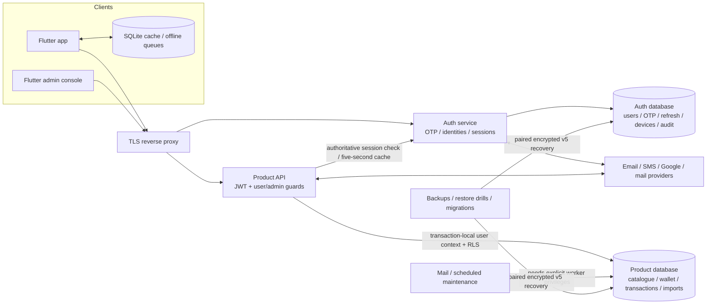

# PandaPay: security, API, backend-flow and data-redundancy audit

Original audit date: 20 October 2026. Original source: `c2e41d8` plus that day's working tree. The last full security-status reconciliation was on 25 October against `dev` at `1025c02`. `dev` now includes security commit `4be0ba0` and merge commit `67afbaa`, which brought in `origin/master` at `24216b4`. The finding ledger has not been fully re-audited against the merged source; its counts, original probes and local database explorer remain dated evidence, not a current route inventory or production certificate.

Implementation follow-up, 22–25 October: the [security/portability plan](security-implementation-plan-2026-10-22.md), [implementation progress](security-implementation-progress-2026-10-22.md), [completion checklist](security-completion-checklist-2026-10-23.md) and [Luna work packages](security-luna-handoff-2026-10-22.md) now accompany implemented source and recorded recovery rehearsals. The status ledger below separates that evidence from remaining release work.

## Production launch priorities

**Launch decision — 25 October 2026: not ready for unrestricted onboarding at 100,000 completed signups per day.** The owner confirmed **one lakh registrations across the first day**, rather than within the first hour. The source has substantial fixes and local tests, but production isolation, recoverability, provider quotas and measured capacity are not accepted. Keep private staging separate from customer onboarding; a capped pilot follows acceptance of the core security/data safeguards below.

The ten rows below are the implementation/acceptance order for launch. They overlap the existing 14 packages and six gates; **they are not ten new vulnerabilities or additional completion counts**. All 76 finding statuses and the 22 unfinished data/dependency/mobile/documentation findings retain their current status. Owners below are proposed responsibilities, not assigned people. Work can run in parallel where dependencies permit.

### Source update after merging master — 25 October 2026

`dev` now contains upstream product changes for Gemini/SMS AI capacity and queue processing, fact scoring, duplicate resolution, support-ticket workflows, notification branding, and card/spend flows, along with their source migrations. The merge also preserves the existing security implementation. This is a source-control update only: no production deployment or database migration was performed, and the full post-merge security, compatibility, provider-quota and data-migration review remains incomplete; the focused fixes below have scoped local evidence. Keep the existing 14-package/6-gate backlog and 76 finding counts as last reviewed; do not mark any finding or launch gate complete because of this merge.

At merge time, only conflict-file YAML and JavaScript syntax checks were run. A subsequent focused AI-pilot source patch passed 36 queue tests and five migration-prefix checks. The current full API suite passes **1,121 tests with two skips and no failures**; the signed-out Flutter support-form regression also passes. The full Flutter suite and analyzer, live database/provider checks, and production-shaped load remain unverified. Treat the merged source as requiring the normal post-merge verification before rollout.

**Follow-up source fix:** the production compose default and an environment override could bypass the Gemini queue's database pilot flag, while an upstream migration enabled the queue at 100%. The API now always enforces the database master/per-profile rollout, the process-wide bypass was removed, and a new forward migration blocks new submissions at 0% until explicit pilot acceptance. Previously accepted queue rows remain; a running worker can still drain them. The targeted regression passes with the old override set to `true`; existing 1% cohort behavior remains covered. The migration has not been applied and nothing was deployed; no finding count changed. [Implementation and limits](security-ai-pilot-gate-implementation-2026-10-25.md) · [Scoped verification](../artifacts/security-ai-pilot-gate-2026-10-25/verification.json).

**Follow-up source fix: support-ticket request bounds.** The `/support-tickets` API now caps message, app-version, and flat diagnostics fields before any database write, and applies a bounded process-local limit of 5 tickets/profile/hour or 30 anonymous tickets/IP/hour. Signed-out OTP-help submissions remain supported and the Flutter field uses the same 4,000-character limit. Five focused API tests pass. The limiter is not shared between replicas, so shared edge/database admission remains a production requirement. No rows or schema changed, no migration was run or deployment made, and no finding or launch gate was closed. [Implementation and limits](security-support-ticket-bounds-implementation-2026-10-25.md) · [Scoped verification](../artifacts/security-support-ticket-bounds-2026-10-25/verification.json).

**Follow-up source fix: anonymous support under row security.** A local restricted-role PostgreSQL fixture reproduced a 500 caused by `INSERT ... RETURNING` needing owner-only read access. The handler now generates receipt metadata within the database transaction and inserts without `RETURNING`. Anonymous tickets remain unreadable to anonymous users; owner isolation, pooled identity reset, operator triage and retained history pass nine scenarios on PostgreSQL 18.4. At that checkpoint, the full API suite passed 1,114 tests with two skips. No policy, grant, schema or live data was changed; hosted PostgreSQL/current-data acceptance and all launch gates remain open. [Implementation and fixture scope](security-support-ticket-bounds-implementation-2026-10-25.md#postgresql-row-policy-follow-up) · [Follow-up verification](../artifacts/security-support-ticket-rls-2026-10-25/verification.json).

**Catalogue feedback follow-up — 26 October 2026:** `/data-error-reports` now preserves signed-out submissions under the existing owner-only read policies, validates UUID/text bounds before database work, and applies per-profile/IP throttling. The shared feedback limiter also avoids rescanning its entire identity map on every request when full. Twelve focused API tests and 18 restricted-role PostgreSQL scenarios (nine support plus nine catalogue-report cases) pass; the full API suite has 1,121 passes and two skips. No schema, policy, grant or live data changed, and LP01/LP06 remain partial. [Implementation, request limits and acceptance scope](security-feedback-reports-implementation-2026-10-26.md) · [Verification](../artifacts/security-feedback-reports-2026-10-26/verification.json).

### Implement or accept these first

**Status reviewed — 26 October 2026: 9 partial, 1 open, 0 accepted for launch.** **Partial** means source work or local proof exists and the launch requirement still needs acceptance. **Open** means the required approvals/evidence are not recorded. Linked tests and live observations keep their original dates; this status refresh does not change the 76 finding statuses, 14 packages or six release gates.

| Rank / requirement | Status — 26 October 2026 | Current gap or risk | Implement first | Evidence required before the affected launch |
| --- | --- | --- | --- | --- |
| 1 / LP01 — **Prove deployed identity and database isolation** | **Partial** — Legacy sync guards and restricted-role support/catalogue-feedback checks pass locally. Deployed identity, effective roles and full current-data acceptance remain. [Isolation evidence](security-sync-isolation-implementation-2026-10-25.md); [feedback proof](security-feedback-reports-implementation-2026-10-26.md). | Source fixes are not verified deployment. The queried database still exposes legacy SECURITY DEFINER sync RPCs to PUBLIC; V2 was absent. Advisor warnings need function-by-function review. | Freeze the actual API/auth images and migrations; verify least-privilege logins, role inheritance, RLS, definer profile/device checks, session revocation, proof-bound lookup and narrow admin powers. Protect hosting, DB, DNS, CI and mail operator accounts with MFA; preserve customer OTP/no-extra-password flow. | Security/backend owner: anonymous, guest, wrong account/device, revoked/deleted and narrow-admin tests pass on the actual target; no privileged backend credentials reach clients. Related work: I03, I09, I10, G02, G03, G05. |
| 2 / LP02 — **Independent recovery and acceptable data loss** | **Partial** — Encrypted local copies and restore rehearsals exist. Two independent off-host copies, separate key/checkpoint custody and intended-provider recovery remain. [Recovery evidence](security-implementation-progress-2026-10-22.md). | The approved temporary backup setup has one Mac location and daily copies; off-host/key custody and intended-host recovery remain unaccepted. | Back up both product and auth databases, original decrypt/lookup keys, lifecycle checkpoint/journals and any object files. Provide independent encrypted copies and separate key custody. Agree server RPO/RTO, prove restore and post-write repair on the intended PostgreSQL target; use supported PITR/continuous recovery where needed. | Operations/data owner: a timed loss-of-primary drill meets the agreed recovery point/time and preserves accounts, deletions, financial state and keys. Do not replace the existing bounded Mac schedule without a measured storage plan. Related work: I01, I06, G03, G04, G06. |
| 3 / LP03 — **Fund and measure hosting, connections and storage** | **Partial** — The aggregate connection-budget release guard is implemented. Actual host quotas, storage/cost budgets and measured capacity remain unaccepted. [Budget safeguard](security-connection-budget-implementation-2026-10-25.md). | User reports free hosting; actual plan/compute/disk allowances are unverified. Live metadata shows max_connections=60 and nine restore-drill databases consuming 211.06 MiB. | Inventory every host/provider quota and aggregate all pools by physical cluster. Remove no database until its owner, evidence, backup and consumers are verified; move future drills to disposable isolated infrastructure. Reserve measured capacity, cost ceilings and failure headroom before marketing. | Infrastructure/database owner: a signed resource budget covers app/auth/workers, provider reserves, database/TOAST/WAL/temp/logs/backup/object growth and burst load; actual measured capacity supports the admitted launch. Related work: I05, I11, I12, G03, G05, G06. |
| 4 / LP04 — **Quota-approved OTP delivery and abuse/spend limits** | **Partial** — OTP work/provider admission and shared abuse controls have local proof. Sender quotas, real delivery, shared-NAT and peak-capacity acceptance remain. [OTP evidence](security-otp-admission-implementation-2026-10-25.md). | 100,000 signups can require over 100,000 OTP messages. The actual SMTP/SMS provider quotas, sender readiness and delivery performance are unknown. | Reserve per-day and peak send capacity; verify sender/domain, production Google sign-in and real canary delivery. Bound bcrypt/verification and recipient/device/IP/global admission before expensive work; test shared-carrier NAT, bots, resend floods, auth-store saturation and provider outages. | Auth/delivery owner: target valid signups complete within the OTP lifetime under the approved burst; rejects, bounces, resend costs and blocked legitimate users are measured, with no public test-code bypass. Related work: I09, I11, I12, G02, G05, G06. |
| 5 / LP05 — **Financial correctness, sync and complete-data migrations** | **Partial** — Typed sync and financial/recovery checks pass locally; V2 remains off. Historical reconciliation, full current-data upgrade, concurrent-client and provider acceptance remain. [Sync evidence](security-sync-financial-recovery-implementation-2026-10-25.md). | The default legacy writer still rejects numeric edits; prepared V2 is off. Historical state/ID reconciliation and concurrent financial edits are not accepted. | Accept V2 on the exact current protected clone and intended PostgreSQL version, including splits, rewards/caps, private categories, duplicates, stale clocks, simultaneous edits and offline replay. Resolve historical mappings without deletion or identity changes. Either support advertised offline edits correctly or constrain that release flow while retaining drafts. | Backend/data owner: balances/projections/history reconcile before and after migration, replay, retries, crashes and concurrency; rejected work remains recoverable. Same-major synthetic tests alone do not close this gate. Related work: I04, I08, I13, G03, G05. |
| 6 / LP06 — **Bound onboarding fan-out and durable background work** | **Partial** — Selected request/import/worker bounds, feedback throttles and AI pilot gates exist. Complete durable continuation, shared budgets and measured backlog recovery remain. [Feedback bounds](security-feedback-reports-implementation-2026-10-26.md); [AI gate](security-ai-pilot-gate-implementation-2026-10-25.md); [remaining work](security-remaining-work-2026-10-25.md). | Imports can dominate writes; per-instance pools/queues do not establish aggregate capacity. Recovery copies also share the database and have a 50 MiB global source quota. | Separate sign-in from history/OCR/IMAP/AI work; add durable continuation, idempotent claims/outboxes, bounded request/upload/memory limits, pagination, retry jitter and per-account/global provider budgets. Keep optional recovery/AI/import surfaces off or constrained until their own storage/throughput budgets pass. | Backend/worker owner: interruptions, replay and overload neither lose accepted work nor duplicate financial effects; backlog drain time is measured and sign-in stays usable. Related work: I06, I07, I11, I12, G05, G06. |
| 7 / LP07 — **Signed mobile/client and supply-chain acceptance** | **Partial** — Component/dependency checks and isolated Android evidence exist. Normal encrypted storage integration and supported signed Android/iOS release acceptance remain. [Mobile gaps](security-focused-gap-review-2026-10-25.md). | Normal SQLite/receipt encryption is not integrated. Local unit/debug checks do not establish release-package storage, TLS, permission or upgrade safety. | Inspect actual signed APK/AAB/IPA/web artifacts and dependencies for secrets/debug endpoints; verify TLS/cleartext, app-private files/secure keys, permission denial, backups, account switching, offline work, updates and key loss. Approve the existing storage baseline or finish the encryption transition before the affected sensitive-data release; keep untested conversion off. | Mobile/security owner: the actual supported signed releases pass their data-protection and crash/upgrade matrix, with accurate privacy/recovery claims and no new customer password. Related work: I01, I02, G01, G02, G05. |
| 8 / LP08 — **Measured load, progressive admission and incident response** | **Partial** — Maintenance notices and the optional alert adapter have local proof. Actual receiver/on-call acceptance and production-shaped load, failure, soak and canary evidence remain. [Alert adapter](maintenance-alert-delivery-source-2026-10-25.md). | No production-shaped 100,000/day capacity or independent on-call/alert proof is recorded. Health endpoints are not end-to-end onboarding success. | Run isolated production-shaped load/failure/soak tests, then a small live canary and staged admission. Add externally monitored signup completion, OTP delivery, pool wait, DB disk/locks, queue age, backup age and cost signals; rehearse pause-new-signup, preserve existing users, rollback/forward repair and operator escalation. | Operations/performance owner: the agreed arrival/burst envelope meets recorded targets, including failure mode; offered/admitted/rejected/completed counts are visible and the operator receives test alerts. Related work: I11, G02, G05, G06. |
| 9 / LP09 — **Privacy, platform and business-policy readiness** | **Open** — Required privacy review, store/permission and production OAuth approvals are not recorded. The responsible owners still need to accept the actual launch data flows and disclosures. | SMS/background-location permissions and financial data need explicit release review; app-store and OAuth production approval have not been established. | Approve data inventory, disclosures/consent, retention/deletion/export/support, third-party processing, legal incident duties and age/market scope. Verify Google Play SMS/background-location declarations, store Data Safety/App Privacy and production OAuth configuration. Do not upload unrelated personal SMS. | Privacy/product/store owner: launch-date legal/platform applicability and notices are accepted, required permissions are approved and users have a tested manual/permission-denied path. Related work: I06, I14, G01, G02, G06. |
| 10 / LP10 — **Exact release, migration and edge rollback rehearsal** | **Partial** — Migration/deployment safeguards and local recovery rehearsals exist. The exact hosted release, intended-target cutover, post-write failback and controlled rollout remain unaccepted. [Rollout procedure](security-rollout-runbook-2026-10-23.md). | Current source, queried database and deployed API/auth/edge builds are not proven to be the same accepted release. | Build immutable images off the live host; stage schema before compatible readers/writers; verify TLS/DNS/firewall/proxy trust, private ports and public-cache boundaries. Test readiness/draining, feature flags, canary, config/key availability, compatible rollback and post-write forward repair; do not combine rehosting with mobile/format activation. | Release owner: the exact source/config/schema/lock/artifact hashes and signed acceptance record pass the release gate, with a rehearsed operator recovery procedure. Related work: I01, I02, I14, G01, G02, G03, G05, G06. |

**Immediate sequence:** first establish the actual deployed security baseline and independent recovery, then verify hosting/pool/storage and OTP capacity. Resolve advertised financial/offline flows and bounded imports before load certification. Signed client/privacy acceptance, independent monitoring and an exact rehearsed release are required before unrestricted onboarding. Optional features may stay disabled with honest product behavior; a disabled flag does not close a broken advertised core flow.

### Latest implementation: sync identity and restored-copy review

The B02 source slice now guards **seven legacy sync signatures** by backend profile/device context, removes PUBLIC execution, fixes their search paths and preserves category/flag actions, registration and cursor behavior. **1,024 API passes (two existing skips), 340 auth passes, 217 tool passes and 45 Python database/backup passes**, plus synthetic PostgreSQL upgrade/replay/dump/restore and financial regressions, are recorded. A protected existing-backup review identified a missing applied migration; its original Git source and two matching database function bodies were recovered. The older reviewed baseline needs reconciliation before actual-data upgrade can pass. Both saved role matrices still have strict findings; **LP01/B02 remain open**, and nothing is deployed. [Implementation and limits](security-sync-isolation-implementation-2026-10-25.md) · [Scoped verification](../artifacts/security-sync-isolation-2026-10-25/verification.json).

### Previous implementation: bounded OTP work and delivery

The [next launch batches](security-next-launch-batches-2026-10-25.md) put OTP work bounds, actual-role acceptance and independent recovery/capacity evidence into small steps. The first batch now bounds concurrent legacy/V2 signin/recovery/replacement operations and SMTP/SMS sends, shares dummy-hash initialization and safely rejects excess work with retryable 503 responses. Existing shared quotas, code purposes, single-use guards, keys and customer flows are retained. **340 auth, 211 tool and 22 deployment tests passed**, plus synthetic native PostgreSQL OTP/abuse-store checks; the 132 focused passes overlap those suites. No live service change or finding closure. [Implementation and limitations](security-otp-admission-implementation-2026-10-25.md) · [Scoped verification](../artifacts/security-otp-admission-2026-10-25/verification.json). Actual provider/replica capacity and LP01/LP02 acceptance remain open.

### Previous implementation: aggregate connection release gate

The LP03 connection-budget slice is implemented in the offline release tooling. It calculates main/dedicated pools per physical cluster, replica ceilings, rollout overlap and provider/operations/safety reserves; unknown limits or an incomplete inventory cannot pass. Exact-source/configuration evidence is required, and enabled lifecycle/console/IMAP features must include their dedicated pools. **209 local tool tests passed, including 42 focused checks (overlapping scopes).** Application runtime, data and live settings are unchanged; actual host budgets and production capacity remain unaccepted. [Implementation and operator flow](security-connection-budget-implementation-2026-10-25.md) · [Scoped verification](../artifacts/security-connection-budget-2026-10-25/verification.json).

### What was checked live, and what is still unknown

This review used the connected Supabase project metadata, security/performance advisors and small read-only PostgreSQL catalogue/session aggregates. The target project was reported healthy in `ap-south-1`, with provider build `17.6.1.155` and SQL server version `17.6`. Snapshots were taken around **15:10–15:16 IST on 25 October**. These checks establish specific observations, not application availability or a capacity certificate. [Sanitized observations](../artifacts/security-production-launch-2026-10-25/live-metadata-summary.json).

| Observation | Why it matters / required decision |
| --- | --- |
| Cluster `max_connections=60`; three superuser-reserved connections. A later sample had 28 client backends, including 25 idle and one active. | Budget every API, auth, worker, dedicated service pool, migration/backup and provider connection across the physical cluster. Product and auth logical databases share this ceiling. The counts are snapshots, not a measured peak or a claim that 32 slots are safely available. Two sampled idle-in-transaction clients were absent on follow-up; a persistent leak was not established. |
| Product logical database: 40.12 MiB; auth: 10.93 MiB. **Nine restore-drill databases: 211.06 MiB**, retained from August–October. Sum of observed logical database sizes: 262.11 MiB. | The drill copies outweigh current product/auth data and can consume scarce space and retain old personal data. Identify their producer, owner, dependencies and recovery evidence; arrange a protected retention/cleanup decision and isolated disposable future drills. No database was deleted. Logical sizes exclude additional WAL/filesystem effects and are not the provider's billable-disk measurement. |
| Selected legacy sync routines have `SECURITY DEFINER` and PUBLIC execute privileges; prepared `sync_apply_change_v2` was not present in the queried product database. | Review actual callable roles, schema exposure and profile/device checks before changing grants. PUBLIC is a database privilege group; these observations alone do not prove anonymous Internet exploitability. Local implementation is not evidence of deployment. API/auth images and live feature settings were not inspected. |
| Security advisors: 17 mutable function-search-path warnings, two extensions in `public`, and one informational RLS-without-policy result. | Classify function ownership/callability and search paths. An intentionally deny-all table can correctly have RLS without policies; do not disable RLS or blindly add policies to remove a warning. Moving extensions can break dependencies and requires rehearsal. [Function search paths](https://supabase.com/docs/guides/database/database-linter?lint=0011_function_search_path_mutable), [RLS advisory](https://supabase.com/docs/guides/database/database-linter?lint=0008_rls_enabled_no_policy). |
| Performance advisors: 123 uncovered foreign keys, 378 multiple-permissive-policy warnings, one duplicate-index warning, one RLS-initplan warning and 53 unused-index observations. | These are advisor observations, not 556 independently confirmed defects. Prioritize onboarding/sync/import join plans and owner-policy semantics on realistic data. Preserve unique/backing indexes; low current use does not justify deleting an index needed at launch. [Foreign-key indexes](https://supabase.com/docs/guides/database/database-linter?lint=0001_unindexed_foreign_keys), [permissive policies](https://supabase.com/docs/guides/database/database-linter?lint=0006_multiple_permissive_policies), [duplicate indexes](https://supabase.com/docs/guides/database/database-linter?lint=0009_duplicate_index). |

**Still unverified:** the actual hosting subscription/compute/disk/egress limits, app-host CPU/RAM/topology, running images/configuration, real sender quotas/deliverability, backup/PITR coverage, independent custody, signed release behavior and offered-load performance. No customer row payload, password, private key or session query text was read. No live mutation, provider message, load test or infrastructure purchase occurred.

### Plan for 100,000 per day and launch spikes separately

The following is arithmetic, **not a benchmark**. It assumes 15 backend HTTP requests and 1.2 OTP sends per completed signup. Measure the actual first-session flow, session-verification fan-out, retries, channel mix and extra verification steps before selecting the load. Static app-store downloads, imports, ordinary existing-user activity and recovery traffic are additional workloads.

| Scenario | Signups/second | Modeled backend HTTP requests/second | Modeled OTP sends/second |
| --- | --- | --- | --- |
| 10,000 over 24 hours | 0.12 | 1.74 | 0.14 |
| 100,000 over 24 hours | 1.16 | 17.36 | 1.39 |
| 10% of day-one users in 15 minutes | 11.11 | 166.67 | 13.33 |
| 20% of day-one users in 15 minutes | 22.22 | 333.33 | 26.67 |

At the same 1.2-send assumption, the day-one OTP budget is **120,000 messages**, before abuse or additional verification flows. Averages do not size peak CPU, bcrypt work, network delivery or database I/O. Do not treat 100,000 registrations as 100,000 simultaneous users or database connections. Burst examples above are stress scenarios to agree with marketing, not forecasts supplied by the owner.

The official Supabase Free offer currently lists a 500 MB database allowance, shared compute/up to 0.5 GB memory, and 5 GB egress. Its advertised MAU allowance concerns Supabase authentication usage; PandaPay has custom Node authentication, so it is not a direct cap on this app's custom-auth registrations. Actual product usage and quotas still need verification. A paid tier also does not by itself certify capacity or failover. [Published limits](https://supabase.com/pricing), [compute model](https://supabase.com/docs/guides/platform/compute-and-disk).

**Connection example:** two API replicas at 10 connections each, two auth replicas at 10 each, and one reward worker at 10 already configure 50 main-pool connections, before other pools and reserves. Classify existing clients rather than adding the observed 28 again and double-counting them. Set the total budget per physical cluster before adding replicas; do not raise connection counts as a substitute for RAM/query/admission work. Supavisor's client limit differs from its backend pool limit, and transaction pooling must preserve each request's transaction-local identity, role and timeout context. [Pool limits](https://supabase.com/docs/guides/database/connecting-to-postgres/pooling-and-limits), [transaction-mode constraints](https://supabase.com/docs/guides/database/connecting-to-postgres).

**Storage example:** if all 100,000 users import 500 distinct entries, the workload reaches 50 million canonical transactions before observations, indexes, outboxes, change logs and financial projections. At the older report's explicitly illustrative 3–6 KiB per indexed transaction footprint, that is roughly 143–286 GiB. Replace this estimate with measured representative row/index/TOAST growth. Stagger history imports instead of making sign-in wait for them.

**Recovery is a separate large workload:** the prepared database recovery function limits each archive to 5 MiB, retains two copies, serializes global quota admission, caps stored archives/wraps at **50 MiB globally**, and refuses uploads above a 350 MiB current-database size guard. These deliberately small-host protections cannot serve 100,000 accounts. At a hypothetical 1 MiB per account, two copies for all users already require about 195.31 GiB of ciphertext; at the 5 MiB maximum, about 976.56 GiB, before WAL/dead tuples/backup overhead. The current-database guard also does not establish project-wide headroom across other logical databases. Keep broad recovery activation off until opt-in adoption, measured archive size, update traffic, durable private object storage or another bounded design, quotas and restore/deletion semantics are accepted. Do not simply lift these limits. [Current quota code](../db/supabase/migrations/20261023192644_account_recovery_escrow.sql), [automatic path](../api/src/automatic_account_recovery.js).

### Additional launch gaps now made explicit

- **Abuse-control capacity is itself a workload.** The PostgreSQL limiter has bounded storage and uses a global lock/count on new bucket creation. Test real new-recipient/device cardinality, cleanup and adversarial unique identifiers, not only repeat hits to one warmed user. The API's short bounded session cache can also churn and multiply auth-service calls. Preserve revocation/fail-closed behavior while measuring it. [Limiter](../auth/src/services/authAbuseStore.js), [session checks](../api/src/auth.js).
- **OTP is a delivery and spend dependency.** Confirm transactional sender quota, SPF/DKIM/DMARC as applicable, deliverability, bounce/complaint handling, resend behavior, production OAuth domains/origins and secure provider outage behavior. A transport-accepted message is not proof that the customer received it. Use a sink for large tests and a separately approved small delivery canary. [OAuth production requirements](https://developers.google.com/identity/protocols/oauth2/production-readiness/policy-compliance).
- **Recovery targets need a decision.** Propose a server recovery point of five minutes and restoration within one hour for approval and testing; these are draft business targets, not existing guarantees. Daily Mac exports can lose nearly a day's new work if they are the only recovery point. Confirm coverage of both custom logical databases, roles/credentials, deletion checkpoints and external objects; database backups alone exclude Storage API file bytes. Keep existing seven-day/seven-set/1 GiB Mac limits until an approved measured replacement exists. [Provider backup scope](https://supabase.com/docs/guides/platform/backups).
- **Financial and promotional abuse need domain controls.** Test spoofed/imported SMS, duplicate callbacks, referral farming, repeated reward grants and retries across workers. Treat imported financial data as untrusted; estimates are not bank-confirmed settlement. Preserve transaction IDs/history and never fix catalogue collisions by blindly merging balances or usage. [Business-flow abuse](https://api-security.owasp.org/editions/2023/en/0xa6-unrestricted-access-to-sensitive-business-flows/).
- **Distribution can block the whole launch.** The Android manifest requests SMS and background location. Review Google Play declarations, data minimization and fallback paths; SMS-based money-management use requires review/approval and does not permit exfiltration of unrelated personal SMS. Verify iOS behavior separately rather than promising Android SMS functionality there. [Google Play SMS policy](https://support.google.com/googleplay/android-developer/answer/10208820).
- **Privacy and incident operations are launch work.** Have the responsible legal/privacy owner approve the actual data flows, notices, consent withdrawal, retention/deletion, support/export, processors and market/age scope. India's DPDP commencement is phased, so confirm launch-date applicability rather than treating every provision as already effective. Assess applicable CERT-In incident reporting, time synchronization and secure log-retention duties, with a named response owner. Do not retain OTPs or raw financial/SMS payloads merely to fill a log policy. Additional banking/lending/payment/AA requirements depend on actual activities; a finance-app name alone does not determine licensing. [Commencement notification](https://egazette.gov.in/WriteReadData/2025/267647.pdf), [CERT-In directions](https://www.cert-in.org.in/PDF/CERT-In_Directions_70B_28.04.2022.pdf).

### How launch readiness must be demonstrated

1. Freeze the intended release, target provider/regions, feature scope, sender quota, arrival model, resource and spend limits, server/client recovery point, and named owners. Separate source/local proof from actual deployed proof.
2. Use isolated production-shaped infrastructure with synthetic accounts and realistic catalogue/history/receipt sizes. Model arrivals with real authentication, hashing and request fan-out; do not remove security work or send 120,000 real OTPs to obtain a flattering benchmark. An open arrival model exposes overload more clearly than a client loop that quietly slows its offered load. [Load-model guidance](https://grafana.com/docs/k6/latest/using-k6/scenarios/concepts/open-vs-closed/).
3. Test the agreed daily mix plus the 10%/15-minute example, then overload above that envelope and a multi-hour/24-hour soak. Include one app node lost, process restart, DB/pool pressure, provider timeout, worker replay, pooled-account isolation, disk pressure and restore. Include browser/current/oldest supported and signed-device paths where affected.
4. Approve explicit targets before the run. Draft targets: light interactive p95 at or below one second, p99 at or below two seconds, unexpected 5xx below 0.5%, no lost committed writes/cross-account access/duplicate financial effects, and OTP delivery comfortably inside the current 120-second lifetime. Measure actual delivery separately from SMTP/API acceptance. Agree import/queue drain time and safe CPU/RAM/disk/pool headroom. These are proposed tests, not measured promises.
5. Record offered, admitted, throttled, abandoned, delivered and completed journeys separately. Planned legitimate traffic rejected below the target cannot be hidden by a low 5xx rate. Publish the capacity actually proved, including degraded mode; reduce the campaign/admission ceiling if the result is lower than 100,000/day.
6. Rehearse external alerts and an accountable on-call response, pause-new-signup before OTP spend while preserving existing-user access, a small approved production canary, then staged cohorts within proven limits. Schema/reader rollout, PostgreSQL rehosting and mobile encryption switches use separate controlled changes with compatible recovery.

### What can wait, and what cannot

Keep optional automatic recovery, AI/IMAP/geofence/provider integrations and promotional flows disabled or narrowly scoped until their own security, cost and throughput tests pass. Do not advertise unavailable recovery or silently discard offline work. New mobile encryption conversion must stay off until the approved signed storage baseline and conversion/recovery tests pass; this is not permission to ignore sensitive-data protection.

Kubernetes, sharding, a database-technology rewrite, blanket Redis caching, blind index removal, broad service extraction and cosmetic historical wording are not first-day prerequisites. Keep PostgreSQL. Cache reviewed public catalogue/static assets where measured; private/auth/recovery responses need safe cache boundaries. **Identity isolation, decryptable independent recovery, financial correctness, honest data handling, provider capacity, measured limits and incident response cannot be deferred to growth after launch.**

[Ranked machine-readable plan](../artifacts/security-production-launch-2026-10-25/launch-priorities.json) · [Current live metadata summary](../artifacts/security-production-launch-2026-10-25/live-metadata-summary.json) · [Existing implementation/acceptance backlog](security-remaining-work-2026-10-25.html). The initial launch review changed documentation only; subsequent source/test slices are recorded above. Prior evidence stays scoped to its dated candidate, no finding is newly closed, and launch approval is not granted.

## Implementation status — 25 October 2026

Review update: 25 October 2026 (IST).

Reviewed source: `dev` at `67afbaa`, containing security commit `4be0ba0` and the merge of `origin/master` at `24216b4`. The finding ledger remains from the previous reconciliation at `1025c02` and has not been fully re-audited against the merged source; counts remain unchanged pending that review. The latest typed-sync/recovery coverage source and local checks are recorded in [current verification](../artifacts/security-sync-financial-recovery-2026-10-25/verification.json); the preceding sync/provenance checks are recorded in [previous verification](../artifacts/security-sync-recovery-2026-10-25/verification.json); the preceding retained-reader checks are recorded in [reader verification](../artifacts/security-key-readers-2026-10-25/verification.json); the preceding transaction/history batch is recorded in [execution verification](../artifacts/security-execution-2026-10-25/verification.json); the preceding catalogue batch is recorded in [catalogue verification](../artifacts/security-catalogue-2026-10-25/verification.json); the preceding storage batch is recorded in [storage verification](../artifacts/security-storage-2026-10-25/verification.json); the preceding [25 October follow-up verification](../artifacts/security-followup-2026-10-25/batch-verification.json); the [preceding local Docker verification](../artifacts/security-local-docker-verification-2026-10-24/batch-verification.json) remains historical; the preceding [partial source verification](../artifacts/security-implementation-2026-10-24-completion-source/batch-verification.json) remains historical. Earlier file hashes and full-suite scope are recorded in [remaining-batch verification](../artifacts/security-implementation-2026-10-24-remaining/batch-verification.json); [earlier capability verification](../artifacts/security-implementation-2026-10-24/batch-verification.json) and [23 October verification](../artifacts/security-implementation-2026-10-23/batch-verification.json) remain historical records.

**The recovery/identity foundation is implemented and locally rehearsed; the whole security plan and production rollout are not complete.** This section and the current-status columns below supersede the original descriptions of what remains unfixed. The original findings, probes and measured data are preserved as dated evidence.

### How many implementations remain?

**14 implementation work packages remain, followed by 6 validation/rollout gates.** These are grouped work packages, not a count of files or individual bugs. Some packages build on substantial existing source. Several findings share a package, and some require only acceptance of code that already exists.

Across the complete report: **76 tracked findings = 26 implemented in source + 43 partial + 7 open**. That is the original 68 findings plus eight additional system-design findings. **50 findings are not fully closed.** “Implemented in source” does not mean deployed or accepted in production; this is not a security-completion percentage.

The earlier six-row “what remains” table grouped broad themes. It was not a count of six code changes. This numbered register is the current remaining-work count and supersedes that interpretation. Completed six-digit contact replacement, bounded receipt reconciliation and the optional operator webhook adapter are recorded in the [25 October implementation record](security-next-implementation-2026-10-25.md) and [local evidence](../artifacts/security-followup-2026-10-25/batch-verification.json).

**Latest catalogue progress:** D05 moved to partial after additive uniqueness, safe conflict handling and synthetic PostgreSQL dump/restore verification. Catalogue incident comments now match source policy. [Implementation and evidence](security-catalogue-implementation-2026-10-25.md) · [All 22 remaining gaps](security-focused-gap-review-2026-10-25.md).

**Storage progress:** W01 architecture documentation is now implemented in source; 22 D/N/M/W findings remain unfinished. Cross-isolate key custody, verified encrypted database copying and receipt components progressed: 1,625 full-app, 30 focused storage, 154 tool-unit and five isolated Android checks passed (scopes overlap). Normal storage activation remains off. [Current implementation](security-storage-implementation-2026-10-25.md) · [Verification](../artifacts/security-storage-2026-10-25/verification.json) · [Progress tracker](security-implementation-progress-2026-10-22.md) · [Recovery flow](security-recovery-flow-2026-10-25.md).

[Open the focused remaining-work HTML](security-remaining-work-2026-10-25.html) or its [Markdown source](security-remaining-work-2026-10-25.md).

#### Implementation backlog — 14 packages

| Package | Remaining implementation | Completion criterion | Related findings |
| --- | --- | --- | --- |
| I01 — Versioned server encryption | Finish the encryption/keyring bridge for approved phone/email/profile/raw-payload copies and IMAP secrets: parallel storage, transactional writes, bounded backfill, verified reads and retained original keys. | Complete the P2 format transition and a different-host restore without plaintext downgrade, changed IDs or lost old-key readability. | M6, M10, W02 |
| I02 — Encrypted device database and receipts | Finish native key custody, resumable SQLite/receipt conversion, the complete writer inventory and remaining crash/power-loss repair. Existing account recovery and receipt reconciliation are foundations; live encryption remains off. | Fresh/upgrade/offline/account-switch/key-loss/interruption/low-disk behavior preserves pending data and receipts, without a new password. | M9, M10, M6 |
| I03 — Remaining database privilege repair | Extend reviewed repairs for remaining PUBLIC/default/inherited grants, ownership/RLS and unsafe definer paths; audit the actual restored role matrix. The narrow exact-grant tool already exists. | Strict actual-role reports pass while ordinary application and worker requests retain required access. | S17, A03 |
| I04 — Business-aware data reconciliation | Reconcile historical cap/benefit IDs and state, then rehearse the new additive normalized uniqueness on the current clone; review every collision before activation. | Before/after IDs, counts, amounts, cap usage, benefit usage and foreign keys reconcile; non-equivalent rows are retained. | D01, D02, D05 |
| I05 — Index reconciliation | Compare the overlapping indexes and query plans, then apply only reviewed remove/retain decisions. Keep backing uniqueness constraints. | Constraint coverage and representative query performance are preserved on the reviewed target. | D03, D04 |
| I06 — Cross-store retention and lifecycle privacy | Finish the approved OTP/refresh/audit/raw-import/cursor/attachment retention categories and missing bounded jobs. Existing deletion ledgers and selected retention jobs stay intact. | Replay detection, long-offline recovery, financial history and restore tombstones survive bounded cleanup. | A01, A08, C03, M6, S08, S16 |
| I07 — Durable customer notification delivery | Add a transactional pending-delivery outbox for important inbox/business notifications, with bounded claims, retries and terminal failure handling. Existing reward/referral outboxes and the new operator adapter do not close this gap. | A crash after commit or an uncertain provider response cannot silently lose a required delivery or duplicate its financial effect. | SD01 |
| I08 — Clock-independent offline conflicts | Replace authoritative phone-wall-clock ordering with reviewed server revisions or logical ordering while preserving losing values and conflict visibility. | Wrong device dates, concurrent edits, edit/delete races and long-offline re-entry reconcile without lost mutations. | SD02 |
| I09 — Remaining shared abuse controls | Complete durable multi-instance admission for general/user/admin route classes; hosted OTP/enumeration/replacement quotas already use PostgreSQL. | Two instances, restart, exhaustion and store outage cannot accidentally permit unlimited sensitive requests. | SD03, M3 |
| I10 — Operation-specific administrator permissions | Define and enforce narrower reviewer/publisher/support/export powers, recent-factor requirements and separation for high-impact actions. | Unprivileged or narrower operators cannot self-approve, escalate or invoke unrelated high-impact actions. | SD08, M3 |
| I11 — Reliability metrics and independent monitoring | Add privacy-preserving trends, service objectives, backlog/cleanup/backup-age thresholds and missing-run detection. The optional notice webhook adapter already exists. | Injected outages, stale backups and stopped jobs produce useful signals accepted by an accountable operator. | SD04, A08, W07 |
| I12 — Large-import continuation and provider backpressure | Finish durable large-work continuation, per-account/provider concurrency and quota handling, with fair admission across pools. Existing selected IMAP/SMTP/export bounds remain. | Slow or throttled integrations and burst backlogs do not starve sign-in or small financial writes. | SD07 |
| I13 — Historical financial reproducibility | Complete ruleset/parser/calculation versioning and auditable reconciliation for historical estimates and recalculations; shared Dart/Node parity fixtures already exist. | Edits, refunds, period changes and replay explain the original result and any revised result without silently rewriting history. | SD06, A07 |
| I14 — Compatibility, configuration and reviewed cleanup | Complete API/feature/version configuration consolidation, route-preserving domain extraction, reviewed legacy consumer/package/repository retirement and matching documentation. Six-digit clients and retirement switches already exist. | Supported clients retain contracts; legacy storage/code is retired only after consumer and recovery evidence, or retained with an explicit reviewed decision. | C01, C02, C04, C05, C06, C07, W01, W02, W05, SD05 |

#### Acceptance and rollout backlog — 6 gates

| Gate | Remaining validation / rollout work | Related findings |
| --- | --- | --- |
| G01 — Signed mobile and native acceptance | Validate the actual Android/iOS release packages, signing/upgrade compatibility, hardware-backed key behavior, TLS, permissions, shrinking/Room paths and full device-loss/crash matrix. Three isolated Android component checks have passed. | A09, M1, M2, M3, M4, M5, M6, M7, M8, M9, M10 |
| G02 — Providers, browser and supported clients | Verify real email/SMS/Google and optional integrations, browser cookies/CSRF/CSP/proxy/operator flows, current/oldest supported clients, and the monitored legacy-route retirement window. | S09, S13, S15, S18, C01, C04, N04, W03, W06, W07, SD03, SD05, SD08 |
| G03 — Actual-data PostgreSQL migration and failback | Run this exact candidate on a complete current restored copy and intended PostgreSQL provider. Apply reviewed contact/role/data changes, preserve all original keys and IDs, then prove cutover and post-write failback/replay. | S17, S18, A03, A04, D01, D02, D03, D04, D05, W02, SD05, SD06 |
| G04 — Independent backup and journal custody | Provision and verify two off-host encrypted recovery copies in separate failure domains, an independently retained latest lifecycle checkpoint and separate recovery-key custody. One Mac and its shortcut count as one location. | A01, A02, M6, M10 |
| G05 — Release security, contract and load evidence | Finish full history/native artifact secret review, Dart/native dependency checks, broader payload/relationship tests, historical financial parity, actual deployed-tree verification and representative failure/load runs. | A07, N02, N04, M1, M2, M3, M4, M5, M7, SD05, SD06, SD07 |
| G06 — Monitored operations and controlled rollout | Approve retention policies and measured free-host quotas, replace old cron in a fenced activation, configure scheduler/independent monitor/receiver and accepted alert routing, then freeze evidence and perform the separately approved rollout/failback procedure. | S08, S16, A01, A02, A08, C03, M6, M8, W01, W03, W07, SD04, SD07 |

The package-to-finding mappings overlap; the numbered packages and gates are the count. Actual-device/provider acceptance, independent custody and intended-host migration are not established by local tests. Data/index/legacy retirement requires a reviewed retain/remove decision, with preservation of existing history and supported behavior.

### Focused plan: data, dependencies, mobile and documentation

**Remaining scope checked:** five data, two dependency, ten mobile and five documentation findings remain unfinished: 19 partial and three open. [Per-finding gaps](security-focused-gap-review-2026-10-25.md) separate missing source work from actual-data/device/provider acceptance. The [current slice](security-sync-financial-recovery-implementation-2026-10-25.md) prepares typed financial sync and compatible recovery coverage. The [next remaining work](security-data-dependency-mobile-documentation-plan-2026-10-25.md#16-typed-sync-and-recovery-coverage-checkpoint) covers protected-data/client/provider acceptance, integrated fresh-phone recovery and historical/data review. Original keys, current write formats and activation defaults remain unchanged.

**Latest batch verified:** [typed sync and recovery coverage](security-sync-financial-recovery-implementation-2026-10-25.md) prepares typed SQL plus atomic financial-state reconciliation behind a default-off flag, rejects unsafe transaction status/delete sync, and adds compatible snapshot coverage manifests. Local checks passed: 1,634 app, 1,024 API (two existing skips), 195 tools and 36 Node 22 sync/configuration tests; scopes overlap. PostgreSQL18 typing/role/financial and dump/restore checks passed. [Verification](../artifacts/security-sync-financial-recovery-2026-10-25/verification.json).

**Previous sync batch:** [sync/recovery/provenance](security-sync-recovery-implementation-2026-10-25.md) adds safe sync boundaries, redacted rejection details, recovery preflight checks and optional commit/blob references. Full local suites passed: 1,631 app, 1,004 API (two existing skips), 193 tools; focused scopes overlap. Full recovery coverage, encrypted normal startup and device/provider acceptance remain. [Verification](../artifacts/security-sync-recovery-2026-10-25/verification.json).

**Numeric-sync rollout remains pending:** the new opt-in V2 path passes typed financial-state tests; the default legacy path still rejects numeric updates with `42804`. Keep `SYNC_TYPED_WRITES_ENABLED=false` until protected current-data, PostgreSQL17/provider, concurrent-edit and supported-client acceptance pass. [Current contracts and limits](security-sync-financial-recovery-implementation-2026-10-25.md) · [Next work](security-data-dependency-mobile-documentation-plan-2026-10-25.md#16-typed-sync-and-recovery-coverage-checkpoint).

**Previous batch verified:** [retained encryption readers](security-key-readers-implementation-2026-10-25.md) add bounded phone/recovery key compatibility and nonsecret release registration. Existing writes, original keys, lookup/IMAP formats and disabled defaults remain unchanged. P05 is in progress; no finding was newly closed. [Verification](../artifacts/security-key-readers-2026-10-25/verification.json).

**Execution started:** [current batch](security-execution-implementation-2026-10-25.md) adds tested transaction split/tag validation and bounded retained-history scanning, plus baseline/mobile/route inventories and the protected v1 catalogue review. All 22 scoped findings remain unfinished; no feature was activated. [Exact-source evidence](../artifacts/security-execution-2026-10-25/verification.json).

**Updated execution plan:** [12 small implementation batches](security-data-dependency-mobile-documentation-plan-2026-10-25.md#10-execution-backlog-and-ownership) cover all 22 unfinished findings, with owning files, dependencies, tests and exit criteria. Start with candidate/support/writer inventories and protected-clone data/index review; dependency and API-boundary preparation can run in parallel. Recovery validation precedes encrypted startup and receipt integration, then signed-device/provider acceptance and per-finding closure. These batches subdivide the existing 14 packages; this planning update changes no finding status or runtime flag.

[Data, dependency, mobile and documentation plan](security-data-dependency-mobile-documentation-plan-2026-10-25.md) covers **22 unfinished findings** across these sections: five data, two dependency, ten mobile and five documentation items (19 partial, three open). Six phases cover baseline/inventory, data reconciliation, dependency hardening, mobile recovery/encryption, signed/actual-data acceptance and documentation closure. Implementation is now in progress within the existing 14-package backlog. The [current implementation record](security-storage-implementation-2026-10-25.md) records new code/local checks, a fresh protected restore review and remaining acceptance. The [recovery flow](security-recovery-flow-2026-10-25.md) explains opt-in automatic copies with existing OTP and no new password. The remaining 22 findings stay unfinished; W01 is now implemented in source; no production feature was enabled. Other unfinished findings retain their acceptance gates.

### How completion is recorded

- **Implemented in source** means a reviewed code/configuration remedy exists. It does not mean deployed, independently penetration-tested or accepted on every supported client.
- **Partial** means a specific part is covered but migration, operational custody, integration, privacy or release evidence is still missing.
- **Open** means the requested remedy or its necessary evidence is still outstanding. An old probe result marked `reproduced: true` describes a demonstrated problem, never a security pass.
- Full closure requires the exact release's code, migration/configuration, regression evidence and target-environment acceptance. This follow-up changes source and runs synthetic local fixtures only. No live database change, provider message, restart or deployment is included.

### Verified work already recorded

- The implementation batch added authoritative account/device/session checks, protected legacy signup, guest denial on private membership routes, phone HMAC lookup, conditional OTP consume/purposes, verified DB TLS, bounded proxy trust, IMAP destination guards and safer log/error sinks.
- Both databases have paired age-encrypted v5 backup/restore tooling, checksummed migration runners, reviewed legacy adoption, writer fencing and bounded recovery storage. The actual launchd export and restore/upgrade/replay of set `0d6c2853aaf4a5417e0628ed7f33bb63` passed at **23 October 2026, 11:18:24 IST** on a separate disposable local PostgreSQL cluster, including retained-key checks and preservation of eight account IDs.
- The approved temporary PC setup runs at **07:45 Mac local time** (currently IST), retains seven days/seven sets within **1 GiB** ciphertext, and keeps a **5 GiB** free-space floor, **95%** disk ceiling and **30-minute** runtime bound. It requires an awake/connected Mac with Docker. The actual background launch was verified after moving the physical folder to Application Support; Documents is a shortcut to the same location, not another copy.
- Historical pre-merge checks recorded **786 API passes (two skipped), 154 auth passes, 48 database checks, 45 backup/setup checks, 21 deployment checks, 19 console passes and 1,466 app passes**. App analysis recorded **51 infos, zero warnings/errors**. These results belong to the earlier tested implementation candidate, not a fresh full run on `1025c02`.
- The master merge added portable account restore, SQLite snapshot/restore components, merchant-category and financial-projection work. Its added migrations, current merged regression suite and signed-device behavior need their own acceptance; the prior restored-copy proof is not blanket proof for these later changes.

There is **one local recovery location**, with recovery material on the same Mac. Independently hosted copies, separate identity custody, managed-provider cutover/failback, remaining runtime/worker privileges, durable deletion/retention and signed-device acceptance remain gates. The owner approved keeping PostgreSQL when changing provider, retaining original keys, allowing contact reuse after deletion and the exact test-account resolution. **No extra end-user password is authorized.** The separate optional passphrase archive primitives do not close password-free device recovery or encrypt the live SQLite database/receipt files.

### Remaining implementation batches — verified 24 October

The [remaining implementation plan](security-remaining-implementation-plan-2026-10-23.md) now records R3 logging/retention, R4 capability/audit tooling, R5 identity, R6 browser/proof endpoint, R7 soft-deletion/tombstones, R8 password-free recovery modules, R9 read-only reports and R10 strict release gating. The [source runbook](security-remaining-source-implementation-2026-10-24.md) documents disabled defaults, migrations, dedicated logins, bounded storage/connections and remaining acceptance.

Current regression evidence includes full API/auth/database tests, all twelve PostgreSQL role/retention/browser/lifecycle/audit/data-review fixtures and paired encrypted v5 recovery with independent-cluster schema/ACL/key checks and verified-status publication. The [remaining-batch artifact](../artifacts/security-implementation-2026-10-24-remaining/batch-verification.json) records exact counts, environments, hashes and Flutter results. Managed-role PostgreSQL 17 fixtures supplement native PostgreSQL 18 synthetic checks. Earlier 918 API/215 auth/56 DB results belong to the capability batch. None of these synthetic checks certifies current actual-data upgrade, live providers, actual browser cookies/CSP or signed clients.

The console web now uses a same-origin HttpOnly cookie gateway and clears legacy browser credentials; **the new static bundle and gateway must be deployed together**. Native bearer behavior remains. Mobile recovery modules require explicit receipt/unsynced-data consent, preserve original UUID/mutation history and introduce no extra password. The later batch adds explicit recovery UI and native SQLite/tracked-operation fencing. Full native writer/crash acceptance and live SQLite/receipt encryption remain pending; no silent upload occurs.

Whole-schema privilege repair, legacy anonymous lookup/OTP transition, independently retained deletion journal, remaining monitored jobs/outboxes, actual-data/provider/device/custody acceptance and controlled rollout remain open. Local changes are uncommitted; notification edits are preserved. New lifecycle/recovery and optional logging/polling stay disabled. No live DDL/data cleanup, provider message, deployment or key rotation occurred.

### Follow-up OTP, deletion journal, OCR and dependency fixes

The [follow-up runbook](security-followup-implementation-2026-10-24.md) and [verification](../artifacts/security-implementation-2026-10-24-followup/batch-verification.json) record additive device/challenge-bound six-digit OTP, externally encrypted denial intents plus a separately durable latest checkpoint before DB commit, quiesced existing-tombstone bootstrap/replay, account snapshot fencing and integrated OCR/startup cleanup. Legacy OTP/masked-email behavior and original data/keys remain. Account denial/recovery activation still requires actual independent custody and operator/provider/device acceptance.

The API dependency lock now includes body-parser 2.4.0 for the [maintainer's compressed-body crash advisory](https://github.com/expressjs/body-parser/security/advisories/GHSA-27r3-jxmh-p828), with a separate-process crash regression. Current API/auth production dependency audits report zero known advisories. Fresh checks include 955 API passes (two skips), 292 auth, 101 DB/tool, 45 backup/setup, 21 deployment, 1,564 app, 29 console and 227 domain cases, clean console analysis/CSP build and zero app analyzer errors/warnings (74 existing infos). Both service images build with readable node-owned source; the full API/auth suites and API real age journal tests pass as non-root. Managed PostgreSQL 17 and native 18 fixtures cover the changed database paths. Actual browser/device/provider/deployment acceptance remains separate.

### Additional recovery, client and maintenance source — locally verified

The [new source runbook](security-recovery-maintenance-source-2026-10-24.md) adds mobile/console six-digit clients and retirement controls, manual account recovery UI before session publication, a native SQLite lease and tracked operation drain with SMS deferral, bounded maintenance/checkpoint/internal-notice jobs, and reviewed exact-grant permission repair. Flags stay off. No new password or silent upload is introduced. This supersedes earlier statements that these source integrations had not yet been written; it does not close their activation or native writer-coverage gates.

The [local Docker verification](security-local-docker-verification-2026-10-24.md) now records fresh current-source results: 964 API passes (two database cases passed separately), 300 auth, 131 database/tool, 45 backup/setup, 22 deployment, 1,576 app, 31 console and 227 domain cases. Four current security fixtures passed on Docker PostgreSQL 17; the complete 14-script/15-database harness and paired encrypted v5 recovery passed on temporary PostgreSQL 18. Exact images, non-root source readability, both services’ real health/readiness, console CSP build and zero-known-vulnerability dependency audits passed. Earlier approval-review usage failures have been resolved for these local runs. Flags remain off; actual-data/provider/browser/signed-device/custody acceptance and deployment remain pending. Original keys/data and all twelve notification edits are preserved.

The local Docker startup check fixed the auth image’s default port to match its advertised port and healthcheck (3210). Test-only corrections preserve trusted profile creation, temporary schema-owner grants and macOS checksum compatibility. Neither runtime permissions nor live credentials were broadened. These are local synthetic results, not release approval.

### Contact replacement, receipt repair and alert adapter — 25 October

The [25 October follow-up](security-next-implementation-2026-10-25.md) adds opt-in six-digit verified contact replacement, bounded DB-aware reconciliation of journaled recovery receipts and a disabled operational webhook adapter with its own release gate. [Current evidence](../artifacts/security-followup-2026-10-25/batch-verification.json) records the combined local verification; the [preceding Docker batch](security-local-docker-verification-2026-10-24.md) remains historical. Supported-client/provider acceptance, native key custody/resumable live storage encryption, complete native crash/writer coverage, actual-data/provider reconciliation, monitored operations and independent recovery custody remain open. No live configuration, data, key, contact, provider or deployment change occurred.

### Current security findings

| ID | Current status | Covered work and remaining gate | Current evidence |
|---|---|---|---|
| S01 | Implemented in source | Email proof selects the verified email identity; an unproved supplied phone cannot claim or attach an existing account. Linking release checks remain. | [factor checks](/Users/chandresh_kerkar/Documents/PandaPath/pandapay-docs/auth/src/routes/authRoutes.js:948) |
| S02 | Implemented in source | Legacy signup now requires authentication and an existing verified account. The obsolete address branch is still tracked separately as B07. | [signup guards](/Users/chandresh_kerkar/Documents/PandaPath/pandapay-docs/auth/src/routes/authRoutes.js:1434) |
| S03 | Implemented in source | Keyed canonical phone hashes replace randomized-ciphertext equality. Bounded verified backfill and original-key recovery are prepared; controlled live migration remains pending. | [lookup](/Users/chandresh_kerkar/Documents/PandaPath/pandapay-docs/auth/src/utils/encryptedPhoneSearch.js:22); [backfill](/Users/chandresh_kerkar/Documents/PandaPath/pandapay-docs/auth/scripts/migrate.js:371) |
| S04 | Implemented in source | Product access uses authoritative account/device/token-version checks. The bounded positive session cache is five seconds, so revocation is not promised to be instantaneous. | [session guard](/Users/chandresh_kerkar/Documents/PandaPath/pandapay-docs/api/src/auth.js:83); [auth verification](/Users/chandresh_kerkar/Documents/PandaPath/pandapay-docs/auth/src/services/currentSessionVerification.js:42) |
| S05 | Implemented in source | Membership-required private routes reject guest tokens; guest issuance still exists. Full route-class and target-role acceptance remains. | [member admission](/Users/chandresh_kerkar/Documents/PandaPath/pandapay-docs/api/src/auth.js:181) |
| S06 | Implemented in source | OTP/provider log paths use fixed messages and bounded error classes. Historical deployed logs, audit-log access and retention still require operational review. | [OTP service](/Users/chandresh_kerkar/Documents/PandaPath/pandapay-docs/auth/src/services/otpService.js:159); [OTP logger](/Users/chandresh_kerkar/Documents/PandaPath/pandapay-docs/auth/src/utils/otpLogger.js:15) |
| S07 | Implemented in source | Conditional atomic consume prevents concurrent reuse; purpose scoping separates sign-in, recovery and replacement. Migration and compatible writer fencing are rollout gates. | [atomic consume](/Users/chandresh_kerkar/Documents/PandaPath/pandapay-docs/auth/src/services/otpService.js:302); [purpose migration](/Users/chandresh_kerkar/Documents/PandaPath/pandapay-docs/auth/db/migrations/0002_otp_purpose_binding.sql:1) |
| S08 | Partial | All logging DDL is migration-owned, including additive risk-level adoption. DML-only logging plus explicit bounded diagnostic/expired-abuse retention preserve security history. Actual maintenance policy/access/schedule/load acceptance remains. | [retention CLI](/Users/chandresh_kerkar/Documents/PandaPath/pandapay-docs/auth/scripts/retention.js:1); [audit migration](/Users/chandresh_kerkar/Documents/PandaPath/pandapay-docs/auth/db/migrations/0008_auth_audit_risk_level.sql:1) |
| S09 | Partial | Legacy codes remain available. Opt-in six-digit mobile/console clients now bind challenge/device/contact/purpose, and explicit legacy-retirement controls exist. Local integrated regressions passed. Contact replacement now also has opt-in six-digit protocol/client source. Provider/client acceptance and monitored retirement remain. | [current source and verification gates](security-recovery-maintenance-source-2026-10-24.md) |
| S10 | Implemented in source | API/auth enforce CA and hostname verification, including parsed URL/SSM paths; plaintext is restricted to explicit local use. Hosted wiring must pass release checks. | [API TLS](/Users/chandresh_kerkar/Documents/PandaPath/pandapay-docs/api/src/db_tls.js:97); [auth TLS](/Users/chandresh_kerkar/Documents/PandaPath/pandapay-docs/auth/src/utils/dbTls.js:97) |
| S11 | Implemented in source | Bounded proxy hops, malformed-IP rejection and nginx forwarding-header overwrite are in source/Compose. Actual ingress topology and direct-origin protection remain deployment checks. | [proxy policy](/Users/chandresh_kerkar/Documents/PandaPath/pandapay-docs/auth/src/utils/proxyTrust.js:7); [nginx ingress](/Users/chandresh_kerkar/Documents/PandaPath/pandapay-docs/deploy/nginx/auth.conf.example:1) |
| S12 | Implemented in source | Both IMAP connectors validate public IPv4/IPv6 destinations, pin DNS results and verify TLS, with protocol/byte/time bounds. Worker/RLS and deployment egress work remain separate. | [network guard](/Users/chandresh_kerkar/Documents/PandaPath/pandapay-docs/api/src/imap_network.js:75); [IMAP client](/Users/chandresh_kerkar/Documents/PandaPath/pandapay-docs/api/src/imap_client.js:1) |
| S13 | Partial | Web console uses same-origin HttpOnly/Secure cookies, encrypted server-held credentials, CSRF/origin checks and CSP template; legacy browser token storage is cleared. Paired console/gateway deployment and real browser/operator/proxy acceptance remain. | [gateway](/Users/chandresh_kerkar/Documents/PandaPath/pandapay-docs/auth/src/services/consoleBrowser.js:1); [web storage](/Users/chandresh_kerkar/Documents/PandaPath/pandapay-docs/console/lib/data/token_store.dart:1) |
| S14 | Implemented in source | Lounge POST atomically requires an owned active wallet card and a benefit from its product; the wallet row stays locked through the insert transaction. Non-owner RLS, foreign/mismatched/archived cases and concurrent archive blocking passed on synthetic PostgreSQL. | [owned insertion](/Users/chandresh_kerkar/Documents/PandaPath/pandapay-docs/api/src/lounge_usage_route.js:47); [role fixture](/Users/chandresh_kerkar/Documents/PandaPath/pandapay-docs/api/test/lounge_usage_postgres.js:1) |
| S15 | Partial | Proof-only own-account hints and v2 challenge flows exist; explicit anonymous-lookup retirement returns a uniform update response. The legacy lookup stays on by default until supported-client/recovery acceptance and monitored retirement. | [current source and verification gates](security-recovery-maintenance-source-2026-10-24.md) |
| S16 | Partial | Ordinary API/auth request logs omit query values and persistent account IDs, using route templates/request IDs. Optional DB logs omit SQL/parameter contents. Intentional audit identity/IP metadata and historic data still need access/retention acceptance. | [API logger](/Users/chandresh_kerkar/Documents/PandaPath/pandapay-docs/api/src/observability.js:65); [auth logger](/Users/chandresh_kerkar/Documents/PandaPath/pandapay-docs/auth/src/observability.js:50) |
| S17 | Partial | Dedicated capability policies/audit now accompany reviewed exact-grant repair plans and rollback rehearsals bound to source/catalog/policy/target. Unmodelled grants and actual-data whole-schema repair/application acceptance remain blocking. | [current source and verification gates](security-recovery-maintenance-source-2026-10-24.md) |
| S18 | Partial | Partial active-contact indexes and the approved encrypted test-account resolution passed a restored-copy rehearsal. Two live test-phone conflicts await the coordinated rollout; deleted-contact reuse is the approved policy. | [active constraints](/Users/chandresh_kerkar/Documents/PandaPath/pandapay-docs/auth/db/migrations/9001_active_contact_uniqueness.sql:1); [controlled resolution](/Users/chandresh_kerkar/Documents/PandaPath/pandapay-docs/docs/security-rollout-runbook-2026-10-23.md:1) |

### Backend operations and recovery

| ID | Current status | Covered work and remaining gate | Current evidence |
|---|---|---|---|
| B01 | Implemented in source | A dedicated restricted login executes private bounded enumeration and durable cursor/defer functions; imports/status keep per-user RLS. Batches cap at 100 with a five-minute budget and failure isolation. Polling remains off pending session-affine provider/quota acceptance. | [worker](/Users/chandresh_kerkar/Documents/PandaPath/pandapay-docs/api/src/imap_poller.js:1); [capability](/Users/chandresh_kerkar/Documents/PandaPath/pandapay-docs/db/supabase/migrations/20261023190128_imap_worker_capability.sql:1) |
| B02 | Implemented in source | The same checked-out worker client owns lock/work/defer/unlock; uncertain lock/unlock destroys the session. Two bounded worker connections preserve readiness during polling. Direct/session-affine provider acceptance remains required. | [lock lifecycle](/Users/chandresh_kerkar/Documents/PandaPath/pandapay-docs/api/src/imap_poller.js:1); [pool bound](/Users/chandresh_kerkar/Documents/PandaPath/pandapay-docs/api/src/service_pools.js:1) |
| B03 | Implemented in source | Dedicated capability validates bounded inputs and serializes idempotent conversion writes. Concurrent no-reference retries reuse a stable row without deleting history. An active integration requires the separate configured login and provider acceptance. | [callback](/Users/chandresh_kerkar/Documents/PandaPath/pandapay-docs/api/src/partner_conversion_route.js:1); [capability](/Users/chandresh_kerkar/Documents/PandaPath/pandapay-docs/db/supabase/migrations/20261023185355_partner_conversion_capability.sql:1) |
| B04 | Implemented in source | A private reader projects sanitized verified status and caller-owned conflicts. A separate recovery-machine writer needs fresh hash-bound paired restore evidence. Unpublished/stale/local status is explicit; manual execution stays 409. Actual publication and independent custody remain gates. | [status routes](/Users/chandresh_kerkar/Documents/PandaPath/pandapay-docs/api/src/backup_status_routes.js:1); [publisher](/Users/chandresh_kerkar/Documents/PandaPath/pandapay-docs/db/scripts/publish_backup_status.js:1) |
| B05 | Implemented in source | Google subject identity now uses oauth_accounts with additive legacy adoption and concurrency checks. Verified tokens replace the magic test-token bypass; matching email alone cannot merge UUIDs. Existing OTP remains available; live provider/client acceptance remains. | [identity](/Users/chandresh_kerkar/Documents/PandaPath/pandapay-docs/auth/src/services/googleIdentity.js:1); [migration](/Users/chandresh_kerkar/Documents/PandaPath/pandapay-docs/auth/db/migrations/0006_google_oauth_identity.sql:1) |
| B06 | Implemented in source | Console login defaults to email OTP and optionally supports phone; Compose enables email. Authorized operator login and live provider delivery remain release acceptance. | [console login](/Users/chandresh_kerkar/Documents/PandaPath/pandapay-docs/console/lib/features/auth/login_screen.dart:19); [hosted settings](/Users/chandresh_kerkar/Documents/PandaPath/pandapay-docs/docker-compose.prod.yml:276) |
| B07 | Implemented in source | Legacy signup accepts old address fields without querying the removed locations table; the response retains location_id:null. Address capture is deprecated; other multi-step signup failure/transaction coverage remains separate. | [compatible removal](/Users/chandresh_kerkar/Documents/PandaPath/pandapay-docs/auth/src/routes/authRoutes.js:1572); [route regressions](/Users/chandresh_kerkar/Documents/PandaPath/pandapay-docs/auth/test/otp_delivery.test.js:1) |
| B08 | Implemented in source | Optional dashboard access uses an explicit expiring private capability, checked against current account state. Runtime cannot self-grant; operator revocation survives disabled/deleted account restoration. No token role or console membership grants access automatically. | [guard](/Users/chandresh_kerkar/Documents/PandaPath/pandapay-docs/auth/src/middleware/adminAuth.js:1); [operator](/Users/chandresh_kerkar/Documents/PandaPath/pandapay-docs/auth/scripts/security_admin_access.js:1) |
| A01 | Partial | Durable soft deletion now requires two age-encrypted external intent copies plus a separate authenticated latest checkpoint before claim commit. Quiesced bootstrap/reconciliation preserves existing tombstones; export snapshots are fenced. Actual independent storage, crash repair, erase policy and monitored activation remain. | [implementation](/Users/chandresh_kerkar/Documents/PandaPath/pandapay-docs/api/src/account_lifecycle_journal.js:1); [follow-up runbook](/Users/chandresh_kerkar/Documents/PandaPath/pandapay-docs/docs/security-followup-implementation-2026-10-24.md:1) |
| A02 | Partial | Paired encrypted v5 export, actual local launchd execution and independent-cluster restore/key/upgrade proof are recorded. Only one Mac location exists; off-host custody and managed-target cutover/failback remain. | [actual recovery proof](/Users/chandresh_kerkar/Documents/PandaPath/pandapay-docs/docs/security-implementation-progress-2026-10-22.md:75); [backup/restore machinery](/Users/chandresh_kerkar/Documents/PandaPath/pandapay-docs/db/backup/README.md:1) |
| A03 | Partial | Canonical product/auth orchestration, checksums, advisory locks and verified backfills are implemented and rehearsed. Full least-privilege provisioning and target acceptance remain. | [migration orchestration](/Users/chandresh_kerkar/Documents/PandaPath/pandapay-docs/db/scripts/migrate.sh:1); [auth runner](/Users/chandresh_kerkar/Documents/PandaPath/pandapay-docs/auth/scripts/migrate.js:1) |
| A04 | Partial | Deployed source/history reconciliation and baseline-protected legacy adoption passed on a restored copy. No live adoption is claimed; newly merged migrations require their own acceptance. | [baseline runner](/Users/chandresh_kerkar/Documents/PandaPath/pandapay-docs/db/scripts/product_migrate.js:1); [recorded proof](/Users/chandresh_kerkar/Documents/PandaPath/pandapay-docs/docs/security-implementation-progress-2026-10-22.md:18) |
| A05 | Implemented in source | API consumes the supported-origin allowlist in both hosted Compose files; invalid/empty hosted configuration is refused. Approved preflight/native requests pass and unrelated browser origins receive 403. Bearer authorization remains unchanged. | [CORS policy](/Users/chandresh_kerkar/Documents/PandaPath/pandapay-docs/api/src/cors_policy.js:1); [boundary tests](/Users/chandresh_kerkar/Documents/PandaPath/pandapay-docs/api/test/request_boundaries.test.js:1) |
| A06 | Implemented in source | Product/auth inventories reject new numeric-prefix collisions before schema work. Exact historical product/seed exceptions and checksums are retained, including zero-padding collision checks; current synthetic fresh/replay migration and restore passed. | [prefix policy](/Users/chandresh_kerkar/Documents/PandaPath/pandapay-docs/db/scripts/migration_prefix_policy.js:1); [reviewed exceptions](/Users/chandresh_kerkar/Documents/PandaPath/pandapay-docs/db/migration-prefix-exceptions.json:1) |
| A07 | Implemented in source | Dart and Node share language-neutral reward fixtures. Full historical rule/parser reproducibility and wider financial parity remain separate acceptance. | [shared fixture consumption](/Users/chandresh_kerkar/Documents/PandaPath/pandapay-docs/api/test/reward_math.test.js:14) |
| A08 | Partial | Bounded disabled maintenance source now covers merchant confidence, rate divergence, optional mail-body/diagnostic retention, durable job leases/cursors/heartbeats and internal notice generations. PostgreSQL/effect checks passed locally. Approved policy, old cron replacement, actual schedules and receiver delivery acceptance remain; the 25 October batch adds a disabled operational webhook adapter. | [current source and verification gates](security-recovery-maintenance-source-2026-10-24.md) |
| A09 | Partial | The latest local app suite passed 1,634 cases with zero analyzer errors/warnings and 80 infos. Earlier isolated Android checks remain dated evidence; signed Android/iOS and key-loss/process-death acceptance remains. | [current app verification](security-sync-financial-recovery-implementation-2026-10-25.md) |

### Data, dependencies, mobile and documentation

| ID | Current status | Covered work and remaining gate | Current evidence |
|---|---|---|---|
| D01 | Open | Latest protected review found zero current equivalent cap extra rows. Historical 20-extra-row ID/state reconciliation remains unverified. | [historical evidence](/Users/chandresh_kerkar/Documents/PandaPath/pandapay-docs/artifacts/security-review-2026-10-20/database-optimization-evidence.json:1) |
| D02 | Open | Latest protected review found zero current equivalent benefit extra rows. Historical four-extra-row identity/usage reconciliation remains unverified. | [historical evidence](/Users/chandresh_kerkar/Documents/PandaPath/pandapay-docs/artifacts/security-review-2026-10-20/database-optimization-evidence.json:1) |
| D03 | Partial | Reviewed index inspect/plan/rehearse/apply tooling and synthetic preservation tests now exist. Actual change_log workload/definition review and target removal remain pending. | [current implementation](security-dnmw-implementation-2026-10-25.md) |
| D04 | Partial | Tooling can retain an exact-key unique constraint index while removing only a reviewed non-unique redundant index; synthetic uniqueness/RLS/CRUD tests pass. Actual partner-click target review remains pending. | [current implementation](security-dnmw-implementation-2026-10-25.md) |
| D05 | Partial | Additive ASCII-v1 expression uniqueness, matching read-only checks and safe admin conflicts pass synthetic preservation/dump-restore tests. Protected-clone v1 review now reports zero collisions. Historical reconciliation, full actual-data upgrade/import and intended-provider acceptance remain. | [implementation](security-catalogue-implementation-2026-10-25.md) |
| C01 | Partial | oauth_accounts is now the canonical Google provider identity store, with upgrade/replay fixtures. Legacy OTP retirement and consumer/retention evidence remain; no historical table was dropped. | [provider migration](/Users/chandresh_kerkar/Documents/PandaPath/pandapay-docs/auth/db/migrations/0006_google_oauth_identity.sql:1); [remaining plan](/Users/chandresh_kerkar/Documents/PandaPath/pandapay-docs/docs/security-remaining-implementation-plan-2026-10-23.md:1) |
| C02 | Open | Feature/version/config mechanisms have not been consolidated with a verified consumer migration. | [feature flag consumer](/Users/chandresh_kerkar/Documents/PandaPath/pandapay-docs/api/src/ai_queue_route.js:61) |
| C03 | Partial | Abuse-bucket expiry/cleanup is bounded. Complete OTP/refresh/audit retention, replay-evidence retention and cleanup-lag monitoring are not delivered. | [bounded cleanup](/Users/chandresh_kerkar/Documents/PandaPath/pandapay-docs/auth/src/services/authAbuseStore.js:1) |
| C04 | Partial | Hosted test pages are disabled and signup/private guest admission is hardened. Legacy lookup/guest/signup routes and the role-mismatched optional dashboard are not all retired. | [hosted harness guard](/Users/chandresh_kerkar/Documents/PandaPath/pandapay-docs/auth/src/utils/testHarnessAccess.js:1); [remaining routes](/Users/chandresh_kerkar/Documents/PandaPath/pandapay-docs/auth/src/routes/authRoutes.js:289) |
| C05 | Open | No verified archive/consumer/history decision retires the nested legacy repository; no automatic deletion is approved. | [existing exclusion](/Users/chandresh_kerkar/Documents/PandaPath/pandapay-docs/.gitignore:1) |
| C06 | Partial | Auth uses Node built-in watch and a tracked dependency lock; complete mobile/native package retirement and platform-release checks remain. | [auth package](/Users/chandresh_kerkar/Documents/PandaPath/pandapay-docs/auth/package.json:1); [mobile release gates](/Users/chandresh_kerkar/Documents/PandaPath/pandapay-docs/docs/security-completion-checklist-2026-10-23.md:1) |
| C07 | Partial | More domain modules are extracted, including projections, merchant rules and portable restore; the API entrypoint is still large and a complete route-preserving refactor is not finished. | [API entrypoint](/Users/chandresh_kerkar/Documents/PandaPath/pandapay-docs/api/src/index.js:1) |
| N01 | Implemented in source | Both lockfiles pin proxy-addr 2.0.8. The prior zero-advisory audit is recorded evidence; refresh advisories and verify ingress at release. | [API lock](/Users/chandresh_kerkar/Documents/PandaPath/pandapay-docs/api/package-lock.json:1); [auth lock](/Users/chandresh_kerkar/Documents/PandaPath/pandapay-docs/auth/package-lock.json:1) |
| N02 | Partial | Targeted split/tag/sync boundaries and typed SQL constraint tests now cover UUID, enum/date, numeric and mixed-item rejection. Broader route/fuzz and exact release dependency/advisory applicability remain. | [typed request boundaries](security-sync-financial-recovery-implementation-2026-10-25.md) |
| N03 | Implemented in source | Nodemailer 10.2.1, strict SMTP TLS, deadlines, recipient acceptance and disabled file/URL message access are implemented. Synthetic delivery is recorded; live delivery is not certified. | [SMTP transport](/Users/chandresh_kerkar/Documents/PandaPath/pandapay-docs/auth/src/services/emailService.js:10); [auth lock](/Users/chandresh_kerkar/Documents/PandaPath/pandapay-docs/auth/package-lock.json:1) |
| N04 | Partial | Patched Twilio/Axios dependencies and bounded/redacted provider transport source are tested locally. Exact deployed-tree, provider delivery/credential and quota acceptance remain. | [provider transport](../auth/src/services/smsService.js); [transport tests](../auth/test/provider_transport_boundaries.test.js) |
| M1 | Partial | Frozen-source retained-ref recognized-text review completed 655 commits / 4,246 blobs with bounded provenance for 32 historical flags; no values emitted. Classification, excluded paths and exact native/binary artifact review remain. | [current scoped review](security-sync-financial-recovery-implementation-2026-10-25.md) |
| M2 | Partial | Backend dependency locks were remediated. A complete Dart/native advisory review and current merged-release build matrix remain. | [backend lock](/Users/chandresh_kerkar/Documents/PandaPath/pandapay-docs/auth/package-lock.json:1); [release scope](/Users/chandresh_kerkar/Documents/PandaPath/pandapay-docs/docs/security-completion-checklist-2026-10-23.md:1) |
| M3 | Partial | Current-session checks and tested source role/ownership controls remain; opt-in V2 also binds profile/device and denies low-privilege execution. The complete route/capability/abuse matrix remains unfinished. | [access boundaries](security-sync-financial-recovery-implementation-2026-10-25.md) |
| M4 | Partial | Opt-in V2 repairs typed sync writes and reconciles actual accepted transaction inputs through the financial core; raw transaction status/delete sync is rejected. Default writer stays legacy; actual-data/concurrency/client and broader entity contracts remain. | [typed sync contracts](security-sync-financial-recovery-implementation-2026-10-25.md) |
| M5 | Partial | Backend DB and IMAP peer verification is fixed in source. Signed-device destination/native TLS and any pinning policy still require acceptance. | [DB TLS](/Users/chandresh_kerkar/Documents/PandaPath/pandapay-docs/api/src/db_tls.js:1); [release gates](/Users/chandresh_kerkar/Documents/PandaPath/pandapay-docs/docs/security-completion-checklist-2026-10-23.md:1) |
| M6 | Partial | Explicit consent, receipt/temp components and compatible snapshot coverage now validate declared tables, independent row counts and receipt bytes before restore writes. Complete phone recovery and cross-store retention/deletion/privacy remain. | [recovery coverage](security-sync-financial-recovery-implementation-2026-10-25.md) |
| M7 | Open | A signed multi-device shrinking/Room/debug/tamper review is not recorded for this release; optional obfuscation is not an auth substitute. | [Android build](/Users/chandresh_kerkar/Documents/PandaPath/pandapay-docs/app/android/app/build.gradle.kts:107) |
| M8 | Partial | Proxy/TLS/readiness/backup and Android permission safeguards exist in source. Installed-client and actual deployed-role checks are not complete. | [runtime readiness](/Users/chandresh_kerkar/Documents/PandaPath/pandapay-docs/auth/src/services/authReadiness.js:1); [release checklist](/Users/chandresh_kerkar/Documents/PandaPath/pandapay-docs/docs/security-completion-checklist-2026-10-23.md:1) |
| M9 | Partial | Operation/native writer fences, verified encrypted full-schema copy, authenticated migration progress and receipt codec source pass focused/native checks. Normal startup still uses plaintext storage; atomic switch, integrated receipt/OCR/export/restore paths and full crash/power-loss/signed-device matrix remain. | [current storage implementation and limits](security-storage-implementation-2026-10-25.md) |
| M10 | Partial | Original keys remain; versioned phone readers and retained recovery unwrap IDs now have source, Node 22, configuration parity and PostgreSQL restore proof. Writes remain unchanged; IMAP/lookup evolution, backfill, device custody and target acceptance remain. | [reader implementation](security-key-readers-implementation-2026-10-25.md) |
| W01 | Implemented in source | Current architecture and all component entrypoints now agree on Flutter clients, service/data/config boundaries and device SQLite. Historical consolidated SQL/build plans carry visible warnings. Deployment acceptance is separate. | [current architecture](security-current-architecture-2026-10-25.md); [root entrypoint](../README.md) |
| W02 | Partial | Current reader formats, optional recovery coverage and typed-writer rollout contracts are documented. Original keys/cipher writers remain; full server format/backfill and effective target acceptance remain. | [format and rollout contracts](security-sync-financial-recovery-implementation-2026-10-25.md) |
| W03 | Partial | Catalogue comments now match source migration 0015; local non-owner public/admin policy checks pass. Effective target publication/RLS acceptance remains. | [catalogue projections](/Users/chandresh_kerkar/Documents/PandaPath/pandapay-docs/api/src/index.js:447) |
| W04 | Implemented in source | Token-store wording now treats native admin credentials as sensitive. Browser bearer persistence is removed through server cookie sessions; runtime/browser acceptance remains S13. | [token store](/Users/chandresh_kerkar/Documents/PandaPath/pandapay-docs/console/lib/data/token_store.dart:1); [session runbook](/Users/chandresh_kerkar/Documents/PandaPath/pandapay-docs/docs/security-remaining-source-implementation-2026-10-24.md:1) |
| W05 | Partial | The obsolete signup address insert is removed compatibly. Other legacy domain labels, consumers and retirement decisions remain to be reviewed. | [signup compatibility](/Users/chandresh_kerkar/Documents/PandaPath/pandapay-docs/auth/src/routes/authRoutes.js:1572) |
| W06 | Partial | OTP subject/text/HTML/default sender label now use PandaPay; an explicitly configured sender is preserved. Actual sender-domain/provider delivery and deployed EMAIL_FROM branding still require acceptance. | [email template](/Users/chandresh_kerkar/Documents/PandaPath/pandapay-docs/auth/src/services/emailService.js:1) |
| W07 | Partial | Safe sync errors and source/local proof boundaries are recorded, including disabled typed writes and legacy archive limits. Deployed logs, retention, revocation and operational evidence remain. | [claims and evidence](security-sync-financial-recovery-implementation-2026-10-25.md) |

### Next work in the backend

1. Accept the implemented browser cookie gateway under actual CSP/proxy/operator conditions and supported clients; complete the legacy anonymous-lookup/OTP transition. Run whole-schema strict privilege reports and repair reviewed drift before deployment.
2. Provision and accept the implemented deletion journal and separate latest checkpoint on independent storage; finish monitored lifecycle/retention operations; finish remaining jobs/outboxes and abuse/privacy controls. Complete the remaining native writer/crash coverage and key custody before live device-storage encryption; the explicit recovery UI and tracked/native operation fences are already in source. Keep OTP-purpose/contact writers coordinated.
3. Rehearse the exact merged migrations on a clone, supported operator/client flows under actual runtime roles, independent off-host recovery and managed-provider cutover/post-write failback before a controlled rollout.
4. Keep dedupe/index retirement, device encryption, capacity/CDN/Redis claims and compatibility retirement open until their separate data/device/load/monitoring gates pass.

Current records: [implementation progress](security-implementation-progress-2026-10-22.md), [completion checklist](security-completion-checklist-2026-10-23.md), [controlled rollout](security-rollout-runbook-2026-10-23.md), [portable account feature](portable-backup-implementation-status.md), and [secret locations without values](security-secrets-inventory-2026-10-23.md).

## Decision summary

**This is not an all-clear for release.** Several original high-priority identity, phone lookup, OTP and session findings now have source remedies. Remaining source gaps and migration/deployment gates are listed above. The following finding descriptions and baseline measurements record what was observed on 20 October; they must be read with each updated status.

Eight isolated probes reproduced the conditions described below using the actual source with synthetic records and mocked database/provider boundaries. No customer account was attacked and no real OTP was requested. On 20 October the normal backend tests passed **436 API tests and 38 auth tests**. Those historical tests did not cover the newly found cases; the later pre-merge results are recorded separately above.

The data audit also confirmed **20 extra cap-rule rows, 4 extra benefit rows, and two overlapping index pairs in the local product database**. No deletion, fix, migration, commit, push or deployment occurred during the original 20 October review. Later source publication and recovery implementation are explicitly recorded in this update; the original duplicate counts were not re-measured here.

### What was checked

The following counts describe the original 20 October scope; no fresh complete route/schema census is claimed for the merged checkout.

- Active Flutter app, Flutter admin console, Node product API, Node auth service, local PostgreSQL schema/policies/aggregate counts, deployment examples and operational scripts. The shared domain/scraper architecture and earlier test baseline are covered in the linked architecture review.
- All **198 registered backend method/path pairs** in the active services: 170 product API and 28 auth routes, including generated admin rule routes and inherited router guards.
- A heuristic inventory of **160 literal Dart HTTP call sites**, followed by manual review of public exceptions, token headers, auth/recovery helpers, Gmail calls, and the authenticated retry client.
- Mobile credential/network/storage/dependency scanners, manual mobile security checks, and current production-dependency `npm audit` results.
- Local schema metadata for **89 product tables and 7 auth tables**; no customer/transaction/message contents were exported.

### Limits that matter

For the original 20 October review, production infrastructure, deployed role grants, real email/SMS delivery, production records, provider dashboards, Firebase authorization rules, complete Git history, penetration testing of every request payload, and runtime instrumentation of a signed mobile release were **not** inspected. API coverage here means registration/guard inventory plus targeted source review and isolated probes—not 198 end-to-end security tests. Some risks depend on configuration or particular account states, explicitly noted below. Later restricted live metadata/key checks and encrypted real-data exports were performed for the recovery implementation, as recorded in the progress report. This refresh did not access live systems, replay old exploit probes, recapture the explorer schema or rerun backend suites; target release acceptance is still separate.

## Review pack

| Artifact | Purpose |
|---|---|
| [Full API authentication matrix](/Users/chandresh_kerkar/Documents/PandaPath/pandapay-docs/artifacts/security-review-2026-10-20/route-inventory.md) | Every inventoried method/path, access rule and source line |
| [Complete local database dictionary](/Users/chandresh_kerkar/Documents/PandaPath/pandapay-docs/artifacts/security-review-2026-10-20/schema-inventory.md) | All 96 tables, columns, nullable fields, foreign keys, RLS policies, index counts and pending migrations |
| [Extended database metadata](/Users/chandresh_kerkar/Documents/PandaPath/pandapay-docs/artifacts/security-review-2026-10-20/schema-details.json) | Fresh local metadata for the HTML Database explorer: 96 tables, 934 columns, 139 foreign keys, keys/checks/defaults, indexes, policies, triggers, six views, 26 enums and 31 application-function signatures. Includes the later local `recurring_series.user_edited` column. No production records. |
| [Source-only and device schemas](/Users/chandresh_kerkar/Documents/PandaPath/pandapay-docs/artifacts/security-review-2026-10-20/schema-source-supplement.json) | Two migration-defined tables absent locally, plus all 19 persistent Flutter SQLite tables, exact source declarations and guarded runtime column additions. Device source inventory, not a device-data snapshot. |
| [Database optimization evidence](/Users/chandresh_kerkar/Documents/PandaPath/pandapay-docs/artifacts/security-review-2026-10-20/database-optimization-evidence.json) | Fresh local table counts/sizes, indexes, counter limits, literal source locations, database-routine mentions and payload/retention aggregates. No customer values or production records exported. |
| [Reproduction results](/Users/chandresh_kerkar/Documents/PandaPath/pandapay-docs/artifacts/security-review-2026-10-20/security-probe-results.json) | Eight reproduced conditions; `reproduced: true` means a problem was demonstrated, not a security pass |
| [Probe source](/Users/chandresh_kerkar/Documents/PandaPath/pandapay-docs/artifacts/security-review-2026-10-20/security-probes.cjs) | Reusable synthetic-only checks; no network/database connection |
| [Dependency audit](/Users/chandresh_kerkar/Documents/PandaPath/pandapay-docs/artifacts/security-review-2026-10-20/dependency-audit.json) | Current npm advisory evidence for the installed API/auth dependency trees |
| [Mobile scanner output, redacted](/Users/chandresh_kerkar/Documents/PandaPath/pandapay-docs/artifacts/security-review-2026-10-20/mobile-scanner-results.redacted.json) | Raw heuristics, with the manual interpretation in this report |
| [Architecture and data review](/Users/chandresh_kerkar/Documents/PandaPath/pandapay-docs/docs/architecture-data-review-2026-10-19.md) | System architecture, data responsibilities, backup/deletion/provisioning findings and previous test baseline |

## 1. Is every API call authenticated?

**23 October status:** product private admission now checks authoritative auth state, membership and guest policy, with a five-second session cache. The 198-route matrix below is the original inventory, not a count of every route in the expanded merged backend. Current guards are linked in S04/S05 above.

**No—and some calls should intentionally remain public.** The important distinction is public catalogue/login traffic versus access to a verified user's private data. No accidentally unguarded private route was identified in the registration inventory, but the current guards do not establish a sufficiently consistent identity/session boundary.

| Product API access class | Method/path pairs | Assessment |
|---|---:|---|
| JWT required | 94 | Signature, issuer, audience and expiry checked; account/session status and guest exclusion are missing at this boundary |
| JWT plus product-admin membership | 59 | `requireAdmin` queries `pandapay.is_admin()`; not merely a client-side role check |
| Public reads/discovery | 14 | Health/readiness, catalogue/categories, app status/changelog, merchant search/resolve/discovery, emergency contacts; public by current design |
| Secret-authenticated webhooks | 2 | Inbound email and partner conversions validate a configured shared secret inside the handler, rather than requiring a user JWT |
| Anonymous analytics write | 1 | Explicitly supports pre-login events; do not treat this as a verified-user channel |
| **Total** | **170** | `/admin/me` needs a JWT and returns the caller's admin status, rather than granting admin access |

The original auth inventory's 28 routes comprised 13 JWT-protected operations (including step-up/recovery-proof variants and 2 feature-gated security-admin APIs), 4 request/verify-OTP routes, 2 refresh-token operations, 1 Google-ID-token operation, 1 token-introspection operation, 4 health/debug routes, and **3 public legacy routes**: `/auth/signup`, `/auth/guest-login`, `/auth/check-user`.

In the original snapshot, the auth service served files from `auth/public/` before its protected dashboard route: `/test.html` and `/security-dashboard.html` are therefore public static resources even when dashboard APIs are disabled. These files, automatic HEAD/OPTIONS handling, and reverse-proxy routes are outside the 198 count. That was unnecessary exposed debugging surface, **not evidence that protected admin APIs could be bypassed**. Current production/staging source disables the public test-harness mount; legacy-route/dashboard retirement remains partial (C04/B08).

On the client side, the ten inventoried call sites without an explicit `headers` argument were eight expected public reads and two low-level `send(request)` calls whose headers are already on the request object. Login/refresh calls often have JSON headers without a Bearer token, correctly using OTP/refresh proof instead. Private repository/admin calls reviewed supply Bearer headers. The mobile authenticated client also checks the token subject around refresh/retry, coalesces refreshes and retries a 401 once. Header presence alone does not prove authorization; the server findings below remain decisive.

Evidence: [product JWT guard](/Users/chandresh_kerkar/Documents/PandaPath/pandapay-docs/api/src/auth.js:33), [admin guard](/Users/chandresh_kerkar/Documents/PandaPath/pandapay-docs/api/src/index.js:264), [client call inventory](/Users/chandresh_kerkar/Documents/PandaPath/pandapay-docs/artifacts/security-review-2026-10-20/client-call-inventory.json), [authenticated mobile client](/Users/chandresh_kerkar/Documents/PandaPath/pandapay-docs/app/lib/data/authenticated_http_client.dart:37).

## 2. Reproduced authentication/security findings

Priority P1 means address before further distribution; P2 means a material correctness/security gap to resolve next. These are review priorities, not assigned CVSS scores.

### S01 — P1: email proof can claim an existing phone-only account

**23 October status: Implemented in source.** Email proof selects the verified email identity; an unproved supplied phone cannot claim or attach an existing account. Linking release checks remain. [factor checks](/Users/chandresh_kerkar/Documents/PandaPath/pandapay-docs/auth/src/routes/authRoutes.js:948).

**Original finding (20 October):**

An OTP can be requested for an attacker-controlled new email without a phone. Normal `/auth/verify-email-otp` then accepts a supplied phone number, finds a phone-only user, attaches that email, and issues tokens for the existing user's ID. It proves the email, **not ownership of the existing phone/account**. The `recovery_only` branch has a guard, but normal verification does not.

The probe reproduced this with a synthetic legacy plaintext-phone, email-null account. The broken encrypted lookup described in S03 affects reachability: this is **not a claim that arbitrary encrypted-phone or already email-linked accounts are takeoverable**. Local aggregate checks found zero phone-only users; production prevalence is unknown. Fix the path even if no susceptible accounts currently exist: linking to an existing identity must require authentication/recent proof for that identity and the new channel, with atomic uniqueness enforcement.

Evidence: [contact selection and linking](/Users/chandresh_kerkar/Documents/PandaPath/pandapay-docs/auth/src/routes/authRoutes.js:939), especially the phone-only branch at line 991; probe 1.

### S02 — P1: public legacy signup issues tokens without an OTP

**23 October status: Implemented in source.** Legacy signup now requires authentication and an existing verified account. The obsolete address branch is still tracked separately as B07. [signup guards](/Users/chandresh_kerkar/Documents/PandaPath/pandapay-docs/auth/src/routes/authRoutes.js:1434).

**Original finding (20 October):**

`POST /auth/signup` has body validation but no OTP proof or authentication middleware. Its existing-user branch completes an account with an empty name and issues access/refresh tokens, explicitly marking the access token `highAssurance: true`. The new-user branch can also create an account without OTP. The probe succeeded even with the phone-OTP feature disabled.

Existing-account takeover requires an incomplete account that the phone lookup can find; a completed account follows a conflict branch. The active Flutter app uses OTP plus profile upsert rather than this legacy signup route, making removal or strict isolation preferable to maintaining a second login implementation. Require a verified signup continuation bound to the authenticated subject; never infer identity from an unverified phone field.

Evidence: [route guards](/Users/chandresh_kerkar/Documents/PandaPath/pandapay-docs/auth/src/routes/authRoutes.js:1460), [incomplete-user branch](/Users/chandresh_kerkar/Documents/PandaPath/pandapay-docs/auth/src/routes/authRoutes.js:1521), [token issuance](/Users/chandresh_kerkar/Documents/PandaPath/pandapay-docs/auth/src/routes/authRoutes.js:1641); probe 2.

### S03 — P1: encrypted-phone equality searches cannot work reliably

**23 October status: Implemented in source.** Keyed canonical phone hashes replace randomized-ciphertext equality. Bounded verified backfill and original-key recovery are prepared; controlled live migration remains pending. [lookup](/Users/chandresh_kerkar/Documents/PandaPath/pandapay-docs/auth/src/utils/encryptedPhoneSearch.js:22); [backfill](/Users/chandresh_kerkar/Documents/PandaPath/pandapay-docs/auth/scripts/migrate.js:371).

**Original finding (20 October):**

Phone encryption correctly uses AES-GCM with a fresh random IV. Search then encrypts the submitted phone again and compares that new ciphertext or the plaintext against the stored ciphertext. The values differ even for the same phone. The probe confirms decrypting works but the stored ciphertext matches neither search candidate.

This affects phone OTP lookup/verification, finding existing users and enforcing contact uniqueness. Decrypt-and-compare logic after the SELECT does not fix a query that returned no matching rows. Add a normalized, keyed-HMAC blind index with a unique constraint and backfill it safely. Keep randomized encryption; **do not reuse GCM IVs or make encryption deterministic** to repair search. Resolve duplicate identity conflicts explicitly during migration.

Evidence: [random-IV encryption](/Users/chandresh_kerkar/Documents/PandaPath/pandapay-docs/auth/src/utils/fieldEncryption.js:88), [search parameters](/Users/chandresh_kerkar/Documents/PandaPath/pandapay-docs/auth/src/utils/encryptedPhoneSearch.js:29), [OTP equality query](/Users/chandresh_kerkar/Documents/PandaPath/pandapay-docs/auth/src/services/otpService.js:154); probe 3.

### S04 — P2: global revocation is not enforced by the product API

**23 October status: Implemented in source.** Product access uses authoritative account/device/token-version checks. The bounded positive session cache is five seconds, so revocation is not promised to be instantaneous. [session guard](/Users/chandresh_kerkar/Documents/PandaPath/pandapay-docs/api/src/auth.js:83); [auth verification](/Users/chandresh_kerkar/Documents/PandaPath/pandapay-docs/auth/src/services/currentSessionVerification.js:42).

**Original finding (20 October):**

For the same signed JWT, auth middleware rejects a stale `token_version` while the product API accepts it. Product auth copies `payload.sub` after JWT verification without checking the current account, token version, device status or deletion status. Previously issued tokens therefore retain product access until expiry (normally 15 minutes), despite revocation on the auth side.

This is a bounded stale-access window, not permanent token validity. Align both services' session policy using a shared validation contract/introspection or revocation cache and test logout-all, disabled accounts, deleted accounts and revoked devices against **both** services. Auth's own ordinary middleware/refresh lookup also lacks consistent `is_active`/`deleted` filtering and needs explicit lifecycle handling.

Evidence: [product guard](/Users/chandresh_kerkar/Documents/PandaPath/pandapay-docs/api/src/auth.js:39), [auth version check](/Users/chandresh_kerkar/Documents/PandaPath/pandapay-docs/auth/src/middleware/authMiddleware.js:88), [refresh account lookup](/Users/chandresh_kerkar/Documents/PandaPath/pandapay-docs/auth/src/routes/authRoutes.js:1266); probe 4.

### S05 — P2: public guest tokens pass private product-route guards

**23 October status: Implemented in source.** Membership-required private routes reject guest tokens; guest issuance still exists. Full route-class and target-role acceptance remains. [member admission](/Users/chandresh_kerkar/Documents/PandaPath/pandapay-docs/api/src/auth.js:181).

**Original finding (20 October):**

`/auth/guest-login` issues a signed 24-hour guest JWT; the product API only checks for a subject and accepts it on private-route guards. A fresh guest UUID does **not** reveal an existing user's data, but this bypasses a verified-account admission requirement and can create unverified/orphan product identities and data. The active app does not need this legacy guest-login flow.

Remove it if unsupported, or make guest capability a deliberately limited token class that private product routes reject. Test actual profile/transaction/sync boundaries, not just token verification.

Evidence: [guest token issuance](/Users/chandresh_kerkar/Documents/PandaPath/pandapay-docs/auth/src/routes/authRoutes.js:370), [product `requireAuth`](/Users/chandresh_kerkar/Documents/PandaPath/pandapay-docs/api/src/auth.js:52); probe 5.

### S06 — P1: raw OTPs are written to production logs

**23 October status: Implemented in source.** OTP/provider log paths use fixed messages and bounded error classes. Historical deployed logs, audit-log access and retention still require operational review. [OTP service](/Users/chandresh_kerkar/Documents/PandaPath/pandapay-docs/auth/src/services/otpService.js:159); [OTP logger](/Users/chandresh_kerkar/Documents/PandaPath/pandapay-docs/auth/src/utils/otpLogger.js:15).

**Original finding (20 October):**

OTP verification logs the submitted code, email identifier, comparison details and a hash prefix through unconditional `console.log` calls. Running the actual OTP service in production mode with synthetic input reproduced the code in captured log output. Development-only logging guards elsewhere do not protect these calls.

Remove codes/hash fragments from every log path; use structured events with masked contact hints and request IDs. Restrict access/retention for existing auth logs and evaluate whether still-valid credentials were exposed; do not indiscriminately erase incident evidence. No production logs were read in this audit.

Evidence: [verification logging](/Users/chandresh_kerkar/Documents/PandaPath/pandapay-docs/auth/src/services/otpService.js:149), [comparison logging](/Users/chandresh_kerkar/Documents/PandaPath/pandapay-docs/auth/src/services/otpService.js:277), [mismatch logging](/Users/chandresh_kerkar/Documents/PandaPath/pandapay-docs/auth/src/services/otpService.js:309); probe 6.

### S07 — P2: one OTP can succeed in concurrent verifications twice

**23 October status: Implemented in source.** Conditional atomic consume prevents concurrent reuse; purpose scoping separates sign-in, recovery and replacement. Migration and compatible writer fencing are rollout gates. [atomic consume](/Users/chandresh_kerkar/Documents/PandaPath/pandapay-docs/auth/src/services/otpService.js:302); [purpose migration](/Users/chandresh_kerkar/Documents/PandaPath/pandapay-docs/auth/db/migrations/0002_otp_purpose_binding.sql:1).

**Original finding (20 October):**

Verification SELECTs an unconsumed challenge, awaits bcrypt comparison, then updates `consumed_at` by ID without requiring it to remain unconsumed. Two concurrent requests can both read it, both compare successfully and both return success. The synchronized synthetic probe reproduced both successes.

Use an atomic conditional consume with `RETURNING`, accepting only one winner, or a transaction/row-lock design with bounded contention. Enforce expiry/attempt/purpose checks in the same concurrency-safe operation; test simultaneous valid and invalid attempts.

Evidence: [read/compare/consume flow](/Users/chandresh_kerkar/Documents/PandaPath/pandapay-docs/auth/src/services/otpService.js:138), successful consume at line 338; probe 7.

### S08 — P2: enabling DB security logging breaks auth queries

**24 October status: Partial.** Pool injection and migration-owned log schema remove recursive/runtime DDL. SQL and parameter values are omitted; optional runtime INSERT grants/readiness are tested. Logging stays off by default pending retention/access and load acceptance. [DML logger](/Users/chandresh_kerkar/Documents/PandaPath/pandapay-docs/auth/src/middleware/dbAccessLogger.js:125); [additive migration](/Users/chandresh_kerkar/Documents/PandaPath/pandapay-docs/auth/db/migrations/0005_db_access_log.sql:1).

**Original finding (20 October):**

`db.js` imports `dbAccessLogger`, which immediately imports `db.js` again and captures its incomplete exports. Enabling `DB_ACCESS_LOGGING_ENABLED` routes database calls into a logger holding an object without `query`, producing `db.query is not a function`. The isolated actual-source circular-loader probe reproduced this. With the flag off, normal queries bypass it.

Inject the underlying pool/query function into the logger rather than calling the wrapped DB API recursively. Do not create tables/indexes on query paths. The logger's current sanitizer also preserves email values and short OTP-shaped strings, so fix privacy handling before enabling it.

Evidence: [DB wrapper](/Users/chandresh_kerkar/Documents/PandaPath/pandapay-docs/auth/src/db.js:186), [logger's circular import](/Users/chandresh_kerkar/Documents/PandaPath/pandapay-docs/auth/src/middleware/dbAccessLogger.js:28), [logger execution](/Users/chandresh_kerkar/Documents/PandaPath/pandapay-docs/auth/src/middleware/dbAccessLogger.js:228); probe 8.

## 3. Additional source-confirmed risks and hardening gaps

These were source/configuration reviews, not live exploit attempts. The descriptions retain the original snapshot; the current-status column records the 23 October reconciliation.

| ID / priority | Finding and scope | Recommended action / evidence | Current status (25 October) |
|---|---|---|---|
| S09 / P2 | OTP generation uses `Math.random()` and only 4 digits. Rate limits reduce guessing, but this is not a cryptographically secure code generator. | Use `crypto.randomInt`, a reviewed code length and strict per-challenge/per-identity attempt limits. [Generator](/Users/chandresh_kerkar/Documents/PandaPath/pandapay-docs/auth/src/services/otpService.js:65) | Partial |
| S10 / P2 | DB TLS, when enabled, uses `rejectUnauthorized: false` in both services. Encryption without peer-certificate verification permits DB impersonation to an attacker with the necessary network position. | Configure a trusted CA and verify the server. Keep non-TLS local development explicitly separate. [API pool](/Users/chandresh_kerkar/Documents/PandaPath/pandapay-docs/api/src/db.js:6), [auth pool](/Users/chandresh_kerkar/Documents/PandaPath/pandapay-docs/auth/src/db.js:132) | Implemented in source |
| S11 / P2 | Auth's production/staging compose does not pass `TRUST_PROXY`, so behind the documented proxy, IP limiters can group users under the proxy address. Simply enabling the current boolean `true` is unsafe with an edge that appends untrusted X-Forwarded-For values. | Trust only the known proxy topology and overwrite/sanitize forwarding headers at ingress. [Auth config](/Users/chandresh_kerkar/Documents/PandaPath/pandapay-docs/auth/src/index.js:37), [edge example](/Users/chandresh_kerkar/Documents/PandaPath/pandapay-docs/deploy/nginx/auth.conf.example:45). See [Express's proxy guidance](https://expressjs.com/en/guide/behind-proxies.html). | Implemented in source |
| S12 / P2 | User-supplied IMAP hosts/ports reach `tls.connect`. The test checks hostname syntax, not resolved IP ranges; an attacker-controlled DNS name can resolve privately. TLS certificate verification remains enabled, so unrestricted internal response/file exfiltration is **not** demonstrated. | Allowlist supported providers or validate/pin resolved public addresses across IPv4/IPv6 and enforce outbound-network policy, bounded concurrency and timeouts. Apply validation when saving and polling, not only testing. [Connection creation](/Users/chandresh_kerkar/Documents/PandaPath/pandapay-docs/api/src/index.js:9174), [TLS connection](/Users/chandresh_kerkar/Documents/PandaPath/pandapay-docs/api/src/imap_test.js:59) | Implemented in source |
| S13 / P2 | Console access and refresh tokens persist in SharedPreferences/localStorage, readable by same-origin JavaScript and an exposed browser profile. No XSS exploit was established, but persistent admin-session theft has high impact. | Prefer a reviewed Secure/HttpOnly/SameSite cookie/BFF session design; otherwise minimize refresh-token persistence and enforce a strong CSP/session lifetime. [Console token store](/Users/chandresh_kerkar/Documents/PandaPath/pandapay-docs/console/lib/data/token_store.dart:4) | Partial |
| S14 / P2 | `POST /lounge-usage` checks the row's `profile_id` via RLS but does not prove the submitted `user_card_id` belongs to that user or the benefit belongs to that card product. Independent foreign keys do not establish those relationships. | Validate both relationships atomically or enforce compound ownership constraints. This is an integrity/foreign-reference authorization gap, not demonstrated cross-user data reading. [Handler](/Users/chandresh_kerkar/Documents/PandaPath/pandapay-docs/api/src/index.js:5914), [schema](/Users/chandresh_kerkar/Documents/PandaPath/pandapay-docs/db/supabase/migrations/0004_user_domain.sql:198) | Implemented in source |
| S15 / P2 | Anonymous `/auth/check-user` exposes existence/registration state without the OTP-request enumeration rate-limiter chain. Encryption's lookup bug may make answers wrong; it is not a security control. | Remove the unused endpoint or normalize responses and apply strict abuse controls. [Route](/Users/chandresh_kerkar/Documents/PandaPath/pandapay-docs/auth/src/routes/authRoutes.js:278) | Partial |
| S16 / P2 | Request logging redacts a small key denylist, but retains other query values. GET discovery coordinates and merchant/VPA searches can therefore be copied into logs despite “never content” comments. | Default to logging route templates and query keys, with an explicit safe-value allowlist. Include encoded-key tests. [URL sanitizer](/Users/chandresh_kerkar/Documents/PandaPath/pandapay-docs/api/src/observability.js:46) | Partial |
| S17 / P2 | Local `app_user` can mutate `schema_migrations`, the only product table without RLS. Setup broadly grants public-table CRUD and function execution. This is avoidable blast radius, not an identified HTTP path to arbitrary SQL. | Revoke ledger mutation from runtime roles; explicitly grant required functions, especially SECURITY DEFINER operations. Keep migration/worker/service roles separate. [Grants](/Users/chandresh_kerkar/Documents/PandaPath/pandapay-docs/db/setup_app_role.sql:34) | Partial |
| S18 / P2 | The local auth `users` table has only its primary-key index: neither email nor normalized phone identity has a database uniqueness constraint. SELECT-before-INSERT checks can race, and encrypted-phone lookup is already broken. No duplicate normalized emails were found locally. | Enforce reviewed normalized-email and phone-blind-index uniqueness for the intended account lifecycle, resolve any conflicts before creating indexes, and handle uniqueness violations atomically. [Auth schema](/Users/chandresh_kerkar/Documents/PandaPath/pandapay-docs/auth/db/pandapay-auth/init.sql:21) | Partial |

## 4. Backend flow and operational bugs

| ID / priority | What is wrong | Impact and next step | Current status (25 October) |
|---|---|---|---|
| B01 / P2 | IMAP polling SELECTs every active connection through the ordinary pool with no `app.user_id`. Owner RLS on `imap_connections` sees a null identity. | Under the documented non-bypass `app_user` deployment, polling returns no connections even though an individual connection test can succeed. Use a narrowly privileged worker operation/role, not a superuser or disabling RLS. [Poll cycle](/Users/chandresh_kerkar/Documents/PandaPath/pandapay-docs/api/src/imap_poller.js:146) | Implemented in source |
| B02 / P2 | Session advisory-lock acquisition and release use separate `pool.query` calls. They are not guaranteed to run on the same PostgreSQL session. | Lock leakage/re-entrancy can disrupt multi-instance polling under load. Hold one checked-out client through acquire/work/release, or use an appropriate transaction-scoped design. [Lock lifecycle](/Users/chandresh_kerkar/Documents/PandaPath/pandapay-docs/api/src/imap_poller.js:152) | Implemented in source |
| B03 / P2 | Partner callback authenticates its shared secret but queries owner-only `partner_clicks` without a user context, then would insert into admin-only `partner_conversions` through the same runtime role. | Under `app_user`, a valid callback can return `matched: false` silently. Use a narrowly scoped, secret-gated worker/RPC and integration-test real role permissions. No live lost conversion/revenue was established. [Webhook](/Users/chandresh_kerkar/Documents/PandaPath/pandapay-docs/api/src/index.js:1885), [policies](/Users/chandresh_kerkar/Documents/PandaPath/pandapay-docs/db/supabase/migrations/0030_partner_attribution.sql:103) | Implemented in source |
| B04 / P2 | User-facing backup-status queries run as a normal user against admin-only backup/restore tables. | Ordinary users receive null backup state even when operational rows exist. Expose a sanitized status projection; do not open raw filesystem/error details to everyone. [Status endpoint](/Users/chandresh_kerkar/Documents/PandaPath/pandapay-docs/api/src/index.js:9022) | Implemented in source |
| B05 / P2 | `/auth/google` reads/writes `users.google_id`, absent from active auth init SQL and the local auth schema. `oauth_accounts` exists but active auth code does not use it. | The endpoint fails against that schema. Migrate to one tested provider-link model; do not keep two undocumented representations. Active app Gmail import authorization is separate from this account-login endpoint. [Google route](/Users/chandresh_kerkar/Documents/PandaPath/pandapay-docs/auth/src/routes/authRoutes.js:1134) | Implemented in source |
| B06 / P2 | Console login supports phone OTP only; the production template disables phone OTP because no SMS provider is configured. | Following that configuration leaves the console's normal sign-in path unavailable. Add the supported email flow or explicitly provision/enable SMS and test operator login. [Console login](/Users/chandresh_kerkar/Documents/PandaPath/pandapay-docs/console/lib/features/auth/login_screen.dart:24), [production flag](/Users/chandresh_kerkar/Documents/PandaPath/pandapay-docs/docker-compose.prod.yml:123) | Implemented in source |
| B07 / P2 | Legacy signup still tries to write the removed farm-domain `locations` table when address fields are supplied. | That path can error after earlier user writes because the multi-step operation is not atomic. Removing the unsupported legacy endpoint also removes this broken flow. [Legacy write](/Users/chandresh_kerkar/Documents/PandaPath/pandapay-docs/auth/src/routes/authRoutes.js:1578) | Implemented in source |
| B08 / P3 | Feature-gated auth security dashboard requires `security_admin`, but the initialized role enum allows `user`, `admin`, `moderator`. | A normally provisioned auth user cannot satisfy that role check. Product-console admin membership is a different mechanism and is not affected. Consolidate/remove the legacy dashboard or version its role model. [Role guard](/Users/chandresh_kerkar/Documents/PandaPath/pandapay-docs/auth/src/middleware/adminAuth.js:22) | Implemented in source |

### Important architecture findings carried forward

These four historical architecture findings are preserved from the 20 October review. A02/A03 now have substantial local implementation/recovery proof, while A01 and full rollout remain incomplete; use A01–A04 in the current ledger above for present status:

1. **P1 — incomplete account erasure:** the API schedules deletion, normal migration runners skip the cron sweep, and product-side deletion does not execute an auth-user deletion workflow. Build a monitored, idempotent two-database erasure process.
2. **P1 — auth recovery coverage:** configured scheduled dumps/restore drills cover one product database URL, not the separate auth database. Demonstrate recovery for both.
3. **P1 — auth provisioning:** production migration automation handles product SQL, not a versioned auth upgrade path. The sample auth URL uses privileged `postgres`; documented least-privilege operation is inconsistent.
4. **P2 — migration drift:** today's local inventory has **67 SQL migration files, 42 product migrations recorded, 24 non-cron files pending, plus intentionally skipped `0013_cron_jobs.sql`**. The ledger has 48 total entries including six seed entries. Yesterday's report had 66 source files/23 pending; an additional working-tree migration was created during this audit. No migration was applied here.

See the [architecture review's evidence and diagram](/Users/chandresh_kerkar/Documents/PandaPath/pandapay-docs/docs/architecture-data-review-2026-10-19.md:19) and the [current pending-file list](/Users/chandresh_kerkar/Documents/PandaPath/pandapay-docs/artifacts/security-review-2026-10-20/schema-inventory.md).

## 5. Redundant data, code and misleading words

### Confirmed local duplication

The equality test below ignores generated `id`, `created_at` and `updated_at`, but compares every other field. It does not assume similarly named rules are semantically interchangeable.

| Object checked | Duplicate groups | Extra rows / recommendation |
|---|---:|---|
| `cap_rules` | 20 | **20** extra definitions |
| `card_benefits` | 2 | **4** extra definitions |
| `reward_rules` | 0 | None under this comparison |
| `milestone_rules` | 0 | None under this comparison |
| Active wallet identity: profile/product/trimmed last4 | 0 | No duplicated active identity groups in the local snapshot |
| `change_log` indexes | 1 pair | `idx_change_log_pull` and `idx_change_log_profile_seq` have the same keys/predicate/sort definition; evaluate retaining one |
| `partner_clicks` indexes | 1 pair | Non-unique `idx_partner_clicks_token` overlaps unique `partner_clicks_click_token_key`; keep the uniqueness constraint, evaluate removing the extra index |

The pending `20261014173000_dedupe_catalogue_rules.sql` already addresses repeated cap/benefit definitions and foreign-key rewiring. **Do not simply delete duplicate rows**: cap states/lounge usage reference them. Dry-run that migration on a clone and reconcile state totals. One inconsistency also needs correction: existing-row dedupe normalizes `lower(trim(label))`, while its new uniqueness indexes use raw `label`, allowing future case/space variants to recur. No state overcount was demonstrated in this audit.

Evidence: [read-only aggregate queries](/Users/chandresh_kerkar/Documents/PandaPath/pandapay-docs/artifacts/security-review-2026-10-20/local-data-audit.sql), [dedupe migration](/Users/chandresh_kerkar/Documents/PandaPath/pandapay-docs/db/supabase/migrations/20261014173000_dedupe_catalogue_rules.sql:12).

### Cleanup candidates—not approved deletions

| Candidate | Evidence / decision |
|---|---|
| Auth `otp_codes`, `oauth_accounts` | Zero local rows and no exact active auth-source use. `otp_requests` is the real OTP table. Decide whether to remove the legacy table or wire the intended OAuth model; absence of local rows alone is insufficient. |
| Product `feature_flags`, `app_versions` | Zero local rows; app status/remote configuration use other paths. Confirm operational/roadmap ownership before retiring them. |
| Expired OTPs and revoked refresh records | Local counts: 24/24 OTP rows expired; 146 refresh rows, 25 expired and 133 revoked (overlapping groups). Define retention and a working cleanup job. Revoked rotation records support replay detection and must not be deleted merely because they are revoked. |
| Legacy auth routes/dashboard | Signup, guest login, check-user, static debug pages, obsolete address writes and mismatched admin roles add attack surface absent from the active app flow. Remove only after checking external consumers and compatibility requirements. |
| Nested `PandaPal_Auth_Service/` | Separate legacy Git checkout; root compose builds `auth/`, not that checkout. Archive separately if confirmed obsolete; do not erase its uncommitted work or secrets. |
| App packages | Previous source scan found no direct imports of `rive`, `flex_color_scheme`, `responsive_framework`, `cupertino_icons`. Verify generated/native/transitive usage before removal. Move test/build/lint tooling out of runtime `dependencies` into `dev_dependencies`, then rebuild/test. |
| Monolithic API | About 9.4k lines in one entrypoint; generated route-family helpers are useful, but domain separation and request-schema tests would make ownership/security review much easier. Refactor incrementally after containment, not during incident fixes. |

### Wording/documentation corrections

- Old single-database/Next.js descriptions do not match the current two-database/Flutter-console implementation.
- Auth init SQL says phone/email are encrypted and the search helper enforces uniqueness. Email flows actually store normalized email directly, and S03 disproves encrypted-phone lookup uniqueness. Documentation must describe real protection, not intended protection.
- The API's catalogue/RLS commentary still describes an unfiltered-draft gap, but later migrations add the published-view/RLS behavior. **That old comment is not evidence of a current public draft leak.** Update/remove obsolete incident narration after verifying the effective deployed view.
- Console token-store commentary dismisses an admin refresh token as “not a payment credential.” It is still a sensitive credential controlling privileged data/actions.
- `Farm Auth Service`, farm-address writes and `BuySellService` references are leftover domain language. Update harmless labels and remove unsupported flows, rather than renaming columns/API contracts blindly.
- OTP email subjects/body still use `PandaPal.Ai` rather than PandaPay; unlike an explanatory comment, this is user-visible trust/branding inconsistency. [Email template](/Users/chandresh_kerkar/Documents/PandaPath/pandapay-docs/auth/src/services/emailService.js:36)
- “Never content” logging commentary contradicts the retained query values; “global logout” must accurately describe the product API's remaining token-validity window until S04 is fixed.

## 6. Dependency and mobile-security results

### npm dependencies

The following dependency results were captured on **20 October**, before the later remediation. They are historical evidence, not a fresh audit of this merged checkout. Current lockfiles contain patched chains; the prior implementation batch recorded zero known npm advisories at that check. No registry audit was rerun for this documentation update:

| Service | Affected installed packages | Registry severity counts |
|---|---|---|
| API | `proxy-addr`, `qs` | 1 critical, 1 moderate |
| Auth | `axios`, `body-parser`, `form-data`, `nodemailer`, `proxy-addr`, `qs` | 1 critical, 3 high, 1 moderate, 1 low |

These are **package-level advisories, not eight proven remotely exploitable application vulnerabilities**. The old installed versions included `proxy-addr 2.0.7` in both services, API `qs 6.15.3`, auth `qs 6.15.2`, `axios 1.16.1`, `form-data 4.0.5`, `nodemailer 8.0.9`, and auth `body-parser 2.2.2`.

- The `proxy-addr` critical advisory requires particular malformed IPv4-mapped/IPv6 trust subnets; that exact configuration was not found here. Upgrade to the patched line and independently fix S11. [Maintainer advisory](https://github.com/advisories/GHSA-jqcg-44mw-7w3h)
- The cited `qs` array-limit bypass depends on comma-parsing options; do not assume the default Express configuration enables it. Refresh the dependency and add bounded parser tests. [Maintainer advisory](https://github.com/advisories/GHSA-x5fp-wj9c-mxmx)
- The cited Nodemailer raw-message SSRF/file-access issue requires attacker influence over the relevant message options. This OTP service uses its own message construction; that exploit path was not established. Other advisories also apply to the installed line, so upgrade with delivery tests instead of running a blind major-version fix. [Maintainer advisory](https://github.com/advisories/GHSA-p6gq-j5cr-w38f)
- Auth's Axios/form-data path comes through Twilio; disabled SMS limits the active path but is not a dependency-removal strategy. Review the installed advisory list and upgrade the provider chain. [form-data advisory](https://github.com/advisories/GHSA-hmw2-7cc7-3qxx)

### Mobile OWASP review

The scanner counts below are the original snapshot. The current M1–M10 ledger distinguishes later backend/recovery work from open native/device validation and unencrypted live local storage.

The installed OWASP Mobile Security Checker supplied four scanners and the mobile checklist. Its instructions explicitly exclude backend auditing; the Node/SQL review above was separate. Scanner output was manually triaged rather than copied as final severity.

| Area | Result / limit | Current status (25 October) |
|---|---|---|
| M1 credentials | Scanner found no hardcoded-secret matches across 304 files; one directory-read diagnostic limits that count. A separate tracked-file/key-shape check found documentation examples, not a confirmed live secret. Firebase client config is not a server credential. Full Git-history/secret-validity testing was not performed. | Partial |
| M2 supply chain | No unconstrained-version/static-threshold hits; 135 outdated Dart packages reported. **Outdated is not equivalent to vulnerable**; this was not a complete Dart/native CVE assessment. npm findings are above. | Partial |
| M3 authentication/authorization | Mobile secure token storage and refresh-subject checks are positive; server identity/revocation findings remain blockers. Console storage is a separate S13 concern. | Partial |
| M4 input/output validation | Private SQL paths sampled are parameterized, admin dynamic identifiers are allowlisted, and sync applies an entity/field allowlist plus ownership checks. Lounge foreign references and IMAP destinations still need the checks described above. No exhaustive fuzzing claim. | Partial |
| M5 communications | Four high HTTP heuristics were false positives: three Android-emulator development URLs and one SMS marker string `http://`, not a network destination. Release URL validation, Android cleartext restrictions and default iOS ATS are present. Missing pinning is a threat-model decision, not by itself a demonstrated MITM vulnerability. Backend DB peer verification is a real S10 gap. | Partial |
| M6 privacy | Production OTP/query logging needs correction; deletion/retention needs a complete workflow. Raw mailbox/SMS/receipt handling deserves retention/consent verification in a release runtime. | Partial |
| M7 binary protections | Release signing/minification configuration was inspected; native minification is deliberately disabled after a documented Room runtime crash. Missing obfuscation is not equivalent to an auth flaw. No reverse-engineering/root/tamper test was performed. | Open |
| M8 configuration | Android backup is disabled, SMS receiver has the broadcast permission guard, exported quick-settings service has its binding permission. Production role/proxy/bootstrap differences still need deployment checks. | Partial |
| M9 storage | Mobile tokens use secure storage with removal of legacy preference tokens. The OCR unencrypted-file warning is transient image processing with best-effort deletion in `finally`; not a confirmed persistent card-data leak. Preparation failures/process death can leave temp files, so add age-based cleanup and avoid retaining PAN-bearing images. The user's source gallery photo is intentionally not deleted. Financial-cache/receipt encryption remains a threat-model/runtime verification item. | Partial |
| M10 cryptography | Random-IV authenticated phone encryption is a positive primitive; searching it incorrectly is S03. OTP randomness is S09. Key custody/rotation and runtime keystore behavior were not independently verified. | Partial |

## 7. High-level architecture and trust boundaries



Current source includes the session bridge and both-database encrypted recovery path shown above. The new synthetic PostgreSQL 18.4 fresh/replay/recovery run includes the merged migrations; the earlier actual-data PostgreSQL 17 recovery proof predates them. Worker privileges, deletion and production acceptance remain separate gates.

There is no cross-database foreign key between auth `users.id` and product `profiles.id`. Verified provisioning, revocation, erasure and recovery must therefore coordinate across services. Preserve owner-scoped RLS while providing explicit worker capabilities; do not solve broken background flows by switching the ordinary API to a superuser.

## 8. Recommended order of work and acceptance gates

1. **Contain identity risks first:** disable/remove unsupported signup/guest/check-user surfaces, fix account linking, remove OTP logging, and review affected-account prevalence using privacy-preserving production aggregates. Fix S03 without weakening encryption. Add the eight reproduced cases as regression tests with expected secure outcomes.
2. **Unify session and abuse controls:** reject guest tokens on private operations, apply account/device/revocation policy consistently, use atomic OTP consumption and secure randomness, configure the proxy chain, and upgrade affected dependencies with compatibility tests.
3. **Repair role-aware integrations:** test mail polling, callbacks, backup-status and ownership constraints against the actual least-privilege DB roles. Add an operational signal for “no work matched” versus successful processing.
4. **Make operations complete:** version auth migrations, reconcile product migration drift on a disposable clone, demonstrate both-database restore, run monitored account erasure and retention jobs, and remove runtime mutation of migration metadata.
5. **Clean up only with evidence:** rewire references before dedupe, validate state totals, retain constraint-backed uniqueness, audit compatibility before dropping tables/routes/packages, and update misleading security/architecture wording.

Required release evidence: real-role cross-user authorization tests, denied anonymous/guest/revoked/disabled sessions, concurrent OTP tests, zero secret/OTP log assertions, successful supported operator login, fresh-install and upgrade migrations, and a demonstrated restore/erasure workflow across both databases. Today's unit-test success is a useful baseline, not a substitute for those gates.

## 9. Solutions for every finding

**Status: proposed remediation is retained as the solution specification; the 25 October current-status column records which source remedies are implemented, partial or open.** The actions below cover the listed security findings, backend failures, architecture gaps, cleanup candidates, dependency advisories, mobile review limits and wording problems. Existing evidence and scope limits still apply. IDs beginning A, D, C, N, W and M organize the work below; they do not represent newly discovered vulnerabilities. Owners are suggested engineering roles, not assigned people.

### Implementation order and release gates

| Stage | Work and owner | Completion evidence |
|---|---|---|
| 1 — contain identity risks | Auth/backend: S01, S02 and S06; remove or isolate unsupported public/debug surfaces; assess affected account states through privacy-preserving production aggregates when authorized. | The two synthetic takeover cases fail securely, supported login still succeeds, and no OTP/secret appears in captured logs. A production-impact assessment remains separate from these local probes. |
| 2 — repair identity and sessions | Auth/backend + database: S03 and S18 together, then S04, S05, S07–S11 and S15. Fix account linking before making previously broken phone lookups reachable. | Race-safe identity uniqueness, single-use OTP, secure code generation, supported account recovery, and matching lifecycle/revocation decisions across both services. |
| 3 — restore safe backend operations | Backend/platform: S12–S14, S16–S17, B01–B08, account erasure, two-database backup/restore and versioned provisioning. | Integration tests run under real runtime/worker roles; two-database recovery and erasure succeed through partial failures; unauthenticated and cross-user requests are denied as intended. |
| 4 — controlled data and dependency work | Database/platform + mobile: clone-tested migrations/dedupe, compatible dependency upgrades, retention jobs and mobile regressions. | Before/after financial-state reconciliation, migration-from-empty and upgrade tests, successful supported login/import flows and reviewed dependency results. |
| 5 — maintainability and documentation | Service/mobile owners: remove proven-unused components, split the API incrementally, update architecture/security claims and add CI coverage. | No unexplained route/behavior changes, no broken supported clients, current architecture docs and a passing relevant test baseline. |

Each database migration needs a reviewed backup/recovery plan and a clone rehearsal. Use additive schema changes and backfills where possible. If a new identity index exposes conflicting accounts, quarantine the conflicts for a verified resolution; do not merge identities automatically. An old vulnerable build is not a safe rollback target for a security fix—retain containment while preparing a corrected release.

### Authentication and API security — S01 to S18

Suggested owners: auth/backend for identity/session changes; database for constraints and grants; platform for TLS/proxy/egress; console for browser sessions. Priorities below retain the original findings' priorities.

| Finding | Suggested solution | How to verify the fix | Current status (25 October) |
|---|---|---|---|
| S01 / P1 — existing phone-only account can be claimed through email proof | Bind the OTP challenge to the intended action and identity. Require a signed-in session plus recent proof of the existing account before attaching a new contact; separately verify the new email. Give legacy users a supported recovery flow with evidence of account ownership. Perform linking and uniqueness checks atomically. | Re-run the synthetic new-email/existing-phone test: no link and no victim token are produced. Test legitimate linking, wrong challenge purpose, expired/replayed proof and two simultaneous link attempts. | Implemented in source |
| S02 / P1 — legacy signup issues tokens without proof | Retire the unused public signup route after checking consumers, or make it accept only a short-lived, single-use continuation created by successful verification and bound to that subject. Profile completion must never establish ownership from an unverified phone/name. Remove the unearned high-assurance claim. | New, incomplete and complete synthetic accounts cannot obtain tokens from signup without valid proof. Supported OTP/profile-upsert onboarding still works; the phone-OTP feature flag cannot be bypassed. | Implemented in source |
| S03 / P1 — encrypted phone searches fail | Normalize phone numbers consistently, retain randomized authenticated encryption, and add a versioned keyed-HMAC blind index using a separately managed secret. Backfill in batches, investigate collisions/duplicate identities, add the intended unique constraint and switch reads only after reconciliation. Coordinate with S01/S02/S18. | Existing and newly created encrypted-phone accounts are found consistently. Concurrent normalized variants cannot create two identities; migration and rollback preserve lookup. Equal phones keep different ciphertexts, and plaintext phones never appear in logs. | Implemented in source |
| S04 / P2 — session revocation differs between services | Define one contract for verified user, account state, token version, device/session revocation and deletion. Make the product API enforce that contract through protected service validation or a carefully bounded revocation cache. Apply the same rules during auth middleware and refresh. Document any actual cache/revocation delay; fail safely when validation is unavailable. | Run the same tokens against auth and product before/after logout-all, device revocation, disablement and deletion. Assert denied refresh and private access within the declared revocation bound; exercise validation outages. | Implemented in source |
| S05 / P2 — guest tokens enter private routes | Remove unsupported server guest-token issuance. If a server guest feature is retained, define an explicit guest token type with minimal capabilities and reject it on verified-user routes. Preserve the app's supported on-device guest experience. | Anonymous/guest requests cannot provision private profiles or write transactions/sync data. Verified accounts still work, and guest mode remains local where intended. | Implemented in source |
| S06 / P1 — OTPs in logs | Delete code/hash-fragment logging from every success/error branch. Use structured event names, request IDs and approved masked identifiers. Restrict existing log access/retention and assess exposure without erasing incident evidence indiscriminately. Invalidate any demonstrably exposed still-valid credentials through the supported process. | Capture production-mode logs for valid, invalid, expired and provider-failure cases. Assert the absence of raw codes, hashes, full contacts and tokens, including serialized exceptions. | Implemented in source |
| S07 / P2 — concurrent OTP reuse | Compare the candidate, then allow success only if a conditional consume still matches the unconsumed, unexpired challenge and its identity/purpose. Use UPDATE … RETURNING or a bounded locking transaction. Make attempt-count updates atomic and prevent late invalid attempts from defeating a successful consume. | Start many concurrent valid verifications: exactly one succeeds and issues a session. Mix invalid/valid/expired attempts and verify attempt limits, consumption and rollback behavior. | Implemented in source |
| S08 / P2 — DB logger circular dependency | Inject the raw pool/query function into the logger, avoiding calls back into the wrapped DB API. Keep logging schema setup in migrations and redact parameter values by default before enabling the feature. | Enable/disable DB logging in a fresh process. Ordinary queries and transactions work without recursion or duplicate execution; logging failures do not leak values or change query results. | Partial |
| S09 / P2 — weak OTP generator | Use crypto.randomInt with a reviewed code length; six digits is a reasonable proposed starting point. Bind each challenge to purpose/contact, apply expiry and strict challenge/identity/IP attempt and resend limits, and update every client/email validator together. | Assert code format and use of the secure generator, expiry, resend behavior and bounded attempts. Test limits across multiple service instances if deployed that way. A randomness-frequency test alone is not proof of security. | Partial |
| S10 / P2 — DB certificate verification disabled | Configure the managed/server CA and hostname validation in both services. Separate explicit local non-TLS settings from production, and fail startup for invalid production trust configuration. Plan CA rotation. | A valid trusted DB succeeds; untrusted CA, expired certificate and hostname mismatch fail. Rotation rehearsal preserves connectivity without setting rejectUnauthorized to false. | Implemented in source |
| S11 / P2 — proxy/rate-limit identity mismatch | Configure trusted proxy addresses/hops for the actual deployment and make ingress replace untrusted forwarding headers. Pass the setting consistently to staging/production and combine IP limits with identity/challenge controls. | Spoofed forwarding headers do not change the effective client IP. Separate clients are not collapsed under the proxy IP; direct backend access is blocked and distributed limits behave as documented. | Implemented in source |
| S12 / P2 — IMAP destination checks insufficient | Prefer a supported-provider allowlist. If custom hosts are required, validate IPv4/IPv6 resolution, reject internal/link-local/metadata destinations, connect to the vetted address while retaining TLS hostname validation, and constrain outbound networking. Apply controls on save, test and every poll; bound time/concurrency. | Provider mail works. Private/loopback/link-local addresses, alternate address forms and DNS changes cannot reach internal services. Verify TLS, timeouts and worker behavior, without treating rejected connections as successful polling. | Implemented in source |
| S13 / P2 — persistent browser admin tokens | Prefer a same-origin backend session using Secure, HttpOnly and appropriate SameSite cookies. Add CSRF/Origin controls for state-changing cookie requests. If retaining Bearer sessions temporarily, minimize persistent refresh storage, shorten exposure, strengthen CSP and revoke sessions on logout. | Browser JavaScript cannot read an HttpOnly session; unauthorized origins/CSRF attempts fail. Login, renewal, logout and revocation work. No browser-storage design is described as preventing all XSS impact. | Partial |
| S14 / P2 — lounge foreign references lack ownership checks | In one transaction, prove that user_card_id belongs to the caller and that the benefit belongs to that card's product before inserting usage. Consider composite constraints where the schema can express the invariant; keep owner RLS. | User A cannot submit user B's card, or a benefit for another product. Legitimate usage succeeds, including concurrent/archive edge cases; failed requests leave no usage/state mutation. | Implemented in source |
| S15 / P2 — public account enumeration | Retire unused check-user. If needed, return a uniform response for known/unknown contacts, apply abuse limits and keep registration decisions inside the verified continuation flow. Avoid new timing/content differences from lookup failures. | Known/unknown/malformed identifiers produce the intended uniform public response. Rate limits apply; authorized recovery/onboarding still reaches the correct next step. | Partial |
| S16 / P2 — query values in request logs | Log route templates, request IDs, query key names and allowlisted non-sensitive values. Omit search terms, coordinates, VPAs, contacts, tokens and arbitrary request bodies by default. Review exception/access logs as well as the normal logger. | Encoded keys, repeated/nested query parameters and error cases cannot disclose sensitive values. Useful route/status/latency diagnostics remain available. | Partial |
| S17 / P2 — excessive runtime grants | Restrict schema_migrations writes to the migration owner. Create explicit grants for API, auth, worker and migration roles; audit inherited/PUBLIC grants and SECURITY DEFINER execution. Harden definer functions' search_path and keep ordinary API roles non-superuser/non-bypass. | Runtime roles cannot alter migration history or access unrelated data/functions. Required requests still pass under real roles, including transactions and background jobs. | Partial |
| S18 / P2 — no contact uniqueness constraints | Define normalized-email and phone-blind-index uniqueness for the intended active/deleted/pending lifecycle. Audit conflicts safely, backfill and create constraints; handle unique violations as normal transactional conflicts. Match S03 normalization and key versioning. | Concurrent signup/link requests create one identity. Email/phone variants obey the documented policy, deleted-account reuse follows the chosen lifecycle, and conflicts do not attach one account's contact to another. | Partial |

### Backend flows — B01 to B08

Suggested owners: backend and database, with platform for operator login configuration.

| Finding | Suggested solution | How to verify the fix | Current status (25 October) |
|---|---|---|---|
| B01 / P2 — polling sees no connections under owner RLS | Give a dedicated worker a narrowly scoped operation to enumerate due connections and process them with explicit ownership context. Do not run the ordinary API as superuser or disable RLS. Record selected/processed/failed counts and alert on unexpected inactivity. | A real worker role sees only permitted work; ordinary user A cannot enumerate user B's connection. Due connections are processed and a no-work cycle is distinguishable from a failed cycle. | Implemented in source |
| B02 / P2 — advisory locks use different pooled sessions | Check out one DB client for acquisition, work and unlock. In finally, release the advisory lock on that same client before returning the client to the pool; discard a connection if safe unlock cannot be confirmed. Use a transaction-scoped lock only if the work genuinely fits that transaction. Define crash/timeout recovery. | Two workers cannot process the same lock scope concurrently. Errors/timeouts return or discard the client safely and leave no persistent lock; repeat under pool contention and process termination. | Implemented in source |
| B03 / P2 — partner callback lacks suitable DB capability | Use a secret-authenticated, narrowly privileged worker/RPC to resolve the click and record a conversion. Keep shared-secret checks, add idempotency/unique provider event identity and expose permission failures instead of silent unmatched success. | Valid callbacks work under the deployed role; invalid secret, unknown click and duplicate delivery are distinct tested cases. Replays do not double-credit rewards; no cross-user read is exposed. | Implemented in source |
| B04 / P2 — backup status hidden by admin-only policies | Return a sanitized aggregate status through an explicit function/projection or service-owned status endpoint. Keep operational paths, errors and backup locations restricted to administrators. | Users see only the intended health summary; admins see detailed diagnostics. No raw location/error or another user's metadata leaks, and unavailable/stale status is explicit. | Implemented in source |
| B05 / P2 — Google login/schema mismatch | Decide whether account Google login is supported. If yes, use one versioned provider-link model with unique provider/subject identity, verified provider tokens and safe explicit account linking. If unsupported, retire the route before dropping unused structures. Gmail import consent remains a separate feature. | A fresh and upgraded auth DB support the chosen contract. Invalid provider tokens and contact-collision linking are denied; Gmail import still works independently. | Implemented in source |
| B06 / P2 — console requires disabled phone OTP | Add the supported email OTP path to console login, or provision and enable the intended SMS provider explicitly. Keep product-admin membership enforced server-side and expose provider-unavailable errors clearly. | A real configured operator signs in and reaches authorized console functions; a normal user is denied admin operations. Disabled/unavailable providers do not produce misleading success. | Implemented in source |
| B07 / P2 — legacy signup writes removed locations table | Retire this unsupported branch with S02. If address capture is a supported requirement, implement it in the current profile model with verified identity and a transaction. Do not recreate an obsolete farm table just to hide the failure. | Signup/profile completion never leaves partial user/token/address state after an injected failure. Current supported onboarding passes on a clean schema. | Implemented in source |
| B08 / P3 — dashboard role enum mismatch | Prefer removing the unused auth dashboard or intentionally consolidate its authorization with the supported admin model. If retained, version the role model, explicitly provision its role and keep its APIs and pages protected. | Intended operators can access it; every ordinary role and anonymous request is denied. Product-console admin status is not accidentally inferred from an unrelated auth role. | Implemented in source |

### Architecture, migration and release work

These actions also cover the linked architecture review. Its dated test failures and local migration state must be rerun before treating them as current release results.

| Work item | Suggested solution | How to verify the fix | Current status (25 October) |
|---|---|---|---|
| A01 / P1 — incomplete two-database erasure | Build an idempotent deletion workflow with a due-date worker, durable progress, retries and alerting. Block sessions when deletion takes effect; remove/anonymize product data and auth identity under an explicit retention policy. Handle imports, devices, attachments and restored backups as part of the workflow. Keep only the necessary non-sensitive completion evidence. | Inject failure after either database step and retry to completion. Verify both identities/data stores, revoked access, queue/import behavior and account recovery rules; document how backup expiry and restore reapply deletion. | Partial |
| A02 / P1 — auth backup and recovery missing | Back up both databases or use a demonstrated cluster-wide backup. Encrypt backups, isolate credentials, monitor age/failure, define recovery objectives and keep decryption material recoverable separately. Coordinate a consistent recovery point or explicitly reconcile cross-database identities. Invalidate restored session credentials as part of the restore runbook. | Restore both into an isolated environment, reconcile users/profiles and run login/product checks. Verify a deleted/revoked identity is not resurrected and old session tokens are not reactivated. Record recovery time and backup age. | Partial |
| A03 / P1 — auth provisioning not reproducible | Add versioned auth migrations and a dedicated least-privilege runtime role. Keep schema bootstrap/upgrade credentials separate, align compose/examples/deployment instructions and record auth migrations independently of product migrations. | Empty and existing environments upgrade predictably; auth starts under its intended runtime role, cannot change schema, and supports OTP/refresh/provider-link contracts. | Partial |
| A04 / P2 — local migration drift | Reconcile each full migration filename and the actual schema on a disposable clone. Do not mark files applied merely because some objects exist. Resolve partial application and semantic data changes, then apply reviewed migrations with pre/post checks. | A blank build and upgrade from the previous released schema converge to the expected objects/data invariants. Pending files, including source-only tables, have explicit outcomes; ledger and schema agree. | Partial |
| A05 / P2 — API CORS too broad | Configure explicit supported browser origins, methods and headers; permit native requests without Origin where intended. Coordinate cookie/CSRF policy if S13 changes session transport. Keep token/role authorization independent of CORS. | Approved console origins work; unapproved browser origins cannot read responses. Private API access still requires valid authorization from every client, including non-browser clients. | Implemented in source |
| A06 / P2 — duplicate migration version prefixes | Adopt unique sortable versions for future migrations and add a CI collision/order check. Preserve already-applied filenames/checksums unless performing an explicitly planned ledger/tool migration. Record dependency order for historical files. | Current runner and any proposed replacement produce the same schema from empty and previous-release baselines. Existing databases do not rerun renamed migrations accidentally. | Implemented in source |
| A07 / P2 — Dart/Node financial calculation drift risk | Keep one shared set of language-neutral money/reward fixtures covering rounding, currency units, categories, caps, dates and rule exclusions. Run them against both implementations before releases; version rule contracts. | Dart and Node return matching integer-safe results for edge cases and representative supported cards. A rule change that diverges between runtimes fails CI. | Implemented in source |
| A08 / P2 — skipped scheduled jobs | Move account deletion, inbound-email purge, merchant-confidence recomputation, divergence checks and anonymization audits to an explicitly installed supported worker/scheduler, or provision the required cron extension intentionally. Give each job bounded privileges, idempotency, heartbeat and failure alerts. | Each job runs in the deployed environment under its real role. Missed/stuck runs alert; retries do not duplicate work, and retention/deletion jobs actually remove the intended expired data. | Partial |
| A09 / P2 — earlier mobile regression failures and lints | Re-run the dated mobile suite; triage each failure as a product regression or an obsolete expectation using the intended UX. Fix async context/file-picker deprecations deliberately. Preserve coverage for duplicate review, scan actions and changed flows. | Relevant mobile tests and the full agreed release suite pass, with analyzer warnings/errors resolved and remaining notices documented. Do not claim the old 19 failures still exist without rerunning. | Partial |

### Duplicate data and index work

Suggested owner: database/backend. Local duplicate counts are evidence for a clone rehearsal, not authorization to delete production rows.

| Work item | Suggested solution | How to verify the fix | Current status (25 October) |
|---|---|---|---|
| D01 — 20 extra cap-rule definitions | Review the existing dedupe migration, choose canonical semantically identical rows, rewire dependent cap state and reconcile usage against source transactions. Preserve a mapping of old IDs for recovery. | No dangling references or duplicate definitions remain in the clone; per-user/per-period caps and reward results match before/after. Do not blindly sum repeated state that may describe the same spend. | Open |
| D02 — 4 extra benefit definitions | Canonicalize only equivalent benefits, rewire lounge/benefit references and retain the audit mapping. Review entitlement and historical usage semantics before merging state. | Benefit availability and lounge counts remain correct; no usage disappears or becomes duplicated. Financial and entitlement fixtures pass. | Open |
| D03 — equivalent change_log indexes | Confirm definitions, constraint dependencies and query plans, then remove only the redundant non-essential index using the deployment's safe index procedure. | Pull/sync plans and latency remain acceptable; required uniqueness/order is unchanged and a reviewed recreation path exists. | Partial |
| D04 — overlapping partner_clicks token indexes | Keep the unique click-token constraint/index. Evaluate removal of the extra non-unique index after dependency/plan checks. | Token uniqueness still rejects duplicates, callback lookups use a suitable index and callback throughput does not regress. | Partial |
| D05 — inconsistent label normalization in dedupe | Apply the same reviewed normalization to matching and future uniqueness enforcement, including case/space handling and null semantics. Confirm every other rule discriminator remains in the uniqueness key. | Repeated equivalent labels cannot re-enter after dedupe; semantically different rules remain separate. Re-running the migration is safe. | Partial |

No duplicate cleanup is proposed for reward_rules, milestone_rules or active wallet identities based on this audit: the stated comparisons found no duplicates there.

### Unused-looking components and retention

Suggested owners: service/database owners, with mobile for package changes. First establish real usage through code, scheduled jobs, supported clients and a representative operational window.

| Work item | Suggested solution | How to verify the decision | Current status (25 October) |
|---|---|---|---|
| C01 — otp_codes and oauth_accounts | Retire unused otp_codes only after checking readers/jobs and retention needs. Resolve B05 before deciding oauth_accounts: use it as the supported provider-link model or retire it with the endpoint. Zero local rows alone are not enough. | Supported auth, recovery, upgrade and provider flows pass with the chosen schema; no remaining reader/job depends on a retired table. | Partial |
| C02 — feature_flags and app_versions | Assign an owner to each configuration mechanism. Consolidate with app_status/remote_config if contracts overlap, migrate any consumers and then deprecate the redundant path. | Old and supported new clients receive correct minimum-version, maintenance and feature behavior. No operational switch silently stops working. | Open |
| C03 — expired OTP/refresh accumulation | Define retention by record purpose. Batch-purge expired OTPs after the required abuse/audit window; preserve revoked rotation-family information long enough for replay detection and investigations. Monitor cleanup lag and storage. | Recently revoked-token replay remains detectable; expired records are eventually removed, active sessions remain valid and cleanup load stays bounded. | Partial |
| C04 — legacy/debug auth surface | Inventory external consumers, remove public test/security-dashboard assets from production serving, and retire unsupported signup/guest/check-user routes with S02/S05/S15. Keep genuine diagnostics protected and minimal. | Anonymous static/API probes cannot reach debug content or unsupported token paths. Supported health and login endpoints continue working. | Partial |
| C05 — nested legacy repository | Confirm deployment/build references, inventory independent history and uncommitted work, then archive securely if obsolete. Handle any credentials through the credential process rather than copying them into documentation. | Root builds and deployments no longer depend on the archive; history/work remains recoverable and no secrets enter the report or application bundle. | Open |
| C06 — apparently unused app packages and runtime tooling | Check generated/native/asset/transitive use before removing packages. Move test/codegen/lint tooling to dev_dependencies, update the lockfile through the normal package workflow and change one coherent group at a time. | Analyze, build and run relevant Android/iOS tests, code generation and release signing. No missing plugin registration, asset or runtime import appears. | Partial |
| C07 — monolithic API entrypoint | Split incrementally by domain while preserving method/path/guard order, request context and error contracts. Extract handlers and schemas behind existing route registration before changing behavior. | Compare the route/authentication matrix before/after. Domain contract and cross-user tests pass; financial behavior and RLS context are unchanged. | Partial |

### Dependency solutions

Suggested owners: backend/platform and mobile. These address dated package advisories or review gaps; no new production exploit is asserted. Pick patched compatible releases using a fresh advisory check at implementation time rather than treating the audit's installed versions as current forever.

| Work item | Suggested solution | How to verify the change | Current status (25 October) |
|---|---|---|---|
| N01 — proxy-addr advisories | Upgrade the affected dependency path through a compatible Express stack and independently repair trusted-proxy configuration under S11. | Lockfile resolves an unaffected version for the applicable advisory; malformed address/proxy tests and rate-limit identity tests pass. | Implemented in source |
| N02 — qs/body-parser advisories | Upgrade the affected parser chains and set explicit bounded body size, parameter count and nesting/array behavior appropriate to supported requests. Avoid enabling unnecessary parser modes. | Advisory applicability is rechecked; oversized/deep/large-array inputs fail predictably while normal login and application payloads work. | Partial |
| N03 — Nodemailer advisories | Upgrade the mailer compatibly, retain application-owned message construction and reject unneeded file/URL/raw-message input capabilities. Do not infer exploitability just from package presence. | OTP email template/delivery tests pass against the configured test provider. Message construction does not accept arbitrary file/URL options; fresh production-dependency audit is reviewed. | Implemented in source |
| N04 — Axios/form-data through provider chain | Update the compatible Twilio/provider dependency chain and verify the actual resolved Axios/form-data versions. Review redirects, destination control, timeouts and credentials on provider calls. | Mocked and configured-provider tests pass for success, timeout and failure. Provider secrets do not cross redirects or enter logs; disabled SMS behavior remains explicit. | Partial |

### Mobile/security validation follow-through

The M1–M10 rows preserve the original OWASP grouping. Several are validation limits or maintainability decisions, not confirmed defects; their solution is to obtain evidence and fix only what that evidence establishes.

| Area | Suggested action | Completion evidence | Current status (25 October) |
|---|---|---|---|
| M1 — credentials | Resolve the scanner's unreadable-directory diagnostic and run approved repository/history and release-artifact secret checks. Confirm a suspected credential before following revocation/rotation procedures. Keep Firebase client configuration distinct from server secrets. | Complete scan coverage, reviewed findings and no confirmed embedded server credential in the release. Any real secret has an owner and a verified rotation outcome. | Partial |
| M2 — supply chain | Inventory direct/transitive Dart/native dependencies and their applicable advisories, not just age. Upgrade in compatible groups and keep a release dependency inventory alongside the npm work. | Reviewed advisory applicability and passing builds/native integration tests; a newer version alone is not labeled a security fix. | Partial |
| M3 — authentication/authorization | Ship the S01–S05/S07/S13/S18 changes with a route-class policy matrix. Add authorized/anonymous/guest/expired/revoked/disabled/deleted and cross-user tests for every sensitive route family, including admin and webhooks. | Server-side permission tests pass with actual DB roles; mobile token refresh and account switching cannot reuse another subject's data/session. Public reads remain intentionally public. | Partial |
| M4 — validation | Add schema and boundary tests for sensitive payloads, sync entity/field allowlists, ownership references and import destinations; keep SQL values parameterized and dynamic identifiers allowlisted. | Malformed/unexpected fields fail safely, no unauthorized object reference is accepted and failures leave no partial financial mutation. S12/S14 tests pass. | Partial |
| M5 — communications | Verify the signed release's real destinations, cleartext restrictions and DB TLS fix. Decide certificate pinning from an explicit threat model with a rotation/recovery plan rather than adding it automatically. | Release endpoints use intended verified TLS, development URLs are not used, and any selected pinning policy survives planned certificate rotation. | Partial |
| M6 — privacy | Minimize raw SMS/mail/receipt retention, document consent and purpose, separate sensitive processing from analytics, and implement S06/S16 plus A01/C03. Restrict log/data access. | Synthetic sensitive markers are absent from ordinary logs/analytics; import retention and deletion operate across local/server stores and backups as documented. | Partial |
| M7 — binary protections | Reproduce and fix the documented Room/minification failure before reconsidering native shrinking. Review release signing, debug flags, tamper/root threat model and artifact protections without treating obfuscation as an auth control. | A signed release starts and exercises Room/OCR/import paths on representative devices. No debug configuration leaks into the artifact; selected protections have runtime evidence. | Open |
| M8 — configuration | Verify the built manifest/entitlements, provider/proxy configuration, exported components, backup policy and role bootstrap in the actual release/deployment. Preserve the safeguards already identified. | Installed release/component tests and deployed-role checks match the reviewed policy, rather than only the source templates. | Partial |
| M9 — local storage and OCR temp files | Add bounded age-based cleanup in the app-owned temporary directory and cover interrupted preparation/process-death paths. Decide financial-cache/receipt encryption from sensitivity and device threat model, using platform-backed key custody where selected. Preserve the user's original gallery files. | Abandoned app temp files are removed without deleting user files; account switch/sign-out/erase behavior is tested. Any chosen encryption and key-loss/restore policy works on real devices. | Partial |
| M10 — cryptography | Implement S03/S09 while preserving authenticated randomized phone encryption. Document key purpose, custody, rotation and recovery; keep indexing and encryption secrets separated and verify platform keystore behavior. | Rotation/backfill tests preserve data recovery and uniqueness. Wrong keys/tampering fail safely; no fixed IV or plaintext lookup workaround is introduced. | Partial |

### Wording and documentation fixes

Suggested owner: the relevant service owner, with documentation maintained in the same change as the actual behavior.

| Work item | Suggested correction | Review check | Current status (25 October) |
|---|---|---|---|
| W01 — stale runtime architecture | Current architecture/entrypoints and visibly historical plans replace conflicting runtime guidance. Product/auth service boundaries are distinct; actual database/schema/provider mappings remain deployment inputs. | Current names/responsibilities match source config/build targets; historical Next.js/shared-schema statements are labelled, not current instructions. | Implemented in source |
| W02 — inaccurate encryption/uniqueness comments | Document normalized email storage, randomized phone encryption, the eventual blind index and actual database uniqueness constraints. Separate present behavior from planned changes. | Comments and privacy/security claims can be traced to current code and constraints. S03/S18 proposals are not described as already shipped. | Partial |
| W03 — stale catalogue incident commentary | Verify the effective published views/RLS in the target environment, then replace old unfiltered-draft incident narration with the current invariant and regression-test reference. | Public/draft access tests support the description; no stale comment is presented as evidence of a current leak. | Partial |
| W04 — admin-token sensitivity | Remove language dismissing admin refresh tokens as harmless. Document their privilege, storage, lifetime, revocation and incident response alongside S13. | The console session documentation matches the implemented transport/storage and treats admin access as sensitive. | Implemented in source |
| W05 — legacy farm/domain wording | Rename harmless labels/classes where compatible and remove unsupported address flows with B07. Version API/DB contracts when a rename changes an external interface. | Supported clients, migrations and email/UI strings remain consistent; a cosmetic rename does not break stored data or routes. | Partial |
| W06 — OTP email branding | Use the approved PandaPay sender display name, subjects and message branding while retaining clear expiry/security guidance. Verify sender-domain authentication with the mail provider when configuring delivery. | Test messages show the intended brand and sender; links and reply handling are correct. Branding alone is not treated as proof of sender legitimacy. | Partial |
| W07 — overclaimed logging/logout behavior | Replace “never content” with the actual safe logging contract after S06/S16, and describe the real global-logout/revocation bound after S04. Keep public-vs-protected API distinctions explicit. | Captured-log and revocation tests support every claim. The report/release notes never promise that every endpoint needs login or that the app is hacker-proof. | Partial |

### When a finding may be marked resolved

A proposed action, a passing old unit test or a changed comment does not close a finding. Record the reviewed implementation, relevant migration/configuration, regression result and target-environment verification. Mark source-only cleanup decisions separately from demonstrated security fixes. Keep remaining production validation visible; this plan makes no claim that production has already been repaired.

## 10. Database optimization and table usage review

**Historical 23 October status:** the measurements and 96-table explorer below remain the dated local snapshot. D01–D05 were open at that checkpoint; no new row dedupe, financial-state rewiring, index removal or table retirement was performed or verified by this refresh. Do not treat historical zero counts as production deletion approval.

**Conclusion:** the best improvements are lifecycle/retention controls, safe rule deduplication and consolidation of configuration responsibilities. Four tables are plausible retirement candidates, but no table has been proven safe to drop from production. A table count of 96 is not itself a performance problem. Some empty tables support features accessed through stored functions or generated routes.

This follow-up inspected local PostgreSQL metadata, allocated sizes, exact row-count aggregates, routine definitions and active-source references on 20 October 2026. It did not retrieve customer records, access production, delete data, create/drop indexes, run migrations or change application logic. The optimization evidence is a newer observation than the initial audit; login/session activity can change local counts between snapshots. The original security work should remain ahead of cosmetic schema reduction.

### Measured local footprint

| Local database | Base tables | Empty tables | Database allocation | Interpretation |
|---|---:|---:|---:|---|
| pandapay | 89 | 49 | 23.76 MiB | Many features have no local records. Empty is not evidence of unnecessary design. |
| pandapay_auth | 7 | 2 | 8.56 MiB | The empty tables are otp_codes and oauth_accounts; the active OTP path uses otp_requests. |
| Combined | 96 | 51 | 32.32 MiB | Database allocation includes system/internal objects. Relation sizes below include allocated pages, indexes and TOAST where applicable; they are not a count of removable data. |

The four retirement candidates together occupy only **80 KiB** locally. One redundant index from each of the two equivalent pairs occupies **16 KiB** combined. Retiring them could simplify maintenance, but it is not a meaningful storage-cost optimization at this local size. Reclamation of filesystem bytes is not guaranteed to equal these allocations. No measured production cost or latency improvement is claimed.

Both databases report an unavailable statistics-reset timestamp. Scan counters are local cumulative observations with no established workload window; **zero index scans do not establish that an index is unused**. There are no invalid/unready indexes in this local capture. Dead-tuple counters are estimates and do not prove a bloat percentage. No VACUUM FULL, reindex, partitioning or database merge is recommended merely from these figures.

### Table-retirement and configuration candidates

| Database.schema.table | Evidence | Recommendation / condition |
|---|---|---|
| pandapay_auth.public.otp_codes | 0 local rows, 24 KiB allocated; no active auth-source or routine use found. otp_requests is the current challenge store. | Strongest legacy-table retirement candidate. Check external consumers, old deployments and schema upgrades; then remove only through a versioned auth migration with recovery coverage. |
| pandapay_auth.public.oauth_accounts | 0 local rows, 24 KiB; no active auth-source use. The Google endpoint instead expects users.google_id, which the inspected schema lacks. | Current follow-up: B05 adopts oauth_accounts as the canonical provider identity store. The zero-row observation remains historical; preserve provider links and account history during migration. |
| pandapay.public.feature_flags | 0 local rows, 16 KiB; no read/write consumer found in active application source. app_status is the implemented application-gating path. | Give it an explicit owner and feature contract, or deprecate it after checking operational clients. Avoid maintaining a second unwired flag system. |
| pandapay.public.app_versions | 0 local rows, 16 KiB; no active consumer found. GET /app-status already returns min_supported_version. | Consolidate supported-version policy around the actual endpoint, preserving historical release information only if it has a real consumer. Check supported older clients before retirement. |
| pandapay.public.kill_switches | 3 local seed rows, 32 KiB; no active-source or local routine consumer found. The implemented SMS import toggle is stored in app_status instead. | This needs an ownership/control-effectiveness review, not automatic deletion. A row labeled a kill switch does not demonstrate that it disables a feature. Wire and test the intended switches end to end, or retire misleading controls. External consumers were not inspected. |
| pandapay.public.remote_config | 5 local rows, 32 KiB; approve_policy_alert writes force_catalogue_sync_after, but no corresponding reader was identified in the reviewed app/API source. | Trace the urgent-refresh/defaults contract and implement a real consumer or remove the ineffective signal after compatibility review. Existing writes prevent labeling the table wholly unused. |

Evidence: [active app-status handler](/Users/chandresh_kerkar/Documents/PandaPath/pandapay-docs/api/src/index.js:947), [platform-table definitions](/Users/chandresh_kerkar/Documents/PandaPath/pandapay-docs/db/supabase/migrations/0009_platform_ops.sql:3), [force-sync signal write](/Users/chandresh_kerkar/Documents/PandaPath/pandapay-docs/db/supabase/migrations/0010_functions_and_views.sql:167), [local optimization evidence](/Users/chandresh_kerkar/Documents/PandaPath/pandapay-docs/artifacts/security-review-2026-10-20/database-optimization-evidence.json).

### Similar or empty tables that should not be merged blindly

| Tables / data | Why they exist separately | Optimization boundary |
|---|---|---|
| Auth user_devices and product user_devices | Separate databases and responsibilities: auth session/device security versus product sync/push registration. | Keep the boundary; document lifecycle coordination and erase/revoke consistently. Matching names do not make them duplicates. |
| change_log and changelog_entries | Per-user synchronization events versus user-visible release notes. | Keep both. Optimize synchronization retention using device cursors and a resnapshot policy; release-note retention has a separate contract. |
| transactions, transaction_observations and transaction_splits | Canonical financial records, source/idempotency provenance and split allocations. The observations are read by current spend/account reports. | Preserve source identities and financial integrity. Prune optional metadata only after documenting which report/retry/reconciliation fields depend on it. The 829 observations are not 829 confirmed duplicate transactions. |
| analytics_events | The API calls record_analytics_event; database views consume the resulting events. There is no literal JS INSERT into the table. | Keep the feature if analytics is intended; add purpose-based retention and minimize props. Missing direct table strings in JS are not proof of obsolescence. |
| contribution_quotas, contribution_salts and partner_programs | Crowdsource quota/salt functions and record_partner_click use them even though they are empty locally. | Preserve abuse controls and attribution. Review their retention/security independently; never drop them based on local emptiness. |
| cap_rules, milestones, fee waivers, benefits, redemption, forex, fuel and billing rules | Generated admin routes register tableName mappings, and different tables express different calculation/entitlement rules. | Remove equivalent rows, not whole rule families. A single generic JSON table would sacrifice typed constraints and make rule correctness harder to review without a demonstrated benefit. |
| needs_review_items, duplicate_candidates, parser_failures and data_error_reports | User import decisions, duplicate resolution, aggregated parser triage and catalogue data complaints are different workflows. | Set lifecycle/status/retention for each. Avoid merging queues solely because they all represent things requiring review. |
| notifications and notification_preferences | Delivered inbox entries versus delivery preferences, mute rules and consent-related settings. | Prune old inbox entries under policy; keep preferences intact. Their empty local state does not prove the notification feature is unused. |
| monthly_reports, reward states and canonical transactions | Derived summaries/checkpoints versus source financial records. | Document which derived values can be rebuilt, version calculations and test reconciliation. Do not delete canonical history to save cache space. |
| financial_entities, cached_responses and local_user_cards on device | Canonical account-scoped offline state, legacy/aggregate response cache and guest wallet storage. | Prune migrated redundant cache entries only after proving full coverage and successful upgrade; preserve pending edits, offline data and guest cards. |

Evidence: [RPC analytics call](/Users/chandresh_kerkar/Documents/PandaPath/pandapay-docs/api/src/index.js:1781), [partner RPC call](/Users/chandresh_kerkar/Documents/PandaPath/pandapay-docs/api/src/index.js:1826), [generated rule registrations](/Users/chandresh_kerkar/Documents/PandaPath/pandapay-docs/api/src/index.js:522), [crowdsource quota/salt functions](/Users/chandresh_kerkar/Documents/PandaPath/pandapay-docs/db/supabase/migrations/0029_crowdsource_ingest.sql:74), [observation-backed report fields](/Users/chandresh_kerkar/Documents/PandaPath/pandapay-docs/api/src/spend_reports.js:342), [device legacy migration](/Users/chandresh_kerkar/Documents/PandaPath/pandapay-docs/app/lib/data/local/financial_store.dart:577).

### Retention and unnecessary-data accumulation

| Data store | What was found | Improvement and verification |
|---|---|---|
| otp_requests | All 24 local challenges expired; 18 remain unconsumed and 6 are older than 30 days. cleanupExpiredOtps only marks records consumed; no periodic caller/purge was found in active auth source. | Schedule bounded cleanup after the approved abuse/audit window; expiry must still be enforced during verification. Test that expired challenges cannot authenticate even when cleanup is delayed. Retain only metadata actually needed for abuse analysis. |
| refresh_tokens and auth_audit | New capture: 164 refresh rows, 151 revoked, 25 expired, including 20 both expired and revoked. These categories overlap. No periodic purge was identified in the reviewed active auth source. | Define retention for rotation families/replay detection and security audit separately. Delete only records outside the agreed security window; keep enough evidence to detect token reuse. Test revocation/replay before and after cleanup. |
| inbound_emails | purge_after exists, but the standard migration runner skips the cron file. Its purge also excludes policy_keyword_hit=true rows. This table is empty locally. | Install a monitored supported cleanup worker and an explicit bounded evidence-hold policy for flagged mail. Preserve required redacted evidence, rather than retaining full messages indefinitely. Verify both ordinary expiry and review-hold release; external production scheduling was not checked. |
| SMS device intake/archive | capture stores sender/body in sms_intake and sms_captured_messages while pending. acknowledge removes only the pending copy and marks the archive processed. Namespace clear exists, but no age/size cap was found. | Separate retry state from a shared message body if worth the complexity, and cap processed raw-body retention. Keep compact processed-source identities needed to prevent replay duplicates. Never drop unsent SMS because of a cache quota. Test offline retries, old-message replay, account switch and explicit erasure. |
| cached_responses and financial_entities | The migration imports old transaction/card snapshots into the canonical financial store and writes a completion marker; the old response-cache rows are not purged by that migration. Some cache blobs still serve derived displays. | Classify cache keys by owner and TTL, remove only migrated redundant canonical snapshots after coverage checks, and bound filter-key cache growth. Cold-start/offline/upgrade tests must prove no financial history or pending work is lost. |
| change_log and sync_conflicts | Sync history and review state are live feature stores even when locally empty. No ordinary time-based cleanup worker was identified in this source review. | Use a safe cursor watermark, active-device policy and a full-resnapshot path for stale devices before pruning events. Close/expire resolved conflicts under a separate policy. A simple delete-older-than cutoff could break offline clients. |
| parser_failures | 1,031 local rows; repeated shapes already aggregate through a unique shape key and occurrence counts. The migration's DELETE is dedupe, not a periodic retention job. | Keep aggregated shapes/counts while bounding stale resolved examples and any identifying content. Verify new failures remain visible and occurrence totals remain correct. Do not add another dedupe mechanism over the existing constraint. |
| analytics, notifications, scrape snapshots and audit logs | These are append/history-oriented features; absence of local rows in some is not a retention policy. No comprehensive periodic retention workflow was identified for them. | Define per-purpose windows, optional aggregation/archival, and deletion/hold behavior. Monitor rows/bytes/oldest age. Preserve required audit/evidence records; do not prescribe one blanket TTL for financial, security and diagnostic data. |

The exact OTP/token counts are dated local aggregates and are not a production-leak or account-compromise finding. Sources: [OTP cleanup](/Users/chandresh_kerkar/Documents/PandaPath/pandapay-docs/auth/src/services/otpService.js:349), [skipped cron migration](/Users/chandresh_kerkar/Documents/PandaPath/pandapay-docs/db/scripts/migrate.sh:44), [mail purge predicate](/Users/chandresh_kerkar/Documents/PandaPath/pandapay-docs/db/supabase/migrations/0013_cron_jobs.sql:3), [device SMS queue/archive](/Users/chandresh_kerkar/Documents/PandaPath/pandapay-docs/app/lib/data/local/sms_intake_repository.dart:43), [SMS acknowledge/clear](/Users/chandresh_kerkar/Documents/PandaPath/pandapay-docs/app/lib/data/local/sms_intake_repository.dart:145), [legacy cache migration](/Users/chandresh_kerkar/Documents/PandaPath/pandapay-docs/app/lib/data/local/financial_store.dart:577), [existing parser-shape dedupe](/Users/chandresh_kerkar/Documents/PandaPath/pandapay-docs/db/supabase/migrations/0033_parser_failure_ingest.sql:45).

### Indexes, payloads and performance

| Observation | Recommendation | Evidence needed before changing it |
|---|---|---|
| Two equivalent index pairs remain on change_log and partner_clicks. Each candidate redundant copy is currently 8 KiB. | Keep constraint-backed uniqueness, remove only a demonstrated redundant copy through the reviewed index procedure, and update schema bootstrap. | Dependency check, query plans, write/read measurements and a recreation path. See D03/D04. |
| The strict catalog screen finds 92 product and 1 auth FK constraints without an unfiltered B-tree index beginning with the referencing columns. Partial indexes are deliberately excluded from this screen. | Treat these as review candidates, not 93 missing-index bugs. Prioritize high-volume account/card erasure and parent updates, then inspect existing partial/composite indexes and the real query predicates. | Representative data and actual role/RLS query plans. Small reference tables often do not warrant another index. The installed profile/card/time transaction index already exists; do not add it again. |
| transactions has 832 rows, about 1.27 MiB total allocation and 0.76 MiB of indexes. Several indexes support distinct filters and unique source identities. | Measure import/write cost and report latency before considering overlapping specialized indexes. Preserve source-key/dedupe and integrity constraints. | A representative workload window including month-end jobs, imports, sync and reporting. Zero scans in this local sample cannot justify dropping an index. |
| card_products is the largest local relation: 204 rows, about 4.70 MiB including 2.72 MiB of TOAST allocation. extended_data values total about 1.19 MiB stored / 2.31 MiB as JSON text; largest expanded value is about 24.4 KiB. | Preserve its reviewer/provenance purpose. The source already excludes extended_data from the public device catalogue. If admin-list payload size becomes costly, consider fetching full reviewer payload only on detail/export or separating cold provenance—after measuring. | Actual public/admin view contracts and response sizes; repeated import growth and storage analysis. Allocated TOAST minus current value sizes is not a measured reclaimable-bloat figure. |
| Observation metadata for 829 rows totals only 5,134 stored value bytes in this sample. | This is not a sensible current storage target. Keep report/idempotency dependencies and minimize any future raw-content additions. | Document metadata keys/consumers and test duplicate handling and account/card reporting. |
| Local dead-tuple estimates exist, notably parser_failures and auth session/device tables, but no reliable statistics window was established. | Observe normal autovacuum/analyze health, long transactions and workload before maintenance tuning. Avoid a blocking rebuild based only on estimates. | A known monitoring interval, actual growth/plan evidence and maintenance rehearsal. Do not claim a bloat percentage from n_dead_tup alone. |

The measured allocation and source locations for every table are in the Database tab's **Table usage & size inventory** and the [downloadable evidence](/Users/chandresh_kerkar/Documents/PandaPath/pandapay-docs/artifacts/security-review-2026-10-20/database-optimization-evidence.json). The capture script uses only local read-only transactions with statement timeouts; source matches are discovery evidence that can include comments or dynamic mappings, not a complete proof of runtime use.

PostgreSQL's documentation supports these limits: an FK does not automatically index its referencing columns, and the right index depends on the workload ([constraint guidance](https://www.postgresql.org/docs/18/ddl-constraints.html#DDL-CONSTRAINTS-FK)). Live/dead tuple statistics are estimates and usage counters accumulate over a monitoring interval ([statistics reference](https://www.postgresql.org/docs/18/monitoring-stats.html)). Ordinary vacuum generally makes space reusable, while VACUUM FULL rewrites the table and requires an exclusive lock; it is not a routine response to an empty-table count ([maintenance guidance](https://www.postgresql.org/docs/18/routine-vacuuming.html)).

### Recommended optimization backlog

| Order | Proposed work | Done when |
|---|---|---|
| O01 — first | Repair identity/authorization and reproducible migrations from sections 8–9 before cleanup. | The security regression cases and schema-from-empty/upgrade checks pass under intended roles. |
| O02 — first | Create a data-owner/retention register for auth, raw imports, device SMS, caches, sync and audit stores; install the missing supported cleanup jobs. | Bounded growth and age metrics exist; delayed/retried cleanup never loses unsent work, audit obligations or financial state. |
| O03 — next | Decide the four table-retirement candidates and test config/kill-switch/urgent-refresh effects. | Supported consumers are mapped; every retained control actually changes intended behavior. Any removed table has a reviewed migration and recovery plan. |
| O04 — next | Rehearse the 20-cap/4-benefit dedupe and the two redundant-index removals on a clone. | Rule IDs/references/state totals reconcile and query/uniqueness contracts remain intact. |
| O05 — next | Bound processed SMS archive and legacy/filter-response caches. | Upgrade/offline/replay/account-switch tests preserve canonical history, guest data and queued edits while old optional copies disappear. |
| O06 — measure before tuning | Capture privacy-preserving query fingerprints, duration/row counts and index/cascade plans for a representative workload. | A specific slow operation or write/storage cost justifies each new/dropped index or payload change. No hypothetical percentage saving is used as evidence. |

No production table is approved for deletion by this review. Safe retirement requires verified consumers, foreign-key/view/trigger/routine dependencies, supported client compatibility, owner sign-off on retained data, clone migration and a tested recovery route. The review provides the evidence and conditions for that decision; it does not replace them with an empty-table count.

## 11. Backend design brief and caching recommendations

**23 October status:** source authentication, migration, TLS, bounded OTP storage and paired recovery now cover part of this design. Shared result caching, complete durable jobs, role separation and measured failure/load behavior remain recommendations unless the current ledger explicitly records evidence.

**Overall assessment:** the database architecture is reasonable, but it is not fully correct or ready for a security all-clear. Separate authentication and product databases are appropriate. The 96-table count is not itself a performance problem. The main work is to strengthen identity/ownership constraints, make session policy consistent, complete background data lifecycles and measure actual workloads before adding caches or indexes. This is a summary of the local review and proposed direction, not a production certification or completed implementation.

### What to keep, improve, add or remove

| Area | Recommendation |
|---|---|
| Authentication | Close the linking/signup gaps, repair encrypted-phone lookup and enforce consistent account-state and revocation decisions in both services. Keep verification bound to the account and action it proves. |
| Database integrity | Add reviewed normalized-contact uniqueness and the missing relationship checks, such as a submitted card belonging to the caller. Keep canonical transactions, source observations and financial state distinct; reconcile their invariants through tests. |
| Candidate removals | Investigate auth otp_codes/oauth_accounts and product feature_flags/app_versions. Confirm consumers, migrations and ownership first. oauth_accounts may instead become the correct supported Google-login model. Their combined local allocation is only about 80 KiB; simplicity is the main potential benefit. |
| Configuration | Consolidate overlapping version/flag/config paths around explicit contracts. Every retained kill switch and urgent-refresh signal needs a tested read consumer; a stored setting is not proof that a control works. |
| Background processing | Add an explicitly deployed, monitored worker/scheduler for cleanup, imports, erasure and maintenance. Use bounded retries, idempotency and narrowly scoped permissions. Durable financial work must not depend solely on a disposable cache. |
| Operations | Version migrations for both databases, test fresh and upgrade paths, restore both databases, and monitor job failures, query latency and growth. Preserve account lifecycle consistency across the two stores. |
| Maintainability and testing | Split the large API entrypoint into domain modules behind shared middleware. Add database-backed permission, ownership and financial-contract tests. Keep method/path/guard behavior explicit during refactoring. |

### Enumerated caching plan

Caching should improve a demonstrated read/latency problem. Each cache needs an owner, key scope, freshness policy, invalidation rule, size bound and behavior on a miss/outage. A cache hit must never bypass authorization.

| Cache candidate | Key and contents | Freshness, invalidation and safety |
|---|---|---|
| 1 — published card catalogue and categories | Published projection keyed by catalogue/data version, response shape and any supported filters. Preserve the existing separation from admin-only reviewer payloads. | Use version invalidation and conditional requests such as ETags; add a bounded fallback TTL. Publishing changes must update the version/validators. Cached drafts or admin responses must never be served through the public cache. |
| 2 — spending summaries and report aggregates | Only after measuring benefit; key by authenticated profile, period, filters and relevant calculation/schema version. Include timezone/currency when those affect results. | Invalidate or advance the account data version after transaction create/edit/delete, import, duplicate resolution and reward-rule recalculation. Define acceptable staleness and never reuse another account's result. The canonical ledger remains authoritative. |
| 3 — per-request repeated lookups | Reuse an already verified catalogue/rule lookup within one request/job where practical; avoid repeating equivalent queries in loops. | Bound lifetime to that operation. Preserve transaction consistency and ownership checks; measure query counts before introducing a wider cache. |
| 4 — existing device/offline storage | Keep canonical account-scoped financial state, guest wallet data and unsent outbox/sync work. Classify disposable cached_responses separately from durable pending changes. | Bound optional response-cache growth and remove proven-redundant migrated snapshots only after coverage checks. Test cold-start, upgrade, offline retry and account switch. A cache-clear action must not erase unsent financial work. |
| 5 — app status, operational switches and version gating | Retain an explicit freshness contract for min-version, maintenance and feature controls. | Avoid long cache lifetimes that delay deliberate withdrawal of a feature. Use short bounded freshness and/or invalidation that meets the control's required response time; test the intended outage behavior. |
| 6 — shared cache or abuse counters | A shared cache such as Redis can be useful when multiple API instances require coordinated caching or rate limits. This is an implementation choice to validate, not a requirement to cache every table. | Bound memory, select eviction/expiry by purpose and test outages. Abuse-control fallback must follow the security policy; it must not silently become an unlimited bypass. Keep durable work and source financial records in the authoritative store. |
| 7 — session/revocation decisions | Prefer a consistent validation contract first. Any revocation/status cache must have an explicit maximum stale-access bound and reliable invalidation. | Do not use long-lived positive authorization results as a substitute for current account/device/session status. Test logout-all, disable/delete and validation outages against both services. Never cache raw OTPs or raw access/refresh tokens as ordinary response data. |

No specific TTL, Redis deployment, new index or expected percentage speedup is justified by the local size snapshot alone. Select these from workload measurements and the feature's freshness requirements. Scope private cache keys by account and remove access on revocation/sign-out as required by the chosen design; a shared cache must not become another unbounded store of financial or personal data.

### Recommended delivery sequence

1. Fix security and integrity first, including supported account recovery and the known authorization cases.
2. Make migrations, workers, retention, erasure and two-database recovery reliable.
3. Measure slow queries, repeated calls, import/write cost and payload sizes under a representative workload.
4. Apply justified query/index/payload changes and introduce scoped caching where the measurements show benefit.
5. Retire confirmed-unused components and refactor incrementally, preserving supported clients and financial invariants.

The detailed evidence, candidate-removal conditions and verification steps remain in sections 9–10 and the Database tab. No application/backend/database change has been performed by adding this brief.

## 12. Additional system-design gaps and priorities

**23 October status:** selected PostgreSQL-backed OTP/enum/replacement budgets and provider/export bounds are implemented. This does not complete generic delivery outboxes, clock-independent sync, actionable alerting, per-operation admin permissions or whole-system capacity acceptance.

The main missing layer is a defined, testable reliability contract: what survives a crash, how conflicting offline changes resolve, what happens when shared infrastructure fails, and how operators detect user-impacting failures. These recommendations extend the earlier security/database work. **Source-observed limitations are distinguished from design requirements that still need validation; this is not a new production penetration test.**

Existing safeguards should be preserved: transaction-local user/RLS context, database statement deadlines, source-key/idempotency support, notification-provider retry keys, sync conflict records, request correlation, readiness endpoints, graceful shutdown and CI/deployment checks are already present. The recommendations below strengthen them rather than assume they do not exist.

| Priority / area | Current evidence or uncertainty | Recommended addition and completion check | Current status (25 October) |
|---|---|---|---|
| SD01 — durable delivery for important events | Source-observed: POST /notifications commits the inbox row, then starts a best-effort remote send. The provider client has bounded retries/idempotency, but no durable pending-delivery record was identified for this handoff. A crash between commit and send can leave the inbox correct while the push is never attempted. | If reminders/alerts require eventual delivery, persist an outbox event in the same transaction as the relevant inbox/business write. A worker claims due events with bounded retry/backoff and records terminal failures for investigation/replay. Consumers must tolerate repeated delivery. Test process termination after commit, provider acceptance followed by timeout, restart and duplicate delivery. Retain best-effort semantics where they are an explicit product choice. | Partial — Referral/reward outboxes exist, but generic notification/delivery durability is still open. |
| SD02 — clock-independent offline conflict policy | Source-observed and documented: field clocks use the device's wall time. An incorrectly dated phone can win/lose changes incorrectly; losing values are retained in the conflict log. | Use server revisions/optimistic concurrency with explicit conflict handling, or an appropriate logical-clock scheme. Preserve the current conflict visibility. Test future/past device clocks, concurrent edits, edit/delete races, duplicate pushes and long-offline re-entry. No phone timestamp alone should establish authoritative financial ordering. | Open — Clock-independent offline conflict semantics are not demonstrated. |
| SD03 — consistent multi-instance abuse controls | Hosted OTP/enumeration/replacement admission now uses bounded atomic PostgreSQL buckets and refuses storage failure. General/admin/user limiter and legacy Redis/memory paths remain separate. A complete multi-instance policy across every route class is not established by the OTP fix. | Verify the deployed shared-store/role configuration, preserve fail-closed security behavior, and finish the remaining limiter classes. Couple account/challenge limits with correctly trusted client IPs. Test two instances, restarts, capacity exhaustion and store outage without accidental unlimited admission. | Partial — Hosted OTP/enum/replacement budgets use bounded PostgreSQL storage; other limiter classes and target multi-instance acceptance remain. |
| SD04 — measurable reliability and real operator alerts | Source-observed: request IDs/logs and health/readiness exist. The data-quality dashboard explicitly says historical trends and threshold alert delivery are not implemented. Deployed monitoring/on-call arrangements were not inspected. | Define service objectives for sign-in, import completion, sync lag, API latency/error rate, cleanup lag and backup age. Collect privacy-preserving metrics and connect actionable alerts to an owner/runbook. Test by injecting a failed job, growing backlog, provider outage and stale backup; verify an operator receives a useful signal. | Open — Metrics/SLO ownership and useful external alert delivery are not verified. |
| SD05 — backward-compatible API and schema contracts | CI, smoke/audit checks and deployment sequencing already exist. A complete machine-readable API contract, supported-client compatibility window and staged failure/load evidence were not established by this follow-up. | Version request/response schemas and error semantics; define pagination/batch bounds and idempotency behavior, including rejection of the same key with a different payload. Use additive database expansion/backfills before removing fields. Test supported older mobile/console clients against upgraded services and both migration baselines; define rollout recovery without restoring vulnerable behavior. | Partial — Exact-source deployment, checksummed migrations and writer fencing exist; merged migrations and current/oldest-client acceptance remain. |
| SD06 — reproducible financial calculations | Reward math, Dart/Node parity fixtures and cap-state reconciliation already exist. A complete contract for reproducing every historical estimate after rule/parser changes was not established. | Record or reference the calculation/ruleset version and evidence needed to explain a result; distinguish estimates, confirmed values and recalculations. Run reconciliation with an auditable outcome instead of silently rewriting history. Test edits/refunds/duplicates, period boundaries, rule updates and reprocessing of the same import. | Partial — Shared parity fixtures and selected versioned facts exist; complete historical reproduction remains unproved. |
| SD07 — provider isolation and bounded work | Timeouts, retry logic, pools and an IMAP poller exist. Representative load/backlog tests and a documented per-provider/per-account capacity budget were not established. | Bound concurrency, batch sizes, queued work and total request/job time; prevent one slow mailbox, import or provider from exhausting shared API/DB resources. Define retryable versus permanent failures and graceful degraded responses. Test provider throttling, slow mailboxes, burst imports and pool exhaustion while ordinary account traffic continues. | Partial — IMAP/SMTP/export limits and selected worker bounds exist; durable large imports and representative resource/load proof remain. |
| SD08 — operation-specific administrative authority | The product API's common requireAdmin boundary checks database membership. That does not by itself establish a complete policy for distinct reviewer/publisher/support/export powers or recent verification of high-impact actions. | Define permissions per sensitive operation, step-up requirements and an approval policy for changes that materially affect users. Preserve audit reasons and provenance. Test normal users, narrower operator roles, self-approval where separation is required, exports and account/security changes. Do not conflate an admin label with unrestricted authority. | Partial — Common admin membership/selected step-up checks exist; full per-operation authority/separation remains open. |

Source evidence: [committed-inbox/best-effort send](/Users/chandresh_kerkar/Documents/PandaPath/pandapay-docs/api/src/index.js:7077), [provider timeout/idempotent retry](/Users/chandresh_kerkar/Documents/PandaPath/pandapay-docs/api/src/notification_service.js:45), [device-clock limitation](/Users/chandresh_kerkar/Documents/PandaPath/pandapay-docs/app/lib/data/sync_api.dart:8), [Redis/memory rate limiter](/Users/chandresh_kerkar/Documents/PandaPath/pandapay-docs/auth/src/middleware/userRateLimit.js:39), [missing dashboard trend/alert delivery](/Users/chandresh_kerkar/Documents/PandaPath/pandapay-docs/api/src/index.js:8311), [existing deployment gate](/Users/chandresh_kerkar/Documents/PandaPath/pandapay-docs/.github/workflows/deploy-prod.yml:31), [product admin guard](/Users/chandresh_kerkar/Documents/PandaPath/pandapay-docs/api/src/index.js:265).

The proposed outbox follows the principle of committing state and its pending event together, then delivering with an idempotent consumer; it does not promise exactly-once external delivery ([transactional-outbox guidance](https://docs.aws.amazon.com/prescriptive-guidance/latest/cloud-design-patterns/transactional-outbox.html)). Operational monitoring should track user-visible latency, traffic, errors and saturation and lead to actionable responses, rather than stop at a healthy process or a log file ([Google SRE monitoring guidance](https://sre.google/sre-book/monitoring-distributed-systems/)). These references explain the patterns; PandaPay's specific gaps above come from local source review.

### Practical next architecture step

Keep the current product/auth separation and add a small, explicit worker/outbox capability where durable execution is required. Define the sync, shared-abuse-control, administrative and release contracts before adding more infrastructure. Prioritize existing identity/security blockers first, then important-event delivery and operational alerting, followed by clock-safe sync and failure/load verification. Additional databases or independently deployed services should have a measured need and a clear owner.

The SD status column records implemented subsets; remaining actions and verification requirements stay open. That original section was a documentation-only refresh. Later source changes and their remaining deployment gates are recorded in the current 25 October ledger above.

## 13. Scalability, low-RAM servers and storage plan

**25 October launch review supersedes the traffic assumptions here:** the owner confirmed 100,000 signups across a day. Use the [top-ranked launch priorities](#production-launch-priorities) and its current read-only metadata, 15-minute burst scenarios and acceptance requirements. The older hardware examples below are benchmark candidates, not purchase recommendations or certified capacity. App-host resources, actual plan and offered-load performance remain unverified.

**23 October status:** this section is a sizing proposal, not measured launch capacity. Verified local recovery has seven-set/1 GiB limits and real background-run/restore evidence. Selected auth/IMAP/export limits and deployment fencing exist; representative load tests, RAM/CPU budgets, pagination, total pool limits and provider quotas are not certified. The older source observations below remain the planning baseline where not explicitly superseded.

**Recommendation:** retain PostgreSQL and the current product/auth separation. Before a large campaign, bound expensive work, isolate imports from sign-in, coordinate limits across replicas, verify email quotas and load-test a small horizontally scalable deployment. Buying more app servers alone will not fix a saturated database or an OTP provider that has stopped sending.

**Scope:** these are recommended configurations and planning examples, as requested—not measurements of the live servers. Production RAM, vCPUs, disk, provider plan, traffic and connection limits were not inspected. No production load test, provisioning or configuration change was performed. The existing security blockers still need remediation; scaling does not resolve them.

### What database and deployment does PandaPay actually use?

| Component | Verified repository/local evidence | Capacity implication |
|---|---|---|
| Server database | PostgreSQL: a relational SQL database with foreign keys, indexes, JSONB and product row-level security. Locally, pandapay contains 89 public tables and pandapay_auth contains 7. | This is an appropriate starting technology for the application. The number of tables alone does not require a database rewrite, sharding or a NoSQL migration. |
| Databases versus servers | The production environment template points the product database at postgres and authentication at pandapay_auth in the same Supabase project. The local product database is named pandapay instead. This template is not confirmation of live hosting. | Two logical databases can share one PostgreSQL server's RAM, CPU, disk and connection budget; they are not automatically two independently scalable database servers. Schemas are namespaces, not extra machines. |
| Mobile storage | SQLite/offline stores and pending synchronization on the device. Receipt attachments are explicitly local-only today. | Device storage does not replace server capacity or backups. A cloud receipt vault would be additional functionality, with separate storage and privacy requirements. |
| Production-shaped app stack | Compose defines one API container, one auth container, backup scheduling and a one-shot migration task. PostgreSQL is external to this compose file. No load balancer, Redis service, dedicated import worker, resource limits or automatic replicas are declared there. | Do not assume that these capabilities are already deployed. External infrastructure may exist, but was not verified. |
| Local storage snapshot | About 23.76 MiB product database plus 8.56 MiB auth database; only 832 transactions and 829 observations in the inspected local sample. | Roughly 32.32 MiB locally is not evidence that production can onboard thousands of users or hold their imported histories within a small free quota. |

Evidence: [production compose](/Users/chandresh_kerkar/Documents/PandaPath/pandapay-docs/docker-compose.prod.yml:1), [database connection template](/Users/chandresh_kerkar/Documents/PandaPath/pandapay-docs/.env.prod.example:39), [local-only receipts](/Users/chandresh_kerkar/Documents/PandaPath/pandapay-docs/app/lib/data/local/transaction_attachments_repository.dart:9), and the Database tab's measured inventory. The PostgreSQL version installed on this development machine must not be presented as the production version.

### Twenty thousand users in a day is different from twenty thousand in ten minutes

The following arithmetic assumes **15 backend HTTP requests per new user**, excluding history imports, retries, provider-internal traffic and static assets. That request count is a modeling assumption to replace with captured onboarding behavior, not an observed application average.

| Arrival scenario | New users per second | Modeled average backend requests per second |
|---|---|---|
| 20,000 over 24 hours | 0.23 | 3.5 |
| 20,000 over 1 hour | 5.56 | 83 |
| 20,000 over 10 minutes | 33.33 | 500 |
| 100,000 over 1 hour | 27.78 | 417 |

These are averages within each window; a notification or influencer mention can create a sharper peak. At 500 requests/second and an assumed mean response time of 0.5 seconds, roughly 250 requests are in flight. That does not mean 250 database connections are required: requests reuse a bounded pool, and some should wait or be rejected with controlled backpressure.

History ingestion can dominate the workload: **20,000 new users importing 500 distinct transactions each means up to 10 million canonical transactions**, plus observations, indexes and reward-state updates. Separate the sign-in/API traffic budget from the import-throughput budget. Staggering history ingestion can preserve a responsive first session while the backlog drains.

### Recommended starting infrastructure—not a capacity guarantee

| Stage | Suggested starting configuration | Conditions and tradeoffs |
|---|---|---|
| Existing very small host: approximately 1–2 GiB RAM | Restrict to a controlled pilot; keep PostgreSQL external. Avoid local image builds, a colocated database, large imports and restore drills competing with API/auth. | Set tested container limits, admission limits and alerts. Swap can cushion a transient peak but is not a substitute for adequate RAM. This is not a recommended untested marketing-launch topology. |
| Budget pilot | One app VM with 2 vCPU / 4 GiB RAM and approximately 30–50 GiB SSD for OS, images and bounded logs; external PostgreSQL. | A reasonable configuration to benchmark, not a promise of a user count. It remains a single point of failure. Keep heavy background work separate or deliberately throttled. |
| Proposed campaign baseline | **Two app VMs, each 2 vCPU / 4 GiB RAM**, behind a health-checked load balancer; one API/auth pair per VM. Managed PostgreSQL starting around **2 vCPU / 4–8 GiB RAM**. A separate bounded worker starting around **2 vCPU / 2–4 GiB RAM**. | Load-test before selecting the final sizes. Use equivalent provider offerings and colocate app/DB regionally. This baseline is not certified for 500 RPS; real query cost, OTP hashing and imports determine that. Verify database failover/recovery separately. |
| Shared limits/cache | A small managed or separate Redis deployment, initially around **512 MiB–1 GiB provisioned RAM**, with an explicit lower application memory budget and monitoring. | Start with coordinated abuse controls and proven cache candidates, not a copy of every table. Protect security counters from eviction by disposable response caches; define conservative outage behavior. Redis is not the financial source of truth. |
| Larger campaigns | Add app replicas within a fixed total DB connection budget; independently increase worker throughput. Upgrade database CPU/RAM/IOPS when measurements identify that bottleneck. | Prewarm capacity before the campaign. Extra app VMs do not increase the PostgreSQL writer's capacity. Read replicas require explicitly routed, stale-tolerant reads and measured benefit; they do not accelerate all writes. |

For the 10-million-transaction storage example below, plan approximately **100 GiB or more of expandable database SSD as an initial candidate**, then include measured WAL, temporary-space and maintenance requirements before committing. This is not a universal minimum: lighter histories need less, and larger payloads or long WAL retention can need considerably more. App VM disk and database disk are different allocations.

No Kubernetes migration or many new microservices is necessary for this first step. A small load-balanced deployment with explicit workers, managed storage and sound operational controls is simpler to operate. Two app VMs help availability only if the load balancer and database also have appropriate resilience. Rehearse the admitted load with one app VM unavailable; otherwise use a documented reduced-throughput mode during failure.

### Proposed request and background-work separation

```text
Flutter app / admin console
          |
    TLS load balancer + bounded admission
          |
    API replicas          Auth replicas ----> quota-approved OTP email service
          |                    |
          +--- bounded pools --+----> PostgreSQL: product + auth databases
          |
    durable jobs / outbox ----> bounded import, IMAP and delivery workers

Shared Redis: coordinated abuse limits + selected bounded caches
Private object storage: off-host backups; future cloud receipts if implemented
```

This is a proposed evolution, not a diagram of confirmed running infrastructure. Keep authentication and account authorization on every relevant request and worker operation. Share signing/encryption configuration safely across replicas, and test OTP issuance on one replica followed by verification on another. Do not rely on sticky sessions to conceal inconsistent state.

### Concrete changes required by the current code and deployment

| Area | Source-observed issue or limit | Recommended change before a surge |
|---|---|---|
| Replica deployment | API/auth bind fixed host ports 4000/3210, without general replica routing. Hosted OTP admission now has shared PostgreSQL buckets and explicit proxy settings; that does not complete every limiter class or capacity budget. | Do not expect compose --scale alone to work on the same host with those port bindings. Use deliberate upstream routing/service discovery, verify shared security-store behavior and keep origin ports private. Redis is optional for separate cache/limiter requirements, not a prerequisite for the implemented PostgreSQL OTP controls. |
| Host RAM during releases | The deployment script builds containers on the live host, even though CI already builds/tests images. Compose has no explicit memory/CPU budgets. | Deploy tested immutable image digests rather than compiling on a memory-constrained live host. Add resource limits after measuring startup/peak RSS; reserve RAM for OS, nginx, Docker, agents and backup peaks. Roll gradually with readiness and graceful draining. |
| Whole-history reads | GET /transactions currently has an empty limitClause and retrieves full account history, including observation lookups. This was intentional to avoid incomplete client totals. | Add cursor pagination with explicit completeness/has-more semantics, incremental sync and accurate server aggregates. Update clients together. Do not silently return the last 50 transactions and break spending totals. Measure under real RLS roles and representative account histories. |
| Import duration | Statement import accepts 1–5,000 rows and processes rows sequentially inside one withUserClient transaction. SMS import is capped at 200 messages but also holds a request transaction across its loop. | Keep small interactive batches bounded by both rows and bytes. Move large imports to durable, resumable jobs with per-account fairness and chunked transactions. Preserve dedupe, reward reconciliation and failure semantics; expose progress rather than an indefinitely spinning request. |
| Request and query bounds | Product statement timeout defaults to 15 seconds per SQL statement. Both services use express.json() without a custom byte limit; the installed parser defaults to 100 KiB. nginx's API example allows 5 MiB. | A SQL statement timeout is not a total import/job deadline. Add total operation deadlines and bounded queue/pool waits. Align documented proxy/parser/client payload limits and test boundaries; a 5,000-row schema allowance is not proof that a request fits the parser. Do not blindly raise limits on a small host. |
| IMAP polling | The poller selects all eligible connections and loops through them; its optional interval is not wired in production compose. B01/B02 now use a dedicated restricted worker pool, bounded 100-row batches, a durable resumable cursor and session-owned locks. Polling remains opt-in; session-affine transport, real provider quotas and target-host acceptance remain. | Repair those correctness issues before enabling/scaling polling. Use scheduled, incremental account jobs, lease ownership, jitter and bounded provider concurrency. Do not start an all-mailboxes poller in every API replica. |
| OTP and email | OTP hashing uses bcrypt cost 10; validity defaults to 120 seconds. SMTP sending is awaited; the transporter has no explicit pooled sending/concurrency setup. | Benchmark auth CPU and delivery separately. Bound concurrent sends and retries; use a quota-approved provider and accurate acceptance/failure responses. Do not weaken OTP hashing/security or bypass authentication to improve throughput. |
| Cache and response size | Catalogue and summaries can create repeated reads; the current client also has offline data. | Apply the scoped caching plan in section 11. Cache only published public projections globally; scope financial summaries by account and invalidate correctly. Reduce redundant calls/payloads before raising DB pool sizes. |

Source links: [fixed ports and environment wiring](/Users/chandresh_kerkar/Documents/PandaPath/pandapay-docs/docker-compose.prod.yml:48), [live-host builds](/Users/chandresh_kerkar/Documents/PandaPath/pandapay-docs/deploy/deploy.sh:167), [unbounded history query](/Users/chandresh_kerkar/Documents/PandaPath/pandapay-docs/api/src/index.js:5274), [statement import](/Users/chandresh_kerkar/Documents/PandaPath/pandapay-docs/api/src/statement_import.js:95), [SMS batch boundary](/Users/chandresh_kerkar/Documents/PandaPath/pandapay-docs/api/src/index.js:4874), [JSON parsing](/Users/chandresh_kerkar/Documents/PandaPath/pandapay-docs/api/src/index.js:156), [IMAP poller](/Users/chandresh_kerkar/Documents/PandaPath/pandapay-docs/api/src/imap_poller.js:146), [OTP lifetime/hash](/Users/chandresh_kerkar/Documents/PandaPath/pandapay-docs/auth/src/services/otpService.js:28), [SMTP sender](/Users/chandresh_kerkar/Documents/PandaPath/pandapay-docs/auth/src/services/emailService.js:9).

### Database connections: scale the budget, not connections per user

The compose default is **10 connections per API instance and 10 per auth instance**. Two app hosts can therefore open up to 40 application connections before workers, migrations, monitoring and provider services. More replicas multiply the potential total. Audit all pools and their maximum replica counts together, as recommended by [node-postgres pool-sizing guidance](https://node-postgres.com/guides/pool-sizing).

```text
For direct/session connections, budget:
  API replicas × API pool max
+ auth replicas × auth pool max
+ worker pools + platform/maintenance/admin reserve
<= the actual PostgreSQL connection budget

With a transaction pooler, separately budget client connections
and the actual backend connections opened by every pooler/direct client.
```

**Worked example only:** if a PostgreSQL instance allowed 60 total connections, reserving 20 for platform/maintenance/administration and using two API pools of 5, two auth pools of 5 and one worker pool of 5 totals 45 including the reserve, leaving 15 headroom. This is not the verified limit of the current server and not a proposed universal setting. Measure pool wait time and throughput; increasing max connections can worsen memory pressure and contention.

If using Supabase, distinguish pooler client limits from PostgreSQL backend limits, and count platform connections in the same instance budget ([official pooling and limits](https://supabase.com/docs/guides/database/connecting-to-postgres/pooling-and-limits)). Transaction pooling needs compatibility verification: the product's transaction-local RLS context is a useful starting point, but session advisory locks such as B02 cannot simply be moved unchanged. Keep migrations, restores and session-dependent operations on appropriate direct/session connections. Verify support for the separate auth database and intended roles rather than just changing a port number.

### OTP delivery may be the first launch bottleneck

The environment template names Gmail SMTP; that is not proof of the live email provider. **If a consumer Gmail account is still being used**, it is not suitable for a 20,000-signup campaign: Google's documentation describes a sending limit around 500 messages/day and temporary sending blocks ([Gmail limits](https://support.google.com/mail/answer/22839)). More API RAM does not change that quota.

For a modeled 20,000 email signups in ten minutes, even one code per user requires roughly 33 accepted sends/second. A planning allowance of two attempts per user raises that to approximately 67/second and 40,000 sends/day. Confirm an approved transactional-email quota above the chosen scenario—for example, at least 75 sends/second and 50,000/day for this assumed case—plus sender-domain verification, SPF/DKIM/DMARC, bounce/complaint handling and delivery monitoring. These are proposed requirements, not a provider capacity purchase or guarantee of inbox placement.

Keep OTP delivery ahead of noncritical notifications. If moving it to a queue, enforce expiry-aware processing and bounded retries: a code arriving after its 120-second lifetime is not a successful sign-in experience. The current response reports SMTP acceptance, not final inbox delivery. An asynchronous design must introduce an honest pending/delivery-failure contract rather than immediately claiming that every queued code was sent. Never expose OTPs in monitoring, caches or ordinary logs.

### Storage planning: ledger, files, logs and backups are separate

For illustration, assume **3–6 KiB per imported transaction including its typical observation/index share**. This is an unvalidated planning range, not extrapolation from a representative production dataset. Other account data, WAL, temporary files, bloat, replicas, backups and receipt images are excluded. Replace it with measured bytes per successful import on a production-shaped staging dataset.

| 20,000 users importing | Potential canonical transactions | Illustrative ledger/observation/index allocation |
|---|---|---|
| 100 distinct transactions each | 2 million | 5.72–11.44 GiB |
| 500 distinct transactions each | 10 million | 28.61–57.22 GiB |
| 1,000 distinct transactions each | 20 million | 57.22–114.44 GiB |

Provision room for WAL generated during bursts, autovacuum, index maintenance and temporary query files. Start with an operational goal of at least 25–30% free space **plus separately sized maintenance/restore scratch requirements**; a full clone or index rebuild can exceed that reserve. Monitor growth rate and time-to-full, not only a percentage. Choose adequate SSD IOPS/throughput as well as capacity; leave autovacuum healthy and avoid long transactions that prevent cleanup.

If the production database follows the Supabase template, check the actual plan before launch. Current documentation says a Free project can become read-only above a **500 MB database quota**, independently of the advertised disk allocation. Paid disk expansion also has conditions and cooldowns; do not rely on last-minute automatic growth during a major import ([database versus disk quotas](https://supabase.com/docs/guides/platform/database-size)). This is conditional provider guidance, not a claim that PandaPay is currently on that plan.

| Storage class | Recommendation specific to this application |
|---|---|
| Financial/auth rows | Keep authoritative structured records in PostgreSQL, with tested retention for OTPs, sessions, raw imports, sync/change logs and operational history. Do not delete financial history merely to recover space. Review section 10's small retirement candidates for simplicity, not meaningful capacity savings. |
| Receipt files | They are local-only today. If cloud receipts are added, use private object storage with authenticated signed access, bounded/compressed uploads, per-user quotas, lifecycle/erasure and DB metadata references—not base64 images in transaction rows or a single app VM's disk. As an example, 20,000 users × 10 receipts × 500 KiB is about 95.4 GiB of new objects, separate from the ledger. |
| App disk and logs | Compose rotates container logs at 10 MB × 5 files per service. OS/nginx logs, image layers/build caches and predeployment dumps are separate; cap and monitor them too. Prebuilt images reduce live-host build space/CPU pressure. |
| Backups | The scheduled backup currently targets the product DB and local Docker volume with 30-day retention. Extend verified recovery to auth as well, encrypt copies off-host and set a tested recovery-point/recovery-time objective. PITR is recommended where supported for an acceptable recovery window; logical dumps remain useful. |
| Backup/restore overhead | The deploy script's predeploy dumps use a separate directory and are not covered by the nightly pandapay-*.dump cleanup pattern. Add an explicit successful-backup retention policy. The restore drill currently creates its temporary database on the source PostgreSQL instance; move substantial drills to an isolated restore environment so a full extra copy does not exhaust production disk/CPU. |

Budget backup storage from **measured compressed dump size × retained copies**, plus auth, WAL/PITR and any replicated/off-site copies. For example, if the combined daily logical dumps later measured 20 GiB, 30 full copies would consume roughly 600 GiB before other copies—not 20 GiB. Do not assume a compression ratio or that a local Docker volume survives VM loss. Object-file recovery is separate: Supabase database backups, for example, do not include Storage API objects ([backup scope](https://supabase.com/docs/guides/platform/backups)).

Evidence: [scheduled dump and retention](/Users/chandresh_kerkar/Documents/PandaPath/pandapay-docs/db/scripts/backup.sh:1), [predeployment dump path](/Users/chandresh_kerkar/Documents/PandaPath/pandapay-docs/deploy/deploy.sh:33), [restore drill](/Users/chandresh_kerkar/Documents/PandaPath/pandapay-docs/db/scripts/restore_drill.sh:74). A dump that can be listed is an initial integrity check; only an actual restore and application verification establishes useful recovery evidence.

### Backpressure and graceful degradation on small servers

1. Put bounded admission at the edge and within services: global capacity, correctly trusted IP limits, account/challenge limits and maximum in-flight expensive operations. Use controlled 429/503 responses and retry guidance; the mobile app needs bounded exponential backoff with jitter rather than a retry storm.
2. Prioritize authentication, small financial writes and interactive reads. Queue resumable imports, mailbox catch-up and noncritical delivery with separate concurrency budgets and per-account fairness. Return a job ID only after the job is durably recorded; acknowledge completed financial work only after the relevant commit.
3. Preserve the existing offline experience. Show clearly dated cached information when appropriate, retain pending edits safely and surface an honest processing state. Never display stale cached balances as newly confirmed server results or bypass authorization during an outage.
4. Keep caches, queue length/age, request bodies, response pages and pool waits bounded. Establish what happens when any bound is reached. A longer in-memory queue on a 1–2 GiB server can turn a transient burst into an out-of-memory restart.
5. Define Redis/provider failure policies explicitly. Abuse-control outages must not create unlimited OTP access; failed background work must remain recoverable without duplicating ledger effects. A dead-letter/review path and safe replay are needed for terminal failures.

### What to monitor and when to add capacity

These are **initial alert/scale thresholds to calibrate in testing**, not values measured on the current servers. Start with actionable user-impact metrics and avoid autoscaling solely from one instantaneous CPU reading.

| Signal | Initial trigger or target | Response |
|---|---|---|
| App CPU and latency | Sustained CPU around 65–70% for 10 minutes, or rising p95 latency/pool wait at the accepted load. Track auth hashing and event-loop delay separately. | Investigate the bottleneck; add/prewarm app capacity if CPU-bound, or fix DB/provider waits if those dominate. |
| RAM | Available host memory below roughly 20–25%, sustained container RSS near its tested cap, abnormal GC, or any OOM kill. | Reduce admitted concurrency/expensive work and increase RAM or replicas as appropriate. Account for native buffers/TLS, not only the JavaScript heap. Reserve capacity for a deploy/backup peak. |
| PostgreSQL | Rising pool acquisition time, active connection pressure, slow query fingerprints, lock waits, CPU/IO saturation or overdue vacuum. | Shorten transactions, tune justified queries/indexes and throttle workers first; resize DB when capacity is genuinely exhausted. Never blindly multiply all pools. |
| OTP | Provider rejection/throttling, acceptance latency and real delivery time. Proposed delivery objective: p95 below 30 seconds, safely inside the current 120-second validity. | Confirm quota/reputation and bound delivery concurrency. Expiry-aware retries and explicit failures; do not keep sending unusable old codes. |
| Background work | Oldest job age, processing time, retries and per-account fairness—not queue length alone. | Add workers only within the shared DB/provider budget; separate slow providers and pause noncritical jobs during foreground overload. |
| Disk and recovery | Start warnings near 70% and critical alerts near 80–85%, or sooner if forecast exhaustion precedes the next resize window. Track backup age/restore results and WAL growth. | Expand ahead of campaigns; resolve runaway WAL/retention/log growth. Restore readiness must be checked independently of available disk. |

Define a tested maximum replica count so autoscaling cannot exhaust database connections or provider quota. Keep an explicit cost budget/alert for compute, database storage/IO, backups, object storage/egress and email volume. Pre-provision for announced campaigns; autoscaling may react after the initial spike has already arrived.

### How to prove the launch capacity safely

1. Build a staging environment with the intended production topology, RLS roles, connection limits and production-shaped histories/indexes. Use synthetic accounts and realistic data distributions, including large histories. Keep the load generator on a separate machine.
2. Measure actual requests per onboarding session, query counts, payload sizes, import write amplification and bytes per imported record. Test sign-in, OTP verification, home summaries, recommendations, paged history, sync and concurrent imports—not only /health.
3. Model arrival rates as well as active users. An open arrival model can maintain offered load when responses slow; a closed virtual-user loop can otherwise hide overload by sending less work ([k6 workload-model guidance](https://grafana.com/docs/k6/latest/using-k6/scenarios/concepts/open-vs-closed/)). Calibrate scenario rates from observed flows rather than treating a virtual user as one request/second.
4. Ramp through calibrated scenarios such as 20, 50, 100, 250 and 500 total RPS as appropriate; stop safely on saturation. Include a ten-minute spike, an hour of steady load and a longer soak, with bounded import backlog. These rates are test scenarios, not already supported capacity claims.
5. Use a staging email sink and full secure test-account verification to exercise hashing/DB work without sending thousands of real emails. Run a small, separately approved delivery canary against the real provider to validate quota/acceptance/delivery; a sink cannot prove deliverability. Never enable a test OTP bypass on an internet-accessible production service.
6. Exercise one app VM unavailable, process restarts, Redis failure, slow/unavailable SMTP, DB pressure and worker replay. Assert no cross-account reads, missing committed writes, duplicate financial effects, unbounded retries or lost durable jobs. Recheck RLS isolation across reused pooled connections.
7. Record maximum admitted throughput at the chosen reliability targets, resource peaks, pool waits and backlog drain time. Draft targets for discussion: light interactive reads p95 under 1 second and fewer than 1% unexpected 5xx responses at admitted load, no OOM, and jobs recovering within a declared completion window. Report intentional admission rejections separately so a low 5xx rate cannot conceal rejected users. Confirm the degraded/failover target as well as the healthy target.

No load test was run as part of this report update. Production load generation, provider-scale sends and infrastructure spending require a separate approved execution plan.

### Recommended order before marketing

1. **Correctness/security first:** resolve the existing identity/authorization findings, worker-role/lock issues and migration/recovery gaps. Do not amplify known vulnerabilities to a larger audience.
2. **Protect the small server:** remove live-host builds, measure/cap memory and concurrency, align payload limits, bound history reads correctly and throttle imports. Confirm quota-approved OTP delivery and two-database off-host recovery.
3. **Add the campaign topology:** health-checked load balancing, two app VMs, shared abuse controls and an explicit durable worker deployment. Set the aggregate connection budget and a maximum replica count before adding replicas.
4. **Prove and reserve capacity:** production-shaped load/failure tests, operational alerts, cost limits, restore evidence and prewarmed resources. Publish a measured launch envelope and a controlled overload/runbook plan.
5. **Scale further only where measured:** database CPU/RAM/IO upgrades, more bounded workers/app replicas, selective caching and possibly stale-tolerant read replicas. Partitioning, sharding and more independently deployed services need demonstrated volume/operational benefit; they are not prerequisites simply because 20,000 people may register.

**Bottom line:** plan for burst arrivals and imported histories, not a registered-user count. The recommended baseline is two modest app servers, an independently sized PostgreSQL instance, bounded background workers, shared limits and a real OTP delivery budget. The exact safe throughput must be established by testing; none is certified by the current small local database or by this report.

## 14. CDN, Redis and the supporting services PandaPay needs

**23 October status:** CDN/WAF/result-cache choices, freshness/invalidation and deployment topology remain proposals. Hosted OTP/enumeration/replacement controls now use PostgreSQL atomic buckets and fail closed on storage failure; Redis is not required for those controls. Legacy general/admin/user limiter and Redis recovery behavior remain separate work. No CDN rollout, cache-hit/load result or private-cache isolation certification is claimed.

**Recommendation:** use a CDN selectively for public content; use Redis first for shared abuse controls, then for measured read hotspots; keep PostgreSQL authoritative; and use durable workers for slow work. These are different layers, not interchangeable solutions. A CDN will not fix an expensive uncached financial query, Redis will not increase an email provider's quota, and neither replaces the authentication repairs in this report.

This section maps established scaling patterns to current PandaPay source and official infrastructure documentation. It is not a claim that every large application uses one particular stack. No live CDN/Redis deployment was inspected or changed, and no provider purchase or application implementation was performed.

### Which layer handles which problem?

| Layer | Job | Recommended PandaPay use |
|---|---|---|
| CDN / edge cache | Reuse identical public responses near users, reducing origin bandwidth and repeated requests. | Public catalogue/categories under explicit cache rules; public remote logos/assets and legal pages. Never a blanket cache-everything rule on API/auth hosts. |
| WAF / edge abuse controls | Reject some unwanted traffic before it consumes app resources. This is distinct from response caching. | Protect API/auth hosts with API-compatible limits and origin protection, while leaving private responses uncached. Still enforce account/challenge policy in the backend. |
| Load balancer | Route requests to healthy app replicas. | The two-app-server campaign topology from section 13, with readiness and connection draining. A CDN account is not automatically a configured multi-origin load balancer. |
| Redis | Fast shared expiring state or reusable server-side results. | Coordinate OTP/account/IP limits across replicas. Consider versioned catalogue/summary caches only after measuring; keep security state separate from evictable caches. |
| PostgreSQL + bounded pools | Authoritative financial/auth data, constraints and transactional changes. | Preserve the current two logical databases and RLS boundaries; optimize actual queries and enforce the total connection budget. |
| Durable queue/outbox + workers | Keep slow/retryable work out of interactive requests without losing it on a crash. | Large imports, IMAP catch-up, notification delivery and cleanup. Persist jobs/events and make processing idempotent. |
| Object storage | Durable files without tying them to one VM. | Off-host encrypted backups; future private cloud receipts. A CDN is a delivery layer, not the durable origin or backup. |
| Device cache + observability | Avoid unnecessary network calls and establish whether the system works under load. | Preserve account-scoped SQLite/offline behavior; measure request volume, cache hits, invalidation, pool wait, queue age and user-visible latency. |

### Exactly what should use a CDN?

| Content / route | CDN decision | PandaPay-specific guardrail |
|---|---|---|
| GET /catalogue | **Yes, a strong initial candidate.** Current handler reads the same public export view for callers without user context. | Cache only the intentionally published device projection. Publication, corrections and withdrawal need bounded freshness and invalidation. Never substitute /admin/cards or a raw table dump. Resolve existing publication/security issues independently. |
| GET /categories | **Yes.** Standard categories are public. | Keep this distinct from authenticated /user-categories. Include any future response-shaping locale/schema inputs in the key. |
| Public bank/issuer logos and other remotely loaded shared artwork | **Yes, when PandaPay controls the licensed asset origin.** Home currently loads an issuer logo URL over the network. | Use optimized, versioned image paths and a managed asset domain. Do not proxy arbitrary user-provided URLs or copy third-party images without permission. Existing third-party CDN URLs may already be efficient. |
| Card faces, bundled icons and installed Flutter assets | **No additional CDN just for these.** CardVisual currently draws the card face locally. | A CDN cannot speed up a CustomPaint operation or an asset already installed on the device. Avoid adding a remote dependency where none is needed. |
| Public legal/help pages and a future public web front end's static files | **Yes.** nginx already serves /legal/ independently of the API container. | Use modest freshness for mutable legal HTML; hashed public web assets can use long freshness. Authenticated admin HTML/data, test tools and this sensitive audit report are not public-site assets. |
| Profiles, wallets, user cards, transaction histories, balances, reward summaries and personalized recommendations | **No shared CDN response cache in the proposed design.** | Keep current authentication/authorization on origin requests. A profile ID in a query string or Vary: Authorization is not sufficient justification to publicly cache financial responses. |
| OTP, login, verification, refresh, logout, recovery, admin APIs and incoming webhooks | **Bypass response caching.** | They can traverse an edge security proxy, but must retain correct method/body/auth semantics. Never cache tokens, OTPs, sensitive errors or Set-Cookie responses. |
| Future receipt photos, bank statements and account exports | **Private object storage first; private CDN only if later justified.** Receipts are local-only today. | Authenticate ownership before issuing short-lived access. A private CDN must validate access even on a cache hit and prevent direct-origin bypass. Do not publish the bucket to improve cache hit rate. |
| Database dumps, operational exports, logs and audit artifacts | **Never public CDN content.** | Private backup storage, restricted operator access and a retention/recovery policy instead. |

Source evidence: [public catalogue handler](/Users/chandresh_kerkar/Documents/PandaPath/pandapay-docs/api/src/index.js:240), [public versus user categories](/Users/chandresh_kerkar/Documents/PandaPath/pandapay-docs/api/src/index.js:906), [network-loaded issuer logo](/Users/chandresh_kerkar/Documents/PandaPath/pandapay-docs/app/lib/features/home/home_screen.dart:2892), [locally drawn card visual](/Users/chandresh_kerkar/Documents/PandaPath/pandapay-docs/app/lib/features/cards/card_visual.dart:62), [legal-page origin](/Users/chandresh_kerkar/Documents/PandaPath/pandapay-docs/deploy/nginx/api.conf.example:55), [existing client catalogue cache](/Users/chandresh_kerkar/Documents/PandaPath/pandapay-docs/app/lib/app/providers.dart:3998). The HTTP catalogue repository fetches the full JSON response; surrounding providers already supply caching/fallback behavior, so its older no-offline comment is not an accurate description of the whole current app.

### Safe cache policy and freshness contract

Start with **default bypass on API/auth**, then explicitly allow only selected public GET/HEAD responses on exact routes. Require an eligible successful response, the expected content type, no credentials/cookies and no user-specific body. Preserve bypass for other methods, private paths and errors. Use path normalization and test encoded/suffix routes so an apparent .css extension cannot turn a private API response into a static asset.

The following are **illustrative starting policies to validate**, not deployed headers or measured optimal TTLs:

| Response class | Proposed policy | Freshness/invalidation contract |
|---|---|---|
| Sensitive API/auth responses | Cache-Control: private, no-store plus an explicit CDN bypass rule. | An edge rule must not override the bypass. The app's deliberate account-scoped offline storage is a separate lifecycle, not permission for an HTTP intermediary to retain these responses. |
| Mutable public catalogue/categories | Example: Cache-Control: public, max-age=60, s-maxage=300, with a stable content validator. | A five-minute edge window is acceptable only if product policy permits it. Publishing/corrections/withdrawal should trigger purge or a version transition with retries and alerting. Do not promise instant withdrawal merely because a purge was requested. |
| Content-hashed public images/JS/CSS | Example: Cache-Control: public, max-age=31536000, immutable. | Only for URLs whose bytes never change. A different file gets a different URL. Keep mutable HTML/version manifests short-lived or revalidated. |

Cache eligibility and TTL behavior are provider-specific; these proposed policies must be tested on the chosen service. Cloudflare, for example, does not cache JSON/HTML by default, so merely enabling its proxy does not establish catalogue caching ([default cache behavior](https://developers.cloudflare.com/cache/concepts/default-cache-behavior/)). Its cache rules can override origin instructions, and no-cache means revalidation rather than no storage ([cache-control reference](https://developers.cloudflare.com/cache/concepts/cache-control/)).

Use one explicit global catalogue publication revision that covers edits, dependent rule/category changes, deletions and withdrawals; do not assume the largest per-card version covers all changes. Include every legitimate response variant in the cache key, while rejecting/normalizing irrelevant query parameters to avoid unlimited variants. Never let untrusted forwarding headers choose another cache namespace or origin.

ETags/304 responses reduce transferred bytes but do not automatically eliminate the database query needed to build the body. A precomputed publication snapshot/version can avoid repeated serialization/queries. The current HTTP repository expects status 200; introducing conditional requests needs supported 304 handling and a retained cached body, not just a new header. Update client compatibility and version invalidation together.

For future private-file delivery, a normal object-store signed URL placed behind a generic public cache is not sufficient: the object store might never see a cache hit. Use a private-distribution access mechanism that verifies the request at the edge and restricts the origin. AWS documents this separation in its [signed-URL flow](https://docs.aws.amazon.com/AmazonCloudFront/latest/DeveloperGuide/private-content-signed-urls.html) and [private-origin controls](https://docs.aws.amazon.com/AmazonCloudFront/latest/DeveloperGuide/private-content-overview.html). Signed links are bearer access while valid; redact them from logs and acknowledge that expiry does not erase a file already downloaded.

### Where Redis helps this application

| Priority | Redis use | Design and failure behavior |
|---|---|---|
| First, before multiple auth replicas | Shared OTP/account/IP abuse counters and existing active-challenge tracking. | Use atomic expiring operations, purpose/challenge binding and the authoritative database's verification rules. Define restart/outage behavior so a replica or Redis restart cannot silently reset all security guarantees. Never store raw OTPs/tokens as an ordinary cache optimization. |
| Next, only if still useful after CDN/client caching | Public published catalogue/category origin cache. | Shared versioned cache-aside: check Redis, load the allowed DB projection on a miss, then populate a bounded entry. A cache miss is not a release of authorization controls. Avoid maintaining another large stale copy if CDN/client hit rates already remove most work. |
| After measuring summary-query cost | Account-scoped dashboard/spending aggregates. | Key by account, period, relevant filters and a data/calculation revision. Invalidate after successful financial mutations/import/reconciliation. A revisioned key helps prevent an old concurrent loader from repopulating the new generation; recheck versions/consistency when needed. No shared CDN cache for these results. |
| Later, if provider requests across replicas are a measured hotspot | Selected public nearby-discovery provider results. | The existing discovery module already has local maps, in-flight dedupe and a rounded-location key. Preserve provider terms, bounds and location minimization if moving reusable results into Redis. Do not turn precise user-location histories or personalized results into a shared public cache. |
| Not as a disposable cache | Canonical transactions, reward ledger, durable import job payloads or the only record of a session revocation. | Keep authoritative state and required financial idempotency in PostgreSQL. A queue product built on Redis needs an explicitly engineered persistence/recovery configuration, not the settings used for an evictable response cache. |

Cache-aside is a standard pattern, but it needs invalidation and protection when many callers miss together. Use bounded single-flight loading, short owner-token leases where appropriate, TTL jitter and bounded waiting; do not release someone else's lease or let every timeout launch an unlimited fallback query. Redis describes these mechanics in its [Node cache-aside example](https://redis.io/docs/latest/develop/use-cases/cache-aside/nodejs/). These mechanisms protect cache population; they are not substitutes for database transactions or durable financial deduplication.

### Redis details to fix or verify in the existing source

1. **Wire it into the deployed topology.** Auth supports REDIS_URL, but production compose does not pass it and defines no Redis service. That is a deployment-source gap, not proof of Redis absence in production. Add private connectivity/TLS and scoped credentials through the deployment secret mechanism; never expose Redis to mobile clients or the public internet.
2. **Make counter-plus-expiry atomic where Redis remains.** The original Redis helpers used INCR and EXPIRE separately; hosted OTP counters now use transactional PostgreSQL storage with fixed expiry. Remaining legacy Redis paths still need review. Interruption between them can leave a counter without its intended TTL. Use a tested atomic script/function or equivalent algorithm and verify partial-failure/concurrency behavior. This exact failure pattern is discussed in the [Redis counter/rate-limiter reference](https://redis.io/docs/latest/commands/incr/).
3. **Recover from connectivity failures deliberately.** The Redis client latches redisInitFailed and can return null without retrying; the host/port path also disables automatic reconnection. Define bounded reconnect/backoff and readiness/alerts, and test Redis recovery without restarting every app instance. Reconcile fallback policy across both services.
4. **Separate security counters from disposable data.** Use independently budgeted instances or provider databases with genuinely independent resource/eviction settings—not just different prefixes or Redis SELECT database numbers on the same instance. An allkeys eviction policy can remove security limits; noeviction can instead reject new writes, which also needs a conservative failure policy. Size for abuse-driven key growth and expire identities/challenges appropriately.
5. **Bound memory and cold-start load.** Set maxmemory below available RAM, allow room for overhead/persistence buffers, monitor evictions/OOM/latency and choose policy by purpose. Redis documents these tradeoffs in its [eviction guidance](https://redis.io/docs/latest/develop/reference/eviction/). Optional cache failure should cause bounded degradation, not a flood of replacement DB queries; security-store failure must not become unlimited admission.

Evidence: [legacy Redis connection/retry behavior](/Users/chandresh_kerkar/Documents/PandaPath/pandapay-docs/auth/src/services/redisClient.js:22), [implemented PostgreSQL OTP store](/Users/chandresh_kerkar/Documents/PandaPath/pandapay-docs/auth/src/services/authAbuseStore.js:339), [remaining user-route counter and fallback](/Users/chandresh_kerkar/Documents/PandaPath/pandapay-docs/auth/src/middleware/userRateLimit.js:39), [compose environment](/Users/chandresh_kerkar/Documents/PandaPath/pandapay-docs/docker-compose.prod.yml:81), [existing discovery cache](/Users/chandresh_kerkar/Documents/PandaPath/pandapay-docs/api/src/nearby_discovery.js:274). Redis/cache proposals are not newly reproduced production incidents or completed deployments; the PostgreSQL security-store implementation is separately recorded in the status ledger.

### Other scalable-application building blocks: add selectively

| Need | Recommendation now | What not to add without evidence |
|---|---|---|
| Durable import/IMAP/delivery work | Start with a PostgreSQL-backed job/outbox mechanism or one managed queue, with ownership leases, retries, dead-letter review and idempotent replay. The outbox addresses the commit-versus-send gap in SD01. | Kafka, multiple brokers and a Redis queue are not all required together. Do not rely on Pub/Sub or an in-memory array for work that must survive a crash. |
| Database efficiency | Correct pagination/aggregates, justified indexes, short transactions and bounded pools; consider a compatible server-side pooler. | No automatic read-replica routing or write scalability just because a pooler/CDN exists. Sharding and a database-per-feature are premature without measured need. |
| File handling | Private object storage and bounded uploads if cloud files are introduced; public asset delivery can use the CDN. | Do not route large files through the low-RAM API unnecessarily or store images/base64 in Redis. Keep private attachments separate from public logo buckets. |
| Provider resilience | Independent concurrency/timeout/retry budgets for SMTP, push, discovery and IMAP; quota monitoring and circuit-break/degraded behavior. | A CDN is not an SMTP relay and cannot solve delayed OTP email. Keep provider failure from exhausting every DB connection. |
| Visibility and operations | Central privacy-preserving logs, latency/error/saturation metrics, alerts, restore evidence, immutable releases and a tested maximum replica count. | Unbounded account-ID/email/merchant metric labels or full payload logging; avoid a monitoring stack that consumes most of a tiny VM. |

The durable-commit/delivery distinction follows the [transactional-outbox pattern](https://docs.aws.amazon.com/prescriptive-guidance/latest/cloud-design-patterns/transactional-outbox.html). For PandaPay, preserve the existing business transaction and authorization boundaries when adding the worker; an external queue does not make a database write and message publish atomic by itself.

### Practical edge deployment choice

A host-independent starting option is **Cloudflare for edge delivery/security**, with the existing API/auth origins behind it, exact public-cache rules, and private endpoints bypassed. An AWS-hosted alternative is CloudFront with the appropriate security/origin controls. Choose one initial edge platform based on supported features, region performance, quotas, cost and operational familiarity; neither is installed or selected by this review.

Use verified TLS to origin, private/firewalled upstreams and an origin-authentication strategy so attackers cannot simply bypass the edge. Trust client-IP headers only through the configured proxy chain, or all users may share one apparent IP—or callers may spoof it. Keep webhook signature checks. Avoid browser-only JavaScript challenges on native Flutter JSON endpoints unless the app has a supported integration. Origin restrictions, monitoring and proxy controls are separate deployment tasks ([origin-protection guidance](https://developers.cloudflare.com/fundamentals/security/protect-your-origin-server/)).

No CDN/WAF setting makes the app hacker-proof or repairs account-linking/RLS/session bugs. Edge TLS termination also introduces a processor of requests; keep secrets/financial payloads out of edge logs and review access/retention before routing them.

### Acceptance tests and rollout order

1. Establish no-store/bypass behavior first. Use two synthetic accounts and logged-out/invalid-token requests for the same private URL; verify bodies never cross accounts and shared-cache status is never a hit. Test query variants, encoded paths, misleading file suffixes, error statuses, Set-Cookie and every supported method. An Age header alone is not a complete cache-isolation test.
2. Enable catalogue/categories caching in staging, verify a genuine cache hit and reduced origin requests, then publish/correct/withdraw a card. Check purge/version propagation, every supported app client's refresh path and the documented worst-case staleness. Test an edge miss and an unavailable origin.
3. Exercise auth requests across two replicas, counter TTLs after partial failure, Redis outage/recovery and memory exhaustion. Confirm the intended shared limits and no unintended fail-open window.
4. Test simultaneous cold-cache requests, mutation-versus-cache-population races, account switching and stale summary handling. Compare end-to-end p95 latency, DB query volume and origin bandwidth before/after; do not claim a fixed percentage saving in advance.
5. Roll out one layer at a time with small traffic exposure and a rollback that bypasses the public cache without removing authentication. Keep campaign admission limits and DB connection budgets from section 13.

**Priority for PandaPay:** security fixes and cache privacy policy first; then CDN for public reads/assets plus shared Redis abuse controls before multi-instance auth; durable workers for heavy onboarding work; account-summary caches only if measurement justifies them. More infrastructure should remove a demonstrated bottleneck, not become another store of unbounded private data.

### Skills used

- **Graphify**: used the existing graph to locate related authentication/security/database code, expanding only from its vocabulary: `auth, security, token, jwt, api, route, database, user, validation, refresh, otp, admin`. The CDN/Redis follow-up used `cache, catalogue, image, redis, static, version, queue, rate, limit` for orientation. The graph is older than the checkout and that broad traversal was truncated, so findings were verified against current files and local metadata rather than accepted from the graph; provider behavior was checked in official documentation.
- **OWASP Mobile Security Checker**, installed under `/Users/chandresh_kerkar/.claude/skills/owasp-mobile-security-checker`: used its four scanners and mobile checklist. Manual triage removed false HTTP/temporary-file alarms and kept outdated packages distinct from verified vulnerabilities. Backend review was explicitly outside that skill's scope and was performed separately.

No production write, destructive cleanup, application-source fix, dependency upgrade, deployment or new credential installation was performed during the original audit or this documentation refresh. Later implementation and recorded recovery work are dated separately in the current status ledger above.
