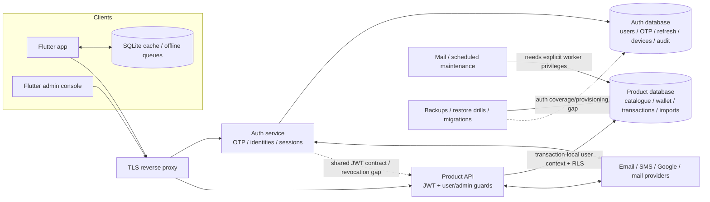

# PandaPay: security, API, backend-flow and data-redundancy audit

Audit date: 20 October 2026. Source: HEAD `c2e41d8` plus the current working tree. Other application edits were occurring during this review, so this is a dated working-tree assessment, not certification of a frozen release binary.

## Decision summary

There are genuine issues to fix; this is **not an all-clear for release**. The highest-priority findings are two conditional account-takeover paths in legacy/contact-linking authentication, broken encrypted-phone lookups, OTP codes appearing in production logs, and inconsistent session revocation between the auth and product services.

Eight isolated probes reproduced the conditions described below using the actual source with synthetic records and mocked database/provider boundaries. No customer account was attacked and no real OTP was requested. The normal backend tests nevertheless pass: **436 API tests and 38 auth tests** rerun today. Passing those tests does not cover the newly found cases.

The data audit also confirmed **20 extra cap-rule rows, 4 extra benefit rows, and two overlapping index pairs in the local product database**. Nothing was deleted, fixed, migrated, committed, pushed, or deployed during this review.

### What was checked

- Active Flutter app, Flutter admin console, Node product API, Node auth service, local PostgreSQL schema/policies/aggregate counts, deployment examples and operational scripts. The shared domain/scraper architecture and earlier test baseline are covered in the linked architecture review.
- All **198 registered backend method/path pairs** in the active services: 170 product API and 28 auth routes, including generated admin rule routes and inherited router guards.
- A heuristic inventory of **160 literal Dart HTTP call sites**, followed by manual review of public exceptions, token headers, auth/recovery helpers, Gmail calls, and the authenticated retry client.
- Mobile credential/network/storage/dependency scanners, manual mobile security checks, and current production-dependency `npm audit` results.
- Local schema metadata for **89 product tables and 7 auth tables**; no customer/transaction/message contents were exported.

### Limits that matter

Production infrastructure, deployed role grants, real email/SMS delivery, production records, provider dashboards, Firebase authorization rules, complete Git history, penetration testing of every request payload, and runtime instrumentation of a signed mobile release were **not** inspected. API coverage here means registration/guard inventory plus targeted source review and isolated probes—not 198 end-to-end security tests. Some risks depend on configuration or particular account states, explicitly noted below.

## Review pack

| Artifact | Purpose |
|---|---|
| [Full API authentication matrix](/Users/chandresh_kerkar/Documents/PandaPath/pandapay-docs/artifacts/security-review-2026-10-20/route-inventory.md) | Every inventoried method/path, access rule and source line |
| [Complete local database dictionary](/Users/chandresh_kerkar/Documents/PandaPath/pandapay-docs/artifacts/security-review-2026-10-20/schema-inventory.md) | All 96 tables, columns, nullable fields, foreign keys, RLS policies, index counts and pending migrations |
| [Extended database metadata](/Users/chandresh_kerkar/Documents/PandaPath/pandapay-docs/artifacts/security-review-2026-10-20/schema-details.json) | Fresh local metadata for the HTML Database explorer: 96 tables, 934 columns, 139 foreign keys, keys/checks/defaults, indexes, policies, triggers, six views, 26 enums and 31 application-function signatures. Includes the later local `recurring_series.user_edited` column. No production records. |
| [Source-only and device schemas](/Users/chandresh_kerkar/Documents/PandaPath/pandapay-docs/artifacts/security-review-2026-10-20/schema-source-supplement.json) | Two migration-defined tables absent locally, plus all 19 persistent Flutter SQLite tables, exact source declarations and guarded runtime column additions. Device source inventory, not a device-data snapshot. |
| [Reproduction results](/Users/chandresh_kerkar/Documents/PandaPath/pandapay-docs/artifacts/security-review-2026-10-20/security-probe-results.json) | Eight reproduced conditions; `reproduced: true` means a problem was demonstrated, not a security pass |
| [Probe source](/Users/chandresh_kerkar/Documents/PandaPath/pandapay-docs/artifacts/security-review-2026-10-20/security-probes.cjs) | Reusable synthetic-only checks; no network/database connection |
| [Dependency audit](/Users/chandresh_kerkar/Documents/PandaPath/pandapay-docs/artifacts/security-review-2026-10-20/dependency-audit.json) | Current npm advisory evidence for the installed API/auth dependency trees |
| [Mobile scanner output, redacted](/Users/chandresh_kerkar/Documents/PandaPath/pandapay-docs/artifacts/security-review-2026-10-20/mobile-scanner-results.redacted.json) | Raw heuristics, with the manual interpretation in this report |
| [Architecture and data review](/Users/chandresh_kerkar/Documents/PandaPath/pandapay-docs/docs/architecture-data-review-2026-10-19.md) | System architecture, data responsibilities, backup/deletion/provisioning findings and previous test baseline |

## 1. Is every API call authenticated?

**No—and some calls should intentionally remain public.** The important distinction is public catalogue/login traffic versus access to a verified user's private data. No accidentally unguarded private route was identified in the registration inventory, but the current guards do not establish a sufficiently consistent identity/session boundary.

| Product API access class | Method/path pairs | Assessment |
|---|---:|---|
| JWT required | 94 | Signature, issuer, audience and expiry checked; account/session status and guest exclusion are missing at this boundary |
| JWT plus product-admin membership | 59 | `requireAdmin` queries `pandapay.is_admin()`; not merely a client-side role check |
| Public reads/discovery | 14 | Health/readiness, catalogue/categories, app status/changelog, merchant search/resolve/discovery, emergency contacts; public by current design |
| Secret-authenticated webhooks | 2 | Inbound email and partner conversions validate a configured shared secret inside the handler, rather than requiring a user JWT |
| Anonymous analytics write | 1 | Explicitly supports pre-login events; do not treat this as a verified-user channel |
| **Total** | **170** | `/admin/me` needs a JWT and returns the caller's admin status, rather than granting admin access |

Auth's 28 routes comprise 13 JWT-protected operations (including step-up/recovery-proof variants and 2 feature-gated security-admin APIs), 4 request/verify-OTP routes, 2 refresh-token operations, 1 Google-ID-token operation, 1 token-introspection operation, 4 health/debug routes, and **3 public legacy routes**: `/auth/signup`, `/auth/guest-login`, `/auth/check-user`.

The auth service additionally serves files from `auth/public/` before its protected dashboard route: `/test.html` and `/security-dashboard.html` are therefore public static resources even when dashboard APIs are disabled. These files, automatic HEAD/OPTIONS handling, and reverse-proxy routes are outside the 198 count. This is unnecessary exposed debugging surface, **not evidence that protected admin APIs can be bypassed**.

On the client side, the ten inventoried call sites without an explicit `headers` argument were eight expected public reads and two low-level `send(request)` calls whose headers are already on the request object. Login/refresh calls often have JSON headers without a Bearer token, correctly using OTP/refresh proof instead. Private repository/admin calls reviewed supply Bearer headers. The mobile authenticated client also checks the token subject around refresh/retry, coalesces refreshes and retries a 401 once. Header presence alone does not prove authorization; the server findings below remain decisive.

Evidence: [product JWT guard](/Users/chandresh_kerkar/Documents/PandaPath/pandapay-docs/api/src/auth.js:33), [admin guard](/Users/chandresh_kerkar/Documents/PandaPath/pandapay-docs/api/src/index.js:264), [client call inventory](/Users/chandresh_kerkar/Documents/PandaPath/pandapay-docs/artifacts/security-review-2026-10-20/client-call-inventory.json), [authenticated mobile client](/Users/chandresh_kerkar/Documents/PandaPath/pandapay-docs/app/lib/data/authenticated_http_client.dart:37).

## 2. Reproduced authentication/security findings

Priority P1 means address before further distribution; P2 means a material correctness/security gap to resolve next. These are review priorities, not assigned CVSS scores.

### S01 — P1: email proof can claim an existing phone-only account

An OTP can be requested for an attacker-controlled new email without a phone. Normal `/auth/verify-email-otp` then accepts a supplied phone number, finds a phone-only user, attaches that email, and issues tokens for the existing user's ID. It proves the email, **not ownership of the existing phone/account**. The `recovery_only` branch has a guard, but normal verification does not.

The probe reproduced this with a synthetic legacy plaintext-phone, email-null account. The broken encrypted lookup described in S03 affects reachability: this is **not a claim that arbitrary encrypted-phone or already email-linked accounts are takeoverable**. Local aggregate checks found zero phone-only users; production prevalence is unknown. Fix the path even if no susceptible accounts currently exist: linking to an existing identity must require authentication/recent proof for that identity and the new channel, with atomic uniqueness enforcement.

Evidence: [contact selection and linking](/Users/chandresh_kerkar/Documents/PandaPath/pandapay-docs/auth/src/routes/authRoutes.js:939), especially the phone-only branch at line 991; probe 1.

### S02 — P1: public legacy signup issues tokens without an OTP

`POST /auth/signup` has body validation but no OTP proof or authentication middleware. Its existing-user branch completes an account with an empty name and issues access/refresh tokens, explicitly marking the access token `highAssurance: true`. The new-user branch can also create an account without OTP. The probe succeeded even with the phone-OTP feature disabled.

Existing-account takeover requires an incomplete account that the phone lookup can find; a completed account follows a conflict branch. The active Flutter app uses OTP plus profile upsert rather than this legacy signup route, making removal or strict isolation preferable to maintaining a second login implementation. Require a verified signup continuation bound to the authenticated subject; never infer identity from an unverified phone field.

Evidence: [route guards](/Users/chandresh_kerkar/Documents/PandaPath/pandapay-docs/auth/src/routes/authRoutes.js:1460), [incomplete-user branch](/Users/chandresh_kerkar/Documents/PandaPath/pandapay-docs/auth/src/routes/authRoutes.js:1521), [token issuance](/Users/chandresh_kerkar/Documents/PandaPath/pandapay-docs/auth/src/routes/authRoutes.js:1641); probe 2.

### S03 — P1: encrypted-phone equality searches cannot work reliably

Phone encryption correctly uses AES-GCM with a fresh random IV. Search then encrypts the submitted phone again and compares that new ciphertext or the plaintext against the stored ciphertext. The values differ even for the same phone. The probe confirms decrypting works but the stored ciphertext matches neither search candidate.

This affects phone OTP lookup/verification, finding existing users and enforcing contact uniqueness. Decrypt-and-compare logic after the SELECT does not fix a query that returned no matching rows. Add a normalized, keyed-HMAC blind index with a unique constraint and backfill it safely. Keep randomized encryption; **do not reuse GCM IVs or make encryption deterministic** to repair search. Resolve duplicate identity conflicts explicitly during migration.

Evidence: [random-IV encryption](/Users/chandresh_kerkar/Documents/PandaPath/pandapay-docs/auth/src/utils/fieldEncryption.js:88), [search parameters](/Users/chandresh_kerkar/Documents/PandaPath/pandapay-docs/auth/src/utils/encryptedPhoneSearch.js:29), [OTP equality query](/Users/chandresh_kerkar/Documents/PandaPath/pandapay-docs/auth/src/services/otpService.js:154); probe 3.

### S04 — P2: global revocation is not enforced by the product API

For the same signed JWT, auth middleware rejects a stale `token_version` while the product API accepts it. Product auth copies `payload.sub` after JWT verification without checking the current account, token version, device status or deletion status. Previously issued tokens therefore retain product access until expiry (normally 15 minutes), despite revocation on the auth side.

This is a bounded stale-access window, not permanent token validity. Align both services' session policy using a shared validation contract/introspection or revocation cache and test logout-all, disabled accounts, deleted accounts and revoked devices against **both** services. Auth's own ordinary middleware/refresh lookup also lacks consistent `is_active`/`deleted` filtering and needs explicit lifecycle handling.

Evidence: [product guard](/Users/chandresh_kerkar/Documents/PandaPath/pandapay-docs/api/src/auth.js:39), [auth version check](/Users/chandresh_kerkar/Documents/PandaPath/pandapay-docs/auth/src/middleware/authMiddleware.js:88), [refresh account lookup](/Users/chandresh_kerkar/Documents/PandaPath/pandapay-docs/auth/src/routes/authRoutes.js:1266); probe 4.

### S05 — P2: public guest tokens pass private product-route guards

`/auth/guest-login` issues a signed 24-hour guest JWT; the product API only checks for a subject and accepts it on private-route guards. A fresh guest UUID does **not** reveal an existing user's data, but this bypasses a verified-account admission requirement and can create unverified/orphan product identities and data. The active app does not need this legacy guest-login flow.

Remove it if unsupported, or make guest capability a deliberately limited token class that private product routes reject. Test actual profile/transaction/sync boundaries, not just token verification.

Evidence: [guest token issuance](/Users/chandresh_kerkar/Documents/PandaPath/pandapay-docs/auth/src/routes/authRoutes.js:370), [product `requireAuth`](/Users/chandresh_kerkar/Documents/PandaPath/pandapay-docs/api/src/auth.js:52); probe 5.

### S06 — P1: raw OTPs are written to production logs

OTP verification logs the submitted code, email identifier, comparison details and a hash prefix through unconditional `console.log` calls. Running the actual OTP service in production mode with synthetic input reproduced the code in captured log output. Development-only logging guards elsewhere do not protect these calls.

Remove codes/hash fragments from every log path; use structured events with masked contact hints and request IDs. Restrict access/retention for existing auth logs and evaluate whether still-valid credentials were exposed; do not indiscriminately erase incident evidence. No production logs were read in this audit.

Evidence: [verification logging](/Users/chandresh_kerkar/Documents/PandaPath/pandapay-docs/auth/src/services/otpService.js:149), [comparison logging](/Users/chandresh_kerkar/Documents/PandaPath/pandapay-docs/auth/src/services/otpService.js:277), [mismatch logging](/Users/chandresh_kerkar/Documents/PandaPath/pandapay-docs/auth/src/services/otpService.js:309); probe 6.

### S07 — P2: one OTP can succeed in concurrent verifications twice

Verification SELECTs an unconsumed challenge, awaits bcrypt comparison, then updates `consumed_at` by ID without requiring it to remain unconsumed. Two concurrent requests can both read it, both compare successfully and both return success. The synchronized synthetic probe reproduced both successes.

Use an atomic conditional consume with `RETURNING`, accepting only one winner, or a transaction/row-lock design with bounded contention. Enforce expiry/attempt/purpose checks in the same concurrency-safe operation; test simultaneous valid and invalid attempts.

Evidence: [read/compare/consume flow](/Users/chandresh_kerkar/Documents/PandaPath/pandapay-docs/auth/src/services/otpService.js:138), successful consume at line 338; probe 7.

### S08 — P2: enabling DB security logging breaks auth queries

`db.js` imports `dbAccessLogger`, which immediately imports `db.js` again and captures its incomplete exports. Enabling `DB_ACCESS_LOGGING_ENABLED` routes database calls into a logger holding an object without `query`, producing `db.query is not a function`. The isolated actual-source circular-loader probe reproduced this. With the flag off, normal queries bypass it.

Inject the underlying pool/query function into the logger rather than calling the wrapped DB API recursively. Do not create tables/indexes on query paths. The logger's current sanitizer also preserves email values and short OTP-shaped strings, so fix privacy handling before enabling it.

Evidence: [DB wrapper](/Users/chandresh_kerkar/Documents/PandaPath/pandapay-docs/auth/src/db.js:186), [logger's circular import](/Users/chandresh_kerkar/Documents/PandaPath/pandapay-docs/auth/src/middleware/dbAccessLogger.js:28), [logger execution](/Users/chandresh_kerkar/Documents/PandaPath/pandapay-docs/auth/src/middleware/dbAccessLogger.js:228); probe 8.

## 3. Additional source-confirmed risks and hardening gaps

These were source/configuration reviews, not live exploit attempts.

| ID / priority | Finding and scope | Recommended action / evidence |
|---|---|---|
| S09 / P2 | OTP generation uses `Math.random()` and only 4 digits. Rate limits reduce guessing, but this is not a cryptographically secure code generator. | Use `crypto.randomInt`, a reviewed code length and strict per-challenge/per-identity attempt limits. [Generator](/Users/chandresh_kerkar/Documents/PandaPath/pandapay-docs/auth/src/services/otpService.js:65) |
| S10 / P2 | DB TLS, when enabled, uses `rejectUnauthorized: false` in both services. Encryption without peer-certificate verification permits DB impersonation to an attacker with the necessary network position. | Configure a trusted CA and verify the server. Keep non-TLS local development explicitly separate. [API pool](/Users/chandresh_kerkar/Documents/PandaPath/pandapay-docs/api/src/db.js:6), [auth pool](/Users/chandresh_kerkar/Documents/PandaPath/pandapay-docs/auth/src/db.js:132) |
| S11 / P2 | Auth's production/staging compose does not pass `TRUST_PROXY`, so behind the documented proxy, IP limiters can group users under the proxy address. Simply enabling the current boolean `true` is unsafe with an edge that appends untrusted X-Forwarded-For values. | Trust only the known proxy topology and overwrite/sanitize forwarding headers at ingress. [Auth config](/Users/chandresh_kerkar/Documents/PandaPath/pandapay-docs/auth/src/index.js:37), [edge example](/Users/chandresh_kerkar/Documents/PandaPath/pandapay-docs/deploy/nginx/auth.conf.example:45). See [Express's proxy guidance](https://expressjs.com/en/guide/behind-proxies.html). |
| S12 / P2 | User-supplied IMAP hosts/ports reach `tls.connect`. The test checks hostname syntax, not resolved IP ranges; an attacker-controlled DNS name can resolve privately. TLS certificate verification remains enabled, so unrestricted internal response/file exfiltration is **not** demonstrated. | Allowlist supported providers or validate/pin resolved public addresses across IPv4/IPv6 and enforce outbound-network policy, bounded concurrency and timeouts. Apply validation when saving and polling, not only testing. [Connection creation](/Users/chandresh_kerkar/Documents/PandaPath/pandapay-docs/api/src/index.js:9174), [TLS connection](/Users/chandresh_kerkar/Documents/PandaPath/pandapay-docs/api/src/imap_test.js:59) |
| S13 / P2 | Console access and refresh tokens persist in SharedPreferences/localStorage, readable by same-origin JavaScript and an exposed browser profile. No XSS exploit was established, but persistent admin-session theft has high impact. | Prefer a reviewed Secure/HttpOnly/SameSite cookie/BFF session design; otherwise minimize refresh-token persistence and enforce a strong CSP/session lifetime. [Console token store](/Users/chandresh_kerkar/Documents/PandaPath/pandapay-docs/console/lib/data/token_store.dart:4) |
| S14 / P2 | `POST /lounge-usage` checks the row's `profile_id` via RLS but does not prove the submitted `user_card_id` belongs to that user or the benefit belongs to that card product. Independent foreign keys do not establish those relationships. | Validate both relationships atomically or enforce compound ownership constraints. This is an integrity/foreign-reference authorization gap, not demonstrated cross-user data reading. [Handler](/Users/chandresh_kerkar/Documents/PandaPath/pandapay-docs/api/src/index.js:5914), [schema](/Users/chandresh_kerkar/Documents/PandaPath/pandapay-docs/db/supabase/migrations/0004_user_domain.sql:198) |
| S15 / P2 | Anonymous `/auth/check-user` exposes existence/registration state without the OTP-request enumeration rate-limiter chain. Encryption's lookup bug may make answers wrong; it is not a security control. | Remove the unused endpoint or normalize responses and apply strict abuse controls. [Route](/Users/chandresh_kerkar/Documents/PandaPath/pandapay-docs/auth/src/routes/authRoutes.js:278) |
| S16 / P2 | Request logging redacts a small key denylist, but retains other query values. GET discovery coordinates and merchant/VPA searches can therefore be copied into logs despite “never content” comments. | Default to logging route templates and query keys, with an explicit safe-value allowlist. Include encoded-key tests. [URL sanitizer](/Users/chandresh_kerkar/Documents/PandaPath/pandapay-docs/api/src/observability.js:46) |
| S17 / P2 | Local `app_user` can mutate `schema_migrations`, the only product table without RLS. Setup broadly grants public-table CRUD and function execution. This is avoidable blast radius, not an identified HTTP path to arbitrary SQL. | Revoke ledger mutation from runtime roles; explicitly grant required functions, especially SECURITY DEFINER operations. Keep migration/worker/service roles separate. [Grants](/Users/chandresh_kerkar/Documents/PandaPath/pandapay-docs/db/setup_app_role.sql:34) |
| S18 / P2 | The local auth `users` table has only its primary-key index: neither email nor normalized phone identity has a database uniqueness constraint. SELECT-before-INSERT checks can race, and encrypted-phone lookup is already broken. No duplicate normalized emails were found locally. | Enforce reviewed normalized-email and phone-blind-index uniqueness for the intended account lifecycle, resolve any conflicts before creating indexes, and handle uniqueness violations atomically. [Auth schema](/Users/chandresh_kerkar/Documents/PandaPath/pandapay-docs/auth/db/pandapay-auth/init.sql:21) |

## 4. Backend flow and operational bugs

| ID / priority | What is wrong | Impact and next step |
|---|---|---|
| B01 / P2 | IMAP polling SELECTs every active connection through the ordinary pool with no `app.user_id`. Owner RLS on `imap_connections` sees a null identity. | Under the documented non-bypass `app_user` deployment, polling returns no connections even though an individual connection test can succeed. Use a narrowly privileged worker operation/role, not a superuser or disabling RLS. [Poll cycle](/Users/chandresh_kerkar/Documents/PandaPath/pandapay-docs/api/src/imap_poller.js:146) |
| B02 / P2 | Session advisory-lock acquisition and release use separate `pool.query` calls. They are not guaranteed to run on the same PostgreSQL session. | Lock leakage/re-entrancy can disrupt multi-instance polling under load. Hold one checked-out client through acquire/work/release, or use an appropriate transaction-scoped design. [Lock lifecycle](/Users/chandresh_kerkar/Documents/PandaPath/pandapay-docs/api/src/imap_poller.js:152) |
| B03 / P2 | Partner callback authenticates its shared secret but queries owner-only `partner_clicks` without a user context, then would insert into admin-only `partner_conversions` through the same runtime role. | Under `app_user`, a valid callback can return `matched: false` silently. Use a narrowly scoped, secret-gated worker/RPC and integration-test real role permissions. No live lost conversion/revenue was established. [Webhook](/Users/chandresh_kerkar/Documents/PandaPath/pandapay-docs/api/src/index.js:1885), [policies](/Users/chandresh_kerkar/Documents/PandaPath/pandapay-docs/db/supabase/migrations/0030_partner_attribution.sql:103) |
| B04 / P2 | User-facing backup-status queries run as a normal user against admin-only backup/restore tables. | Ordinary users receive null backup state even when operational rows exist. Expose a sanitized status projection; do not open raw filesystem/error details to everyone. [Status endpoint](/Users/chandresh_kerkar/Documents/PandaPath/pandapay-docs/api/src/index.js:9022) |
| B05 / P2 | `/auth/google` reads/writes `users.google_id`, absent from active auth init SQL and the local auth schema. `oauth_accounts` exists but active auth code does not use it. | The endpoint fails against that schema. Migrate to one tested provider-link model; do not keep two undocumented representations. Active app Gmail import authorization is separate from this account-login endpoint. [Google route](/Users/chandresh_kerkar/Documents/PandaPath/pandapay-docs/auth/src/routes/authRoutes.js:1134) |
| B06 / P2 | Console login supports phone OTP only; the production template disables phone OTP because no SMS provider is configured. | Following that configuration leaves the console's normal sign-in path unavailable. Add the supported email flow or explicitly provision/enable SMS and test operator login. [Console login](/Users/chandresh_kerkar/Documents/PandaPath/pandapay-docs/console/lib/features/auth/login_screen.dart:24), [production flag](/Users/chandresh_kerkar/Documents/PandaPath/pandapay-docs/docker-compose.prod.yml:123) |
| B07 / P2 | Legacy signup still tries to write the removed farm-domain `locations` table when address fields are supplied. | That path can error after earlier user writes because the multi-step operation is not atomic. Removing the unsupported legacy endpoint also removes this broken flow. [Legacy write](/Users/chandresh_kerkar/Documents/PandaPath/pandapay-docs/auth/src/routes/authRoutes.js:1578) |
| B08 / P3 | Feature-gated auth security dashboard requires `security_admin`, but the initialized role enum allows `user`, `admin`, `moderator`. | A normally provisioned auth user cannot satisfy that role check. Product-console admin membership is a different mechanism and is not affected. Consolidate/remove the legacy dashboard or version its role model. [Role guard](/Users/chandresh_kerkar/Documents/PandaPath/pandapay-docs/auth/src/middleware/adminAuth.js:22) |

### Important architecture findings carried forward

These remain source/configuration findings from the architecture review, not new proof of production failure:

1. **P1 — incomplete account erasure:** the API schedules deletion, normal migration runners skip the cron sweep, and product-side deletion does not execute an auth-user deletion workflow. Build a monitored, idempotent two-database erasure process.
2. **P1 — auth recovery coverage:** configured scheduled dumps/restore drills cover one product database URL, not the separate auth database. Demonstrate recovery for both.
3. **P1 — auth provisioning:** production migration automation handles product SQL, not a versioned auth upgrade path. The sample auth URL uses privileged `postgres`; documented least-privilege operation is inconsistent.
4. **P2 — migration drift:** today's local inventory has **67 SQL migration files, 42 product migrations recorded, 24 non-cron files pending, plus intentionally skipped `0013_cron_jobs.sql`**. The ledger has 48 total entries including six seed entries. Yesterday's report had 66 source files/23 pending; an additional working-tree migration was created during this audit. No migration was applied here.

See the [architecture review's evidence and diagram](/Users/chandresh_kerkar/Documents/PandaPath/pandapay-docs/docs/architecture-data-review-2026-10-19.md:19) and the [current pending-file list](/Users/chandresh_kerkar/Documents/PandaPath/pandapay-docs/artifacts/security-review-2026-10-20/schema-inventory.md).

## 5. Redundant data, code and misleading words

### Confirmed local duplication

The equality test below ignores generated `id`, `created_at` and `updated_at`, but compares every other field. It does not assume similarly named rules are semantically interchangeable.

| Object checked | Duplicate groups | Extra rows / recommendation |
|---|---:|---|
| `cap_rules` | 20 | **20** extra definitions |
| `card_benefits` | 2 | **4** extra definitions |
| `reward_rules` | 0 | None under this comparison |
| `milestone_rules` | 0 | None under this comparison |
| Active wallet identity: profile/product/trimmed last4 | 0 | No duplicated active identity groups in the local snapshot |
| `change_log` indexes | 1 pair | `idx_change_log_pull` and `idx_change_log_profile_seq` have the same keys/predicate/sort definition; evaluate retaining one |
| `partner_clicks` indexes | 1 pair | Non-unique `idx_partner_clicks_token` overlaps unique `partner_clicks_click_token_key`; keep the uniqueness constraint, evaluate removing the extra index |

The pending `20261014173000_dedupe_catalogue_rules.sql` already addresses repeated cap/benefit definitions and foreign-key rewiring. **Do not simply delete duplicate rows**: cap states/lounge usage reference them. Dry-run that migration on a clone and reconcile state totals. One inconsistency also needs correction: existing-row dedupe normalizes `lower(trim(label))`, while its new uniqueness indexes use raw `label`, allowing future case/space variants to recur. No state overcount was demonstrated in this audit.

Evidence: [read-only aggregate queries](/Users/chandresh_kerkar/Documents/PandaPath/pandapay-docs/artifacts/security-review-2026-10-20/local-data-audit.sql), [dedupe migration](/Users/chandresh_kerkar/Documents/PandaPath/pandapay-docs/db/supabase/migrations/20261014173000_dedupe_catalogue_rules.sql:12).

### Cleanup candidates—not approved deletions

| Candidate | Evidence / decision |
|---|---|
| Auth `otp_codes`, `oauth_accounts` | Zero local rows and no exact active auth-source use. `otp_requests` is the real OTP table. Decide whether to remove the legacy table or wire the intended OAuth model; absence of local rows alone is insufficient. |
| Product `feature_flags`, `app_versions` | Zero local rows; app status/remote configuration use other paths. Confirm operational/roadmap ownership before retiring them. |
| Expired OTPs and revoked refresh records | Local counts: 24/24 OTP rows expired; 146 refresh rows, 25 expired and 133 revoked (overlapping groups). Define retention and a working cleanup job. Revoked rotation records support replay detection and must not be deleted merely because they are revoked. |
| Legacy auth routes/dashboard | Signup, guest login, check-user, static debug pages, obsolete address writes and mismatched admin roles add attack surface absent from the active app flow. Remove only after checking external consumers and compatibility requirements. |
| Nested `PandaPal_Auth_Service/` | Separate legacy Git checkout; root compose builds `auth/`, not that checkout. Archive separately if confirmed obsolete; do not erase its uncommitted work or secrets. |
| App packages | Previous source scan found no direct imports of `rive`, `flex_color_scheme`, `responsive_framework`, `cupertino_icons`. Verify generated/native/transitive usage before removal. Move test/build/lint tooling out of runtime `dependencies` into `dev_dependencies`, then rebuild/test. |
| Monolithic API | About 9.4k lines in one entrypoint; generated route-family helpers are useful, but domain separation and request-schema tests would make ownership/security review much easier. Refactor incrementally after containment, not during incident fixes. |

### Wording/documentation corrections

- Old single-database/Next.js descriptions do not match the current two-database/Flutter-console implementation.
- Auth init SQL says phone/email are encrypted and the search helper enforces uniqueness. Email flows actually store normalized email directly, and S03 disproves encrypted-phone lookup uniqueness. Documentation must describe real protection, not intended protection.
- The API's catalogue/RLS commentary still describes an unfiltered-draft gap, but later migrations add the published-view/RLS behavior. **That old comment is not evidence of a current public draft leak.** Update/remove obsolete incident narration after verifying the effective deployed view.
- Console token-store commentary dismisses an admin refresh token as “not a payment credential.” It is still a sensitive credential controlling privileged data/actions.
- `Farm Auth Service`, farm-address writes and `BuySellService` references are leftover domain language. Update harmless labels and remove unsupported flows, rather than renaming columns/API contracts blindly.
- OTP email subjects/body still use `PandaPal.Ai` rather than PandaPay; unlike an explanatory comment, this is user-visible trust/branding inconsistency. [Email template](/Users/chandresh_kerkar/Documents/PandaPath/pandapay-docs/auth/src/services/emailService.js:36)
- “Never content” logging commentary contradicts the retained query values; “global logout” must accurately describe the product API's remaining token-validity window until S04 is fixed.

## 6. Dependency and mobile-security results

### npm dependencies

Fresh `npm audit --omit=dev --json` completed without changing lockfiles:

| Service | Affected installed packages | Registry severity counts |
|---|---|---|
| API | `proxy-addr`, `qs` | 1 critical, 1 moderate |
| Auth | `axios`, `body-parser`, `form-data`, `nodemailer`, `proxy-addr`, `qs` | 1 critical, 3 high, 1 moderate, 1 low |

These are **package-level advisories, not eight proven remotely exploitable application vulnerabilities**. Installed versions include `proxy-addr 2.0.7` in both services, API `qs 6.15.3`, auth `qs 6.15.2`, `axios 1.16.1`, `form-data 4.0.5`, `nodemailer 8.0.9`, and auth `body-parser 2.2.2`.

- The `proxy-addr` critical advisory requires particular malformed IPv4-mapped/IPv6 trust subnets; that exact configuration was not found here. Upgrade to the patched line and independently fix S11. [Maintainer advisory](https://github.com/advisories/GHSA-jqcg-44mw-7w3h)
- The cited `qs` array-limit bypass depends on comma-parsing options; do not assume the default Express configuration enables it. Refresh the dependency and add bounded parser tests. [Maintainer advisory](https://github.com/advisories/GHSA-x5fp-wj9c-mxmx)
- The cited Nodemailer raw-message SSRF/file-access issue requires attacker influence over the relevant message options. This OTP service uses its own message construction; that exploit path was not established. Other advisories also apply to the installed line, so upgrade with delivery tests instead of running a blind major-version fix. [Maintainer advisory](https://github.com/advisories/GHSA-p6gq-j5cr-w38f)
- Auth's Axios/form-data path comes through Twilio; disabled SMS limits the active path but is not a dependency-removal strategy. Review the installed advisory list and upgrade the provider chain. [form-data advisory](https://github.com/advisories/GHSA-hmw2-7cc7-3qxx)

### Mobile OWASP review

The installed OWASP Mobile Security Checker supplied four scanners and the mobile checklist. Its instructions explicitly exclude backend auditing; the Node/SQL review above was separate. Scanner output was manually triaged rather than copied as final severity.

| Area | Result / limit |
|---|---|
| M1 credentials | Scanner found no hardcoded-secret matches across 304 files; one directory-read diagnostic limits that count. A separate tracked-file/key-shape check found documentation examples, not a confirmed live secret. Firebase client config is not a server credential. Full Git-history/secret-validity testing was not performed. |
| M2 supply chain | No unconstrained-version/static-threshold hits; 135 outdated Dart packages reported. **Outdated is not equivalent to vulnerable**; this was not a complete Dart/native CVE assessment. npm findings are above. |
| M3 authentication/authorization | Mobile secure token storage and refresh-subject checks are positive; server identity/revocation findings remain blockers. Console storage is a separate S13 concern. |
| M4 input/output validation | Private SQL paths sampled are parameterized, admin dynamic identifiers are allowlisted, and sync applies an entity/field allowlist plus ownership checks. Lounge foreign references and IMAP destinations still need the checks described above. No exhaustive fuzzing claim. |
| M5 communications | Four high HTTP heuristics were false positives: three Android-emulator development URLs and one SMS marker string `http://`, not a network destination. Release URL validation, Android cleartext restrictions and default iOS ATS are present. Missing pinning is a threat-model decision, not by itself a demonstrated MITM vulnerability. Backend DB peer verification is a real S10 gap. |
| M6 privacy | Production OTP/query logging needs correction; deletion/retention needs a complete workflow. Raw mailbox/SMS/receipt handling deserves retention/consent verification in a release runtime. |
| M7 binary protections | Release signing/minification configuration was inspected; native minification is deliberately disabled after a documented Room runtime crash. Missing obfuscation is not equivalent to an auth flaw. No reverse-engineering/root/tamper test was performed. |
| M8 configuration | Android backup is disabled, SMS receiver has the broadcast permission guard, exported quick-settings service has its binding permission. Production role/proxy/bootstrap differences still need deployment checks. |
| M9 storage | Mobile tokens use secure storage with removal of legacy preference tokens. The OCR unencrypted-file warning is transient image processing with best-effort deletion in `finally`; not a confirmed persistent card-data leak. Preparation failures/process death can leave temp files, so add age-based cleanup and avoid retaining PAN-bearing images. The user's source gallery photo is intentionally not deleted. Financial-cache/receipt encryption remains a threat-model/runtime verification item. |
| M10 cryptography | Random-IV authenticated phone encryption is a positive primitive; searching it incorrectly is S03. OTP randomness is S09. Key custody/rotation and runtime keystore behavior were not independently verified. |

## 7. High-level architecture and trust boundaries

There is no cross-database foreign key between auth `users.id` and product `profiles.id`. Verified provisioning, revocation, erasure and recovery must therefore coordinate across services. Preserve owner-scoped RLS while providing explicit worker capabilities; do not solve broken background flows by switching the ordinary API to a superuser.

## 8. Recommended order of work and acceptance gates

1. **Contain identity risks first:** disable/remove unsupported signup/guest/check-user surfaces, fix account linking, remove OTP logging, and review affected-account prevalence using privacy-preserving production aggregates. Fix S03 without weakening encryption. Add the eight reproduced cases as regression tests with expected secure outcomes.
2. **Unify session and abuse controls:** reject guest tokens on private operations, apply account/device/revocation policy consistently, use atomic OTP consumption and secure randomness, configure the proxy chain, and upgrade affected dependencies with compatibility tests.
3. **Repair role-aware integrations:** test mail polling, callbacks, backup-status and ownership constraints against the actual least-privilege DB roles. Add an operational signal for “no work matched” versus successful processing.
4. **Make operations complete:** version auth migrations, reconcile product migration drift on a disposable clone, demonstrate both-database restore, run monitored account erasure and retention jobs, and remove runtime mutation of migration metadata.
5. **Clean up only with evidence:** rewire references before dedupe, validate state totals, retain constraint-backed uniqueness, audit compatibility before dropping tables/routes/packages, and update misleading security/architecture wording.

Required release evidence: real-role cross-user authorization tests, denied anonymous/guest/revoked/disabled sessions, concurrent OTP tests, zero secret/OTP log assertions, successful supported operator login, fresh-install and upgrade migrations, and a demonstrated restore/erasure workflow across both databases. Today's unit-test success is a useful baseline, not a substitute for those gates.

## 9. Solutions for every finding

**Status: proposed remediation, not implemented or verified fixes.** The actions below cover the listed security findings, backend failures, architecture gaps, cleanup candidates, dependency advisories, mobile review limits and wording problems. Existing evidence and scope limits still apply. IDs beginning A, D, C, N, W and M organize the work below; they do not represent newly discovered vulnerabilities. Owners are suggested engineering roles, not assigned people.

### Implementation order and release gates

| Stage | Work and owner | Completion evidence |
|---|---|---|
| 1 — contain identity risks | Auth/backend: S01, S02 and S06; remove or isolate unsupported public/debug surfaces; assess affected account states through privacy-preserving production aggregates when authorized. | The two synthetic takeover cases fail securely, supported login still succeeds, and no OTP/secret appears in captured logs. A production-impact assessment remains separate from these local probes. |
| 2 — repair identity and sessions | Auth/backend + database: S03 and S18 together, then S04, S05, S07–S11 and S15. Fix account linking before making previously broken phone lookups reachable. | Race-safe identity uniqueness, single-use OTP, secure code generation, supported account recovery, and matching lifecycle/revocation decisions across both services. |
| 3 — restore safe backend operations | Backend/platform: S12–S14, S16–S17, B01–B08, account erasure, two-database backup/restore and versioned provisioning. | Integration tests run under real runtime/worker roles; two-database recovery and erasure succeed through partial failures; unauthenticated and cross-user requests are denied as intended. |
| 4 — controlled data and dependency work | Database/platform + mobile: clone-tested migrations/dedupe, compatible dependency upgrades, retention jobs and mobile regressions. | Before/after financial-state reconciliation, migration-from-empty and upgrade tests, successful supported login/import flows and reviewed dependency results. |
| 5 — maintainability and documentation | Service/mobile owners: remove proven-unused components, split the API incrementally, update architecture/security claims and add CI coverage. | No unexplained route/behavior changes, no broken supported clients, current architecture docs and a passing relevant test baseline. |

Each database migration needs a reviewed backup/recovery plan and a clone rehearsal. Use additive schema changes and backfills where possible. If a new identity index exposes conflicting accounts, quarantine the conflicts for a verified resolution; do not merge identities automatically. An old vulnerable build is not a safe rollback target for a security fix—retain containment while preparing a corrected release.

### Authentication and API security — S01 to S18

Suggested owners: auth/backend for identity/session changes; database for constraints and grants; platform for TLS/proxy/egress; console for browser sessions. Priorities below retain the original findings' priorities.

| Finding | Suggested solution | How to verify the fix |
|---|---|---|
| S01 / P1 — existing phone-only account can be claimed through email proof | Bind the OTP challenge to the intended action and identity. Require a signed-in session plus recent proof of the existing account before attaching a new contact; separately verify the new email. Give legacy users a supported recovery flow with evidence of account ownership. Perform linking and uniqueness checks atomically. | Re-run the synthetic new-email/existing-phone test: no link and no victim token are produced. Test legitimate linking, wrong challenge purpose, expired/replayed proof and two simultaneous link attempts. |
| S02 / P1 — legacy signup issues tokens without proof | Retire the unused public signup route after checking consumers, or make it accept only a short-lived, single-use continuation created by successful verification and bound to that subject. Profile completion must never establish ownership from an unverified phone/name. Remove the unearned high-assurance claim. | New, incomplete and complete synthetic accounts cannot obtain tokens from signup without valid proof. Supported OTP/profile-upsert onboarding still works; the phone-OTP feature flag cannot be bypassed. |
| S03 / P1 — encrypted phone searches fail | Normalize phone numbers consistently, retain randomized authenticated encryption, and add a versioned keyed-HMAC blind index using a separately managed secret. Backfill in batches, investigate collisions/duplicate identities, add the intended unique constraint and switch reads only after reconciliation. Coordinate with S01/S02/S18. | Existing and newly created encrypted-phone accounts are found consistently. Concurrent normalized variants cannot create two identities; migration and rollback preserve lookup. Equal phones keep different ciphertexts, and plaintext phones never appear in logs. |
| S04 / P2 — session revocation differs between services | Define one contract for verified user, account state, token version, device/session revocation and deletion. Make the product API enforce that contract through protected service validation or a carefully bounded revocation cache. Apply the same rules during auth middleware and refresh. Document any actual cache/revocation delay; fail safely when validation is unavailable. | Run the same tokens against auth and product before/after logout-all, device revocation, disablement and deletion. Assert denied refresh and private access within the declared revocation bound; exercise validation outages. |
| S05 / P2 — guest tokens enter private routes | Remove unsupported server guest-token issuance. If a server guest feature is retained, define an explicit guest token type with minimal capabilities and reject it on verified-user routes. Preserve the app's supported on-device guest experience. | Anonymous/guest requests cannot provision private profiles or write transactions/sync data. Verified accounts still work, and guest mode remains local where intended. |
| S06 / P1 — OTPs in logs | Delete code/hash-fragment logging from every success/error branch. Use structured event names, request IDs and approved masked identifiers. Restrict existing log access/retention and assess exposure without erasing incident evidence indiscriminately. Invalidate any demonstrably exposed still-valid credentials through the supported process. | Capture production-mode logs for valid, invalid, expired and provider-failure cases. Assert the absence of raw codes, hashes, full contacts and tokens, including serialized exceptions. |
| S07 / P2 — concurrent OTP reuse | Compare the candidate, then allow success only if a conditional consume still matches the unconsumed, unexpired challenge and its identity/purpose. Use UPDATE … RETURNING or a bounded locking transaction. Make attempt-count updates atomic and prevent late invalid attempts from defeating a successful consume. | Start many concurrent valid verifications: exactly one succeeds and issues a session. Mix invalid/valid/expired attempts and verify attempt limits, consumption and rollback behavior. |
| S08 / P2 — DB logger circular dependency | Inject the raw pool/query function into the logger, avoiding calls back into the wrapped DB API. Keep logging schema setup in migrations and redact parameter values by default before enabling the feature. | Enable/disable DB logging in a fresh process. Ordinary queries and transactions work without recursion or duplicate execution; logging failures do not leak values or change query results. |
| S09 / P2 — weak OTP generator | Use crypto.randomInt with a reviewed code length; six digits is a reasonable proposed starting point. Bind each challenge to purpose/contact, apply expiry and strict challenge/identity/IP attempt and resend limits, and update every client/email validator together. | Assert code format and use of the secure generator, expiry, resend behavior and bounded attempts. Test limits across multiple service instances if deployed that way. A randomness-frequency test alone is not proof of security. |
| S10 / P2 — DB certificate verification disabled | Configure the managed/server CA and hostname validation in both services. Separate explicit local non-TLS settings from production, and fail startup for invalid production trust configuration. Plan CA rotation. | A valid trusted DB succeeds; untrusted CA, expired certificate and hostname mismatch fail. Rotation rehearsal preserves connectivity without setting rejectUnauthorized to false. |
| S11 / P2 — proxy/rate-limit identity mismatch | Configure trusted proxy addresses/hops for the actual deployment and make ingress replace untrusted forwarding headers. Pass the setting consistently to staging/production and combine IP limits with identity/challenge controls. | Spoofed forwarding headers do not change the effective client IP. Separate clients are not collapsed under the proxy IP; direct backend access is blocked and distributed limits behave as documented. |
| S12 / P2 — IMAP destination checks insufficient | Prefer a supported-provider allowlist. If custom hosts are required, validate IPv4/IPv6 resolution, reject internal/link-local/metadata destinations, connect to the vetted address while retaining TLS hostname validation, and constrain outbound networking. Apply controls on save, test and every poll; bound time/concurrency. | Provider mail works. Private/loopback/link-local addresses, alternate address forms and DNS changes cannot reach internal services. Verify TLS, timeouts and worker behavior, without treating rejected connections as successful polling. |
| S13 / P2 — persistent browser admin tokens | Prefer a same-origin backend session using Secure, HttpOnly and appropriate SameSite cookies. Add CSRF/Origin controls for state-changing cookie requests. If retaining Bearer sessions temporarily, minimize persistent refresh storage, shorten exposure, strengthen CSP and revoke sessions on logout. | Browser JavaScript cannot read an HttpOnly session; unauthorized origins/CSRF attempts fail. Login, renewal, logout and revocation work. No browser-storage design is described as preventing all XSS impact. |
| S14 / P2 — lounge foreign references lack ownership checks | In one transaction, prove that user_card_id belongs to the caller and that the benefit belongs to that card's product before inserting usage. Consider composite constraints where the schema can express the invariant; keep owner RLS. | User A cannot submit user B's card, or a benefit for another product. Legitimate usage succeeds, including concurrent/archive edge cases; failed requests leave no usage/state mutation. |
| S15 / P2 — public account enumeration | Retire unused check-user. If needed, return a uniform response for known/unknown contacts, apply abuse limits and keep registration decisions inside the verified continuation flow. Avoid new timing/content differences from lookup failures. | Known/unknown/malformed identifiers produce the intended uniform public response. Rate limits apply; authorized recovery/onboarding still reaches the correct next step. |
| S16 / P2 — query values in request logs | Log route templates, request IDs, query key names and allowlisted non-sensitive values. Omit search terms, coordinates, VPAs, contacts, tokens and arbitrary request bodies by default. Review exception/access logs as well as the normal logger. | Encoded keys, repeated/nested query parameters and error cases cannot disclose sensitive values. Useful route/status/latency diagnostics remain available. |
| S17 / P2 — excessive runtime grants | Restrict schema_migrations writes to the migration owner. Create explicit grants for API, auth, worker and migration roles; audit inherited/PUBLIC grants and SECURITY DEFINER execution. Harden definer functions' search_path and keep ordinary API roles non-superuser/non-bypass. | Runtime roles cannot alter migration history or access unrelated data/functions. Required requests still pass under real roles, including transactions and background jobs. |
| S18 / P2 — no contact uniqueness constraints | Define normalized-email and phone-blind-index uniqueness for the intended active/deleted/pending lifecycle. Audit conflicts safely, backfill and create constraints; handle unique violations as normal transactional conflicts. Match S03 normalization and key versioning. | Concurrent signup/link requests create one identity. Email/phone variants obey the documented policy, deleted-account reuse follows the chosen lifecycle, and conflicts do not attach one account's contact to another. |

### Backend flows — B01 to B08

Suggested owners: backend and database, with platform for operator login configuration.

| Finding | Suggested solution | How to verify the fix |
|---|---|---|
| B01 / P2 — polling sees no connections under owner RLS | Give a dedicated worker a narrowly scoped operation to enumerate due connections and process them with explicit ownership context. Do not run the ordinary API as superuser or disable RLS. Record selected/processed/failed counts and alert on unexpected inactivity. | A real worker role sees only permitted work; ordinary user A cannot enumerate user B's connection. Due connections are processed and a no-work cycle is distinguishable from a failed cycle. |
| B02 / P2 — advisory locks use different pooled sessions | Check out one DB client for acquisition, work and unlock. In finally, release the advisory lock on that same client before returning the client to the pool; discard a connection if safe unlock cannot be confirmed. Use a transaction-scoped lock only if the work genuinely fits that transaction. Define crash/timeout recovery. | Two workers cannot process the same lock scope concurrently. Errors/timeouts return or discard the client safely and leave no persistent lock; repeat under pool contention and process termination. |
| B03 / P2 — partner callback lacks suitable DB capability | Use a secret-authenticated, narrowly privileged worker/RPC to resolve the click and record a conversion. Keep shared-secret checks, add idempotency/unique provider event identity and expose permission failures instead of silent unmatched success. | Valid callbacks work under the deployed role; invalid secret, unknown click and duplicate delivery are distinct tested cases. Replays do not double-credit rewards; no cross-user read is exposed. |
| B04 / P2 — backup status hidden by admin-only policies | Return a sanitized aggregate status through an explicit function/projection or service-owned status endpoint. Keep operational paths, errors and backup locations restricted to administrators. | Users see only the intended health summary; admins see detailed diagnostics. No raw location/error or another user's metadata leaks, and unavailable/stale status is explicit. |
| B05 / P2 — Google login/schema mismatch | Decide whether account Google login is supported. If yes, use one versioned provider-link model with unique provider/subject identity, verified provider tokens and safe explicit account linking. If unsupported, retire the route before dropping unused structures. Gmail import consent remains a separate feature. | A fresh and upgraded auth DB support the chosen contract. Invalid provider tokens and contact-collision linking are denied; Gmail import still works independently. |
| B06 / P2 — console requires disabled phone OTP | Add the supported email OTP path to console login, or provision and enable the intended SMS provider explicitly. Keep product-admin membership enforced server-side and expose provider-unavailable errors clearly. | A real configured operator signs in and reaches authorized console functions; a normal user is denied admin operations. Disabled/unavailable providers do not produce misleading success. |
| B07 / P2 — legacy signup writes removed locations table | Retire this unsupported branch with S02. If address capture is a supported requirement, implement it in the current profile model with verified identity and a transaction. Do not recreate an obsolete farm table just to hide the failure. | Signup/profile completion never leaves partial user/token/address state after an injected failure. Current supported onboarding passes on a clean schema. |
| B08 / P3 — dashboard role enum mismatch | Prefer removing the unused auth dashboard or intentionally consolidate its authorization with the supported admin model. If retained, version the role model, explicitly provision its role and keep its APIs and pages protected. | Intended operators can access it; every ordinary role and anonymous request is denied. Product-console admin status is not accidentally inferred from an unrelated auth role. |

### Architecture, migration and release work

These actions also cover the linked architecture review. Its dated test failures and local migration state must be rerun before treating them as current release results.

| Work item | Suggested solution | How to verify the fix |
|---|---|---|
| A01 / P1 — incomplete two-database erasure | Build an idempotent deletion workflow with a due-date worker, durable progress, retries and alerting. Block sessions when deletion takes effect; remove/anonymize product data and auth identity under an explicit retention policy. Handle imports, devices, attachments and restored backups as part of the workflow. Keep only the necessary non-sensitive completion evidence. | Inject failure after either database step and retry to completion. Verify both identities/data stores, revoked access, queue/import behavior and account recovery rules; document how backup expiry and restore reapply deletion. |
| A02 / P1 — auth backup and recovery missing | Back up both databases or use a demonstrated cluster-wide backup. Encrypt backups, isolate credentials, monitor age/failure, define recovery objectives and keep decryption material recoverable separately. Coordinate a consistent recovery point or explicitly reconcile cross-database identities. Invalidate restored session credentials as part of the restore runbook. | Restore both into an isolated environment, reconcile users/profiles and run login/product checks. Verify a deleted/revoked identity is not resurrected and old session tokens are not reactivated. Record recovery time and backup age. |
| A03 / P1 — auth provisioning not reproducible | Add versioned auth migrations and a dedicated least-privilege runtime role. Keep schema bootstrap/upgrade credentials separate, align compose/examples/deployment instructions and record auth migrations independently of product migrations. | Empty and existing environments upgrade predictably; auth starts under its intended runtime role, cannot change schema, and supports OTP/refresh/provider-link contracts. |
| A04 / P2 — local migration drift | Reconcile each full migration filename and the actual schema on a disposable clone. Do not mark files applied merely because some objects exist. Resolve partial application and semantic data changes, then apply reviewed migrations with pre/post checks. | A blank build and upgrade from the previous released schema converge to the expected objects/data invariants. Pending files, including source-only tables, have explicit outcomes; ledger and schema agree. |
| A05 / P2 — API CORS too broad | Configure explicit supported browser origins, methods and headers; permit native requests without Origin where intended. Coordinate cookie/CSRF policy if S13 changes session transport. Keep token/role authorization independent of CORS. | Approved console origins work; unapproved browser origins cannot read responses. Private API access still requires valid authorization from every client, including non-browser clients. |
| A06 / P2 — duplicate migration version prefixes | Adopt unique sortable versions for future migrations and add a CI collision/order check. Preserve already-applied filenames/checksums unless performing an explicitly planned ledger/tool migration. Record dependency order for historical files. | Current runner and any proposed replacement produce the same schema from empty and previous-release baselines. Existing databases do not rerun renamed migrations accidentally. |
| A07 / P2 — Dart/Node financial calculation drift risk | Keep one shared set of language-neutral money/reward fixtures covering rounding, currency units, categories, caps, dates and rule exclusions. Run them against both implementations before releases; version rule contracts. | Dart and Node return matching integer-safe results for edge cases and representative supported cards. A rule change that diverges between runtimes fails CI. |
| A08 / P2 — skipped scheduled jobs | Move account deletion, inbound-email purge, merchant-confidence recomputation, divergence checks and anonymization audits to an explicitly installed supported worker/scheduler, or provision the required cron extension intentionally. Give each job bounded privileges, idempotency, heartbeat and failure alerts. | Each job runs in the deployed environment under its real role. Missed/stuck runs alert; retries do not duplicate work, and retention/deletion jobs actually remove the intended expired data. |
| A09 / P2 — earlier mobile regression failures and lints | Re-run the dated mobile suite; triage each failure as a product regression or an obsolete expectation using the intended UX. Fix async context/file-picker deprecations deliberately. Preserve coverage for duplicate review, scan actions and changed flows. | Relevant mobile tests and the full agreed release suite pass, with analyzer warnings/errors resolved and remaining notices documented. Do not claim the old 19 failures still exist without rerunning. |

### Duplicate data and index work

Suggested owner: database/backend. Local duplicate counts are evidence for a clone rehearsal, not authorization to delete production rows.

| Work item | Suggested solution | How to verify the fix |
|---|---|---|
| D01 — 20 extra cap-rule definitions | Review the existing dedupe migration, choose canonical semantically identical rows, rewire dependent cap state and reconcile usage against source transactions. Preserve a mapping of old IDs for recovery. | No dangling references or duplicate definitions remain in the clone; per-user/per-period caps and reward results match before/after. Do not blindly sum repeated state that may describe the same spend. |
| D02 — 4 extra benefit definitions | Canonicalize only equivalent benefits, rewire lounge/benefit references and retain the audit mapping. Review entitlement and historical usage semantics before merging state. | Benefit availability and lounge counts remain correct; no usage disappears or becomes duplicated. Financial and entitlement fixtures pass. |
| D03 — equivalent change_log indexes | Confirm definitions, constraint dependencies and query plans, then remove only the redundant non-essential index using the deployment's safe index procedure. | Pull/sync plans and latency remain acceptable; required uniqueness/order is unchanged and a reviewed recreation path exists. |
| D04 — overlapping partner_clicks token indexes | Keep the unique click-token constraint/index. Evaluate removal of the extra non-unique index after dependency/plan checks. | Token uniqueness still rejects duplicates, callback lookups use a suitable index and callback throughput does not regress. |
| D05 — inconsistent label normalization in dedupe | Apply the same reviewed normalization to matching and future uniqueness enforcement, including case/space handling and null semantics. Confirm every other rule discriminator remains in the uniqueness key. | Repeated equivalent labels cannot re-enter after dedupe; semantically different rules remain separate. Re-running the migration is safe. |

No duplicate cleanup is proposed for reward_rules, milestone_rules or active wallet identities based on this audit: the stated comparisons found no duplicates there.

### Unused-looking components and retention

Suggested owners: service/database owners, with mobile for package changes. First establish real usage through code, scheduled jobs, supported clients and a representative operational window.

| Work item | Suggested solution | How to verify the decision |
|---|---|---|
| C01 — otp_codes and oauth_accounts | Retire unused otp_codes only after checking readers/jobs and retention needs. Resolve B05 before deciding oauth_accounts: use it as the supported provider-link model or retire it with the endpoint. Zero local rows alone are not enough. | Supported auth, recovery, upgrade and provider flows pass with the chosen schema; no remaining reader/job depends on a retired table. |
| C02 — feature_flags and app_versions | Assign an owner to each configuration mechanism. Consolidate with app_status/remote_config if contracts overlap, migrate any consumers and then deprecate the redundant path. | Old and supported new clients receive correct minimum-version, maintenance and feature behavior. No operational switch silently stops working. |
| C03 — expired OTP/refresh accumulation | Define retention by record purpose. Batch-purge expired OTPs after the required abuse/audit window; preserve revoked rotation-family information long enough for replay detection and investigations. Monitor cleanup lag and storage. | Recently revoked-token replay remains detectable; expired records are eventually removed, active sessions remain valid and cleanup load stays bounded. |
| C04 — legacy/debug auth surface | Inventory external consumers, remove public test/security-dashboard assets from production serving, and retire unsupported signup/guest/check-user routes with S02/S05/S15. Keep genuine diagnostics protected and minimal. | Anonymous static/API probes cannot reach debug content or unsupported token paths. Supported health and login endpoints continue working. |
| C05 — nested legacy repository | Confirm deployment/build references, inventory independent history and uncommitted work, then archive securely if obsolete. Handle any credentials through the credential process rather than copying them into documentation. | Root builds and deployments no longer depend on the archive; history/work remains recoverable and no secrets enter the report or application bundle. |
| C06 — apparently unused app packages and runtime tooling | Check generated/native/asset/transitive use before removing packages. Move test/codegen/lint tooling to dev_dependencies, update the lockfile through the normal package workflow and change one coherent group at a time. | Analyze, build and run relevant Android/iOS tests, code generation and release signing. No missing plugin registration, asset or runtime import appears. |
| C07 — monolithic API entrypoint | Split incrementally by domain while preserving method/path/guard order, request context and error contracts. Extract handlers and schemas behind existing route registration before changing behavior. | Compare the route/authentication matrix before/after. Domain contract and cross-user tests pass; financial behavior and RLS context are unchanged. |

### Dependency solutions

Suggested owners: backend/platform and mobile. These address dated package advisories or review gaps; no new production exploit is asserted. Pick patched compatible releases using a fresh advisory check at implementation time rather than treating the audit's installed versions as current forever.

| Work item | Suggested solution | How to verify the change |
|---|---|---|
| N01 — proxy-addr advisories | Upgrade the affected dependency path through a compatible Express stack and independently repair trusted-proxy configuration under S11. | Lockfile resolves an unaffected version for the applicable advisory; malformed address/proxy tests and rate-limit identity tests pass. |
| N02 — qs/body-parser advisories | Upgrade the affected parser chains and set explicit bounded body size, parameter count and nesting/array behavior appropriate to supported requests. Avoid enabling unnecessary parser modes. | Advisory applicability is rechecked; oversized/deep/large-array inputs fail predictably while normal login and application payloads work. |
| N03 — Nodemailer advisories | Upgrade the mailer compatibly, retain application-owned message construction and reject unneeded file/URL/raw-message input capabilities. Do not infer exploitability just from package presence. | OTP email template/delivery tests pass against the configured test provider. Message construction does not accept arbitrary file/URL options; fresh production-dependency audit is reviewed. |
| N04 — Axios/form-data through provider chain | Update the compatible Twilio/provider dependency chain and verify the actual resolved Axios/form-data versions. Review redirects, destination control, timeouts and credentials on provider calls. | Mocked and configured-provider tests pass for success, timeout and failure. Provider secrets do not cross redirects or enter logs; disabled SMS behavior remains explicit. |

### Mobile/security validation follow-through

The M1–M10 rows preserve the original OWASP grouping. Several are validation limits or maintainability decisions, not confirmed defects; their solution is to obtain evidence and fix only what that evidence establishes.

| Area | Suggested action | Completion evidence |
|---|---|---|
| M1 — credentials | Resolve the scanner's unreadable-directory diagnostic and run approved repository/history and release-artifact secret checks. Confirm a suspected credential before following revocation/rotation procedures. Keep Firebase client configuration distinct from server secrets. | Complete scan coverage, reviewed findings and no confirmed embedded server credential in the release. Any real secret has an owner and a verified rotation outcome. |
| M2 — supply chain | Inventory direct/transitive Dart/native dependencies and their applicable advisories, not just age. Upgrade in compatible groups and keep a release dependency inventory alongside the npm work. | Reviewed advisory applicability and passing builds/native integration tests; a newer version alone is not labeled a security fix. |
| M3 — authentication/authorization | Ship the S01–S05/S07/S13/S18 changes with a route-class policy matrix. Add authorized/anonymous/guest/expired/revoked/disabled/deleted and cross-user tests for every sensitive route family, including admin and webhooks. | Server-side permission tests pass with actual DB roles; mobile token refresh and account switching cannot reuse another subject's data/session. Public reads remain intentionally public. |
| M4 — validation | Add schema and boundary tests for sensitive payloads, sync entity/field allowlists, ownership references and import destinations; keep SQL values parameterized and dynamic identifiers allowlisted. | Malformed/unexpected fields fail safely, no unauthorized object reference is accepted and failures leave no partial financial mutation. S12/S14 tests pass. |
| M5 — communications | Verify the signed release's real destinations, cleartext restrictions and DB TLS fix. Decide certificate pinning from an explicit threat model with a rotation/recovery plan rather than adding it automatically. | Release endpoints use intended verified TLS, development URLs are not used, and any selected pinning policy survives planned certificate rotation. |
| M6 — privacy | Minimize raw SMS/mail/receipt retention, document consent and purpose, separate sensitive processing from analytics, and implement S06/S16 plus A01/C03. Restrict log/data access. | Synthetic sensitive markers are absent from ordinary logs/analytics; import retention and deletion operate across local/server stores and backups as documented. |
| M7 — binary protections | Reproduce and fix the documented Room/minification failure before reconsidering native shrinking. Review release signing, debug flags, tamper/root threat model and artifact protections without treating obfuscation as an auth control. | A signed release starts and exercises Room/OCR/import paths on representative devices. No debug configuration leaks into the artifact; selected protections have runtime evidence. |
| M8 — configuration | Verify the built manifest/entitlements, provider/proxy configuration, exported components, backup policy and role bootstrap in the actual release/deployment. Preserve the safeguards already identified. | Installed release/component tests and deployed-role checks match the reviewed policy, rather than only the source templates. |
| M9 — local storage and OCR temp files | Add bounded age-based cleanup in the app-owned temporary directory and cover interrupted preparation/process-death paths. Decide financial-cache/receipt encryption from sensitivity and device threat model, using platform-backed key custody where selected. Preserve the user's original gallery files. | Abandoned app temp files are removed without deleting user files; account switch/sign-out/erase behavior is tested. Any chosen encryption and key-loss/restore policy works on real devices. |
| M10 — cryptography | Implement S03/S09 while preserving authenticated randomized phone encryption. Document key purpose, custody, rotation and recovery; keep indexing and encryption secrets separated and verify platform keystore behavior. | Rotation/backfill tests preserve data recovery and uniqueness. Wrong keys/tampering fail safely; no fixed IV or plaintext lookup workaround is introduced. |

### Wording and documentation fixes

Suggested owner: the relevant service owner, with documentation maintained in the same change as the actual behavior.

| Work item | Suggested correction | Review check |
|---|---|---|
| W01 — stale runtime architecture | Make one current deployment/architecture page authoritative: Flutter mobile + Flutter console, separate product/auth databases, explicit schemas and device SQLite. Mark old consolidated SQL/plans as historical; regenerate only from the supported migration chain. | Names and responsibilities match compose, schema metadata and build targets; no current guide calls the console Next.js or assumes one shared database. |
| W02 — inaccurate encryption/uniqueness comments | Document normalized email storage, randomized phone encryption, the eventual blind index and actual database uniqueness constraints. Separate present behavior from planned changes. | Comments and privacy/security claims can be traced to current code and constraints. S03/S18 proposals are not described as already shipped. |
| W03 — stale catalogue incident commentary | Verify the effective published views/RLS in the target environment, then replace old unfiltered-draft incident narration with the current invariant and regression-test reference. | Public/draft access tests support the description; no stale comment is presented as evidence of a current leak. |
| W04 — admin-token sensitivity | Remove language dismissing admin refresh tokens as harmless. Document their privilege, storage, lifetime, revocation and incident response alongside S13. | The console session documentation matches the implemented transport/storage and treats admin access as sensitive. |
| W05 — legacy farm/domain wording | Rename harmless labels/classes where compatible and remove unsupported address flows with B07. Version API/DB contracts when a rename changes an external interface. | Supported clients, migrations and email/UI strings remain consistent; a cosmetic rename does not break stored data or routes. |
| W06 — OTP email branding | Use the approved PandaPay sender display name, subjects and message branding while retaining clear expiry/security guidance. Verify sender-domain authentication with the mail provider when configuring delivery. | Test messages show the intended brand and sender; links and reply handling are correct. Branding alone is not treated as proof of sender legitimacy. |
| W07 — overclaimed logging/logout behavior | Replace “never content” with the actual safe logging contract after S06/S16, and describe the real global-logout/revocation bound after S04. Keep public-vs-protected API distinctions explicit. | Captured-log and revocation tests support every claim. The report/release notes never promise that every endpoint needs login or that the app is hacker-proof. |

### When a finding may be marked resolved

A proposed action, a passing old unit test or a changed comment does not close a finding. Record the reviewed implementation, relevant migration/configuration, regression result and target-environment verification. Mark source-only cleanup decisions separately from demonstrated security fixes. Keep remaining production validation visible; this plan makes no claim that production has already been repaired.

### Skills used

- **Graphify**: used the existing graph to locate related authentication/security/database code, expanding only from its vocabulary: `auth, security, token, jwt, api, route, database, user, validation, refresh, otp, admin`. The graph is older than the checkout, so findings were verified against current files and local metadata rather than accepted from the graph.
- **OWASP Mobile Security Checker**, installed under `/Users/chandresh_kerkar/.claude/skills/owasp-mobile-security-checker`: used its four scanners and mobile checklist. Manual triage removed false HTTP/temporary-file alarms and kept outdated packages distinct from verified vulnerabilities. Backend review was explicitly outside that skill's scope and was performed separately.

No production write, destructive cleanup, application-source fix, dependency upgrade, deployment, or new credential installation was performed by this audit.
