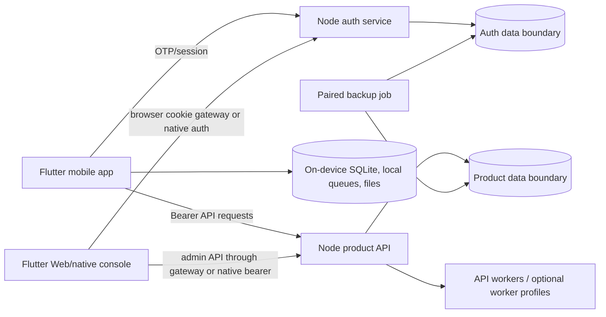

# PandaPay current architecture and recovery boundaries

**Source inventory dated 25 October 2026.** This note describes the repository working tree and checked-in configuration examples. It does not certify a running staging or production deployment, provider state, live data, installed scheduler, device behavior, or key custody. Code and examples can differ from what is currently deployed.

## Runtime map

The mobile app and the internal console are separate Flutter targets. Both use the `pandapay_domain` Dart package for shared client-side rules. The mobile app has a local SQLite database, caches, and offline queues; its network clients target the product API and auth service separately. The console calls the product API for admin operations and authenticates through the auth service. Web console requests can use the same-origin `/browser` cookie/CSRF gateway; native console clients use the configured auth and API origins directly. The source entrypoints are [mobile `main.dart` and providers](../app/lib/main.dart) and [mobile build-time environment](../app/lib/app/env.dart), plus [console `main.dart`](../console/lib/main.dart), [console auth/API providers](../console/lib/app/providers.dart), [console browser-aware API client](../console/lib/data/admin_api.dart), and [auth service route mounting](../auth/src/index.js).

The product API is an Express service with a large central route entrypoint and extracted route/worker modules. It verifies auth-issued JWTs and uses `withUserClient` to establish user-scoped database context. Auth owns OTP, identity, refresh-token and device/session records within its own service and configured data boundary. Production and staging Compose files give the services separate database connection settings and ports. The examples do not establish that deployed physical databases are distinct: both services may use the same Supabase project or PostgreSQL host, and could point to the same database or schema. Verify the actual deployed database, schema, roles and grants before making topology claims. Application consistency must not presume a cross-service PostgreSQL foreign key. See [API package entrypoint](../api/package.json), [API database pools and user transaction boundary](../api/src/db.js), [auth package entrypoint](../auth/package.json), [auth database pools](../auth/src/db.js), [production Compose services](../docker-compose.prod.yml), and the [root README topology statement](../README.md).

The product schema is maintained under [`db/supabase/migrations/`](../db/supabase/migrations/); the auth schema has its own [`auth/db/migrations/`](../auth/db/migrations/) and auth bootstrap files. The `supabase` folder and CLI workflow describe the product migration organization; runtime services connect through PostgreSQL URLs using `pg`, rather than embedding a Supabase client in the Flutter apps. Provider portability therefore means using PostgreSQL-compatible connections and reviewed logical backup/restore procedures. It does not mean arbitrary-provider compatibility has been proven: roles, extensions, RLS, grants, connection mode, TLS and managed-service limits still need a target-specific restore and acceptance rehearsal. Current production examples name a Supabase PostgreSQL pooler endpoint, while [deployment configuration](../deploy/DEPLOY.md) documents separate product and auth roles/URLs.

The API also hosts feature workers and capability-specific pools. The rewards worker is a separate Compose command; Gemini and SMS-learning workers are optional profiles. IMAP polling and account lifecycle workers are disabled by zero intervals/false flags in the examples. The [API scripts](../api/package.json), [worker and capability configuration](../api/src/config.js), and [production Compose worker declarations](../docker-compose.prod.yml) define the source defaults. These definitions are not proof that external schedules or deployed workers are active.

## Data and key ownership

| Boundary | Data owned | Source / limit |
|---|---|---|
| Mobile device | SQLite rows, local-first cache, sync/outbox queues, user-selected files and device tokens | `AppDatabase.open()` currently uses the baseline `sqlite3` package and calls `sqlite3.open()` for `pandapay.sqlite` ([database open path](../app/lib/data/local/app_database.dart)). A recent isolated prototype selected SQLite3MC for evaluation, but it is not wired into this opener; this is not SQLCipher integration. Key custody, authenticated journal and verified encrypted-copy components exist in [`secure_storage/`](../app/lib/data/secure_storage/), but is not activated by `AppDatabase.open()`. The new receipt codec is also not connected to attachment add/view or recovery callsites. |
| Product data boundary | Card catalogue/rules, user product records, transactions, sync/import state, operational queues and recovery snapshots | Accessed by the product API and restricted worker identities. User context is set inside the API's transaction helper; table grants/RLS and capability roles are in product migrations and `db/security/`. Physical database/schema placement must be checked from deployed configuration. |
| Auth data boundary | Verified account identity/contact state, OTP challenges, refresh/session/device state and auth audit | Accessed by the auth service and restricted auth lifecycle/capability identities. Config separates service responsibilities and connection settings; it does not prove a separate physical database or schema from product data. |
| Auth/service keys | JWT signing/verification material, OTP/contact field-encryption keys, worker and internal-service keys | Auth and API share only the documented JWT verification/signing contract and specific internal-service secrets. Refresh-token signing material remains auth-owned. None of these keys belongs in a mobile build. [Auth and API config](../auth/src/config.js) / [product API config](../api/src/config.js) show the distinct responsibilities. |
| Backup decryption identity | Private `age` identity for encrypted database archives | The backup job receives public recipients only. Decryption identity is for the separately controlled recovery host. The [`db/backup` contract](../db/backup/README.md) distinguishes those roles and explicitly says operator verification is required for independent failure domains. |

The app's [token store](../app/lib/data/token_store.dart) uses Flutter secure storage for mobile session tokens; the console's native token store and browser cookie flow have separate behavior ([console token store](../console/lib/data/token_store.dart)). This is distinct from encrypting the entire local SQLite database or encrypting receipt files.

Current local encryption source must not be described as active protection. `LocalDatabaseKeyCustody` has versioned secure-storage slots, an install-bound MAC and a cross-isolate provisioning lease ([custody](../app/lib/data/secure_storage/local_database_key_custody.dart), [lease](../app/lib/data/secure_storage/local_key_provisioning_lease.dart)); `EncryptedMigrationJournal` provides a versioned bounded journal ([migration journal](../app/lib/data/secure_storage/encrypted_database_migration.dart)). Separate random account/guest receipt keys now have a [custody component](../app/lib/data/secure_storage/local_receipt_key_custody.dart). The standalone [receipt-file codec](../app/lib/data/secure_storage/encrypted_receipt_file.dart) implements a bounded authenticated file format, but attachment and recovery callsites do not use it. Its path-based static-symlink checks cannot close a concurrent replacement race; callers must constrain destinations to resolved app-private storage and serialize writes. The current database opener still calls `sqlite3.open(path)` directly. These are source components, not release acceptance or evidence of encrypted data on devices.

## Build origins and feature defaults

| Setting | Checked-in default / effect | Source |
|---|---|---|
| `PANDAPAY_ENV` | `dev`; allowed values map to `dev`, `staging` or `prod`, with a separate `dev_hosted` mode | [mobile `Env`](../app/lib/app/env.dart) |
| `PANDAPAY_API_BASE_URL`, `PANDAPAY_AUTH_BASE_URL` | Android emulator host defaults `http://10.0.2.2:4000` and `:3210`; release builds reject local origins and require explicit hosted defines | [mobile `Env`](../app/lib/app/env.dart), [release check](../app/lib/app/env.dart), [startup use](../app/lib/main.dart) |
| Console API/auth origins | Native defaults `localhost:4000` / `localhost:3210`; web uses same-origin `/browser` routing where the gateway is configured | [console providers](../console/lib/app/providers.dart), [admin API client](../console/lib/data/admin_api.dart) |
| `PANDAPAY_OTP_V2_ENABLED` | `false`; v2 client requests are opt-in and do not fall back to legacy OTP within a v2 request | [mobile flag](../app/lib/app/env.dart), [auth v2 route](../auth/src/index.js) |
| `AUTH_RETIRE_LEGACY_OTP`, `AUTH_RETIRE_PUBLIC_LOOKUP` | `false` in production examples; retirement requires a supported-client transition | [auth config](../auth/src/config.js), [production example](../.env.prod.example) |
| `ENABLE_PHONE_OTP`, `ENABLE_EMAIL_OTP` | Auth code defaults both on when unset; production Compose/example sets phone OTP `false` and email OTP `true` | [auth defaults](../auth/src/config.js), [production Compose](../docker-compose.prod.yml), [example](../.env.prod.example) |
| `ALLOW_TEST_OTP` | Production Compose sets `false`; local development Compose sets `true`. The fixed four-digit fixture is accepted only outside production when the flag is enabled, and only for test identifiers | [auth test OTP gate](../auth/src/utils/testOtp.js), [local Compose](../docker-compose.yml), [production Compose](../docker-compose.prod.yml) |
| `PANDAPAY_ACCOUNT_RECOVERY_ENABLED` | App default `false` | [mobile flag](../app/lib/app/env.dart) |
| `ACCOUNT_RECOVERY_ENABLED` and wrapping key | API/Compose/example default `false`; server release requires an explicit enabled configuration and wrapping key | [API route registration](../api/src/index.js), [production Compose](../docker-compose.prod.yml), [example](../.env.prod.example) |
| Account lifecycle / OTP retirement / other workers | Source defaults are disabled or intervals are zero unless the relevant capability/worker is explicitly configured | [API config](../api/src/config.js), [production Compose](../docker-compose.prod.yml) |

These are source defaults and checked-in examples, not observations from a live environment. `.env.*.example` files are templates; this review did not read `.env` files or contact an external service.

## Backups, recovery and portability

### Operator backup and provider migration

The database backup system produces a **paired** product and auth archive, encrypts the archives and manifest with `age`, verifies copies and restore evidence separately, and requires two operator-provisioned destinations for its off-host mode. The source contract accepts separately configured product/auth database URL inputs, recipient file, independent-destination requirement and retention caps ([backup README](../db/backup/README.md)); production Compose wires product/auth URLs and both mount points ([backup service](../docker-compose.prod.yml)). Separate URL inputs do not establish separate physical projects, hosts, databases or schemas; verify their actual mappings and access roles. The source documentation also permits an explicit local backup mode; it describes the checked-in Mac/local workflow as one physical copy, so that alone does not satisfy the two-failure-domain release requirement. Compose mounts cannot establish that two destinations are physically independent, and this source review did not verify a running cron, mounted destinations, cloud provider state, or an off-host restore.

Rehosting should preserve product/auth service-data responsibilities, reviewed database/schema mappings and all original encryption/HMAC/JWT keys. PostgreSQL logical archives provide a provider-independent data format only when the target can recreate the reviewed application roles, memberships, extensions, schemas, grants, RLS policies and connection semantics. The [security migration plan](security-implementation-plan-2026-10-22.md) describes the mapping and rehearsal gates. `database.sql` is historical reference and still begins by describing one shared database and a Next.js console; the README now correctly calls it historical ([README](../README.md)).

### User-controlled portable export

Portable export/import is separate from the operator database backup. The client archive format has a user-selected passphrase mode and bounded encrypted archive logic in [`portable_crypto.dart`](../app/lib/data/portable_backup/portable_crypto.dart); the portable snapshot/collector path reads selected local records/files into private staging. It is a user-managed export product and must not be conflated with account recovery below.

### Account recovery without adding a password

The account-recovery feature is currently gated off by both client and server defaults. Its source flow generates a random archive key, encrypts account-local data with XChaCha20-Poly1305, and asks the existing account to authenticate using its verified phone/email OTP; the service wraps the archive key under a server-held AES-GCM wrapping key. Restore/key release requires a recent verified session (five minutes in the source route), and restore targets a fresh local account rather than replacing existing history. The archive is capped at 5 MiB and the server allows at most two copies per account. There is **no additional recovery password, phrase or user-held recovery-key file**. Because the service stores the wrapping key and can unwrap archive keys after the required verification, this is encrypted server storage but **not end-to-end encryption against the service operator**. See [archive key and cipher](../app/lib/data/portable_backup/account_recovery_crypto.dart), [consent/repository behavior](../app/lib/data/portable_backup/account_recovery_repository.dart), [recent-OTP server guard and key wrapping](../api/src/account_recovery_routes.js), and the [recovery UI and feature gate](../app/lib/features/recovery/account_data_recovery.dart).

Automatic recovery is an opt-in, device-bound upload path. It checks server consent before snapshot capture and only attempts while the app is open/resumed and online; its scheduler rate limits verified updates ([provider](../app/lib/features/recovery/automatic_account_recovery.dart), [scheduler](../app/lib/data/portable_backup/automatic_recovery_scheduler.dart)). It does not turn routine sync into backup and cannot recover changes that never reached the server or a verified recovery copy before device loss. Receipt inclusion is separately controlled by consent and the current device snapshot limit can reject receipt-heavy accounts.

### What the recoveries do not imply

- A server database backup does not recover SQLite data that never synced or reached a user recovery snapshot.
- Reinstalling or changing devices does not transfer a local SQLite key simply because the account OTP succeeds. The device key custody work is not active in `AppDatabase.open()` yet.
- Paired database backup encryption does not encrypt local SQLite files or the current local receipt attachment files.
- A local backup run or a copied ciphertext set is not a completed restore verification. Off-host custody, key access, provider restore and actual recovery drill need separate evidence.
- Successful source tests or a correctly wired Compose file do not prove deployment, physical destination separation, installed schedules or release-key availability.

## Documentation inventory (read-only findings)

The following paths were inspected but not edited in this task.

| Path | Current source comparison | Recommendation |
|---|---|---|
| [`database.sql`](../database.sql) | Header says “Single Shared Database” and calls the console Next.js; current source has product/auth service boundaries and a Flutter console; physical DB/schema mapping is deployment-specific. | Keep as clearly marked historical schema reference or regenerate from the current migration sets. Do not use it as the deployment schema source. |
| [`admin-console-plan.md`](../admin-console-plan.md) | Still proposes React/Next.js (or low-code); active console is Flutter Web/native and talks to the API. | Preserve as historical product planning or update its stack and data boundary before using it as implementation instructions. |
| [`product-plan.md`](../product-plan.md) | Its strategic feature plan remains useful, but its implementation architecture proposes PocketBase/Supabase managed auth and email/password flows; current runtime is custom Node API/auth with OTP. | Keep product requirements, but add a prominent historical/aspirational architecture banner and point implementation readers to current service docs. |
| [`ui-spec.md`](../ui-spec.md) | Signup/login/password-reset flows still specify email/password or magic link; current auth uses OTP and has no account password or password-reset flow. | Mark those flows superseded and reconcile current screen requirements with OTP before treating this as implementation guidance. |
| [`Userappimplementation_plan.md`](../Userappimplementation_plan.md) | It records the custom Node/OTP deviation in later sections, but earlier architecture diagrams and remote repository descriptions still show direct Supabase client access; local key-encryption DoD is also aspirational. | Add a prominent current-versus-superseded banner near the top and distinguish implemented source from remaining plan items. |
| [`adminimplementation_plan.md`](../adminimplementation_plan.md) | It notes Flutter Web as a deviation from Next.js, but still describes Supabase email/password admin auth and direct same-database/RLS access. Current console authenticates through auth and calls the product API. | Mark stale data/auth details superseded; use the current console providers, API and auth-service source as implementation reference. |
| [`docs/architecture-data-review-2026-10-19.md`](architecture-data-review-2026-10-19.md) | Useful dated review, but it describes a product-only backup path and old local schema counts; paired backup code/docs now exist. It explicitly limits itself to a local source/DB snapshot. | Keep date and scope prominent; point current readers here and to the current paired backup contract rather than carrying old findings forward as live status. |
| [`auth/docs/API_SIGNUP_ENDPOINT.md`](../auth/docs/API_SIGNUP_ENDPOINT.md) | Describes unauthenticated-style body-driven identity creation, location creation and a 201 response. Runtime `POST /auth/signup` requires `auth`, completes an already verified subject, rejects unverified contacts, and returns a null location; signup cannot create an identity from body contacts ([route](../auth/src/routes/authRoutes.js)). | Rewrite as verified-profile completion or archive. Make OTP account creation and profile completion distinct in docs and labels. |
| [`auth/QUICK_DEPLOY.md`](../auth/QUICK_DEPLOY.md), [`auth/DEPLOYMENT_GUIDE.md`](../auth/DEPLOYMENT_GUIDE.md), and older `auth/docs/getting-started/` pages | Quick deploy correctly warns it is historical, but commands still use `farm-auth-service`, old port/config recipes and `livingai.app` labels; some setup pages retain `farmmarket` database names and older standalone/AWS flows. | Keep explicit historical warnings or archive from the active getting-started path; make `deploy/DEPLOY.md` the single current deployment entrypoint. Replace stale Farm/LivingAI branding and examples when these are next maintained. |
| [`app/README.md`](../app/README.md), [`console/README.md`](../console/README.md), [`auth/README.md`](../auth/README.md) | These previously contained starter/template text; root review replaced them with component responsibilities and current onboarding/verification links. | Completed in this source batch; retain these current onboarding pointers. |
| [`README.md`](../README.md) and linked product plans | Root README identifies distinct product/auth service/data responsibilities and the shared Dart domain package and explicitly labels `database.sql` historical. Its earlier version called large product/build plans collectively sufficient to implement the whole system; the entrypoint now separates historical/product plans from current operations. | Keep README as entrypoint, link this current source inventory, and label aspirational/product-planning docs separately from operational runbooks. |

The current `/auth/signup` route name is a compatibility/product-flow label, not an unauthenticated identity-creation boundary. Root `README.md` describes the product; stale `farm-*`, `farmmarket`, `LivingAI`, and Next.js references found in old service docs/database planning should not be treated as current service or domain names. No read-only docs inventory is evidence of production behavior.

## Scope and evidence boundary

This note was prepared by reading source, config examples, repository documentation and the existing architecture graph, then verifying the claims against files listed in the links above. No `.env` file, customer data, live endpoint, provider control panel, or deployment host was accessed. It does not certify a release or claim that any source behavior is deployed. W01 is a documentation-source remedy; broader cleanup/target acceptance remains separate. Root review reconciled the current entrypoint READMEs and added historical/product-design banners to the listed older plans. This source documentation change does not activate or certify a deployment.

## Authoritative entrypoints reconciled

The [root README](../README.md), [mobile README](../app/README.md), [console README](../console/README.md), [API README](../api/README.md) and [auth README](../auth/README.md) now point here. Product/build plans retain their content with visible historical/design banners. The audit ledger records the documentation remedy separately from unfinished deployment/provider acceptance.

## Retained server-reader source update

The [P05 source batch](security-key-readers-implementation-2026-10-25.md) supersedes earlier single-reader descriptions: phone readers optionally accept an authenticated v2/key-ID envelope, while current writes remain the original three-part format under the original key. Recovery unwrap selects exactly the active or an explicitly retained key ID; current 60-byte wraps and client archive format stay unchanged. Optional lists are blank in examples and do not enable recovery. Lookup HMAC/IMAP versioning, backfill/rotation, real retained custody and intended-provider acceptance remain. This source update does not establish deployed protection or change normal mobile storage.
