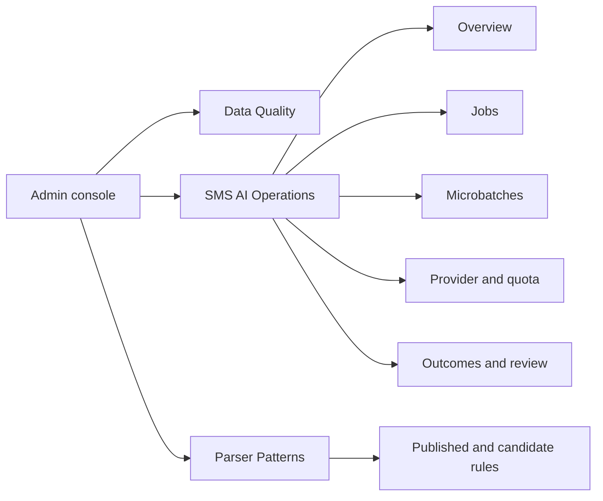
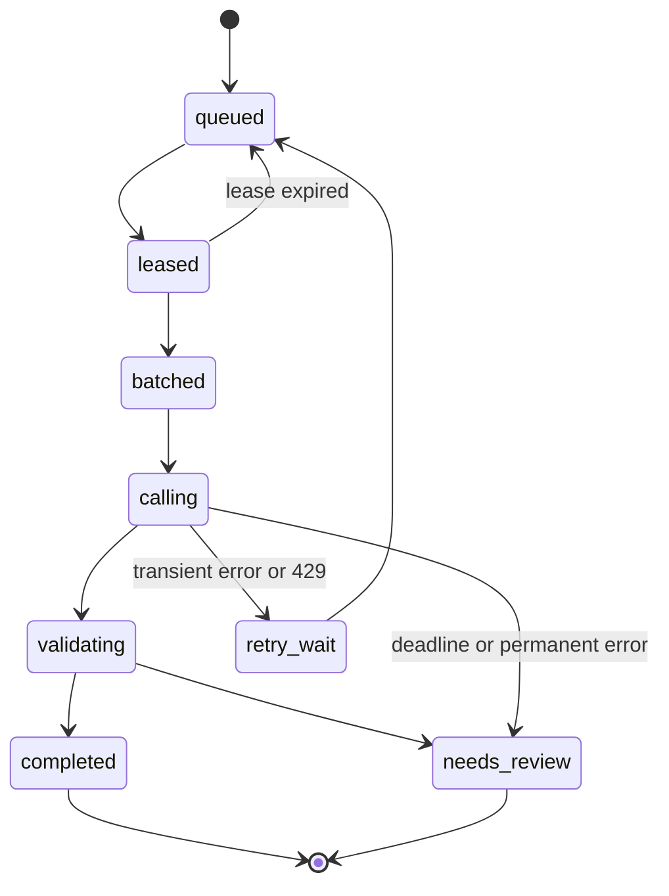

# SMS AI operations in the existing admin console

## Feasibility and current state

**Yes, the existing Flutter Web console can host this.** Its left navigation already has Data Quality and Parser Patterns screens. The Data Quality API currently reads a snapshot view of cards, merchants, alerts, and scrape failures; it has no SMS AI queue fields. Parser Patterns supports manual regex CRUD and match counters, but no AI job, microbatch, provider attempt, score, or user-review telemetry. The proposed AI queue and its tables do not exist yet. Therefore the UI must be built together with queue/event APIs; it cannot display live AI operations merely by extending the current screen.

## Suggested navigation

Add a dedicated **SMS AI Operations** destination. Put only 3-4 headline SMS cards on Data Quality, linking to it. Keep Parser Patterns as the rule-maintenance area; candidate-rule testing and promotion can be added there later.

## What the operator should see

| View | Data shown | Action / question answered |
| --- | --- | --- |
| Overview | Jobs queued, running, retrying, awaiting review, completed and terminally failed; oldest ready job age; p50/p95 queue wait and end-to-end time; live versus import counts | Is the pipeline healthy? Are users waiting too long? |
| Jobs | Opaque job ID, created time, source (`live`/`backup`), masked issuer/sender family, user pseudonym, priority, status, attempt count, next retry, assigned batch, rule result, AI result tier, final outcome/reason | Which messages are waiting or were processed? Why? |
| Microbatches | Batch ID, time formed/sent/completed, job IDs, size, estimated/actual input and output tokens, provider/model, request latency, outcome counts, partial/missing IDs, retry split | Which SMSs were grouped, and what happened to each? |
| Provider and quota | Gemini project/model, worker enabled/paused, concurrency, RPM/TPM/RPD headroom, spend budget, current backoff, `429`/`5xx` counts, latency and token trends | Are we near a limit, and when can work resume? |
| Outcomes and review | Rule-resolved, Gemini-resolved, low-score review, invalid-output review, timeout review, user-confirmed/edited/dismissed counts; correction rate by rule/model version and message family | Is AI helping, and where does it make mistakes? |
| Event timeline | Job accepted → parsed → queued → batch formed → quota reserved → provider call → response validation → result/review → user correction | What exactly happened to a specific job? |

**Sorting/filtering:** default jobs to oldest ready first, with status, source, issuer family, age, and reason filters. This is the *effective dispatch order*: per-user fairness, live priority, quota waits, and delayed retries mean strict global FIFO would be misleading. Display both `created_at` and `eligible_at`, plus a `selection_reason` in dispatch events.

**Refresh:** summary polling every 15-30 seconds while open is sufficient initially; detail tables paginate server-side. No raw SMS, prompts, completions, names, card numbers, or full account identifiers in browser responses or exported telemetry.

## Job and batch state model

Store one **AI job per SMS** and one **microbatch per provider call**, joined through batch items. Retry splitting creates a new batch attempt but preserves the original job ID. A job's immutable event timeline records transitions. This lets the console display individual SMS outcomes even when several shared one Gemini request.

Suggested tables/API contracts:

- `sms_ai_jobs`: `id`, `profile_id`, user-scoped source key, source, priority, status, created/eligible/leased/finished times, attempts, parser version, masked sender family, review reason, result reference, and short-lived encrypted payload reference. Unique `(profile_id, source_key)`.
- `sms_ai_batches`: `id`, provider/model/prompt version, status, formed/sent/completed times, item count, reserved/actual tokens, latency, provider error class, retry-after time.
- `sms_ai_batch_items`: batch ID, job ID, result status, validation reason. Unique per batch/job.
- `sms_ai_events`: append-only job/batch state changes with safe reason codes, timestamps, worker ID and trace ID. Apply retention and partitioning as volume grows.
- `sms_ai_quota_snapshots`: aggregate counters and configured ceilings for RPM, TPM, RPD, concurrency, spend; do not store API keys.
- Admin read APIs: `/admin/sms-ai/summary`, `/jobs`, `/jobs/:id`, `/batches`, `/batches/:id`, `/quota`, `/outcomes`. All require admin auth, pagination, bounded time ranges, and field allowlists.

For a **development-only GLM fallback**, the same views can show provider=`glm` and its independent limits. Gemini remains the default. Do not show a provider result as final until the same validator has checked it; record both attempts on the one SMS job if a fallback occurs.

## Admin controls

Start read-only. Once the queue is stable, add narrowly scoped controls: pause/resume AI dispatch, retry a terminal job, and mark a malformed job for user review. Show a confirmation of affected queue depth and write every action to `admin_audit_log` with operator, reason, before/after, and time. Never expose a button to edit a user's transaction from this ops screen or to replay a job after a user has corrected it. Do not let an operator bypass the quota gate.

## Privacy and accuracy boundaries

- Admin operations need **metadata and evidence codes**, not every raw SMS. The present `parser_failures` table stores redacted shapes, while the mobile Needs Review queue holds raw SMS locally. Keep those roles separate.
- If sample text is used to debug a candidate rule, create an explicit consented, time-limited diagnostic flow with stronger access/audit; do not silently surface users' raw SMS in the general dashboard.
- The existing parser pattern `success_count` measures matches, not verified correctness. Show a separate user correction/error rate. Avoid labeling a model-generated score as calibrated probability until measured against a labeled holdout set.
- Distinguish **user review required** from **admin investigation required**. An admin can diagnose the pipeline, but the user decides ambiguous personal financial meaning.

## Delivery sequence

1. Finalize job/batch/event schema and privacy-safe API DTOs alongside the Gemini worker.
2. Build read-only SMS AI Operations overview, jobs list, batch detail, and job timeline in the existing console.
3. Add quota/latency trends and outcome quality metrics; establish alert thresholds for oldest-job age, 429 spikes, stuck leases, invalid batch responses, and review-rate increase.
4. Add audited controls after worker recovery and idempotency are tested.
5. Extend Parser Patterns with candidate-rule evaluation and promotion only after labeled feedback and regression tests exist.

### Concrete build slices in this repository

| Slice | Backend and database | Console | Done when |
| --- | --- | --- | --- |
| A. Operational records | New migration for jobs, batches, batch items, events, indexes and retention; worker writes every transition | None yet | A replayed SMS has one job and a complete timeline, including grouped attempts. |
| B. Read-only APIs | Admin-only summary/list/detail endpoints with pagination and allowed fields; aggregate queries use indexes/time windows | Add typed methods in `console/lib/data/admin_api.dart` and providers in `console/lib/app/providers.dart` | APIs reconcile with raw job counts and never include payload or secret fields. |
| C. Operations UI | No new mutation | Add `sms_ai_operations_screen.dart`; register it in `console/lib/main.dart`; overview cards, filterable job table, batch detail and timeline | Operator can find a job and explain its queue wait, group, AI result and review status. |
| D. Health and quality | Time-bucket metrics and provider quota snapshots | Quota/latency charts, 429 and review trends, alert states | A quota pause or rising invalid-output rate is visible without reading server logs. |
| E. Controls | Audited pause/resume and retry routes with state guards | Restricted controls with reason field and affected-job preview | Every action has an audit row; a corrected user transaction cannot be replayed over. |

**UI layout:** one top summary row; below it a tab bar for Jobs, Microbatches, Gemini Health, and Outcomes. A job opens a side/detail panel with the event timeline and field-level validation reasons. A batch opens a table of its member job IDs and individual outcomes. Keep tables virtualized or server-paginated and preserve filters in the URL where practical.

## Acceptance checks

- Every submitted unresolved SMS can be traced to one job and one final result/review state, across retries and grouped calls.
- A batch page shows exactly which opaque jobs it contained and which individual outputs failed validation.
- The UI can explain queue order, quota pauses, and next retry without implying strict FIFO.
- A non-admin receives no data; admin list responses contain no raw SMS or secrets; all actions are audited.
- Dashboard counts reconcile with underlying job states and the mobile user's result.
