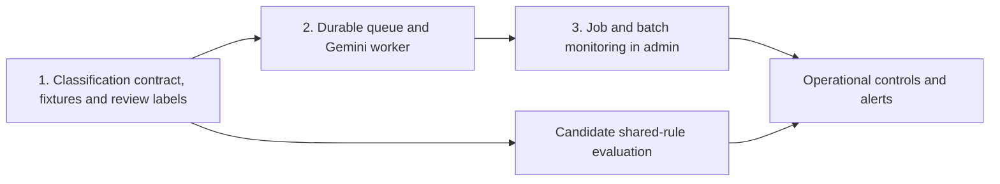

# SMS AI implementation: three coordinated plans

For the complete implementation order, cross-feature fact contract, final product decisions, score gates, and release checklist, use the [SMS intelligence master implementation plan](SMS_INTELLIGENCE_MASTER_IMPLEMENTATION_PLAN.md). This page remains a short index of its three workstreams.

This is the build order for the SMS work discussed with the team. Each part has its own detailed design and acceptance gate.

| Part | Plan | Outcome |
| --- | --- | --- |
| 1. Classification and learning | [Message families plan](sms-message-families-plan.md), [transaction classification plan](../TRANSACTION_CLASSIFICATION_PLAN.md), and [learning flow diagram](sms-self-learning-classifier-diagram.md) | Known SMSs are parsed consistently across transactions, bills, mandates and subscriptions; uncertain ones reach Needs Review; confirmed corrections can become tested shared rules. |
| 2. Gemini processing | [Final queue architecture](sms-gemini-final-architecture.md) and [microbatch plan](sms-gemini-microbatch-plan.md) | Unresolved SMSs use a durable, quota-aware queue and adaptive grouping; each result is validated separately. Gemini is primary; GLM fallback is development-only. |
| 3. Admin visibility | [Admin monitoring implementation plan](sms-ai-admin-monitoring-plan.md) | Operators can see queue health, dispatch order, grouped calls, output status, quota, retries, and review outcomes in the existing Flutter Web console. |

## Dependency order

Build the queue's **job, batch, and event records with the worker**, so the admin UI can be added without reconstructing history from logs. The first admin release can be read-only; controls follow once retries, leases, and audit behavior are verified. Each part uses the same job IDs, classification vocabulary, result states, and privacy rules.

## End-to-end completion criteria

1. An SMS is either safely excluded, classified, or available in Needs Review. A Gemini error cannot make it disappear.
2. A grouped call maps each response back to exactly one SMS; retries and phone replays do not create duplicate transactions.
3. User corrections persist and outrank later parser or model results. Shared learning requires validation before publication.
4. The admin console can trace an unresolved SMS from intake through queue, batch, Gemini attempt, validation, and final outcome using privacy-safe metadata.
5. Dashboard totals reconcile with job records and user-visible outcomes; quota pauses and 429s are visible and recoverable.
