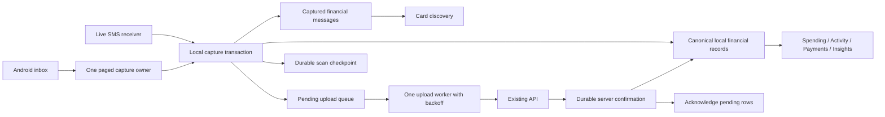

# SMS capture and sync architecture

Implemented in the stability follow-up on 18 October 2026. This describes the
final code; device performance measurements and build verification are recorded
separately. It does not claim that every database operation in the app runs on
a worker isolate.

## Ownership and data flow

The scanner owns device progress, the local store owns displayable financial
records, and the upload worker owns delivery retries. Screens own none of those
jobs. Existing server report endpoints remain responsible for server-derived
projections; their outputs are not treated as another SMS ingestion source.

## Initial capture

1. After permission, read the highest inbox provider ID, transferring one ID
   without message bodies. That fixes the boundary for this capture operation.
2. Query ascending pages where `saved ID < _id <= snapshot boundary`. Native
   cursor traversal runs on an Android worker; at most 200 rows cross the
   platform channel per page.
3. Filter irrelevant/sensitive messages before persistence. OTPs are not retained.
4. Send relevant messages to one dedicated Dart capture isolate. It opens its
   own SQLite connection, parses and commits the page in a transaction.
5. Only after that commit succeeds, advance the account-scoped provider ID.
   A process interruption between commit and checkpoint can replay that page
   safely; it cannot skip uncaptured messages.
6. Mark the initial snapshot complete when its boundary has been traversed.
   API access is not required for any of these steps.

One scan operation uses small internal pages to avoid freezing the phone. It is
not one scan per financial screen. Relevant raw financial messages remain in
`sms_captured_messages`, parsed records in `financial_entities`, and delivery
work in `sms_intake`.

New installations start at ID zero. Existing installations without the new
account-scoped row-ID checkpoint need one paged establishment pass. Existing
confirmed source receipts prevent that pass from parsing/uploading already
confirmed transactions again. Old device-global date/count checkpoints cannot
safely establish a per-account provider-ID cursor and are not imported as one.

## Later operation

- Live delivery captures only the delivered message and requests an upload.
  It does not advance the inbox cursor, because intervening missed messages
  may still need recovery.
- Resume/startup recovery first checks the inbox head. If it has not advanced,
  no body pages are read. Otherwise only IDs after the saved checkpoint are
  captured, including a newly inserted message with an older timestamp.
- Opening Spending, Activity, Payments due or Subscriptions does not read the
  SMS provider. Card discovery uses the retained messages through the same
  capture owner, rather than making its own history query.
- Server observation counts, server deletion/cleanup, token rotation, app
  build numbers, and failed HTTP requests never rewind device scan progress.
- Existing historical repair runs once per account/migration revision.
  Review replay is once per parser revision, not every resume. Both operate
  on saved data; neither initiates another full device scan.

## Upload and reconciliation

The queue is independent of scanning. Foreground delivery, lifecycle recovery,
reconnection and retry timers share one in-flight upload owner. Upload batches
reuse already captured records and do not parse/capture them again.

Current-month versus historical batches retain the existing reward-cycle
semantics. A successful HTTP status alone is insufficient to discard a financial
record: the existing response reconciliation verifies a canonical transaction,
an explicit ignored/review outcome, or a durable source receipt before ack.

On failure, pending rows remain local. Persisted retries start at 30 seconds
and increase to at most 30 minutes. A delayed failed row does not prevent a
new ready message from syncing. Timers retry the queue only; they never read
the inbox. Offline detection suppresses HTTP attempts, and reconnect/resume
also requests delivery.

Acknowledgment marks a retained message processed and removes its pending row
in a transaction. Duplicate delivery does not enqueue a processed message again.
Raw financial messages remain available to card discovery after acknowledgment.
All private records, progress and worker requests are scoped to account identity.

## Display stability and work reduction

- Bulk initial capture parses/writes on a separate Dart isolate, with an
  entity-change event returned only after commit. UI providers keep their own
  SQLite connection and use those events to update the shared local views.
- No-op SMS acknowledgments emit no transaction change; real changes are
  published in a batch.
- Transaction saves compare affected rows rather than serializing the complete
  history twice. Detail reads target one ID and preserve queued edit overlays.
- Multi-page server sync materializes each affected entity once per bounded
  cycle. The persisted cursor and ack still follow durable materialization.
- Lifecycle display refreshes coalesce while in flight and debounce closely
  spaced resumes. Unopened secondary screens no longer cause eight eager
  report warm-up requests on every refresh.
- Subscription displays retain an established server report while unrelated
  provisional SMS exists. Local partial history cannot temporarily replace it
  or resurrect a dismissed server series.

## Boundaries and validation

The OS can suspend a foreground retry timer; restart/resume/reconnect must
therefore remain recovery triggers. The design does not promise immediate
server delivery while Android has stopped the app.

Provider IDs are the incremental identity within the device's existing SMS
database. A user restoring/replacing the entire SMS provider database is an
exceptional recovery event, not a reason to routinely rewind all history. The
current implementation never automatically rewinds a larger stored cursor
because the inbox head decreased. Such a provider reset needs a deliberate
recovery policy; normal deletion of old SMS must not trigger full imports.

Existing sign-out/account-clearing behavior is retained. Access to archive and
queue reads remains account-scoped. An account change mid-page prevents that
page's checkpoint from advancing under another account.

Regression coverage includes offline completion, interrupted-page restart,
new arrivals during capture, backdated new rows, account isolation/switches,
nonfinancial/OTP progress, retained archive reads, duplicate acknowledgment,
upload failures/backoff, real SQLite cross-isolate visibility, offline edits,
subscription stability and multi-page cursor durability. Host tests do not
establish phone frame timing or replace on-device startup/resume verification.

## Verification and local device update

- Full Flutter suite: **869 passed**. Final pipeline run: **15 passed**;
  the subsequent pending-status/worker checks: **2 passed**.
- Targeted Dart analysis reported no issues. Whitespace validation passed.
- All three native release APKs built and passed package, ABI, expected version,
  SMS/notification permission, certificate and APK v2 signature checks.
- The ARM64 device-test APK, version **20055**, was installed over **20052**
  with `adb install -r` at 12:08:48 IST on 18 October. No uninstall or data-clear
  operation was performed. Production endpoints and the existing Android Debug
  signing certificate were retained; this is not a distributable production APK.
- ARM64 SHA-256:
  `29C5F36659AD13F36CE0A76BEDDEA61DDA11549DFDFFA4F75BEE83ADE2B91617`.
- Android reported a successful cold activity launch in 1,660 ms. Home and
  Wallet rendered the existing financial data. The last ANR remained the
  pre-update incident at 11:20:59; no new ANR was recorded during the short check.
- Further input testing stopped when the phone switched to an unrelated app.
  Insights/subscription navigation is therefore covered by tests, not by a
  completed physical-device walkthrough in this run.

Remaining observations, not hidden by the client fixes:

- Android logged **81 skipped frames at cold startup**. No frame-time baseline
  or long-session profile was captured, so this run does not establish sustained
  60/120 FPS or prove that every startup cost has been removed.
- Push-device registration returned server-side **504 notification timeouts**,
  followed by **503 `notification_service_auth_failed`** reporting rejection of
  the key configured on the PandaPay server. The existing background retry
  remains active. No server credentials or production services were changed.
  These responses do not establish a failure of financial/SMS synchronization.

Detailed local records are in `artifacts/stability-full-tests.log`,
`artifacts/stability-final-pipeline-tests.log`,
`artifacts/stability-final-status-tests.log`,
`artifacts/stability-build-verification.json` and
`artifacts/stability-device-check.log`.
