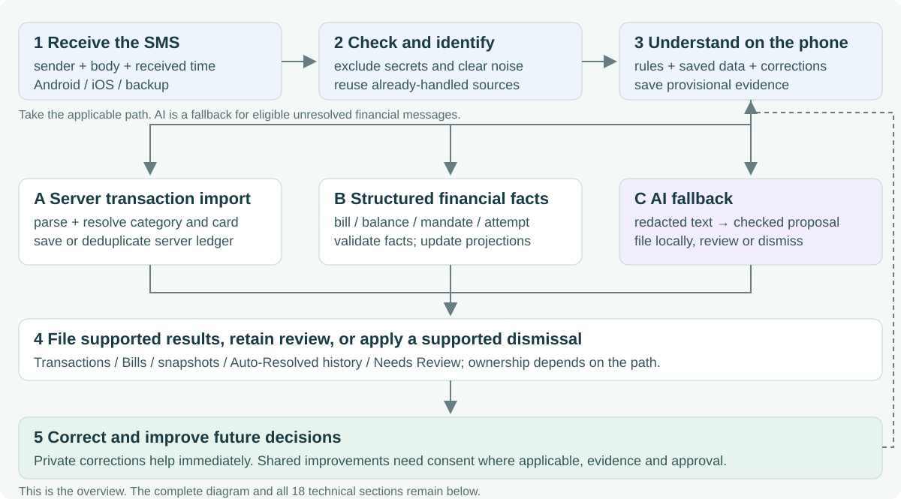
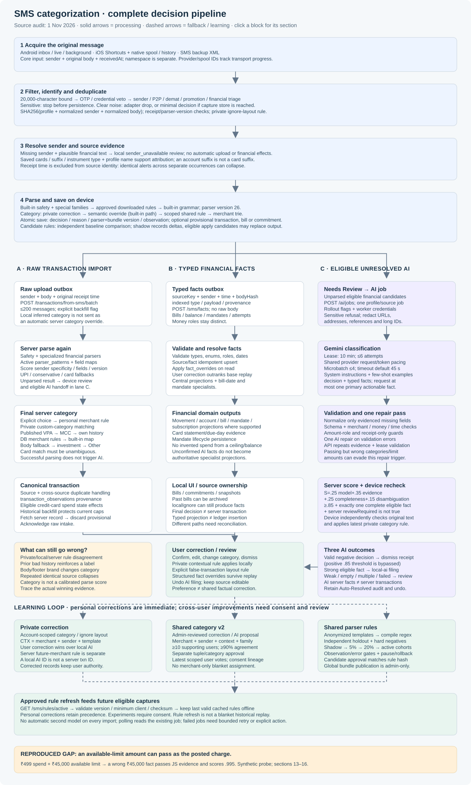
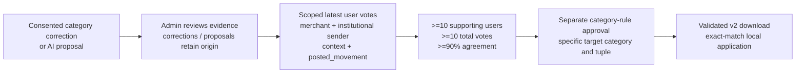

# SMS categorization: inputs, decisions, AI review, rechecks, and learning



**Start with the overview, then go deeper:** follow the five broad steps above, use the complete diagram below for the three processing paths, and use the 18 unchanged technical sections for exact rules, fields, thresholds and source links.

[Overview SVG](diagrams/sms-categorization-overview-2026-11-01.svg) · [Overview Mermaid source](diagrams/sms-categorization-overview-2026-11-01.mmd) · [Guided narration with visual cues](sms-categorization-narration-2026-11-01.md) · [Plain-text narration for read-aloud tools](sms-categorization-narration-2026-11-01.txt)

The HTML page adds a chapter selector, matching-section navigation and optional browser read-aloud. The narration explains the original 1 November source-audit snapshot; adding learning aids does not imply a new audit of later code changes.



[Open the full-size diagram](diagrams/sms-categorization-pipeline-2026-11-01.svg) · [Editable Mermaid diagram](diagrams/sms-categorization-pipeline-2026-11-01.mmd)

[Read the standalone HTML guide](sms-categorization-pipeline-2026-11-01.html) for section search, navigation, an expandable diagram and an interactive validation example. It contains the same detailed documentation and works offline.

**Source audit: 1 November 2026.** This guide describes the checked-out implementation, including working-tree changes, at base commit `a82ca8b`. It explains what the code does; it does not certify which app build, database migrations, feature flags, downloaded rules, or workers are running on a particular device or server. Existing plans describe several intended architectures; this document uses the executable paths as the authority. No categorization logic was changed for this audit.

## 1. What “categorization” means here

There are several separate decisions. A mistake in any one can look like a categorization bug in the UI.

| Decision | Example | Main implementation |
| --- | --- | --- |
| Capture eligibility | Is this a useful financial alert, a promotion, a personal message, or a security message? | `SmsGateFilter`, `classifySmsTriage` |
| Financial event | Is this completed spending, income, transfer, investment, bill due, balance, mandate, or a failed attempt? | Local grammar, downloaded parser rules, server parser, AI |
| Amount role | Is ₹5,000 the charge, bill total, minimum payment, balance, or mandate ceiling? | Parser branches and typed-fact contract |
| Payment attribution | Credit card, debit card, bank UPI, wallet, cash, or unknown? Which saved card/account? | Local grammar, saved cards, server card resolver |
| Spending category | Groceries, dining, travel, bills, etc.? | Personal rules, shared rules, merchant catalogues, VPA/MCC/history, AI |
| Routing | File automatically, keep a provisional entry, show Needs Review, discard, or retry later? | Capture store, sync reconciliation, AI scoring |
| Learning | Does a correction apply privately, become a reviewed shared example, or qualify as a downloadable rule? | Local feedback, consented outboxes, admin review, learning worker |

**The most important behavior:** AI does not review every successfully parsed transaction. A deterministic result can be imported with an inferred category, including `other`, without asking AI whether that category is correct. The AI confidence system governs AI results; it is not a universal quality score for the entire pipeline.

The implementation also has parallel paths. Transactions normally still use raw-message server parsing, while several non-spend and bill observations use structured facts. AI suggestions are stored on the server but auto-filed into local records by the app. There is no single universal category resolver shared by all three paths.

## 2. End-to-end block diagram with data contracts

The diagram at the top is a printable overview. This diagram shows the same routing with the intermediate data and ownership boundaries.

```mermaid
flowchart TD
  I["INPUT ADAPTERS<br/>Android inbox / foreground / background<br/>iOS Shortcuts / native spool / imported history<br/>SMS backup XML"] --> Q["COMMON MESSAGE<br/>sender + original body + receivedAt<br/>account namespace; transport checkpoint stays separate"]
  Q --> G["PRE-CAPTURE GATES<br/>20,000-character bound; OTP/security veto<br/>sender/P2P checks; demat/noise/promotion checks<br/>financial evidence and special-case triage"]
  G -->|"security"| X["Stop before SMS persistence / upload / AI"]
  G -->|"clear noise"| N["Often stopped by adapter filter<br/>If capture store is reached: minimal negative decision<br/>forget raw capture; no AI"]
  G -->|"financial candidate"| K["ACCOUNT-SCOPED SOURCE KEY<br/>SHA256 JSON of profile, normalized sender, normalized body<br/>receipt / parser-version check; private ignore-layout rule"]
  K -->|"already processed"| R["Reuse outcome; preserve capture/checkpoint bookkeeping"]
  K -->|"sender missing"| SR["Needs Review: sender_unavailable<br/>no automatic financial effect or AI upload"]
  K --> L["LOCAL PARSE<br/>built-in safety and special families<br/>approved downloaded rules + built-in grammar<br/>saved cards + profile name + personal/shared category rules"]
  L --> O["ATOMIC LOCAL SAVE<br/>decision + observation + reason codes + parser/bundle version<br/>optional provisional transaction / bill / commitment<br/>candidate-vs-baseline exposure telemetry"]
  O --> F["TYPED-FACT PATH<br/>bills, balances, mandates, attempts, supported service facts<br/>sourceKey + sender + received time + bodyHash + indexed facts<br/>NO raw body in facts envelope"]
  O --> U["LEGACY TRANSACTION / UNRESOLVED PATH<br/>durable sms_intake; sender + body + original receipt time<br/>POST /transactions/from-sms/batch; historical backfill flag"]
  F --> FS["POST /sms/facts<br/>validate contract; source/fact dedupe; merge overrides<br/>central projections + card-date / mandate specialists"]
  U --> P["SERVER PARSER<br/>financial safety + specialized built-ins<br/>active parser_patterns; UPI / conservative / card fallbacks"]
  P -->|"parsed"| C["SERVER CATEGORY + CARD RESOLUTION<br/>explicit choice; personal merchant rule; private categories<br/>verified VPA; MCC; user history; DB rules; built-in map; Other"]
  C --> T["CANONICAL TRANSACTION<br/>source-key / cross-source duplicate handling<br/>transaction_observations; accounting / rewards where applicable<br/>device fetch replaces provisional entry"]
  P -->|"unparsed / needs review"| V["DEVICE RECONCILIATION<br/>suppress known negatives and handled bill observations<br/>retain eligible unresolved SMS in Needs Review"]
  V --> A["POST /ai/jobs<br/>one job per profile + sourceKey; flags and worker auth required<br/>sensitive-content refusal; redact URLs / addresses / references / IDs"]
  A --> W["GEMINI WORKER<br/>lease + provider capacity; up to 4 SMS per request<br/>system instructions + few-shot examples + original receipt time<br/>decision + typed facts; at most one actionable fact requested"]
  W --> H["VALIDATE AND RECHECK<br/>normalize evidenced fields; schema + amount-role + merchant/time evidence<br/>one repair request for invalid actionable facts / decision<br/>API repeats validation; server computes composite score"]
  H --> D{"Device routing"}
  D -->|"explicit valid shouldConsider=false"| AD["Auto-Resolved dismissal receipt<br/>remove Needs Review; positive-fact score not required"]
  D -->|"one complete eligible actionable fact; score >= 0.85"| AT["Auto-file local-ai transaction / bill / mandate<br/>personal category correction wins over AI category<br/>Auto-Resolved history + source context"]
  D -->|"empty / weak / incomplete / multiple facts / failure"| MR["Keep editable Needs Review<br/>suggestions or unavailable state; manual correction / retry"]
  MR --> E["USER CONFIRMS / CORRECTS / DISMISSES<br/>update own record / fact override / private layout rule<br/>explicit false-transaction correction can teach private ignore rule"]
  AT --> E
  AD --> E
  T --> E
  E --> LE["CONSENTED LEARNING<br/>redacted structured feedback; origin and correction kind<br/>AI-only outcomes are proposals; admin review before shared use"]
  LE --> LR["TWO SHARED LEARNING ROUTES<br/>Category: merchant + sender + context + family; >=10 users, >=90% agreement, approval<br/>Parser: compile template; holdout + hard negatives; shadow / 5% / 20% / active"]
  LR --> B["ADMIN-APPROVED DOWNLOADS<br/>version / minimum client / checksum validation<br/>cached offline; private user corrections still take precedence"]
  B -.-> L
```



The arrows are data paths, not a promise that every message visits every box. For example, a locally understood balance can take the facts path and never enter AI. A normal parsed card purchase takes the transaction path and never enters AI.

## 3. Exactly what enters the pipeline

### 3.1 Minimum common message

The common Dart input is `QueuedSms`:

```json
{
  "sender": "VM-HDFCBK-S",
  "body": "INR 499.00 spent on HDFC Bank Credit Card XX1234 at SWIGGY on 01-11-2026. Available limit INR 45000.00.",
  "receivedAt": "2026-11-01T07:00:00.000Z"
}
```

This is a synthetic example. The SMS body is the original content supplied by the transport. `receivedAt` is the original message receipt time when available, rather than upload time. `namespace`, such as `user:<profile-id>`, is passed separately to the capture store. The core message object has no category, AI confidence, or verified card ID.

Adapters have additional transport data: Android inbox provider IDs, iOS spool/run identifiers and date windows, or XML timestamps. These control acquisition, deduplication of transport records, acknowledgements, and progress. They are separate from the core SMS source key.

### 3.2 Acquisition routes

| Route | What happens before classification |
| --- | --- |
| Android inbox | A paged scanner reads through a captured inbox head ID. Each page is captured durably before the page checkpoint advances. Later ordinary scans read newer IDs. |
| Android foreground | The listener receives sender/body/time and invokes the shared capture owner. |
| Android background | A separate isolate runs the financial/security filter, then writes local capture state. It does not use the signed-in HTTP client to upload. Resume performs upload/reconciliation. The old preferences queue remains an upgrade/recovery input. |
| iOS main intake | Shortcuts/native spool and history adapters pass acquired messages to the shared Dart intake. Sender/body quality depends on what the adapter actually supplies. Native code transports messages; shared financial classification remains in Dart. |
| Backup XML | XML is parsed into sender/body/original timestamp and then imported through the SMS capture/import flow. A backup is not a distinct category engine. |

Missing sender has specific behavior: a plausible financial message is kept locally with `reason=sender_unavailable`; it must not create financial effects or enter the automatic upload/AI path until sender evidence is supplied. iOS contact-name senders are also recognized as personal messages by triage. A body alone is not treated as a verified institutional alert.

### 3.3 Other data the classifiers read

| Data | Purpose | Availability / limitation |
| --- | --- | --- |
| Saved cards, last four digits, card type, archived status | Attribute physical-card alerts | A unique compatible match is required; an account suffix is not a card suffix. |
| Profile display name | Identify explicit own-name transfers | Name matching is a heuristic; it is not proof of account ownership. |
| Built-in Dart grammar | Event, amount, time, merchant, balance, bill and mandate extraction | Ships with the app; inspected parser version is **26**. |
| Downloaded parser bundles | Recognize additional sender/template layouts | Version, minimum client version, rule validation, and checksum gates; cached offline. |
| Candidate bundles | Compare or apply experimental parser rules | Shadow mode records comparison without replacing the baseline; apply mode may select the first matching candidate. |
| Private local category/ignore rules | Reuse the user's corrections | Account scoped; contextual corrections can depend on exact sender and normalized wording. |
| Shared category rules v2 | Reuse approved cross-user category evidence | Exact merchant/sender/context/family tuple, rather than a merchant-only blanket rule. |
| Server `parser_patterns` | Admin-managed SMS regex and field maps | Loaded once per transaction batch; active SMS patterns only. |
| Server catalogue and user data | Final import category | Published merchants, MCC mapping, private categories/rules, own transaction history, DB name rules, built-in name rules. |
| Gemini prompt and examples | Resolve eligible unknown financial SMS | Uses redacted text and receipt metadata. It is not passed the full user's spending history or live merchant database by the inspected prompt. |

## 4. Pre-capture filtering: what gets excluded

`SmsGateFilter.evaluate` and `classifySmsTriage` execute before expensive parsing. The capture store repeats triage as a defensive boundary.

### 4.1 Gate order

1. **Size/shape:** empty messages and bodies over 20,000 characters fail.
2. **Security:** OTP, PIN, CVV, password/passcode and similar credential wording are vetoed, as are device-registration security alerts.
3. **Sender:** Indian personal mobile-number formats, telemarketing numbers, and six-digit promotional headers are excluded. A `-P` route is rejected unless completed-transaction/bill evidence or an actionable insurance renewal exempts it.
4. **Demat and noise:** securities unit movements, pledge/unpledge messages, selected operational notices, order dispatch messages, gambling promotions, and other configured noise patterns are excluded. Some balance/insurance evidence exempts messages from selected noise checks.
5. **Financial signals:** currency/amount/balance/limit indicators or movement/bill/mandate verbs are required, with explicit special cases.
6. **Triage refinements:** card/loan marketing, EMI solicitations, strong financial evidence, Pay Later/investment/receipt/mandate shapes, and unrelated messages are distinguished.

The security policy has a deliberately narrow advisory exception: a terminal “Never share OTP/PIN/CVV” warning on a financial alert can be discounted for classification when money/movement evidence precedes it and no authentication context or credential-bearing suffix remains. The original message is not rewritten. This is different from accepting an actual OTP containing an amount.

### 4.2 What a rejection leaves behind

| Rejection point | Result |
| --- | --- |
| Sensitive message | The capture store returns before SMS persistence. Earlier adapters also filter it. No review item or AI request should be created through this path. |
| Adapter financial filter rejects clear noise | The message may never reach `SmsImportStore`. An inbox page checkpoint can still advance. There is not necessarily a per-message decision row. |
| Capture store receives promotion/unrelated text | Records a minimal final decision such as `ignored_promotion` or `ignored_unrelated`, then forgets the raw captured copy. |
| Private false-transaction layout rule matches | Records `user_corrected_not_financial`, removes raw capture, and stops before parsing/AI. |
| Parser returns `localIgnore` | This is a routing disposition, not synonymous with spam. It includes recognized non-spend financial information that may generate typed facts. Raw capture is not universally purged by this branch. |

**Failure implication:** an incorrect early rejection cannot be rescued by a better server parser or AI prompt because neither sees it. Mixed financial alerts with advertising or operational footers therefore need tests at the gate as well as at the parser/AI validator. Passing a late-stage evidence test does not prove the early gate passed.

Sources: [gate](../app/lib/data/sms_gate_filter.dart), [triage](../app/lib/features/sms_import/sms_text_hint.dart), [security policy](../app/lib/data/sms_security_policy.dart), [capture store](../app/lib/data/local/sms_import_store.dart).

## 5. Identity, duplicate protection, and “processed” state

### 5.1 Actual source identity

The active Dart and API SMS paths use matching implementations:

```text
sourceKey = SHA256(JSON.stringify([
  profileId,
  uppercase(collapseWhitespace(sender)),
  collapseWhitespace(body)
]))
```

The local namespace's `user:` prefix is removed before hashing. Sender case and whitespace are normalized; body case is preserved. DLT sender cleanup used for classification does not mean the source-key sender has had its carrier prefix removed.

**Receipt time is intentionally excluded.** Broadcast and inbox copies of the same message can have slightly different timestamps. The active API helper is `api/src/import_source_key.js`; a different timestamp-bearing helper also exists in `source_identity.js`, but the SMS import route imports the former. Following the wrong helper produces an incorrect explanation of current deduplication.

### 5.2 Consequences

- Repeated delivery of the same normalized sender/body for the same profile reuses the source identity.
- A different profile gets a different identity.
- A genuinely repeated identical alert without a changing date/reference/amount can collapse into the same source, even on another day.
- Local capture sets `repeated_occurrence` when the same source is seen more than ten seconds from its original time. This prevents attributing shared-learning corrections to a unique occurrence, but does not create a second financial event.
- There is additional handling for sender-filled re-acquisition so a missing-sender review copy does not linger after an eligible institutional sender arrives.

### 5.3 Multiple kinds of “done”

| State | Meaning |
| --- | --- |
| Inbox checkpoint advanced | This acquisition page was captured; it says nothing about whether a transaction is server-confirmed. |
| `sms_source_decisions.state=final` | Local classification completed. A `financial_auto` decision can still have a pending server upload. |
| `sms_intake` acknowledged | The raw-message upload/review handoff is handled, not necessarily a successful spend. |
| Financial source receipt | Prevents recreating a provisional duplicate of a reconciled source. |
| AI job `done` | A validated result was stored, including valid empty-fact decisions. It does not imply a server ledger transaction was created. |
| Auto-Resolved history receipt | The device applied an AI result or dismissal and retained an audit/undo surface. |

The local `wasProcessed(...parserVersion)` check examines a final decision's parser version. A parser upgrade can make older decisions eligible on re-acquisition. That check does not itself rescan the entire phone inbox, and ordinary scans do not rewind their provider cursor. Bundle updates are not a universal automatic recategorization of all past transactions.

Sources: [local identity/state](../app/lib/data/local/sms_intake_repository.dart), [active server identity](../api/src/import_source_key.js), [scanner](../app/lib/features/sms_import/sms_inbox_scanner.dart).

## 6. Local extraction and financial classification

### 6.1 Execution order

`SmsImportStore` reads saved cards and local/shared category rules, starts a savepoint, and calls `LocalSmsParser.parse`. Its baseline is evaluated independently of experimental candidates.

The parser is an ordered decision tree. Security and noise guards apply before downloaded financial rules. Certain specialized families, including investment allotment and Pay Later drawdown handling, have explicit branches. Eligible downloaded rules then match sender plus regex; the first usable result returns. Rules for posted movements are blocked on future/failed/declined wording. Merchant receipt shapes are kept out of the ordinary downloaded-rule path. The built-in grammar handles the remaining messages.

Candidate comparison is a separate invocation against the same SMS. Shadow candidates cannot silently become the baseline. The store records family, disposition, field comparisons, validity/invariant signals and whether a candidate was applied. A matching `mode=apply` candidate can replace the baseline observation.

### 6.2 Fields extracted

An observation can include a transaction plus additional evidence:

- Event type and disposition; confidence and reason codes.
- Posted amount, amount due, minimum due, available balance, and AutoPay limit as separate fields.
- Card/account last four digits; payment method such as UPI; saved-card identity/display name when uniquely matched.
- Merchant or transfer party, biller/service, cadence when supported.
- Transaction time, due date, statement date, and whether statement-date evidence was explicit.

Merchant extraction includes bank-specific wording and UPI narration parsing. `IndianNarrationSanitizer` removes supported gateway/channel prefixes, UPI routing/reference tokens, legal-entity suffixes, terminal IDs and selected trailing location noise. Weak or opaque names are rejected in several paths. A VPA's provider handle identifies a payment route, not necessarily the underlying business.

### 6.3 Important financial distinctions

| Message semantics | Expected handling |
| --- | --- |
| Completed purchase / bank debit | Posted transaction; distinguish card from account UPI and identify the actual debit amount. |
| Salary / earned income | Income, rather than spending. |
| Own-account movement / broker payout | Transfer where supported by wording/profile evidence. Bank transfer pairing additionally requires exact bank-reference and account-suffix evidence on the server. |
| SIP / investment payment | Investment, rather than ordinary consumption spending. Folio/allotment notices have dedicated handling; allotment is not independent proof that a second bank debit occurred. |
| Card refund / reversal / statement adjustment | Special non-spend handling; generic failed/refund wording must not create a fresh purchase. |
| Credit-card bill payment | Transfer/payment handling rather than another purchase of everything already on the card. |
| Bill or insurance premium due | Obligation/commitment with a deadline, not completed spending. A month-only premium date is insufficient for a precise due date. |
| AutoPay setup | Mandate lifecycle/ceiling; the maximum authorized amount is not an actual paid amount. |
| Scheduled debit | Upcoming obligation/attempt, not already-posted spend. |
| Declined/failed attempt | Failure information, even if it prints a transaction amount and the word “debited” in a negated sentence. |
| Available balance / limit | Snapshot evidence; the balance must not replace the charge amount. |
| Merchant e-bill/receipt without settlement identity | Review/enrichment; not an independent bank ledger entry that would duplicate the bank alert. |
| Telecom airtime/retention fee versus bank recharge debit | Carrier service deductions can be suppressed; a real masked-account/card bank debit for recharge remains financial. |
| Generic unknown financial format | Durable unresolved intake/review path, rather than an invented transaction. |

These are implemented distinctions, not a guarantee that every possible wording is covered. In particular, local and server special-case implementations should be compared when one side disagrees about an event family.

### 6.4 Local dispositions

| Disposition | Practical effect |
| --- | --- |
| `sync` | Usually a provisional transaction that continues through server import. |
| `local_observation` | Saves financial evidence without necessarily creating a spend. Rich bill observations can be acknowledged locally after queuing facts. |
| `local_commitment` | Can create a local upcoming commitment. |
| `local_ignore` | Stops legacy raw-message upload for the recognized result; supported typed facts may still be queued. |
| `review` | Retains uncertainty; bill-specific review can be created locally, while unsupported financial transaction input continues through server reconciliation. |
| No observation | Records `unparsed_financial`, state `pending`, for later processing. |

Expired non-card bills can be archived into past-bill receipts, with paid-linked versus historical-unpaid status, instead of cluttering Needs Review. A rich bill can populate Bills without a transaction import or AI review.

### 6.5 Local confidence is not AI confidence

Ordinary built-in transaction observations commonly carry confidence `1.0`. This reflects that branch's parse decision; it is not a calibrated probability that its merchant category is correct. Bill confidence uses an additive heuristic:

```text
0.55 base
+ 0.20 if biller exists
+ 0.20 if due date exists
+ 0.05 if statement date exists
+ 0.10 if amount due / bill amount exists
+ 0.05 if account suffix exists
clamped to a maximum of 0.95
```

Downloaded rules carry their own confidence. A downloaded credit-card movement without a matched saved card is capped at `0.90`. This is distinct from the AI composite formula below.

Source: [local parser](../app/lib/data/local_sms_parser.dart), [capture/persistence](../app/lib/data/local/sms_import_store.dart), [narration sanitizer](../app/lib/data/indian_narration_sanitizer.dart).

## 7. Exactly how spending categories are chosen

There is a meaningful difference between local provisional classification, server-confirmed import, and AI filing.

### 7.1 Local built-in transaction category precedence

First matching applicable tier wins:

1. **Private local user correction.** Context rules match merchant + sender + normalized layout. Legacy non-context patterns use longest matching merchant/sender pattern.
2. **Explicit financial semantics in the grammar.** Investment/broker/proceeds → `investments`; card-bill payment → `bills`; loan repayment → `emi`; fee → `bills`; salary → `income`.
3. **Approved shared category v2 rule.** Exact merchant, institutional sender, bounded context and `posted_movement` family.
4. **Dart FlashText merchant catalogue.** Category of the first extracted known merchant match.
5. **No match.** Category can remain absent in the provisional record.

The downloaded posted-movement path similarly uses private correction → shared rule → FlashText; it does not have every semantic override in the built-in transaction branch.

FlashText scans `merchant + body` when merchant exists, otherwise the body. It checks word boundaries and prefers the longest match **at a given starting position**, for example “Swiggy Instamart” over “Swiggy.” `extractFirst` then takes the first match in text order; it does not globally rank every merchant mention across the SMS. An unrelated brand in a footer can therefore influence a missing/weak-merchant case.

### 7.2 Shared category rule scope

The current v2 scope is:

```text
(merchantKey, senderKey, contextKey, factFamily) -> categorySlug
```

The merchant key is uppercase with collapsed whitespace. The sender must match an institutional form such as `VM-HDFCBK-S`; the local shared matcher does not apply these rules to arbitrary bare sender names. `contextKey` is a sorted, unique list of one to eight allowed context tokens, derived after excluding merchant identity. Examples are `GROCERIES|SUPERMARKET` and `RENEWAL|SUBSCRIPTION`. The allowed vocabulary includes financial/business words such as FUEL, PETROL, DINING, SCHOOL, LOAN, TAX and TRAVEL.

No usable context, wrong sender, more than eight context tokens, or a different family means no shared-rule match. A legacy merchant-only v1 cache is deliberately refused by the current local loader. Delivery needs a valid v2 hash and compatible minimum client version.

### 7.3 Server transaction-import category precedence

The normal SMS batch route calls `importParsedMessage`, which calls `resolveCategoryAssignmentForImport` unless an explicit category ID was supplied.

| Priority | Evidence | Details |
| --- | --- | --- |
| 1 | Explicit caller category ID | Bypasses ordinary inference. The standard background SMS upload does not send its local inferred category as an explicit choice. |
| 2 | Reviewed category/subcategory hints, where supplied by an import caller | Can resolve private categories before remembered rules. Normal SMS batch messages do not supply these hint fields. |
| 3 | Active private server merchant rule | Exact VPA when present; otherwise strict normalized non-generic name. Spend eligibility excludes transfer/income/refund/reversal/split cases. A VPA prevents a fallback to a broad name rule. |
| 4 | Private custom-category matching | User category `match_terms`, name/slug, or explicit hints. Returns private child and reporting parent where available. |
| 5 | Published merchant record by VPA | Uses the stored category of the published VPA record. |
| 6 | MCC mapping | Four-digit MCC → category. SMS often lacks MCC. |
| 7 | User's own active non-Other VPA history | Most frequent category for that VPA. |
| 8 | User's own active non-Other exact normalized merchant history | Most frequent existing category. Prior `other` does not become a permanent rule. |
| 9 | Active DB `merchant_category_rules` | Normalized substring match, `priority ASC`, then longer pattern. |
| 10 | Server built-in merchant map | Priority-ordered India-focused brand/business aliases. |
| 11 | Built-in inference from SMS body | Used when merchant-name built-in inference fails; can pick up wording outside the actual payee clause. |
| 12 | Investment fallback | `entryKind=investment` can fall back to the investment category if previous tiers did not resolve. |
| 13 | `other` | Explicit Other category; null only if required reference data is unavailable. |

Private category matching scores explicit subcategory hints `+1000`, category hints `+900`, matching configured terms `+600`, and matching name/slug `+400`; the highest candidate wins with a deterministic ID tie-break. This is another text-matching mechanism that can be affected by broad match terms.

Examples from the server catalogue: Swiggy Instamart → groceries before Swiggy → dining; Amazon Pay → wallet before Amazon → online; Uber Eats → dining before Uber → travel. It recognizes corporate aliases as well as brands. The server matcher uses normalized substring rules and priority; it is not the same algorithm as Dart's word-boundary trie.

**A practical precedence gap:** the local private contextual SMS table, shared SMS category v2 rules, server future-merchant rules and server DB merchant map are distinct rule stores. The normal background upload sends sender/body/time and an optional selected card, then the server resolves the category again. The server import resolver does not consult the downloaded local SMS v2 tuple map. A locally preferred category can therefore change after server reconciliation. A local correction does not automatically mean its equivalent server rule has been created.

### 7.4 AI-filed category precedence

AI proposes a canonical category in its fact payload. When the app files a movement, it applies:

```text
current private local user correction
    -> AI payload category
    -> bills fallback for bill_payment
```

The AI filing function does not run the server's full VPA → MCC → history → DB category resolver. It also does not insert the shared category v2 map into this precedence chain. AI category output is checked against the allowed taxonomy, but the deterministic validator does not prove that “dining” is the true business category of a grounded merchant.

### 7.5 Taxonomy differences

The AI/typed-fact spend taxonomy has 15 values:

```text
groceries, fuel, dining, online, travel, bills, rent, insurance,
education, government, wallet, entertainment, health, emi, other
```

`income` and `investments` also appear in local transaction categories, while `income`/`investment` are separately represented as entry kinds. Do not assume a local category slug, a canonical AI spend slug, a database category UUID and a private user-category UUID are interchangeable.

Sources: [local category tiers](../app/lib/data/local_sms_parser.dart), [FlashText](../app/lib/data/flashtext_merchant_extractor.dart), [server resolver](../api/src/import_resolvers.js), [server built-ins](../api/src/merchant_category.js), [AI filing](../app/lib/data/local/sms_import_store.dart), [shared-rule contract](../app/lib/data/local/sms_rule_bundle.dart).

## 8. Server parsing, import and reconciliation

### 8.1 Raw-message transaction route

`POST /transactions/from-sms/batch` accepts at most 200 messages. Each message carries body, sender, original `occurredAt` metadata, and optional card/category/rail. The request can declare `backfill` and app version. A missing/invalid original timestamp is rejected rather than silently dated to upload time.

The server loads active SMS `parser_patterns` once per batch. `parseSmsAgainstPatterns` first runs safety/noise and specialized financial parsers. It recognizes investment/Pay Later/card credit/bill payment/non-spend debit/account credit/wallet/receipt/transfer/account-debit families in an explicit order. Eligible configured regexes compete next, followed by UPI, conservative bank-spend and final card-spend fallbacks.

Configured pattern selection uses:

```text
priority = (sender_pattern exists ? 1000 : 0)
         + 100 * number_of_extracted_fields
         + pattern.version
```

**Current route detail:** the batch query orders by version but selects `id, issuer_id, sender_pattern, regex, field_map`, without `version` in its selected columns. Thus the pure scorer supports a version bonus, while this route's loaded rows do not carry it. Query order still affects equal-score ordering. Documenting “newest pattern always wins” would be inaccurate.

Pattern field maps assign capture groups to amount, merchant, suffix, date, instrument, etc. Raw-message bank/account/card evidence constrains mapped instrument values. A broad regex is not allowed to bypass all early semantic guards.

### 8.2 Card resolution and ledger effects

For physical-card alerts, the server validates an explicit card against ownership, instrument and suffix/issuer evidence. Otherwise it tries an unambiguous compatible suffix or issuer match. Bank-account UPI remains cardless. An unresolved credit-card purchase can still be imported as `credit_card` with no saved-card association.

The shared transaction writer handles source-key idempotency, observations and duplicate handling. Only an active credit-card **spend** attached to a concrete saved card can move that card's state. Backfill avoids applying historical purchases to current cap/milestone/fee-waiver state. Transfers, income, investment and cardless rows do not all have identical card-state side effects.

Exact-source retries do not create new ledger rows. Existing-row repair can improve selected attribution/generic merchant fields and reclassify entry kind under locks/guards; it is not a general automatic category rewrite for old rows. Explicit classification/merchant locks protect user choices.

### 8.3 Per-message results

| API outcome | Device response |
| --- | --- |
| `imported` / `duplicate` | Fetch/merge server transactions, discard the corresponding provisional copy, acknowledge intake. |
| Known ignorable `unparsed` reason | Acknowledge without inventing a transaction; provisional cleanup depends on local event state. |
| Locally understood bill with server transaction no-match | Acknowledge the raw path; preserve its bill-specific evidence/review as appropriate. |
| Eligible `unparsed` / `needs_review` | Best-effort AI submission plus durable local Needs Review item; acknowledge raw intake so it does not loop indefinitely. |
| Noise/nonfinancial result | Suppress rather than populate review/AI. |
| `invalid` / `error` or transport failure | Leave/retry durable intake; do not acknowledge as successfully processed. |

The local upload retry starts around 30 seconds and increases exponentially with a 30-minute cap. Upload retry is distinct from provider AI retry and from a new inbox scan.

### 8.4 Structured facts route

`POST /sms/facts` receives source key, sender, receipt time, body hash and at most 20 typed facts. The ordinary envelope has no raw body. Each fact has a type, payload, provenance, deterministic index and optional status. Payload roles prevent one money field being silently reused for another role.

| Role | Money field | Meaning |
| --- | --- | --- |
| `posted` | `amountInr` | Actual movement/payment |
| `due_total` | `amountDueInr` | Bill total due |
| `due_minimum` | `minimumDueInr` | Minimum due |
| `outstanding` | `outstandingInr` | Outstanding at an as-of time |
| `ceiling` | `limitInr` | Authorized maximum |
| `proposed` | `proposedAmountInr` | Future/proposed amount |

Fact types are `posted_movement`, `pending_or_failed_attempt`, `balance_snapshot`, `bill_obligation`, `bill_payment`, `mandate_lifecycle`, `card_identity_hint`, `security_or_service_alert`, and `promotion`.

The server validates, deduplicates source/facts, loads user overrides, and applies central financial projections plus specialist bill-date/mandate behavior. Central projections are separate from inserting a row in `transactions`. Unconfirmed AI provenance is excluded from authoritative domain projection/specialist behavior until explicitly overridden. The existence of a generic projection engine is not evidence that every old SMS transaction route has been replaced by canonical facts.

Sources: [batch route and transaction writer](../api/src/index.js), [server parser](../api/src/sms_parser.js), [facts contract](../api/src/sms_facts.js), [facts endpoint](../api/src/sms_facts_route.js), [central projections](../api/src/central_financial_projection.js), [device reconciliation](../app/lib/app/providers.dart).

## 9. When AI runs, and what it receives

### 9.1 Eligibility

The ordinary AI path starts when server import cannot resolve an eligible financial candidate and the device retains it in Needs Review. Lifecycle reconciliation recovers the crash window where the review row exists but the initial AI submission was not acknowledged. Some existing review items can also be reconciled through this mechanism.

It is not a mandatory second pass on every local parse. A final deterministic import with `other`, or an incorrect specific merchant category, does not automatically create an AI job.

AI acceptance requires the effective `sms_facts_pipeline_enabled` and `sms_ai_queue_enabled` rollout flags plus a configured worker credential. `sms_ai_queue_enabled` defaults to disabled when absent. A running consumer additionally needs its provider configuration. Queue authorization alone does not prove a worker is healthy.

### 9.2 Job payload and redaction

`POST /ai/jobs` accepts one source key per request. The queue enforces one job per profile/source. The app sends the candidate body to the API; the queue applies a sensitive-content refusal and redacts the body before storing/provider use.

The worker receives a payload resembling:

```json
{
  "sender": "VM-HDFCBK-S",
  "body": "INR 499.00 spent on HDFC Bank Credit Card XX1234 at SWIGGY on 01-11-2026. Available limit INR 45000.00.",
  "bodyHash": "<hash of original sender/body>",
  "occurredAt": "2026-11-01T07:00:00.000Z",
  "kind": "classify_sms"
}
```

Redaction replaces URLs, email/VPA-like addresses, reference identifiers, long digit runs and supported account/routing identifiers, preserving useful short amounts, dates and suffixes. It is not a blanket anonymization of every merchant/person name. The worker needs grounded party text for extraction. Server queue payloads are purged on completion or failure; source facts, result metadata and safe job events remain.

### 9.3 Provider behavior in the inspected source

| Setting | Code default / behavior |
| --- | --- |
| Model | `GEMINI_MODEL`, default `gemini-3.5-flash-lite` |
| Fallback model | `GEMINI_FALLBACK_MODEL`, default `gemini-flash-lite-latest`; switches on model HTTP 404 |
| Request timeout | Default 45 seconds, configurable |
| Microbatch | Up to four SMS jobs; default collection window 300 ms, capped at 500 ms |
| Output | Structured JSON schema; output token budget 2048 |
| Lease | Ten minutes; bounded to six lease attempts; heartbeat protects long capacity waits |
| Polling interval | Worker default two seconds |
| Capacity | Shared request/token reservation; default 30 requests/minute and 24,000 estimated tokens/minute; configured request ceiling 30/minute |
| Provider retry | Rate limits, timeouts and transient failures release the same durable job with bounded backoff; Retry-After is respected when available |
| Keys | Configured key rotation exists for supported quota/auth failures |

These are code defaults, not a claim about current model availability or production environment values. The inspected capacity code has no daily request cap; older documents or old error names referring to a daily quota should not be assumed to describe current acceptance.

### 9.4 Prompt instructions

The system prompt asks Gemini to do two stages in the same response:

1. Return a `decision`: `topic`, `shouldConsider`, `rejectionReason`.
2. If trackable, return grounded typed financial facts, with a clean merchant, supported amount/date/instrument, canonical category, completeness flag and model confidence.

The prompt includes worked few-shot cases and the original receipt timestamp. It explicitly distinguishes spend/income/transfer/investment, bill due versus paid, mandate ceiling versus charge, ATM withdrawal, Pay Later drawdown and loan/telecom promotions. It asks for at most one actionable fact. Multiple separate money movements should return empty facts for human review. A transaction should not add a balance snapshot side fact.

The decision topic list covers card spend/refund, UPI debit/credit, ATM, bank transfer, bills, mandate, investment, salary, telecom deduction, loan/limit upsell, OTP, promotion, balance information, Pay Later due/drawdown and other nonfinancial content. A topic is not a spending category.

Sources: [queue acceptance/redaction](../api/src/gemini_queue.js), [AI routes/flags](../api/src/ai_queue_route.js), [worker and prompt](../api/src/gemini_worker.js), [capacity](../api/src/ai_provider_quota_route.js), [flag resolution](../api/src/sms_observation_migration.js).

## 10. Every AI review and recheck, in order

### 10.1 First recheck: normalize only evidenced fields

Before validation, `normalizeModelFacts` cleans party fields and can fill an unambiguous missing posted/payment amount from the completed clause. When the body has no printed calendar date, completed movement/payment time is set to the original receipt metadata, rather than an unrelated model date. Bill normalization can fill an explicitly printed due date and an evidenced utility biller.

When required evidence is present and the model did not explicitly mark the fact incomplete, normalization can set `isComplete=true` and default missing confidence to `0.9`. Thus a normalized completeness/confidence field is not always an untouched statement from the model. The generic scoring fallback for absent/out-of-range confidence is `0.8`.

### 10.2 Second recheck: schema and source evidence

| Check | What it protects |
| --- | --- |
| Fact type and enum validation | Unsupported instruments, categories, entry kinds and amount roles are rejected. |
| Required fields / monetary semantics | Positive posted amount, appropriate role and timestamp; non-posted types cannot masquerade as movements. |
| Printed money | AI monetary fields must be found in message money evidence, including supported currencyless movement formats. |
| Clause association | Attempts to attach posted amount to a completed debit/purchase clause, and bill amounts to their total/minimum clause. This is heuristic: the available-limit counterexample in §13.2 passes despite having the wrong amount role. |
| Merchant identity | Party must be a meaningful supported name in the SMS, not a URL, hash, opaque ID or invented brand. |
| Suffix/reference | Last four digits and reference must occur in the redacted text. A redacted-away reference cannot be reconstructed. |
| Completed-event evidence | Future/failed/ambiguous movement cannot become posted spending. Footer handling attempts to isolate the core transaction clause. |
| Time grounding | Movement time must be supported by body date/time or permitted original receipt metadata; printed contradictory dates cannot be discarded casually. |
| Receipt-only protection | A merchant receipt without independent settlement evidence cannot mint another posted ledger movement. |
| Family evidence | Bill, balance, bank-account or mandate facts need appropriate message evidence. |

Invalid informational facts can be dropped independently. Invalid actionable facts generate repair errors. The API repeats fact-set and evidence validation under the live lease before accepting the result. The final API does not simply trust the worker's assertions.

### 10.3 Third recheck: one bounded AI repair

The worker collects invalid actionable-fact and decision-envelope errors and makes **one corrective provider pass**. Invalid members of the same microbatch can share the repair request. This is the closest current implementation to “ask AI to recheck itself.”

It is not a separate independent reviewer model. A plausible but wrong category that passes schema/evidence validation does not trigger repair merely because it is semantically wrong. The validator can prove that SWIGGY is in the SMS; it cannot prove that this specific purchase was dining rather than groceries from transaction text that lacks that distinction.

After repair, unsafe facts are filtered and an invalid decision is cleared. If repair is unavailable, the worker retains safe review behavior and guards against accidentally validating a contradictory negative decision simply by dropping its invalid fact. The API can terminally fail schema/evidence-invalid submissions. Useful safe facts can remain editable suggestions.

### 10.4 Decision-envelope validation

A decision must contain only supported `topic`, boolean `shouldConsider`, and supported `rejectionReason` fields. Trackable decisions require `rejectionReason=none`; rejected decisions require an explicit reason and an empty facts list. A malformed decision is not permission to dismiss the SMS: the API forces review and does not accept it as a negative instruction.

**Remaining limit:** `validateDecision` enforces envelope consistency, not an independent text-based proof that the negative decision is correct. An otherwise consistent wrong `shouldConsider=false` can pass. This matters because the dismissal route has different confidence behavior from filing a positive fact.

### 10.5 Fourth recheck: composite confidence

Both JS and Dart implement:

```text
S = 0.25 × model
  + 0.35 × evidence
  + 0.25 × completeness
  + 0.15 × disambiguation
```

Evidence score:

| Signal | Contribution |
| --- | --- |
| Correct amount evidence / clause | 0.40 |
| Printed suffix matches | 0.25 |
| Supported date or permitted receipt time | 0.20 |
| Completed movement or bill/mandate wording | 0.15 |

For receipt-time scoring, movement/payment timestamp within five minutes of supplied receipt time can earn date evidence. This is not permission to fabricate a bill due date from receipt time.

Completeness is family-specific:

| Family | Completeness components |
| --- | --- |
| Posted movement | Positive amount .25 + valid instrument .25 + meaningful merchant/party .25 + valid category .25 |
| Bill obligation | `amountDueInr` .35 + valid due date .35 + meaningful biller .30 |
| Bill payment | Amount .40 + valid event time .20 + meaningful biller/merchant .40 |
| Mandate | Positive limit .40 + service/merchant .30 + status .30 |
| Balance | Nonnegative balance .50 + as-of date .25 + valid instrument .25; informational for AI routing |

An allowed category earns completeness credit; the score has no separate “is this business really dining?” test. Bill minimum-only/outstanding roles and mandate cancellation without a ceiling can be valid information while scoring differently from a complete total-due/registered-limit case. Not all valid facts qualify for automatic action.

Disambiguation rewards grounded party identity and supported account/card identity. A grounded posted-movement merchant or bill-obligation biller can earn full disambiguation credit. It does not use a trained business-category accuracy probability.

The result-level score is the **highest** actionable fact score, rather than an average. Automatic filing separately requires exactly **one** actionable fact; therefore multiple actionable facts cannot slip through just because one has a strong score. Actionable types are posted movement, bill obligation, bill payment and mandate lifecycle.

### 10.6 Fifth recheck: device routing

| Result | Routing |
| --- | --- |
| Valid explicit `shouldConsider=false` | Record an Auto-Resolved dismissal and remove review. The positive-fact .85 threshold is not required; score can be zero because facts are empty. |
| Positive/unknown decision, no usable actionable fact | Keep Needs Review, even with empty suggestions. |
| Score below .45 | Abstain; keep Needs Review. Low confidence is not an instruction to discard. |
| Score .45 to below .85 | Keep editable suggestions in Needs Review. |
| Score ≥.85 | File only if local assessment is auto-resolvable, exactly one actionable fact is complete and eligible, and server `reviewRequired` is not true. Otherwise retain review. |
| Provider/job failure | Keep review with unavailable/failure state; no invented transaction. |

The app recomputes evidence against its original body and respects the server score/review flag. A high server score cannot override a failed local auto-resolvability gate. This device pass is deterministic validation, not a second model call.

### 10.7 What automatic filing actually writes

Movement/payment filing creates a local transaction with ID `local-ai:<sourceKey>`, plus `ai:<sourceKey>` Auto-Resolved history. Bills/mandates create corresponding local records/history. The history preserves source context, category, amount, confidence and modification/undo information.

The inspected AI result endpoint persists AI facts and result metadata; it does not call the normal server transaction writer to book an authoritative transaction. Likewise, local `_fileMovement` uses `saveTransactions`, not a server `POST /transactions`. An AI fact existing in PostgreSQL and a local transaction being visible are therefore different persistence milestones. Verify cross-device/recovery behavior for this path separately from a normal server-imported spend.

Sources: [normalization/evidence](../api/src/ai_fact_evidence.js), [decision validation](../api/src/sms_decision.js), [server scoring](../api/src/ai_fact_scoring.js), [Dart scoring](../app/lib/data/sms_fact_scoring.dart), [worker repair](../api/src/gemini_worker.js), [server result acceptance](../api/src/ai_queue_route.js), [device resolution](../app/lib/data/local/sms_import_store.dart).

## 11. What causes a later recheck or retry

| Trigger | What reruns | What does not automatically happen |
| --- | --- | --- |
| Duplicate broadcast/inbox/backup source | Cheap gate and source/receipt bookkeeping; reuse where eligible | A new AI job for every delivery |
| Local upload failure | The durable raw/facts outbox with backoff | Full inbox rescan merely to retry HTTP |
| App startup/resume, connectivity or refresh | Pending upload and AI-status reconciliation | Independent AI review of all already-imported transactions |
| AI status polling | Reads the existing job by source key | A fresh model request on every poll |
| Worker crash / lease expiry | Same job can be reclaimed within attempt budget | A different source identity |
| Provider 429/timeout/transient error | Same job delayed/retried | Category-rule learning from the failure |
| Invalid actionable output | One corrective AI pass | Unlimited self-critique loop or guaranteed independent model agreement |
| Failed job on ordinary lifecycle pass | Mark unavailable and retain review | Automatic reset of attempt budget on every open |
| “Retry failed AI reviews” action | Explicit `retryFailed=true`, same job row | Sensitive/malformed sources are not eligible through the UI retry filter |
| Completed empty-fact job with explicit retry | Queue API supports reopening when both landed facts and fact types are empty | Successful/partially successful completed jobs are not blindly rerun |
| Parser version upgrade | Older decision can be eligible when reacquired; targeted legacy repairs exist | Automatic cursor rewind and blanket historical reclassification |
| Downloaded bundle update | Later eligible captures use refreshed rules | Guaranteed rewrite of existing user-reviewed/server-confirmed categories |
| User moves AI result back to review | Undo local filing and keep review | Immediate reapplication of the same completed AI decision; reconciler explicitly skips `moved_from_auto_resolved` |
| Fact override | Resolve the original facts with the saved patch, rerun relevant specialists | Later base-fact replay erasing the override |

Lifecycle reconciliation also skips review rows that already have suggestions so resolved suggestions are not restored by repeatedly fetching the original result. Account namespace checks prevent a response being applied to the next signed-in account.

Some legacy repairs replay specific EMI/recipient/merchant cases under one-time/versioned markers. These are targeted migration behaviors, not an always-on classifier that periodically revisits every mistake.

Sources: [lifecycle/reconciliation](../app/lib/app/providers.dart), [explicit retry UI](../app/lib/features/activity/needs_review_screen.dart), [job reuse](../api/src/gemini_queue.js), [local overrides/undo](../app/lib/data/local/sms_auto_resolution_controller.dart).

## 12. User review and correction learning

### 12.1 Immediate private behavior

The user can confirm/edit a review, change a category, correct amount/merchant/time, dismiss a false transaction, or move an AI result back to review. These are different labels and should not all teach the same rule.

- A category correction can update the displayed transaction/history and synchronously create a private local rule at confidence `1.0`.
- When source body/sender is available, its pattern is contextual: `CTX|MERCHANT|SENDER|NORMALIZED_LAYOUT`. Currency amounts and digits are normalized so later amounts/reference digits can vary while wording still scopes the correction.
- If contextual rules exist for a merchant but the current context does not match, the local matcher abstains rather than falling back to a legacy blanket merchant rule.
- Legacy rules without source context match normalized merchant/sender patterns, preferring the longest pattern.
- An explicit “not a financial transaction” correction can create a private sender/layout ignore rule. A preference-only dismissal should not be treated as proof that the layout is nonfinancial for everyone.
- Server fact corrections are overlays in `fact_overrides`, applied on reads before projections; raw/base replay must not resurrect the corrected value.

The server's future-merchant-rule API is a separate contract requiring a real source transaction. A correction to a synthetic local AI transaction does not magically have a server transaction ID. The local rule repository explicitly tracks pending/synced state rather than inventing an ID. This is why local success must not be mistaken for established server-wide precedence.

### 12.2 Shared feedback is consented and reviewed

Private correction works without contributing a shared example. Cross-user learning requires the relevant `sms_shared_learning` consent. Current client capture/upload paths gate on the current policy version and capture-time consent. Some lower-level server helpers only check latest granted consent; the v2 category aggregation also checks policy/grant lineage. Do not describe every helper as enforcing an identical consent check.

Shared feedback records origin, original decision, corrected fields, correction kind and redacted evidence. Safe training examples use HMAC user/sender identities and anonymized templates/field values. Learning redaction is stricter than the AI extraction payload: shared training should not retain actual personal payment values/names as reusable literal patterns.

AI-only automatic results are proposals, not user confirmation. Their current path can enqueue `ai_auto_resolved` with `decisionOrigin=ai` and confidence; administrative review determines whether that evidence can contribute to shared rules. User corrections can supersede earlier AI proposals. Unreviewed AI output must not bootstrap its own agreement by repeatedly counting itself.

### 12.3 Shared category-learning route



Repeated messages from one person do not become ten independent people. Current v2 aggregation uses latest scoped profile votes, supersession and consent lineage. Approval is tied to the proposed category/scope; reaching an evidence threshold alone is insufficient for delivery.

### 12.4 Shared parser-learning route

This route learns how to extract an event, not merely a merchant's category:

1. Cluster eligible anonymized examples by sender fingerprint, financial family, template and issuer. Default proposal threshold is five distinct users. Approved AI proposals can enter the eligible input set.
2. Compile the template into bounded regex/field-map rules. A concrete issuer/sender pattern is required; wildcard sender patterns are rejected.
3. Evaluate against independent positive examples, hard negatives, exact amount/identity fields and a family-specific statistical error bound.
4. Operational holdout examples must come after candidate creation and from users outside its training set. Original generation rows do not certify themselves.
5. Advance through `proposed → evaluated → shadow → limited → expanded → active`, with pause/reject/rollback states.
6. Candidate delivery also needs an admin approval matching the current rule hash. Consent gates experiments; approved published product rules can be consumed by signed-in users without contributing new learning evidence.
7. The autonomous worker **cannot publish global immutable bundles**: `publishActiveBundle()` returns `admin_approval_required`. Global publication/rollback is an admin API operation.

Family defaults:

| Family | Min positive examples | Min distinct users | Distinct users for active | Max statistical error bound | Hard-negative collisions |
| --- | ---: | ---: | ---: | ---: | ---: |
| `ignore_noise` | 10 | 10 | 10 via family minimum | .02 | 0 |
| `posted_movement` | 5 | 5 | 10 | .05 | 0 |
| `balance_snapshot` | 5 | 5 | 8 | .05 | 0 |
| `bill_obligation` | 5 | 5 | 8 | .05 | 0 |
| `mandate_lifecycle` | 5 | 5 | 8 | .05 | 0 |

These counts are minimum gates, not a statement that five examples suffice statistically. The evaluator uses Wilson upper bounds by default (or a Laplace option), so the error-bound condition can require substantially more examples even when no error was observed. Bill-payment examples can be proposed, but `ACTION_THRESHOLDS` does not contain a dedicated bill-payment row; generic defaults apply where the worker/evaluator falls back. Do not invent a separately tuned threshold for it.

Canary defaults include a 24-hour observation window, 10 shadow / 25 limited / 50 expanded exposures, comparable baseline evidence, correction rate at most 1%, false-discard rate at most 0.5%, and comparison error rate at most 1%. Limited/expanded cohorts are 5%/20% via deterministic assignment; active is 100% of eligible delivery. Insufficient observation stays pending; regressions can pause/withdraw worker candidates.

Separately, shared negative evidence has an operator-tunable default pause threshold of **three distinct reporting profiles** per rule. Existing-assignment behavior is deliberately preserved in the serving code; withholding from new users is not a universal instant purge of every previously downloaded rule.

Sources: [private feedback](../app/lib/data/local/sms_learning_feedback.dart), [feedback ingress](../api/src/sms_learning_feedback_route.js), [learning records](../api/src/sms_learning.js), [v2 category SQL](../db/supabase/migrations/20261028140000_sms_shared_category_rules_v2.sql), [negative evidence SQL](../db/supabase/migrations/20261027200000_sms_shared_rule_negative_evidence.sql), [learning worker](../api/src/sms_autonomous_worker.js), [evaluator](../api/src/sms_evaluator.js), [delivery/approval](../api/src/sms_rule_bundle.js).

## 13. Worked examples

### 13.1 Ordinary purchase: usually no AI

Input:

```text
Sender: VM-HDFCBK-S
Received: 1 November 2026, 12:30 IST
Body: INR 499.00 spent on HDFC Bank Credit Card XX1234 at SWIGGY
      on 01-11-2026. Available limit INR 45000.00.
```

Assume a single compatible saved HDFC credit card ending `1234`, no private correction, no applicable shared rule, no conflicting historical category and normal server reference data.

| Step | Data / decision |
| --- | --- |
| Gate | Financial amount + completed spend; institutional sender; no credential. Pass. |
| Identity | Profile + normalized `VM-HDFCBK-S` + normalized full body → stable source key. Re-delivery with another receipt timestamp reuses it. |
| Local event | Posted credit-card spend, ₹499.00; available limit ₹45,000 is a separate field/context. |
| Local merchant/category | Extract `SWIGGY`; FlashText → Dining. Match saved card only if unique/compatible. |
| Local persistence | Observation plus `local-sms:<sourceKey>` provisional transaction; raw intake remains for server import. |
| Server upload | Body, sender, original receipt time and backfill classification; local inferred category is not automatically an explicit server override. |
| Server parse | Supported built-in/configured path extracts ₹499, card suffix, merchant and printed date; exact selected parser depends on active DB patterns. |
| Server category | Under the assumptions above, server map resolves Dining. A stronger private rule, published VPA/MCC or non-Other history would win instead. |
| Ledger/reconciliation | Insert/dedupe canonical row, apply eligible state effects, fetch server data, remove provisional copy, acknowledge intake. |
| AI | No fallback job is needed merely because the message has a category. |

This example's parser and scoring components were executed locally during the audit. Database-dependent rule/card outcomes above are conditional assumptions, not a claimed live production transaction.

### 13.2 Same purchase through an AI fallback

Suppose an unfamiliar bank wording reaches review and AI proposes this grounded fact (envelope simplified):

```json
{
  "decision": {
    "topic": "card_spend",
    "shouldConsider": true,
    "rejectionReason": "none"
  },
  "facts": [{
    "factType": "posted_movement",
    "payload": {
      "amountRole": "posted",
      "entryKind": "spend",
      "amountInr": 499,
      "occurredAt": "2026-11-01T07:00:00.000Z",
      "instrument": "credit_card",
      "last4": "1234",
      "merchant": "SWIGGY",
      "category": "dining",
      "isComplete": true,
      "confidence": 0.98
    }
  }]
}
```

For the printed-date sample above, evidence can score `1.00`: correct posted amount `.40`, suffix `.25`, date `.20`, completion `.15`. Completeness `1.00`; grounded merchant disambiguation `1.00`.

```text
S = .25 × .98 + .35 × 1 + .25 × 1 + .15 × 1 = .995
```

If exactly one actionable fact passes every additional gate, the server leaves `reviewRequired=false` and the device can auto-file it. A current private local correction would override AI's `dining` category. The result appears in Auto-Resolved history and can be undone.

Now change the AI amount to `45000`. That amount is printed, but belongs to available limit, not the completed spending clause. **The audit executed this counterexample: the current JS evidence validator accepted it, and the composite scorer still returned `.995` with `reviewRequired=false`.** The intended amount-role safeguard does not catch this wording. This is an observed validation blind spot, not merely a hypothetical risk or a claim that a live model actually produced the wrong amount.

The reason is visible in `amountInPostedTransaction`: it avoids splitting on periods because of `Rs.` and decimals, and its excluded-label regex covers balance wording but not available-limit wording. The available-limit figure remains in a clause containing “spent” and is not excluded. The Dart scoring mirror uses the same clause-splitting and balance-label structure. The executed end-to-end validator/scorer probe was on JS; no claim of a newly executed Dart counterexample is made.

Change only `category` to `groceries`: the executed evidence check also accepts it because it is an allowed category and SWIGGY is grounded. This illustrates two distinct limits: numeric role association has heuristic gaps, and an excellent extraction score does not guarantee correct business categorization. Neither passing example produces validation errors to trigger the repair request.

| Executed synthetic variant | Fact schema | Source-evidence validator | Composite | Server review required |
| --- | --- | --- | ---: | --- |
| ₹499, Dining | Valid | Valid | .995 | false |
| **₹45,000 available limit used as charge**, Dining | Valid | **Valid: incorrect acceptance** | **.995** | **false** |
| ₹499, **Groceries** instead of Dining | Valid | Valid; category truth is not checked | .995 | false |

Reproduce these exact local-code results with [the synthetic probe](examples/sms-categorization-validation-2026-11-01.js); [captured JSON results](examples/sms-categorization-validation-2026-11-01.json) are included. Run `node docs/examples/sms-categorization-validation-2026-11-01.js` from the repository root. This probe reports the current behavior and intentionally does not assert that incorrect acceptance is desirable.

### 13.3 Mandate ceiling is not spending

```text
Your AutoPay mandate for NETFLIX with maximum amount INR 1499
has been registered on 01-11-2026.
```

The ₹1,499 is a ceiling (`limitInr`, `amountRole=ceiling`), not `amountInr=1499` posted spend. Depending on supported wording, the local parser emits mandate/service evidence and typed facts. A later bank debit of ₹649 is its own completed movement. Registration alone does not prove ₹1,499 was paid, establish a paid subscription period, or justify a recurring due amount without further evidence.

### 13.4 Wrong early rejection versus wrong category

| Symptom | Which decision to inspect first |
| --- | --- |
| Entire purchase never appears anywhere | Gate/sender evidence, transport acquisition, source identity and checkpoints |
| Appears as transfer instead of spend | Entry-kind semantics and own-name/account-transfer matching |
| Amount is right, category wrong | Private/shared/merchant/history precedence; whether AI was ever invoked |
| Dining locally, Bills after syncing | Server resolver versus local rule stores and custom match terms/history |
| AI dismissed a useful message | `shouldConsider`, topic/rejection reason and dismissal receipt; positive confidence threshold did not protect this branch |
| AI checked but remains in review | Composite components, complete/receipt/merchant gates, actionable count and server review flag |
| Visible only on one device | Whether it is a local `local-ai:` record, pending local transaction or canonical server transaction |

## 14. Failure modes grounded in this implementation

These are source-supported risks and audit observations. They are not claims that each one caused a particular user's incident; that requires tracing the affected source.

| Failure mode | Why it can happen | Evidence / diagnostic |
| --- | --- | --- |
| Wrong category bypasses AI entirely | Successful regex/grammar import does not require category review. | Imported result, no AI job, resolver tier used. |
| Correct local category changes after sync | Device and server use different stores/precedence; normal upload does not preserve local category as explicit override. | Compare provisional category with fetched canonical row and server merchant history/rules. |
| Earlier bad category reinforces itself | Server non-Other own-history majority outranks name rules and built-in map. It is not restricted to explicitly reviewed categories. | Count active categories for exact VPA/name; distinguish user correction from prior automatic import. |
| Footer or unrelated brand influences category | Local FlashText can scan full body; server has built-in body fallback. | Compare extracted merchant, matched keyword and its position versus transaction clause. |
| Shared learning never applies to an otherwise familiar merchant | Sender format/context tuple must match exactly; bare headers or changed DLT prefix/context can miss. | Actual sender, contextKey and cached v2 tuple/hash. |
| Private correction applies too narrowly or too broadly | Context rules use normalized layout; legacy patterns allow substring merchant/sender matching. | Stored `CTX|...` pattern versus legacy pattern; sender/layout changes. |
| “High confidence” category still wrong | Transaction branch confidence can be 1.0; AI completeness rewards allowed categories, not independently verified category meaning. | Identify which confidence was displayed and inspect its components. |
| Available limit accepted as the charge in AI validation | Period-delimited limit context stays in the movement clause; balance-label exclusion does not include available limit. **Reproduced with the synthetic §13 example.** | `verifyModelFacts` accepts `amountInr=45000` and `assessFacts` returns .995 / no review for a ₹499 spend followed by ₹45,000 available limit. |
| Useful SMS disappears before AI | Early sender/security/noise gate rejected it. Later parser and model cannot recover unseen input. | Test the raw sender/body against triage before testing parser/AI. |
| AI negative decision removes useful input | Consistent negative envelope can pass without a text-based negative proof or .85 threshold. | Auto-Resolved dismissal, original body, decision origin/reason. |
| Same alert on another day is missing | Source identity excludes receipt time; unchanged sender/body collide. | Same source key; `repeated_occurrence` marker. |
| AI result visible locally but not authoritative server spend | AI completion stores facts; app writes local transaction; server transaction writer is a distinct path. | `local-ai:` ID versus server transaction UUID and observation. |
| Rule downloads do not fix existing mistakes | Future capture/rule refresh is not blanket replay or category rewrite. | Parser/bundle version, receipt, acknowledged intake and repair markers. |
| New pattern does not win despite higher version | Pattern scorer values fields/sender specificity; batch query omits selected version value. | Actual SQL row and all competing pattern scores/order. |
| Model/batch fails intermittently | Provider quota/timeouts, schema output, missing batch member, lease/configuration, capacity or worker health. | Safe job events/attempts and failure reason; distinguish transport failure from classification disagreement. |

Also inspect acquisition fidelity. A miscaptured sender, incomplete multipart body or wrong source timestamp can make otherwise correct downstream rules behave incorrectly. Changing a category prompt cannot fix missing input evidence.

## 15. How to investigate one reported mistake

1. **Capture the symptom and source context.** Record sender, original receipt time, app/platform version, expected event/category and actual result. Use a redacted reproduction for committed artifacts. Preserve enough wording to reproduce the gate and amount roles.
2. **Run triage first.** Inspect `SmsGateVerdict.dropReason` and `SmsTriageResult.reasonCode`. If it fails here, stop diagnosing Gemini as the cause.
3. **Resolve the active source key.** Check local namespace/sender/body normalization. Inspect repeated-occurrence and sender-unavailable behavior.
4. **Read local decision/observation.** Check parser version, bundle version, event type, disposition, reasons, amounts and provisional transaction.
5. **Inspect category candidates in actual precedence order.** Private contextual rules, semantic branch, shared v2 tuple, FlashText match. For server output, separately inspect private merchant rules/custom categories/VPA/MCC/history/DB/built-ins.
6. **Determine whether AI actually ran.** Fetch `GET /ai/jobs/source/:sourceKey`; inspect status, decision, reviewRequired, composite/per-fact scores and job events. No job can be a normal result of a successful deterministic import.
7. **For an AI mistake, separate intent from extraction.** Was `shouldConsider` wrong, the financial family wrong, a field unsupported, the category merely plausible, or the application state wrong? Check whether repair was triggered and what survived validation.
8. **Identify persistence ownership.** Local provisional ID, local AI ID, server transaction UUID, source/fact ID and Auto-Resolved history ID describe different records. Compare by source key.
9. **Check overrides and user actions.** A deliberate correction/undo must remain authoritative. Inspect `moved_from_auto_resolved`, fact overrides and classification/merchant locks before replaying anything.
10. **Create one regression case at the failing boundary.** Gate failure needs a gate test; local/server disagreement needs parity tests; category ambiguity needs precedence/context tests. Include a near-negative example and a mixed-footer example.

Relevant local tables: `sms_intake`, `sms_captured_messages`, `sms_source_decisions`, `financial_entities`, `financial_source_receipts`, `local_needs_review`, `local_auto_resolved_history`, `sms_facts_outbox`, private merchant/ignore rules and rule-bundle caches.

Relevant server stores: `parser_patterns`, `parser_failures`, `transactions`, `transaction_observations`, `sms_sources`, `sms_source_facts`, `fact_overrides`, `ai_jobs`, `ai_job_events`, private merchant rules, learning feedback/examples/proposals/candidates/approvals/exposures and published bundles.

Useful admin surfaces include SMS AI operations, correction cases, category proposals, parser candidates, rollout flags, job events and learning-worker health. Admin aggregate evidence is not a replacement for the device's original review context.

## 16. Suggestions, ordered by impact

These are proposed improvements; this documentation task did not implement them.

| Priority | Suggestion | Why it helps | Acceptance evidence |
| --- | --- | --- | --- |
| 1 | **Persist a field-level decision trace.** Record category source/rule ID, merchant evidence span, event rule, competing candidates and category-specific confidence. | A single wrong case becomes explainable without reconstructing several rule stores. Existing parser/version/reason metadata is useful but incomplete for category precedence. | Each displayed category can answer “why this category?” with source/rule/version and whether user choice won. |
| 1 | **Unify category precedence across local, server and AI filing.** Share a versioned decision contract or parity-tested resolver, including private contextual corrections. | Prevents a correct local category being replaced by a different server inference. | Same source/evidence/rules yield the same category before and after sync; private correction survives every path. |
| 1 | **Give category uncertainty its own route.** Retain a valid transaction while marking only category uncertain; optionally send eligible ambiguous cases for category-only review. | Amount/event can be correct while category is wrong. Current transaction success suppresses this fallback. | Unknown/mixed-context merchant can remain accurately booked and visibly uncertain without inventing confidence or recreating the payment. |
| 1 | **Harden AI negative decisions independently.** Require evidence/reason grounding or review for an ambiguous financial dismissal, and retain a clear undo trail. | Current valid negative envelope bypasses positive-fact scoring. | Synthetic genuine debit/bill negatives cannot silently disappear solely on an unsupported model rejection; deliberate promotions still suppress correctly. |
| 1 | **Close the reproduced amount-role validation gap.** Bind the posted amount to the actual movement verb/amount relation and explicitly exclude available/credit/remaining limits and other amount roles in both JS and Dart. | The current synthetic available-limit counterexample passes evidence and scores .995, so model confidence and one repair pass do not protect it. | The §13.2 wrong-limit fact is refused on server and device; the ₹499 charge, existing balance cases, Indian amounts and decimal `Rs.` formats still work. |
| 1 | **Complete and prove the AI-to-authoritative-ledger contract.** Explicitly define whether auto-filed AI records remain local proposals or are committed through the standard transaction writer. | Prevents device/server/recovery disagreement and inconsistent reward state. | One source, one canonical event across devices/recovery; correct idempotency, locks and accounting effects. |
| 2 | **Restrict category inference to grounded merchant/business evidence.** Separate core transaction clause from footer; prefer exact VPA/merchant identity and explicit business context. | Stops a footer brand, aggregator or substring from determining the wrong business category. | Correct category remains stable after unrelated offer/footer insertion; ambiguous generic payees stay Other/uncertain. |
| 2 | **Use reviewed/reliable history separately from inferred history.** Store origin and correction status; avoid treating all prior non-Other imports as equally authoritative votes. | Prevents one bad historical label becoming self-reinforcing. | Correct new evidence can heal old inferred history while an explicit user preference remains protected. |
| 2 | **Fix/test configured-pattern precedence explicitly.** Include version in selected rows if intended, and define tie-breaks. | Current route and pure scorer do not carry identical information. | A competing-pattern fixture demonstrates intended sender/field/version ordering. |
| 2 | **Introduce occurrence identity with a deliberate migration.** Preserve source aliases while distinguishing truly repeated identical SMS from transport retries. | Avoids losing repeated equal alerts without reintroducing duplicates. | Same delivery through broadcast/inbox dedupes; identical text on different genuine occurrences is preserved; old receipts still resolve. |
| 2 | **Add controlled replay for corrected rule scope.** Select affected sources, preview category/event deltas, honor user locks and never reset the inbox cursor as a blanket fix. | New rules then repair known historical mistakes safely. | Preview and replay are idempotent; corrections/dismissals remain protected; rewards are adjusted only through the standard state path. |
| 3 | **Measure errors by decision family and origin.** Capture false rejection, wrong event kind, wrong amount role, wrong card, category correction rate, local/server disagreement, and AI negative undo rate. | A single “parse success” metric hides category mistakes. | Metrics distinguish accurate extraction from correct categorization and can be segmented by parser/bundle/model version. |
| 3 | **Evaluate category truth on a frozen redacted corpus.** Include mixed merchant contexts, ambiguous aliases, gateways, body footers, Hindi/Unicode wording, date formats and repeated same-amount alerts. | Existing safety tests do not establish real-world category accuracy. | Confusion matrix and exact field/category outcomes by local/server/AI path; no training/holdout leakage. |

An extra reviewer model is lower priority than fixing evidence scope, resolver disagreement and persistence ownership. A second model can agree with the first on an ambiguous category, while the underlying source/rule problem remains.

## 17. Verification performed for this document

The audit traced the current Dart capture/parser/store/lifecycle/review flow, Node parser/category/AI/facts/learning flow, and current category/negative-evidence migrations. Existing graphify output was used for orientation but predates these SMS changes; it was not treated as authority for current behavior.

Focused existing API suites passed **313 tests, zero failures**:

```sh
cd api
node --test test/sms_parser.test.js test/sms_decision.test.js \
  test/merchant_category.test.js test/import_resolvers.test.js \
  test/ai_fact_scoring.test.js test/ai_fact_evidence.test.js \
  test/gemini_worker.test.js test/gemini_queue.test.js \
  test/sms_learning_pipeline.test.js test/sms_category_rules_v2.test.js \
  test/sms_evaluator.test.js test/sms_autonomous_worker.test.js
```

The selected existing Flutter suites also passed:

```sh
cd app
flutter test test/data/local/sms_import_store_category_precedence_test.dart \
  test/data/local/sms_import_store_ai_resolution_test.dart \
  test/data/sms_fact_scoring_test.dart test/data/sms_gate_filter_test.dart \
  test/data/local_sms_parser_test.dart
```

The synthetic probe in §13.2 separately reproduces a wrong available-limit amount passing schema/evidence checks and scoring `.995`. The passing existing suites do not cover that exact failure; their success must not be read as proof that the gap is absent.

The HTML guide was checked in Chrome: section search and empty-search results, navigation, diagram expansion/zoom, and the captured example selector worked. Internal anchors, repository link targets, JavaScript syntax and SVG text bounds were checked. The page has no external script dependencies; its primary content and diagram are embedded for offline use.

This validation exercises parser semantics, category precedence, AI evidence/repair/scoring/routing, queue behavior and learning gates. It does not establish live Gemini behavior, a deployed worker's health, actual production flag values, migration installation, physical-device acquisition correctness, or a real user's category accuracy. No live provider call, production write, migration, deployment, blanket replay or rule publication was performed.

## 18. Source navigation map

| Question | Start here |
| --- | --- |
| What fields arrive? | [QueuedSms](../app/lib/features/sms_import/sms_background_queue.dart), [Android listener](../app/lib/features/sms_import/sms_listener_service.dart), [iOS intake](../app/lib/features/sms_import/ios_sms_intake_controller.dart), [backup parser](../app/lib/data/sms_backup_xml_parser.dart) |
| Why was it dropped? | [gate](../app/lib/data/sms_gate_filter.dart), [triage](../app/lib/features/sms_import/sms_text_hint.dart), [security](../app/lib/data/sms_security_policy.dart) |
| Why this local transaction/category? | [parser](../app/lib/data/local_sms_parser.dart), [merchant trie](../app/lib/data/flashtext_merchant_extractor.dart), [capture store](../app/lib/data/local/sms_import_store.dart) |
| Why does server output differ? | [SMS parser](../api/src/sms_parser.js), [import resolver](../api/src/import_resolvers.js), [merchant map](../api/src/merchant_category.js), [batch/writer](../api/src/index.js) |
| What does AI see/return? | [queue](../api/src/gemini_queue.js), [prompt/provider/repair](../api/src/gemini_worker.js), [decision schema](../api/src/sms_decision.js) |
| Why did AI auto-file or abstain? | [evidence](../api/src/ai_fact_evidence.js), [JS score](../api/src/ai_fact_scoring.js), [Dart score](../app/lib/data/sms_fact_scoring.dart), [device filing](../app/lib/data/local/sms_import_store.dart) |
| What triggers retries? | [lifecycle](../app/lib/app/providers.dart), [review UI](../app/lib/features/activity/needs_review_screen.dart), [API queue routes](../api/src/ai_queue_route.js) |
| How do corrections win? | [private feedback](../app/lib/data/local/sms_learning_feedback.dart), [AI undo/edit](../app/lib/data/local/sms_auto_resolution_controller.dart), [facts/overrides](../api/src/sms_facts_route.js) |
| How do shared rules appear? | [feedback ingress](../api/src/sms_learning_feedback_route.js), [learning](../api/src/sms_learning.js), [worker](../api/src/sms_autonomous_worker.js), [evaluation](../api/src/sms_evaluator.js), [bundle approval/delivery](../api/src/sms_rule_bundle.js), [local bundle validation](../app/lib/data/local/sms_rule_bundle_store.dart) |
