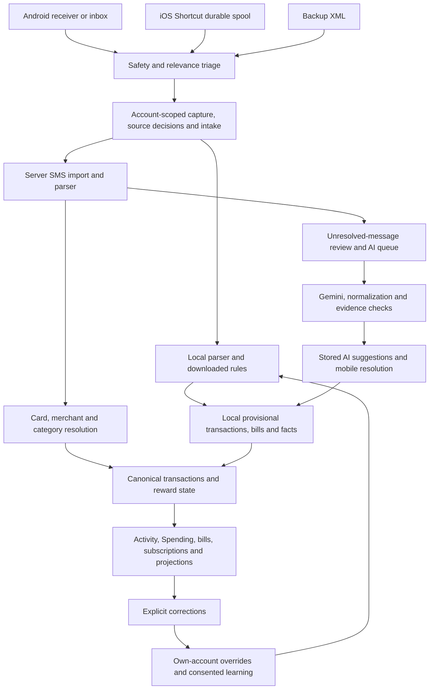

# Entire SMS pipeline: reliability audit and improvement roadmap

Date: 2026-11-01. Scope: the current PandaPay checkout. Status: investigation and proposed work packages; application behavior has not been changed by this audit.

Related detail: [merchant/category/Gemini investigation](sms-reliability-architecture-investigation-2026-11-01.md).

## Decision

Keep the durable capture, account scoping, append/ack outboxes, typed source facts, leased AI queue, explicit user overrides, and reviewed shared-rule mechanisms. Improve their contracts and resolution policy in small independently testable sections.

The main reliability problem is that different paths assign authority differently. A local parse, server parse, historical category, model suggestion, user correction, and projection can each represent a different interpretation of the same message. There is no sufficiently consistent field-level decision record connecting all of them. A successful parse, a completed upload, and a correct financial interpretation are different states.

The highest-priority intervention is to stop unsupported automatic acceptance and expose contradictions. Add richer categories after defining the taxonomy contract and its separation from rewards/payment channels. Replacing the whole pipeline or adding an ever-growing merchant whitelist would not address these causes.

## Evidence and limits

Evidence labels used below:

- **Reproduced:** actual repository functions executed against synthetic input, with a real result recorded.
- **Source-confirmed:** the control flow, SQL, or contract directly establishes the behavior; its production frequency is unmeasured.
- **Validation needed:** a failure scenario remains plausible but requires device, native-platform, deployment, or real-database verification before it is called an incident.
- **Design gap:** current behavior is deliberate or internally consistent, but does not meet the desired product capability.

Checks completed across this investigation:

| Check group | Result | What it establishes |
|---|---|---|
| Parser, Gemini worker/queue, AI evidence/scoring, merchant identity, SMS decisions and intelligence scenarios | 241 API tests passed | Existing contracts and regression expectations |
| Facts, projections, migration, rules, learning/correction, merchant bulk/user rules, rewards and source identity where the named file existed | 220 additional API tests passed | Broader existing persistence, rollout and rule behavior |
| Android scanner/page service, durable intake, backup screen, gate filter, mobile fact contract | 46 Flutter tests passed | Unit/widget behavior on the host |
| Focused resolver/parity/shared-rule suite from the preceding analysis | 85 tests passed | Earlier resolver expectations; overlaps other groups, not an additional unique coverage total |
| Read-only diagnostic script | 13 synthetic probes reproduced | Specific current gaps or integration constraints |

Run the diagnostic with `node scripts/audit_sms_pipeline.js`. It makes no provider calls or real database writes. Its assertions reproduce current behavior, including undesirable behavior; it is not a CI acceptance test for the future design. Convert each relevant reproduction into a desired-behavior regression when implementing that section.

No live Gemini evaluation, production data audit, real Postgres migration run, fresh native Android instrumentation, or physical iOS run was performed for this report. The audit covers the principal paths and boundaries, not proof that every possible message or deployment is correct. Current unrelated worktree changes were not edited or staged.

The earlier emulator SQLite reads used an immutable connection after copying database/WAL files separately. That is not a reliable way to establish the latest live WAL state. Treat the reported fresh-import visibility failure as unresolved until a consistent SQLite backup/read and correlated receiver/scanner trace confirm it. Existing stored category labels also do not establish which original rule or edit produced them.

## Pipeline and ownership map

This is a conceptual map; not every arrow is a direct function call. In particular, AI suggestions are review-only in server financial projections until overridden, whereas eligible suggestions can auto-file locally. That difference is one boundary to resolve explicitly.

| Section | Principal owners |
|---|---|
| Android acquisition | `sms_listener_service.dart`, `sms_inbox_scanner.dart`, vendored Telephony, `sms_capture_worker.dart` |
| iOS acquisition | `IncomingSmsSpool.swift`, `IncomingSmsIntent.swift`, `ios_sms_intake_controller.dart`, acquisition receipts |
| Backup import | `sms_backup_xml_parser.dart`, `sms_backup_import_screen.dart`, repository callbacks |
| Safety/relevance | `sms_security_policy.dart`, `sms_gate_filter.dart`, `sms_text_hint.dart`, native mirrors |
| Capture and identity | `sms_import_store.dart`, `sms_intake_repository.dart`, `import_source_key.js` |
| Interpretation | `local_sms_parser.dart`, `sms_parser.js`, merchant identity helpers |
| Category selection | `import_resolvers.js`, `merchant_category.js`, FlashText, scanned-merchant and MCC maps |
| AI | `gemini_queue.js`, `gemini_worker.js`, `ai_queue_route.js`, `ai_fact_evidence.js`, `ai_fact_scoring.js` |
| Persistence and reporting | facts/outboxes, `index.js`, `central_financial_projection.js`, financial store and spending providers |
| Corrections and learning | fact overrides, feedback/exposure outboxes, learning routes, evaluator/compiler and bundle store |

## Findings by section

### A. Acquisition, filtering and durable capture

**A1 — P1, reproduced: message content identity conflates different occurrences.**

`import_source_key.js` and the Dart mirror hash owner + normalized sender + normalized body. Receipt time is intentionally excluded so receiver/provider clock skew does not duplicate one delivery. The diagnostic confirms identical text on two different days gets the same key. Messages with distinct bank references/dates normally differ, but a short repeat alert without either can represent two legitimate transactions. `repeated_occurrence` flags correction ambiguity; it does not create another ledger occurrence.

Remedy: distinguish content fingerprint, acquisition occurrence, and financial event identity. Prefer bank references and instrument context; retain acquisition IDs and original dates. Resolve uncertainty rather than blindly appending timestamps to the current key. Any identity transition needs alias compatibility and replay tests so existing data does not duplicate.

Owners: `api/src/import_source_key.js`, `app/lib/data/local/sms_intake_repository.dart:177`, iOS occurrence receipts.

**A2 — P2, source-confirmed: provider reset/restoration has no explicit reconciliation state.**

The scanner reads strictly after `last_provider_id`. If the new provider head is below that cursor, the loop does not execute and the persisted MAX cursor remains high. The scanner deliberately never rewinds automatically. After a restore/reset that reuses low IDs, new rows can therefore be missed until IDs exceed the old boundary.

Remedy: detect a changed provider generation or head regression, surface reconciliation-required status, and run a bounded replay through idempotent occurrence/event resolution. Keep ordinary incremental scans fast and preserve source identity.

Owner: `app/lib/features/sms_import/sms_inbox_scanner.dart:110`. Existing tests cover interruptions, new rows, accounts, malformed pages and empty completion; they do not cover provider generation replacement.

**A3 — P2, source-confirmed: early relevance decisions are poorly visible.**

Android receiver and inbox-page paths apply `capturesFinancialSms` before durable intake. Excluded messages therefore do not receive the richer source-decision records available inside `SmsImportStore`. Native iOS first captures nonsensitive input and later routes it through shared intake, so path observability differs. Numeric personal/promotional sender exclusions and language/token requirements are product policies, not evidence that every excluded message is irrelevant.

Remedy: preserve absolute secret exclusion; add bounded reason counts for other drops and evaluate relevance recall on a labeled corpus. Do not retain raw OTPs or upload every rejected message. Distinguish unsupported/unrecognized financial content from proven noise.

Owners: listener service, gate filter and text hint; native iOS security policy. Measure real false-negative rates before relaxing any sender policy.

**A4 — P2, source-confirmed recovery limitation: capture failures can become silent.**

The background handler tries main SQLite and then a bounded deferred spool. Its outer catch is silent. The deferred spool refuses input when full rather than evicting older work, and its error calls for inbox reconciliation. If both writes fail, recovery depends on the provider still retaining that SMS and later reconciliation finding it. This is not a demonstrated data-loss incident.

Remedy: durable or native-safe bounded failure indicators, spool pressure counters, and an explicit recovery-needed state. Test main DB lock + full spool + process death + provider retention. The capture worker appropriately waits for native writes instead of racing a timeout fallback; preserve that invariant and add a watchdog/status for stalls.

Legacy `SmsBackgroundQueue` still contains drop-oldest and read/replace logic, but the current receiver writes SQLite. Do not report that legacy 200-message queue as the normal current capture design.

**A5 — P2, source-confirmed interface inconsistency: backup review IDs differ.**

The backup screen's fallback review ID uses sender + timestamp; ordinary intake uses the SHA source key. AI reconciliation only polls hash-shaped IDs. Repository upload callbacks already capture locally and usually create canonical review rows, and review storage deduplicates equal sender/body within five minutes. Therefore duplicate creation or missed AI processing is conditional, not inevitable.

Remedy: use canonical identity across all entry points and return an explicit capture/review receipt. Backup UI should consume that result rather than independently reconstructing review state. Test callback enabled/disabled, crash boundaries, timestamps, repeated import, and receipt-only messages.

**A6 — iOS: sound receipt fencing, native validation remains open.**

Native spool checks owner/generation/attempt, excludes sensitive messages, enforces capacity, and clears native body/sender only after shared processing acknowledgement. Dart capture checks account and records acquisition receipts. Window completion compares found counts and actual receipts rather than trusting URL return. These are useful safeguards.

Open validation: real Shortcut source-date quality, missing sender, timezone/month boundaries, capacity, termination between commit and ack, delayed old callbacks, account switch, and physical-device history completeness. A received/processed count is not a count of correctly categorized transactions.

### B. Interpretation, merchant extraction and classification

**B1 — P1, reproduced: role confusion passes AI acceptance.**

For a debit at BALAJI SPORTS using an HDFC Swiggy credit card, proposing Swiggy as merchant passes the actual schema/evidence/scoring functions with score 0.9975 and no review. A correct payee with an unsupported Travel category gets the same score. Presence anywhere in the message is weaker than payee-role evidence.

Remedy: role-aware extraction with source spans; separate issuer/product/platform/payee; verify relation to the monetary clause. Treat category correctness as its own claim. Detailed repro is in the related investigation and diagnostic script.

**B2 — P1, reproduced: category matching has collisions and divergent semantics.**

KUBER HARDWARE -> Travel, SPARK ELECTRICALS -> Groceries, SHELLY BOOK STORE -> Fuel on the server. The local matcher has word boundaries but UBER EATS -> Travel while the server gives Dining. Whole-message matching can select card products and promotions. INDIGO PAINTS shows that even a whole brand word can be semantically ambiguous.

Remedy: explicit match scopes, merchant-role isolation, ambiguity handling, identity specificity, and generated/shared alias data plus conformance tests. Remove unrestricted substring authority; a brand hint can be a candidate rather than a final decision.

**B3 — P1/P2, reproduced/source-confirmed: successful parses can still miss the merchant and bypass enrichment.**

The synthetic native-script payee `बालाजी स्पोर्ट्स` is lost by the server parser while amount/date/instrument succeed. Identity cleanup itself accepts Unicode. The AI fallback is mostly driven by unparsed/review outcomes; imported rows with weak fields can avoid it.

Remedy: Unicode-aware extraction, partial fact records, per-field unresolved states and enrichment after successful imports. An enrichment must update the same event rather than create another spend.

**B4 — P1, reproduced with controlled history: past guesses can reinforce themselves.**

History excludes Other but does not require user-confirmed provenance. An old KFC=Online history row wins before the current Dining rule. Investment category fallback occurs after earlier name/history inference, allowing a grocery match for an investment entry kind.

Remedy: explicit category origin/confirmation, separate automatic candidates from verified history, and economic-kind/category consistency checks. Keep intentional user choices authoritative.

### C. Gemini input, contracts, decisions and confidence

**C1 — P2, reproduced: redaction removes useful identity evidence.**

Named, opaque processor and personal VPAs all become `[ADDRESS]`. This protects identity but can remove the only payee clue. Use typed local identifier candidates, approved identity lookup and opaque references. Preserve privacy; do not simply send all identifiers unredacted.

**C2 — P1, source-confirmed: the provider contract is all-or-nothing at important boundaries.**

Posted movements require merchant/category; uncertain essential fields and multiple movements lead to empty facts. This hides partial understanding and conflates extraction with permission to create ledger entries. Permit unknown fields and multiple candidates while gating materialization independently.

**C3 — P1, reproduced: default metadata inflates acceptance.**

Normalizer supplies confidence=0.9 and isComplete=true for some omitted metadata. In the deliberately incorrect merchant/category example, normalized score becomes 0.975 and review is not required. Default completeness cannot substitute for evidence. Retain confidence origin and use calibrated field-level eligibility.

**C4 — P1, source-confirmed and validator-probed: negative decisions are not source-grounded.**

The negative envelope validator checks allowed values and empty facts, not source content. Completion treats explicit negatives as not requiring review; mobile moves the item to dismissed history. The action is recoverable, but a wrong model negative can hide a financial candidate from ordinary review.

Remedy: source-aware rejection predicates, contradiction checks against strong movement/bill evidence, and reason-specific acceptance. Keep secret/security exclusion separate from AI uncertainty.

**C5 — P2, source-confirmed: scheduling differs from the intended architecture.**

The inspected `ai_claim_next_job` function orders by created_at. The job acceptance payload has no live/history priority classification and no per-owner fairness policy. Older bulk imports can delay new interactive work. Durable leases, retry backoff, attempt caps, capacity reservation and per-item batch validation already exist; preserve them.

Remedy: explicit job purpose/priority, fair admission, live capacity reservation, age/attempt limits and queue-age metrics. Verify the deployed SQL matches repository migrations before claiming current production scheduling.

**C6 — P2, source-confirmed: revision lineage is incomplete.**

The inspected final job result stores facts/scores/decision but not a complete prompt/schema/normalizer/taxonomy/policy revision tuple. Once payload is purged, reproducing why an old version accepted a result is harder. Store bounded non-sensitive lineage and reason codes; do not solve this by retaining all raw SMS/model text indefinitely.

### D. Fact merging, storage and projections

**D1 — P1, reproduced: a contradiction can be skipped without review.**

`completeJobWithResult` treats facts as semantically matching based on type, role, time anchor, instrument and account. Amount, payee and category are not compared. In the diagnostic, an existing 200-unit fact and a proposed 300-unit fact with a different merchant share the matching fields. The proposal inserts zero facts, but completion reports reviewRequired=false and score=0.9975 from the proposed facts.

Preserving existing device/user data is valuable; silently treating contradictory evidence as already handled is not conflict resolution. Distinguish agreement, compatible enrichment, machine contradiction, explicit user override, and distinct event. Score the selected persisted interpretation and expose unresolved disagreements.

**D2 — P2, source-confirmed: slot-based replay freezes machine facts as well as user edits.**

Fact indices are derived from sorted fact content; conflict on `(source_id, fact_index)` only updates updated_at. Changing a parser result or fact ordering has no explicit revision/replacement semantics. Facts-outbox enqueue also uses INSERT OR IGNORE. These choices ensure replay safety but do not provide controlled machine-field improvement.

Remedy: stable event/fact identity independent of mutable payload ordering, immutable evidence revisions or explicit replacement links, and user override overlays. Demonstrate old-device retry cannot roll back a newer supported revision.

**D3 — P1, reproduced: account projection identity is weaker than account identity.**

Two balance facts with different issuers, same suffix 1234 and same calendar day generate identical `account_observation` projection keys. Persistence is unique by profile + kind + key. The projection also omits issuer from its data. Distinct accounts can therefore collide in this projection namespace. This does not prove that every account screen uses that projection or that a production collision occurred.

Remedy: link to resolved account identity when available. Otherwise retain source-scoped observations until issuer/instrument/suffix evidence can distinguish accounts. Do not use last four digits alone as a durable account key. Define latest-balance selection by observed time rather than arrival/order.

**D4 — P2, reproduced: historical observation mapping lags the current fact model.**

The migration mapper omits entryKind=investment from posted movement extraction and drops a registered mandate without a ceiling. The current model supports investments and optional mandate ceilings. Diagnostic input returns no facts for both shapes.

Remedy: mapper conformance against all supported fact kinds/optional fields, deterministic dry-run diffs, and versioned backfill. Do not equate zero change in spending totals with complete financial migration.

**D5 — P1/P2, source-confirmed architectural gap: local and server AI projection authority differ.**

Mobile can auto-file high-scoring AI suggestions into local transactions. Server central projections explicitly skip unoverridden AI facts. Neither boundary is automatically wrong, but the product needs one clear accepted-event state so screens/devices do not disagree about what has been recorded.

Remedy: test the complete lifecycle from AI result through local record, server acceptance and second-device read. Make provisional/accepted/review status explicit. Preserve the protection against treating unconfirmed AI as a shared-learning vote.

**D6 — P2, source-confirmed: automatic repair excludes many wrong labels.**

Inspected repair handles missing/unclassified/Other spend categories; duplicate-source updates preserve existing categories and mostly preserve named merchants. Wrong non-Other labels can survive a parser upgrade. Add a previewed, versioned reassessment limited to eligible machine-derived fields with user locks preserved. Recompute reward/report state through the existing state machinery.

### E. Review, learning, operations and maintainability

**E1 — P2, source-confirmed: status wording conflates stages.**

`scanned==0` produces “No transaction SMS found in the device inbox” even when it means no new candidates since a cursor. Local source decisions can be final while HTTP work is still pending. iOS has more granular acquisition receipts. Expose acquisition checked/captured, classified, pending upload, accepted, review, rejected and failed as distinct states; derive counts from durable receipts.

**E2 — P2, source-confirmed: diagnostic evidence exists but does not join into one decision explanation.**

HTTP request IDs, source keys, local decisions, AI events, rule exposures and feedback are useful foundations. Inspected records do not consistently explain selected/rejected merchant/category candidates or transport one full interpretation revision through each boundary. Add a compact authorized per-source explanation and bounded aggregate metrics. No raw SMS bodies in ordinary logs.

Questions the telemetry should answer: was it captured; where was it rejected; which field evidence won; what changed after sync; why did this case require review; how many accepted labels are corrected later? Track backlog age and progress separately from interpretation accuracy.

**E3 — Existing learning safeguards are worth preserving; historical category inference needs the same discipline.**

Shared learning already has consent/version handling, explicit corrections, context/sender/merchant scope, approval, distinct-user thresholds, holdout/canary machinery, exposure attribution and negative evidence. Unconfirmed AI proposals are separate from confirmed user votes. Do not replace this with automatic global learning from arbitrary model predictions. Expand category validation centrally when taxonomy changes.

**E4 — P2, source-confirmed: taxonomy and policy duplication make changes incomplete.**

Allowed categories are repeated in Gemini worker, server/mobile facts, downloaded-rule validation and SQL aggregate functions. QR, FlashText, server and database name rules differ. A database-only Sports row can display in a picker while its AI facts or learning rules are rejected. See the taxonomy plan below.

**E5 — P2, maintainability: orchestration and policy are entangled in large owners.**

`index.js`, providers, local parser and review repository each contain substantial SMS-specific orchestration alongside many other concerns. Review storage itself parses and resolves some bills/receipts. This makes path equivalence difficult to reason about. Extract a small intake coordinator, interpretation policy, field resolver and projection service with clear inputs/outputs. Avoid creating a new wrapper around every existing branch; remove duplicate interpretation paths as each section moves.

**E6 — P2, validation/retention follow-up: recovery and replay need explicit retention policy.**

Acknowledgement preserves financial captured bodies for corrections/replay; AI payloads purge at completion/failure; native iOS clears raw input after shared commit. Define the minimum local retention needed for those workflows and make purge/recovery behavior testable. A broad audit of encryption, platform backups and all deletion flows remains separate validation; no vulnerability is asserted here.

## Missing-category plan

Adding categories is justified, but the existing 15-category structure mixes economic kind, purchase purpose and channel. The published `spend_categories` schema is flat; hierarchy exists for private user categories. Current `category_id` also drives reward matching, so a new public child does not automatically inherit a parent's reward rules.

### Recommended dimensions

| Dimension | Meaning | Example for BALAJI SPORTS |
|---|---|---|
| Economic kind | What happened financially | Spend |
| Counterparty identity | Who received/paid the money | BALAJI SPORTS |
| Reporting category | Purchase purpose at the supported granularity | Sports & Fitness |
| Reporting detail | More specific purpose, when evidenced | Sporting Goods, unknown if insufficient evidence |
| Channel | Online, in-person, unknown | Unknown from a generic UPI debit |
| Rail/instrument | How money moved | UPI / bank account |
| Recurrence | Timing relationship | One-time or recurring evidence |
| Reward eligibility | Applicable published card rules and evidence | Evaluated separately |

“Sports” in a merchant name is useful evidence for a suggestion. It must occur in the payee role, and the system should distinguish goods, gym/coaching and venue/event payments when supporting context exists. A mixed retailer's precise purchased items cannot be inferred from a bank SMS alone.

### Proposed additions and refinements

These are product-design candidates, not a claimed exhaustive standard or an automatic migration list. Validate against the labeled corpus and current Other/correction distribution before finalizing exact names and hierarchy.

| Area | Proposed reporting structure | Why |
|---|---|---|
| Sports | Sports & Fitness: sporting goods; gym/fitness; coaching; sports venues | Currently no canonical slot |
| General retail | Shopping: clothing/footwear; electronics; jewellery/accessories; books/stationery; general retail | Online Shopping currently absorbs unrelated retail |
| Home | Home & Household: furnishings; appliances; household supplies; repairs/services | Distinguishes daily goods and home maintenance |
| Personal | Personal Care: salon; grooming; beauty | Separate purpose from health/medical |
| Pets | Pet Care: supplies; veterinary care | Missing common purpose; define veterinary overlap explicitly |
| Vehicle | Vehicle & Maintenance: repairs; parts; parking; tolls | Fuel should not absorb all vehicle costs |
| Mobility | Transport: local transit; taxi/rides; intercity transport | Current Travel combines routine commuting and trips |
| Trips | Travel: accommodation; flights; booking services | Preserve clear definitions versus Transport |
| Giving | Gifts & Donations: gifts; charitable donations | Separate purchased gifts from money transfers/receipts |
| Services | Professional & Other Services with selective detail | Avoid guessing legal/accounting/repair payments into Shopping |
| Food | Keep Groceries and Dining; optionally add food delivery detail | Maintain distinction from grocery delivery |
| Bills | Utilities/Telecom refinements when supported | Electricity, water, internet and mobile payments |
| Existing domains | Retain/refine Health, Education, Housing/Rent, Insurance, Government/Taxes, Entertainment | Stable continuity while expanding detail |
| Financial events | Investment, repayment, wallet funding, refund and transfer as economic/event kinds | Avoid double counting repayments/top-ups as purchases |

Subscription is a recurrence/commitment property across many purposes, not sufficient proof of Entertainment. Online/offline is a channel, not sufficient proof of a purchase category. Do not infer that an SMS saying “card payment” was online.

### Required integration changes before category rollout

1. Create a versioned taxonomy registry with stable identifiers, definitions, optional parent, applicability by economic kind, deprecated aliases, unknown/fallback semantics and compatibility mappings.
2. Have validators, Gemini schema/prompt and downloadable rules consume that published registry or generated pinned artifacts. Cache taxonomy with a version and support unknown newer categories on old clients without losing the source.
3. Decide whether reporting categories have separate storage from the reward classification context. Preserve MCC, merchant/rail evidence and published reward definitions. Do not blindly make Sports inherit Online Shopping acceleration.
4. Support public hierarchy explicitly in schema/API/client; private user categories remain owner-scoped overlays. Test nested parent resolution and reporting rollups.
5. Update learning SQL/functions, private-category import matching, facts, exports/backups, budget/report filters, recurring data, UI names/icons/search and rule approval validation.
6. Make historical reassignment previewable and restricted to machine labels. Keep prior taxonomy/version lineage. Do not relabel every old Online Shopping transaction as a particular retail subtype.
7. Stage the migration server-first with compatible readers, publish taxonomy version, deploy capable clients and worker, then enable new assignments. Test old-client/new-server and old-queue/new-taxonomy combinations.

The app already refreshes cached categories through a background catalogue path; it would be inaccurate to say new categories can never arrive. However, the provider accepts a cached list containing EMI as its validity signal, and neither the public API shape nor the inspected cache has an explicit taxonomy version. That must become a deliberate compatibility contract.

## Work packages: improve one section at a time

| Order | Work package | Bounded deliverable | Exit criteria |
|---|---|---|---|
| 1 | Reliability baseline and trace | Shared synthetic/golden fixtures; per-source selected-field reason record | Each reproduced misclassification is reproducible and attributable; no private bodies in telemetry |
| 2 | Acceptance and conflict handling | Merchant-role checks, independent category acceptance, contradictory-negative checks, explicit merge conflicts | Wrong card-brand/payee/category probes stay uncertain; AI/device contradictions remain visible; user edits preserved |
| 3 | Identity and acquisition recovery | Separate occurrence/content/event identity; provider-reset reconciliation and shared backup receipts | One delivery through multiple paths counts once; two genuine repeat payments remain distinct or explicitly ambiguous; reset inbox recovers |
| 4 | Partial understanding and merchant coverage | Unicode role/span extraction and enrichment jobs for missing fields | Confirmed movements survive unknown merchant/category; promotions/card products cannot become payees; one ledger row per event |
| 5 | Taxonomy and category resolution | Versioned registry, missing categories, shared aliases/policy, channel separation | Sports and other approved categories work across facts/AI/mobile/rules/learning; reward invariants hold |
| 6 | Facts and projections | Revision-aware machine facts, account identity, consistent local/server accepted-event state | Account suffix collisions separated; late machine results cannot undo user corrections; second device agrees |
| 7 | AI service and review experience | Priority/fairness, revision lineage, explicit pending/rejected/review statuses | Live work is not starved by history; failures recover; review requests only unresolved attributes |
| 8 | Learning and historical repair | Confirmed-only authoritative learning, compatible bundles, dry-run reassessment | Negative evidence pauses bad rules; repairs preserve explicit choices and reward/report totals |

Packages are related but should be small reviewable changes. Do not combine occurrence-key migration, taxonomy expansion and Gemini prompt replacement in one release. Fix directly demonstrated correctness defects before spending time on cosmetic module extraction.

Package 2 is the first behavior-changing implementation I recommend after establishing package 1 fixtures. It addresses the user's wrong-category complaint directly and reduces the chance that broader coverage merely creates more confident errors. The identity/projection risks should be addressed before broad historical replay.

## Acceptance matrix for every implementation section

Cover Android foreground/background/inbox, backup, iOS Shortcut, offline capture, reconnect, process termination, account switch, provider/queue failure, late AI, user edits, downloaded-rule revision, old client, second device and historical replay as applicable.

Financial families: purchase, external credit, own transfer, cash withdrawal/deposit, refund/reversal, reward/cashback, card repayment, loan/EMI, investment contribution/proceeds, bill due/minimum, mandate registration/schedule/failure, receipt-only enrichment and sensitive/nonfinancial messages.

Meaning-preserving transformations: change amount/date/issuer/card-brand formatting without changing payee/category; append an unrelated offer without changing the payment; change only failure/future wording and require event-status changes; use native scripts and unseen merchant names; replay the same delivery via another path; repeat identical text as a separate occurrence.

Measure automatic precision and abstention together; lowering review count by forcing categories is not improvement. Separate capture recall, wrongful dismissal, merchant-role error, category error, ledger duplication/omission, amount/status correctness, sync disagreement and user correction rate. Use held-out template/merchant/time families and adjudicated ambiguous labels. Set numeric targets after measuring the baseline.

## First concrete implementation slice

1. Turn the wrong-card-brand, unsupported-category, contradictory-negative and conflicting-existing-fact reproductions into tests asserting review/uncertainty.
2. Add the minimum role/category/conflict evidence needed to make those tests pass, with explicit user-override precedence.
3. Verify deterministic accepted spends, partial unknowns and positive/negative controls still behave correctly.
4. Add source-level reason/version output and validate one synthetic case from ingestion through review/storage and another through successful posting.
5. Review the bounded diff, then proceed to occurrence identity and capture recovery. Taxonomy changes follow the registry/compatibility design.

## Remaining runtime validation

- Correlated fresh emulator delivery using a consistent live database snapshot, plus real receiver/inbox behavior.
- Physical Android OEM/background and physical iOS Shortcut lifecycle checks.
- Current deployed parser patterns, merchant rules, feature flags, queue function and active model/prompt configuration.
- Live Gemini benchmark on approved synthetic/redacted held-out examples with complete pipeline acceptance, not model answer accuracy alone.
- Real Postgres concurrency, migrations, uniqueness and rewards/projection consistency under replay.
- End-to-end account reset/recovery/retention behavior for all SMS stores.

Those are explicit validation items, not reasons to postpone fixing the reproduced source-level defects.
