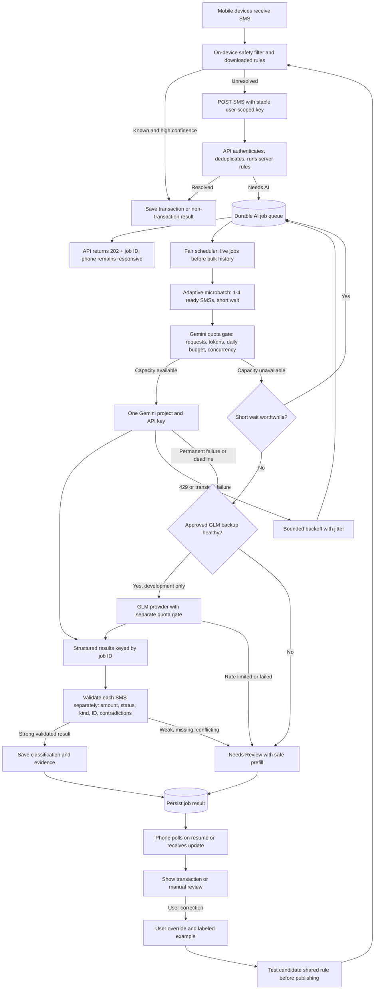

# SMS classification architecture: Gemini primary, optional GLM backup

## Operating rules

1. **One Gemini project first.** Keep its key on the server. Set dispatch limits below the actual per-model project quotas in AI Studio. Extra keys in the same project do not add Gemini capacity.
2. **Call AI only for unresolved SMSs.** Deterministic filters and published patterns handle routine messages without queueing or token cost.
3. **Group adaptively.** Start by testing a maximum of four unresolved SMSs per interactive call with a short grouping window (for example, 300 ms). If only one job is ready, send one. Benchmark sizes 1, 2, 4, and 8 before fixing the production setting. Cap estimated input and output tokens for every group.
4. **Protect live users.** Use per-user fairness and reserve capacity for current SMSs. Historical imports get lower priority. A delayed retry never blocks newer jobs.
5. **Never lose an SMS.** Return a job ID immediately, persist job/result state, lease work to a separate worker, and make retries idempotent. If Gemini is slow, unavailable, or uncertain, the item stays recoverable in Needs Review.
6. **Validate per message.** Require one result for each opaque job ID; reject duplicates or missing IDs. Check transaction amount against the SMS, posted/failed wording, allowed economic kinds, and contradictions. A grouped response does not get one shared confidence score.
7. **Control provider load.** Gate requests per minute, input tokens per minute, daily requests, spend, and concurrent calls. Retry transient `429`/`5xx` with jitter and a cap. A queue reduces `429`s but cannot guarantee zero.
8. **Protect financial data.** Minimize and mask the payload, encrypt short-lived queued text, restrict job lookup to its owner, and avoid logging SMS bodies. User corrections are stored separately from shared patterns.

**Decision:** use one Gemini project as primary. Enable the GLM branch for development-only comparison after the chosen hosting API and key are identified. Gemini and GLM have independent quotas. The worker records the provider/model on every result, applies the same validation, and sends weak or failed results to Needs Review. A user correction always outranks a late provider result. The mobile API and review flow stay the same. Production deployment of GLM remains a separate decision after accuracy, privacy, entitlement, latency, and isolation checks.

Sources: [Gemini rate limits](https://ai.google.dev/gemini-api/docs/rate-limits), [Gemini retry guidance](https://ai.google.dev/gemini-api/docs/troubleshooting), [structured outputs](https://ai.google.dev/gemini-api/docs/structured-output).
