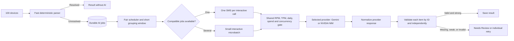

# Plan: grouping SMSs for AI classification

## Recommendation

Use **adaptive microbatches** in the durable server queue. First apply local and server rules; only unresolved SMSs enter the AI queue. Group a few compatible jobs into one interactive provider request when they are already waiting. Send a single job promptly when traffic is low. Keep bulk historical imports in a separate low-priority lane; Gemini Batch API is an option for non-urgent offline evaluation and backfills, not the live review path. Put Gemini and NVIDIA NIM behind the same provider interface, result schema, and validation gates.

## Why group, and when it stops helping

For `n` SMSs, a one-per-call design sends `n` requests and repeats the same instructions and schema `n` times. A grouped call sends one request, shares that fixed overhead, and can help when **requests per minute (RPM)** is the binding quota. It still consumes the SMS input tokens and an output object for every SMS. When **tokens per minute (TPM)**, daily requests, spend, or latency is binding, larger groups may offer little benefit or make results slower. A queue and quota gate are still needed; grouping alone cannot guarantee no `429`.

Two different forms of batching:

| Method | Use | Caution |
| --- | --- | --- |
| Interactive microbatch: several SMS records in one `generateContent` call | Short queue of live unresolved SMSs, or one user's import | One malformed/blocked response can affect the whole group; map and validate every item independently. |
| Gemini Batch API: many independent requests submitted as a job | Historical backfills, evaluation, candidate-rule experiments | Its target turnaround is up to 24 hours, so do not make a person wait for it in Needs Review. |

## Initial dispatch policy to test

These are **experiment settings**, not proven optimal values:

- Begin with at most **4 SMSs per interactive call** and a **300 ms grouping window**. Cap total estimated input tokens and reserve output tokens before dispatch. Benchmark 1, 2, 4, and 8 items; keep the smallest size that materially improves throughput without hurting accuracy or p95 time to result.
- Never wait for a full batch. If the oldest live job reaches its wait limit, dispatch it alone.
- Separate live jobs from historical import jobs. Reserve capacity for live traffic so a 5,000-message import cannot delay current users.
- Schedule fairly: approximate first-in-first-out among ready jobs, but cap jobs selected from one user in each round. Delayed retries do not block fresh jobs.
- Initially group **within one user's import**. Permit cross-user grouping only after privacy review and evaluation show it is necessary. If enabled, remove names/account identifiers where possible, give each item an opaque job ID, prohibit cross-item inference in the prompt, and validate that every output ID belongs to the request. Never return another user's item through the API.
- If a group response is incomplete or malformed, retry only the missing items, preferably as smaller groups or single items. Never create transactions from a partially mapped response.
- On `429` or transient `5xx`, back off with jitter, reduce dispatch rate temporarily, and retry within a cap. On daily/spend exhaustion, pause AI dispatch and send time-sensitive items to Needs Review; do not repeatedly hammer Gemini.

## Request and response contract

Input: `[{job_id, masked_sms, sender_family, known_facts}]`, bounded in count and tokens. Do not include other users' profile IDs, full card/account numbers, unrelated SMSs, or previous users' raw examples.

Output: exactly one object per `job_id` with `message_type`, `lifecycle`, `transaction_amount`, `currency`, `direction`, `economic_kind`, extracted field evidence, and `uncertain_fields`. Schema-constrained output is useful, but server checks still verify ID set equality, allowed enums, amount labels, nonnegative values, and contradictions. A batch-level confidence from Gemini does not authorize auto-import; each item receives its own calibrated score and decision.

## Provider selection: Gemini and NVIDIA NIM

Keep **one queue** and add per-provider workers/adapters. Each provider has its own rate limiter, concurrency cap, health state, cost/credit ceiling, timeout, and retry schedule. Record `provider`, `model`, and model/prompt version on each result so accuracy can be measured and audited. Routing choices should be based on observed precision, latency, privacy terms, and actual capacity—not a model's self-reported confidence.

| Configuration | Sensible use |
| --- | --- |
| Gemini only | Simplest first production path if its paid-service data terms and quota fit the product. |
| NVIDIA NIM only | Useful for development benchmarking; use for live users only after confirming the selected hosted service's production entitlement, privacy terms, and capacity. A self-hosted NIM is a separate infrastructure/cost choice. |
| Primary plus fallback | Route a job to the second provider after sustained throttling or an outage, only if the user-data terms permit that transfer. Bound retries and preserve one idempotent job. |
| Dual-model adjudication | Reserve for difficult cases or offline evaluation. Two model opinions add latency/tokens and do not automatically constitute independent proof; unresolved disagreement goes to Needs Review. |

NVIDIA's hosted API catalogue is described as free access for **prototyping/development** and warns that requests may be rate limited or affected by other users' traffic. Its trial terms state that user content and generated content may be used to improve NVIDIA services/models. That is material for financial SMS: do not assume the free hosted endpoint has the same data treatment as a paid production service. Verify the exact service/model terms before sending real user content. The queue must treat NVIDIA `429` and exhausted credits as normal provider states, with fallback or Needs Review rather than indefinite retries.

## Delivery steps

1. **Measure baseline:** log privacy-safe counts of unresolved SMSs per minute, burst size, queue wait, prompt/input/output tokens, Gemini latency, `429` rate, and user corrections. Read actual model limits in AI Studio; quotas are project-wide and vary by model/tier.
2. **Ship durable queue and single-item worker:** prove idempotency, fair selection, quota reservation, bounded retries, app polling, and Needs Review fallback.
3. **Add within-user microbatching:** structured per-ID responses, strict validation, partial retry, and token-aware batch size. Use a replay corpus containing refunds, repayments, multiple amounts, OTPs, and near-duplicate messages.
4. **Run A/B evaluation:** compare single, 2, 4, and 8 items on cost per resolved SMS, provider requests, tokens, precision, p95 completion, review rate, and missing/contaminated outputs. Keep the smallest useful setting.
5. **Consider cross-user grouping only if RPM remains limiting:** require privacy review and strict isolation tests. Add adaptive size/window control based on queue depth and measured latency.
6. **Use Batch API for low-priority offline work:** backfills and rule research can tolerate long turnaround and have separate capacity characteristics.

## Acceptance checks

- One submitted SMS maps to one result or one review item, even after app retry, worker crash, malformed group response, or Gemini timeout.
- A returned result never contains another user's SMS fields.
- At the chosen rate, p95 live completion stays within the product target; queue wait is visible to the app.
- Auto-classification precision does not fall relative to single-item calls.
- A full historical import cannot starve live requests; provider quota exhaustion still leaves SMSs recoverable in Needs Review.

References: [Gemini rate limits](https://ai.google.dev/gemini-api/docs/rate-limits), [token counting](https://ai.google.dev/gemini-api/docs/tokens), [structured outputs](https://ai.google.dev/gemini-api/docs/structured-output), [Batch API](https://ai.google.dev/gemini-api/docs/batch-api), [retry guidance](https://ai.google.dev/gemini-api/docs/troubleshooting), [NVIDIA NIM FAQ](https://docs.api.nvidia.com/nim/docs/product), [NVIDIA API trial terms](https://assets.ngc.nvidia.com/products/api-catalog/legal/NVIDIA%20API%20Trial%20Terms%20of%20Service.pdf).
