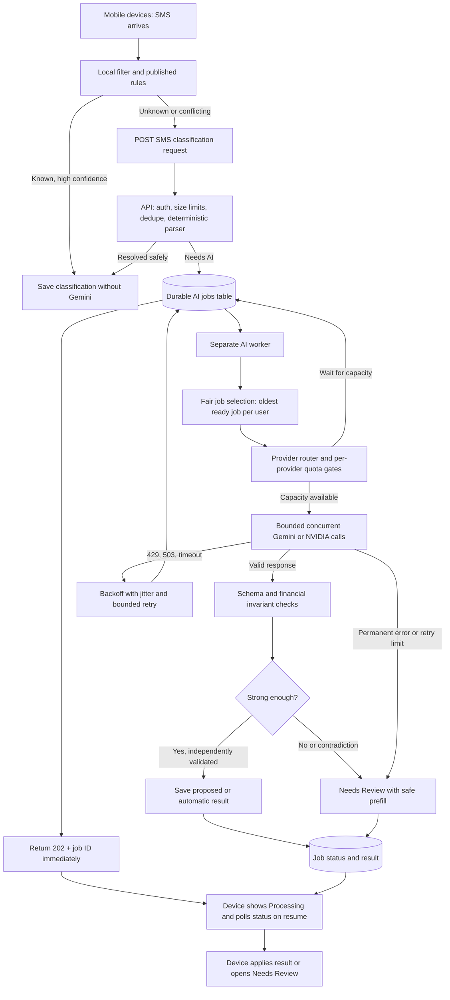

# SMS AI queue: server design

## Request and result flow



## Worker and quota behavior

```mermaid
sequenceDiagram
    participant Phone
    participant API
    participant DB as Durable jobs DB
    participant Worker
    participant Quota as Shared quota gate
    participant Provider as Gemini or NVIDIA

    Phone->>API: POST request with stable SMS key
    API->>DB: Insert job if absent; bind to user
    API-->>Phone: 202 Accepted + job ID
    Worker->>DB: Lease next ready job
    Worker->>Quota: Reserve selected provider capacity
    alt Capacity available
        Quota-->>Worker: Permit
        Worker->>Provider: Structured classification request
        alt Valid response
            Provider-->>Worker: Candidate fields and kind
            Worker->>DB: Validate and save result
        else 429 or transient failure
            Provider-->>Worker: Error
            Worker->>DB: Release lease; set next attempt with jitter
        end
    else Quota exhausted
        Quota-->>Worker: Wait until next capacity window
        Worker->>DB: Release lease; set next attempt
    end
    Phone->>API: GET job status, including after app restart
    API->>DB: Read this user's job only
    API-->>Phone: Processing, completed, or Needs Review
```

## Team decisions

| Concern | Recommended rule |
| --- | --- |
| API responsiveness | Do not wait for Gemini inside the SMS upload request. Return `202 Accepted` and a job ID. Existing deterministic parsing remains fast. |
| Durability | Start with a PostgreSQL jobs table and a separate worker process. The product API already uses PostgreSQL; its package does not currently include a queue/Redis dependency. Use atomic row leases, retry times, and lease expiry so restarts do not lose jobs. |
| Ordering | Approximately first-in-first-out among ready jobs, with per-user fairness. A delayed retry must not block newer jobs. Limit outstanding jobs per user so one bulk import cannot monopolize the queue. |
| Provider quota | Maintain a separate gate per provider/model for its actual request, token, daily, credit, and spend limits. Configure below observed capacity with headroom; cap concurrent calls. Multiple Gemini keys in one project do not increase its project quota. |
| Overload | Bound queue depth, per-user submissions, request size, and job lifetime. If the queue is too long, return a reviewable deferred result instead of accepting an unbounded backlog. |
| Retry | For `429`, `408`, `503`, and other transient `5xx`, use exponential backoff with jitter and a retry cap. Respect provider retry guidance when available. Do not retry malformed requests or authentication/billing failures indefinitely. |
| Idempotency | A stable user-scoped SMS key yields one active job/result. A retried phone upload or worker lease must not create duplicate transactions or repeat costly Gemini calls unnecessarily. |
| Privacy | Store only the minimum masked payload needed by the worker, encrypt it, set a short retention period, and keep the Gemini key server-side. Never expose another user's job/result. |
| Outcome | Invalid or low-confidence AI output goes to Needs Review. A worker outage never silently discards the SMS. User corrections outrank later model or rule reruns. |

**Important:** A queue reduces the chance of provider `429` errors; it cannot guarantee zero `429`s because capacity and limits can change. The retry path is required. Actual Gemini limits must be read from Google AI Studio. NVIDIA's free hosted API is described as development/trial access and may throttle; verify production entitlement and financial-data terms before routing real users to it.

**Separate workload:** Historical backfills and rule evaluation can use a lower-priority queue or Gemini Batch API. Live SMS review should use the interactive API because Batch has a much longer target turnaround.

Sources: [Gemini rate limits](https://ai.google.dev/gemini-api/docs/rate-limits), [Gemini retry guidance](https://ai.google.dev/gemini-api/docs/troubleshooting), [Gemini Batch API](https://ai.google.dev/gemini-api/docs/batch-api), [NVIDIA NIM FAQ](https://docs.api.nvidia.com/nim/docs/product), [NVIDIA API trial terms](https://assets.ngc.nvidia.com/products/api-catalog/legal/NVIDIA%20API%20Trial%20Terms%20of%20Service.pdf).
