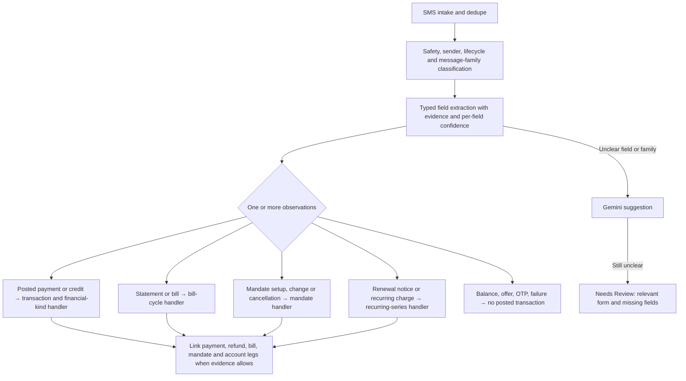

# SMS message families: transactions, bills, mandates, and subscriptions

## Recommendation

Use **one intake and classification pipeline** for every financial SMS. It should emit one or more typed observations, then send each observation to its existing domain handler. Keep specialized deterministic extractors and state machines for bills, mandates, payments, and recurring series. Gemini is a fallback for unfamiliar wording, not a replacement for those domain rules.

An SMS is not forced into one mutually exclusive category. For example, a statement SMS can provide an amount due, minimum due, due date, statement date, and card suffix. A successful AutoPay debit SMS can create a posted transaction **and** update a recurring series. A mandate registration SMS creates an authorization record but no spend.

## Current code and what it already handles

| Area | Current path | Observation |
| --- | --- | --- |
| Device parsing | `app/lib/data/local_sms_parser.dart` emits `transaction`, `bill`, `autopay`, `promotion`, `balance`, `failed`, `security`, `unknown`; it extracts due date, statement date, amount due, minimum due and mandate limit. `sms_import_store.dart` persists structured observations. | Good starting vocabulary, but the numeric `confidence` is a hand-built bill heuristic, not a calibrated probability. |
| Card bills on device | `app/lib/data/card_bill_ledger.dart` groups recent bill observations into cycles and applies recognized card-bill payments; `payments_due_screen.dart` consumes it. | Bill amount and due date are used locally. Cycle grouping and partial-payment attribution need explicit provenance and regression cases when AI adds new formats. |
| Server due-day learning | `api/src/due_date_parser.js` extracts explicit due dates and statement dates; `import_resolvers.js` updates card `due_day`/`statement_day` when the card match is unambiguous and protects user-entered values. | This stores recurring **days** on the card, not a full bill instance with amount, minimum, and due date. |
| Mandates on server | `api/src/subscription_parser.js` parses activation/cancellation, merchant, amount, cadence, reference and instrument; `index.js` persists to `recurring_series`. | A mandate amount can be a maximum authorization, not the eventual charge. Missing explicit cadence currently defaults to 30 days; the record flags cadence as unconfirmed. |
| Recurring spending | `api/src/recurring.js` groups posted spend by merchant, amount and interval; `GET /recurring` merges this with mandate/manual state. | Recurrence is a relationship inferred across transactions; a single debit or the word “subscription” alone should not establish it. |
| Server transaction import | `api/src/index.js` runs bill-day sync and transaction parsing on SMS; it tries mandate parsing on the `!parsed.ok` branch. | A multi-purpose SMS may need more than one observation. The current branching makes it hard to apply independent bill/mandate/payment claims consistently. |

**Path to verify before implementation:** `LocalSmsParser` returns an AutoPay setup as `localIgnore`, and `SmsImportStore` acknowledges `localIgnore` without server upload. That may prevent server `persistSubscriptionMandate` from seeing the same live SMS, even though a structured local observation is saved. Confirm this end-to-end with a fixture before changing delivery behavior.

## Typed observation contract

Each output needs `source_sms_key`, `message_family`, `lifecycle`, `observed_at`, `effective_at`, `account_or_card_hint`, `evidence`, `parser_version`, `confidence_tier`, and an idempotency key. Keep each money field distinct:

| Field | Meaning | Must never be substituted for |
| --- | --- | --- |
| `transaction_amount` | Amount actually posted/debited/credited | Balance, bill due, mandate ceiling |
| `statement_total` / `amount_due` | Statement or invoice obligation for a cycle | New spending transaction |
| `minimum_due` | Minimum required payment | Full statement amount |
| `outstanding_amount` | Remaining obligation as of a later reminder | Original statement total |
| `mandate_limit` | Maximum allowed AutoPay debit | Expected subscription charge |
| `typical_recurring_amount` | Estimate from repeated charges or explicit plan | Guaranteed future bill |
| `available_balance` / `credit_limit` | Account/card context | Any payment |

Store dates with roles: `transaction_at`, `statement_on`, `bill_due_on`, `mandate_start_on`, `mandate_end_on`, `next_expected_on`. An SMS receive date is not automatically any of these. Preserve date precision and source evidence.

## Scenario matrix

| SMS says | Produce | Do not do |
| --- | --- | --- |
| “Card spent ₹799 at Netflix” | Posted purchase; consider recurring-series evidence | Create a mandate from merchant name alone |
| “AutoPay mandate for Netflix up to ₹2,000 registered” | Active mandate, ceiling ₹2,000; no transaction | Count ₹2,000 as spend or fixed monthly charge |
| “Netflix AutoPay ₹799 debited successfully” | Posted purchase and link/update recurring series | Count a second purchase because the mandate exists |
| “AutoPay ₹799 scheduled tomorrow” | Scheduled/expected event | Create posted spend today |
| “AutoPay failed; no debit” | Failure observation and possible renewal-at-risk signal | Create spend |
| “Mandate cancelled” | Change mandate lifecycle | Delete historical charges |
| “Credit-card statement ₹24,000 due; minimum ₹1,200; pay by 15 Nov” | Bill-cycle record with three labeled fields | Create ₹24,000 purchase or confuse minimum with total |
| “Pay ₹9,000 outstanding by 15 Nov” | Update the same bill's remaining balance if linked | Replace original statement total without evidence |
| “Paid ₹10,000 toward card bill” | Repayment/transfer transaction, link partial settlement | Count repayment as new spending |
| “Electricity bill ₹1,500 generated; due Friday” | Biller obligation, not posted transaction | Infer payment from “bill” wording |
| “Insurance renewal due” | Commitment/renewal notice | Treat future debit as completed |
| “SIP mandate ₹5,000 registered” | Investment mandate/commitment | Consumer subscription or purchase |
| “₹499 refunded for subscription” | Refund and link to original charge where possible | Earned income or automatic mandate cancellation |
| “Offer: get ₹100 cashback on subscription” | Promotion | Charge or reward credit |

Also test one SMS with both statement and successful payment clauses; multiple cards sharing last four digits; full and partial repayments; revised due dates; bill reminders repeated after a payment; different currencies; reversed AutoPay; merchant name changes; a mandate limit increase; trial conversion to paid plan; and annual/variable subscriptions.

## Processing and review decisions

1. **Detect lifecycle first.** Due, scheduled, failed, pending, and mandate setup are not posted spend. A later posted SMS can link to the earlier observation.
2. **Extract typed fields by message family.** The same number may play different roles. Require phrase-level evidence for each value. Gemini may propose a role; deterministic validation must check it against the SMS.
3. **Score each required field separately.** A high message-family score with an uncertain amount or card identity goes to review. Use review forms tailored to transaction, bill, or mandate rather than one generic spending form.
4. **Persist observations before projections.** One SMS may yield multiple observations but one economic event should contribute to spending once. Keep links among bill, payment, mandate, recurring series, refund, and account leg.
5. **Resolve state with domain handlers.** Bills settle through payments; mandates activate/change/cancel; recurring series learn from actual charges; refunds reduce net spending when linked. User corrections outrank automatic reprocessing.
6. **Learn message templates across users.** Publish only patterns proven on diverse examples and negative cases. The learned template should map slots to typed fields, not simply label an SMS “subscription.”

## Delivery order

1. Build a shared fixture corpus for all families, including the scenario matrix, and run it through current server/local paths to establish baseline behavior and identify divergent cases.
2. Define the multi-observation schema and typed amount/date roles, with source and confidence metadata. Preserve existing transaction and card APIs during migration.
3. Make local and server routing consistent: a locally recognized mandate/bill must either sync its structured observation or remain intentionally local with a documented product outcome. Never upload it as generic spend.
4. Extend specialized extractors and persist full bill/mandate facts. Keep due-day hints and bill instances separate. Link payment alerts to bill cycles and recurring charges to mandates only with enough evidence.
5. Add Gemini fallback to the existing unresolved-SMS queue for any family. Validate each proposed observation, and route uncertain fields to the corresponding Needs Review form.
6. Reconcile historical SMSs in a dry run, compare projected totals and due dates, then roll out by feature flag. Track false spend, missing bills, wrong due dates, duplicate charges, and user corrections in admin monitoring.

## Acceptance gates

- A mandate creation or bill notice never increases spending; a posted AutoPay charge counts once.
- Bill total, minimum due, outstanding, mandate limit, and transaction amount remain distinct throughout storage, UI and AI output.
- A single SMS can update multiple domains without duplicate economic events.
- Server and offline paths agree on message family, lifecycle and required fields for the shared corpus.
- A low-confidence bill or mandate reaches an appropriate review path, and a correction survives parser/model upgrades.
