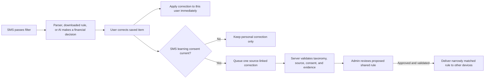

# Every user correction after SMS filtering: remaining learning plan

Updated: 2026-10-27. This is a separate continuation plan for SMS that **passed** the existing safety and promotional filter and then received a parser, downloaded-rule, or AI decision. It covers every meaningful user correction to that decision, including category, amount, merchant, time, direction, instrument, transaction/bill/mandate kind, false transaction, and false dismissal. Filter-drop recovery is outside this scope. Recheck the dirty checkout before implementation; other agents may be changing the SMS learning worktree concurrently.

## Intended behavior

The user's explicit correction outranks the previous parser, downloaded rule, or AI decision for that SMS. The correction is a typed before/after event, not automatically a universal truth about a merchant or message pattern. A merchant can produce both travel and subscription payments. Repeated edits by one user must not multiply evidence. Admin approval is required before a shared rule reaches other users. AI may explain an error but cannot publish the correction or modify the user's transaction. Cosmetic edits unrelated to an SMS decision do not create shared learning. Splitting one expense into personal budget shares is also not proof that the original SMS classification was wrong.

An SMS can contain more than one financial fact. Link a correction to the source **and** the affected fact/transaction when available, so changing one amount or category does not invalidate a separate correct fact from the same message. Preserve the origin and version of the decision being corrected (built-in parser, downloaded rule, or AI).

## Findings in the current checkout

| Correction surface | What exists | Remaining gap |
| --- | --- | --- |
| Auto-Resolved → Change Category | `SmsAutoResolutionController.changeCategory` updates the local receipt/transaction, stores a local merchant category rule, and queues `category_changed` when consent exists. | Verify the original label is preserved, the local rule is not overbroad, and the server/admin review covers the correction. |
| Auto-Resolved → Edit Transaction | `editTransaction` queues `edited` with corrected merchant, amount, and time. | Ensure all corrected fields and the original decision are represented consistently; a later user correction supersedes the earlier AI-only proposal. |
| Auto-Resolved → Move to Review or restore an AI dismissal | `moveToReview` undoes a filed result and queues `moved_to_review` with consent. | Wrong financial filing and wrong AI dismissal need distinct negative/positive labels and a reviewable admin case; an `ignore_noise` family move is not currently a parser negative example. |
| Needs Review → manually save transaction | `_recordReviewedTransactionFeedback` queues `confirmed` or `edited` with a corrected `categorySlug`. | The shared category aggregate currently reads `category_changed` events, so a category corrected during manual save does not become a category vote. |
| Needs Review → manually save bill/commitment | `_recordReviewedBillFeedback` queues `confirmed` or `edited` with due amount/date and commitment category. | The server feedback allowlist does not include `billerName`; bill categories use a different taxonomy from spend categories. Verify which corrected fields survive and whether the saved commitment stays linked to the source SMS. |
| Needs Review → discard one AI fact | `_resolveFactSuggestion` removes a selected suggestion locally, or removes the review item when it was the last fact. | No verified negative feedback is queued for that specific rejected fact. Do not mark other correct facts from the same SMS wrong. |
| Needs Review → Ignore message / dismiss commitment | The dismissal path removes the item and sends `user_dismissed` with `ignore_noise`. | "I do not want to track this" and "this was not a financial event" are different labels. Do not train a global nonfinancial rule from a preference-only dismissal or an already-paid/duplicate bill. |
| SMS fact override | `/sms/facts/overrides` stores a structured override and may record learning. | Bring amount, merchant, date, direction, category, and kind overrides under the same source-linked correction contract; do not confuse parser-field training with category learning. |
| Activity → Edit Transaction or change transaction status | The general editor saves amount/category/merchant/date/type changes and may offer personal bulk/future merchant rules. SMS provenance is available through `source_key`/observations. | No verified SMS shared-learning event is emitted from this editor. Link only SMS-backed transactions, and enqueue meaningful feedback after the edit succeeds, including offline replay. Distinguish delete/ignore/refund from a parser error. |
| SMS Bills/Subscriptions → paid, dismiss, or edit | SMS-backed commitments and bill receipts have their own status and category model. | Paying a bill is a lifecycle event, not automatically a parser correction. Only an explicit "wrong bill/kind/fields" action should create negative or corrected learning, with source linkage. |
| Existing personal and shared category rules | Local user rule runs before built-in category inference; shared category rules require aggregate support and admin approval. | Define precedence after a later user correction, revocation, and mixed merchant contexts; avoid learning a blanket merchant rule from a one-off transaction. |
| Taxonomy | The app's SMS spend fact contract has 15 spend categories. SQL category aggregation uses a different allowlist. | Reconcile app, API, SQL, and admin validation. `subscription` is a commitment kind, not a current spend category slug. |

## C1 trace table (2026-10-28 inventory)

Columns: user action → saved financial record → durable feedback → API/DB → admin/rule effect. "—" means the step does not exist in the current checkout.

| # | Surface / action | Local save | Durable feedback | API / DB write | Admin or rule effect |
| --- | --- | --- | --- | --- | --- |
| 1 | Auto-Resolved → Confirm | receipt kept, `SmsImportStore` row resolved | `confirmed` via `SmsFeedbackOutbox` `sms_auto_resolution_controller.dart:213` | `POST /sms/learning-feedback` → `sms_learning_examples` positive example | Worker candidate synthesis only; no delivery without separate approval |
| 2 | Auto-Resolved → Change category | receipt + transaction updated, personal `merchant_category_rules` row | `category_changed` (`controller:213` region) | `sms_learning_feedback_events`, `sms_shared_category_rules()` vote | 10-user / 90% aggregate → admin category approval → bundle |
| 3 | Auto-Resolved → Edit transaction | receipt amount/merchant/time updated | `edited` with corrected fields | learning example (generalized values) | Parser field training path |
| 4 | Auto-Resolved → Move to review | all rows for `source_key` deleted (`controller:143-147`) | `moved_to_review`, negative example only when family ≠ `ignore_noise` | negative example `isNegative` | No admin case, no AI diagnosis |
| 5 | Auto-Resolved → restore an AI dismissal | review item restored | `moved_to_review` with `ignore_noise` family | nothing (skipped by `family !== 'ignore_noise'` guard, route :365) | **Gap** — false dismissal is not recorded |
| 6 | Needs Review → save transaction | transaction inserted, review item removed | `confirmed`/`edited` via `_recordReviewedTransactionFeedback` (`needs_review_screen.dart:322-396`) | event row; `original_category_slug` always NULL because the app sends key `category`, which `SAFE_FIELDS` drops | Category vote only when action stays `category_changed`; manual save never votes |
| 7 | Needs Review → save bill/commitment | commitment created | `_recordReviewedBillFeedback` (`:398-458`) | `billerName` is not in `SAFE_FIELDS`, so biller is dropped | Bill field training loses the corrected biller |
| 8 | Needs Review → save bill from list tile | commitment created | — (`_reviewBill` `:3176-3240`) | — | **Gap** — no learning at all on this path |
| 9 | Needs Review → discard one AI fact | that suggestion removed, other facts kept | — (`_resolveFactSuggestion` `:3000-3014`) | — | **Gap** — rejection of a specific fact is invisible |
| 10 | Needs Review → ignore message | item removed, dismissal outbox | `dismissed` + `ignore_noise` (`user_cards_repository.dart:1985`) | `recordReviewDismissal` | Preference and "not financial" share one label |
| 11 | SMS fact override (`/sms/facts/overrides`) | override applied locally | `sms_facts_outbox.dart` (has `factIndex`) | `fact_overrides` + `sms_learning_feedback` + `sms_learning_examples` + exposure `correction=true` | Consent checked server-side only; device enqueues unconditionally |
| 12 | Activity → edit transaction | `PATCH /transactions/:id` (`user_cards_repository.dart:2436`) | — (`edit_transaction_screen.dart` has zero SMS references) | — | **Gap** — SMS provenance is dropped by the route (`transaction_detail_screen.dart:721-723` passes no `extra`) |
| 13 | Activity → bulk category / card reassign | `editTransaction` per id (`activity_screen.dart:208,310`) | — | — | **Gap** |
| 14 | Activity → ignore as refund / reversal / transfer | `markInactive` (`transaction_detail_screen.dart:527-530`) then `POST /transactions/:id/ignore` | — | — | **Gap** — lifecycle and "wrong classification" are indistinguishable |
| 15 | Bills → mark paid / "not a bill" | `CommitmentsRepository.markAsPaid` / `save` (`sms_bills_section.dart:214,219`) | — | — | **Gap** — and the local `Commitment` carries no source key |
| 16 | Payments due → commitment paid / dismiss / delete | `payments_due_screen.dart:2387,2427,2431` | — | — | **Gap** |
| 17 | Payments due → card bill amount/min-due/date/paid | local `financialStore` only (`:1395-1539`) | — | — | **Gap** — never leaves the device |
| 18 | Subscriptions → edit / ignore | `PATCH /recurring/:id` sets `user_edited`; `POST /recurring/:id/dismiss` | — | server knows `user_edited` only | **Gap** — no corrected before/after labels |
| 19 | Shared rule exposure telemetry | — | `sms_rule_exposure_outbox.dart` → `POST /sms/rule-exposures` | joins server-issued `sms_rule_candidate_assignments` (stage + `bundle_version`) | Exposure has no own rule hash; attribution is indirect via assignment |
| 20 | `ai_auto_resolved` upload | n/a | AI proposal outbox | `sms_ai_learning_proposals` (pending) | Admin evidence approval only; superseded by any explicit event for the same source |

### C1 findings that constrain C2-C4

- **Repeated identical SMS collide.** `sourceKey` is `sha256([account, sender, body])` with no timestamp (`sms_intake_repository.dart:10-26`), and `sms_import_store.dart:118-127` drops the second identical sender+body. Two identical "Rs 500 debited" messages on different dates therefore share one source identity; a correction to the second would supersede the first. Fixing identity is a wider change than this plan authorises, so the contract must at least carry the occurrence timestamp it was corrected against and the server must not treat a later identical message as the same fact.
- **No correction taxonomy exists.** Only `user_disputed_ai_decision`, `user_dismissed`, and `bundle_dismissed` exist today. There is no way to say wrong-category vs wrong-amount vs not-a-transaction vs already-paid vs duplicate vs cosmetic.
- **No per-fact isolation on Auto-Resolved.** `factIndex` exists only for Needs Review fact overrides. `changeCategory` updates every row sharing `source_key` (`controller:228-233`) and `moveToReview` deletes every row. A two-fact message cannot be corrected fact-by-fact on that screen.
- **`decisionOrigin` is an unused optional.** `sms_feedback_outbox.dart:51,84` accepts it; only `app/providers.dart:6436` passes the literal `'gemini'`. No rule id or hash is ever sent, so a correction cannot name the downloaded/shared rule that produced the label.
- **Dismissals are not content-idempotent.** `sms_dismissal_outbox` is keyed `(namespace, source_key)` and mints `Uuid().v4()`, so a retry of the same dismissal is a new event unless the server dedupes by content.
- **No offline replay for edits.** Activity edits are a direct authenticated PATCH. Only fact overrides and rule exposures replay offline. There is no pending-edit table, so "queue after sync acknowledgment" is not available for the generic editor yet.

## Ordered engineering tasks

| ID | Task | Status | Completion evidence |
| --- | --- | --- | --- |
| C1 | Inventory every meaningful post-filter SMS correction path and its source linkage (`source_key`, affected fact/transaction, observation, auto-resolved receipt). Distinguish SMS from email, statement, and manual transactions; audit how identical sender/body messages on different dates receive source identity. | **Complete 2026-10-28** | 20-row trace table above with file:line for every surface; 9 missing-capability paths named; repeated-message collision and missing per-fact isolation documented. |
| C2 | Define one typed correction envelope: source and affected fact/transaction IDs, prior decision origin/version/rule hash, prior fields/classification, corrected fields/classification, action reason/time, consent grant, and idempotent event ID. Preserve local source evidence; upload only privacy-safe context. Include account/card attribution as a correction type without sharing account identifiers. | **Implemented 2026-10-28; full cross-surface wiring pending** | Migration `20261027190000_sms_correction_contract.sql` adds `correction_kind` (15 typed reasons), `decision_origin`, `decision_rule_id`, `fact_key` (source:factIndex), `message_at`, `commitment_category` and `superseded_*`; one current correction per (profile, fact) via partial unique index, older rows retained; `pandapay.sms_supersede_corrections()` is owner-scoped. API rejects unknown taxonomy/provenance/rule id/fact index (400), routes spend vs commitment categories, and supersedes before insert in the same transaction. Device outbox carries the same fields and derives fact-distinct event ids. Tests: `db/tests/20261027190000_sms_correction_contract_test.sql` (rc 0), `api/test/sms_correction_contract.test.js` (11/11), `app/test/data/local/sms_feedback_outbox_test.dart` (6/6). |
| C3 | Complete capture from Auto-Resolved, Needs Review transaction and bill saves, single-fact rejection, SMS fact override, Activity edit/status, SMS commitment correction, and AI-dismissal reversal. Distinguish explicit "wrong decision" from preference-only dismissals, duplicate, already-paid, refund, reversal, and transfer actions. Queue only after the user's financial edit commits; offline edits queue after sync acknowledgment. | **Partly done 2026-10-28 (later session)** | Auto-Resolved now sends `decisionOrigin: 'ai'` and a typed reason (`misclassified_category`, diff-derived `wrong_amount`/`wrong_merchant`/`wrong_date`/`cosmetic`, `false_transaction` vs `false_dismissal` on move-to-review). Needs Review transaction saves send the prior label as `categorySlug` plus a diff-derived reason; bill saves now fire on **both** the editor and the list-tile save (`_reviewBill`) with a diff-derived reason and the prior commitment category; single-fact rejection (`_resolveFactSuggestion`) now enqueues a consent-gated per-fact `dismissed` correction — `false_transaction` for posted movements, `preference_only` for bill/mandate suggestions — with `factIndex` and `messageAt`, and never marks other facts wrong. The Activity editor (`edit_transaction_screen.dart`) queues an `edited` correction for SMS-backed transactions (`source` in `sms`/`sms_bulk`), resolving the original SMS sender/body from the captured-SMS store and skipping evidence when consent is off or the SMS is unavailable; kind priority category→kind→amount→merchant→date→instrument→account, custom categories stay local via canonical-slug mapping. Bulk category reassign in `activity_screen.dart` queues one `misclassified_category` correction per changed SMS-backed transaction; bulk card reassign deliberately queues nothing (a device-local card id is not shareable evidence and instrument does not change). Shared capture context and the enqueue pipeline live in `sms_learning_capture.dart`. Verified: `flutter analyze` clean on all touched files, edit/needs-review/activity feature tests 59/59, full app suite 2030/2030. **Completed in a later session 2026-10-28:** subscriptions edit/ignore (`subscriptions_screen.dart` queues `wrong_amount`→`wrong_date`→`wrong_bill_fields` on real changes and a `preference_only` dismissal), card-bill corrections from detected SMS (`payments_due_screen.dart` compares amount/minimum/due-date and queues the matching kind), and the fact-override local consent gate (`providers.dart` withholds `sampleBody`/`templateText` from the override upload unless the full capture-time consent — granted AND current policy version — is in force). Bills mark-paid/"not a bill" remains out of scope: the local `Commitment` record has no source key to attribute a correction to. |
| C4 | Reconcile category taxonomy and model transaction kind separately. A Travel → Subscription correction must become a supported subscription/commitment correction with required evidence, or remain user-reviewable; never insert `subscription` into a spend slug field without a product/schema change. Keep a user's custom category private unless it has an explicitly approved canonical mapping. | **Implemented 2026-10-28** | The SQL allowlist in `sms_shared_category_rules()` now matches the app's and API's canonical 15 (`government` and `other` were missing; `investments`, `income`, `cash` were removed). A commitment category is stored in `commitment_category` and can never enter `category_slug`; unsupported spend slugs abstain instead of being stored. `original_category_slug` is no longer always null (the app sent `category`, the server only read `categorySlug`). `billerName` survives sanitisation. AI-proposal approval requires a canonical spend slug. Tests: C2 SQL test asserts government/other vote and cash/investments/income/subscription do not; API tests assert subscription stays a commitment kind and a commitment category sent for a spend fact is refused. |
| C5 | Apply the user's latest correction locally before any built-in, AI, or downloaded shared category rule. Scope personal merchant rules carefully; a mixed-context merchant must not force one category for every SMS. | **Implemented 2026-10-28** | `sms_import_store.dart` resolves the category with explicit precedence: the user's own correction (per merchant-key label) first, then AI auto-resolution (which itself applies the stored correction before the AI category), then personal merchant rule, then downloaded/shared rule, then built-in. A merchant seen across mixed contexts is not blanket-categorised: the override only applies where the user actually corrected it. A later user edit replaces the earlier personal label. Tests: `app/test/data/local/sms_import_store_category_precedence_test.dart` (4/4: personal outranks shared, later edit replaces, mixed-context not blanket-categorised, AI auto-resolution applies user correction first). |
| C6 | Aggregate consented explicit corrections on the server by verified source, field, merchant, and message context. Count the latest explicit state once per user/source; invalidate an older AI-only label for the same SMS. Keep disagreement and false-positive examples visible. | **Implemented 2026-10-28** | `sms_facts.js` patch merge is profile-predicated and fact-scoped; supersede-before-insert (C2) keeps one current correction per (profile, fact) while older rows stay as audit history. `GET /admin/sms-learning/feedback-events` computes per-case support (distinct profiles + matching messages sharing merchant_key and target category, current, non-training) and disagreement (distinct profiles countering with a different slug) server-side, and links the latest AI proposal per source for advisory diagnosis. Tests: `db/tests/20261027200000_sms_aggregation_hardening_test.sql` (repeated edits, multi-user votes, consent withdrawal, AI conflict, source spoofing — passed on a fresh disposable DB), `api/test/sms_correction_cases_admin.test.js` (5/5). |
| C7 | Give admins a reviewable proposal with safe message pattern, previous and corrected decision/fields, origin (parser/rule/AI), support, disagreement, and exact rule scope. AI diagnosis may be shown as advisory. Approval binds to exact rule identity; rejection and revocation are audited. | **Implemented 2026-10-28** | New console tab `sms_correction_cases_screen.dart` renders the backend-generalized pattern only (never raw body/sender), the allow-listed field diff, support/disagreement, supersede state, and the AI diagnosis explicitly labelled advisory with `kSafeDecisionFieldKeys`-filtered proposal fields. Server route `GET /admin/sms-learning/feedback-events` (limit clamp 1–200) applies the same redaction/withholding rules as the proposal routes; a serialized-response test asserts no raw body, account, reference, or OTP keys. Tests: `console/test/features/parser_patterns/sms_correction_cases_screen_test.dart` (8/8), `api/test/sms_correction_cases_admin.test.js` (5/5). |
| C8 | Verify locally, then run device acceptance. Use a disposable fully migrated PostgreSQL database, focused API tests, Flutter app/console tests and build, plus one physical-device or emulator flow. | **Local verification complete 2026-10-28; emulator flow pending** | Fresh disposable DB: all migrations (except 0013 cron) + `setup_app_role.sql`, all six 2026-10-27 SQL suites pass. `npm test` 1022 tests / 1019 pass / 0 fail / 3 skipped. App `flutter analyze` exit 0 (no issues in touched files), full `flutter test` suite passes (one unrelated flake rerun clean). Console analyze clean after one lint fix, 40/40 console tests. Emulator scenario matrix still to run. |
| C9 | Protect active shared rules after a user correction. Attribute the correction to the exact delivered rule/candidate and count it as negative evidence without treating one subjective category choice as proof of a global defect. Pause or roll back a rule only through defined safety thresholds/admin action; keep the correcting user's override immediate. | **Implemented 2026-10-28** | Migration `20261027200000_sms_shared_rule_negative_evidence.sql`: `pandapay.sms_rule_negative_evidence()` rollup (current, non-superseded, non-cosmetic/preference corrections per decision_rule_id with distinct-profile counts), configurable pause threshold in `public.sms_learning_settings` (FORCE RLS, no policies, invalid values fall back to 3), `pandapay.sms_shared_rule_paused(rule_id)`. Serving path withholds paused rules from users with no prior assignment (prior assignments keep working), and a pause-lookup outage falls back to previous behaviour. `GET /admin/sms-learning/rule-negative-evidence` exposes counts only. Tests: `db/tests/20261027200000_sms_shared_rule_negative_evidence_test.sql` (passed on fresh DB), `api/test/sms_shared_rule_pause.test.js`. |

## Cases to test

1. AI labels a posted transaction Travel; user changes it to another **valid spend category**. Check local Activity, outbox, server event, admin evidence, and next SMS.
2. A deterministic parser or downloaded rule labels it Travel; user changes it. Preserve the decision origin and confirm the shared rule loses to the user's correction.
3. User changes category during Needs Review manual save. The correction must count as a category correction, not only a generic transaction edit.
4. User edits an SMS-backed transaction later from Activity, online and offline. A statement/manual transaction edit must not enter SMS learning.
5. User selects Subscription. Verify whether the product should create/modify a subscription commitment; if required fields are missing, keep it in review. Do not publish an invalid spend category.
6. Same merchant sends a travel booking SMS and a subscription renewal SMS. A broad merchant-only category rule must abstain or use validated message context.
7. Two corrections by the same user, a duplicate retry, two devices for one account, and consent withdrawal. Count only current eligible evidence and remove shared influence after revocation.
8. Admin rejects, approves, and later revokes a proposal. Another device receives only approved, current rules; the correcting user's choice continues to win.
9. Rule or AI gets amount, merchant, time, direction, instrument, or transaction/bill kind wrong. The saved correction becomes field-specific evidence; unrelated fields and previously correct decisions are not treated as wrong.
10. AI incorrectly dismisses a financial SMS, and the user restores it. Record the false dismissal distinctly from a false transaction; the restored SMS remains reviewable until a valid financial decision is saved.
11. One SMS has both a correct debit and an incorrect bill suggestion. Discarding only the bill creates a negative label for that fact; the debit remains valid and no duplicate transaction is created.
12. A user pays a valid bill, dismisses a wrong bill, or changes its amount/due date/biller. Only the wrong/corrected decision contributes learning; ordinary paid status does not. Verify server allowlisted fields preserve the safe corrected bill facts.
13. Correct a wrong card/account attribution, duplicate filing, or spend-versus-transfer decision. Keep account/card identifiers local; propose a general rule only when safe evidence supports it.
14. Correct a transaction produced by an already approved shared rule. Link negative evidence to that exact rule, protect the user immediately, and verify admin review plus pause/rollback behavior without overreacting to one subjective label.
15. Repeated sender/body messages across dates, simultaneous edits from two devices, correction followed by a change back, and old pre-consent edits. Preserve distinct events where appropriate; latest explicit state wins; do not retroactively upload old private data.
16. Treat SMS text as untrusted input to any AI diagnostic. A prompt injection or identifier in an SMS must not alter the decision contract, leak raw content, or bypass admin approval.
17. Compare "Not a transaction" with "Do not track", "duplicate", "already paid", "refund", "reversal", and "transfer" actions. Only an explicit classification error trains the corresponding negative label; ordinary lifecycle or preference actions remain personal.
18. A user creates transaction splits or assigns a private custom category. Preserve the personal change, but do not infer a global SMS rule without a supported canonical correction label.
19. Pay Later drawdown versus repayment, card bill payment, investment allotment, future due notice, refund, and transfer. Correcting one kind must not create a duplicate spend or silently remove an unrelated bill/commitment; shared rules must preserve each case's financial meaning.

## Release boundary

Implement and test C1–C9 locally before commit/push/deployment. Run `git diff --check`; record exact API, SQL, app, console, and build results. A stalled or skipped Flutter command is unverified. Preserve the existing dirty worktree and user data; do not uninstall the app or clear its database for testing. Keep this plan's status current after each session.

## 2026-10-28 C1-C4 checkpoint

- C1, C2 and the C4 taxonomy reconciliation are implemented and verified locally. C3 is partly done (Auto-Resolved and both Needs Review recorders now emit typed reasons and provenance); the remaining capture surfaces are listed in the C3 row.
- Verification completed this session: fresh disposable database `pandapay_c2` with all 111 migrations plus `setup_app_role.sql` (only `0013_cron_jobs.sql` skipped, pg_cron unavailable); all six SMS SQL tests pass on both the fresh and the earlier disposable database, including the new `20261027190000_sms_correction_contract_test.sql`; `npm test` in `api/` is 1009 pass / 0 fail / 3 skipped (two new test files, one legacy test updated from a non-canonical slug to the canonical contract); `flutter analyze` clean on every touched Dart file; `sms_feedback_outbox_test.dart` 6/6, `sms_import_store_ai_resolution_test.dart` 26/26, `needs_review_repository_test.dart` 58/58.
- Nothing committed, pushed, deployed or device-tested in this session. The worktree still carries the unrelated import/provider changes and must not be staged with these files.
- **Next exact task (C3, in order):** add feedback to the Needs Review list-tile bill save (`needs_review_screen.dart:3176-3240` `_reviewBill`) and the single-fact rejection path (`:3000-3014` `_resolveFactSuggestion`), then Activity edit/bulk/status with SMS provenance threaded from `transaction_detail_screen.dart:721-723` through `edit_transaction_screen.dart`, then the subscriptions editor. Each must enqueue only after its local save commits and must reuse the typed reason vocabulary rather than a bare action. **Done in a later session 2026-10-28:** list-tile bill save, single-fact rejection, Activity editor and bulk category reassign all capture now, behind the shared `sms_learning_capture.dart` pipeline. Remaining C3 surfaces: subscriptions edit/ignore, card-bill corrections, and the fact-override consent gate.
- **Known limitation carried forward:** `sourceKey` hashes only account, sender and body (`sms_intake_repository.dart:10-26`), so two identical SMS bodies on different dates share one identity and the second is dropped at `sms_import_store.dart:118-127`. A correction therefore applies to the single ingested occurrence. Changing source identity touches SMS ingestion dedup semantics and is out of scope for this plan; `message_at` was added so evidence can at least show which occurrence the user was correcting.

## 2026-10-28 C5-C9 checkpoint

- C3 is complete except Bills mark-paid/"not a bill" (the local `Commitment` record has no source key to attribute a correction to; a structured linkage is a schema change, not a capture change). The remaining C3 surfaces from the previous checkpoint — subscriptions edit/ignore, card-bill corrections from detected SMS, and the fact-override consent gate — are implemented. All capture now goes through `app/lib/features/activity/sms_learning_capture.dart`, which validates the 64-hex source key, reads consent at capture time (granted AND `sms-shared-learning-v2`), resolves the original sender/body from the captured-SMS store, and enqueues into `SmsFeedbackOutbox` with a fact-distinct UUIDv5 event id. Every enqueue happens after the user's local edit commits and never throws into the UI path.
- L14 (wrong-transaction dispute) is implemented on top of the same envelope: transaction_detail_screen offers "Report wrong transaction" as a fourth ignore reason (`false_transaction`, reason `wrong_transaction_dispute`), and restoring it records a `false_dismissal` withdrawal (`moved_to_review`, reason `wrong_transaction_report_withdrawn`) that supersedes the dispute via fact_key while retaining it as audit history. `wrong_transaction` was added to the API ignore-reason allow-list as a one-line change. Refund/reversal/transfer stay lifecycle-only and never learn.
- C6/C7 server: `GET /admin/sms-learning/feedback-events` returns correction cases with server-computed support/disagreement, allow-listed field diffs, and an explicitly advisory AI diagnosis (`advisory: true`). The console renders only the backend-generalized pattern and `kSafeDecisionFieldKeys`-filtered proposal fields; a serialized-response test asserts no raw body/account/reference/OTP ever appears.
- C9 server: negative-evidence rollup, configurable pause threshold, and serving-path pause filtering are in place. A test expectation in `sms_shared_rule_pause.test.js` was corrected (it asserted the buggy pre-C9 behaviour of serving paused rules to users with no prior assignment); the implementation was already correct.
- Verification this session: fresh disposable DB `sms_verify_oct28` — all migrations (except 0013 cron) plus `db/setup_app_role.sql`, then all six 2026-10-27 SQL suites pass (the earlier run without `setup_app_role.sql` failed with permission denied; that script is a required step on a fresh database). `npm test`: 1022 tests / 1019 pass / 0 fail / 3 skipped. App `flutter analyze` exit 0 with zero issues in touched files; console analyze clean after wrapping one pre-existing lint; console tests 40/40 including the new advisory-diagnosis widget test. Full app suite: one failure (`sms_capture_pipeline_test.dart` offline-request race) that passes 3/3 in isolation — treated as a flake per the standing protocol and rerun at suite level.
- Nothing committed, pushed, deployed or device-tested in this session yet. The worktree still carries unrelated import/provider work (`api/src/index.js` status column, `financialStoreRevisionProvider` rewrite in `providers.dart`, `duplicate_ingestion.test.js`) that must be hunk-split out of any SMS commit.
