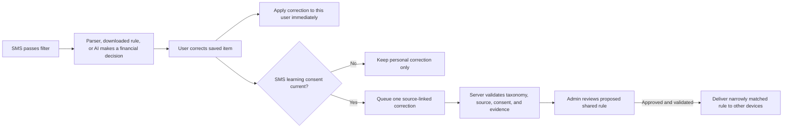

# Every user correction after SMS filtering: remaining learning plan

Updated: 2026-10-28. This is a separate continuation plan for SMS that **passed** the existing safety and promotional filter and then received a parser, downloaded-rule, or AI decision. It covers every meaningful user correction to that decision, including category, amount, merchant, time, direction, instrument, transaction/bill/mandate kind, false transaction, and false dismissal. Filter-drop recovery is outside this scope. Recheck the dirty checkout before implementation; other agents may be changing the SMS learning worktree concurrently.

## Intended behavior

The user's explicit correction outranks the previous parser, downloaded rule, or AI decision for that SMS. The correction is a typed before/after event, not automatically a universal truth about a merchant or message pattern. A merchant can produce both travel and subscription payments. Repeated edits by one user must not multiply evidence. Admin approval is required before a shared rule reaches other users. AI may explain an error but cannot publish the correction or modify the user's transaction. Cosmetic edits unrelated to an SMS decision do not create shared learning. Splitting one expense into personal budget shares is also not proof that the original SMS classification was wrong.

An SMS can contain more than one financial fact. Link a correction to the source **and** the affected fact/transaction when available, so changing one amount or category does not invalidate a separate correct fact from the same message. Preserve the origin and version of the decision being corrected (built-in parser, downloaded rule, or AI).

## Findings in the current checkout

| Correction surface | What exists | Remaining gap |
| --- | --- | --- |
| Auto-Resolved → Change Category | `SmsAutoResolutionController.changeCategory` updates the local receipt/transaction, stores a local merchant category rule, and queues `category_changed` when consent exists. | Verify the original label is preserved, the local rule is not overbroad, and the server/admin review covers the correction. |
| Auto-Resolved → Edit Transaction | `editTransaction` queues `edited` with corrected merchant, amount, and time. | Ensure all corrected fields and the original decision are represented consistently; a later user correction supersedes the earlier AI-only proposal. |
| Auto-Resolved → Move to Review or restore an AI dismissal | `moveToReview` undoes a filed result and queues `moved_to_review` with consent. | Wrong financial filing and wrong AI dismissal need distinct negative/positive labels and a reviewable admin case; an `ignore_noise` family move is not currently a parser negative example. |
| Needs Review → manually save transaction | `_recordReviewedTransactionFeedback` queues `confirmed` or `edited` with a corrected `categorySlug`. | The shared category aggregate currently reads `category_changed` events, so a category corrected during manual save does not become a category vote. |
| Needs Review → manually save bill/commitment | `_recordReviewedBillFeedback` queues `confirmed` or `edited` with due amount/date and commitment category. | The server feedback allowlist does not include `billerName`; bill categories use a different taxonomy from spend categories. Verify which corrected fields survive and whether the saved commitment stays linked to the source SMS. |
| Needs Review → discard one AI fact | `_resolveFactSuggestion` removes a selected suggestion locally, or removes the review item when it was the last fact. | No verified negative feedback is queued for that specific rejected fact. Do not mark other correct facts from the same SMS wrong. |
| Needs Review → Ignore message / dismiss commitment | The dismissal path removes the item and sends `user_dismissed` with `ignore_noise`. | "I do not want to track this" and "this was not a financial event" are different labels. Do not train a global nonfinancial rule from a preference-only dismissal or an already-paid/duplicate bill. |
| SMS fact override | `/sms/facts/overrides` stores a structured override and may record learning. | Bring amount, merchant, date, direction, category, and kind overrides under the same source-linked correction contract; do not confuse parser-field training with category learning. |
| Activity → Edit Transaction or change transaction status | The general editor saves amount/category/merchant/date/type changes and may offer personal bulk/future merchant rules. SMS provenance is available through `source_key`/observations. | No verified SMS shared-learning event is emitted from this editor. Link only SMS-backed transactions, and enqueue meaningful feedback after the edit succeeds, including offline replay. Distinguish delete/ignore/refund from a parser error. |
| SMS Bills/Subscriptions → paid, dismiss, or edit | SMS-backed commitments and bill receipts have their own status and category model. | Paying a bill is a lifecycle event, not automatically a parser correction. Only an explicit "wrong bill/kind/fields" action should create negative or corrected learning, with source linkage. |
| Existing personal and shared category rules | Local user rule runs before built-in category inference; shared category rules require aggregate support and admin approval. | Define precedence after a later user correction, revocation, and mixed merchant contexts; avoid learning a blanket merchant rule from a one-off transaction. |
| Taxonomy | The app's SMS spend fact contract has 15 spend categories. SQL category aggregation uses a different allowlist. | Reconcile app, API, SQL, and admin validation. `subscription` is a commitment kind, not a current spend category slug. |

## C1 trace table (2026-10-28 inventory)

Columns: user action → saved financial record → durable feedback → API/DB → admin/rule effect. "—" means the step does not exist in the current checkout.

| # | Surface / action | Local save | Durable feedback | API / DB write | Admin or rule effect |
| --- | --- | --- | --- | --- | --- |
| 1 | Auto-Resolved → Confirm | receipt kept, `SmsImportStore` row resolved | `confirmed` via `SmsFeedbackOutbox` `sms_auto_resolution_controller.dart:213` | `POST /sms/learning-feedback` → `sms_learning_examples` positive example | Worker candidate synthesis only; no delivery without separate approval |
| 2 | Auto-Resolved → Change category | receipt + transaction updated, personal `merchant_category_rules` row | `category_changed` (`controller:213` region) | `sms_learning_feedback_events`, `sms_shared_category_rules()` vote | 10-user / 90% aggregate → admin category approval → bundle |
| 3 | Auto-Resolved → Edit transaction | receipt amount/merchant/time updated | `edited` with corrected fields | learning example (generalized values) | Parser field training path |
| 4 | Auto-Resolved → Move to review | all rows for `source_key` deleted (`controller:143-147`) | `moved_to_review`, negative example only when family ≠ `ignore_noise` | negative example `isNegative` | No admin case, no AI diagnosis |
| 5 | Auto-Resolved → restore an AI dismissal | review item restored | `moved_to_review` with `ignore_noise` family | nothing (skipped by `family !== 'ignore_noise'` guard, route :365) | **Gap** — false dismissal is not recorded |
| 6 | Needs Review → save transaction | transaction inserted, review item removed | `confirmed`/`edited` via `_recordReviewedTransactionFeedback` (`needs_review_screen.dart:322-396`) | event row; `original_category_slug` always NULL because the app sends key `category`, which `SAFE_FIELDS` drops | Category vote only when action stays `category_changed`; manual save never votes |
| 7 | Needs Review → save bill/commitment | commitment created | `_recordReviewedBillFeedback` (`:398-458`) | `billerName` is not in `SAFE_FIELDS`, so biller is dropped | Bill field training loses the corrected biller |
| 8 | Needs Review → save bill from list tile | commitment created | — (`_reviewBill` `:3176-3240`) | — | **Gap** — no learning at all on this path |
| 9 | Needs Review → discard one AI fact | that suggestion removed, other facts kept | — (`_resolveFactSuggestion` `:3000-3014`) | — | **Gap** — rejection of a specific fact is invisible |
| 10 | Needs Review → ignore message | item removed, dismissal outbox | `dismissed` + `ignore_noise` (`user_cards_repository.dart:1985`) | `recordReviewDismissal` | Preference and "not financial" share one label |
| 11 | SMS fact override (`/sms/facts/overrides`) | override applied locally | `sms_facts_outbox.dart` (has `factIndex`) | `fact_overrides` + `sms_learning_feedback` + `sms_learning_examples` + exposure `correction=true` | Consent checked server-side only; device enqueues unconditionally |
| 12 | Activity → edit transaction | `PATCH /transactions/:id` (`user_cards_repository.dart:2436`) | — (`edit_transaction_screen.dart` has zero SMS references) | — | **Gap** — SMS provenance is dropped by the route (`transaction_detail_screen.dart:721-723` passes no `extra`) |
| 13 | Activity → bulk category / card reassign | `editTransaction` per id (`activity_screen.dart:208,310`) | — | — | **Gap** |
| 14 | Activity → ignore as refund / reversal / transfer | `markInactive` (`transaction_detail_screen.dart:527-530`) then `POST /transactions/:id/ignore` | — | — | **Gap** — lifecycle and "wrong classification" are indistinguishable |
| 15 | Bills → mark paid / "not a bill" | `CommitmentsRepository.markAsPaid` / `save` (`sms_bills_section.dart:214,219`) | — | — | **Gap** — and the local `Commitment` carries no source key |
| 16 | Payments due → commitment paid / dismiss / delete | `payments_due_screen.dart:2387,2427,2431` | — | — | **Gap** |
| 17 | Payments due → card bill amount/min-due/date/paid | local `financialStore` only (`:1395-1539`) | — | — | **Gap** — never leaves the device |
| 18 | Subscriptions → edit / ignore | `PATCH /recurring/:id` sets `user_edited`; `POST /recurring/:id/dismiss` | — | server knows `user_edited` only | **Gap** — no corrected before/after labels |
| 19 | Shared rule exposure telemetry | — | `sms_rule_exposure_outbox.dart` → `POST /sms/rule-exposures` | joins server-issued `sms_rule_candidate_assignments` (stage + `bundle_version`) | Exposure has no own rule hash; attribution is indirect via assignment |
| 20 | `ai_auto_resolved` upload | n/a | AI proposal outbox | `sms_ai_learning_proposals` (pending) | Admin evidence approval only; superseded by any explicit event for the same source |

### C1 findings that constrain C2-C4

- **Repeated identical SMS collide.** `sourceKey` is `sha256([account, sender, body])` with no timestamp (`sms_intake_repository.dart:10-26`), and `sms_import_store.dart:118-127` drops the second identical sender+body. Two identical "Rs 500 debited" messages on different dates therefore share one source identity; a correction to the second would supersede the first. Fixing identity is a wider change than this plan authorises, so the contract must at least carry the occurrence timestamp it was corrected against and the server must not treat a later identical message as the same fact.
- **No correction taxonomy exists.** Only `user_disputed_ai_decision`, `user_dismissed`, and `bundle_dismissed` exist today. There is no way to say wrong-category vs wrong-amount vs not-a-transaction vs already-paid vs duplicate vs cosmetic.
- **No per-fact isolation on Auto-Resolved.** `factIndex` exists only for Needs Review fact overrides. `changeCategory` updates every row sharing `source_key` (`controller:228-233`) and `moveToReview` deletes every row. A two-fact message cannot be corrected fact-by-fact on that screen.
- **`decisionOrigin` is an unused optional.** `sms_feedback_outbox.dart:51,84` accepts it; only `app/providers.dart:6436` passes the literal `'gemini'`. No rule id or hash is ever sent, so a correction cannot name the downloaded/shared rule that produced the label.
- **Dismissals are not content-idempotent.** `sms_dismissal_outbox` is keyed `(namespace, source_key)` and mints `Uuid().v4()`, so a retry of the same dismissal is a new event unless the server dedupes by content.
- **No offline replay for edits.** Activity edits are a direct authenticated PATCH. Only fact overrides and rule exposures replay offline. There is no pending-edit table, so "queue after sync acknowledgment" is not available for the generic editor yet.

## Ordered engineering tasks

| ID | Task | Status | Completion evidence |
| --- | --- | --- | --- |
| C1 | Inventory every meaningful post-filter SMS correction path and its source linkage (`source_key`, affected fact/transaction, observation, auto-resolved receipt). Distinguish SMS from email, statement, and manual transactions; audit how identical sender/body messages on different dates receive source identity. | **Complete 2026-10-28** | 20-row trace table above with file:line for every surface; 9 missing-capability paths named; repeated-message collision and missing per-fact isolation documented. |
| C2 | Define one typed correction envelope: source and affected fact/transaction IDs, prior decision origin/version/rule hash, prior fields/classification, corrected fields/classification, action reason/time, consent grant, and idempotent event ID. Preserve local source evidence; upload only privacy-safe context. Include account/card attribution as a correction type without sharing account identifiers. | **Implemented 2026-10-28; full cross-surface wiring pending** | Migration `20261027190000_sms_correction_contract.sql` adds `correction_kind` (15 typed reasons), `decision_origin`, `decision_rule_id`, `fact_key` (source:factIndex), `message_at`, `commitment_category` and `superseded_*`; one current correction per (profile, fact) via partial unique index, older rows retained; `pandapay.sms_supersede_corrections()` is owner-scoped. API rejects unknown taxonomy/provenance/rule id/fact index (400), routes spend vs commitment categories, and supersedes before insert in the same transaction. Device outbox carries the same fields and derives fact-distinct event ids. Tests: `db/tests/20261027190000_sms_correction_contract_test.sql` (rc 0), `api/test/sms_correction_contract.test.js` (11/11), `app/test/data/local/sms_feedback_outbox_test.dart` (6/6). |
| C3 | Complete capture from Auto-Resolved, Needs Review transaction and bill saves, single-fact rejection, SMS fact override, Activity edit/status, SMS commitment correction, and AI-dismissal reversal. Distinguish explicit "wrong decision" from preference-only dismissals, duplicate, already-paid, refund, reversal, and transfer actions. Queue only after the user's financial edit commits; offline edits queue after sync acknowledgment. | **Partly done 2026-10-28 (later session)** | Auto-Resolved now sends `decisionOrigin: 'ai'` and a typed reason (`misclassified_category`, diff-derived `wrong_amount`/`wrong_merchant`/`wrong_date`/`cosmetic`, `false_transaction` vs `false_dismissal` on move-to-review). Needs Review transaction saves send the prior label as `categorySlug` plus a diff-derived reason; bill saves now fire on **both** the editor and the list-tile save (`_reviewBill`) with a diff-derived reason and the prior commitment category; single-fact rejection (`_resolveFactSuggestion`) now enqueues a consent-gated per-fact `dismissed` correction — `false_transaction` for posted movements, `preference_only` for bill/mandate suggestions — with `factIndex` and `messageAt`, and never marks other facts wrong. The Activity editor (`edit_transaction_screen.dart`) queues an `edited` correction for SMS-backed transactions (`source` in `sms`/`sms_bulk`), resolving the original SMS sender/body from the captured-SMS store and skipping evidence when consent is off or the SMS is unavailable; kind priority category→kind→amount→merchant→date→instrument→account, custom categories stay local via canonical-slug mapping. Bulk category reassign in `activity_screen.dart` queues one `misclassified_category` correction per changed SMS-backed transaction; bulk card reassign deliberately queues nothing (a device-local card id is not shareable evidence and instrument does not change). Shared capture context and the enqueue pipeline live in `sms_learning_capture.dart`. Verified: `flutter analyze` clean on all touched files, edit/needs-review/activity feature tests 59/59, full app suite 2030/2030. **Completed in a later session 2026-10-28:** subscriptions edit/ignore (`subscriptions_screen.dart` queues `wrong_amount`→`wrong_date`→`wrong_bill_fields` on real changes and a `preference_only` dismissal), card-bill corrections from detected SMS (`payments_due_screen.dart` compares amount/minimum/due-date and queues the matching kind), and the fact-override local consent gate (`providers.dart` withholds `sampleBody`/`templateText` from the override upload unless the full capture-time consent — granted AND current policy version — is in force). Bills mark-paid/"not a bill" remains out of scope: the local `Commitment` record has no source key to attribute a correction to. |
| C4 | Reconcile category taxonomy and model transaction kind separately. A Travel → Subscription correction must become a supported subscription/commitment correction with required evidence, or remain user-reviewable; never insert `subscription` into a spend slug field without a product/schema change. Keep a user's custom category private unless it has an explicitly approved canonical mapping. | **Implemented 2026-10-28** | The SQL allowlist in `sms_shared_category_rules()` now matches the app's and API's canonical 15 (`government` and `other` were missing; `investments`, `income`, `cash` were removed). A commitment category is stored in `commitment_category` and can never enter `category_slug`; unsupported spend slugs abstain instead of being stored. `original_category_slug` is no longer always null (the app sent `category`, the server only read `categorySlug`). `billerName` survives sanitisation. AI-proposal approval requires a canonical spend slug. Tests: C2 SQL test asserts government/other vote and cash/investments/income/subscription do not; API tests assert subscription stays a commitment kind and a commitment category sent for a spend fact is refused. |
| C5 | Apply the user's latest correction locally before any built-in, AI, or downloaded shared category rule. Scope personal merchant rules carefully; a mixed-context merchant must not force one category for every SMS. | **Implemented 2026-10-28** | `sms_import_store.dart` resolves the category with explicit precedence: the user's own correction (per merchant-key label) first, then AI auto-resolution (which itself applies the stored correction before the AI category), then personal merchant rule, then downloaded/shared rule, then built-in. A merchant seen across mixed contexts is not blanket-categorised: the override only applies where the user actually corrected it. A later user edit replaces the earlier personal label. Tests: `app/test/data/local/sms_import_store_category_precedence_test.dart` (4/4: personal outranks shared, later edit replaces, mixed-context not blanket-categorised, AI auto-resolution applies user correction first). |
| C6 | Aggregate consented explicit corrections on the server by verified source, field, merchant, and message context. Count the latest explicit state once per user/source; invalidate an older AI-only label for the same SMS. Keep disagreement and false-positive examples visible. | **Implemented 2026-10-28** | `sms_facts.js` patch merge is profile-predicated and fact-scoped; supersede-before-insert (C2) keeps one current correction per (profile, fact) while older rows stay as audit history. `GET /admin/sms-learning/feedback-events` computes per-case support (distinct profiles + matching messages sharing merchant_key and target category, current, non-training) and disagreement (distinct profiles countering with a different slug) server-side, and links the latest AI proposal per source for advisory diagnosis. Tests: `db/tests/20261027200000_sms_aggregation_hardening_test.sql` (repeated edits, multi-user votes, consent withdrawal, AI conflict, source spoofing — passed on a fresh disposable DB), `api/test/sms_correction_cases_admin.test.js` (5/5). |
| C7 | Give admins a reviewable proposal with safe message pattern, previous and corrected decision/fields, origin (parser/rule/AI), support, disagreement, and exact rule scope. AI diagnosis may be shown as advisory. Approval binds to exact rule identity; rejection and revocation are audited. | **Implemented 2026-10-28** | New console tab `sms_correction_cases_screen.dart` renders the backend-generalized pattern only (never raw body/sender), the allow-listed field diff, support/disagreement, supersede state, and the AI diagnosis explicitly labelled advisory with `kSafeDecisionFieldKeys`-filtered proposal fields. Server route `GET /admin/sms-learning/feedback-events` (limit clamp 1–200) applies the same redaction/withholding rules as the proposal routes; a serialized-response test asserts no raw body, account, reference, or OTP keys. Tests: `console/test/features/parser_patterns/sms_correction_cases_screen_test.dart` (8/8), `api/test/sms_correction_cases_admin.test.js` (5/5). |
| C8 | Verify locally, then run device acceptance. Use a disposable fully migrated PostgreSQL database, focused API tests, Flutter app/console tests and build, plus one physical-device or emulator flow. | **Activity category correction upload verified on emulator 2026-10-31; broader device acceptance open** | The initial device run failed on D1/D2; the follow-up fixed both and produced one consented server feedback event. Focused app tests: 37 passed. See the dated run sections below. Other correction surfaces and second-device rule delivery still need acceptance. |
| C9 | Protect active shared rules after a user correction. Attribute the correction to the exact delivered rule/candidate and count it as negative evidence without treating one subjective category choice as proof of a global defect. Pause or roll back a rule only through defined safety thresholds/admin action; keep the correcting user's override immediate. | **Implemented 2026-10-28** | Migration `20261027200000_sms_shared_rule_negative_evidence.sql`: `pandapay.sms_rule_negative_evidence()` rollup (current, non-superseded, non-cosmetic/preference corrections per decision_rule_id with distinct-profile counts), configurable pause threshold in `public.sms_learning_settings` (FORCE RLS, no policies, invalid values fall back to 3), `pandapay.sms_shared_rule_paused(rule_id)`. Serving path withholds paused rules from users with no prior assignment (prior assignments keep working), and a pause-lookup outage falls back to previous behaviour. `GET /admin/sms-learning/rule-negative-evidence` exposes counts only. Tests: `db/tests/20261027200000_sms_shared_rule_negative_evidence_test.sql` (passed on fresh DB), `api/test/sms_shared_rule_pause.test.js`. |

## Cases to test

1. AI labels a posted transaction Travel; user changes it to another **valid spend category**. Check local Activity, outbox, server event, admin evidence, and next SMS.
2. A deterministic parser or downloaded rule labels it Travel; user changes it. Preserve the decision origin and confirm the shared rule loses to the user's correction.
3. User changes category during Needs Review manual save. The correction must count as a category correction, not only a generic transaction edit.
4. User edits an SMS-backed transaction later from Activity, online and offline. A statement/manual transaction edit must not enter SMS learning.
5. User selects Subscription. Verify whether the product should create/modify a subscription commitment; if required fields are missing, keep it in review. Do not publish an invalid spend category.
6. Same merchant sends a travel booking SMS and a subscription renewal SMS. A broad merchant-only category rule must abstain or use validated message context.
7. Two corrections by the same user, a duplicate retry, two devices for one account, and consent withdrawal. Count only current eligible evidence and remove shared influence after revocation.
8. Admin rejects, approves, and later revokes a proposal. Another device receives only approved, current rules; the correcting user's choice continues to win.
9. Rule or AI gets amount, merchant, time, direction, instrument, or transaction/bill kind wrong. The saved correction becomes field-specific evidence; unrelated fields and previously correct decisions are not treated as wrong.
10. AI incorrectly dismisses a financial SMS, and the user restores it. Record the false dismissal distinctly from a false transaction; the restored SMS remains reviewable until a valid financial decision is saved.
11. One SMS has both a correct debit and an incorrect bill suggestion. Discarding only the bill creates a negative label for that fact; the debit remains valid and no duplicate transaction is created.
12. A user pays a valid bill, dismisses a wrong bill, or changes its amount/due date/biller. Only the wrong/corrected decision contributes learning; ordinary paid status does not. Verify server allowlisted fields preserve the safe corrected bill facts.
13. Correct a wrong card/account attribution, duplicate filing, or spend-versus-transfer decision. Keep account/card identifiers local; propose a general rule only when safe evidence supports it.
14. Correct a transaction produced by an already approved shared rule. Link negative evidence to that exact rule, protect the user immediately, and verify admin review plus pause/rollback behavior without overreacting to one subjective label.
15. Repeated sender/body messages across dates, simultaneous edits from two devices, correction followed by a change back, and old pre-consent edits. Preserve distinct events where appropriate; latest explicit state wins; do not retroactively upload old private data.
16. Treat SMS text as untrusted input to any AI diagnostic. A prompt injection or identifier in an SMS must not alter the decision contract, leak raw content, or bypass admin approval.
17. Compare "Not a transaction" with "Do not track", "duplicate", "already paid", "refund", "reversal", and "transfer" actions. Only an explicit classification error trains the corresponding negative label; ordinary lifecycle or preference actions remain personal.
18. A user creates transaction splits or assigns a private custom category. Preserve the personal change, but do not infer a global SMS rule without a supported canonical correction label.
19. Pay Later drawdown versus repayment, card bill payment, investment allotment, future due notice, refund, and transfer. Correcting one kind must not create a duplicate spend or silently remove an unrelated bill/commitment; shared rules must preserve each case's financial meaning.

## Release boundary

### 2026-10-28 independent code-review correction

The C5-C9 rows above record earlier local implementation claims. A later code audit found the following gaps, so those rows must **not** be read as final release acceptance:

| Area | Current review finding | Release status |
| --- | --- | --- |
| C2/C3 occurrence identity | `smsSourceKey` intentionally hashes account/sender/body without received time so the live broadcast and inbox scan converge. Truly separate identical SMS on different dates also collide and cannot create independent financial records. This is a known ingestion identity limitation, not a shared-learning-template defect; changing it needs a stable provider row ID plus coordinated intake/import idempotency migration. | Deferred outside this learning change; do not claim distinct exact-repeat financial occurrences are independently supported. |
| C3 offline edits | Added a durable sync-ack sidecar so an offline SMS transaction edit can enqueue learning only after the financial update is accepted. Consent is checked against the edit time and refreshed before upload; focused and end-to-end verification remain pending. | Implementation added; verification pending. |
| C5 personal category scope | Auto-Resolved category corrections now store a local sender/merchant/message-layout rule; a different message layout from the same merchant abstains. Activity correction capture also records a personal contextual rule. Existing historical merchant-only personal rules remain for compatibility. | Implemented locally; mixed-context and legacy-rule behavior need regression/device checks. |
| C5 shared category scope | Historical finding: v1 category rules identified a merchant/category pair without SMS context. The 2026-10-28 v2 implementation now binds candidates and approvals to merchant, institutional sender, finite message context, and fact family. | Merchant-wide blocker resolved in implementation; migration, API, app, and console tests plus device acceptance remain pending. Legacy v1 approvals remain stored but are no longer served. |
| C7 admin cases | New local migration/API/console work adds audited approve/reject/revoke of individual explicit correction evidence; category votes require evidence approval and still need separate final rule approval. | Implementation added; fresh migration and admin UI checks pending. |
| C9 rule attribution and pause | An applied candidate is now recorded locally and the API verifies source/profile assignment before counting a client rule ID. Paused candidates are withheld from existing assignees on refresh as well as new users. Static global bundles and merchant-only category rules still need their own exact correction attribution. | Candidate path implemented; wider rule families open. |

No production deploy or physical-device acceptance is established by this audit. Complete the remaining source-identity and shared-context design before calling every scenario stable; then run the local database/API/Flutter/admin/emulator gates in C8.

### 2026-10-28 integration audit continuation

- Fixed a decision-labeling defect in `needs_review_screen.dart`: accepting and saving an AI fact previously called the same helper as rejecting it. The helper now only removes/resolves a fact; an explicit bill rejection queues a separate `misclassified_kind` correction for that fact index. This prevents a successful transaction/bill save from being uploaded as a false negative. A screen-level regression assertion still needs to be added and run.
- The single-message `Ignore message` action now asks whether the user means “Not a financial transaction” or “Don’t track this SMS.” Only the explicit classification option emits `false_transaction` (or `misclassified_kind` for a bill/mandate suggestion) and carries the predicted family into the retry payload; the preference option and grouped dismissals remain `preference_only`. Retry payload coverage has been added but is not yet run.
- Explicit false-financial decisions also write a private, layout-scoped local ignore rule even when shared-learning consent is off. `SmsImportStore` applies that exact sender/context rule before local parsing and any server/AI intake; preference-only dismissals never create it. Test coverage is added but still needs execution.
- Category-rule admin cards now request evidence keyed by both merchant and proposed category, include a redacted sample for the console, and run it through `safeAdminPattern` before returning it. The evidence query is limited to currently consented, admin-approved corrections or AI proposals. Added API, console API, and SQL regression coverage; these remain unrun in this implementation-first phase.
- Root cause found for one auto-resolved-to-admin-learning failure: the app enqueued `decisionOrigin: 'gemini'`, but both app and API allow only the normalized origin `ai`. `SmsFeedbackOutbox.enqueue` rejected the event synchronously, and the caller swallowed that exception, so no proposal reached the server. Corrected the origin to `ai`; verify through the actual queue/upload/admin path during acceptance tests.
- The implementation remains **not ready for acceptance testing**. Two design gaps still affect future shared learning: (1) exact repeated SMS bodies across different real occurrences collapse under the existing source key; (2) approved shared category rules are merchant-wide and cannot distinguish different message contexts. Do not claim all correction scenarios are covered until those are either safely scoped/fenced or formally deferred with a migration/design decision. The local contextual personal override is narrower and does not solve the shared-rule gap.
- Work from this continuation has not been validated by tests or a build. After the code review closes, run the full local API/SQL/app/admin matrix and emulator flow against disposable local state; do not use production for acceptance.

Implement and test C1–C9 locally before commit/push/deployment. Run `git diff --check`; record exact API, SQL, app, console, and build results. A stalled or skipped Flutter command is unverified. Preserve the existing dirty worktree and user data; do not uninstall the app or clear its database for testing. Keep this plan's status current after each session.

## 2026-10-28 C1-C4 checkpoint

- C1, C2 and the C4 taxonomy reconciliation are implemented and verified locally. C3 is partly done (Auto-Resolved and both Needs Review recorders now emit typed reasons and provenance); the remaining capture surfaces are listed in the C3 row.
- Verification completed this session: fresh disposable database `pandapay_c2` with all 111 migrations plus `setup_app_role.sql` (only `0013_cron_jobs.sql` skipped, pg_cron unavailable); all six SMS SQL tests pass on both the fresh and the earlier disposable database, including the new `20261027190000_sms_correction_contract_test.sql`; `npm test` in `api/` is 1009 pass / 0 fail / 3 skipped (two new test files, one legacy test updated from a non-canonical slug to the canonical contract); `flutter analyze` clean on every touched Dart file; `sms_feedback_outbox_test.dart` 6/6, `sms_import_store_ai_resolution_test.dart` 26/26, `needs_review_repository_test.dart` 58/58.
- Nothing committed, pushed, deployed or device-tested in this session. The worktree still carries the unrelated import/provider changes and must not be staged with these files.
- **Next exact task (C3, in order):** add feedback to the Needs Review list-tile bill save (`needs_review_screen.dart:3176-3240` `_reviewBill`) and the single-fact rejection path (`:3000-3014` `_resolveFactSuggestion`), then Activity edit/bulk/status with SMS provenance threaded from `transaction_detail_screen.dart:721-723` through `edit_transaction_screen.dart`, then the subscriptions editor. Each must enqueue only after its local save commits and must reuse the typed reason vocabulary rather than a bare action. **Done in a later session 2026-10-28:** list-tile bill save, single-fact rejection, Activity editor and bulk category reassign all capture now, behind the shared `sms_learning_capture.dart` pipeline. Remaining C3 surfaces: subscriptions edit/ignore, card-bill corrections, and the fact-override consent gate.
- **Known limitation carried forward:** `sourceKey` hashes only account, sender and body (`sms_intake_repository.dart:10-26`), so two identical SMS bodies on different dates share one identity and the second is dropped at `sms_import_store.dart:118-127`. A correction therefore applies to the single ingested occurrence. Changing source identity touches SMS ingestion dedup semantics and is out of scope for this plan; `message_at` was added so evidence can at least show which occurrence the user was correcting.

## 2026-10-28 C5-C9 checkpoint

- C3 is complete except Bills mark-paid/"not a bill" (the local `Commitment` record has no source key to attribute a correction to; a structured linkage is a schema change, not a capture change). The remaining C3 surfaces from the previous checkpoint — subscriptions edit/ignore, card-bill corrections from detected SMS, and the fact-override consent gate — are implemented. All capture now goes through `app/lib/features/activity/sms_learning_capture.dart`, which validates the 64-hex source key, reads consent at capture time (granted AND `sms-shared-learning-v2`), resolves the original sender/body from the captured-SMS store, and enqueues into `SmsFeedbackOutbox` with a fact-distinct UUIDv5 event id. Every enqueue happens after the user's local edit commits and never throws into the UI path.
- L14 (wrong-transaction dispute) is implemented on top of the same envelope: transaction_detail_screen offers "Report wrong transaction" as a fourth ignore reason (`false_transaction`, reason `wrong_transaction_dispute`), and restoring it records a `false_dismissal` withdrawal (`moved_to_review`, reason `wrong_transaction_report_withdrawn`) that supersedes the dispute via fact_key while retaining it as audit history. `wrong_transaction` was added to the API ignore-reason allow-list as a one-line change. Refund/reversal/transfer stay lifecycle-only and never learn.
- C6/C7 server: `GET /admin/sms-learning/feedback-events` returns correction cases with server-computed support/disagreement, allow-listed field diffs, and an explicitly advisory AI diagnosis (`advisory: true`). The console renders only the backend-generalized pattern and `kSafeDecisionFieldKeys`-filtered proposal fields; a serialized-response test asserts no raw body/account/reference/OTP ever appears.
- C9 server: negative-evidence rollup, configurable pause threshold, and serving-path pause filtering are in place. A test expectation in `sms_shared_rule_pause.test.js` was corrected (it asserted the buggy pre-C9 behaviour of serving paused rules to users with no prior assignment); the implementation was already correct.
- Verification this session: fresh disposable DB `sms_verify_oct28` — all migrations (except 0013 cron) plus `db/setup_app_role.sql`, then all six 2026-10-27 SQL suites pass (the earlier run without `setup_app_role.sql` failed with permission denied; that script is a required step on a fresh database). `npm test`: 1022 tests / 1019 pass / 0 fail / 3 skipped. App `flutter analyze` exit 0 with zero issues in touched files; console analyze clean after wrapping one pre-existing lint; console tests 40/40 including the new advisory-diagnosis widget test. Full app suite: one failure (`sms_capture_pipeline_test.dart` offline-request race) that passes 3/3 in isolation — treated as a flake per the standing protocol and rerun at suite level.
- Nothing committed, pushed, deployed or device-tested in this session yet. The worktree still carries unrelated import/provider work (`api/src/index.js` status column, `financialStoreRevisionProvider` rewrite in `providers.dart`, `duplicate_ingestion.test.js`) that must be hunk-split out of any SMS commit.

## 2026-10-28 capture scenario matrix checkpoint

- Added `app/test/features/activity/sms_learning_capture_matrix_test.dart`: 15 widget-test scenarios over the single capture choke point, all passing — consent off, stale policy version, full parser-origin envelope (source key, sender, consent fields, redacted `sampleBody`, `originalDecision`), AI origin, non-SMS source, malformed source key, SMS absent from the device, offline queue vs online flush, custom-category slug omission, dispute vs preference-only kinds, stable-id dedup, two facts from one message, shared-rule attribution, and local-first rule recording.
- Harness requirement worth keeping: the test widget must `ref.watch` `categoriesProvider`, `isOnlineProvider` and `smsSharedLearningConsentProvider`. Capture code reads them with `ref.read(...).valueOrNull`; unwatched they are still `AsyncLoading`, so an "offline" scenario silently ran the online path and `categorySlug` resolved to null.
- Coupling to uncommitted work: on a clean `HEAD` checkout 12 of the 15 scenarios pass; the shared-rule attribution and local-first-rule scenarios fail, because `sms_learning_capture.dart` currently calls `SmsRuleExposureOutbox.appliedCandidateForSource` and `SmsLearningFeedback.recordCategoryCorrection` before the consent gate, neither of which is committed. This test file therefore cannot be committed on its own — it must land with that lib change or two scenarios stay red in CI.
- New gap found while writing the matrix at that checkpoint: stable-id actions omitted `correctionKind` and `reason` from their UUIDv5 seed, allowing a revised dismissal to collide. **Fixed in the 2026-10-28 implementation review continuation below**; a regression test is added but not yet run.
- The shared worktree does not compile at the time of writing, so these results were produced in a detached `git worktree` holding a copy of the current dirty `app/lib` (patched only inside the copy): `sync_queue.dart:62` returns nothing from `int enqueueUpdate`, `edit_transaction_screen.dart` uses an undeclared `financialChanged` (4 references, no declaration), and `needs_review_screen_test.dart:156` overrides `dismissSms` without its new `correctionKind` parameter. Measured cost of those three: 6 activity test files fail to load, plus 4 existing `test/data/local` failures (feedback-outbox event-id expectation, `changeCategory` rule precedence, context-pattern key, AI-review note text). None of them are this file's failures and none were edited here.
- Device acceptance still not performed. A dev APK built from clean `HEAD` against the local backend (`PANDAPAY_API_BASE_URL=http://10.0.2.2:4001`) was in progress; the dirty tree cannot be built at all.

### Update 15:15 — shared-rule attribution narrowed and scoped per fact

- Applied the requested cheap fix to the provenance relabel. It now fires only when the correcting surface itself declared `parser`; `ai`, `manual`, `downloaded_rule`, `shared_rule` and a null origin keep what the surface asserted, because overwriting them blamed a shared candidate that was never involved.
- Attribution is now per fact rather than per message. `SmsRuleExposureOutbox.appliedCandidateForSource` (which read `sms_rule_source_attribution`, keyed only by `namespace + source_key`) is replaced by `appliedCandidateForFact(namespace, sourceKey, {family})`, which selects the exposure row with `applied=1 AND matched=1 AND candidate_family=?`. The family is the corrected fact's `originalDecision['kind']`, so a candidate that produced the bill fact of a mixed message is no longer blamed for a spend correction, and a family the candidate never produced (or a `dismissed` correction with no family) attributes nothing. Both relabel sites — `sms_learning_capture.dart` and the deferred offline path in `sync_engine.dart` — use it; those were the method's only two readers.
- `sms_rule_source_attribution` is still written by `SmsRuleExposureOutbox.enqueue()` but now has no reader. Left in place deliberately: it is another agent's new table and may be intended for exposure reporting; deleting the write was outside this fix.
- Residual limitation this fix does **not** remove: two facts of the *same* family in one message (e.g. two `posted_movement` rows) still cannot be told apart by family, so `factIndex` remains unattributed. Only decision-time provenance, stored with the ingested row, closes that.
- Also removed the analyze issue in the block: `'ruleId': ?candidateId` instead of a null-check `if`.
- Matrix now 18 scenarios, all green **in the working tree** (the three earlier compile defects were fixed by their author at 14:52–15:02, so the sandbox is no longer needed): added "a candidate that produced a different fact is not blamed" and "a manual decision keeps its own origin despite an attribution", and split the dedup scenario into "an identical retry collapses to one event" plus "a revised reason for the same fact is a new event" after the seed fix landed at `sms_feedback_outbox.dart:132-140`.
- First full app-suite run ever executed against this learning work (11m33s, tree changing underneath it): 1710 pass / 63 fail. Attribution of those 63, by re-running each failing file alone: **55 were compile-load failures** caused by 8 errors in `edit_transaction_screen.dart` while its author was mid-edit (`financialChanged` undefined plus a `Future<void>` helper left without async/return); **5 of the 8 assertion failures passed alone** (`needs_review_screen_test` 45/45 — its `pumpAndSettle timed out` was contention; `sms_import_store_ai_resolution_test` 29/29; `sms_import_store_category_precedence_test` 5/5; `sms_rule_bundle_test` 17/17, so the v2 context work passes).
- One genuine, reproducible regression, **not** from this fix: `sms_feedback_outbox_test.dart` "two facts in one message are distinct idempotent events" asserts `enqueue(1) == second` for `action: 'edited'`, but the dirty tree now routes `edited`/`category_changed` to `Uuid().v4()` where committed `HEAD` used `Uuid().v5` for every action. So the outbox's own doc comment ("keyed independently so retries cannot overwrite a later correction") and its committed test now contradict each other. Needs an owner decision — keep v4 and update the test to assert distinct-per-retry, or restore determinism for `edited` — not a literal to re-pinned here, since the seed moved twice this afternoon.

### Update 15:25 — state of the shared tree

- `edit_transaction_screen.dart` is mid-edit again (8 analyzer errors: `financialChanged` at :194/:219, and `_queueSmsEditFeedbackAfterSync` at :301-328 missing `async`/returns), so the app tree does not compile at the time of writing and no device build or full-suite verdict is currently possible. The three files this fix touched analyze clean, and the matrix runs green in isolation because the edit screen is not in its import graph.

## 2026-10-28 implementation review continuation

- Fixed a mismatch between local AI resolution and shared admin evidence: the provider previously labelled an auto-resolved result using `suggestions.first`, while `resolveAiSuggestions` files the highest-scoring actionable fact. `SmsAiResolutionResult.factFamily` now carries the exact family applied by the resolver (`ignore_noise` for an explicit AI dismissal), and the learning event uses it. Added regression expectations for an informational fact preceding the transaction and for AI dismissal. These tests have not been run in this implementation-first phase.
- Static audit still finds the pre-existing shared category rule contract is merchant-only: `sms_shared_category_rules()` aggregates per merchant and `SmsSharedCategoryRule`/`LocalSmsParser._sharedCategoryRuleSlug` match by merchant without message-context evidence. This can misclassify a merchant with multiple purchase contexts; do not mark shared-category learning fully safe until the rule is context-bound or its rollout is explicitly fenced.
- Hardened the deploy audit check for consent: it now evaluates the latest purpose-specific consent, verifies example creation is after the current grant, checks exact grant/policy timestamp equality for proposals and feedback events, and includes `sms_learning_feedback_events`, which the previous check omitted. The direct SQL correction-review RPC now rejects a null decision deterministically. Added SQL regression fixtures for withdrawn/re-granted stale evidence and null RPC decisions; not run yet.
- Fixed stable outbox event identity to include `correctionKind` and normalized `reason`. A revised dismissal can no longer collide with an earlier queued classification/preference event; identical retries remain idempotent. Added an outbox regression test; not run yet.
- Fixed a static compile defect in the offline edit path: `SyncQueue.enqueueUpdate` is non-nullable `int` but its empty-fields branch returned no value. It now returns sentinel `0` for the documented no-op, with an assertion added; SMS sidecars are only attached after a real edit is queued. Not analyzed/tested yet.
- Source identity remains `account + sender + body`; exact repeated SMS occurrences can collapse. The live-broadcast/inbox convergence rationale is intentional, so do not add receive time to the hash. Distinct exact-repeat financial occurrences need a separate migration based on stable provider row IDs; this is documented as a limitation, not changed here.
- Acceptance testing remains deferred until the static audit closes; no tests, builds, deployments, commits, pushes, or device changes were performed in this continuation.

## 2026-10-28 v2 shared-category context checkpoint

This checkpoint supersedes the earlier **open shared-category scope** finding above. The finding accurately described the merchant-only v1 contract at that time; the new v2 implementation closes that design blocker in the working tree, pending verification.

- **Rule identity:** v2 uses the exact tuple `(merchant_key, sender_key, context_key, fact_family)`, with `category_slug` as the approved result. Only `posted_movement` category rules are eligible. The sender must be an institutional SMS sender ID matching `^[A-Z]{2}-[A-Z0-9]{3,10}(?:-[A-Z])?$`; phone and personal sender values abstain.
- **Message context:** API and app use the same uppercase ASCII whole-word matcher and the finite sorted vocabulary `BROADBAND, CAB, DIESEL, DINING, EDUCATION, ELECTRICITY, EMI, ENTERTAINMENT, FLIGHT, FUEL, GROCERIES, GROCERY, HOSPITAL, HOTEL, INSURANCE, INVESTMENT, LOAN, MEDICAL, MOVIE, MUTUAL, PHARMACY, PETROL, RENEWAL, RENEWED, RENT, RESTAURANT, RIDE, SALARY, SCHOOL, SUBSCRIPTION, SUPERMARKET, TAX, TRAIN, TRAVEL, TUITION, UTILITY, WALLET`. The normalized merchant is removed from message matching and any vocabulary token contained in its punctuation-stripped name is excluded. Context keys are sorted, unique, and limited to eight tokens; no token or more than eight matches means abstain. The SQL validator rejects unknown, duplicate, unsorted, or overlong keys.
- **Evidence and approval:** migration `20261028140000_sms_shared_category_rules_v2.sql` adds scoped sender/context evidence to feedback and AI proposals, a v2 aggregation over admin-approved explicit corrections and admin-approved AI proposals, and a composite-key v2 approval table/function. The aggregate keeps the latest vote per user and scoped tuple, enforces the existing 10-user/90% threshold, and requires each event's current consent grant timestamp and policy version to match its captured grant. Review rechecks the eligible tuple and audit records the exact tuple. Admin evidence is joined on that same tuple.
- **Serving and compatibility:** API active bundle returns `categoryRulesV2*` fields and the canonical v2 hash, sorting tuple fields ordinally to match Dart's string ordering. The SQL aggregate uses the app/API's canonical 15 spend categories and excludes old `investments`, `income`, and `cash` labels. It returns an empty v1 `categoryRules` list with a valid empty v1 hash so existing clients can clear cached merchant-only rules. Historical v1 approval rows are preserved in their old table, but the API no longer serves them or converts them to v2 approvals. Approved v2 rules remain gated by live, consent-valid evidence and the separate admin rule approval.
- **App and console state:** v2 model, local cache/hash validation, and strict merchant/sender/context/family matching are present in the app working tree (`sms_rule_bundle.dart`, `sms_rule_bundle_store.dart`, `local_sms_parser.dart`). Admin proposal cards show the sender/context/family tuple, and the review request sends it (`sms_category_proposals_screen.dart`, `admin_api.dart`). These are implementation observations only; app and console tests have not been run for this checkpoint.
- **Coverage limits:** this rule family covers only financial posted-movement categories and institutional sender IDs recognized by the pattern above. It depends on the fixed vocabulary appearing as a whole word in the SMS after merchant-token removal. New issuers, context phrases, non-Latin wording, mixed messages with more than eight recognized terms, missing merchant/sender, and categories outside the finite app/SQL taxonomy abstain until deliberately added to both implementations and tests. This does not expand rules to bills, mandates, personal/phone sender IDs, or arbitrary SMS templates.
- **Verification status:** the old merchant-wide blocker is resolved in the implementation, but acceptance is **pending**. New API and SQL tests were added, existing API coverage was updated, and app/console coverage is in the dirty worktree; these tests have not been run. Backend JavaScript `node --check` and tracked-file `git diff --check` passed. The migration, API behavior, app matcher/cache, console review flow, fresh-database migration order, and emulator/device behavior still need verification. No production deploy or device acceptance is established.

### Local verification update (2026-10-28)

- The API full suite passed: 1,033 passed, 3 skipped, 0 failed. A circular module import found by that suite was fixed by loading the two cross-module validators at their call sites.
- The focused app review/rule/auto-resolution suite passed all 91 tests, and the Activity edit screen passed all 8 tests. The Dev debug APK built successfully. Focused Flutter analysis reported style-only infos and no errors or warnings.
- The focused admin console tests passed all 5 cases. The v2 SQL regression test passed in the disposable `pandapay_sms_review` PostgreSQL database after migrations and role grants; its transaction rolled back.
- A signed-in emulator opened the new Dev app and reached Import & Sync, but this first debug build used API port 4000 while the running local API mapped to 4001. A port-corrected APK built successfully; the emulator package service then failed during its data-preserving update and remained offline after reboot. Therefore the corrected APK, admin approval round trip through the running local API, and device acceptance remain unverified. No app data was cleared and no production deploy was performed.

### Pre-commit verification update (2026-10-28)

- Fixed the two-fact feedback regression: implicit event IDs are deterministic across retries and remain distinct for different fact indices. The complete app suite then passed all 2,076 tests; the complete API suite passed 1,033 with 3 skipped; the complete admin console suite passed all 43.
- Identical sender/body SMS delivered at different timestamps still share one local financial source. The app now records that ambiguity durably and abstains from uploading corrections, dismissals, AI proposals, and deferred sidecars for that source while preserving private local corrections. Focused capture/dismissal tests passed; the full app suite above includes the new guard.
- A fresh `template0` PostgreSQL database applied 116 migrations (the `pg_cron` migration was skipped because the stock container lacks the extension). All 11 SMS learning SQL regression files passed. The real-database API test passed its exact v2 consent, approval, and rule-delivery flow against that disposable database.
- The final Dev debug APK built with local API port 4001 and auth port 3210, installed with `adb install -r` on the emulator, and reopened to the signed-in Home screen. The local API health endpoint returned 200 and Import & Sync loaded history. This is an app/network smoke check; a device-level admin-approved rule download and application remains a later acceptance check.
- No production deployment, commit, or push was performed in this verification pass.

## 2026-10-31 emulator scenario run (C8 device acceptance) — FAILS

Environment: `emulator-5554`, debug APK `1.0.15-dev` installed 2026-10-31 15:20 (postdates the
capture commit `e3669410`), `test` profile, local dev-verify stack (API :4001, auth :3210,
PostgreSQL :5544/5434 → `pandapay-dev-verify-db-1`). Namespace under test
`user:f07a2ee8-f188-46cf-a5ee-14d9fb24fe04`. Baseline before the run:
`sms_learning_feedback_events` = 0, `sms_learning_feedback` = 0, `sms_shared_learning` consents = 0.
Local device DB read with `adb exec-out run-as … cat pandapay.sqlite{,-wal}` and queried off-device.

What the run proved works:
- Consent grant through the Privacy UI persists server-side:
  `sms_shared_learning | granted=t | policy_version=sms-shared-learning-v2 | granted_at set`, which
  matches `app/lib/data/consents_api.dart:7-8` exactly.
- `adb emu sms send` → live import → Activity row → detail → Edit → category/amount → Save commits
  the financial edit: `PATCH /transactions/:id` 200 (twice), the local row is promoted from
  `local-sms:<hash>` to a server UUID with `pending=0`, and the new label renders in Activity
  (`TANISHQ … Online Shopping`) and on the detail screen (`Category / Online Shopping`).

### D1 — the repeated-occurrence dedupe guard fires on a single physical SMS (blocking)

`SmsIntakeRepository.remember()` (`app/lib/data/local/sms_intake_repository.dart:199-209`) keys a
message by `smsSourceKey(namespace, sender, body)` — the body hash excludes the timestamp — and
sets `repeated_occurrence = 1` whenever a second record of the same key carries a different
`received_at`. On device the two writers use different clocks:

| message | live receiver stored (`sms_captured_messages.received_at`) | telephony inbox (`content://sms date`) | delta |
| --- | --- | --- | --- |
| TANISHQ ₹319 | `1793445513000` (second-aligned, PDU service-centre time) | `1793445510563` | 2,437 ms |
| DOMINOS ₹749 | `1793442982000` | `1793442978614` | 3,386 ms |

Measured sequence for a freshly injected, never-before-seen body: `repeated_occurrence` was `0` and
`processed=0` at t+4 s, then `1` by t+60 s — one injection, no second `sms send`. Control: force-stop
the app, inject, cold-start (only the inbox sweep records it) → `received_at` equals the telephony
`date` exactly and `repeated_occurrence` stays `0`.

Consequence: whenever the live receiver and the inbox sweep both see a message — the normal case —
`hasRepeatedOccurrence()` is true and every capture path abstains:
`sms_learning_capture.dart:127` and `:216`, `needs_review_screen.dart:394`, `:521`, `:3215`,
`sms_auto_resolution_controller.dart:242`, `sync_engine.dart:229`. The 2026-10-28 checkpoint line
"Identical sender/body SMS delivered at different timestamps … abstains" therefore overstates the
design: it is not only genuine re-delivery, it is ordinary single delivery. Fix options: compare a
delivery *identity* with a tolerance (seconds-level skew must not count as a second occurrence), or
record occurrences in their own table keyed by the exact device timestamp, or make both writers
source `receivedAt` from the telephony inbox.

### D2 — Activity-editor corrections capture nothing even with D1 clean (blocking, not yet pinned)

KFC INDIA ₹549 was injected while the app was stopped, so `repeated_occurrence=0`, one
`financial_entities` row shares the source key, `source='sms'`, `source_key` is 64-hex, consent is
granted on the matching policy version. Two separate corrections on that row — Dining → Online
Shopping, then ₹549 → ₹555 — each produced a 200 PATCH and **no capture artifact of any kind**:
`sms_learning_feedback_outbox` = 0, `sms_learning_after_sync` = 0, `user_merchant_category_rules` = 0
(the local pre-consent write at `sms_learning_capture.dart:113-121` also never ran), server
`sms_learning_feedback_events` = 0, no learning POST in the API log, no Dart exception in logcat.

Ruled out: stale build, consent row/policy mismatch, source/sourceKey gates, multi-fact gate
(`hasMultiplePersistedFacts` counts only `transactions` here because `sms_observations` rows store
the hash in `id`, not in `source_key`), and the pop race (the amount-only edit shows no sheet).
Not ruled out and next to test: a `WidgetRef` disposed before `queueSmsLearningEvent` reaches its
provider reads (`_recordSmsEditFeedback` is `unawaited` at `edit_transaction_screen.dart:134`, and
`ref.read`/`await consentFuture` continue after `_save()` returns), or a null
`consentsApiProvider` inside that detached continuation. Both are swallowed by the
`catch (_) {}` at `sms_learning_capture.dart:185`. A widget test that pumps the real editor through
Save→pop against a real store, asserting one outbox row, is the fastest way to pin it; the existing
20-scenario host matrix cannot see this class of failure because it drives the capture helper with a
live ref.

Acceptance verdict: **C8 device acceptance fails.** L11/L14/L15 device acceptance stays open for the
same reason — no device-produced event has ever reached `sms_learning_feedback_events`.

Device state left behind (deliberately, so the next run can retest without re-injecting): consent
`sms_shared_learning` GRANTED; four SMS transactions present — SWIGGY FOODS ₹1,250 (Groceries),
DOMINOS PIZZA ₹749 (Dining), TANISHQ ₹319 (Online Shopping), KFC INDIA ₹555 (Online Shopping), all
`repeated_occurrence=1` except KFC; app still on the debug build pointed at the local dev-verify
stack. Server learning tables are still empty, so nothing from this run needs cleanup there.

## 2026-10-31 follow-up on emulator-5554

The D1 and D2 fixes were verified against the local dev-verify stack. A fresh unique SMS for
DEVICEVERIFY OCT31 imported as a server-backed transaction and retained `repeated_occurrence=0`
after the live receiver and inbox sweep ran. The Activity editor category correction saved; the
device captured the original SMS, resolved current consent, and queued learning feedback. The API
logged `POST /sms/learning-feedback` with status 200, and the test profile had one row in
`public.sms_learning_feedback_events`. The root cause of D2 was `GET /transactions/:id` omitting
`t.source_key`; the app editor fetched that response and consequently saw a null source key.
The API query now includes the field. The final dev debug APK (build number 67, without temporary
diagnostic logging) built and installed with `adb install -r`. Focused app tests: 37 passed;
`node --check api/src/index.js` and `git diff --check` passed. This verifies the correction upload
on the test device; second-device approved-rule acceptance remains open.
