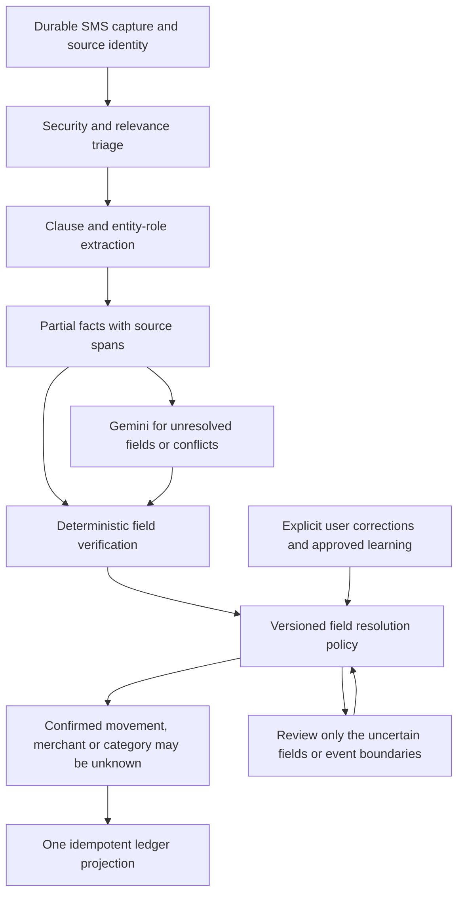

# SMS reliability: merchant extraction, categories, and Gemini

Investigation date: 2026-11-01. Scope: current workspace source and synthetic local probes. This is an investigation and proposed design, not an implementation or a production-accuracy certification.

## Recommendation

Keep the existing durable capture, source identity, typed facts, queue, user overrides, and reviewed learning mechanisms. Refactor the interpretation and decision boundaries around them. Replacing the entire pipeline would discard useful infrastructure; adding more merchant exceptions would leave the demonstrated errors intact.

The central issue is that the system confuses several different claims: an SMS was parsed, money moved, a name appeared somewhere in the SMS, that name is the payee, and the purchase belongs to a particular category. Those claims currently share confidence and acceptance paths even though they need different evidence.

Use deterministic extraction for supported templates, Gemini for unresolved attributes and conflicts, and one versioned policy for deciding which individual attributes are safe to accept. A supported amount must remain useful when category or merchant identity is unknown.

## What was inspected and verified

The source review covered Android triage and capture, local parsing, server parsing, merchant identity, category resolution, AI payload redaction, Gemini instructions and structured output, evidence validation, confidence scoring, result merging, mobile auto-resolution, user corrections, and financial projection boundaries.

The main fresh test command was:

```powershell
node --test api/test/gemini_worker.test.js api/test/gemini_queue.test.js api/test/ai_fact_scoring.test.js api/test/ai_fact_merchant_gate.test.js api/test/ai_fact_evidence.test.js api/test/merchant_identity.test.js api/test/sms_decision.test.js api/test/sms_parser.test.js api/test/sms_intelligence_scenarios.test.js
```

Result: 241 passed, zero failed. Separate earlier focused resolver/parity/rule tests passed 85 tests. Passing tests coexist with the gaps reproduced below; they are not a measured classification accuracy.

No live Gemini request was made in this investigation. Constructed model responses were passed through the real validator and scorer. These demonstrate acceptance weaknesses, not the frequency with which Gemini generates those responses. The configured source default is not proof of the model or configuration currently running in production.

Existing emulator rows from the earlier investigation do not identify the original category decision or establish that a particular parser created a wrong label. Server history, administrative rules, manual edits, runtime versions, and persistence must be traced before assigning causality. The earlier failure to observe a fresh emulator import also requires a consistent SQLite snapshot including WAL and a verified runtime trace before being attributed to Telephony visibility.

## Reproduced failure modes

### 1. A card brand can pass as the merchant

Synthetic SMS:

> Rs.200.00 spent on HDFC Swiggy Credit Card xx1234 at BALAJI SPORTS on 01-11-26. Avl Bal Rs.5000.00

The deterministic server parser correctly returned BALAJI SPORTS. A deliberately incorrect AI fact with merchant=Swiggy, category=dining, correct amount/date/card, isComplete=true, and confidence=0.99 passed:

- Fact schema validation.
- `verifyModelFacts`.
- Merchant/completion hard gates.
- Automatic-resolution assessment, score 0.9975, reviewRequired=false.

`merchantEvidence` proves textual presence and rejects weak identities, but does not prove the semantic role of the name. Swiggy appears as the card product, so presence is insufficient.

Owners: `api/src/merchant_identity.js:276`, `api/src/ai_fact_evidence.js:142`, `api/src/ai_fact_scoring.js:253`.

Required change: identify payee, payer, issuer, card product, payment processor, platform, and promotional names as separate roles. Accept a merchant only when connected to the movement clause or a verified transaction identifier. Keep original text spans for the evidence.

### 2. A wrong category can receive almost perfect confidence

Using the same SMS, merchant=BALAJI SPORTS with category=travel passed verification and received exactly the same 0.9975 score. Category=other also received the same score.

The scorer awards category completeness for belonging to the allowed enum. Its evidence score measures amount, suffix, date, and completion. It does not establish why a particular category is correct. Overall extraction certainty is therefore being used as category certainty.

Owner: `api/src/ai_fact_scoring.js:156`, `:189`, `:343`.

Required change: assess event, amount, date, instrument, counterparty role, merchant identity, and category separately. Add category reason, evidence source, policy version, and independent confidence. Unknown category must not invalidate a confirmed debit or become a confident guessed label.

### 3. Normalization can manufacture confidence metadata

The same incorrect Swiggy/travel fact was submitted without isComplete or confidence. `normalizeModelFacts` supplied isComplete=true and confidence=0.9; the final score was 0.975 and reviewRequired=false.

The normalizer is deliberately filling omitted metadata, but the evidence it uses has the role/category gaps above. It therefore amplifies an unsupported interpretation.

Owner: `api/src/ai_fact_evidence.js:169`.

Required change: retain whether confidence came from the model, deterministic evidence, or a default. Never present a default as measured certainty. Derive eligibility from explicit per-field evidence and calibrated decision rules.

### 4. Useful UPI payee information is removed before Gemini sees it

`redactBodyForAi` changed each of these to `[ADDRESS]`:

- balajisports@upi
- gpay-1234567890@okbizaxis
- rajesh@oksbi

Masking addresses protects private identity, but removing the entire identifier can also remove the only counterparty signal. A business handle, an opaque processor handle, and a personal handle then look identical to the model. A later prompt cannot recover information that was removed.

Owner: `api/src/gemini_queue.js:32`.

Required change: parse and classify identifier types locally, retain exact values in the authorized identity-resolution boundary, and send only the permitted structured evidence to Gemini. Use source-scoped opaque tokens to associate model output with local candidates. Expose a safe merchant display name only when independently supported. Do not globally weaken redaction or assume a handle proves business identity/category.

### 5. The AI contract makes partial understanding difficult to return

The provider schema requires merchant and category on every posted_movement. The instructions tell Gemini to return an empty facts array when an essential attribute is absent or uncertain. They also permit at most one primary actionable fact and request an empty array for multiple movements.

Thus a message with a clear debit and amount but unknown payee can produce no usable extracted facts. The UI then cannot distinguish which parts were understood from which were missing. The spend category list also differs from the broader economic-kind model: investment is an entryKind, but investments is not an allowed AI spend-category value. Those dimensions need an explicit mapping rather than a larger ad hoc enum.

Owners: `api/src/gemini_worker.js:50`, `:184`, `:688`; `api/src/sms_facts.js:46`.

Required change: return a partial evidence record independently of ledger eligibility. Permit unknown attributes and multiple candidate events, but leave ambiguous or multiple-event records in review until event boundaries are established. Do not automatically materialize every extracted candidate. Keep a deliberate distinction between a transaction's economic kind and its reporting category.

### 6. Some merchant names are excluded by grammar before identity validation

The server parser accepted a synthetic UPI debit to `बालाजी स्पोर्ट्स`, extracted amount/date/instrument, and returned no merchant. Its merchant identity cleaner independently preserves that Unicode name. Several extraction patterns use ASCII character ranges, so cleanup is not the layer losing this name.

The same synthetic format extracted `7 ELEVEN`. This is a grammar coverage problem, not evidence that all short or numeric names fail.

Owners: `api/src/sms_parser.js`, `app/lib/data/local_sms_parser.dart:2753`, `api/src/merchant_identity.js:162`.

Required change: Unicode-aware role/span extraction and normalization, with original spelling preserved. Test native scripts, transliteration, punctuation, numeric brands, legal entity suffixes, UPI narration, and masked identifiers as independent input dimensions.

### 7. Server substring matching produces unrelated categories

Direct calls to the built-in category resolver returned:

| Input | Result | Matched text |
|---|---|---|
| KUBER HARDWARE | travel | uber |
| SUBER ENTERPRISES | travel | uber |
| SPARK ELECTRICALS | groceries | spar |
| SHELLY BOOK STORE | fuel | shell |
| INDIGO PAINTS | travel | indigo |
| AMAZON PRIME | online | amazon |
| NEW LOCAL SHOP@jio | bills | jio |

The first four demonstrate accidental substrings. INDIGO PAINTS demonstrates an ambiguous brand word even with word boundaries. AMAZON PRIME demonstrates fixed category priority beating a more specific service phrase. The VPA example demonstrates using a payment-handle suffix as business evidence.

Owners: `api/src/merchant_category.js:123`, `api/src/import_resolvers.js:789`.

Required change: remove unrestricted substring inference. Use explicit match types and scope: exact verified identity, normalized alias, scoped legal entity alias, token phrase, or tentative semantic candidate. Detect conflicts. Prefer identity specificity over arbitrary category priority, but do not mistake a longer substring for proof of identity.

### 8. Mobile and server use different interpretations

A direct Dart probe of the actual local FlashText extractor returned UBER EATS=travel; the server returned dining. Local word boundaries avoided KUBER/SPARK/SHELLY collisions, but local INDIGO PAINTS still became travel. The local extractor also selected an Uber promotion or a Swiggy card product when the actual merchant was unknown.

`extractFirst` returns the earliest match, with longest matching at that position. It is not a semantic selection of the correct entity across the whole message.

Owners: `app/lib/data/flashtext_merchant_extractor.dart:69`, `app/lib/data/local_sms_parser.dart:2950`, `:3148`.

Required change: one versioned decision specification and generated/shared alias data, implemented for offline Dart and server use with golden conformance tests. Offline results must retain their provisional status and evidence; sync needs explicit rules for upgrading each field.

### 9. Automatic historical mistakes can become future evidence

Server category history queries exclude Other but do not require a user-confirmed category or distinguish automatic inference from verification. History runs before shipped name rules. A resolver probe with a simulated existing KFC history category of online returned online immediately, despite the current built-in dining rule.

The investment fallback runs after history and name inference. A synthetic SPARK INVESTMENTS record with entryKind=investment returned groceries through the spar match.

Owner: `api/src/import_resolvers.js:743`, `:762`, `:822`.

Required change: record category provenance per field and restrict authoritative learning to explicit corrections or independently verified evidence. Automatic predictions are candidates, not confirmation votes. Enforce economic-kind consistency before accepting category inference, while preserving explicit user choices according to a documented policy.

### 10. A syntactically valid negative AI decision can dismiss a financial message

`validateDecision` accepts a supported negative topic/reason with facts=[] without inspecting the source SMS. `completeJobWithResult` makes an explicit negative decision non-reviewable. The mobile resolver removes the review item into dismissed history when shouldConsider=false.

This is recoverable history, not proven permanent data loss. However, a wrong negative answer can hide a transaction candidate from the normal review workflow. A syntax validator cannot establish a semantic rejection.

Owners: `api/src/sms_decision.js:23`, `api/src/gemini_queue.js:285`, `app/lib/data/local/sms_import_store.dart:642`.

Required change: validate dismissals against the source's strong financial evidence and give contradictory negatives an explicit review state. Use reason-specific rejection evidence. Keep OTP/security protections separate and absolute; do not send excluded secrets to AI.

### 11. Gemini is primarily a fallback for parse misses, not a verifier of weak fields

The mobile upload reconciliation submits AI jobs for needs_review/unparsed financial candidates. A parser can return ok=true with amount/instrument/date and no merchant, as reproduced above, while the server can still assign Other or a body-derived category and import it. Such successful imports do not enter this miss-driven AI branch.

Conversely, AI facts semantically matching an existing fact are skipped using type, amount role, time anchor, instrument, and account. Merchant/category are not part of that comparison. This protects existing facts from being overwritten, but is not a field-by-field enrichment mechanism.

Owners: `app/lib/app/providers.dart:1937`, `api/src/gemini_queue.js:288`.

Required change: route unresolved fields and interpretation conflicts to an enrichment job even when the money movement is already recorded. Reuse the same source/event identity. Merge supported attributes by provenance and preserve explicit user locks. Never create a second transaction merely to attach an improved merchant/category.

### 12. Existing repair and tests do not establish general reliability

The inspected category repair pass selects spend rows whose category is missing, legacy unclassified, or Other. It does not revisit a wrong non-Other category such as Travel. The duplicate-source update likewise preserves existing categories. This is conservative about user data, but means new rules alone do not repair existing wrong labels.

The existing mobile/server parity test checks amount, instrument, and entry kind against fixtures. It does not execute both category engines and compare merchant/category results. Many Gemini worker tests mock provider responses; they verify plumbing and contracts, not live model understanding.

Owners: `api/src/index.js:3997`, `:3208`; `api/test/local_sms_parity.test.js`; `api/test/gemini_worker.test.js`.

Required change: versioned reassessment for machine-assigned fields, with a preview and a diff, separate from explicit user edits. Recompute affected reporting/reward state through the existing transaction state machinery. Evaluate against held-out labeled data rather than relying on test pass count.

## Target structure



The security, durable capture, deduplication, facts, and projection foundations already exist. This proposal makes the interpretation boundary consistent instead of adding another competing parser.

Represent each field with its value, evidence span or identity reference, extraction method/version, validation status, confidence basis, and user-lock status. Keep source SMS evidence apart from later identity/category enrichment. A category inferred from an MCC is supported by that MCC mapping, not necessarily by a literal category word in the SMS.

Example: BALAJI SPORTS is an evidenced payee; HDFC is issuer; Swiggy is card product. Amount=200 and completion=posted are independently confirmed. Purchase category remains unknown unless an explicit user rule, suitable verified merchant/MCC evidence, or a sufficiently supported inference establishes it. The UI can show the transaction accurately without inventing its purpose.

## Gemini improvements

1. Define extraction and classification as separate outputs, even if initially served by one request. Extract event status, typed amounts, counterparty roles, instrument, dates, and source spans before proposing categories.
2. Permit null/unknown fields and preserve partial facts. Return ambiguity codes such as merchant_missing, conflicting_payees, category_unknown, multiple_movements, and date_from_receipt.
3. Supply safe, structured parser candidates with evidence. Identify them as untrusted candidates; do not force the model to agree with an earlier guess.
4. Request evidence spans and role assignments rather than a narrative explanation or hidden reasoning. Verify spans programmatically and check their relationship to the transaction clause.
5. Add counterexamples: co-branded cards, issuer names, payment gateways, personal VPAs, business VPAs, promotional footers, Unicode merchants, future debits, refunds, and multiple monetary values. Vary names so examples do not become a whitelist.
6. Version prompt, schema, model configuration, normalizer, and decision policy. Measure prompt variants and model choices on the same held-out corpus before changing production defaults.
7. Keep per-item batch IDs, validation, quota controls, retries, and durable results. Compare batch sizes in evaluation; investigate truncation and cross-item contamination before attributing errors to model size.
8. Make correction feedback field-specific. A well-formed but semantically wrong category will not trigger the current schema repair; semantic checks must produce the correction reason.

Do not begin by buying a larger model, extending the brand list, or sending every inbox message to Gemini. Those choices do not fix lost evidence, acceptance gaps, or inconsistent merge policies.

## Rollout order

### Stage 1: Stop confident misfiling

- Gate merchant acceptance on payee role, not occurrence anywhere.
- Separate category eligibility from amount/event confidence.
- Remove broad substring matches and whole-body category fallback.
- Route weak categories to Other/uncertain and contradictory negatives to review.
- Add the reproduced failures as regressions, including negative variants.

This is a focused reliability intervention. It should precede a large extraction refactor.

### Stage 2: Preserve partial understanding and improve merchant coverage

- Introduce role/span candidates, Unicode-aware merchant extraction, and privacy-preserving VPA identity references.
- Relax extraction completeness while keeping ledger projection requirements strict.
- Route missing fields after successful imports to enrichment.
- Separate counterparty identity from economic kind and purchase purpose.

### Stage 3: Make resolution consistent and learning trustworthy

- Publish a shared versioned policy/alias format and run Dart/server conformance tests.
- Record per-field provenance, independent confidence, and explicit user locks.
- Reconcile local/server/AI candidates through that policy.
- Preserve the existing distinction between unconfirmed AI output and user-confirmed learning; extend it to automatic transaction history used for categorization.

### Stage 4: Reassess historical machine decisions safely

- Preview eligible automatic labels, proposed changes, reasons, and effects.
- Preserve user edits and identity, prevent duplicate materialization, and recompute dependent reward/reporting state.
- Stage rollout by pipeline version with rollback and bounded replay.

## Evaluation that would demonstrate improvement

Build a consented/redacted or synthetic labeled corpus with independent fields: relevance, status, amount role/value, economic kind, merchant span/role, instrument, date, category, acceptable alternatives, and expected abstention. Include messages with no identifiable merchant; missing identity is sometimes the correct answer.

Split by template family, merchant identity, and time so near-duplicate templates and the same brands cannot leak into both training/examples and the holdout. Use multiple annotations/adjudication for ambiguous merchant-purpose labels. Report results separately for native scripts, banks, rails, merchant types, and live versus historical messages.

Measure:

- Financial-message capture recall and wrongful dismissal rate.
- Wrong ledger-event creation, duplicate rate, amount/status accuracy.
- Merchant exact/normalized accuracy and, separately, wrong-role selection rate.
- Category precision on automatically assigned cases, coverage, and abstention.
- Local/server disagreement and field changes after sync.
- Confidence calibration against observed correctness.
- User corrections, reversals, review burden, latency, and provider cost.

Set numerical release targets after measuring the baseline and agreeing on error costs. Do not claim a 0.99 model score is a 99% measured correctness rate.

Add metamorphic tests: changing the amount must not change the merchant/category; adding an unrelated card brand or offer must not change the payee; varying bank/sender/date formatting must preserve meaning; an unseen merchant must not match a brand substring; adding failure/future wording must change event status; replaying and syncing must preserve source identity and explicit user corrections.

For production diagnosis, store compact reason codes and decision/version lineage rather than logging complete SMS bodies. Trace capture -> triage -> extraction -> candidate fields -> selected evidence -> AI result -> merge -> persisted category. That trace is needed to determine why a specific transaction became Travel.

## Completion criteria

The redesign is successful when the system can say which event it observed, which payee it identified, which attributes remain unknown, and why each accepted field was chosen. Every supported SMS must produce a consistent outcome, but an ambiguous SMS need not produce an invented merchant or a forced specific category.
