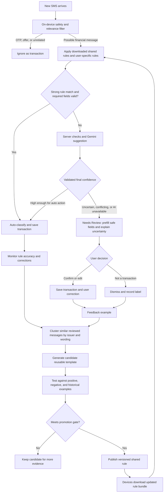

# SMS classification and learning loop

## How to explain it

1. **Known SMS formats resolve immediately.** Each device has the latest approved shared rules plus that user's own account mappings and corrections. New users receive the existing approved rules.
2. **Unfamiliar messages get a second pass.** The server and Gemini propose fields and a classification. Validation checks transaction status, amount labels, direction, and contradictions before assigning a final score.
3. **Low confidence goes to Needs Review.** The user can confirm, edit, or dismiss a prefilled suggestion. If Gemini fails, the message still reaches review.
4. **Reviews improve future detection.** Confirmed decisions become examples. Similar examples produce candidate templates, which are tested before release to everyone.

**Score policy:** Measure confidence separately for transaction detection, field extraction, lifecycle, and economic kind. Use a moderate score to prefill review; require a much higher, empirically calibrated threshold for automatic financial classification. A user correction always takes priority over a shared rule.

**Data boundary:** Share approved template definitions across users, not their raw SMS or personal account mappings. Keep candidate versions, evaluation results, and rollout history on the server; cache published rules and user-specific decisions on the device.
