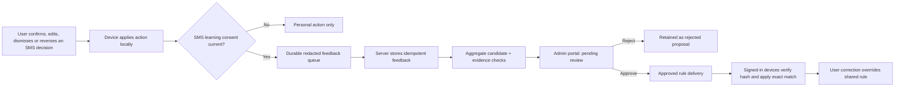

# SMS shared learning and admin approval

Updated: 2026-10-27. This document is the continuation record for future sessions and agents. Check the repository and tests again before changing a status.

## Product contract

The AI result alone does not become a shared teaching label. An explicit user action produces the label. Personal corrections take effect immediately. Sharing requires a separate, current, default-off `sms_shared_learning` consent. Neither consent nor a statistically eligible candidate gives a rule authority to other devices. Admin approval is mandatory.

## Two rule families

| Family | Candidate source | Admin evidence | Delivery gate | Device behavior |
| --- | --- | --- | --- | --- |
| Financial extraction | Corrected/confirmed structured facts, generalized SMS template, existing holdout and canary compiler | Sample size, distinct users, match failures, holdout precision, false-positive examples, privacy review | Global immutable bundles require `/admin/sms-rules/publish`; autonomous worker publication is disabled. Candidate cohorts remain individually admin-approved before any device experiment. | Schema/hash/version validation, reversible rule rollback, deterministic evidence gate |
| Merchant category | Latest explicit category correction per opted-in user and exact merchant | At least 10 distinct users, at least 90% agreement, category and merchant key, disagreement count; no raw SMS | New `/admin/sms-rules/category-proposals/review` approval record; device endpoint joins only currently eligible and approved rows | Exact merchant match; local user correction wins; invalid/unknown mapping abstains |

The statistical threshold only creates a proposal. The admin must approve the exact merchant/category pair. If consensus changes to another category, support drops, or consent is revoked, that pair disappears from delivery. Rejection is recorded and can be reversed through another audited review. Existing issued bundles should be audited separately for prior approvals before declaring the parser side fully compliant.

## Interface and data boundaries

- `POST /sms/learning-feedback`: one idempotent event, consent policy and grant timestamp, source hash, generalized pattern, allowlisted original and corrected fields. Server records no original SMS body in feedback events.
- `pandapay.sms_shared_category_rules()`: eligible aggregate proposals. `pandapay.sms_approved_category_rules()`: only rules allowed on devices.
- Admin list/review routes are admin authenticated, require a reason, and write `admin_audit_log`. The console displays aggregate evidence only.
- `GET /sms/rules/active`: parser bundle and approved category rules with a canonical SHA-256 checksum. Device cache verifies checksum and client version. Revocation or consensus loss produces an empty/changed list on next refresh.
- A previous decision is not a fresh label after consent withdrawal. Opt-out deletes attributed examples and feedback, and queued local uploads are cleared.

## Engineering tasks and status

| ID | Task | Owner area | Status | Completion evidence |
| --- | --- | --- | --- | --- |
| L1 | Purpose-specific SMS consent and privacy copy | App/API/DB | Implemented locally, policy review pending | New consent purpose; default off; old merchant consent does not enable it |
| L2 | Durable local feedback on auto-resolve confirm, edit, category change, undo, and dismissal | App | Implemented locally; regression check pending | UI/action tests and queue retry/opt-out tests |
| L3 | Capture manual Needs Review transaction, bill, and Pay Later saves | App | Implemented locally; regression check pending | Save succeeds before feedback is queued; no network delay in UI |
| L4 | Idempotent feedback route, server redaction, consent/revoke serialization | API/DB | Implemented locally; integration check pending | API tests, migration check, opt-out race and duplicate event proof |
| L5 | Financial rule training and existing admin bundle publish workflow | API/worker | Admin-only global bundle publish/rollback and candidate delivery gates implemented locally; focused regression check pending | Worker cannot publish or roll back global bundles; regression withdraws only the worker candidate; legacy worker bundles are withdrawn |
| L6 | Exact merchant category proposal aggregate | DB | Implemented locally; SQL check pending | Latest vote/user, 10 users, 90% agreement, revoked consent abstention |
| L7 | Category approval table and approved-only delivery gate | DB/API | Implemented locally; API route test passed, SQL check pending | No approval yields no delivered rule; approve/reject/consensus loss alter response correctly |
| L8 | Admin portal list and review action for category and parser candidates | Console/API | Implemented locally; Flutter analysis and widget/API check pending | Admin sees aggregate proposals, reason required, non-admin forbidden, audit row written |
| L9 | App category bundle verification and local rule precedence | App | Implemented locally; integration check pending | Tampered hash rejected; exact merchant only; local correction wins |
| L10 | Local migration-backed and full focused tests | QA | Pending | Disposable clean DB; API, app and console tests; build and analyzer results recorded |
| L11 | Production rollout and device acceptance | Release | Pending | Policy approved, migration deployed before API, admin console deployed, split APK upgraded with data preserved, one end-to-end correction and another-device approved-rule download |
| L12 | Operations and rollback | API/Console | Pending | Admin can revoke approved category, device refresh removes it, audit and telemetry reconcile |

## Session sequence

1. Complete L7-L9 focused tests and inspect each new diff for consent/privacy/financial safety. In particular, verify the new admin approval migration on a disposable clean DB and test an unapproved rule never appears in `GET /sms/rules/active`.
2. Parser candidate cohort delivery requires an explicit admin approval record at every stage, including shadow. The autonomous worker cannot publish or roll back global bundles; regression handling withdraws the candidate only. The approval migration withdraws legacy NULL-publisher bundles; only admin API bundles remain eligible for `/sms/rules/active`.
3. Verify admin UI with a test admin account and a non-admin denial. Confirm the review reason and audit entry. Add a read-only detail view with evidence and disagreement counts if operators cannot make an informed decision from the list.
4. Obtain approval for the SMS learning policy text and data retention. The existing legal screens are draft. Keep contribution default off until that is resolved.
5. Deploy migration, API, worker, console, then app in that order. Validate one consented user feedback event and one proposed rule. Before admin approval, a second device must receive no rule. After approval, it must receive the exact approved rule; reject/revoke must remove it.

## Acceptance gates

- No user action blocks on consent/network feedback delivery.
- No raw SMS, OTP, card/account number or exact reference appears in shared examples or admin responses. Consent is checked on write and on aggregate use.
- Repeated events and retries cannot multiply a user's vote. A newer correction replaces their vote.
- An unapproved or rejected rule never reaches another device, including parser experiments.
- Admin approval is bound to the reviewed rule identity and recorded with operator, time, evidence and reason.
- App accepts only validated rule hashes/versions; current user's correction has precedence; rollback removes the learned rule.
- Production and device verification are reported separately from local tests and commit/push status.

## 2026-10-27 Luna implementation checkpoint

- Three GPT-6 Luna agents reviewed backend approval, the admin portal, and mobile delivery/review flows in parallel. Their changes are integrated in the local checkout.
- The focused API suite for worker publication, learning feedback, and rule delivery passed 33/33. API syntax and `git diff --check` passed.
- Console tests/analyzer and the new mobile test remain unverified: the local Flutter/Dart commands stalled, and the console's offline dependency cache lacks `build_runner`.
- The approval migration and real database behavior remain unverified on a clean disposable database. No production deployment or physical-device acceptance is claimed.
- Next session: provision a disposable test database, run migrations and SQL tests, resolve Flutter dependencies, run app/console checks, then exercise admin approve/reject and device rollback in a signed-in test environment before rollout.
