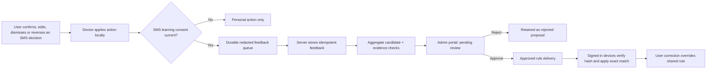

# SMS shared learning and admin approval

Updated: 2026-10-27. This document is the continuation record for future sessions and agents. Check the repository and tests again before changing a status.

## Product contract

An AI result alone creates only a pending proposal. An explicit user action can provide a stronger label; an admin-approved AI proposal may contribute weaker candidate evidence. Personal corrections take effect immediately. Sharing requires a separate, current, default-off `sms_shared_learning` consent. Neither consent nor a statistically eligible candidate gives a rule authority to other devices. Admin approval of the final rule is mandatory.

For the same `(profile_id, source_key_hash)`, a later explicit confirmation, edit, category correction, dismissal, or move back to review must supersede the earlier AI-only proposal. The server must invalidate that proposal atomically with accepting the explicit feedback, including when it was already approved. Admin review must refuse a stale proposal, and worker/category aggregation must not count it. A delayed AI event must not recreate a proposal after explicit feedback. Retries must remain idempotent. An edit should contribute corrected facts only after the local transaction save succeeds and current consent is verified; a move to review is negative evidence, not a positive transaction label.

When a user marks an auto-resolved transaction wrong, keep a durable, idempotent dispute record linked to the SMS source and the AI decision. Immediately undo the local financial effect and preserve the SMS in Needs Review. With current SMS learning consent, upload privacy-safe evidence to a dedicated admin review queue and request an AI diagnostic classification of what failed (for example, false transaction, wrong amount, wrong merchant, or wrong category). The AI diagnostic is advisory; it cannot publish a rule or restore the transaction. Admins see the original decision, user correction/reversal, redacted message pattern, AI diagnosis, and the proposed rule change; they can approve, reject, or request more evidence. Only a separately approved and validated rule can reach other devices. Without consent, retain the personal correction locally and do not upload the SMS or diagnosis.

Category corrections are learning signals too. The user's corrected label must apply immediately on that device, and, with consent, the before/after category and safe SMS context should enter admin-reviewed shared learning. Capture corrections at every SMS-backed transaction editing surface, not just the Auto-Resolved card. Keep one latest explicit label per user and source/merchant context; do not let repeated edits multiply votes. A merchant can legitimately have different transaction types, so a merchant-wide rule must abstain when the SMS context is ambiguous. The example “Travel” to “Subscription” crosses the current taxonomy boundary: `subscription` is not one of the 15 canonical spend categories and is represented elsewhere as a commitment. Treat this as a transaction-kind or commitment correction if supported by the product, rather than inserting an invalid spend category. Reconcile app, API, and SQL category allowlists before publishing any category rule.

## Two rule families

| Family | Candidate source | Admin evidence | Delivery gate | Device behavior |
| --- | --- | --- | --- | --- |
| Financial extraction | Corrected/confirmed structured facts, generalized SMS template, existing holdout and canary compiler | Sample size, distinct users, match failures, holdout precision, false-positive examples, privacy review | Global immutable bundles require `/admin/sms-rules/publish`; autonomous worker publication is disabled. Candidate cohorts remain individually admin-approved before any device experiment. | Schema/hash/version validation, reversible rule rollback, deterministic evidence gate |
| Merchant category | Latest explicit category correction per opted-in user and exact merchant | At least 10 distinct users, at least 90% agreement, category and merchant key, disagreement count; no raw SMS | New `/admin/sms-rules/category-proposals/review` approval record; device endpoint joins only currently eligible and approved rows | Exact merchant match; local user correction wins; invalid/unknown mapping abstains |

The statistical threshold only creates a proposal. The admin must approve the exact merchant/category pair. If consensus changes to another category, support drops, or consent is revoked, that pair disappears from delivery. Rejection is recorded and can be reversed through another audited review. Existing issued bundles should be audited separately for prior approvals before declaring the parser side fully compliant.

## Interface and data boundaries

- `POST /sms/learning-feedback`: one idempotent event, consent policy and grant timestamp, source hash, generalized pattern, allowlisted original and corrected fields. Server records no original SMS body in feedback events.
- `pandapay.sms_shared_category_rules()`: eligible aggregate proposals. `pandapay.sms_approved_category_rules()`: only rules allowed on devices.
- Admin list/review routes are admin authenticated, require a reason, and write `admin_audit_log`. The console displays aggregate evidence and generalized individual AI message patterns, without raw SMS.
- `GET /sms/rules/active`: parser bundle and approved category rules with a canonical SHA-256 checksum. Device cache verifies checksum and client version. Revocation or consensus loss produces an empty/changed list on next refresh.
- A previous decision is not a fresh label after consent withdrawal. Opt-out deletes attributed examples and feedback, and queued local uploads are cleared.

## Learning entry paths (verified in the current checkout)

| User/system entry | Local/API path | What enters shared learning |
| --- | --- | --- |
| Auto-Resolved receipt: confirm, edit transaction, change category, or move back to Needs Review | `SmsAutoResolutionController` writes `SmsFeedbackOutbox`; `UserCardsRepository.flushSmsLearningFeedbackQueue()` posts `/sms/learning-feedback` | Explicit `confirmed`, `edited`, `category_changed`, or `moved_to_review` feedback. Consent must be present at capture and is rechecked by the API. |
| AI auto-resolved SMS ingestion | `app/providers.dart` adds `ai_auto_resolved` after local save, with source body, decision, confidence and Gemini origin; durable feedback outbox submits it | A redacted `sms_ai_learning_proposals` row marked pending review. It is not a positive training example and is not delivered to devices merely because AI resolved it. |
| Manual transaction saved from Needs Review | `_recordReviewedTransactionFeedback` in `needs_review_screen.dart` enqueues after the save; exact field match is `confirmed`, otherwise `edited` | User-reviewed structured movement evidence and the redacted message pattern. |
| Manual bill saved from Needs Review | `_recordReviewedBillFeedback` enqueues after the bill save | User-reviewed bill evidence and the redacted message pattern; matching suggestions are `confirmed`, changed values are `edited`. |
| Correct an extracted fact in SMS fact review | `POST /sms/facts/overrides` in `sms_facts_route.js` stores the override, records the confirmed correction and (when available) a structured learning example | Explicit corrected fields, gated by current consent; learning failure does not undo the user's correction. |
| SMS dismissed from Needs Review or related dismissal controls | App `UserCardsRepository.dismissSms()` queues `dismissed` to `/sms/learning-feedback`; the authenticated source dismissal endpoint is `POST /sms/dismiss` in `sms_facts_route.js` | Negative/ignore-noise signal, subject to consent and sensitive-message gates. Unknown-source dismissal uses its distinct authenticated fallback path. |
| User category correction for merchant | `SmsLearningFeedback.recordCategoryCorrection()` feeds the category aggregate; `pandapay.sms_shared_category_rules()` computes eligible proposals | Latest explicit vote per opted-in user. Requires threshold plus separate admin approval before approved-only bundle delivery. |
| Parser candidate from worker | `sms_learning_worker` candidate lifecycle and `/admin/sms-rules/parser-proposals` | Candidate evidence only. An admin review bound to current rule hash is required; global bundle publication remains a separate audited admin action. |

There is no shared-learning hook in the generic statement/PDF/CSV transaction import pipeline in the current diff. Do not describe imported statement rows as a learning entry path unless a future implementation adds explicit user feedback and consent gates.

## Engineering tasks and status

| ID | Task | Owner area | Status | Completion evidence |
| --- | --- | --- | --- | --- |
| L1 | Purpose-specific SMS consent and privacy copy | App/API/DB | Consent purpose, default-off switch, and revocation cleanup implemented locally; policy/legal review pending | Old merchant consent does not grant SMS learning; production contribution stays gated on policy approval |
| L2 | Durable auto-resolve feedback: confirm, edit, category correction, undo, plus AI-origin proposal | App/API/DB | Implemented locally; end-to-end regression check pending | Outbox action coverage, retries, duplicate idempotence, consent revocation and redaction tests |
| L3 | Needs Review transaction and bill saves | App | Implemented locally; focused regression check pending | Feedback enqueues after save; matching versus changed suggestions map to `confirmed`/`edited`; upload does not block the save |
| L4 | Dismissal feedback path | App/API/DB | Existing route and local retry path implemented; full flow check pending | Sensitive-message rejection, consent check, retry, and duplicate retry proof |
| L5 | Feedback API, durable explicit examples, AI-origin proposals and revocation | API/DB | Implemented locally; disposable migration and proposal approval/revocation SQL checks passed | Verify explicit events train only under valid consent; AI events create proposal only; consent withdrawal purges both examples and AI proposals |
| L6 | Worker candidate lifecycle and global bundle controls | API/worker | Worker publication/rollback restrictions and admin-only bundle routes implemented locally; a deployment regression in `db/setup_app_role.sql` was found and fixed, and the focused API regression now passes | Worker cannot publish/rollback global bundles; legacy worker bundles are ineligible; each candidate approval binds to rule hash and stage. `db/scripts/migrate.sh` re-runs `setup_app_role.sql` after the migrations, and that script re-granted `sms_publish_bundle`/`sms_rollback_bundle` to `sms_learning_worker`, undoing the L6 revoke in `20261027160000_sms_category_rule_approval.sql` and making `sms_autonomous_worker`'s own capability check refuse to start; both statements are now revokes so the rerunnable script converges. The older `20261022143500` worker-permissions regression asserted the superseded grant and only passed while the bug was present; it is corrected to require both functions to be absent |
| L7 | Merchant category aggregation and approval-only delivery | DB/API | Implemented locally; disposable migration and threshold/consent SQL checks passed | Latest vote per user, 10-user/90% threshold, current consent, separate approve/reject record, consensus/revocation removal |
| L8 | Admin console: category, parser, and AI decision review | Console/API | Three review tabs, API clients, and focused list/review route tests implemented locally; console analysis/widget and live role checks pending | Aggregate-only evidence, reason-required audited review, non-admin denial, safe AI proposals require separate parser-rule approval before delivery |
| L9 | Device bundle verification and local rule precedence | App/API | Existing checksum/version and local-correction paths are present; current end-to-end regression check pending | Tampered hash rejected; exact merchant match; local correction wins; approved-rule refresh and removal verified |
| L10 | Clean migration-backed and focused test verification | QA | API, SQL, app and console focused checks complete locally with recorded output; production and device verification pending | Disposable clean-DB migrations in order plus five SQL regressions; full API suite 997/997 pass with every database gate enabled, identical serially and in parallel; app 28/28 and console 4/4 focused tests with analysers and successful web and APK builds; see the 2026-10-27 L13 supersede checkpoint |
| L11 | Production rollout and device acceptance | Release | Pending | Policy approved; migration deployed before API; console deployed; app upgraded with data preserved; consented feedback reaches review; a second device gets no rule pre-approval and exact rule post-approval |
| L12 | Operations, revocation and rollback | API/Console/Release | Partially implemented; operational acceptance pending | Admin revocation, next-refresh removal, audit/telemetry reconciliation, recovery steps and rollback exercised |
| L13 | Explicit user feedback supersedes AI-only evidence for the same SMS | API/DB/worker | Implemented locally; disposable-DB SQL, focused API and real-DB end-to-end checks passed. Production/device verification still pending | `20261027180000_sms_ai_proposal_supersede.sql` adds a `superseded` status, a SECURITY DEFINER demotion helper, a before-insert resurrection guard and a backfill; the feedback route demotes in the same transaction as the accepted event and refuses late AI retries; the admin review route returns 409 `proposal_superseded_by_user_feedback`; `api/test/sms_learning_supersede.test.js` (23 checks) and `api/test/sms_learning_e2e_real_db.test.js` cover retry, both arrival orders, correction retention and device-delivery removal |
| L14 | Wrong-transaction dispute to AI diagnosis and admin review | App/API/DB/Console | Implemented locally 2026-10-28 (see checkpoint); device acceptance pending | Every consented wrong-transaction action creates one durable case, local undo succeeds independently, AI diagnosis is advisory, admin sees safe evidence and can review, approved fixes pass existing validation and publication gates; no-consent case stays local |
| L15 | Category and transaction-kind corrections across SMS-backed surfaces | App/API/DB/Console | Implemented locally 2026-10-28 via C-plan C3–C7 (see checkpoint); device acceptance pending | Local correction wins immediately; consented before/after labels and safe context reach admin review from every relevant edit surface; latest explicit vote per user counts once; app/API/SQL categories agree; Travel-to-Subscription is handled as a supported kind/commitment correction or stays reviewable, never an invalid spend slug |

## Session sequence

1. Run focused API, app and console checks with completed output, then execute both new migrations plus relevant SQL checks against a disposable clean database. Specifically prove an unapproved AI/parser/category proposal cannot reach `GET /sms/rules/active`.
2. Implement L13-L15, then exercise the complete entry paths above. Confirm auto-resolve AI proposals remain non-training pending review; explicit user actions invalidate AI-only evidence for the same SMS and create only their intended signals; wrong-transaction reversals reach the admin/AI diagnostic queue only with consent; category/kind edits are captured at every SMS-backed edit surface; manual transaction and bill review saves enqueue after persistence; dismissals remain sensitive-content gated.
3. Verify console with an admin and non-admin account. Confirm each category, parser and AI decision route requires an adequate reason and records the expected audit evidence. AI proposal approval is evidence approval only; a parser rule still needs its own approval before device delivery.
4. Obtain approval for the SMS learning policy text and data retention. The current legal text remains draft; keep contribution default off in production until approved.
5. Deploy migration, API, worker, console, then app. Validate consented feedback and proposals end to end. A second device must receive no rule before approval, the exact approved rule after approval, and removal after rejection/revocation or consensus loss.

## Acceptance gates

- No user action blocks on consent/network feedback delivery.
- No raw SMS, OTP, card/account number or exact reference appears in shared examples or admin responses. Consent is checked on write and on aggregate use.
- Repeated events and retries cannot multiply a user's vote. A newer correction replaces their vote.
- A user correction, dismissal, or reversal supersedes a previous AI-only proposal for that SMS even if the AI proposal was approved; late AI delivery cannot restore it.
- A wrong-transaction action is visible as a single reviewable case to admins when consented; AI diagnosis cannot change the user's ledger or publish to other devices.
- Category/kind corrections preserve the user's choice immediately, enter shared learning only with consent and admin approval, and never deliver a category outside the canonical app/API taxonomy.
- An unapproved or rejected rule never reaches another device, including parser experiments.
- Admin approval is bound to the reviewed rule identity and recorded with operator, time, evidence and reason.
- App accepts only validated rule hashes/versions; current user's correction has precedence; rollback removes the learned rule.
- Production and device verification are reported separately from local tests and commit/push status.

## 2026-10-27 implementation checkpoint

- The current dirty checkout contains local changes across app, API, console, tests, and two new migrations (`20261027170000_sms_ai_learning_proposals.sql`, `20261027171000_sms_admin_learning_evidence.sql`). Treat this as implemented in the working tree, not deployed or merged.
- API work now distinguishes explicit feedback from `ai_auto_resolved`: the latter stores a redacted proposal and returns `admin_review_pending`; it does not directly insert a positive training example. Admin routes list/review AI proposals, and consent revocation deletes them.
- The console screen has Categories, Parser rules, and AI decisions tabs. AI evidence approval does not itself publish a parser rule; a separate hash-bound parser approval and admin publication gate remains required.
- This session passed 37/37 focused API checks and a clean diff check. A Luna review found that names outside greeting text could remain in admin evidence; the device/API redactors now mask likely name patterns, preserve the classified merchant as a typed slot, and have a regression test. AI admin-list and review tests now verify redacted evidence and an audit row tied to the exact proposal ID. This is a bounded regex redactor, so it cannot guarantee detection of every name; broader privacy review remains a release gate. Dart formatting/parser checks completed using a workspace-local cache. All migrations applied to a disposable PostgreSQL database except the optional Supabase cron migration, which local PostgreSQL lacks. Both SMS category and AI proposal SQL regressions passed. Flutter test commands stalled without output and were stopped, so app tests, console analysis/widget checks, live admin/non-admin role behavior, production rollout, and physical-device acceptance remain unverified.
- No production deployment, device validation, commit, or push is claimed.
- Review found that the admin AI-proposal routes need to read the proposal owner's current consent under `app_user`. An admin-only read policy for `user_consents` was added to the pending AI-proposal migration, with an owner-versus-admin SQL regression. The policy was also exercised in a rolled-back local PostgreSQL transaction under the real `app_user` role. The local database predates the new SMS consent purpose, so the full migration-backed SQL suite still needs a fresh disposable database run before release.

## 2026-10-27 L13 supersede checkpoint

L13 is implemented in the working tree. It is not committed, pushed, deployed, or verified on a physical device.

### What changed

- `db/supabase/migrations/20261027180000_sms_ai_proposal_supersede.sql` (new). Adds `superseded_at`, `superseded_reason`, `superseded_by_event_id` and a `superseded` value to the status check constraint; a partial index over `(profile_id, source_key_hash)` for live proposals; `pandapay.sms_supersede_ai_proposals(text, uuid)`, a `SECURITY DEFINER` helper that lets an owner demote only their own pending/approved proposals, matching the existing `sms_delete_learning_examples_for_user` and `sms_purge_ai_proposals_on_opt_out` erasure pattern; a `BEFORE INSERT` trigger that silently drops an AI proposal whose source already has an explicit feedback event; and a backfill that demotes rows written before this migration. Audit history is retained, never deleted.
- `api/src/sms_learning_feedback_route.js`. Accepted explicit feedback calls the demotion helper inside the same transaction as the event insert, so a proposal is never visible as eligible between the two. The `ai_auto_resolved` branch refuses to recreate superseded evidence and returns `superseded_by_user_feedback`. The admin review route takes `FOR UPDATE`, returns 409 `proposal_superseded_by_user_feedback` for a superseded row, and re-checks explicit feedback as defence in depth for rows that predate the backfill. Privacy helpers `residualIdentifierRisk` and `personalNameSender` withhold evidence the regex redactor cannot make safe.
- `db/setup_app_role.sql`. Deployment regression fix, see L6 above.
- `db/tests/20261022143500_sms_learning_worker_permissions_test.sql`. This committed regression predates L6 (commit `7fd3b116`) and asserted that `sms_learning_worker` **must** hold EXECUTE on `sms_publish_bundle` and `sms_rollback_bundle`. That contract was superseded: `20261027160000_sms_category_rule_approval.sql:38-39` revokes both, and `api/src/sms_autonomous_worker.js:614-616` refuses to start unless both are absent. The test passed only while `setup_app_role.sql` was re-granting them, so it was asserting the bug. Both checks now live in the "privileges beyond the autonomous cycle" block, which is what they are.
- `api/test/sms_learning_supersede.test.js`, `api/test/sms_learning_e2e_real_db.test.js`, `db/tests/20261027180000_sms_ai_proposal_supersede_test.sql` (new).

No app or console code change was required. Every new `recorded: false` reason still returns `acknowledged: true`, so `user_cards_repository.dart` deletes the outbox row instead of retrying a proposal that can never become eligible. The console tile gates both buttons on `status == 'pending'`, so a `superseded` proposal renders inert and its header reads `· superseded`.

### Serialization

No second lock was added. The existing per-profile `pg_advisory_xact_lock(hashtextextended('sms-shared-learning-consent:{userId}', 0))` is already the first statement of every `/sms/learning-feedback` transaction, of `POST /consents`, and of the admin review route (keyed on the proposal owner), which is a strictly stronger serialization than a per-source lock. The `BEFORE INSERT` trigger repeats the check so the guarantee does not depend on any caller holding that lock.

### Residual privacy limitation

`proposalPattern` and `smsLearning.redactBody` are bounded regex passes. They reliably mask amounts, references, account fragments, URLs, emails, phone numbers and the classified merchant, but they cannot guarantee that every personal name is caught. Two residual leak shapes are now withheld rather than shown to an admin: a VPA or handle with no TLD (any surviving `@`), and an ALL-CAPS run of two or more tokens inside an otherwise mixed-case message, which is how Indian bank SMS render a payer's name outside a greeting (`credited RAJESH KUMAR`). A Title-Case two-word sender is treated as a peer-to-peer payer name and withheld; single-token and all-caps institutional sender IDs (`AD-HDFCBK`, `VK-SBI`) are not.

Known blind spot, accepted: a message written *entirely* in capitals gives casing no discriminating power, so a name inside it is not detected and the evidence is still shown. Amounts, references, account fragments and the merchant remain masked in that text. Screening all-caps messages as a class would have blocked almost every Indian bank SMS and gutted the AI-proposal pipeline, so the trade-off is deliberate. A named-entity model or a sender-allowlist is the durable fix and remains a release gate. The literal merchant string survives in `redacted_pattern` on the explicit-feedback path by design: it is the category evidence the admin is being asked to approve.

### Local verification results

- `node --test test/sms_learning_supersede.test.js test/sms_learning_feedback_route.test.js` — 33/33 pass.
- `npm test` against a freshly migrated disposable database with every database gate enabled (`PANDAPAY_TEST_DATABASE_URL`, `PANDAPAY_TAGS_TEST_DATABASE_URL`, `PANDAPAY_E2E_ADMIN_DATABASE_URL`, `PANDAPAY_E2E_APP_DATABASE_URL`) — 997 tests, 997 pass, 0 fail, 0 skipped, exit 0. The same run with `--test-concurrency=1` is also 997/997, so nothing is passing only because of scheduling.
- A first parallel run of that suite failed with `Unable to deserialize cloned data due to invalid or unsupported version` against the end-to-end file, at ~214ms, before it did any database work. Cause: that file is the only test which requires `../src/db`, and therefore `../src/config`, and therefore `dotenv`, whose `injected env` banner is written to the child's stdout — which is the test runner's IPC channel. Under a full parallel glob that stray line corrupts the parent's parse. Fixed by setting `DOTENV_CONFIG_QUIET` before the require. This was a harness defect, not a product defect, but it would have made the gated suite permanently red for anyone who enabled it.
- Disposable PostgreSQL 16 (Docker, host port 55440, never the local user database): all migrations applied in filename order except `0013_cron_jobs.sql`, which needs `pg_cron`. `db/setup_app_role.sql` re-run before and after, mirroring `db/scripts/migrate.sh`.
- SQL regressions `20261027153000`, `20261027170000`, `20261027180000` (new), `20261021230000_sms_ai_permissions_test.sql`, `20261022143500_sms_learning_worker_permissions_test.sql` — all exit 0.
- `api/test/sms_learning_e2e_real_db.test.js` — pass. Runs the real `withUserClient`, so the API connects as `app_user` and RLS, the `SECURITY DEFINER` helpers and the trigger are exercised for real. Covers: AI auto-resolve to pending evidence; non-admin 403 with the handler never reached; evidence approval plus ten-user threshold delivers a category rule to a *second* account; a pending proposal with no rule approval never reaches a device; evidence approval alone publishes no parser candidate; an explicit `edited` correction demotes the approved proposal while the correction and its generalized training example survive; a late AI retry is refused and creates no second row; admin approve and reject both return 409 and write no audit row; the rule then disappears from device delivery and the worker's approved count drops to nine; consent withdrawal purges both pending and approved evidence; cross-user consent reads are denied. Fixture rows are deleted in a `finally` block and the database was confirmed empty afterwards. Gated on `PANDAPAY_E2E_ADMIN_DATABASE_URL` and `PANDAPAY_E2E_APP_DATABASE_URL`, so a plain `npm test` never touches a database that was not explicitly provided.
- Console: `flutter analyze` on the touched files exits 0 with one pre-existing info-level lint; `flutter test test/data/admin_sms_proposals_api_test.dart` 4/4 pass; `flutter build web` succeeds.
- App: `flutter test` on `sms_feedback_outbox_test.dart`, `sms_dismissal_outbox_test.dart`, `sms_learning_privacy_test.dart`, `sms_import_store_ai_resolution_test.dart` — 28/28 pass. `flutter analyze` on `sms_feedback_outbox.dart`, `user_cards_repository.dart`, `local_sms_parser.dart` reports 20 info-level issues, all in pre-existing working-tree code; no app file was modified for L13. `flutter build apk --debug` exits 0 and writes fresh flavour APKs under `app/build/app/outputs/flutter-apk/`. No APK was installed on a device.

### Still unverified and still not done

Only L13 was implemented. The session sequence asks for L13-L15, and **L14 and L15 remain pending and untouched**: there is still no durable wrong-transaction dispute case, and no audit of category/kind corrections across the SMS-backed screens or reconciliation of the app/API taxonomy. The SMS shared-learning initiative is therefore not complete.

Also unverified: physical-device acceptance (APKs were built, never installed), live admin and non-admin console sessions against the hosted backend, and production migration ordering. Nothing here is pushed or deployed.

The disposable verification container is reproducible rather than persistent: `docker run -d --name pandapay-l13-verify -e POSTGRES_PASSWORD=l13test -e POSTGRES_DB=pandapay_l13 -p 55440:5432 postgres:16-alpine`, then apply every migration in `db/supabase/migrations/` in filename order except `0013_cron_jobs.sql` (needs `pg_cron`), running `db/setup_app_role.sql` both before and after with `APP_USER_PASSWORD`, `REWARD_WORKER_DB_PASSWORD` and `SMS_LEARNING_WORKER_DB_PASSWORD` set, exactly as `db/scripts/migrate.sh` does. The local user database on port 5434 was never touched.
