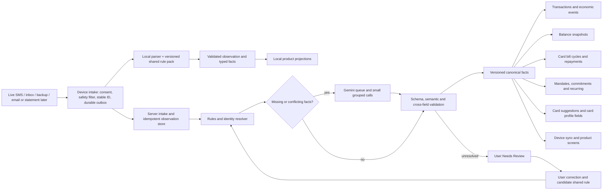

# Unified SMS intelligence: application audit and recommended design

Reviewed 21 October 2026 against the current working tree. This is a design review, not an implemented pipeline. It extends the [three-part plan](sms-ai-three-part-plan.md) and the [transaction classification plan](../TRANSACTION_CLASSIFICATION_PLAN.md).

## Recommendation

Build **one intake and evidence pipeline**, with **separate domain reducers** for transactions, account balances, card bills, card identity, commitments, mandates, and recurring charges. A message can contain several facts: a debit, an available balance, a card suffix, and a bill due date. A single exclusive SMS category would lose some of them. Store facts and their provenance once, then let each reducer update its own projection. Gemini should fill gaps in the facts, not own the ledger or directly write product tables.

## Current application map

| Concern | Current path | Consequence for the new pipeline |
| --- | --- | --- |
| Live and inbox capture | `app/lib/features/sms_import/sms_listener_service.dart`, `sms_inbox_scanner.dart`, `sms_capture_worker.dart` use a transaction-shaped prefilter and local durable intake. | Replace the eligibility question with “is this a potentially useful financial observation?” while retaining OTP/security exclusion. A bill, mandate, balance, or card clue must be eligible even with no purchase. |
| Local extraction | `app/lib/data/local_sms_parser.dart` and `local/sms_import_store.dart` save `sms_observations`, provisional transactions, and some review entries. | Preserve fast offline extraction, but emit multiple typed facts with field provenance and versions. Today one event type and one message confidence constrain multi-purpose SMSs. |
| Server extraction | `api/src/index.js` `/transactions/from-sms` and `/batch` run `sms_parser.js` patterns, then independent due/statement/limit resolvers and `subscription_parser.js` on parse failure. | Move all family extraction behind one orchestration contract. Keep the specialist parsers as deterministic extractors. Make a successful transaction parse compatible with simultaneous bill/mandate/balance facts. |
| Transactions | `api/src/index.js` persists parsed transactions and `transaction_observations`; local provisional rows reconcile with server transactions. | Keep the existing transaction insert and dedupe logic, but feed it only validated posted movement facts and a canonical economic kind. See `TRANSACTION_CLASSIFICATION_PLAN.md` for metrics. |
| Bank balances | `financial_store.dart` derives local bank rows from `sms_observations`; `/account-summaries` derives server rows mainly from `transaction_observations`; `bankAccountSummariesProvider` merges them; Home displays them. | A balance is a timestamped snapshot, never an inferred current ledger total. Both local and server should consume the same balance fact and identity resolution. Preserve “as of SMS time.” |
| Card bills | `cardBillLedgerProvider` reads local bill observations and server transactions; `card_bill_ledger.dart` merges cycles and card repayments; Payments Due displays results. | Preserve cycle and payment reducer. Add bill type, cycle identity, statement total versus current outstanding, amount role, and exact source fact. An unidentified card bill remains reviewable and must not attach by suffix alone when ambiguous. |
| Other bills and commitments | `commitmentsProvider` combines manual commitments with eligible local bill observations, suppresses repeats by category/title/suffix, and requires confidence about 0.85 except a special LIC case. | Keep manual override behavior; give bills a stable provider/account/cycle identity and status transitions. A reminder updates the same obligation; a payment closes or reduces it. |
| Autopay and subscriptions | Local parser labels setup as `localIgnore`; server `subscription_parser.js` can persist a mandate in `recurring_series` when transaction parsing fails; `recurring.js` finds repeated posted charges; Subscriptions reads the recurring report. | Treat mandate authorization, actual charge, and recurring inference as related but distinct facts. A mandate cap is not a bill amount or spend. Cancellation changes mandate status; repeated posted charges provide billing evidence. |
| Card discovery | `find_cards_screen.dart` separately scans SMS bodies through `/card-discovery` or `card_discovery_engine.dart`, then presents suggestions for user addition. | Feed card identity evidence from the common observation store. Keep suggestions separate from owned/confirmed cards; user confirmation still governs wallet addition. |
| Review and admin | `needs_review_repository.dart` stores raw user review on device; `parser_failures` stores redacted admin shapes. | Introduce typed review cases, including bill, account identity, balance and mandate, without exposing raw SMS in admin. Preserve on-device raw context and sync only the allowed correction/fact. |

## Findings that change implementation priority

1. **The gate can hide non-transaction facts.** `sms_listener_service.dart` calls `looksLikeTransactionSms`; the helper includes some due-date words, yet its vocabulary and early rejects are still transaction focused. An autopay-only or balance-only format may never reach durable capture. Test the gate against every message family before AI work.
2. **Local terminal classification can prevent server learning.** `sms_import_store.dart` acknowledges `localIgnore`; `local_sms_parser.dart` uses it for autopay setup and balance-only notices. Therefore the existing server mandate parser, shared telemetry, and future Gemini queue may never see those messages. Distinguish `safe_discard` from `recognized_non_spend_sync` and `needs_more_facts`.
3. **One message-level score is insufficient.** Local bill confidence is a hand-built sum, while other local observations default to 1. These are heuristic scores, not measured probabilities. Use independently calibrated confidence for family, each extracted field, account binding, and posting decision. The decision policy below replaces a universal 80% rule.
4. **User-facing projections do not share one server fact store.** Bank balances use local `sms_observations` plus server transaction observations; card bills and commitments read local observations; recurring series is server driven; discovery scans SMS separately. A Gemini result inserted only into the transaction parser would not update all surfaces.
5. **Account suffix is a weak identity.** Current local grouping uses canonical sender plus last four; server grouping and local/server merge have different rules. Two accounts or a card can share suffixes. Use issuer, instrument type, verified ownership, full source references where available, and a stable internal account ID. Leave ambiguous records unattached.
6. **Bill amount roles need explicit semantics.** `card_bill_ledger.dart` takes the greatest `amountDue` within a cycle and first minimum due. This can work for some reminder sequences, but a message may state statement total, minimum due, remaining outstanding, or already-paid amount. Pick fields by role and observation time, and retain source evidence. Payment matching by time/amount is provisional unless unique.
7. **Current review is transaction/commitment shaped.** `NeedsReviewKind` has two variants. A unified pipeline needs distinct user actions: confirm movement, choose owned account/card, correct bill fields, verify mandate, dismiss a card suggestion, or mark safe noise. Corrections should take precedence over future rule/model reprocessing.
8. **Some plans already specify correct financial invariants.** The transaction classification plan separates observations, account legs and economic events. Reuse it. A card purchase and later card repayment, or two sides of an own transfer, must never double-count spending.

## Canonical data contract

Persist one immutable source envelope per message: `source_id`/dedupe key, user scope, channel, sender identity, received time, optional stated event time and timezone, capture method, consent/retention state, redacted shape, parser/model/rule versions, and processing state. Encrypt any retained raw body; allow independent short retention for Gemini retries and device review. Do not send OTP or security content to Gemini.

Store zero or more **facts** per envelope, each with `fact_id`, type, typed value, unit/currency, role, source span or safe redacted reference, extraction method, field confidence, validation state, and supersession link. Useful fact types include `posted_movement`, `pending_or_failed_attempt`, `balance_snapshot`, `bill_obligation`, `bill_payment`, `mandate_lifecycle`, `recurring_charge`, `card_identity_hint`, `card_profile_hint`, and `non_financial`. A message can emit `posted_movement + balance_snapshot + card_identity_hint` simultaneously.

Resolve facts to user-specific entities: account, card, merchant/biller, bill cycle, mandate, and economic event. Keep entity identity separate from last four digits. Use append-only facts and versioned materialized projections so a corrected parse can rebuild affected screens without duplicate rows. Store a user override at field/entity level; rule upgrades and Gemini reruns cannot replace it silently.

### Domain behavior

| Message scenario | Facts and handling |
| --- | --- |
| “₹500 debited, Avl bal ₹9,000” | Posted debit and balance snapshot. Classify debit economic kind; balance snapshot has its own timestamp. Do not derive balance by subtracting from an older snapshot. |
| Card statement ₹12,000, minimum ₹600, due 5 Nov | Bill obligation linked to exact cycle/card if safe. No new purchase. Keep statement total, minimum and due date separate. |
| Reminder “₹4,000 outstanding” after partial payment | Update current outstanding evidence for the cycle, retaining original statement total and payment ledger. Do not use ₹4,000 as a new statement total. |
| Card repayment from bank | One bank outflow/transfer and one bill settlement relationship; no second consumer spend. If the card is ambiguous, leave settlement attribution pending. |
| Autopay mandate created with ₹10,000 cap | Mandate authorization and ceiling. No purchase, no bill due and no claim that ₹10,000 will be charged. |
| Subscription charge ₹299 | Posted spend, possibly linked to mandate and recurring series. Predict next charge only with sufficiently strong cadence evidence. |
| Bill reminder for electricity/insurance | Commitment obligation, provider/account/cycle identity and due date; no spend until actual payment is observed or user confirms it. |
| Card application/offer or card use alert | Offer is safe noise; actual card use may produce a card identity suggestion. Discovery does not auto-add an owned card. |
| Failed/pending/reversed/refunded attempt | Model lifecycle and links; post only completed movement, reverse or refund its prior economic effect according to the classification plan. |
| Ambiguous account, amount, due date or family | Gemini may propose typed facts; validators reject impossible combinations. Remaining uncertainty creates a specific Needs Review task. |

## Gemini and shared learning

### Final decision policy for scores and marketing

There is **no defensible universal best percentage** before labeling real PandaPay SMSs. The correct threshold depends on the cost of a wrong decision: discarding a real bill is worse than briefly reviewing an extra message; falsely posting a purchase or assigning it to the wrong account changes money views. Google's [classification guidance](https://developers.google.com/machine-learning/crash-course/classification/accuracy-precision-recall) describes the threshold tradeoff between precision and recall. Start with the following **operating policy**, then set numeric thresholds from a held-out labeled corpus and monitor them by sender and message family.

| Decision | Initial gate and behavior | Required measured release target |
| --- | --- | --- |
| OTP, PIN, CVV, verification/security content | Deterministic safety veto before persistence, Gemini, or review. Never treat a bare word `PIN` inside ordinary text as sufficient without context; audit false exclusions. | Zero known sensitive messages sent to Gemini; manually inspect negative fixtures and sampled redacted exclusion counts. |
| Clear promotion/marketing | Discard locally only when a strong offer/call-to-action pattern is present **and** no completed movement, bill, balance, mandate, or card ownership fact is detected. Sender suffix such as `-P` is supporting evidence, never sufficient alone. Keep a privacy-safe exclusion reason/count. | At least **99.9% precision** for auto-discard on the evaluation set, with explicit recall checks for real financial messages. If that target is not met, route ambiguous cases to lightweight classification or review. |
| Financial relevance gate | High-recall, multi-family eligibility. Unknown but bank-like messages enter durable intake; obvious nonfinancial content is excluded. | At least **99.5% recall** for actionable financial families in the held-out corpus. Report recall separately for transactions, balances, bills, mandates and card hints. |
| Automatic posted transaction or economic kind | Require validated status, amount, direction, currency, source identity, duplicate check and calibrated family/field confidence. Target **≥0.99 calibrated probability** for the relevant combined decision; stronger deterministic evidence can satisfy the gate without an ML score. | At least **99.5% precision** for auto-posted transactions and no known double-counting regression. If evidence is weaker, Gemini or Needs Review; no provisional item should affect final financial totals. |
| Card/account binding, bill cycle/amount, due date or mandate state | Require exact role and unambiguous entity; target **≥0.99 calibrated probability** for automatic mutation. For a balance snapshot displayed as tentative with timestamp, a lower gate may be acceptable, but never merge accounts by suffix alone. | At least **99.5% precision** on automatic identity and bill mutations; maintain field-level error rates and abstention counts. |
| Gemini proposal | Gemini can supply candidate facts, not final authority. Apply the same validators and release gates after the model responds. Its self-reported confidence is **not** the calibrated score. | Evaluate model-assisted decisions independently from rule-only decisions; measure precision, recall, abstention and correction rate. |
| Remaining uncertainty | Needs Review with the specific disputed field(s), original context on device, and safe suggested values. An explicit user correction outranks later rules and models. | Every actionable unresolved message remains recoverable; review backlog and false-review rate are monitored. |

The `0.99` operating gates and precision/recall targets are **design targets, not measured claims about the current app**. A small corpus cannot establish 99.9% precision; require enough independent examples and a confidence bound before enabling broad auto-discard. If no calibrated model exists at launch, ship deterministic verified rules plus abstention; do not convert today's heuristic `confidence` or Gemini's number into a probability. Calibrate on a held-out set split by template/sender and time, rather than random copies of near-identical SMSs across training and validation. Inspect a confusion matrix by family, sender, language, mixed-content message, and amount role. Retune thresholds by family only after measuring both false positives and false negatives. Record the policy version alongside each decision so a future threshold change can be audited and replayed.

Marketing needs a **precedence rule**: a real debit SMS may include “get cashback”; a genuine bill may append an offer; and a refund alert may use the word “cashback.” The parser must first search for completed movement and obligations, then classify marketing content. An offer-only message such as “Spend ₹15,000 and get ₹250” has a conditional amount, not a posted spend. A marketing message that is genuinely ambiguous should be excluded from user review only after a safe negative rule or Gemini classification passes validation; otherwise keep it in a low-priority triage state so a real transaction is not lost. Sample redacted auto-discard outcomes for regression review without retaining raw promotions.

Use the [Gemini queue design](sms-gemini-final-architecture.md): deterministic rules first, durable server jobs for unresolved cases, short wait microbatching, per-message result IDs, quota-aware dispatch, bounded retries and Needs Review on persistent uncertainty. Grouping several small SMSs into one call can reduce request pressure, but token use and per-message validation still apply. Google's [rate-limit documentation](https://ai.google.dev/gemini-api/docs/rate-limits) says active limits depend on tier and model, so the dispatcher must read configured limits and live 429/retry information. Google's [Batch API](https://ai.google.dev/gemini-api/docs/batch-api) targets asynchronous bulk work with turnaround up to 24 hours; use it only for historical backfill or evaluation when that latency is acceptable. A single Gemini account is enough for the first implementation. Keep a provider interface for later development fallback without making multi-key quota evasion part of the design.

The model returns a strict versioned JSON proposal with one result per source ID. Server validators check sender/template consistency, amounts and currency, date plausibility, amount roles, financial lifecycle, account ownership, contradictory facts, and schema completeness. Confidence reported by a model is evidence, not a calibrated probability. Calibrate decisions against a labeled, privacy-safe fixture set and measure precision/recall per family and field. For high-impact writes, require stronger evidence or user confirmation.

Learning loop: collect user corrections and admin-approved redacted variants; cluster by normalized sender plus wording structure; infer variable slots (amount, date, suffix, reference) and stable anchors; generate a *candidate* rule; replay it over positives and hard negatives; publish a versioned rule only after measured precision, minimum independent examples, and human approval. A few users can seed useful rules, but four or five examples do not justify automatic global promotion. Distribute the signed rule pack to devices and use the same fixtures against local/server implementations. Keep per-user overrides private; never distribute one user's raw SMS or account details.

## Device/server ownership and privacy

- The **device** owns capture, offline observations, raw context for Needs Review, and locally available projections. It keeps a durable outbox and can apply downloaded approved rules without network access.
- The **server** owns shared rule versions, Gemini dispatch, global quality metrics, canonical synced facts/projections, and account-scoped correction records. The server may retain encrypted raw SMS only for a limited, stated purpose and period, with user deletion and reprocessing behavior defined before rollout.
- Admin sees redacted shapes, rule candidates, status, error codes, quota, latency, validation failures, and aggregate accuracy. Existing `parser_failures` is a redacted admin signal, not a user review store.
- SMS permission and sending content to Gemini require explicit product/privacy review before production distribution. Google Play [restricts SMS permission access](https://support.google.com/googleplay/android-developer/answer/10208820) and [requires declaration/review for sensitive permissions](https://support.google.com/googleplay/android-developer/answer/9214102). This is a release gate, not an assumption that permission is available.

### Decisions confirmed from the 21 October product review

1. **Automatic detection remains the default experience after SMS access is enabled.** Do not add a per-message Gemini approval prompt. The current sign-up flow records terms, crowdsourcing and marketing choices, and onboarding requests Android SMS access, but none of those records is a specific Gemini-processing choice (`login_screen.dart`, `permissions_screen.dart`). Update the SMS setup explanation to say clearly that unresolved financial alerts may be sent to PandaPay's server and an AI processor, state the purpose and retention, and record a versioned processing preference using the existing consent infrastructure. Give the user a later setting to stop AI processing; deterministic on-device detection continues. Do not infer permission to share with Gemini merely from Android's SMS permission or marketing/crowdsourcing consent.
2. **Use the existing Needs Review page.** Extend its item types and actions instead of creating another inbox. Keep raw SMS context on the originating device. When a user confirms a transaction, bill, account match, or dismissal, sync the structured decision and its source ID to the server; the confirmed result can reach other devices through normal account sync. Sync the pending review itself only if the product later requires cross-device review. The screenshot's `VM-HDFCBK-S` transaction-check alert and `VZ-ViCARE-S` call-forwarding alert show why the queue needs a `security_or_service_alert` path: neither should offer “Review transaction.” The Kotak settlement payout needs investment-proceeds/transfer handling rather than default spend or earned income.
3. **Balance is the latest observed snapshot.** Show the amount with the SMS observation date, such as “Balance as of 15 Oct.” Do not infer today’s balance from subsequent transactions or hide a valid older snapshot solely because it is old. Resolve ambiguous account identity before attaching it to an account card.
4. **Bills use automatic detection when validated; uncertainty uses Needs Review.** A clear statement, reminder, or due date follows the normal bill reducer without asking the user. Send the item to the existing review page only when required bill fields or identity fail the calibrated family-specific gate. The review action must say “Review bill” or “Choose card” as appropriate.

**Gemini tier and sanitization:** Google's [Gemini API terms](https://ai.google.dev/gemini-api/terms) say unpaid service inputs and outputs may be used to improve its products, may be reviewed by humans, and should not contain sensitive, confidential or personal information. A masked account suffix does not reveal the full account number by itself, but a complete SMS may still describe one person's financial activity. The free-tier path can be evaluated for development fixtures and for **sanitized templates whose payload passes a tested de-identification gate and terms/privacy review**; the paid tier is the default for unresolved real-user SMSs that need original contextual details. The [pricing page](https://ai.google.dev/gemini-api/docs/pricing) distinguishes free and paid data-use treatment.

Bank SMSs generally arrive with account/card numbers already masked. Treat that as a useful input property, and make the remaining check **automatic and invisible to the user**: inspect each candidate before an unpaid Gemini call for exceptional full identifiers, personal names, phone numbers, UPI IDs, references, URLs and other sensitive content. For the free-tier template path, replace any such values and exact dates/times and amounts with typed placeholders such as `ACCOUNT_A`, `AMOUNT_1`, `DATE_1`, `MERCHANT_A` when the original value is unnecessary for classification. Keep the original values only on the device or PandaPay server. Preserve semantic roles and relations, for example: `Your ACCOUNT_A was debited AMOUNT_1 at MERCHANT_A. Available balance BALANCE_1.` The model returns types and placeholder IDs; the server validates them and joins back to the original values. Do not give Gemini a stable cross-user account token or the original mapping. Test this gate against account/phone/reference formats, names, addresses and mixed-language SMSs; if it cannot safely sanitize a message, skip free-tier Gemini and use paid-tier processing or Needs Review. Sanitization can make merchant/category inference less accurate, so measure that separately. There is no manual redaction step or per-SMS permission prompt.

## Delivery order and acceptance gates

1. **Inventory and baseline:** add labeled fixtures for every table row above, including negative examples; measure current capture eligibility, parser family recall, field accuracy, duplicate count, and screen discrepancies. Document existing user-visible totals and bill states.
2. **Observation contract:** add source/fact IDs, typed amount/date roles, provenance, lifecycle, entity binding and per-field confidence. Adapt local and server parsers to emit it. Preserve existing tables through adapters during migration.
3. **Unified routing:** widen the capture gate; stop terminally acknowledging useful non-spend facts; route all families through specialist deterministic extractors; persist synchronized facts and explicit processing state. Make retries idempotent across inbox, broadcast, backup, and server.
4. **Projection adapters:** transactions/economic metrics first; then balance snapshots, card bill cycles, commitments, mandate/recurring, card suggestions and profile hints. Reconcile local/server results, freshness, conflicts and user overrides. Backfill historical SMS observations by version without blindly changing confirmed records.
5. **Gemini queue:** add the durable queue, grouping, per-item validation, 429 handling, quota pause, and specific Needs Review outcomes. Keep model writes behind the same fact and reducer contracts.
6. **Learning and admin:** collect corrections, create candidate templates, replay against hard negatives, approve/publish signed rule packs, and expose queue and quality monitoring using the existing admin plan.
7. **Rollout:** shadow run old/new paths on fixtures and consenting test users, compare each product projection and financial metric, then enable by family. Stop or roll back a family when false positives, money totals, account binding, or bill attribution regress.

Acceptance checks: no useful SMS disappears at the prefilter or acknowledgement stage; one SMS can update multiple relevant projections; no bill/mandate/balance fact becomes spend; a card payment does not double-count; unknown account identity stays unresolved; stale balances display their timestamp; user corrections survive model/rule upgrades; one repeated SMS produces one source and no duplicate economic event; offline and server results converge after sync; admin can trace a message without revealing raw content.

## Remaining implementation choice

Decide whether PandaPay wants the better context of a billed Gemini project for real-user financial SMSs, or the lower-cost free-tier path restricted to proven de-identified templates. The current app can continue automatic local/rule-based detection and the existing Needs Review flow while this is decided. Define the exact retention window and deletion procedure as part of the consent and server implementation.
